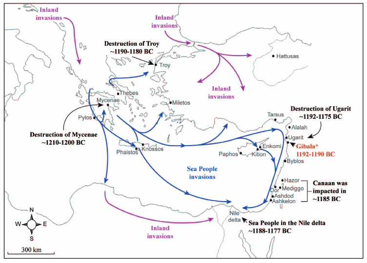
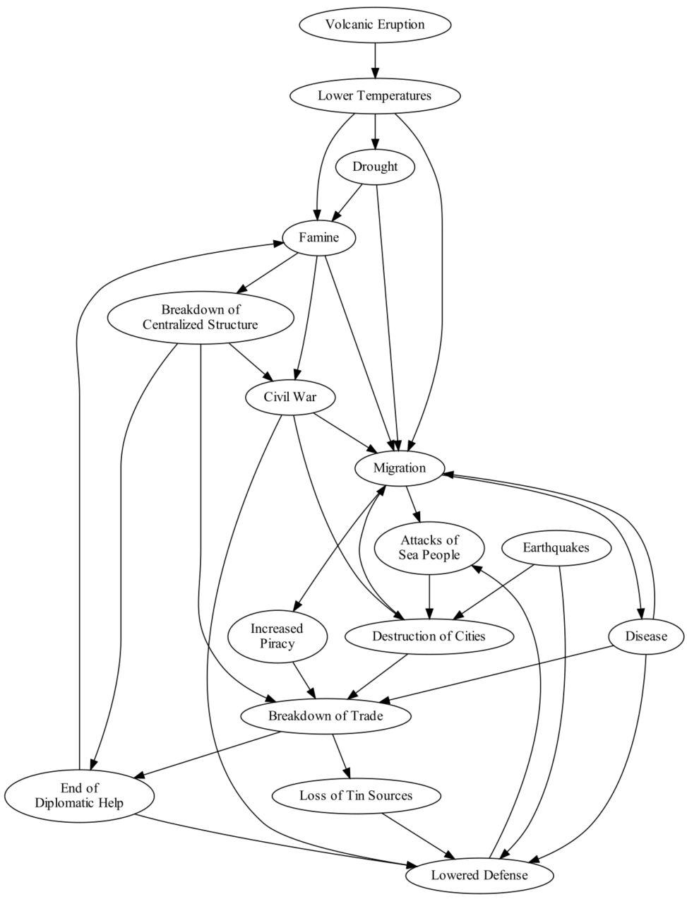

# Das Ende eines Zeitalters
Warum brechen Zivilisationen zusammen? Bei manchen Zusammenbrüchen in der Vergangenheit gibt es ein auffälliges Ereignis, das zu einem schnellen Ende führt, wie die Umweltzerstörung bei den Menschen auf der Osterinsel. Bei anderen Zivilisationen wirken mehrere Ursachen zusammen, wie bei den Maya, deren Schicksal durch Umweltzerstörung, Klimawandel und feindliche Nachbarn besiegelt wurde (Diamond, 2011). Der rätselhafteste Fall, auf den ich gestoßen bin, ist aber der gleichzeitige Zusammenbruch fast aller großen Reiche im Mittelmeerraum während der späten Bronzezeit. In nur etwa 50 Jahren zwischen 1200 und 1150 v. Chr. lösten sich die mykenischen Königreiche und das Hethiterreich auf, Ägypten verlor die Kontrolle über die Levante und brach kurz darauf zusammen. Nur Elam und das Assyrische Reich überlebten einigermaßen intakt. Zur Einordnung: Zu dieser Zeit der Menschheitsgeschichte gab es nicht viele Staaten. Je nachdem, wie man zählt, heißt das, dass die meisten damals existierenden Staaten der Erde entweder zusammenbrachen oder niedergingen. Über China und Indien in der späten Bronzezeit gibt es weniger Daten, aber einige Hinweise deuten darauf hin, dass sie zu einer ähnlichen Zeit ebenfalls zu kämpfen hatten. Das würde daraus eine globale Krise machen, die jeden damals existierenden Staat betraf. Da die Daten aus Indien und China aber sehr dünn sind, konzentriere ich mich auf den Mittelmeerraum, beschreibe mein aktuelles Verständnis des Zusammenbruchs der Bronzezeit und was wir heute daraus lernen könnten.

Was ist also passiert? Das ist immer noch sehr umstritten, und es gibt viele widersprüchliche Theorien, aber ich versuche hier die Geschichte zu erzählen, die mir am wahrscheinlichsten erscheint (ich bin kein Historiker, also nimm das vielleicht mit Vorsicht). Ich habe viele Paper gesehen, die den Zusammenbruch auf nur eine oder wenige Ursachen zurückführen, aber für mich ergab es mehr Sinn, dass im Grunde alle vorgeschlagenen Ursachen zu einem gewissen Grad verantwortlich sind. Ich versuche, ihre Verbindungen im Text und in Abbildung 2 hervorzuheben.

Aus archäologischen Funden wissen wir, dass die meisten Städte der Region gewaltsam zerstört wurden (Abbildung 1). Die Menschen, die diese Städte zerstörten, nennt man meist einfach „Seevölker“. Sie haben diesen vagen Namen, weil sie nicht aus einer einzigen Kultur bestanden. Je nach Ort und Jahr war ihre Zusammensetzung ziemlich unterschiedlich (Burlingame, 2011). Außerdem scheinen sie keine übergeordnete Führungsstruktur gehabt zu haben, und die Angriffe passierten mehr oder weniger zufällig. An der Bewegung ihrer Angriffe sieht man, dass die Seevölker sich grob von Norden nach Süden bewegten, und es scheint, dass sie unterwegs die lokale Bevölkerung entweder vernichteten oder in ihren Zug nach Süden aufnahmen (Carlin, 2019).

Andere Forschung verbindet diese Bewegungen mit einer Dürre, die zu weitverbreiteten Hungersnöten führte (Weiss, 1982) und wahrscheinlich durch eine Abkühlung des Mittelmeers verursacht wurde (Drake, 2012). Dadurch verdunstete weniger Wasser, was zu weniger Niederschlag führte und in Dürre und Hungersnot endete. Das Meer selbst kühlte wegen eines großen Ausbruchs der Hekla auf Island ab (Yurko, 1999), der wahrscheinlich einen vulkanischen Herbst auslöste, der die Temperaturen weltweit senkte und den Himmel verdunkelte (das ist auch die Verbindung zu den Problemen der Zivilisationen in Indien und China).

Abbildung 1: Karte der Invasionen der Seevölker in der Ägäis und im östlichen Mittelmeer am Ende der späten Bronzezeit (blaue Pfeile). Einige der wichtigsten Städte, die von den Überfällen betroffen waren, sind mit historischen Daten markiert. Invasionen im Landesinneren sind mit lila Pfeilen dargestellt. (Quelle: Kaniewski et al., 2011)

# Mögliche Ursachen für den Zusammenbruch

Dieser klimatische Ansatz erklärt aber nicht alles. Die Zivilisationen in diesem Teil der Erde hatten ähnliche Ereignisse schon früher überlebt. Die Zerstörung der minoischen Zivilisation auf Kreta (mitten im östlichen Mittelmeer) wurde zum Beispiel durch einen anderen großen Vulkanausbruch verursacht (Marinatos, 1939). Alle anderen Zivilisationen überlebten aber weitgehend unbeschadet. Das deutet darauf hin, dass auch die Gesellschaftsstruktur eine Rolle spielt. Es gibt Hinweise darauf, dass die Zivilisationen dieser Zeit stark zentralisiert waren, wobei die Hauptstädte und Paläste die gesamte Produktion der umliegenden Höfe und Werkstätten einsammelten (Nakassis et al., 2011). Die so gesammelten Ressourcen wurden dann für den Handel genutzt und um wichtige Unterstützer der herrschenden Klasse zufriedenzustellen. Dieses System hängt aber davon ab, dass die Zentralregierung die Produktion aller anderen einsammeln kann. Genau diese Fähigkeit wurde durch das sich wandelnde Klima gestört. Die Städte im Mittelmeerraum brauchten meistens mehr Nahrung und andere Ressourcen, um sich zu erhalten, als ihre unmittelbare Umgebung liefern konnte. Sie waren also darauf angewiesen, dass die kleineren Städte sie regelmäßig mit Nahrung versorgten. Mit dem Klimawandel brauchten die kleineren Städte die Nahrung, die sie produzierten, selbst und stellten ihre Lieferungen an die Hauptstädte ein (Knitter et al., 2019). Ohne diese Lieferungen hatte die Zentralmacht zwei Probleme auf einmal. Plötzlich fehlten Güter des täglichen Bedarfs, die die Bürger brauchten, aber es fehlten auch wertvolle Handelsgüter. Diese Handelsgüter waren ziemlich wichtig, denn die Staaten dieser Zeit waren in einem riesigen Handelsnetz verbunden, das von Ägypten bis Skandinavien reichte (Varberg et al., 2020). Dieses Handelsnetz war lebenswichtig, weil alle Staaten dieser Zeit Zinn und Kupfer brauchten, um Bronze herzustellen. Kupfer ist relativ häufig und lässt sich an vielen Orten abbauen, große Zinnvorkommen sind dagegen viel seltener. Große Lagerstätten gibt es im heutigen Spanien, im Südwesten Englands und in Afghanistan (Berger et al., 2019). Ohne Handel verliert man also den Zugang zu Zinn und kann keine Bronze mehr schmelzen. Da Bronze besonders für die Herstellung von Waffen und Rüstungen wichtig war, bedeutete ihr Verlust, dass man sich schlechter gegen Eindringlinge verteidigen konnte. Eine weitere wichtige Funktion des Handelsnetzes war, mit den anderen Reichen in Verbindung zu bleiben. Es gibt mehrere Hinweise darauf, dass sich die Reiche in Notfällen mit Nahrung und militärischer Hilfe unterstützten (Burlingame, 2011). Was die Verteidigung noch viel schwerer machte, war eine Serie von Erdbeben, die den Mittelmeerraum zu dieser Zeit traf. Sie zerstörten wahrscheinlich einen Großteil der Befestigungen und Paläste der Region, was die Städte wehrlos und im Chaos zurückließ (Nur and Cline, 2000). All diese Faktoren wurden durch Krankheiten noch verstärkt. Es gibt mehrere Hinweise darauf, dass in dieser Zeit auch eine Art Pandemie wütete. Unklar ist aber, um welche Krankheiten es sich handelte. Wahrscheinliche Kandidaten sind die Beulenpest und die Pocken (Norrie, 2016). Das destabilisierte die Gesellschaft und verringerte die verfügbaren Ressourcen, was zu Migration und schließlich zu Druck auf andere Städte führte. Der letzte beitragende Faktor, den ich gefunden habe, ist Bürgerkrieg. In mehreren Städten wurde nur der Palast niedergebrannt, während der Rest der Stadt unversehrt blieb, was auf einen gewaltsamen Aufstand hindeutet (Carlin, 2019).

All diese Faktoren ergeben ein sehr kompliziertes Bild des Zusammenbruchs der Bronzezeit (Abbildung 2). Es gibt nicht die eine entscheidende Ursache. Jeder Faktor allein hätte wahrscheinlich nicht gereicht, um mehrere bronzezeitliche Reiche zu stürzen. Ihr Zusammenspiel führte aber zu einem schnellen Ende der Bronzezeit, die über Jahrhunderte oder sogar Jahrtausende relativ stabil gewesen war.

Abbildung 2: Zusammenspiel der verschiedenen Faktoren, die zum Zusammenbruch der späten Bronzezeit führten (eigene Abbildung).

# Was das für heute bedeutet

Ich erzähle diese Geschichte, weil sie mich an die aktuelle Lage der Welt erinnert. Viele Faktoren tragen zu einem komplexen System bei, das wir nicht immer tief verstehen oder überblicken. Es ist wirklich schwer, den Zeitpunkt zu bestimmen, ab dem es für ein System zu spät ist, bevor es zusammenbricht. Wann war das Schicksal der Menschen der Bronzezeit besiegelt? Als die Hekla ausbrach? Als die zentralisierte Struktur zusammenbrach? Als kein Zinn mehr zu bekommen war? Die Ursachen, die mir am wahrscheinlichsten erscheinen, sind der Ausbruch der Hekla und die Serie von Erdbeben. Diese beiden Ereignisse lösten eine Art Kettenreaktion aus, indem sie mit der Art zusammenwirkten, wie die damalige Gesellschaft organisiert war. Ein Vulkanausbruch, der eine anders organisierte Gesellschaft getroffen hätte, wäre nicht so verhängnisvoll gewesen, wie der frühere Ausbruch auf Kreta gezeigt hat. Es ist aber fast unmöglich, die Hauptursache zu bestimmen oder auch nur festzustellen, ob es so etwas überhaupt gibt. Das zeigt, wie schwierig es ist, den genauen Kipppunkt eines Systems zu finden.

Es gibt auch Forschung, die zeigt, dass Menschen Schwierigkeiten haben, Kipppunkte zu finden, und dass uns vielleicht sogar die richtigen Techniken dafür fehlen (Dudney and Suding, 2020). Deshalb finde ich, wir sollten bei Kipppunkten in unserer modernen Welt vorsichtiger sein. Am dringendsten scheint das gerade beim Klimawandel. Wir haben viele Kipppunkte in unserem Klimasystem, etwa tauenden Permafrost oder einen schnell absterbenden Regenwald (Lenton et al., 2019). Und obwohl wir sie immer besser verstehen, gibt es noch viele Unbekannte. Aus dem Zusammenbruch der Bronzezeit können wir lernen, dass eine Zivilisation kurz vor ihrer Zerstörung am hellsten strahlen kann (Carlin, 2019). Und in vielerlei Hinsicht war die damalige Zivilisation gar nicht so anders als unsere heutige, etwa mit ihren riesigen Handelsnetzen, der gegenseitigen Abhängigkeit der Staaten und der Notwendigkeit, bestimmte knappe Ressourcen zu beschaffen. Wir haben allerdings auch mehr Ressourcen und mehr Wissen als die Menschen der Bronzezeit. Außerdem sind wir viel stärker vernetzt und besser gerüstet, um uns gegenseitig zu helfen. Trotzdem sollten wir nicht zu selbstsicher sein, denn die Menschen der Bronzezeit dachten vielleicht auch, sie hätten alles im Griff, kurz bevor die Katastrophe kam.

Stell dir eine Frau vor, die 1230 v. Chr. in Ugarit geboren wurde, einer wohlhabenden Stadt im riesigen Hethiterreich. Alles scheint gut zu laufen. Die Zisternen und Kornspeicher sind voll, Waren und Menschen aus der ganzen bekannten Welt kommen regelmäßig in die Stadt, und ein überraschend großer Teil der Bevölkerung kann schreiben. Jetzt spul 80 Jahre vor, ins Jahr 1150 v. Chr. Ugarit ist eine geschwärzte Ruine, das Hethiterreich existiert einfach nicht mehr, alle, die sie kannte, sind an Krankheit, Krieg und Hunger gestorben, und die Sonne ist seit Jahren nicht mehr durch die grauen Wolken gedrungen.

Ich hoffe, wir können unserer heutigen Zivilisation so ein Schicksal ersparen.

# Danksagung

Danke an Jan Wittenbecher, Peter Ruschhaupt, Lutz Breuer, Matteo Trevisan und Luise Wolf fürs Korrekturlesen und wertvolle Kommentare!

# Zitieren
Bitte das englische Original zitieren:

Jehn, F. U. (2023, January 14). The end of the Bronze Age as an example of a sudden collapse of civilization. Existential Crunch. [https://doi.org/10.59350/6gej8-4xt50](https://doi.org/10.59350/6gej8-4xt50)

# Quellen

* Berger, D., Soles, J. S., Giumlia-Mair, A. R., Brügmann, G., Galili, E., Lockhoff, N. and Pernicka, E.: Isotope systematics and chemical composition of tin ingots from Mochlos (Crete) and other Late Bronze Age sites in the eastern Mediterranean Sea: An ultimate key to tin provenance?, edited by A. Zerboni, PLoS ONE, 14(6), e0218326, doi:10.1371/journal.pone.0218326, 2019.
* Burlingame, K.: Forces of Destruction: The Collapse of the Mediterranean Bronze Age, Bachelor Thesis, Pennsylvania State University., 2011.
* Carlin, D.: Chapter 3: The End of the World as They Knew It, in The end is always near: apocalyptic moments, from the Bronze Age collapse to nuclear near misses, HarperCollins Publishers, New York, NY., 2019.
* Diamond, J. M.: in Collapse: how societies choose to fail or survive, Penguin Books, New York, NY., 2011.
* Drake, B. L.: The influence of climatic change on the Late Bronze Age Collapse and the Greek Dark Ages, Journal of Archaeological Science, 39(6), 1862–1870, doi:10.1016/j.jas.2012.01.029, 2012.
* Dudney, J. and Suding, K. N.: The elusive search for tipping points, Nat Ecol Evol, doi:10.1038/s41559-020-1273-8, 2020.
* Kaniewski, D., Van Campo, E., Van Lerberghe, K., Boiy, T., Vansteenhuyse, K., Jans, G., Nys, K., Weiss, H., Morhange, C., Otto, T. and Bretschneider, J.: The Sea Peoples, from Cuneiform Tablets to Carbon Dating, edited by K. Hardy, PLoS ONE, 6(6), e20232, doi:10.1371/journal.pone.0020232, 2011.
* Knitter, D., Günther, G., Hamer, W. B., Keßler, T., Seguin, J., Unkel, I., Weiberg, E., Duttmann, R. and Nakoinz, O.: Land use patterns and climate change—a modeled scenario of the Late Bronze Age in Southern Greece, Environ. Res. Lett., 14(12), 125003, doi:10.1088/1748-9326/ab5126, 2019.
* Lenton, T. M., Rockström, J., Gaffney, O., Rahmstorf, S., Richardson, K., Steffen, W. and Schellnhuber, H. J.: Climate tipping points — too risky to bet against, Nature, 575(7784), 592–595, doi:10.1038/d41586-019-03595-0, 2019.
* Marinatos, S.: The Volcanic Destruction of Minoan Crete, Antiquity, 13(52), 425–439, doi:10.1017/S0003598X00028088, 1939.
* Nakassis, D., Parkinson, W. A. and Galaty, M. L.: Redistribution in Aegean Palatial Societies Redistributive Economies from a Theoretical and Cross-Cultural Perspective, American Journal of Archaeology, 115(2), 177–184, doi:10.3764/aja.115.2.177, 2011.
* Norrie, P.: How Disease Affected the End of the Bronze Age, in A History of Disease in Ancient Times: More Lethal than War, edited by P. Norrie, pp. 61–101, Springer International Publishing, Cham., 2016.
* Nur, A. and Cline, E. H.: Poseidon’s Horses: Plate Tectonics and Earthquake Storms in the Late Bronze Age Aegean and Eastern Mediterranean, Journal of Archaeological Science, 27(1), 43–63, doi:10.1006/jasc.1999.0431, 2000.
* Varberg, J., Kaul, F. and Gratuze, B.: Bronze Age Glass and Amber Evidence of Bronze Age long distance exchange, Adoranten, (2019), 5–29, 2020.
* Weiss, H.: The decline of Late Bronze Age civilization as a possible response to climatic change, Climatic Change, 4(2), 173–198, 1982.
* Yurko, F. J.: End of the Late Bronze Age and other crisis periods: a volcanic cause?, in Gold of praise: studies on ancient Egypt in honor of Edward F. Wente, edited by E. F. Wente, E. Teeter, and J. A. Larson, Oriental Institute of the University of Chicago, Chicago, Ill., 1999.
