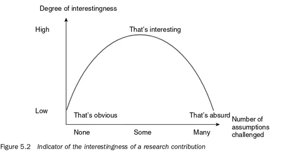

*Fast alle Forschenden nutzen „Gap-Spotting“, also die Suche nach Lücken, ein Vorgehen, das nur langweilige Forschungsfragen hervorbringt*

Normalerweise lese ich kein Sachbuch in zwei Tagen durch, aber dieses konnte ich nicht weglegen. In den letzten Monaten ist mir aufgefallen, dass ich, um ein besserer Forscher zu werden, vor allem mehr und bessere Forschungsfragen finden muss. Als ich mich aber umgesehen habe, fand ich kaum Material dazu, das mehr bietet als uninspirierte Checklisten. Zufällig bin ich auf „Constructing Research Questions: Doing Interesting Research“ von Mats Alvesson und Jörgen Sandberg gestoßen, und ich bin froh darüber.

Das Buch erzählt seine Geschichten etwas parallel, aber es gibt vier Hauptthemen, die die Autoren untersuchen:

* Wie kann man Forschungsfragen einordnen?
* Fast alle Forschenden nutzen Gap-Spotting, ein Vorgehen, das nur langweilige Forschungsfragen hervorbringt
* Wie findet man relevantere Forschungsfragen? Stattdessen Annahmen hinterfragen!
* Warum nutzen Wissenschaftler Gap-Spotting so viel, obwohl es langweiligere Forschung hervorbringt?

Der Fokus des Buchs liegt auf den Sozialwissenschaften. Nach meiner Erfahrung in einer Reihe anderer Forschungsfelder sind diese Probleme aber auch in Feldern akut, die weit von den Sozialwissenschaften entfernt sind. Deshalb behandle ich hier alles als allgemeinen Kommentar zur Wissenschaft. Ich wäre aber neugierig, ob es Felder gibt, die nicht unter den hier beschriebenen Problemen leiden.

Ich finde die Einordnung von Forschungsfragen den am wenigsten interessanten Teil des Buchs (trotzdem interessant), deshalb überspringe ich ihn und konzentriere mich auf die würzigen Teile.

Gut, gehen wir das Schritt für Schritt durch.

# Fast alle Forschenden nutzen Gap-Spotting, ein Vorgehen, das nur langweilige Forschungsfragen hervorbringt

Die zentrale Behauptung, mit der die Geschichte beginnt: Wir haben heute mehr Forschung als je zuvor, aber interessante und einflussreiche Paper sind weniger geworden, nicht mehr. Dafür muss es einen Grund geben, und die Autoren schlagen vor, dass Forschende heute vor allem auf Gap-Spotting setzen, um Forschungsfragen zu finden. Gap-Spotting heißt, dass Forschende ihre Paper damit beginnen, irgendwo in der wissenschaftlichen Literatur eine Lücke zu identifizieren, und die Existenz ihrer Studie dann damit rechtfertigen, dass sie diese Lücke füllt. Alvesson und Sandberg untermauern das mit einer empirischen Studie. Sie haben eine Stichprobe von über 100 Papern gesammelt und genau geprüft, wie sie ihre Forschungsfrage rechtfertigen. Fast alle nutzten Gap-Spotting! Sie fanden auch, dass Gap-Spotting in verschiedenen Geschmacksrichtungen daherkommt:

* Verwirrung finden: „Die Literatur hat konkurrierende Erklärungen für X, und meine Studie zeigt, welche stimmt.“
* Vernachlässigung finden: „Es gibt keine gute Forschung zu X. Meine Studie füllt dieses Loch.“
* Anwendung finden: „Technik X könnte gut für Y sein, und ich habe das getestet.“

Nachdem du diese Beschreibungen gelesen hast, fühlst du dich wahrscheinlich ertappt. Mir ging es jedenfalls so. Die meiste Forschung, die ich bisher geschrieben habe, nutzt genau diese Muster, um zu erklären, warum ich eine bestimmte Forschungsfrage verfolge. Und wenn ich mich umschaue, erklären die Leute, die ich kenne, ihre Forschung auch so. Oft wird Leuten sogar genau so beigebracht, wie man überhaupt Forschungsfragen findet.

Gut, wir wissen jetzt, dass Gap-Spotting der häufigste Weg ist, auf Forschungsfragen zu kommen. Es gibt aber auch andere Wege:

* Kritische Konfrontation: „X ist Mist, und ich sage dir, warum.“
* Neue Idee: „X ist neu und toll, und ich erzähle dir alles darüber.“
* Problematisierung: „Ich stelle X infrage, indem ich zeige, dass die zugrunde liegenden Annahmen nicht stimmen, und lege neue Annahmen vor, die X besser erklären oder sogar zeigen, dass X allgemein kein nützliches Konzept / keine nützliche Theorie / Idee ist.“

Dass Gap-Spotting so verbreitet ist, wird zum Problem, wenn die daraus entstehenden Forschungsfragen nicht relevant und interessant sind. Das mag subjektiv klingen, aber man kann tatsächlich Eigenschaften finden, die wichtige und einflussreiche Studien gemeinsam haben. Wissenschaftler bewerten eine Studie als relevant und interessant, wenn sie die Annahmen einer etablierten Theorie infrage stellt. Studien, die das tun, werden häufiger zitiert als Studien, die es nicht tun. Das Problem: Gap-Spotting produziert bestenfalls inkrementelle Ergänzungen und hat gute Chancen, einfach Lücken in der Literatur zu füllen, die niemanden interessieren. Wenn ich im aktuellen Paradigma nach einer Lücke suche, ist es unwahrscheinlich, dass die daraus entstehende Studie das Paradigma selbst infrage stellt.

Wir sehen also: Die meisten Studien nutzen Gap-Spotting, und Gap-Spotting produziert vor allem Studien, die andere Wissenschaftler nicht so interessant finden. Gibt es einen besseren Weg, den wir stattdessen nutzen sollten? Laut Alvesson und Sandberg ja: Problematisierung!

# Wie findet man relevantere Forschungsfragen? Stattdessen Annahmen hinterfragen!

Bevor sie überhaupt darüber reden, wie man bessere Forschungsfragen findet, hämmern die Autoren einen Punkt immer wieder ein: Du musst mehr lesen! Wenn du glaubst, dass du genug liest, lies mehr! Wenn du glaubst, dass du zu viel liest, stimmt das nicht, lies lieber mehr. Die Literatur zu kennen und zu verstehen ist die Grundlage, um neue Forschungsfragen zu finden. Ohne dieses solide Fundament ist es egal, wie dein Vorgehen bei der Suche nach Fragen aussieht, es kommt so oder so nichts Lohnendes heraus. Das heißt nicht, dass man jedes obskure Paper lesen muss, das man finden kann. Konzentrier dich stattdessen auf die wichtigsten Werke in deinem Teilgebiet, aber lies auch in benachbarten oder sogar weit entfernten Feldern. So gewinnst du neue Perspektiven, und die sind nützlich, wenn es darum geht, die eigentlichen Forschungsfragen zu finden.

Wie wir oben gesehen haben, geht es bei der Problematisierung darum, die zugrunde liegenden Annahmen etablierter Theorien infrage zu stellen. Dafür schlagen Alvesson und Sandberg eine Reihe von Schritten vor. Sie betonen, dass das kein linearer Prozess sein soll. Man muss jeden Schritt mehrmals durchgehen, um auf interessante und relevante Forschungsfragen zu kommen. Die Schritte sind:

1. Ein Literaturfeld bestimmen: Der Schlüssel ist hier, die einflussreichsten Studien zu dem Thema zu finden, das einen interessiert. Sie enthalten die wichtigsten Annahmen. Man muss aber auch in der umgebenden Literatur auf dem Laufenden sein, um sicherzugehen, dass die Annahmen nicht schon von jemand anderem infrage gestellt wurden.

2. Die Annahmen identifizieren und ausformulieren: Normalerweise werden die Annahmen nicht klar dargelegt, also müssen wir sie ausgraben. Außerdem gibt es Annahmen auf verschiedenen Ebenen. Das reicht von gemeinsamen Annahmen darüber, was eine bestimmte Methode kann, bis zu den grundlegenden Annahmen eines ganzen Forschungsfelds. Je größer die Annahme, die wir ausgraben wollen, desto weiter müssen wir uns vom Feld entfernen. Das gibt uns den Abstand und die Perspektive, die wir brauchen, um die Annahmen zu finden. Hier hilft breites Wissen über andere Felder, weil es zeigt, wie man Konzepte anders definieren könnte, und die zugrunde liegenden Annahmen ins Rampenlicht rückt.

3. Die ausformulierten Annahmen bewerten: Wenn man die Annahmen identifiziert hat, ist es Zeit, sie im Detail auszuformulieren. Man weiß, dass man die richtigen Annahmen zum Infragestellen gefunden hat, wenn andere Forschende sagen: „Das ist interessant!“, wenn man mit ihnen darüber spricht. In diesem Schritt muss man auch entscheiden, welche der gefundenen Annahmen man weiter untersuchen will. Dabei sollte man beachten: a) die Reichweite (größer ist besser), b) ob man alternative Annahmen entwickeln kann, c) wie wichtig es für die Gesellschaft ist, diese Annahme infrage zu stellen.

4. Alternative Annahmen entwickeln: Wenn man sich für Annahmen entschieden hat, die man infrage stellen will, muss man alternative Annahmen finden, die die Welt besser erklären. Wichtig ist, dass man wirklich offen für neue Annahmen ist. Man will vermeiden, nur die eigenen Vorurteile zu reproduzieren. Dabei hilft es, a) Quellen außerhalb des Felds zu lesen, b) die ursprünglichen Annahmen einfach umzudrehen, c) mit Leuten zu reden, die andere Annahmen haben als man selbst.

5. Die Annahmen auf das Publikum beziehen: Bevor man Annahmen infrage stellt, muss man prüfen, ob die Leute sie überhaupt haben. Wäre ziemlich blöd, wenn man Annahmen infrage stellt, die niemand hat. Außerdem muss man überlegen, welche Folgen es für das Publikum und die Gesellschaft haben könnte, wenn die Annahmen erfolgreich infrage gestellt werden.

6. Die entwickelten alternativen Annahmen in ihrer Gesamtheit bewerten: Wenn man die ersten 5 Schritte abgeschlossen hat, muss man prüfen, wo die eigene Sammlung alternativer Annahmen auf dieser Grafik landet:

Wenn man zu wenige Annahmen infrage stellt, tun die Leute es als offensichtlich ab. Wenn man aber zu viele infrage stellt, haben die Leute das Gefühl, man wolle zu viel beweisen, und halten es einfach für absurd. Man will den Sweet Spot treffen, an dem die Leute die alternativen Annahmen lesen und als Erstes denken: „Das ist interessant!“.

# Beispiel

Schauen wir uns ein kurzes Beispiel an. Es ist nicht ausgearbeitet, weil das ein eigenes großes akademisches Projekt wäre, sondern soll nur das Vorgehen veranschaulichen:

1. Ein Literaturfeld bestimmen: Eine wegweisende Studie für das Feld der Progress Studies ist „Are ideas getting harder to find?“ von Bloom et al. (2020). Sie zeigt, dass wir pro Ressourceneinheit, die wir in die Wissenschaft stecken, immer weniger Ideen haben.
2. Die Annahmen identifizieren und ausformulieren: Die zentrale Annahme dieser Studie (und der Progress Studies allgemein) ist: Wir haben weniger Ideen, weil Ideen schwerer zu finden sind, je weiter wir die Wissenschaft erkunden.
3. Die ausformulierten Annahmen bewerten: Wenn man diese Annahme erfolgreich infrage stellen könnte, wäre das in großem Maßstab und auch relevant für die Gesellschaft, weil es ziemlich viel bewirken würde, wenn wir einfach einen Weg fänden, wieder mehr Ideen pro Einheit Forschungsaufwand zu haben.
4. Eine alternative Grundannahme entwickeln: Das Buch, um das es in dieser Rezension geht, bietet eine alternative Erklärung dafür, dass wir weniger Ideen pro Einheit Forschungsaufwand haben. Vielleicht ist der wahre Grund, dass Gap-Spotting früher viel seltener war und das Tempo der Forschung nur nachgelassen hat, weil Forschende immer mehr auf Gap-Spotting setzen, was sie zu weniger relevanten Forschungsfragen führt.
5. Die Annahmen auf das Publikum beziehen: Diesen Schritt habe ich nicht wirklich gemacht, weil das nur ein Beispiel ist. Ich bin aber ziemlich zuversichtlich, dass Leute in den Progress Studies die oben genannte Annahme haben und mir das sagen würden, wenn ich mit ihnen darüber spräche.
6. Die entwickelten alternativen Annahmen in ihrer Gesamtheit bewerten: Ich bin ziemlich optimistisch, dass diese alternative Annahme im Bereich „Das ist interessant!“ landen würde. Sie stellt nicht so viel infrage, dass sie absurd wird, aber sie stellt eine so grundlegende Annahme der Progress Studies infrage, dass sie wohl kaum als offensichtlich gilt.

# Warum nutzen Wissenschaftler Gap-Spotting so viel, obwohl es langweiligere Forschung hervorbringt?

Wir haben gesehen, dass viel Forschung ineffektiv betrieben wird, obwohl vielversprechende Alternativen da sind. Das ist besonders verwirrend, weil es klare Belege dafür gibt, dass Studien, die Annahmen infrage stellen, häufiger zitiert werden und weithin als interessanter und einflussreicher gelten als Gap-Spotting-Forschung. Warum konzentrieren sich Forschende nicht darauf, solche einflussreiche Forschung zu produzieren? Alvesson und Sandberg schlagen einige mögliche Erklärungen vor:

## Institutionelle Bedingungen

Wissenschaftler werden immer mehr danach bewertet, ob sie in Zeitschriften mit hohem Impact veröffentlicht haben. Zeitschriften betonen gern, dass man klar machen muss, inwiefern die eingereichte Studie die aktuelle Wissenschaft ergänzt. Das heißt, dass es wahrscheinlich schwerer ist, Studien zu veröffentlichen, die liebgewonnene Annahmen infrage stellen. Da Wissenschaftler veröffentlichen müssen, um Karriere zu machen, konzentrieren sie sich auf die einfachere Gap-Spotting-Forschung.

## Berufliche Normen in der Wissenschaft

Wissenschaftler konzentrieren sich immer mehr auf winzige Teilgebiete. Wenn man aber tief in einem bestimmten Teilgebiet steckt, wird es unwahrscheinlicher, dass man paradigmensprengende Forschung in großem Maßstab produziert. Außerdem bewegt sich Forschung, die für die Gesellschaft relevant ist, oft über Disziplingrenzen hinweg. Das ist für jemanden, der nur ein Nischenthema kennt, schwieriger. Ein weiterer Punkt, den Alvesson und Sandberg kritisieren, ist, dass Autoren meist alle Änderungen umsetzen müssen, die Gutachter vorschlagen. Das bringt Autoren dazu, möglichst wenig Angriffsfläche in ihrem Entwurf zu bieten. Das Infragestellen einer wichtigen Annahme lässt sich leicht kritisieren und wird deshalb weggelassen.

## Persönlichkeit der Forschenden

Gap-Spotting hat sich mit der Zeit immer mehr verfestigt. Viele Leute kennen es als einzigen Weg, auf neue Forschungsfragen zu kommen. Das kann dazu führen, dass sie denken, das sei der einzig richtige Weg, Wissenschaft zu betreiben, und andere Ansätze müsse man ablehnen.

# Aufruf zum Handeln

Das Buch endet mit einem Aufruf an alle Forschenden. Man könnte die aktuelle Situation so deuten, dass Wissenschaftler in einem System gefangen sind, das sie zu unkreativer Forschung zwingt. Man könnte sich die Wissenschaft aber auch anschauen und sehen, dass alle Entscheidungen von Forschenden selbst getroffen werden. Wer begutachtet Paper? Forschende. Wer trifft redaktionelle Entscheidungen? Forschende. Wer entscheidet, welche Projekte gefördert werden? Forschende. Wer entscheidet, welcher Forschungsfrage man nachgeht? Forschende.

Wir schaffen dieses System selbst, also sind wir auch diejenigen, die sich daraus befreien müssen. Hör auf, dich nur auf Paper zu konzentrieren, es gibt auch andere wichtige wissenschaftliche Beiträge. Lehne mehr Paper ab, wenn sie nur Lücken füllen, die niemanden interessieren. Mach jüngeren Wissenschaftlern klar, dass es wichtig ist, Fragen zu untersuchen, die über das Füllen von Lücken hinausgehen. Erweitere deinen Horizont, um interdisziplinär arbeiten zu können.

Werde ein innovativer Forscher, nicht für deine Karriere, sondern weil es das Richtige ist.

# Danksagung
Danke an Ekaterina Ilin und Peter Ruschhaupt für wertvolles Feedback zu diesem Beitrag.

# Zitieren
Bitte das englische Original zitieren:

Jehn, F. U. (2023, February 3). Against the dominance of gap-spotting in research. Existential Crunch. [https://doi.org/10.59350/cwhhx-cp072](https://doi.org/10.59350/cwhhx-cp072)
