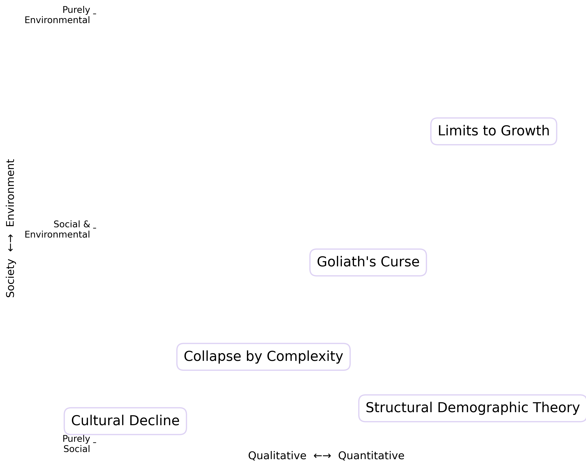
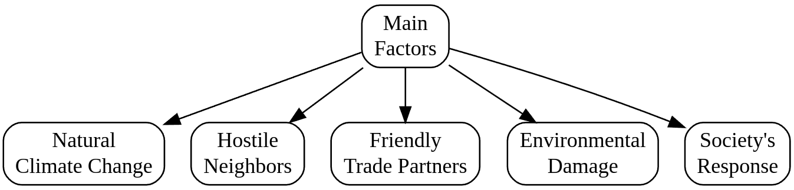
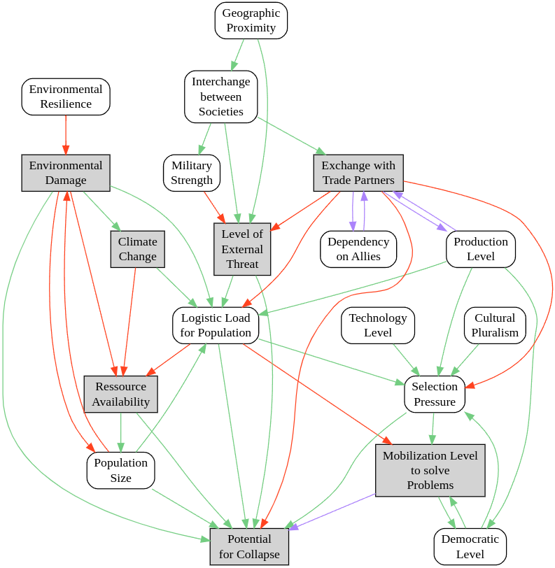
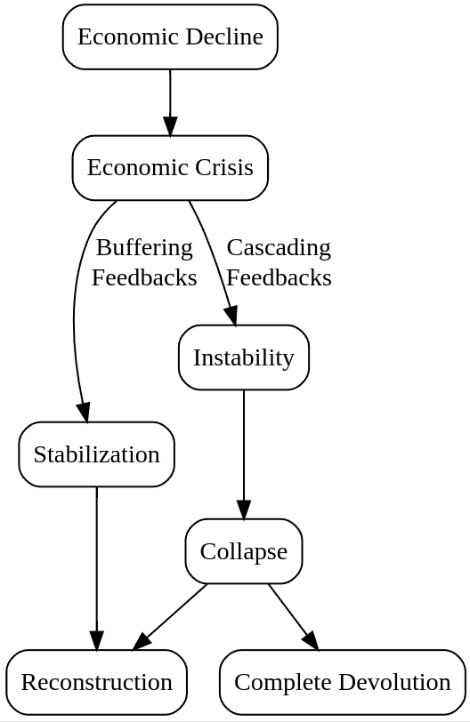
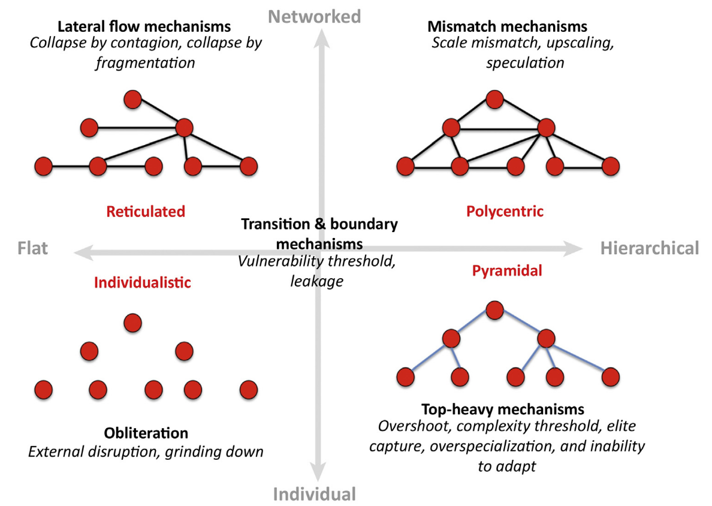
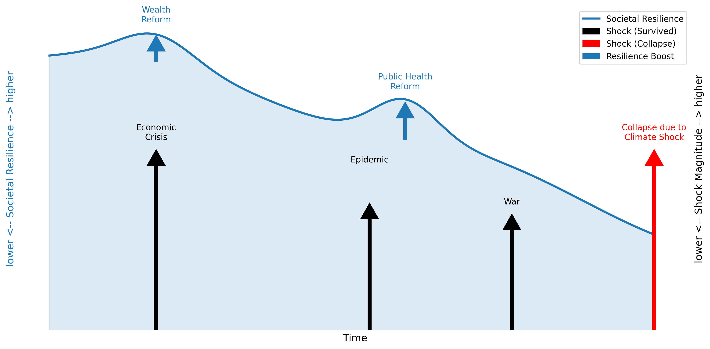

Gesellschaftlichen Kollaps gibt es seit der Agrarrevolution, aber erst in der Aufklärung bekamen Menschen die Mittel, diese Katastrophen systematisch zu verstehen. Diese Forschungsrichtung geht bis heute weiter, und in diesem Beitrag kartiere ich, wie sich das Feld der Kollapsforschung über die Zeit entwickelt hat, welche Schulen es gibt (Abbildung 1) und welche Faktoren sie als Ursachen für Kollaps betonen. Vieles davon beruht auf Brozović (2023), der eine beeindruckende Menge an Kollapsforschung gelesen und zusammengefasst hat. Wir schauen uns zuerst die verschiedenen Schulen der Kollapsforschung grob in chronologischer Reihenfolge an. Diese Schulen kann man auch als Vertreter dafür sehen, wie wir allgemein über Kollaps denken sollten. Nach der Vorstellung dieser großen Schulen nutzen wir sie als Brille, um zwei wichtige Fragen anzugehen: Was ist überhaupt ein Kollaps? Und was verursacht ihn?

Abbildung 1: Schulen der Kollapsforschung.

### Traditionelle Theorien der kulturellen Evolution

*„Kulturen steigen durch Härte auf und gehen durch Dekadenz unter“*

In dieser Schule werden Kulturen als Organismen gesehen. Sie entwickeln sich und passen sich an, und wenn ihnen das nicht gelingt, sterben sie. Vieles davon beruht ursprünglich auf dem Hauptwerk von Edward Gibbon, „Verfall und Untergang des Römischen Imperiums“. In diesem Werk untersucht Gibbon, was das Ende des Römischen Reichs verursacht haben könnte. Ihm zufolge hörte das Römische Reich (und damit möglicherweise auch andere Kulturen) vor allem deshalb auf zu existieren, weil seine Bürger durch Dekadenz ihre Bürgertugenden verloren.

Seine Ideen waren sehr einflussreich für die Kollapsforschung und dafür, wie Kollaps allgemein gesehen wird. Spenglers „Der Untergang des Abendlandes“ argumentierte zum Beispiel, dass „der Westen“ vor dem Ersten Weltkrieg seinen Höhepunkt erreicht habe und danach zerbröckeln werde, weil er seine alten Wege verloren habe. Heute gilt diese Sicht auf Kollaps aber als widerlegt, weil sie zu vereinfacht ist und bestimmte Kulturen oft als von Natur aus wertvoller als andere festschreibt. Trotzdem sind diese Ideen tief verwurzelt, vor allem in westlichen, konservativen Kreisen. Dort werden sie zum Beispiel genutzt, um Migranten als Zerstörer der Kultur darzustellen, die den Untergang der Zivilisation herbeiführen würden, indem sie die Werte der Aufklärung untergraben.

### Grenzen des Wachstums

*„Menschen werden immer versuchen, alle verfügbaren Ressourcen zu verbrauchen“*

Grenzen des Wachstums ist die Idee, dass die Erde eine feste Tragfähigkeit hat, die sie langfristig aushalten kann. Diese Denkweise hat im Lauf der Zeit mehrere Wandlungen durchgemacht. Die erste Variante dieser Sicht ist das Konzept der Malthusianischen Falle, das zuerst von Thomas Malthus 1798 entwickelt wurde. Die Grundidee der Malthusianischen Falle ist, dass arme Menschen immer so viele Kinder bekommen, wie die Ressourcen der Gesellschaft tragen können, sodass die verfügbaren Ressourcen als strenger Regulator der Gesamtbevölkerung wirken, möglicherweise über Hungersnöte und andere Katastrophen (siehe [einen früheren Beitrag hier für eine genauere Erklärung](https://existentialcrunch.substack.com/p/escaping-the-malthusian-trap)). Diese Idee erlebte in den 1960er-Jahren in den USA rund um das Buch „Die Bevölkerungsbombe“ von Paul Ehrlich ein Comeback, aber das schnell sinkende Bevölkerungswachstum im 20. Jahrhundert hat gezeigt, dass sie für postindustrielle Zivilisationen nicht stimmt.

Die Idee der Malthusianischen Falle lebt heute in den Ideen der Grenzen des Wachstums des Club of Rome (Meadows et al., 1974), im Konzept der sogenannten planetaren Grenzen (Rockström et al., 2009) und in der Degrowth-Bewegung weiter. Planetare Grenzen sind als Teile des Erdsystems definiert, die innerhalb bestimmter Grenzen bleiben müssen, damit dieser Planet langfristig bewohnbar bleibt. Die zugrunde liegende Annahme ist, dass sich die menschliche Zivilisation in einem stabilen Fenster von Umweltbedingungen im Holozän entwickelt hat und deshalb daran angepasst ist. Jede Überschreitung dieser Bedingungen könnte zum Kollaps führen, weil die Menschheit nicht an die Umwelt außerhalb davon angepasst ist.

Wie starr diese Grenzen sind und wie viel sie zu einem Kollaps beitragen könnten, ist heftig umstritten. Kareiva & Carranza (2018) argumentieren zum Beispiel, dass von allen planetaren Grenzen nur der Klimawandel einen klaren Weg zu einem möglichen Kollaps hat, während Cernev (2022) Szenarien untersucht, in denen auch andere überschrittene planetare Grenzen zu einer höheren Chance auf einen globalen Kollaps führen könnten. Manche argumentieren, dass der Weg von exponentiellem Wachstum zum Kollaps für jede Art von Zivilisation typisch ist, selbst für außerirdische (siehe [hier für eine ausführlichere Erklärung](https://existentialcrunch.substack.com/p/the-universal-anthropocene)).

### Kollaps durch Komplexität

*„Gesellschaften werden immer komplexer, aber irgendwann lässt sich die Komplexität nicht mehr tragen“*

In der Komplexitätssicht auf Kollaps (eingeführt von Joseph Tainter, 1988) müssen Gesellschaften ständig Probleme lösen (zum Beispiel, wie sie mehr Essen für ihre Bürger bereitstellen). Diese Probleme entstehen aus dem Zusammenspiel einer Gesellschaft mit ihrer Umwelt und aus ihrer inneren Dynamik. Die zentrale Annahme ist, dass jede gefundene Lösung die Komplexität der Gesellschaft erhöht und damit die Energie, die sie braucht, um sich zu erhalten. Das Problem ist, dass Gesellschaften normalerweise nur komplexer werden können. Frühere Lösungen müssen dauerhaft erhalten werden, während neue Probleme neue und zusätzliche Lösungen brauchen. Nimm zum Beispiel eine Kanalisation. Sie verhindert, dass Menschen ihre Fäkalien einfach auf die Straße kippen, aber man kann Abwasser nicht „lösen“. Stattdessen hat man ein sehr komplexes Abwassersystem, das man ständig überwachen, reparieren und erweitern muss.

Tainter argumentiert außerdem, dass Probleme entstehen, wenn der Energieertrag auf die Investition sinkt, womit er meint, dass man immer mehr Energie investieren muss, um neue Energie zu bekommen. Das passiert, weil Gesellschaften mit der am leichtesten zugänglichen Energie anfangen, und wenn diese Energiequelle aufgebraucht ist, sind die nächsten Energiequellen zwangsläufig schwerer zugänglich. Eine Gesellschaft bricht an dem Punkt zusammen, an dem ihr die Energie fehlt, um die Komplexität zu erhalten, die sie angehäuft hat (Brozović, 2023).

Diese Theorie gilt als die kompakteste Kollapstheorie, weil man sie auf jede Gesellschaft anwenden kann, ohne Anpassungen machen zu müssen (Brozović, 2023).

### Strukturell-demografische Theorie

*„Geschichte besteht aus wiederkehrenden Mustern, und wir können sie messen“*

Wenn traditionelle Theorien der kulturellen Evolution eine erzählende Art der Kollapsforschung sind, ist die strukturell-demografische Theorie das Gegenteil und versucht, so quantitativ wie möglich zu sein. Der wichtigste Vertreter dieser Art von Geschichte, Peter Turchin, nutzt mathematische Modelle, die auf umfangreichen historischen Daten beruhen, um gesellschaftliche Dynamiken in der Vergangenheit zu untersuchen. Daraus sind einige sehr beeindruckende historische Datensätze entstanden (Turchin et al., 2023), mit denen man bestimmte Hypothesen testen kann. Eines der wichtigsten Ergebnisse dieses Forschungsfelds sind die sogenannten säkularen Zyklen (Turchin & Nefedov, 2009).

Säkulare Zyklen beschreiben ein wiederkehrendes Muster in der Geschichte. Es beginnt mit einer wachsenden Bevölkerung, die auch Raum zum Wachsen hat. Das Wachstum führt zu mehr Ressourcen für alle, was insgesamt zu einer kooperativen Stimmung führt. Irgendwann schrumpft aber der Raum zum Wachsen, sodass Menschen nur noch an mehr Ressourcen kommen, wenn sie sie anderen wegnehmen. Bevölkerungswachstum drückt außerdem die Reallöhne und führt zu einer Überproduktion von Eliten im Verhältnis zu den Elitepositionen. Das verringert Vertrauen und Frieden, bis es möglicherweise ein Umverteilungsereignis auslöst, etwa einen Bürgerkrieg, was wiederum die Bevölkerung verringert, und der Zyklus beginnt von vorn.

Dieser Zugang zur Geschichte bringt zwar sehr elegante Theorien hervor, wurde aber auch als zu vereinfacht und zu eng auf leicht messbare Variablen fokussiert kritisiert (Maini, 2020). Die Vertreter dieser Schule halten dagegen, dass nur Geschichte mit großen Stichproben verlässliche Ergebnisse liefern kann. In einem aktuellen Paper beschreibt Daniel Hoyer das Versagen früherer Kollapsschulen und führt es darauf zurück, dass sie sich zu sehr auf kleine, verzerrte Stichproben und Fallstudien konzentriert haben (Hoyer, 2023). Hoyer glaubt, dass nur eine große, repräsentative Stichprobe eine Chance auf allgemeine Erkenntnisse bietet (1).

### Goliaths Fluch

*„Dominanzhierarchien verdammen Gesellschaften“*

Goliaths Fluch ist die jüngste große Kollapstheorie (eingeführt von Luke Kemp 2025). Sie schöpft aus allen anderen. Ähnlich wie die strukturell-demografische Theorie konzentriert sie sich eher auf die sozialen Aspekte, bespricht aber auch große Schocks, vor allem in Form heutiger globaler katastrophaler Risiken.

Die Grundidee von Goliaths Fluch ist, dass speicherbare Ressourcen Dominanzhierarchien ermöglichen, die Ungleichheit schaffen und Gesellschaften schwächen, bis Schocks einen Kollaps auslösen. Das alles beruht auf vielen Belegen und geht von der Überzeugung aus, dass Menschen egalitäre Gesellschaften bevorzugen, Gesellschaften aber leicht in eine Spirale der Dominanz geraten. Diese Spirale beginnt, wenn Menschen Zugang zu speicherbaren Ressourcen (wie Getreide) bekommen. Sobald es die gibt, kann man sie anhäufen und vererben. So entsteht schnell ein Machtgefälle, das es einigen erlaubt, Macht zu gewinnen. Mit dieser Macht kommen oft Gewalt und Zwang. Menschen können davon nur begrenzt viel ertragen und lehnen sich auf, wenn es zu schlimm wird. Dieser Kreislauf hat sich inzwischen unzählige Male wiederholt, und wenn wir nicht aufpassen, könnte die heutige globale Gesellschaft auf dieselbe Weise enden. Also besser jetzt die Ungleichheit verringern, bevor ein globaler Kollaps alle gleich arm macht (2).

## Was zählt überhaupt als Kollaps?

Bisher haben wir vier Hauptansätze gesehen, über gesellschaftlichen Kollaps nachzudenken. Die kulturelle Schule gibt der kulturellen Dekadenz einer Gesellschaft die Schuld. Die Schule der Grenzen des Wachstums betont, dass Gesellschaften über den ökologischen Rahmen hinausgehen, der sie tragen kann. Die Schule des Komplexitätskollapses betont die nicht tragfähige Zunahme sozialer Komplexität. Und strukturell-demografische Schulen betonen einen Wechsel von Wachstum, bei dem alle gewinnen, zu Nullsummenkonflikten, sobald der Raum zur Ausbreitung an seine Grenzen stößt. Reden all diese Ansätze aber überhaupt über dasselbe?

Es gibt keine endgültige Definition von Kollaps. Das gilt umso mehr, seit sich die Kollapsforschung von einem Teil der Geschichtswissenschaft zu der eher transdisziplinären Forschung entwickelt hat, die sie heute ist (Brozović, 2023). Mit der Zeit ist die Kollapsforschung weniger qualitativ und quantitativer geworden (von Gibbon zu Turchin).

Einige Beispiele für Definitionen von Kollaps:

* Kollaps ist die Zersplitterung oder Auflösung eines bestimmten politischen Apparats, und Transformation ist ein weiter Begriff, der verschiedene Arten gesellschaftlichen Wandels umfasst (Faulseit, 2016)
* Kollaps ist ein schneller, unkontrollierter, unerwarteter und ruinöser Niedergang von etwas, das vorher gut lief (Bardi, 2020)
* Kollaps ist ein drastischer Rückgang der menschlichen Bevölkerungsgröße und/oder der politischen/wirtschaftlichen/sozialen Komplexität über ein beträchtliches Gebiet für längere Zeit (Diamond, 2011)

All diese Definitionen haben eines gemeinsam: Sie sind ziemlich vage. Was zählt als drastischer Rückgang? Was ist ein bedeutender Verlust? Wie würden wir soziopolitische Komplexität überhaupt messen? Wenn wir irgendetwas über Kollaps lesen, sollten wir immer im Kopf behalten, welche Definition von Kollaps der Autor im Sinn hatte, denn davon hängen die Schlüsse ab. Interessanterweise sind die vergangenen Kollapsereignisse, auf die verwiesen wird, dieselben, auch wenn die möglichen Definitionen variieren. In gewisser Weise scheint man die Frage „Wann können wir ein Ereignis als Kollaps einordnen?“ mit „Ich erkenne es, wenn ich es sehe“ beantworten zu können. Es scheint zum Beispiel sehr breiten Konsens zu geben, dass das Ende des Römischen Reichs als Kollaps zählt, unabhängig von der konkreten Definition.

Andere sprechen sich gegen die Idee des Kollapses insgesamt aus. Lawler (2010) argumentiert zum Beispiel, dass der Untergang der Maya nicht wirklich ein Kollaps war, sondern eher eine Transformation zu einer anderen Art von Gesellschaft. Mir scheint das aber vor allem ein semantisches Spiel zu sein. Wenn jemand argumentiert, dass das historische Ereignis X kein Kollaps, sondern eine Transformation war, räumt er meist trotzdem ein, dass die betreffende Gesellschaft erhebliche Veränderungen durchgemacht und gesellschaftliche Komplexität verloren hat. Der Streit geht nicht um das Ereignis, sondern darum, ob es schnell, groß und dauerhaft genug war, um als Kollaps zu zählen. Das läuft am Ende auf ein Werturteil darüber hinaus, welche Definition von Kollaps die Person bevorzugt, die die Behauptung aufstellt. Da die Definition von Kollaps so vage ist, lässt sich das nicht wirklich auflösen, bis es eine weithin akzeptierte Definition gibt. In dieser Reihe nutze ich verschiedene Definitionen, konzentriere mich aber vor allem auf die Art von Ereignissen, die Menschen als schlimm empfinden.

Es gibt auch die Idee, dass Kollaps nicht unbedingt schlecht sein muss. Das hat vor allem Kemp (2025) vertreten. Kollaps hört auf, ein Problem zu sein, wenn man sowieso nicht wirklich mit dem Staat verbunden ist und der Staat, in dem man lebte, von vornherein auf Zwang beruhte. Historisch war das ziemlich oft der Fall, und das Leben vieler Menschen verbesserte sich, nachdem der Staat um sie herum zusammengebrochen war. Sie verloren nicht viel, außer dass sie keine Steuern mehr zahlen mussten, und schlimm erging es vor allem den Eliten der zusammenbrechenden Gesellschaft. Das heißt nicht, dass es für den Durchschnittsmenschen immer gut ist. Vor allem in der heutigen stark vernetzten Welt wäre es für viele wahrscheinlich verheerend und tödlich, aber wir sollten im Kopf behalten, dass Kollaps auch Vorteile haben kann, wenn er ein autoritäres Regime beendet.

## Rahmen für Ursachen von Kollaps

Während die Definition von Kollaps vage bleibt, hat die Suche nach Ursachen von Kollaps etwas klarere Ergebnisse gebracht. Wir sind weit gekommen seit Edward Gibbons Erklärung, dass die Römer einfach nicht tugendhaft genug waren, um den Kollaps zu vermeiden. Allgemein herrscht in der Kollapsforschung inzwischen die Sicht, dass monokausale Erklärungen zu vereinfacht sind (Brozović, 2023). Trotzdem sieht man bei den Erklärungen von Kollaps eine Unterscheidung zwischen Forschung, die sich auf das Zusammenspiel der Gesellschaft mit der äußeren Umwelt konzentriert, und Forschung, die sich auf die inneren Mechanismen einer Gesellschaft konzentriert oder Kollaps sogar als Konzept sieht, das für alle komplexen Systeme gilt und nicht nur für Gesellschaften. Im Folgenden zeige ich drei Rahmen, die die Unterschiede zwischen diesen Forschungsrichtungen deutlich machen.

### Umweltrahmen (Beispiel: Jared Diamond)

Fangen wir mit der Arbeit von Jared Diamond an, einem der bekanntesten Kollapsrahmen, der sich auf das Zusammenspiel der Gesellschaft mit ihrer Umwelt konzentriert. Insgesamt gibt es fünf Faktoren, die Diamond als Haupttreiber von Kollaps sieht (wobei Diamond glaubt, dass man gegen jeden dieser Faktoren etwas tun kann, zum Beispiel kann eine gut gesteuerte gesellschaftliche Reaktion helfen, eine plötzliche Klimaveränderung abzufedern).

Abbildung 2: Jared Diamonds Hauptfaktoren für Kollaps

Neben den fünf Hauptfaktoren identifiziert Diamond auch zwölf Umweltprobleme, die oft mit Kollaps verbunden sind. Andere haben diesen Rahmen genutzt, um ein konzeptionelles Modell zu erstellen (Abbildung 3) (Carter, 2013). Es wurde zwar noch nicht für weitere Forschung genutzt, zeigt aber schön, wie komplex der Versuch ist, den Kern dessen zu erfassen, warum Kollaps passiert.

Abbildung 3: Nachgezeichnete Abbildung aus Carter (2013) auf Grundlage von Diamond (2011). Rot: negative Rückkopplung, Grün: positive Rückkopplung, Lila: positive/negative Rückkopplung, graue Kästen: Hauptfaktoren, weiße Kästen: Unterfaktoren.

Diamonds Fokus auf die Umwelt und das Zusammenspiel der Menschheit mit ihr ergibt für mich zwar intuitiv Sinn, aber man sollte beachten, dass Diamonds Arbeit von Anthropologen kritisiert wurde, weil sie zu sehr auf die Umwelt fokussiert sei (z. B. Butzer (2012)) und historische Belege falsch darstelle oder Rosinen picke (Hunt & Lipo, 2012).

### Gesellschaftlicher Rahmen (Beispiel: Karl Butzer)

Anders als Diamond konzentriert sich Karl Butzer auf die gesellschaftliche Reaktion statt auf die Umwelt (Butzer, 2012). Die Umwelt spielt eine Rolle dabei, möglicherweise eine Wirtschaftskrise auszulösen, aber auch das passiert nur nach einem intern erzeugten wirtschaftlichen Niedergang. Wenn eine Krise ausgelöst wird, hängt die Reaktion davon ab, ob die Gesellschaft in positiven oder negativen Rückkopplungsschleifen landet. In beiden Fällen ist Wiederaufbau möglich, aber nach einem Kollaps eher unvollständig. Butzer unterscheidet außerdem zwischen einem Kollaps und einem vollständigen gesellschaftlichen Zerfall, definiert aber keines von beiden wirklich. Es liest sich so, als könne man sich von einem Kollaps noch erholen, während ein Zerfall zur vollständigen Auflösung staatsähnlicher Strukturen führt. Diesen Fokus auf Wirtschaftswachstum findet man auch in anderen Arbeiten, z. B. in Samo Burjas Great Founder Theory (Burja, 2018).

Abbildung 4: Karl Butzers Rahmen für gesellschaftlichen Kollaps.

### Meta-Rahmen (Beispiel: Cumming und Peterson)

Der Rahmen von Cumming & Peterson (2017) geht im Vergleich zu den anderen beiden eine Abstraktionsebene höher. Während Butzer und Diamond sich nur für gesellschaftlichen Kollaps interessieren, sehen Cumming und Peterson Kollaps als allgemeineres Phänomen. Die Beispiele, die sie sich anschauen, reichen vom Zusammenbruch der Bronzezeit bis zum Zusammenbruch von Bienenstöcken. Sie kommen zu dem Schluss, dass die Art des Kollapses von der Struktur des Systems abhängt. Wenn man zum Beispiel eine hierarchische und individualistische Struktur hat, bekommt man die Art von Kollaps, die Peter Turchin in seinen Ideen der säkularen Zyklen beschreibt. Insgesamt finde ich das überzeugender, weil es ein ganzheitlicheres Bild ist. Es ist auch noch abstrakter als die anderen vorgeschlagenen Modelle, was es schwerer anwendbar macht. Cumming und Peterson sagen aber, dass sie ihre Arbeit als Grundlage einer interdisziplinären Untersuchung von Kollaps sehen, was ziemlich vielversprechend klingt.

Abbildung 5: Arten von Kollaps je nach Struktur des Systems nach Cumming und Peterson (2017)

## Synthese

Was ich vor allem mitnehme: Dieses Feld hat noch einen langen Weg vor sich. Das ist beunruhigend, denn in unserer heutigen Gesellschaft sehen wir Zeichen, die man als Hinweise auf einen nahenden Kollaps deuten könnte. Es gibt Stimmen, die warnen, dass unsere globale Gesellschaft dekadent geworden ist (Autoren wie [Ross Douthat](https://www.vox.com/policy-and-politics/2020/2/28/21137971/the-decadent-society-ross-douthat-book)), dass wir gegen ökologische Grenzen drücken (zum Beispiel [Extinction Rebellion](https://rebellion.global/)), dass unser Energiesystem einen sinkenden Ertrag auf die Investition hat (zum Beispiel die Arbeit von [David Murphy](https://royalsocietypublishing.org/doi/10.1098/rsta.2013.0126)) und dass es in den letzten Jahrzehnten eine Überproduktion von Eliten gab (Autoren wie [Noah Smith](https://www.noahpinion.blog/p/the-elite-overproduction-hypothesis)). Wir haben also Warnzeichen, die zu allen großen Sichtweisen auf Kollaps passen. Außerdem bringen neue technische Möglichkeiten neue Gefahren mit sich, bei denen wir über den Bereich historischer Erfahrung hinaus hochrechnen müssen. Das alles heißt, dass es ziemlich dringend ist zu verstehen, wie Kollaps wirklich passiert.

Die Arbeit von Jared Diamond und anderen hat das Feld zwar vorangebracht, indem sie viele Diskussionen und neue Forschung angestoßen hat, aber die Kollapsforschung ist noch dabei, eine Theorie zu finden, die in der Community weithin akzeptiert ist. Es gibt keine klare Definition dessen, was Kollaps ist. Je nach Hintergrund plädieren Leute für einen stärkeren Fokus auf die Umwelt oder auf gesellschaftliche Faktoren. Das scheint auch zu vielen Diskussionen über Semantik zu führen. Forschende kritisieren gegenseitig ihre Definitionen von Kollaps, obwohl sich die meisten einig zu sein scheinen, dass es in den historischen Aufzeichnungen eindeutig Brüche gibt.

Am nächsten an einem tatsächlichen Modell zur Vorhersage von Kollaps ist das Feld der strukturell-demografischen Theorie. Es konzentriert sich aber vor allem auf innere Mechanismen der Gesellschaft und weniger auf das Zusammenspiel der Gesellschaft mit der Umwelt. Ein guter Weg nach vorn wäre, Arbeiten zur strukturell-demografischen Theorie mit einem komplexeren Umweltmodell zu koppeln. Das ließe sich auch mit der Arbeit von Cumming und Peterson verbinden, um es breiter anwendbar zu machen. Das ist aber ein langfristiges Projekt, das noch viel mehr Arbeit braucht. Trotzdem wäre es eine wichtige Arbeit, denn wir müssen verstehen, wie vergangener Kollaps funktioniert hat, um vor den komplexen, verwickelten und möglicherweise unerwarteten Wegen sicher zu sein, auf denen unsere Gesellschaft heute in Gefahr sein könnte. Etwas in diese Richtung haben Hoyer (2023) vorgeschlagen und Hoyer et al. (2025) teilweise umgesetzt. Ich bespreche das in [einem anderen Beitrag](https://florianjehn.github.io/Societal_Collapse/2024-04-09-big_data_history/) genauer, aber im Kern geht es darum, dass es schwer ist, das Überleben einer Gesellschaft einer kleinen Zahl von Faktoren zuzuschreiben. Wenn man aber wählen müsste, wäre das Zusammenspiel von Elitenverhalten, staatlicher Leistungsfähigkeit und der Größe des äußeren Schocks wahrscheinlich ein guter Ausgangspunkt. Das ist natürlich nur eine Teilantwort, aber sie geht zumindest von einer soliden empirischen Grundlage aus und bietet einen guten Ansatzpunkt.

Was mir beim Lesen über all diese verschiedenen Arten, über Kollaps nachzudenken, auch klarer geworden ist: Sie drehen sich alle darum, wie Zivilisationen ihre Resilienz erhöhen oder verringern und wie wahrscheinlich und schwer die äußeren Schocks sind, denen sie gegenüberstehen. Natürlich konzentrieren sich all diese Theorien auf unterschiedliche Antworten darauf, was diese Veränderungen der Resilienz und diese Schocks verursacht, aber sie schließen sich auch nicht wirklich gegenseitig aus. Mir scheint eher, dass sie sich auf verschiedene Facetten desselben Bildes konzentrieren. Wenn ich sie also alle in einen Topf werfen müsste, würde ich sagen, dass es bei Kollapstheorien um die Kräfte geht, die die Resilienz verändern, und darum, wie diese Resilienz mit Schocks zusammenwirkt. Ich habe versucht, das in Abbildung 6 darzustellen.

Das soll zeigen, wie sich die Resilienz über die Zeit durch die Entscheidungen einer Zivilisation verschiebt. Sie kann rauf- und runtergehen, und ab und zu wird die Zivilisation von einem Schock einer bestimmten Größe getroffen. Wenn der Schock kleiner ist als die Resilienz, geht es weiter. Wenn der Schock gut bewältigt wird, kann die Resilienz danach sogar steigen. Er kann aber auch zu weiterem Verfall führen. Und irgendwann wird die Zivilisation von einem Schock getroffen, der so groß ist, dass er nicht mehr bewältigt werden kann, und sie bricht zusammen. Ich mag diese Sichtweise, weil sie weitgehend offen lässt, was die Resilienz verändert, und so alle möglichen Theorien darunter zusammengefasst werden können. Sie erklärt auch, warum Zivilisationen mit sehr geringer Resilienz lange überleben können. Sie hatten einfach Glück mit der Größe der Schocks. Ebenso können Zivilisationen mit hoher Resilienz trotzdem von einem sehr großen Schock gestürzt werden, wenn sie Pech haben.

Das ist nur mein Senf dazu, wie das alles zusammenpassen könnte, nachdem ich ein paar Hundert Paper und einige Bücher zum Thema gelesen habe. Es ist bei Weitem keine fertige Theorie, aber vielleicht inspiriert es einige meiner Leserinnen und Leser, tiefer zu graben.

*Danke fürs Lesen! Wenn du über diesen Beitrag oder gesellschaftlichen Kollaps allgemein reden willst, würde ich mich über ein Gespräch freuen. Schick mir einfach eine Mail an existential_crunch at posteo.de, dann machen wir einen Termin aus.*

## Zitieren
Bitte das englische Original zitieren:

Jehn, F. U. (2023, June 7). Mapping out collapse research. Existential Crunch. [https://doi.org/10.59350/1r2zm-j9h84](https://doi.org/10.59350/1r2zm-j9h84)

## Anmerkungen

(1) Eine längere Besprechung der strukturell-demografischen Theorie findest du [hier](https://existentialcrunch.substack.com/p/inequality-all-the-way-down).

(2) Eine längere Besprechung von Goliaths Fluch findest du [hier](https://existentialcrunch.substack.com/p/the-peoples-history-of-collapse).

## Quellen

* Bardi, U. (2020). Before the Collapse: A Guide to the Other Side of Growth. Springer International Publishing. https://doi.org/10.1007/978-3-030-29038-2
* Brozović, D. (2023). Societal collapse: A literature review. Futures, 145, 103075. https://doi.org/10.1016/j.futures.2022.103075
* Butzer, K. W. (2012). Collapse, environment, and society. Proceedings of the National Academy of Sciences, 109(10), 3632–3639. https://doi.org/10.1073/pnas.1114845109
* Carter, M. J. (2013). A Sociological Model of Societal Collapse. Comparative Sociology, 12(2), 236–254. https://doi.org/10.1163/15691330-12341262
* Cernev, T. (2022). Global catastrophic risk and planetary boundaries: The relationship to global targets and disaster risk reduction. https://www.undrr.org/publication/global-catastrophic-risk-and-planetary-boundaries-relationship-global-targets-and
* Cumming, G. S., & Peterson, G. D. (2017). Unifying Research on Social–Ecological Resilience and Collapse. Trends in Ecology & Evolution, 32(9), 695–713. https://doi.org/10.1016/j.tree.2017.06.014
* Diamond, J. M. (2011). Collapse: How societies choose to fail or survive. Penguin Books.
* Faulseit, R. K. (2016). Beyond Collapse: Archaeological Perspectives on Resilience, Revitalization, and Transformation in Complex Societies. SIU Press.
* Burja S. (2018, September 5). Great Founder Theory. https://samoburja.com/great-founder-theory/
* Hoyer, D. (2023). Decline and Fall, Growth and Spread, or Resilience? Approaches to Studying How and Why Societies Change. Journal of World History, 34(4), 497–525. https://doi.org/10.1353/jwh.2023.a912768
* Hoyer, D., Holder, S., Bennett, J. S., Francois, P., Whitehouse, H., Covey, R. A., Feinman, G., Korotayev, A., Ustyuzhanin, V., Preiser-Kapeller, J., Bard, K., Levine, J., Reddish, J., Orlandi, G., Ainsworth, R., & Turchin, P. (2025). All Crises are Unhappy in Their Own Way: The Role of Societal Instability in Shaping the Past. Social Science History, 50(2), 314–346. https://doi.org/10.1017/ssh.2025.10113
* Hunt, T., & Lipo, C. (2012). Ecological Catastrophe and Collapse: The Myth of “Ecocide” on Rapa Nui (Easter Island) (SSRN Scholarly Paper No. 2042672). https://doi.org/10.2139/ssrn.2042672
* Kareiva, P., & Carranza, V. (2018). Existential risk due to ecosystem collapse: Nature strikes back. Futures, 102, 39–50. https://doi.org/10.1016/j.futures.2018.01.001
* Kemp, L. (2025). Goliath’s Curse: The History and Future of Societal Collapse. Viking.
* Lawler, A. (2010). Collapse? What Collapse? Societal Change Revisited. Science, 330(6006), 907–909. https://doi.org/10.1126/science.330.6006.907
* Maini, A. (2020). On Historical Dynamics by P. Turchin. Biophysical Economics and Sustainability, 5(1), 3. https://doi.org/10.1007/s41247-019-0063-x
* Meadows, D. H., Club of Rome, & Potomac Associates (Eds.). (1974). The limits to growth: A report for the club of rome’s project on the predicament of mankind (2. ed). Universe books.
* Rockström, J., Steffen, W., Noone, K., Persson, Å., Chapin, F. S. I., Lambin, E., Lenton, T., Scheffer, M., Folke, C., Schellnhuber, H. J., Nykvist, B., de Wit, C., Hughes, T., van der Leeuw, S., Rodhe, H., Sörlin, S., Snyder, P., Costanza, R., Svedin, U., … Foley, J. (2009). Planetary Boundaries: Exploring the Safe Operating Space for Humanity. Ecology and Society, 14(2). https://doi.org/10.5751/ES-03180-140232
* Tainter, J. (1988). The Collapse of Complex Societies. Cambridge University Press.
* Turchin, P., & Nefedov, S. A. (2009). Secular cycles. Princeton University Press.
* Turchin, P., Whitehouse, H., Larson, J., Cioni, E., Reddish, J., Hoyer, D., Savage, P. E., Covey, R. A., Baines, J., Altaweel, M., Anderson, E., Bol, P., Brandl, E., Carballo, D. M., Feinman, G., Korotayev, A., Kradin, N., Levine, J. D., Nugent, S. E., … François, P. (2023). Explaining the rise of moralizing religions: A test of competing hypotheses using the Seshat Databank. Religion, Brain & Behavior, 13(2), 167–194. https://doi.org/10.1080/2153599X.2022.2065345
