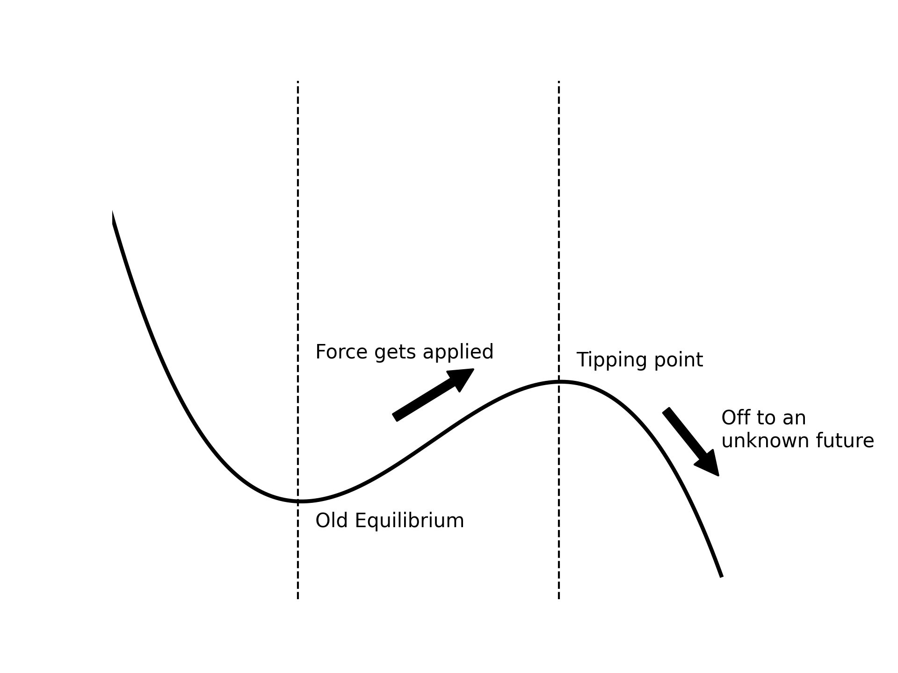

Vergangene Gesellschaften fanden ihr Ende oft in einem schwierigen Klima. Umweltveränderungen können eine Gesellschaft stark belasten, und es gibt viele Fälle in der Geschichte, in denen sie wesentlich zu ihrem Zusammenbruch beigetragen haben, vor allem wenn die Veränderung plötzlich kam. Auch heute erleben wir einen erheblichen Wandel des globalen Klimas, der es wahrscheinlich macht, dass wir Temperaturen erreichen, wie es sie auf der Erde zuletzt vor 20 bis 50 Millionen Jahren gab. Dieser Wandel ist zwar gewaltig, war bisher aber relativ langsam und vorhersehbar. Das könnte sich ändern, wenn wir das Erdsystem immer weiter aus seinem alten Gleichgewicht schieben und möglicherweise seine Kipppunkte auslösen.

# Was sind Kipppunkte?

Die Idee von Kipppunkten im Klimasystem stammt aus einem Paper von Lenton et al. aus dem Jahr 2008. Komplexe Systeme haben eine natürliche Fähigkeit, in ihren ursprünglichen Zustand zurückzufedern, solange man sie nicht zu weit treibt. Ein Kipppunkt ist ein Punkt im System, ab dem jeder zusätzliche Druck es unmöglich macht, zum vorherigen Zustand zurückzukehren (Abbildung 1). Vor dem Kipppunkt bringen Rückkopplungen im System es meist wieder in seinen ursprünglichen Zustand zurück. Ist der Kipppunkt überschritten, tun sie das nicht mehr.

Abbildung 1: Schematische Darstellung eines Kipppunkts. Wenn sich ein System von seinem bisherigen stabilen Zustand entfernt, nähert es sich nach und nach einer kritischen Schwelle, dem Kipppunkt. Ist dieser Kipppunkt überschritten, verändert sich das System erheblich, ohne dass weiterer äußerer Einfluss nötig ist, und bewegt sich auf einen neuen stabilen Zustand zu.

Übertragen auf unser Klimasystem findet man Kipppunkte in großen Elementen des Erdsystems wie dem Amazonas-Regenwald, dem grönländischen Eisschild oder der Atlantischen Meridionalen Umwälzzirkulation. Man nennt sie Kippelemente. Wenn diese Kippelemente über ihre Kipppunkte hinausgetrieben werden, würde das die Erde dauerhaft verändern. Wang et al. (2023) haben einen sehr gründlichen Literaturüberblick geschrieben, in dem sie eine Reihe von Kippelementen und die physikalischen Prozesse beschreiben, die sie steuern. Nehmen wir zum Beispiel den grönländischen Eisschild. Er schmilzt gerade, aber wir wissen nicht sicher, ob er schon einen kritischen Punkt ohne Rückkehr erreicht hat. Dieser Eisschild beeinflusst das lokale Klima über einen fortlaufenden Kreislauf stark. Er besteht aus Eisschichten, die sich auf 2000 bis 3000 Meter Höhe auftürmen. Dadurch ist die Luft oben kühler. Außerdem reflektiert die Schneedecke des Eisschilds wegen ihrer hohen Albedo einen großen Teil der Sonnenstrahlung, was zusätzlich kühlt. Wenn das globale Klima insgesamt aber zu warm wird, fängt die Schneedecke an zu schmelzen. Das hat zwei Folgen: Der Eisschild wird niedriger, und er wird dunkler, weil die Schneedecke schmilzt und das freiliegende Eis dunkler ist als der Schnee. Beide Veränderungen tragen dazu bei, dass die lokale Temperatur steigt, wodurch noch mehr Eis schmilzt. Außerdem fließt das Schmelzwasser bis an den Grund des Gletschers. Dieses Wasser wirkt wie ein Schmiermittel und lässt den Gletscher schneller fließen. Diese schneller fließenden Gletscher erreichen das Meer früher, wo sie als Eisberge abbrechen. Zusammen kommt eine Rückkopplungsschleife in Gang, die sich nicht mehr aufhalten lässt, bis das ganze Eis geschmolzen ist. Beim grönländischen Eisschild könnte das in den nächsten paar Tausend Jahren zu einem zusätzlichen Meeresspiegelanstieg von etwa 7 Metern führen. Diese Veränderungen passieren meistens nicht abrupt. Der Begriff Kipppunkt wird hier eher in dem Sinne verwendet, dass ab einem bestimmten Punkt wahrscheinlich Prozesse in Gang gesetzt werden, die für Jahrtausende oder länger unumkehrbar sind.

Das Erdsystem als Ganzes hat wahrscheinlich keinen einzelnen Kipppunkt. Stattdessen gibt es ein komplexes Zusammenspiel einzelner großer Kippelemente, die jeweils eigene Kipppunkte haben. Dieses komplexe Zusammenspiel ist schwer vorherzusagen, birgt aber das Risiko einer sogenannten Kippkaskade. Das heißt, die Kippelemente geraten in eine positive Rückkopplungsschleife und fangen an, sich gegenseitig aus dem sicheren Bereich und über ihre Kipppunkte zu schieben. Den Ablauf und die Probleme von Kippkaskaden beschreiben Armstrong McKay et al. (2022) gut. Der Prozess ähnelt den Rückkopplungsschleifen eines einzelnen Kippelements und läuft über den Einfluss auf die globale Temperatur und andere Prozesse im Klimasystem. Wenn ein Kippelement wie der grönländische Eisschild kippt, verändert das also die globale Temperatur und beeinflusst gleichzeitig Prozesse wie den Salzgehalt des Wassers im Nordatlantik. Diese höhere Temperatur und der veränderte Salzgehalt könnten wiederum ein anderes Kippelement auslösen, beim grönländischen Eisschild am wahrscheinlichsten die Atlantische Meridionale Umwälzzirkulation, weil sie stark auf salziges Wasser im Nordatlantik angewiesen ist, um die Zirkulation in Gang zu halten. Dieser sich selbst verstärkende Prozess könnte theoretisch weitergehen, bis alle Kippelemente des Erdsystems über ihren Kipppunkt hinaus sind. Armstrong McKay et al. zeigen, dass so eine Kaskade sogar schon im Temperaturbereich von 1,5 bis 2 °C beginnen könnte. Manche Kippelemente könnten tatsächlich schon über den Punkt ohne Rückkehr hinaus sein.

# Wechselwirkungen zwischen Kippelementen

Die ursprüngliche Studie von Lenton et al. identifizierte 15 Kippelemente, die sie für politisch relevant hielten. Eine neuere Studie von Ripple et al. (2023) hat über einen Literaturüberblick 41 Kippelemente und Rückkopplungsschleifen identifiziert. Allerdings sind nicht alle dieser Kipppunkte gleich groß, und viele der von Ripple et al. (2023) identifizierten Kipppunkte haben wahrscheinlich nur wenig Einfluss auf den Gesamtverlauf des Erdsystems. Die meisten Paper konzentrieren sich deshalb nur auf eine Auswahl.

Eine interessante Studie dazu ist von Wunderling et al. (2021). Sie haben die Kippelemente ausgewählt, die als am wahrscheinlichste Auslöser einer Kippkaskade gelten: den grönländischen Eisschild, den westantarktischen Eisschild, die Atlantische Meridionale Umwälzzirkulation (AMOC), die El-Niño-Südliche-Oszillation (ENSO) und den Amazonas-Regenwald. Wunderling und Co-Autoren stellen alle Kipppunkte als Sammlung einzelner Differentialgleichungen dar, die alle miteinander gekoppelt sind. Dieses gekoppelte Modell hat eine Reihe von Parametern für die Zeitskala und Empfindlichkeit des Kippens jedes Kippelements und für die Stärke der Wechselwirkung zwischen ihnen. Sie lassen das Modell mit einem Monte-Carlo-Ansatz laufen und zeigen, dass selbst in einer Welt mit nur 2 °C Erwärmung eine Wahrscheinlichkeit von 61 % besteht, dass mindestens eines der großen Kippelemente ausgelöst wird, und in 39 % der Simulationen startet eine Kaskade von zwei oder mehr Kippelementen.

Aufbauend auf diesem Modell hat dieselbe Arbeitsgruppe eine Folgestudie veröffentlicht (Wunderling et al., 2023), um abzuschätzen, wie viel Spielraum wir haben, wenn wir die Temperaturen überschreiten, die ein Kippen auslösen könnten. Die Idee dahinter: Der tatsächliche Kipppunkt hängt nicht nur von der Temperatur ab, sondern auch davon, wie lange man in diesem Bereich erhöhter Temperaturen bleibt. Um die Chance zu verringern, einen Kipppunkt auszulösen, kann man also entweder dafür sorgen, dass die Temperaturen niedrig bleiben, oder, wenn das nicht klappt, wenigstens versuchen, schnell wieder unter die Schwelle zu kommen. Die Gefahrenzone hängt also davon ab, wie weit man die Schwellentemperatur überschreitet und wie lange man darüber bleibt.

Ihre Ergebnisse zeigen, wie nötig es ist, das 1,5-°C-Ziel des Pariser Abkommens einzuhalten oder, noch besser, die Temperaturen zumindest langfristig unter 1,0 °C Erwärmung gegenüber vorindustriellem Niveau zu halten. Wenn die langfristige Zieltemperatur in ihrem Modell bei 2 °C liegt, besteht eine Chance von 82 %, dass mindestens ein Kippelement kippt, selbst wenn die globale Höchsttemperatur nie über 2 °C steigt. Das ist aber die lange Sicht, und ihre Ergebnisse zeigen auch, dass wir möglicherweise ziemlich viel Zeit haben, wieder auf eine niedrigere Temperatur zu kommen. Bei vielen Simulationen scheint es eine Zeitspanne von 100 bis 200 Jahren zu geben, um wieder auf eine niedrigere Zieltemperatur zu kommen. Das scheint allerdings nur zu gelten, solange die Spitzentemperatur unter 2,5 °C bleibt. Wenn wir darüber gehen, schrumpft die Zeit, die wir haben, um wieder auf eine niedrigere Temperatur zu kommen, erheblich. Das ist beunruhigend, denn derzeit scheint unsere Welt auf eine Erwärmung irgendwo zwischen 2 und 3 °C zuzusteuern.

Eine frühere Modellstudie von Ritchie et al. (2021) kam zu ähnlichen Schlüssen wie Wunderling et al., sah aber eine geringere Chance für Kippkaskaden. Ritchie et al. haben allerdings keine direkten Wechselwirkungen zwischen Kippelementen berücksichtigt und lassen alle Veränderungen nur über die Temperatur laufen, während das Modell von Wunderling et al. zusätzliche Wechselwirkungen auf Grundlage physikalischen Wissens darüber enthält, wie sich die Kippelemente gegenseitig beeinflussen.

Es gibt viele Studien zu Kippelementen. Die meisten konzentrieren sich aber auf die Beschreibung der physikalischen Prozesse und weniger auf die Folgen fürs Klima im Zusammenspiel mit anderen Kippelementen (siehe Wang et al. (2023) für eine ausführliche Beschreibung). Derzeit sind die hier genannten Studien der wichtigste Forschungsstrang zu Kippkaskaden und dazu, wie miteinander wechselwirkende Kipppunkte auf verschiedene Temperaturen reagieren.

*Wenn du wichtige Studien kennst, die ich übersehen habe, schreib mir bitte eine Mail, dann aktualisiere ich diesen Artikel!*

# Wie könnten wir Kipppunkte erkennen?

Kipppunkte treten zwar abrupt auf, aber es gibt trotzdem Werkzeuge, mit denen wir sie erkennen können, bevor sie passieren. Ein Paper, das das untersucht, ist ein Literaturüberblick von Dakos et al. (2023). Der wichtigste Weg, Kipppunkte zu erkennen, sind sogenannte Frühwarnsignale. Sie funktionieren, indem sie Veränderungen im Verhalten eines Systems erkennen, während es sich einem Kipppunkt nähert. Diese Veränderung zeigt sich oft durch ein Phänomen namens kritisches Verlangsamen, bei dem das System weniger widerstandsfähig gegenüber Störungen wird. Das heißt, nach einer Störung braucht es immer länger, um in seinen ursprünglichen Zustand zurückzukehren, je näher es am Kipppunkt ist. Frühwarnsignale sagen allerdings nicht alle Arten von Kipppunkten vorher und können auch bei sanfteren Übergängen auftreten. Trotzdem haben sie in fast 70 % der Fälle, die sich Dakos und Co-Autoren angeschaut haben, Kipppunkte erfolgreich erkannt.

# Wie warm könnte es werden?

Abzuschätzen, wie stark Kipppunkte am Ende die Temperatur beeinflussen, ist ziemlich schwierig, weil die möglichen Spannen der zusätzlichen Erwärmung durch sie ziemlich breit sind. Eine grobe Einschätzung können wir aber trotzdem machen. Armstrong McKay et al. (2022) fassen Schätzungen für die Wirkung der 15 von Lenton et al. identifizierten Kippelemente zusammen. Wenn wir all diese Werte naiv addieren, kommen wir auf eine zusätzliche Erwärmung von ~1,17 °C.

Das ist ziemlich viel, erzählt aber nicht die ganze Geschichte, denn die Kippelemente unterscheiden sich stark in ihrer wahrscheinlichen Auslösetemperatur, darin, ob sie die Temperatur erhöhen oder senken, und in der Zeitskala, über die sich diese Erwärmung entfalten würde. Wenn wir nur die Kippelemente mit einer geschätzten Auslösetemperatur unter 3 °C addieren, kommen wir auf ~0,04 °C zusätzliche Erwärmung. Wenn wir stattdessen die Kippelemente mit einer geschätzten Zeitskala unter hundert Jahren addieren, kommen wir auf ungefähr 0,1 °C zusätzliche Erwärmung. Die globale Wirkung in absehbarer Zukunft ist also messbar, aber nicht gewaltig. Regional könnten diese Veränderungen aber viel größer sein. Das Absterben des Amazonas-Regenwalds könnte zum Beispiel in nur 50 Jahren passieren und die lokalen Temperaturen um zusätzliche 2 °C erhöhen. Wang et al. (2023) kommen bis zum Ende des Jahrhunderts auf höhere Werte von ~0,21 °C, aber nur, wenn die Menschheit sich bei der Energieerzeugung weiter vor allem auf fossile Brennstoffe stützt.

# Wie schlimm ist unsere Lage?

Das ist die Billionen-Dollar-Frage, und die ehrliche Antwort ist vielleicht einfach: Wir wissen es nicht genau. Wie in diesem Beitrag hoffentlich klar geworden ist, gibt es nicht viel Forschung dazu, was passieren würde, wenn wir eine Kippkaskade auslösen. Aus paläoklimatischen Belegen wissen wir aber, dass die hier beschriebenen abrupten Veränderungen passieren können. Das wurde in den neuesten Berichten des IPCC anerkannt, und der gesamte Wissensstand dazu wurde 2022 in einem Literaturüberblick von Boers et al. ausführlich aufgearbeitet. Ein Beispiel sind die sogenannten Dansgaard-Oeschger-Ereignisse. Sie sind durch ein komplexes Zusammenspiel von Meereis, atmosphärischer Dynamik und der Atlantischen Meridionalen Umwälzzirkulation gekennzeichnet, das in hohen nördlichen Breiten in weniger als zehn Jahren zu einem abrupten Temperaturanstieg von bis zu 16 °C führt. Weitere Belege für früheres Kippverhalten finden wir auch in unseren paläoklimatischen Aufzeichnungen. Ein aktuelles Paper von Setty et al. (2023) hat festgestellt, dass drei frühere Temperaturspitzen im Erdsystem mit erheblichen Veränderungen im Kohlenstoffkreislauf verbunden sind. Das deutet darauf hin, dass in kurzer Zeit eine große Menge Kohlendioxid in die Atmosphäre gelangte. Wahrscheinlich lag das an einer sich selbst verstärkenden Schleife aus wärmeren Temperaturen und mehr Freisetzung von Methan und Kohlendioxid aus Mooren, untermeerischen Hydraten und Permafrost.

Es gibt Forderungen nach mehr Forschung in diesem Bereich und zu Klimawandel bei höheren Temperaturen allgemein (siehe zum Beispiel Kemp et al. (2022)), und es gibt auch Forderungen nach einem Sonderbericht des IPCC genau zu diesem Thema (Boers et al., 2022). Im Moment muss diese Forschung aber erst noch gemacht und zusammengefasst werden. Wang et al. (2023) betonen auch mehrmals, dass viele der Prozesse nicht gut verstanden sind, vor allem für Zeitskalen über 2100 hinaus. Diese Forschung könnte schwierig werden, weil Kipppunkte in den meisten großen Modellen zur Modellierung des Klimawandels nicht berücksichtigt werden (Kemp et al., 2022). Es ist nicht einmal klar, ob die globalen Klimamodelle, die wir nutzen, dieser Aufgabe überhaupt gewachsen sind (Balaji et al., 2022). Boers et al. betonen mehrmals, dass die meisten unserer heutigen Modelle Schwierigkeiten haben, abrupte Übergänge in unseren paläoklimatischen Aufzeichnungen nachzubilden, wegen einer Neigung zur Stabilität und unzureichender räumlicher Auflösung. Es ist also schwer, Extremereignisse auszulösen, selbst wenn man einen massiven Antrieb anlegt. Bei Kipppunkten sind Extremereignisse aber genau das, was wir untersuchen wollen.

Trotzdem bleibt bei mir nach dem Schreiben ein grimmiger Optimismus. Versteh mich nicht falsch, irgendeinen der Kipppunkte auszulösen, ist sehr schlimm. Ich fände es ein Denkmal unseres Versagens, wenn wir die großartige Artenvielfalt im Amazonas-Regenwald zerstören würden. Es sieht aber so aus, als könnten Kipppunkte nicht einfach so viel zusätzliche Erwärmung beitragen, dass die Erde als Ganzes auf einen Kurs über 3 °C käme, zumindest in den nächsten hundert Jahren. Außerdem werden viele der größten Folgen regional und nicht global zu spüren sein. Und schließlich werden die größten Folgen der Kipppunkte das allgemeine Funktionieren der Biosphäre treffen und nicht direkt die Temperatur. Mein Optimismus besteht also eher darin, dass ich jetzt glaube, dass Kipppunkte allein wahrscheinlich keinen Zusammenbruch der globalen Zivilisation durch Temperaturveränderungen auslösen. Trotzdem sollten wir vorsichtig sein, denn viele der früheren abrupten Klimaübergänge sind nicht gut verstanden, und das Erdsystem hält vielleicht noch ein paar unwillkommene Überraschungen für uns bereit.

# Zitieren
Bitte das englische Original zitieren:

Jehn, F. U. (2023, June 19). The trouble with tipping points. Existential Crunch. [https://doi.org/10.59350/b9pgp-6ae83](https://doi.org/10.59350/b9pgp-6ae83)

# Quellen

* Armstrong McKay, D. I., Staal, A., Abrams, J. F., Winkelmann, R., Sakschewski, B., Loriani, S., Fetzer, I., Cornell, S. E., Rockström, J., & Lenton, T. M. (2022). Exceeding 1.5°C global warming could trigger multiple climate tipping points. Science, 377(6611), eabn7950. https://doi.org/10.1126/science.abn7950
* Balaji, V., Couvreux, F., Deshayes, J., Gautrais, J., Hourdin, F., & Rio, C. (2022). Are general circulation models obsolete? Proceedings of the National Academy of Sciences, 119(47), e2202075119. https://doi.org/10.1073/pnas.2202075119
* Boers, N., Ghil, M., & Stocker, T. F. (2022). Theoretical and paleoclimatic evidence for abrupt transitions in the Earth system. Environmental Research Letters, 17(9), 093006. https://doi.org/10.1088/1748-9326/ac8944
* Dakos, V., Boulton, C. A., Buxton, J. E., Abrams, J. F., Armstrong McKay, D. I., Bathiany, S., Blaschke, L., Boers, N., Dylewsky, D., López-Martínez, C., Parry, I., Ritchie, P., van der Bolt, B., van der Laan, L., Weinans, E., & Kéfi, S. (2023). Tipping Point Detection and Early-Warnings in climate, ecological, and human systems. EGUsphere, 1–35. https://doi.org/10.5194/egusphere-2023-1773
* Kemp, L., Xu, C., Depledge, J., Ebi, K. L., Gibbins, G., Kohler, T. A., Rockström, J., Scheffer, M., Schellnhuber, H. J., Steffen, W., & Lenton, T. M. (2022). Climate Endgame: Exploring catastrophic climate change scenarios. Proceedings of the National Academy of Sciences, 119(34), e2108146119. https://doi.org/10.1073/pnas.2108146119
* Lenton, T. M., Held, H., Kriegler, E., Hall, J. W., Lucht, W., Rahmstorf, S., & Schellnhuber, H. J. (2008). Tipping elements in the Earth’s climate system. Proceedings of the National Academy of Sciences, 105(6), 1786–1793. https://doi.org/10.1073/pnas.0705414105
* Ripple, W. J., Wolf, C., Lenton, T. M., Gregg, J. W., Natali, S. M., Duffy, P. B., Rockström, J., & Schellnhuber, H. J. (2023). Many risky feedback loops amplify the need for climate action. One Earth, 6(2), 86–91. https://doi.org/10.1016/j.oneear.2023.01.004
* Ritchie, P. D. L., Clarke, J. J., Cox, P. M., & Huntingford, C. (2021). Overshooting tipping point thresholds in a changing climate. Nature, 592(7855), 517–523. https://doi.org/10.1038/s41586-021-03263-2
* Setty, S., Cramwinckel, M. J., van Nes, E. H., van de Leemput, I. A., Dijkstra, H. A., Lourens, L. J., Scheffer, M., & Sluijs, A. (2023). Loss of Earth system resilience during early Eocene transient global warming events. Science Advances, 9(14), eade5466. https://doi.org/10.1126/sciadv.ade5466
* Wang, S., Foster, A., Lenz, E. A., Kessler, J. D., Stroeve, J. C., Anderson, L. O., Turetsky, M., Betts, R., Zou, S., Liu, W., Boos, W. R., & Hausfather, Z. (2023). Mechanisms and Impacts of Earth System Tipping Elements. Reviews of Geophysics, 61(1), e2021RG000757. https://doi.org/10.1029/2021RG000757
* Wunderling, N., Donges, J. F., Kurths, J., & Winkelmann, R. (2021). Interacting tipping elements increase risk of climate domino effects under global warming. Earth System Dynamics, 12(2), 601–619. https://doi.org/10.5194/esd-12-601-2021
* Wunderling, N., Winkelmann, R., Rockström, J., Loriani, S., Armstrong McKay, D. I., Ritchie, P. D. L., Sakschewski, B., & Donges, J. F. (2023). Global warming overshoots increase risks of climate tipping cascades in a network model. Nature Climate Change, 13(1), Article 1. https://doi.org/10.1038/s41558-022-01545-9
