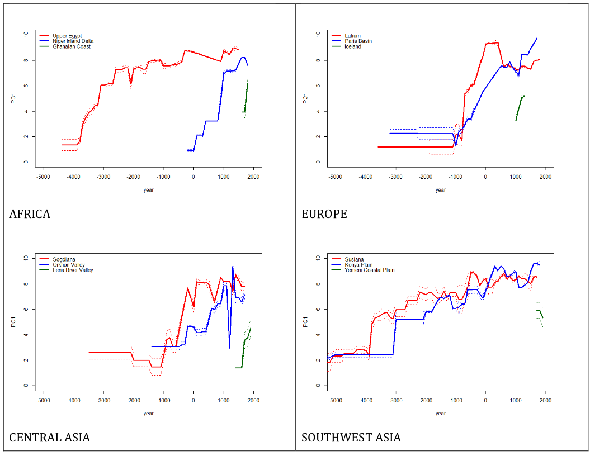
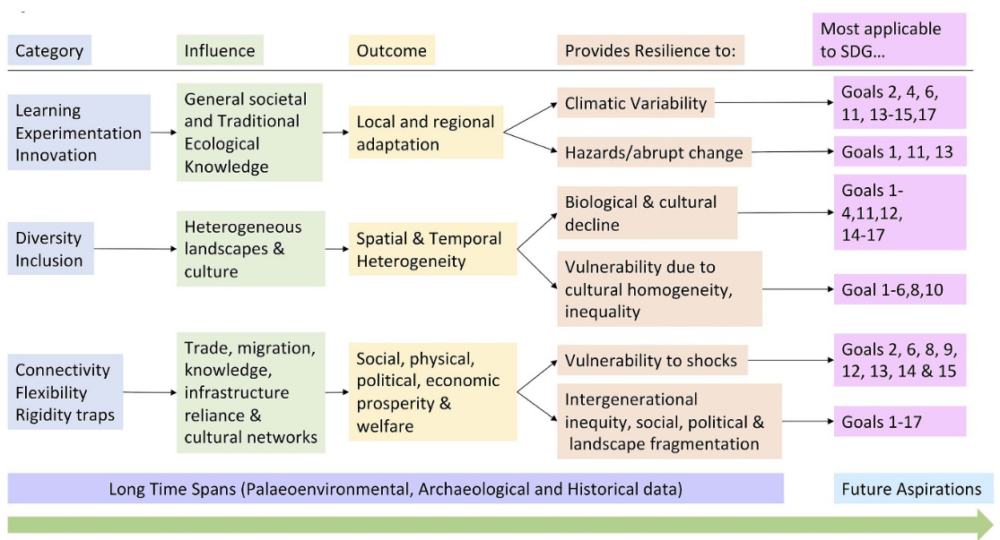

Wenn wir etwas über die Resilienz oder Fragilität menschlicher Gesellschaften lernen wollen, hilft es, aus den bisherigen Erfahrungen unserer Spezies zu lernen. Das Problem ist, dass Kollaps ein relativ seltenes Phänomen ist und wir deshalb wenig Daten haben. Eine Möglichkeit, eine größere Stichprobe zu bekommen, ist, immer weiter in die Vergangenheit zu schauen. Aber wie weit kann man zurückgehen und trotzdem noch eine nützliche Stichprobe bekommen?

Menschen in ihrer modernen Form leben seit etwa 200.000 Jahren auf diesem Planeten. Die globale Gesellschaft, die wir heute haben, ist den Gruppen von Jägern und Sammlern der fernen Vergangenheit sehr unähnlich, aber wir sind immer noch dieselbe Spezies. Es gibt keinen klaren Bruch zwischen ihnen und uns. Trotzdem scheint offensichtlich, dass es umso schwieriger wird, etwas auf die heutige globale Gesellschaft Übertragbares zu lernen, je weiter man in die Vergangenheit geht. Nimm zum Einstieg dieses Argument, angelehnt an Toby Ords „The Precipice“:
* Menschen gibt es schon lange
* Natürliche existenzielle Risiken (denk an Supervulkane, Asteroiden, Pandemien und andere nicht menschengemachte Gefahren) haben uns nicht alle getötet
* Also muss die Gefahr natürlicher existenzieller Risiken gering sein.

Das klingt nach einem schönen, sauberen Argument, aber ein Paper von Seth Baum aus dem Jahr 2023 stellt infrage, ob es sinnvoll ist, so über natürliche existenzielle Risiken nachzudenken.

## Gegen natürliche existenzielle Risiken

Baum stellt Ords Annahmen in einem zweistufigen Argument infrage:

### 1) Es gibt keine „natürlichen“ existenziellen Risiken. Risiken bestehen im Zusammenspiel mit der Gesellschaft

Ords Argument nimmt an, dass natürliche existenzielle Risiken unabhängig von der menschlichen Gesellschaft auftreten, was teilweise stimmt. In neueren Diskussionen über existenzielle Risiken hat sich der Fokus aber dahin verschoben, Risiko über drei Hauptaspekte zu betrachten: Gefahr, Exposition und Verwundbarkeit.
Die Gefahr ist die Quelle des Risikos, zum Beispiel ein Asteroideneinschlag. Die Exposition beschreibt, wie das Risiko mit der Gesellschaft interagiert. Bei einem Asteroideneinschlag könnte es zum Beispiel zu einem Temperaturabfall kommen, der die für die Gesellschaft verfügbare Nahrung verringern würde. Die Verwundbarkeit beschreibt, wie die Gesellschaft über die Exposition von der Gefahr getroffen wird. Wichtig ist, dass die Gesellschaft ihre Verwundbarkeit selbst beeinflussen kann. Um beim Beispiel des Asteroideneinschlags zu bleiben: Wir könnten zum Beispiel vorher resiliente Lebensmittel entwickeln, damit wir weniger auf die klassische Landwirtschaft angewiesen sind, wenn die Temperatur fällt (1).

### 2) Die bisherige Bilanz der menschlichen Spezies sagt wenig über das Aussterberisiko einer globalen Zivilisation aus.

Diese Zerlegung existenzieller Risiken bedeutet, dass die letzten 200.000 Jahre die falsche Vergleichsgruppe sind, um die Wahrscheinlichkeit natürlicher existenzieller Risiken abzuschätzen. Gruppen von Jägern und Sammlern sind einfach zu anders als unsere heutige globale Zivilisation, um ihr Überleben mit unserem gleichzusetzen. Die Häufigkeit der Gefahren mag zwar über die Zeit plausibel konstant sein, das Risiko ist es aber nicht. Es schwankt über die Zeit mit der Verwundbarkeit und Exposition, die eine Gesellschaft gegenüber einer bestimmten Gefahr hat.

Nimm zum Beispiel das heutige globale System der Lebensmittelproduktion, das vor Kurzem in einer Modellstudie von Moersdorf et al. (2024) untersucht wurde (Hinweis: Ich bin Co-Autor dieses Papers). Wir haben modelliert, wie das globale Agrarsystem reagieren würde, wenn Betriebsmittel wie Dünger, Bewässerung, Mechanisierung und Pestizide durch globale Katastrophen wie einen Sonnensturm wegfallen. Unser Modell findet, dass das weltweit zu Ertragsverlusten von etwa 35 bis 50 % führen würde und Landwirtschaft mit Tieren nötig machen würde (also ein Tier statt eines Traktors, um den Pflug zu ziehen). Das Wissen, wie man Landwirtschaft mit Tieren betreibt, ist an Orten mit stark industrialisierter Landwirtschaft wie Mitteleuropa aber größtenteils verloren gegangen. Wenn wir nicht einfach zu einfacheren Stufen der Komplexität zurückkehren können, würden wir wahrscheinlich einfach mangels Essen zusammenbrechen, wenn keine Vorbereitungen getroffen werden. Bei einer Gesellschaft von Jägern und Sammlern wäre das ganz anders, denn sie wäre gegenüber Sonnenstürmen überhaupt nicht verwundbar, weil ihr die Technik fehlt, die der Sonnensturm zerstören könnte.

Dieses konkrete Beispiel lässt sich wahrscheinlich verallgemeinern: Es scheint wahrscheinlich, dass eine Gefahr umso zerstörerischer ist, je vernetzter eine Zivilisation ist. Das liegt an der Komplexität, die wir geschaffen haben. Sie macht uns gegenüber kleineren Schocks resilienter, führt aber zum Kollaps, wenn unsere Systeme über ihre Kapazität hinaus belastet werden, weil uns die Fähigkeiten fehlen, ältere, einfachere Technologien kurzfristig wieder einzuführen.

## Wie weit können wir zurückgehen?

Wenn Gesellschaften von Jägern und Sammlern zu verschieden von unserer sind, um aufschlussreich zu sein, was ist dann mit jüngeren Gesellschaften? Einigen wir uns darauf, dass 200.000 Jahre zu weit zurück sind und wir aus den Daten der fernen Geschichte wenig für unsere globale Gesellschaft ableiten können. Eine andere oft diskutierte Grenze sind 10.000 Jahre, denn ungefähr dann fingen Menschen an, Gesellschaften zu bilden, die komplexer waren als eine Gruppe von Jägern und Sammlern. Die nächste oft diskutierte Grenze liegt etwa 250 Jahre zurück, als wir von einer überwiegend landwirtschaftlichen zu einer überwiegend industriellen Zivilisation wechselten. Hat einer dieser Übergänge die Zivilisation so stark verändert, dass wir keine Vergleiche mehr ziehen können?

Dafür brauchen wir eine Möglichkeit, Zivilisationen über Zeit und Raum hinweg zu vergleichen. Ein Weg ist die Arbeit von Peter Turchin und Mitarbeitenden mit ihrer Seshat-Datenbank (Turchin et al., 2018). In dieser Datenbank wurden archäologische Daten aus der ganzen Welt quantitativ kodiert, und Turchin et al. nutzen sie, um ein Maß für gesellschaftliche Komplexität zu entwickeln. Dieses Maß beruht auf 9 Variablen (z. B. wie viel geschrieben wird oder ob Geld genutzt wird), auf die sie eine Hauptkomponentenanalyse anwenden. Bei einer Hauptkomponentenanalyse deckt man die wichtigsten Muster in der Variation der Daten auf. Dafür werden die Daten so neu ausgerichtet, dass die Richtungen der größten Variabilität hervortreten, was es erlaubt, wesentliche zugrunde liegende Strukturen zu erkennen und die Darstellung der Daten zu vereinfachen. Die neuen Achsen, die dabei entstehen, die Hauptkomponenten, lenken den Blick auf das Wesentliche am Verhalten der Daten. Im Datensatz von Turchin und Co-Autoren erklärt die erste Hauptkomponente 76 % der gesamten Variabilität ihrer neun Maße gesellschaftlicher Komplexität, und alle Variablen tragen gleichermaßen dazu bei. Turchin und Co-Autoren argumentieren, dass diese Hauptkomponente damit ein robustes Maß für die gesamte gesellschaftliche Komplexität ist: eine einzige Zahl, die die Trends in ihren neun verschiedenen Indikatoren gesellschaftlicher Komplexität gut erfasst.

So können sie die Komplexität von 30 Gesellschaften über die Zeit darstellen. Abbildung 1 zeigt als Beispiel den Verlauf für 12 dieser Gesellschaften, aber der Trend sieht für alle 30 betrachteten Gesellschaften ziemlich ähnlich aus (Turchin et al., 2018). Leider enden ihre Daten mit der industriellen Revolution. Ich gehe hier vorerst davon aus, dass die moderne Gesellschaft, gemessen nach Turchin und Co-Autoren, eine vergleichbare Komplexität hat wie die hohen Stufen der Vergangenheit, weil ich keine Studie gefunden habe, die die gesellschaftliche Komplexität vor und nach der industriellen Revolution vergleicht. Das ist eine große Annahme, denn wenn wir die heutige Gesellschaft mit der von vor 200 Jahren vergleichen, scheinen sie sehr verschieden (2).

*Wenn du wichtige Studien kennst, die ich hier übersehen habe, schreib mir bitte eine Mail, dann aktualisiere ich diesen Artikel!*

Abbildung 1: Beispiele für gesellschaftliche Komplexität über die Zeit (Turchin et al., 2018)

Die Ergebnisse von Turchin et al. zeigen einen Trend über alle Regionen hinweg. Zivilisationen scheinen etwa 1000 bis 2000 Jahre zu brauchen, um auf ein hohes Komplexitätsniveau zu kommen. Ist das aber einmal erreicht, bleibt die Komplexität meist auf einem stabilen Niveau. Das heißt, dass wir eine Zivilisation als Vergleich für heute nutzen können, sobald sie diese Anlaufphase der Komplexität hinter sich hat. Wann das passiert, hängt von der Zivilisation ab. Oberägypten hat diese hohe Komplexität zum Beispiel vor etwa 5000 Jahren erreicht. Bei den meisten betrachteten Gesellschaften scheint die Anlaufphase um das Jahr 0 abgeschlossen gewesen zu sein. Die letzten etwa 2000 Jahre scheinen also für einen Großteil der Welt ein vernünftiger Vergleich für heute zu sein. Ausnahmen sind einige Orte, die sehr früh komplex wurden, wie Oberägypten, oder nie sehr komplex wurden (nach Turchins Maß), wie die Gesellschaften in Ozeanien.

Diese scheinbare Ähnlichkeit im Aufbau verschiedener Zivilisationen ist auch anderen aufgefallen. Wand & Hoyer (2024) haben eine Stichprobe von 23 geografischen Regionen aus dem Seshat-Datensatz genommen und versucht herauszufinden, ob alle einem ähnlichen Muster folgen. Sie finden, dass das tatsächlich so ist. Gesellschaften brauchen meist 2500 Jahre, um ihre Komplexität von frühen Siedlungen bis zu vormodernen Staaten aufzubauen. Dass man so ein klares Muster findet, legt nahe, dass wir vielleicht auch etwas Ähnliches finden würden, wenn wir uns die letzten 200 Jahre anschauen. Die Forschung dazu ist aber noch dünn.

## Wie hätten vergangene Gesellschaften bei heutigen Nachhaltigkeitsmaßstäben abgeschnitten?

Bisher haben wir argumentiert: Weil Gesellschaften Gefahren unterschiedlich ausgesetzt und für sie unterschiedlich verwundbar sind, müssen wir uns, wenn wir die Risiken für die heutige Gesellschaft verstehen wollen, Gesellschaften anschauen, die der heutigen ausreichend ähneln. Dann haben wir eine quantitative Datenbank archäologischer Belege genutzt, um zu sehen, ab wann Gesellschaften unserer ausreichend ähneln. Ein anderer Weg, diese Übertragbarkeit menschlicher Erfahrungen über die Zeit zu untersuchen, ist, sich anzuschauen, was unserer Meinung nach heute eine Gesellschaft gut funktionieren lässt, und zu prüfen, ob vergangene Gesellschaften sich auch an dieselben Regeln gehalten haben. Zum Glück gibt es schon ein riesiges Projekt, in dem Tausende Wissenschaftler darüber nachgedacht haben, was eine heutige Gesellschaft für Mensch und Planet nachhaltig macht: die Ziele für nachhaltige Entwicklung. Diese Ziele wurden 2015 von der Generalversammlung der Vereinten Nationen formuliert, um einen [Bauplan](https://sdgs.un.org/goals) dafür zu schaffen, was getan werden muss, um langfristig Frieden und Wohlstand für alle zu schaffen. Die Idee ist, eine Reihe von Zielen zu formulieren, die, wenn sie erreicht sind, nachhaltige und gerecht verteilte Ressourcen für alle Menschen ermöglichen. Zu den Zielen gehören keine Armut, kein Hunger und Geschlechtergleichstellung.

Allen et al. (2022) nehmen die Ziele für nachhaltige Entwicklung und schauen in die Geschichte, um herauszufinden, ob das Überleben und die Resilienz vergangener Gesellschaften davon abhingen, ob sie in den Bereichen blieben, die die Ziele für nachhaltige Entwicklung anstreben. Sie nutzen archäologische, historische und paläoökologische Belege und ordnen sie den entsprechenden Zielen für nachhaltige Entwicklung zu (Abbildung 2). Das 2. Ziel will zum Beispiel den Hunger beenden und Ernährungssicherheit erreichen. Das lässt sich messen, indem man schaut, wie häufig Zeichen von Mangelernährung an Skeletten sind. Ein anderes Beispiel ist das 15. Ziel, das den Zustand der Landökosysteme erfassen soll. Erfasst wird es über das Ausmaß von Entwaldung und Bodendegradation.

Abbildung 2: Schema, wie Informationen aus historischen und archäologischen Zeugnissen für die SDGs relevant werden (Allen et al., 2022)

Allen et al. stellen fest, dass Gesellschaften in der Vergangenheit, die im Einklang mit den Zielen für nachhaltige Entwicklung leben konnten, insgesamt besser abgeschnitten haben. Diese Bestätigung der heutigen Ziele für nachhaltige Entwicklung durch die Vergangenheit ist ein weiterer Beleg dafür, dass sich gesellschaftliche Erkenntnisse über die Zeit übertragen lassen.

## Die Bedeutung der vormodernen Geschichte für heute

Nachdem die oben genannten Paper untersucht haben, von welchen Gesellschaften wir lernen können, will ich noch einen Überblicksartikel von Haldon et al. (2024) besprechen. Er untersucht, wie Geschichte für die Politik relevant ist und vor allem, wie wir sicherstellen können, verlässliche Lehren aus der Vergangenheit zu ziehen.

Sie argumentieren, dass wir uns bei politischen Entscheidungen ständig auf Geschichte stützen, denn wenn man vor einer Krise steht, ist es nur natürlich, herausfinden zu wollen, wie frühere Entscheidungsträger in ähnlichen Situationen reagiert haben. Man braucht etwas, woran man sich festhalten kann. Das stößt aber auf mehrere Probleme. Geschichte ist komplex, und Politikerinnen und Politiker haben oft wenig Zeit. Sie neigen also dazu, Rosinen zu picken, weil sie auf die bekanntesten Geschichtsfakten aus ihrem eigenen Land zurückgreifen. Damit bleibt aber die große Mehrheit der Lehren, die wir aus der Geschichte ziehen könnten, außen vor. Zum Beispiel die aus Studien mit großen Stichproben und aus Modellstudien, die beide versuchen, die allgemeineren Trends in der Geschichte zu erfassen.

Haldon und Co-Autoren machen auch mehrere Vorschläge, wie die Politik Geschichte in Zukunft besser aufnehmen könnte. Sie glauben, dass vor allem Expertenbefragungen hier zu wenig genutzt werden. Damit meinen sie, eine große Gruppe von Fachleuten zu einem bestimmten, politisch relevanten Thema zu befragen und all diese Stimmen dann in einem Bericht zusammenzufassen, der die wichtigsten Lehren hervorhebt und auch zeigt, wo die Meinungen der Fachleute auseinandergehen. Außerdem schlagen sie vor, qualitative und quantitative Daten zu verbinden. Damit meinen sie, die Stärke großer Datensätze mit konkreten Fallstudien zu kombinieren. Man nutzt den großen Datensatz, um einen wiederkehrenden Trend zu finden, und gibt dann ein Beispiel, wie sich dieser Trend in einer bestimmten historischen Krise gezeigt hat, die für das relevant ist, was die Politik gerade sucht (3). Sie hoffen, dass es so ein Ansatz der Politik leichter macht, sich auf Geschichte zu stützen, denn in aktuellen Debatten gelten die Erkenntnisse aus den Naturwissenschaften oft als vertrauenswürdiger. Es ist wichtig, dass die Geschichtswissenschaft diese Lücke schließt, sonst bleiben viele wichtige Erkenntnisse aus der Geschichte in unseren politischen Debatten ungehört.

## Fazit

Ich lese die Belege so, dass es hilfreich sein kann, vergangene Gesellschaften zu untersuchen, die über das Stadium der Jäger und Sammler hinausgekommen sind und sich über ein paar Tausend Jahre zu hoher Komplexität entwickelt haben, um unsere heutige Gesellschaft zu verstehen. Das gilt aber nur, wenn die industrielle Revolution unsere Gesellschaft nicht so verändert hat, dass ein Vergleich unmöglich wird. Ob das so ist, ist noch umstritten.
Ich persönlich neige zu der Ansicht, dass man trotzdem sinnvolle Vergleiche ziehen kann, vor allem wenn man sich auf übergeordnete Trends konzentriert, die in grundlegendem menschlichem Verhalten wurzeln. Argumente zu Themen wie Koordinationsproblemen, gestützt auf historische Daten, scheinen mir also glaubwürdig, weil diese Probleme eine gewisse Allgemeingültigkeit über die Epochen hinweg haben.
Außerdem liefern die Ziele für nachhaltige Entwicklung einen weiteren bemerkenswerten Beleg. Diese Ziele wurden mit der zentralen Frage formuliert, wie die langfristige Nachhaltigkeit der modernen Gesellschaft gesichert werden kann. Dass sie sich auch für Zivilisationen der Vergangenheit als nützlich erwiesen haben, kann man als eine Art unabhängige Bestätigung sehen, die der Idee von Parallelen zwischen historischer und heutiger gesellschaftlicher Dynamik zusätzliches Gewicht verleiht.

## Anmerkungen

(1) Liu et al. (2018) erklären Gefahr, Exposition und Verwundbarkeit im Zusammenhang mit existenziellen Risiken viel ausführlicher.

(2) Grundsätzlich lassen sich die Methoden, mit denen Turchin und Kollegen Komplexität messen, auch auf unsere heutige Gesellschaft anwenden. Sie schauen sich zum Beispiel Faktoren an wie die Zahl der Beamten in der Regierung, die Größe des Territoriums einer Gesellschaft und die Bevölkerung ihrer Hauptstadt. Diese Faktoren haben sich aber über die Zeit stark verändert, es ist also nicht sicher, ob diese Annahme hält.

(3) Dafür wird die Seshat-Datenbank oft genutzt, z. B. in [diesem Paper](https://doi.org/10.21237/C7CLIO.38365).

## Zitieren
Bitte das englische Original zitieren:

Jehn, F. U. (2023, August 10). Lessons from the past for our global civilization. Existential Crunch. [https://doi.org/10.59350/3fc9m-gvv63](https://doi.org/10.59350/3fc9m-gvv63)

## Quellen

* Allen, K., Reide, F., Gouramanis, C., Keenan, B., Stoffel, M., Hu, A., & Ionita, M. (2022). Coupled insights from palaeoenvironmental, historical and archaeological archives to support social-ecological resilience and the Sustainable Development Goals. Environmental Research Letters, 17. https://doi.org/10.1088/1748-9326/ac6967
* Baum, S. D. (2023). Assessing natural global catastrophic risks. Natural Hazards, 115(3), 2699–2719. https://doi.org/10.1007/s11069-022-05660-w
* Haldon, J., Mordechai, L., Dugmore, A., Eisenberg, M., Endfield, G., Izdebski, A., Jackson, R., Kemp, L., Labuhn, I., McGovern, T., Metcalfe, S., Morrison, K., Newfield, T., & Trump, B. (2024). Past Answers to Present Concerns. The Relevance of the Premodern Past for 21st Century Policy Planners: Comments on the State of the Field. Wiley Interdisciplinary Reviews: Climate Change. https://doi.org/10.1002/wcc.923
* Liu, H.-Y., Lauta, K. C., & Maas, M. M. (2018). Governing Boring Apocalypses: A new typology of existential vulnerabilities and exposures for existential risk research. Futures, 102, 6–19. https://doi.org/10.1016/j.futures.2018.04.009
* Moersdorf, J., Rivers, M., Denkenberger, D., Breuer, L., & Jehn, F. U. (2024). The Fragile State of Industrial Agriculture: Estimating Crop Yield Reductions in a Global Catastrophic Infrastructure Loss Scenario. Global Challenges, 8(1), 2300206. https://doi.org/10.1002/gch2.202300206
* Ord, T. (2020). The Precipice: Existential Risk and the Future of Humanity. Hachette Books, 480 pp.
* Turchin, P., Currie, T. E., Whitehouse, H., François, P., Feeney, K., Mullins, D., Hoyer, D., Collins, C., Grohmann, S., Savage, P., Mendel-Gleason, G., Turner, E., Dupeyron, A., Cioni, E., Reddish, J., Levine, J., Jordan, G., Brandl, E., Williams, A., … Spencer, C. (2018). Quantitative historical analysis uncovers a single dimension of complexity that structures global variation in human social organization. Proceedings of the National Academy of Sciences, 115(2), E144–E151. https://doi.org/10.1073/pnas.1708800115
* Wand, T., & Hoyer, D. (2024). The characteristic time scale of cultural evolution. PNAS Nexus, 3(2), pgae009. https://doi.org/10.1093/pnasnexus/pgae009
