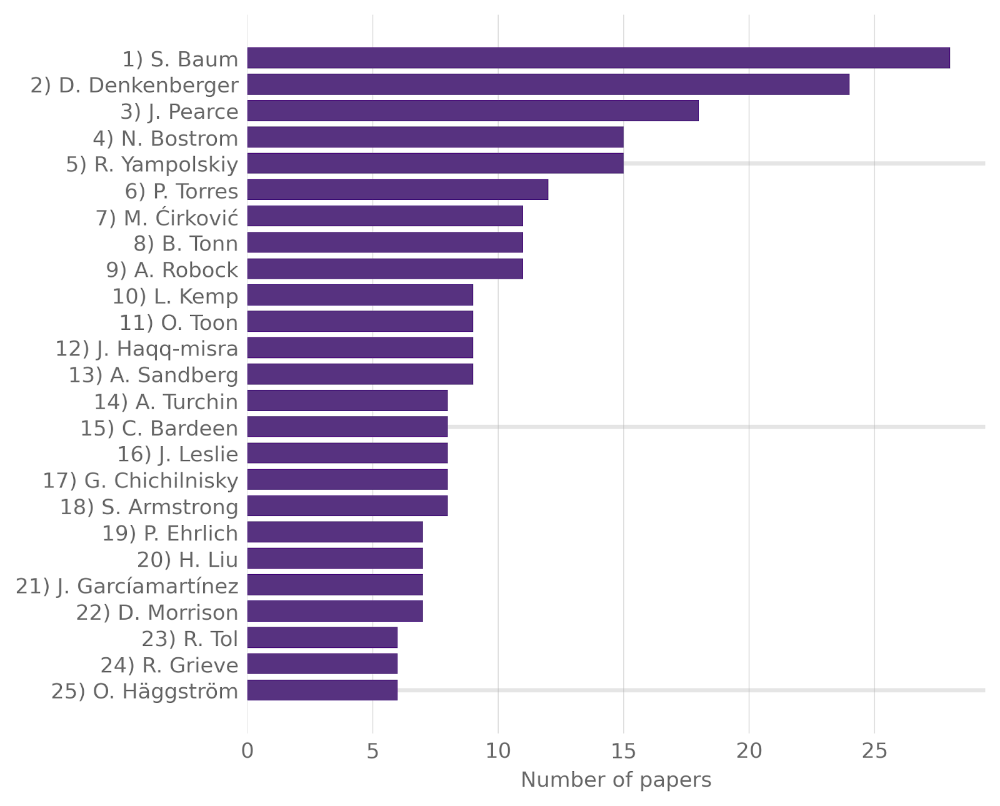
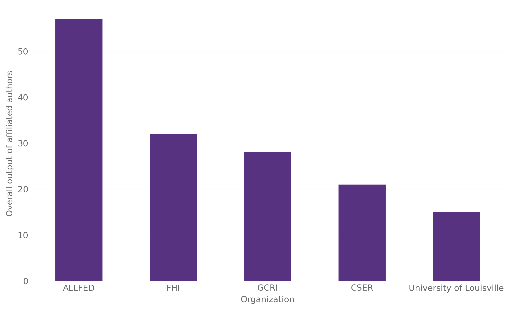

Ich habe eine Liste von Forschenden im Bereich existenzieller Risiken erstellt, sortiert danach, wie viele Paper sie veröffentlicht haben. Im Folgenden verlinke ich ihre Arbeit. Das ist nicht als strenge Bewertung ihres Beitrags zum Feld gedacht, sondern eher als schneller Überblick darüber, wer woran arbeitet. Ich hoffe, das hilft Leuten, die sich für die Forschung zu existenziellen Risiken interessieren, sei es beruflich oder privat, um die wichtigsten Themen zu verstehen, an denen gerade gearbeitet wird. Ich denke, das könnte besonders für Leute nützlich sein, die neu in die Forschung zu existenziellen Risiken einsteigen und verstehen wollen, welche Organisationen, Forschenden und Themen etabliert sind.

Die Grundlage ist [The Existential Risk Research Assessment (TERRA)](https://terra.cser.ac.uk/). TERRA ist eine Webseite, die mit maschinellem Lernen Publikationen findet, die mit existenziellen Risiken zu tun haben. Sie wird vom [Centre for the Study of Existential Risk (CSER)](https://www.cser.ac.uk/) betrieben und wurde ursprünglich von [Gorm Shackelford](https://scholar.google.co.za/citations?user=lLtc-n0AAAAJ&hl=en) gestartet. Ich habe ihre kuratierte Liste von Papern genommen und etwas Code geschrieben, der die Zahl der Paper pro Autor oder Autorin zählt. Den Code findest du hier, und das sind die Ergebnisse:

Sorry, dass ich einige Namen verunstaltet habe, aber das lag daran, wie ich die Zeichenketten kürzen musste, um sie einfach zählen zu können. Da TERRA auf der manuellen Bewertung automatisch gesammelter Paper beruht, ist diese Liste wahrscheinlich unvollständig, aber ich denke trotzdem, dass sie einen guten Überblick darüber gibt, was in der Forschung zu existenziellen Risiken passiert. Wenn du die Daten hier verbessern willst, leg dir gerne einen Account bei TERRA an und fang an, Paper zu bewerten.

Im Folgenden habe ich eine Liste aller Top-25-Forschenden zusammengestellt, mit Links zu ihrem Google-Scholar-Profil (falls ich es finden konnte), der wichtigsten Organisation zu existenziellen Risiken, für die sie arbeiten, und einer Publikation, die meiner Meinung nach zeigt, welche Art von Forschung zu existenziellen Risiken sie machen. Wenn du den Eindruck hast, dass jemand auf der Liste durch eine andere Publikation besser repräsentiert wäre, sag mir bitte Bescheid, dann ändere ich das. 25 ist eine willkürliche Grenze. Das heißt nicht, dass die Person auf Platz 26 irgendwie schlechter ist als die auf Platz 25, aber ich musste irgendwo aufhören. Die vollständige Liste findest du im [Repository](https://github.com/florianjehn/X-Risk-Rank).

Hier ist die Liste:
* [Seth Baum](https://scholar.google.com/citations?user=lJxa2TEAAAAJ&hl=en)
    - Global Catastrophic Risk Institute (GCRI)
    - How long until human-level AI? Results from an expert assessment
* [David Denkenberger](https://scholar.google.com/citations?user=BGy0ZrMAAAAJ&hl=en)
    - Alliance to Feed the Earth in Disasters (ALLFED)
    - Feeding everyone: Solving the food crisis in event of global catastrophes that kill crops or obscure the sun
* [Joshua M. Pearce](https://scholar.google.com/citations?user=QZ8lPxwAAAAJ&hl=en)
    - Alliance to Feed the Earth in Disasters (ALLFED)
    - Leveraging Intellectual Property to Prevent Nuclear War
* [Nick Bostrom](https://scholar.google.com/citations?user=oQwpz3QAAAAJ&hl=de)
    - Future of Humanity Institute (FHI)
    - Superintelligence: Paths, Dangers, Strategies
* [Roman V. Yampolskiy](https://scholar.google.com/citations?user=0_Rq68cAAAAJ&hl=de)
    - University of Louisville
    - Predicting future AI failures from historic examples
* [Émile P. Torres](https://www.xriskology.com/)
    - Derzeit ohne Affiliation, früher Centre for the Study of Existential Risk (CSER)
    - Who would destroy the world? Omnicidal agents and related phenomena
* [Milan M. Ćirković](https://scholar.google.com/citations?user=BT4eHgkAAAAJ&hl=en)
    - Astronomical Observatory of Belgrade
    - The Temporal Aspect of the Drake Equation and SETI
* [Bruce Edward Tonn](https://www.researchgate.net/profile/Bruce-Tonn)
    - University of Tennessee
    - Obligations to future generations and acceptable risks of human extinction
* [Alan Robock](https://scholar.google.com/citations?user=PuKvZ4MAAAAJ&hl=de)
    - Rutgers University
    - Volcanic eruptions and climate
* [Owen Toon](https://scholar.google.com/citations?user=XVKz51YAAAAJ&hl=en)
    - University of Colorado, Boulder
    - Environmental perturbations caused by the impacts of asteroids and comets
* [Jacob Haqq-Misra](https://scholar.google.com/citations?user=kdKxcSYAAAAJ&hl=en)
    - Blue Marble Space Institute of Science
    - The Sustainability Solution to the Fermi Paradox
* [Luke Kemp](https://scholar.google.co.uk/citations?user=Kd-EpXgAAAAJ&hl=en)
    - Centre for the Study of Existential Risk (CSER)
    - Climate Endgame: Exploring catastrophic climate change scenarios
* [Anders Sandberg](https://scholar.google.com/citations?user=aefVOM4AAAAJ&hl=en)
    - Future of Humanity Institute (FHI)
    - Converging Cognitive Enhancements
* [Alexey Turchin](https://scholar.google.ru/citations?user=LyRLy0EAAAAJ&hl)
    - Alliance to Feed the Earth in Disasters (ALLFED)
    - Classification of global catastrophic risks connected with artificial intelligence
* [Charles Bardeen](https://thebulletin.org/biography/charles-g-bardeen/)
    - National Center for Atmospheric Research
    - Extreme Ozone Loss Following Nuclear War Results in Enhanced Surface Ultraviolet Radiation
* [John Leslie](https://en.wikipedia.org/wiki/John_A._Leslie)
    - University of Guelph
    - Testing the Doomsday Argument
* [Graciela Chichilnisky](https://scholar.google.com/citations?user=usqnvhIAAAAJ&hl=en)
    - Columbia University
    - The foundations of probability with black swans
* [Stuart Armstrong](https://scholar.google.com/citations?user=bSJaYzgAAAAJ&hl=en)
    - Future of Humanity Institute (FHI)
    - Eternity in six hours: Intergalactic spreading of intelligent life and sharpening the Fermi paradox
* [Paul R. Ehrlich](https://scholar.google.com/citations?user=SN2zDOEAAAAJ&hl=de),
    - Stanford University
    - Extinction: The Causes and Consequences of the Disappearance of Species
* [Hin-Yan Liu](https://scholar.google.it/citations?user=TO1tLV0AAAAJ&hl=en)
    - University of Copenhagen
    - Categorization and legality of autonomous and remote weapons systems
* [Juan B. García Martínez](https://scholar.google.com/citations?user=k-5JFToAAAAJ&hl)
    - Alliance to Feed the Earth in Disasters (ALLFED)
    - Potential of microbial protein from hydrogen for preventing mass starvation in catastrophic scenarios
* [David Morrison](https://en.wikipedia.org/wiki/David_Morrison_(astrophysicist))
    - Ames Research Center
    - Asteroid and comet impacts: the ultimate environmental catastrophe
* [Richard Grieve](https://www.researchgate.net/profile/Richard-Grieve)
    - University of Western Ontario
    - Extraterrestrial impacts on earth: the evidence and the consequences
* [Richard S.J. Tol](https://scholar.google.co.uk/citations?user=AjZwhtwAAAAJ&hl=en)
    - University of Sussex
    - Why Worry About Climate Change? A Research Agenda
* [Olle Häggström](https://scholar.google.com/citations?user=lCX1JVEAAAAJ&hl=de)
    - Chalmers University of Technology
    - Artificial General Intelligence and the Common Sense Argument

Um auch einen Überblick über den Gesamtoutput der Organisationen zu existenziellen Risiken zu bekommen, habe ich außerdem die Publikationen aller Forschenden addiert, die bei derselben Organisation sind. Das enthält Doppelzählungen, aber ich denke trotzdem, dass es eine gute grobe Annäherung an die Gesamtproduktivität der Organisationen ist:

Noch ein paar persönliche Eindrücke vom Kategorisieren der Forschung auf TERRA. Es sieht so aus, als würde die Welle an Papern zu COVID-19 langsam abebben, 2022 scheinen es weniger gewesen zu sein als 2021. Das Interesse an KI scheint dagegen zu wachsen. 2022 gab es spürbar mehr Paper zu KI als in den Jahren davor. Mir kam es so vor, als könnten KI-Paper 2022 sogar etwa 50 % der Paper ausmachen, die ich als relevant für existenzielle Risiken eingestuft habe. Das ist allerdings nur eine grobe Schätzung, da ich keinen Zugriff auf die kategorisierten Daten habe.

Ein Punkt macht mir besonders Sorgen: Frauen sind auf der Liste kaum vertreten (1 von 25). Es ist unklar, was genau dahintersteckt und wie wir das angehen können, aber es ist zweifellos ein Problem. Wir müssen das verbessern. Die Community sollte etwas dafür tun, dass Frauen sich willkommener und unterstützter fühlen, wenn sie in dem Feld mitmachen, bleiben und erfolgreich sein wollen. Mentoringprogramme speziell für Frauen im Bereich existenzieller Risiken könnten hier zum Beispiel eine gute Option sein.

# Zitieren
Bitte das englische Original zitieren:

Jehn, F. U. (2023, August 12). The 25 researchers who have published the largest number of academic articles on existential risk. Existential Crunch. [https://doi.org/10.59350/j4gxm-1bm60](https://doi.org/10.59350/j4gxm-1bm60)
