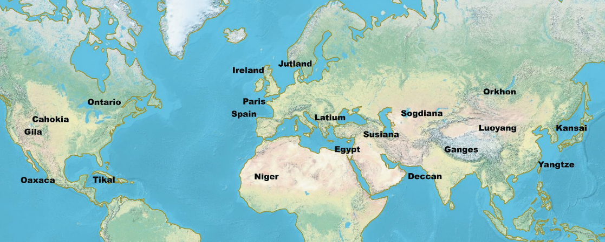

Das Risiko eines gesellschaftlichen Kollapses hängt nicht nur von den Problemen ab, vor denen eine Gesellschaft steht, sondern auch davon, wie sie sich anpasst, um diesen Problemen zu begegnen. Diese Anpassungen können die Resilienz einer Gesellschaft erhöhen und sie weniger verwundbar gegenüber möglichen Gefahren machen. Dieser Beitrag schaut sich mehrere Paper an, die vergangene Gesellschaften analysieren (1), um zu argumentieren, dass mehr Beteiligung und Inklusion der Mitglieder einer Gesellschaft ihre Resilienz erhöhen können.

# Aus vergangenen Gesellschaften Schlüsse für heutige existenzielle Risiken ziehen

Unsere erste Studie, von Peter Peregrine, versucht herauszufinden, welche Faktoren der modernen Gesellschaft helfen könnten, einen eher kleinen Atomkrieg zu überleben, indem sie untersucht, wie Gesellschaften auf der ganzen Welt auf den vulkanischen Winter der Spätantiken Kleinen Eiszeit reagiert haben (Peregrine, 2021). Peregrine untersucht, wie verschiedene Gesellschaften auf die extremen Umweltherausforderungen dieser Zeit reagierten und welche gesellschaftlichen Strukturen offenbar resilienter waren.

Peregrine stützt sich auf Daten aus der Seshat-Datenbank zu 20 Gesellschaften auf der ganzen Welt. Er will Autokorrelation durch räumliche Nähe zwischen Kulturen vermeiden, indem er Gesellschaften aufnimmt, die nie die Chance hatten, miteinander in Kontakt zu kommen. Der Fokus liegt auf der Spätantiken Kleinen Eiszeit (ungefähr 6. und 7. Jahrhundert n. Chr.), weil er darin den besten Stellvertreter für die Art von nuklearem Winter sieht, der auf einen eher kleinen Atomkrieg folgen würde. In dieser Zeit brachen innerhalb von 10 Jahren mehrere größere Vulkane aus, was zu einem globalen Temperaturrückgang von 1 bis 2 °C führte. Das hatte Missernten und große Migrationsbewegungen zur Folge.

Abbildung 1: Räumliche Verteilung der Stichprobe in Peregrine (2021)

Ausgehend von einem Überblick über frühere Literatur stellt Peregrine die Hypothese auf, dass flexiblere Gesellschaften resilienter sind, dass diese Flexibilität vor allem durch Beteiligung entsteht und dass das Maß an Beteiligung davon abhängt, wie hierarchisch eine Gesellschaft ist. Um das zu testen, erstellt Peregrine einen Index, der die Hierarchie einer Gesellschaft erfasst. Dieser Index ist die Summe aus fünf Variablen, bewertet auf einer 5-Punkte-Skala, die die Privilegien von Herrschenden erfassen, wie stark Herrschende besondere Erkennungsmerkmale haben (z. B. ihr Aussehen), wie stark Autorität geteilt wird und wie viele Kontakte eine Gesellschaft nach außen hat. Außerdem hat er einen Index für gesellschaftlichen Wandel erstellt. Dieser Index ist die Summe aus sechs Variablen, bewertet auf einer 3-Punkte-Skala, die Veränderungen der Bevölkerung, Hunger und Krankheit, Konflikte sowie drei Variablen zu verschiedenen Aspekten der gesellschaftlichen Organisation erfassen. Damit soll erfasst werden, wie gut die jeweilige Gesellschaft mit der Spätantiken Kleinen Eiszeit zurechtkam. Die Ergebnisse zeigen, dass Gesellschaften mit einem niedrigen Hierarchieindex, die mehr Beteiligung zuließen, sich besser an die neuen klimatischen Umstände anpassten und weniger negativen gesellschaftlichen Wandel (wie Bevölkerungsverluste) erlebten. Peregrine erklärt das damit, dass mehr Beteiligung an politischen Entscheidungen eine Gesellschaft flexibler macht und diese höhere Flexibilität es ihr wiederum erlaubt, besser auf die Veränderungen durch die Gefahren eines vulkanischen Winters zu reagieren. Er verbindet das auch mit sozialem Kapital, also den sozialen Netzwerken und zwischenmenschlichen Beziehungen, die eine Gemeinschaft zusammenhalten und es wahrscheinlicher machen, dass Menschen einander helfen.

Peregrine hat noch eine weitere Studie, die die Frage „Welche Eigenschaften machen Gesellschaften resilient?“ noch ausdrücklicher stellt (Peregrine, 2018). In diesem Paper hat er untersucht, wie 33 verschiedene Gesellschaften auf 22 katastrophale klimabedingte Katastrophen reagiert haben. Mit diesem Datensatz testet er zwei gegensätzliche Hypothesen, die in früherer Katastrophenforschung formuliert wurden:

* Gesellschaften mit inklusiveren und beteiligungsorientierten Strukturen sind resilienter gegenüber Katastrophen.
* Gesellschaften, die sich strenger an Regeln halten, sind resilienter gegenüber Katastrophen.

Dafür hat er einen ähnlichen Ansatz verwendet wie den gerade beschriebenen. Peregrine hat zwei Indizes definiert:

* Locker-streng-Index: Er soll erfassen, wie sehr sich eine Gesellschaft an Regeln hält, und ist der Durchschnitt verschiedener Stellvertretervariablen, etwa wie standardisiert Häuser oder Keramik sind oder ob es sehr ausgeprägte gemeinschaftliche Rituale wie Übergangsriten gibt.
* Ausschließungsindex: Das ist derselbe Hierarchieindex wie oben beschrieben.

Dann setzt er diese beiden Indizes in Beziehung dazu, wie stark die katastrophalen klimabedingten Katastrophen die betroffenen Gesellschaften getroffen haben, etwa bei Bevölkerungszahl, Gesundheit und Ernährung sowie Konflikten. Die Ergebnisse sind ziemlich eindeutig. Der Locker-streng-Index hängt nicht mit den gesellschaftlichen Ergebnissen zusammen, der Ausschließungsindex dagegen schon (z. B. führt weniger Hierarchie zu einer stabileren Bevölkerung nach einer Katastrophe). Wir können also Hypothese 1 annehmen und Hypothese 2 verwerfen. Strenges Einhalten von Regeln scheint die Resilienz gegenüber Katastrophen nicht zu erhöhen, mehr Inklusion und Beteiligung dagegen schon.

# Wie hätten vergangene Gesellschaften bei heutigen Nachhaltigkeitsmaßstäben abgeschnitten?

Die dritte Studie ist von Allen et al. (2022). Ich halte mich hier kurz, weil wir diese Studie schon in einem [früheren Beitrag](https://florianjehn.github.io/Societal_Collapse/2023-08-10-lessons_from_the_past/) besprochen haben, aber ich wollte sie noch einmal hervorheben, weil man sie als unabhängige Bestätigung der Ergebnisse von Peregrine sehen kann. Allen und Co-Autoren drehen den Ansatz von Peregrine um. Während Peregrine versucht hat, aus vergangenen Gesellschaften etwas für heute zu lernen, versucht die Studie von Allen et al. zu verstehen, wie vergangene Gesellschaften bei heutigen Nachhaltigkeitsmaßstäben abgeschnitten haben. Die Maßstäbe, auf die sie sich konzentrieren, sind die Ziele für nachhaltige Entwicklung. Allen et al. stellen fest, dass Gesellschaften in der Vergangenheit, die im Einklang mit den Zielen für nachhaltige Entwicklung leben konnten, insgesamt besser abgeschnitten haben. Für diese Einschätzung schauen sie sich auf Grundlage eines Literaturüberblicks eine große Bandbreite an Kulturen aus Geschichte, Paläoumwelt und Archäologie an. Ein zentraler Punkt der Ziele für nachhaltige Entwicklung ist die Förderung von Vielfalt und Inklusion. Allen und Co-Autoren verweisen auf eine Reihe von Studien, die ebenfalls finden, dass in archäologischen und historischen Zeugnissen jene Gesellschaften resilienter waren, die mehr Vielfalt und Inklusion hatten. Sie zitieren sogar die Studie von Peregrine als weiteres Beispiel dafür.

# Moralischer Zusammenbruch und Staatsversagen

Einen weiteren interessanten Punkt zum Zusammenhang zwischen Beteiligung und der Stabilität von Staaten machen Blanton et al. (2020). Ihre Idee: Ein wichtiger Faktor dafür, dass eine Gesellschaft stark und resilient bleibt, ist ein gemeinsamer moralischer Kodex, an den sich alle halten. Sie argumentieren, dass die Bürger eines Staates sich dann mehr einbringen, was den Staat wiederum stärker gedeihen lässt, weil mehr Zusammenarbeit möglich ist. Um das zu untersuchen, nutzen sie einen Ansatz der quantitativen Geschichte und einen Datensatz von 30 vormodernen Staaten. Dieser Datensatz enthält Informationen darüber, wie gut die Regierung des jeweiligen Staates war, und dann haben sie sich angeschaut, wie lange diese Staaten bestanden und wie verheerend ihr Zusammenbruch war. Die Qualität der Regierung haben sie bewertet, indem sie Dinge quantifiziert haben wie die Fairness der Justiz, die Fairness der Steuerverteilung oder ob die Macht der Führung begrenzt war.

Insgesamt finden sie, dass das Wohlergehen der Bürger meist umso höher war, je besser ein Staat beim Maß für gute Regierung abschnitt. Interessanterweise fanden sie keinen Unterschied in der Lebensdauer von Staaten mit guter und schlechter Regierung. Sie fanden aber, dass Staaten mit besserer Regierung eine leicht erhöhte Chance hatten, einen schwereren Zusammenbruch zu erleben, wenn es zu einem kam. Sie erklären das damit, dass Bürger, wenn ein Staat ihnen mehr Güter bereitstellt, auf diesem Fundament aufbauen und davon abhängig werden. Wenn diese Struktur des Staates zusammenbricht, bricht auch der höhere Wohlstand zusammen, den die Bürger darauf aufgebaut haben.

Anhand einiger Fallstudien (Römisches Reich, Venedig, Mogulreich und Ming-Dynastie) versuchen sie auch herauszufinden, was diese Staaten normalerweise zum Zusammenbruch brachte. Sie glauben, dass der ursächliche Mechanismus darin liegt, dass selbst Staaten mit guter Regierung meist zusammenbrechen, wenn die Eliten und die Führung aufhören, ihren fairen Anteil zur Gesellschaft beizutragen. Wenn ich zum Beispiel klar sehe, dass die Führung meines Staates Korruption zulässt und daran teilnimmt, macht es das für mich weniger attraktiv, zu diesem Staat beizutragen, und gibt mir gleichzeitig einen Anreiz, auch korrupt zu werden und mir durch Abtrünnigkeit ein Stück vom Kuchen zu sichern.

# Was hat das mit Demokratie zu tun?

Wir haben jetzt Beteiligung, Inklusion und das Einhalten gemeinsamer moralischer Prinzipien als zentrale Merkmale resilienter Gesellschaften identifiziert. Eine wichtige Sache, die in der heutigen Gesellschaft mehr Beteiligung und Inklusion ermöglicht und gleichzeitig die Chance bietet, gemeinsame moralische Prinzipien zu schaffen und durchzusetzen, ist Demokratie. Leider habe ich keine Forschung gefunden, die direkt den Zusammenhang zwischen Demokratie und gesellschaftlichem Kollaps untersucht, wahrscheinlich weil bisher keine moderne Demokratie einen gesellschaftlichen Kollaps erlebt hat. Das ist an sich schon irgendwie beruhigend! Da es moderne Demokratien aber erst seit etwa 200 Jahren gibt und sie sich [erst ab den 1950er-Jahren verbreitet haben](https://ourworldindata.org/democracy), sollten wir uns darauf nicht zu viel einbilden.

*Wenn du wichtige Studien kennst, die ich hier übersehen habe, schreib mir bitte eine Mail, dann aktualisiere ich diesen Artikel!*

Wir können uns aber etwas Ähnliches anschauen: Wie reagieren demokratische und nicht demokratische Gesellschaften heute auf Naturgefahren? Diese Gefahren sind kleiner als Ereignisse, die einen gesellschaftlichen Kollaps auslösen könnten, aber sie können groß genug sein, um Gesellschaften lokal an ihre Grenzen zu bringen, und es gibt viel Literatur dazu. Die Studie, die ich hervorheben will, ist von Thung-Hong Lin und untersucht, wie moderne Staaten auf Naturgefahren unterschiedlicher Größe reagiert haben (Lin, 2015).

Lin nutzt einen Datensatz von 150 Ländern von 1995 bis 2009 und schaut sich ihre staatliche Leistungsfähigkeit an, wie demokratisch sie sind und wie sie auf Katastrophen reagiert haben. Für die Analyse hat Lin Daten aus der [Emergency Event Database](https://www.emdat.be/) genutzt, um die Zahl der Betroffenen zu bekommen (also Menschen, die entweder durch die Katastrophen starben oder in ihrer Lebensgrundlage betroffen waren, etwa durch Verletzung oder Obdachlosigkeit). Als Stellvertreter für staatliche Leistungsfähigkeit nutzte Lin die Staatsausgaben geteilt durch das BIP des Landes, für den Demokratiestatus den [Polity-IV-Datensatz](https://www.systemicpeace.org/polityproject.html). Dann hat Lin mit multipler linearer Regression den Zusammenhang zwischen diesen Variablen untersucht.

Grundsätzlich findet Lin, dass weniger Menschen betroffen sind, wenn ein Land mehr staatliche Leistungsfähigkeit hat und eine Demokratie ist. Das gilt für alle verschiedenen Katastrophenarten wie Erdbeben, Stürme oder Überschwemmungen. Lin argumentiert, dass seine Ergebnisse zeigen: Man braucht sowohl staatliche Leistungsfähigkeit als auch Demokratie, um die höchste Resilienz gegenüber Naturgefahren zu haben. Fehlt die Demokratie, fehlt dem Staat der Anreiz, sich um alle zu kümmern. Fehlt die staatliche Leistungsfähigkeit, kann man die Maßnahmen schlicht nicht umsetzen, die nötig sind, um die Gesellschaft resilienter gegenüber Gefahren zu machen. Das findet sich auch in anderen Studien zu Resilienz gegenüber Gefahren und staatlicher Leistungsfähigkeit wieder. Omberg & Tabarrok (2022) fanden zum Beispiel, dass staatliche Leistungsfähigkeit einer der wenigen Faktoren war, die die Übersterblichkeit bei COVID-19 senkten.

Wenn wir theoretischer werden wollen, gibt es ein aktuelles Buchkapitel von Luke Kemp (2023), das für Demokratie als Schutz vor Kollaps argumentiert, indem es [Tainters Theorie der Komplexität](https://existentialcrunch.substack.com/p/mapping-out-collapse-research#%C2%A7collapse-by-complexity) abwandelt. Kemp argumentiert, dass Staaten nicht an den steigenden Kosten zusätzlicher Komplexität zusammenbrechen, sondern an abnehmenden Erträgen der Ausbeutung. Diese abnehmenden Erträge entstehen, weil Gesellschaften nicht rational abwägen, was, wo und wie sie Ressourcen ausbeuten wollen, sondern das von Interessengruppen diktiert wird. Diese Gruppen nutzen den Staatsapparat nicht, um den Wohlstand insgesamt zu vergrößern, sondern nur ihr eigenes Kapital. Kemp schlägt deshalb vor, dass das Problem nicht durch neue und bessere technische Lösungen gelöst wird, sondern durch mehr deliberative Demokratie, um negative Rückkopplungen besser zu berücksichtigen, Wohlstand umzuverteilen und politische Macht von Reichtum zu trennen.

# Was können wir tun?

In diesem Beitrag haben wir uns mehrere Studien angeschaut, die zu verstehen versuchten, wie Gesellschaften auf schwierige Ereignisse reagierten, die ihre Bevölkerung gefährdeten. Alle betonen, dass Beteiligung, Inklusion und Demokratie wichtig für eine resiliente Gesellschaft sind. Von allen betrachteten Faktoren lagen diese ganz vorn. Ich kann dir keine konkrete Zahl nennen wie „Demokratie senkt das Kollapsrisiko um x %“, aber ich halte die Belege trotzdem für stark. Vor allem, weil es klare Mechanismen gibt, wie Demokratie, Inklusion und Beteiligung zu mehr Resilienz führen. Menschen können ihren Unmut besser äußern, sind viel eher bereit, einander zu helfen, und der Staat hat einen stärkeren Anreiz, sich um alle zu kümmern.

Welche konkreten Anpassungen sollten wir laut diesen Studien anstreben? Peregrine (die Studie zur Resilienz in der Spätantiken Kleinen Eiszeit) schlägt einige sehr kleinteilige Maßnahmen vor, zum Beispiel, dass lokale Verantwortliche im Katastrophenschutz regelmäßig mit den Menschen in ihrer Gemeinde reden sollten. Für mich scheinen die Ergebnisse eher nach anderen, größeren Maßnahmen zu verlangen, etwa Demokratie weltweit auszubauen oder dafür zu sorgen, dass unsere Gesellschaften inklusiv genug sind, um allen die Chance auf Beteiligung zu geben, zum Beispiel durch bessere Rechte für Minderheiten (was eine der Arten war, wie Beteiligung in Allen et al. 2022 gemessen wurde). In seiner Studie von 2018 schlägt Peregrine allerdings genau das vor. Die letzte Studie von Lin fügt eine wichtige Einschränkung hinzu: Um wirklich von Beteiligung zu profitieren, braucht man auch einen starken Staat, der die nötigen Maßnahmen umsetzt, um das Leben für alle sicher zu machen. Für mich heißt das auch, dass Neoliberalismus ein Risikofaktor für gesellschaftlichen Kollaps sein könnte, weil er dazu neigt, staatliche Leistungsfähigkeit auszuhöhlen, zum Beispiel indem Aufgaben des Staates an private Akteure abgegeben werden und die Steuerbasis zur Finanzierung staatlicher Aufgaben schrumpft (Hamm et al., 2012).

Insgesamt nehme ich daraus mit, dass Demokratie noch wichtiger ist, als ich bisher dachte. Mehr Demokratie, Inklusion und Beteiligung zu fördern und gleichzeitig Staaten aufzubauen, die auch die Kapazität haben, Programme umzusetzen, könnte eine wichtige Maßnahme sein, um den Zusammenbruch unserer globalen Zivilisation zu vermeiden.

*Danke fürs Lesen! Wenn du über diesen Beitrag oder gesellschaftlichen Kollaps allgemein reden willst, würde ich mich über ein Gespräch freuen. Schick mir einfach eine Mail an florian.u.jehn at posteo.de, dann machen wir einen Termin aus.*

# Anmerkungen

(1) Mehr dazu, wie vergleichbar vergangene und heutige Gesellschaften sind, wenn man etwas über gesellschaftlichen Kollaps lernen will, findest du in meinem früheren Beitrag [Lehren aus der Vergangenheit für unsere globale Zivilisation](https://florianjehn.github.io/Societal_Collapse/2023-08-10-lessons_from_the_past/).

# Zitieren
Bitte das englische Original zitieren:

Jehn, F. U. (2023, August 16). Participation, inclusion, democracy, and resilience. Existential Crunch. [https://doi.org/10.59350/fxddg-5p067](https://doi.org/10.59350/fxddg-5p067)

# Quellen

* Allen, K., Reide, F., Gouramanis, C., Keenan, B., Stoffel, M., Hu, A., & Ionita, M. (2022). Coupled insights from palaeoenvironmental, historical and archaeological archives to support social-ecological resilience and the Sustainable Development Goals. Environmental Research Letters, 17. https://doi.org/10.1088/1748-9326/ac6967
* Blanton, R. E., Feinman, G. M., Kowalewski, S. A., & Fargher, L. F. (2020). Moral Collapse and State Failure: A View From the Past. Frontiers in Political Science, 2. https://doi.org/10.3389/fpos.2020.568704
* Hamm, P., King, L. P., & Stuckler, D. (2012). Mass Privatization, State Capacity, and Economic Growth in Post-Communist Countries. American Sociological Review, 77(2), 295–324. https://doi.org/10.1177/0003122412441354
* Kemp, L. (2023). Diminishing Returns on Extraction: How Inequality and Extractive Hierarchy Create Fragility. In How Worlds Collapse. Routledge.
* Lin, T.-H. (2015). Governing Natural Disasters: State Capacity, Democracy, and Human Vulnerability. Social Forces, 93(3), 1267–1300.
* Omberg, R. T., & Tabarrok, A. (2022). Is it possible to prepare for a pandemic? Oxford Review of Economic Policy, 38(4), 851–875. https://doi.org/10.1093/oxrep/grac035
* Peregrine, P. N. (2018). Social Resilience to Climate-Related Disasters in Ancient Societies: A Test of Two Hypotheses. Weather, Climate, and Society, 10(1), 145–161. https://doi.org/10.1175/WCAS-D-17-0052.1
* Peregrine, P. N. (2021). Social resilience to nuclear winter: Lessons from the Late Antique Little Ice Age. Global Security: Health, Science and Policy, 6(1), 57–67. https://doi.org/10.1080/23779497.2021.1963808
