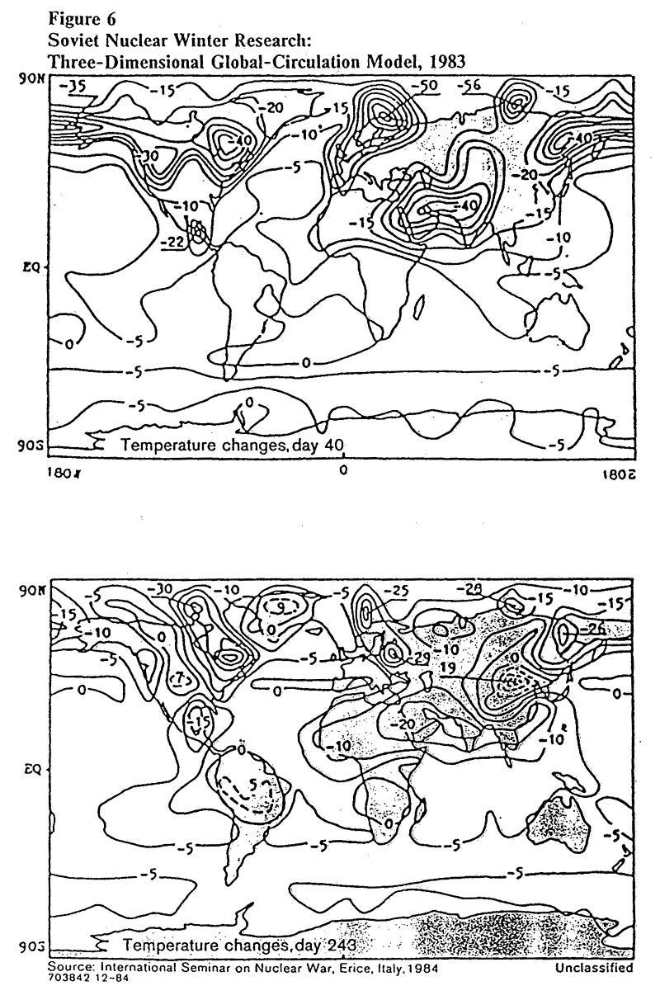

Im letzten Jahr habe ich viel Zeit mit dem nuklearen Winter verbracht. Er ist eine der möglichen globalen Katastrophen, die mich allgemein antreiben, und er ist direkt relevant für meine Arbeit (Jehn, 2023; Jehn et al., 2024). Es ist also ziemlich offensichtlich, dass ich den nuklearen Winter ernst nehme. Wenn ich über meine Arbeit geredet habe, bekam ich aber Gegenwind wie: „Interessante Studie, schade nur, dass sie zu einem Thema ist, das komplett erfunden ist.“ Solche Aussagen haben mich überrascht, denn in den letzten Jahren gab es viel Forschung mit globalen Simulationen, um die Folgen und Auswirkungen eines nuklearen Winters zu verstehen (z. B. Coupe et al. (2019)). Diese Arbeit stammt vor allem von der Arbeitsgruppe und den Kolleginnen und Kollegen von Alan Robock, Distinguished Professor am Department of Environmental Sciences der Rutgers University.

Mit der Zeit habe ich gemerkt, dass sich die Kritik am nuklearen Winter grob in zwei Lager aufteilen lässt. Im ersten Lager geht es um ganz normale wissenschaftliche Debatte: Wissenschaftler kritisieren andere Wissenschaftler, weil sie glauben, Fehler in deren Methoden gefunden zu haben. Beim nuklearen Winter dreht sich die Debatte hier vor allem um die Frage, wie viel Ruß in die obere Atmosphäre gelangen würde. Das hängt davon ab, wie gut moderne Städte brennen. Dazu haben wir eigentlich keine Daten, also ergibt es Sinn, dass wir unsicher sind. Das Team um Robock ist dafür bekannt, oft sehr pessimistische Annahmen zu treffen, also ergibt es auch Sinn, dass Leute ihn kritisieren. Wenn du mehr über diese Diskussion lesen willst, hat Hess (2021) eine gute Zusammenfassung geschrieben.

Das zweite Lager würde ich als Wissenschaftsskepsis einordnen. Manche Leute haben eine andere Sicht auf den nuklearen Winter und stellen ihn als weitgehend widerlegte Idee dar, die oft mit linken, Antikriegs-Ideologien in Verbindung gebracht wird. Als ich das erste Mal auf diese Sichtweise stieß, erinnerte sie mich an die Debatten um Klimawandelskepsis. Leute äußern heftige Skepsis gegenüber der Belastbarkeit der wissenschaftlichen Belege, obwohl diese glaubwürdig sind. Mir ist diese Haltung vor allem in Gesprächen begegnet, aber ein konkretes Beispiel ist dieser Kommentar, den ich zu einem Beitrag über den nuklearen Winter bekommen habe:

*„You should first check if nuclear winter is actually a thing. The first proponents from the 80's seem to me ideologically motivated and their theory was refuted in 1991 when soot from Kuwait's burning oilfields failed to stay at high altitude. Than [sic] around the year 2000 academics made even wilder claims that nuclear winter could be provoked by 100 nukes from an India-Pakistan war which is far less in numbers and more local than the tens of thousands of nukes used in an intercontinental bombardment presumed by 80's models. Science has problems being self correcting when it relates to ideologically important topics.“*

(„Du solltest erst mal prüfen, ob es den nuklearen Winter überhaupt gibt. Die ersten Befürworter aus den 80ern scheinen mir ideologisch motiviert, und ihre Theorie wurde 1991 widerlegt, als der Ruß der brennenden Ölfelder in Kuwait nicht in großer Höhe blieb. Dann haben Akademiker um das Jahr 2000 noch wildere Behauptungen aufgestellt, dass ein nuklearer Winter durch 100 Atombomben aus einem Krieg zwischen Indien und Pakistan ausgelöst werden könnte, was zahlenmäßig viel weniger und viel lokaler ist als die Zehntausenden Atombomben eines interkontinentalen Bombardements, von dem die Modelle der 80er ausgingen. Die Wissenschaft tut sich schwer damit, sich selbst zu korrigieren, wenn es um ideologisch wichtige Themen geht.“)

In diesem Beitrag will ich untersuchen, woher die zweite Sichtweise kommt.

# Die Ursprünge moderner wissenschaftsfeindlicher Taktiken und Ideen

Schauen wir uns zuerst die tieferen Wurzeln der Wissenschaftsleugnung an, bevor wir uns dem konkreten Fall des nuklearen Winters widmen. Ich will ein großartiges wissenschaftshistorisches Paper von Naomi Oreskes und Erik Conway (2022) besprechen. Ihr Paper untersucht, warum Wissenschaftsleugnung in der heutigen Rechten so ein großes Problem ist. Interessanterweise lässt sich Wissenschaftsleugnung allgemein auf dieselbe Zeit und sogar teilweise auf dieselben Leute zurückführen wie die Leugnung des nuklearen Winters.

In seiner Antrittsrede sagte Ronald Reagan: „Der Staat ist nicht die Lösung unseres Problems; der Staat ist das Problem“, und er scheint das aus tiefstem Herzen geglaubt zu haben. Dieser Satz fasst schön zusammen, worum es im Neoliberalismus geht. Die Idee ist, dass freies Unternehmertum der Grundstein einer freien Gesellschaft ist. Jeder Kompromiss bei der wirtschaftlichen Freiheit ist immer auch ein Kompromiss bei der politischen Freiheit. Deshalb muss man den Staat so klein wie möglich halten, um ein Höchstmaß an wirtschaftlicher und politischer Freiheit zu ermöglichen.

Diese Ideen sind aber nicht plötzlich entstanden, als Reagan Präsident wurde. Oreskes und Conway verfolgen ihre Ursprünge bis zum Anfang des 20. Jahrhunderts zurück.

* 1920er- bis 1930er-Jahre: Strom galt in den USA nicht als Teil der öffentlichen Infrastruktur. Wer Strom wollte, musste selbst dafür bezahlen. Viele Leute fanden aber, dass Strom öffentliche Infrastruktur sein sollte, für alle verfügbar. Wenig überraschend waren die privaten Stromunternehmen dagegen, weil das ihren Markt zerstört hätte. Um sicherzustellen, dass Strom ein privater Markt bleibt, starteten sie eine riesige Propagandakampagne. Sie heuerten Akademiker an, schrieben Schulbücher um und entwickelten Lehrpläne für Business Schools. Die eine große Botschaft, die sie verbreiteten, war, dass Privateigentum das Fundament des amerikanischen Wegs sei. Sich in die Geschäfte privater Unternehmen einzumischen, sei deshalb zutiefst unpatriotisch. Sie stießen aber auf ein Problem. Die meisten Leute kauften ihnen das nicht ab, weil ihnen klar war, dass staatlich bereitgestellter Strom eigentlich ziemlich gut für sie wäre. Etwas Ähnliches passierte während der Großen Depression, als die National Association of Manufacturers eine große Kampagne für die Idee fuhr, dass die Große Depression nichts mit Marktspekulation und Bankenpleiten zu tun habe, sondern von Gewerkschaften, Steuern und Regulierung verursacht worden sei.

* 1940er- bis 1970er-Jahre: Am Ende scheiterten diese Kampagnen. Die USA führten weiter mehr Regulierung ein. Das Stromnetz der USA kam zum Beispiel 1934 unter staatliche Kontrolle. Die Kampagnen halfen aber erheblich dabei, die Idee der überragenden Bedeutung des Privateigentums in die öffentliche Debatte der USA zu bringen. Der größte Vertreter dieser Ideen war damals die University of Chicago, finanziert von privaten Philanthropen. In diesen Kreisen kam die Idee auf, dass man so etwas wie „Das Kapital“ bräuchte, aber für den Neoliberalismus. Ihren neoliberalen Karl Marx fanden sie in Friedrich von Hayek, einem österreichischen neoliberalen Ökonomen. Sie finanzierten ihn, um ein Buch zu schreiben, was 1944 zur Veröffentlichung von „Der Weg zur Knechtschaft“ führte. Aus diesem Buch stammt die Unteilbarkeitsthese: die Idee, dass jeder Kompromiss bei der wirtschaftlichen Freiheit die politische Freiheit bedroht. „Der Weg zur Knechtschaft“ war ein sehr akademischer Text. Um es leichter verständlich zu machen, finanzierte die University of Chicago den Wissenschaftler Milton Friedman, um „Kapitalismus und Freiheit“ zu schreiben, das die Unteilbarkeitsthese allgemeinverständlich erklärte („Das Buch steht auf praktisch jeder Liste der 100 oder sogar 10 wichtigsten Bücher von Konservativen“).

Diese Arbeit von über einem halben Jahrhundert an staatsfeindlichen Ideen fand ihren Höhepunkt in der Präsidentschaft von Ronald Reagan. Reagan glaubte fest daran und stützte sich bei der Politik seiner Regierung stark auf Leute wie Friedman. Die größte Wirkung gab es bei den Steuern. Die sanken unter der Regierung Reagan erheblich. Die Regierung war zwar allgemein für Deregulierung und einen kleineren Staat, für Militärausgaben aber immer noch sehr offen. Der Teil des Staates, der während seiner Präsidentschaft immer mehr Geld bekam, war das Militär und vor allem der nukleare Teil. Reagan hatte aber ein Problem. Wissenschaftler fanden in dieser Zeit immer mehr Ergebnisse, dass der unkontrollierte Kapitalismus und die nukleare Aufrüstung eine Gefahr für die Menschheit waren.

Die Wissenschaftler sorgten sich vor allem um drei Themen:
* Nuklearer Winter
* Umweltverschmutzung
* Klimawandel

Bei allen drei Themen argumentierten sie, dass ein kräftiges Eingreifen des Staates nötig sei, um die Bewohnbarkeit unseres Planeten zu schützen. Diese Haltung stand aber in krassem Gegensatz zu dem, was Figuren wie Reagan und die Anhänger des Neoliberalismus wollten. Sie wollten weniger statt mehr Staat. Trotzdem betonten die Wissenschaftler weiter, dass so ein Eingreifen nötig sei.

Da ihr ideologischer Standpunkt mit empirischen wissenschaftlichen Ergebnissen kollidierte, entschied sich die Regierung Reagan meist dafür, wissenschaftliche Ergebnisse zu ignorieren oder sie sogar direkt anzuzweifeln, ohne eine empirische Grundlage dafür zu haben. Sie strich auch Geld für kritische wissenschaftliche Vorhaben und leitete Mittel zu Forschenden um, die eher bereit waren, öffentlich regierungsnahe Sichtweisen zu vertreten. Einige Beispiele dafür, wie sie sich davon abwandte, sich auf wissenschaftliche Ergebnisse zu stützen, und stattdessen nur noch Deregulierung förderte:

* Bevor Reagan ins Amt kam, hatten Wissenschaftler Luftverschmutzung mit saurem Regen in Verbindung gebracht. Die Regierung Carter arbeitete an einem Vertrag mit Kanada zur Begrenzung der Verschmutzung. Die Regierung Reagan änderte aber den Kurs, zweifelte die Wissenschaft an und mischte sich in Begutachtungen ein. 1984 beeinflusste George Keyworth, der wissenschaftliche Berater des Präsidenten, eine Begutachtung so, dass die Ergebnisse weniger sicher wirkten, um Untätigkeit zu rechtfertigen.
* Die vorherige Regierung hatte der Umweltschutzbehörde EPA zusätzliches Geld und zusätzliche Aufgaben gegeben, um die Umweltzerstörung in den USA zu bekämpfen. Reagan machte diese Änderungen rückgängig und setzte einen Unternehmensanwalt an die Spitze der Behörde, der Regulierungen wie den Clean Air Act entschieden ablehnte.
* Das Verteidigungsministerium half, den nuklearen Winter zu diskreditieren, wie im nächsten Abschnitt beschrieben.

Mit der Zeit untergruben diese Taktiken das Vertrauen der Rechten und der Neoliberalen in die Wissenschaft allgemein, was uns in die unglückliche politische Lage bringt, die wir heute oft vorfinden.

# Wie die NATO der Forschung zum nuklearen Winter das Geld strich und sie diskreditierte

Dieser Abschnitt beruht auf der Arbeit von Simone Turchetti (2021). Turchetti hat in den Archiven gegraben, um herauszufinden, warum es so wenig Forschung zum nuklearen Winter gibt und warum Leute dem Konzept so kritisch gegenüberstehen.

Die NATO ist nicht nur ein Militärbündnis. Sie ist auch ein Instrument der Diplomatie. Sie versucht dafür zu sorgen, dass ihre Mitgliedstaaten gut miteinander auskommen. Ein Weg, der dafür ausgiebig genutzt wurde, war die Finanzierung von Forschungsprojekten, um Wissenschaftler aus verschiedenen Ländern zusammenzubringen. Die NATO gab dafür viel Geld aus. Laut Turchetti war die NATO in den 1960er- und 1970er-Jahren einer der größten Wissenschaftsförderer in Westeuropa. Richard Nixon dachte sogar darüber nach, die NATO zu mehr als einem Militärbündnis zu machen. Sie sollte auch zu globalen Umweltthemen forschen, um die NATO-Mitglieder hinter einem gemeinsamen Ziel zu vereinen.

Das führte dazu, dass wichtige Forschung von der NATO finanziert wurde. Die Forschung von Paul Crutzen zur Zerstörung der Ozonschicht wurde zum Beispiel ursprünglich von der NATO finanziert. In den 1970er-Jahren interessierten sich die von der NATO geförderten Wissenschaftler aber für ein neues Thema: globale Klimaveränderungen. Dazu gehörte nicht nur die Erderwärmung, sondern auch die möglichen Klimafolgen eines Atomkriegs. Führende Stimmen waren hier wieder Paul Crutzen, aber Carl Sagan brachte das Thema ins öffentliche Bewusstsein.

Bei der NATO gingen deshalb einige Alarmglocken an. Solche Forschung stellte die gesamte nukleare Haltung der NATO direkt infrage. Wenn einen die indirekten Folgen eines Atomkriegs töten, selbst wenn man alle anfliegenden Raketen abwehren könnte, steht die ganze Idee, Atomwaffen zu haben, infrage. Gleichzeitig entdeckten Luis Alvarez und andere, dass ein Asteroideneinschlag die Dinosaurier ausgelöscht hatte, was der Idee zusätzliche Glaubwürdigkeit gab, dass globale, zerstörerische Ereignisse eine Spezies auslöschen können.

All diese neue Wissenschaft zum nuklearen Winter kam für die NATO genau zur falschen Zeit. Es war mitten in der Krise um die Euroraketen, als die NATO mehr atomwaffenfähige Raketen in Europa stationieren wollte. Dagegen gab es massive Proteste, vor allem nachdem die Idee des nuklearen Winters durch den ABC-Film „The Day After“ und den BBC-Film „Threads“ weithin bekannt geworden war.

Die NATO-Verantwortlichen mussten also einen Weg finden, die Öffentlichkeit davon zu überzeugen, dass es trotzdem in Ordnung sei, mehr Atomwaffen zu stationieren. Sie mussten irgendwie die ganze Idee des nuklearen Winters diskreditieren. Wenn niemand daran glaubte, hätten sie es wieder leichter, atomwaffenfähige Raketen nach Belieben zu stationieren (1). Der erste Schritt war einfach. Die NATO war der größte Geldgeber in diesem Bereich. Sie konnte einfach die gesamte Forschung zum nuklearen Winter nicht mehr finanzieren. Sicherheitshalber strich sie auch einem Großteil der Klimaforschung das Geld, weil sie fürchtete, dass die Erkenntnisse daraus auch genutzt werden könnten, um die Forschung zum nuklearen Winter voranzubringen.

Der zweite Schritt war schwieriger. Sie mussten dafür sorgen, dass die Leute den nuklearen Winter nicht für eine glaubwürdige wissenschaftliche Idee hielten. Dafür nutzten sie eine der klassischen Taktiken der Wissenschaftsleugnung: Wissenschaftler finden, deren Ansichten zu den eigenen passen, und ihnen Geld geben. Einige Beispiele:

* Gumundur Sigvaldason und Claude Allgre: Zwei Vulkanologen, die argumentierten, dass Vulkane in der Vergangenheit nie abrupte Klimaveränderungen ausgelöst hätten (2). Wenn Vulkane das Klima also nicht schnell verändern können, könnten es Atomwaffen auch nicht.

* Antonino Zichichi: Er organisierte mit NATO-Geld „unabhängige“ Workshops zum nuklearen Winter. Er lud Forschende ein, die dem nuklearen Winter kritisch gegenüberstanden, wie Edward Teller, und gab ihnen eine Bühne, auf der sie ohne Widerspruch über die Unmöglichkeit des nuklearen Winters reden konnten, ohne dass sie in dem Bereich tatsächlich Wissenschaft betreiben mussten (3).

* Das Oak Ridge National Laboratory und das Lawrence Livermore National Laboratory: Diese Einrichtungen lehnten damals alle Projektionen zum nuklearen Winter ab. Sie machten sogar eigene Simulationen. Ich finde es aber zumindest sehr verdächtig, wenn eine vom Militär finanzierte Einrichtung zu genau den Schlüssen kommt, die das Militär haben wollte. Diese beiden Einrichtungen hier zu finden, hat mich auch etwas überrascht, denn sie sind auch heute die führenden Stimmen in der Kritik am nuklearen Winter. Sie hier zu sehen, hat mein Vertrauen in ihre heutige Forschung weiter verringert.

Was es der NATO zusätzlich leichter machte, den nuklearen Winter zu diskreditieren, war, dass sowjetische Wissenschaftler den nuklearen Winter für ein Problem hielten. Wladimir Alexandrow machte einige Studien, die die ursprünglichen Ergebnisse zum nuklearen Winter bestätigten. Das wurde als Beleg dafür genutzt, dass der nukleare Winter eigentlich eine psychologische Operation der Sowjetunion und linker Wissenschaftler in den USA sei (4).

Beispiel für die sowjetischen Simulationen des nuklearen Winters in den 1980er-Jahren.

Leider hat dieser Angriff auf die Forschung zum nuklearen Winter von zwei Seiten funktioniert. Die Leute nahmen die Idee weniger ernst (5). Außerdem verblasste nach dem Ende der Sowjetunion sogar die Idee eines Atomkriegs an sich. Das führte dazu, dass der nukleare Winter für etwa drei Jahrzehnte fast vollständig aus der wissenschaftlichen Debatte verschwand. Zum Glück hat sich das in den letzten Jahren wieder zu ändern begonnen.

# Zusammenfassung und Fazit

Mein Argument ist folgendes: Die neoliberale Politik von Ronald Reagan und anderen stieß auf das Problem, dass ihre Idee eines kleinen Staates und der Vermeidung von Regulierung mit wissenschaftlichen Ergebnissen zur Umweltzerstörung kollidierte. Sie lösten das, indem sie Geld von den Forschenden abzogen, die sie kritisierten, und zu denen umleiteten, deren Meinungen besser passten. Mit der Zeit untergrub das das Vertrauen von Konservativen in die Wissenschaft, weil ihre politischen Anführer ihnen immer wieder Dinge erzählten, die wissenschaftlichen Ergebnissen widersprachen. Es lieferte auch ein Drehbuch, das in verschiedenen Fällen genutzt wurde. Einer davon ist der Klimawandel (6), ein anderer der nukleare Winter, so wie hier beschrieben. Ich glaube, die Wissenschaftsleugnung zum nuklearen Winter, auf die ich gestoßen bin, wurzelt in diesen historischen Ereignissen.

Es scheint aber, als würde der nukleare Winter wieder offener diskutiert. Ich bin nicht sicher, warum genau er wieder ins Overton-Fenster rückt, aber hier sind ein paar Ideen:

* Open Phil hat ziemlich viel Geld bereitgestellt, um die Forschung zum nuklearen Winter aus den 80ern mit modernen Klimamodellen nachzubauen (Robock et al., 2023). Das hat der Idee neue Glaubwürdigkeit gegeben.
* Ein Atomkrieg ist nicht die einzige Art von Ereignis, die zu einer abrupten Verringerung des Sonnenlichts führen kann. Große Vulkanausbrüche können denselben Effekt haben. Wir verstehen die Mechanismen inzwischen besser, und das lässt sich teilweise auf den nuklearen Winter übertragen.
* Eine Reihe sehr großer Waldbrände hat einen ähnlichen Mechanismus beim Aufsteigen von Ruß gezeigt, wie wir ihn nach einem Atomkrieg vermuten (Damany-Pearce et al., 2022).
* Bewegungen wie Effektiver Altruismus haben globale katastrophale Risiken allgemein wieder stärker in die öffentliche Debatte gebracht.
* Die Weltlage war in den letzten Jahren wegen großer Umbrüche wie der COVID-Pandemie und dem russischen Überfall auf die Ukraine sehr instabil. Das hat den Leuten vielleicht gezeigt, dass wir Katastrophen stärker berücksichtigen müssen.

Ich hoffe, dass der nukleare Winter diesmal auf unserer Agenda bleibt und nicht wieder in Vergessenheit gerät.

# Anmerkungen

1. Turchetti verweist hier auf offizielle NATO-Protokolle als Quelle. Ich habe keinen direkten Zugang dazu, kann es also nicht unabhängig überprüfen. Bitte beachte auch, dass ich Turchettis Punkte zusammenfasse. All das wird im Original-Paper ausführlicher erklärt.
2. Was falsch ist, aber ich weiß nicht, was die Wissenschaft damals sagte, also könnten sie das in gutem Glauben getan haben.
3. Edward Teller gilt weithin als sehr zwiespältige Figur, was seine Ansichten zu möglichen Einsätzen von Atomwaffen und ihren Folgen für die Umwelt angeht. Siehe zum Beispiel [seinen Wikipedia-Artikel](https://en.wikipedia.org/wiki/Edward_Teller#Death_and_legacy) oder Turchettis Buch „Greening the Alliance“, das eine Vielzahl von Kommentaren zu Teller enthält (Turchetti, 2018).
4. Was tatsächlich so gewesen sein könnte. Ich finde aber Quellen, die behaupten, dass die Sowjets es sicher als psychologische Operation genutzt haben, und andere, die sagen, dass die Idee des nuklearen Winters ein wichtiger Grund war, warum die Sowjets den Kalten Krieg beenden wollten. Ich weiß also nicht recht, was ich von diesem Punkt halten soll. Siehe Scouras et al. (2023) für einige Diskussionen dazu.
5. Turchetti erwähnt, dass deutlich weniger öffentlich darüber diskutiert wurde, nennt aber keine konkreten Zahlen.
6. Ich kann das Buch „Merchants of Doubt“ sehr empfehlen, wenn du tiefer in die Leugnung des Klimawandels einsteigen willst (Oreskes & Conway, 2012).

# Zitieren
Bitte das englische Original zitieren:

Jehn, F. U. (2023, September 28). Science denial and nuclear winter. Existential Crunch. [https://doi.org/10.59350/f3ew7-etr74](https://doi.org/10.59350/f3ew7-etr74)

# Quellen

* Coupe, J., Bardeen, C. G., Robock, A., & Toon, O. B. (2019). Nuclear Winter Responses to Nuclear War Between the United States and Russia in the Whole Atmosphere Community Climate Model Version 4 and the Goddard Institute for Space Studies ModelE. Journal of Geophysical Research: Atmospheres, 124(15), 8522–8543. https://doi.org/10.1029/2019JD030509
* Damany-Pearce, L., Johnson, B., Wells, A., Osborne, M., Allan, J., Belcher, C., Jones, A., & Haywood, J. (2022). Australian wildfires cause the largest stratospheric warming since Pinatubo and extends the lifetime of the Antarctic ozone hole. Scientific Reports, 12. https://doi.org/10.1038/s41598-022-15794-3
* Hess, G. D. (2021). The Impact of a Regional Nuclear Conflict between India and Pakistan: Two Views. Journal for Peace and Nuclear Disarmament, 4(sup1), 163–175. https://doi.org/10.1080/25751654.2021.1882772
* Jehn, F. U. (2023). Anthropocene Under Dark Skies: The Compounding Effects of Nuclear Winter and Overstepped Planetary Boundaries. Intersections, Reinforcements, Cascades: The Proceedings of the 3rd Annual Stanford Existential Risks Conference, 1(1). https://doi.org/10.25740/ZB109MZ2513
* Jehn, F. U., Dingal, F. J., Mill, A., Harrison, C. S., Ilin, E., Roleda, M. Y., James, S. C., & Denkenberger, D. C. (2024). Seaweed as a Resilient Food Solution After a Nuclear War. Earth’s Future, 12(1), e2023EF003710. https://doi.org/10.1029/2023EF003710
* Oreskes, N., & Conway, E. (2022). From Anti-Government to Anti-Science: Why Conservatives Have Turned Against Science. Daedalus, 151, 98–123. https://doi.org/10.1162/daed_a_01946
* Oreskes, N., & Conway, E. M. (2012). Merchants of doubt: How a handful of scientists obscured the truth on issues from tobacco smoke to global warming (Paperback. ed). Bloomsbury.
* Robock, A., Xia, L., Harrison, C., Coupe, J., Toon, O., & Bardeen, C. (2023). Opinion: How Nuclear Winter has Saved the World, So Far. https://doi.org/10.5194/acp-2022-852
* Scouras, J., Ice, L., & Proper, M. (2023). Nuclear Winter, Nuclear Strategy, Nuclear Risk. Defense Technical Information Center. https://apps.dtic.mil/sti/citations/AD1201181
* Turchetti, S. (2018). Greening the Alliance: The Diplomacy of NATO’s Science and Environmental Initiatives. University of Chicago Press. https://press.uchicago.edu/ucp/books/book/chicago/G/bo31043377.html
* Turchetti, S. (2021). Trading Global Catastrophes: NATO’s Science Diplomacy and Nuclear Winter. Journal of Contemporary History, 56(3), 543–562. https://doi.org/10.1177/0022009421993915
