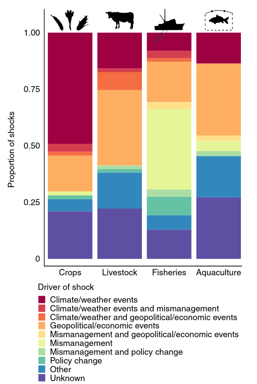
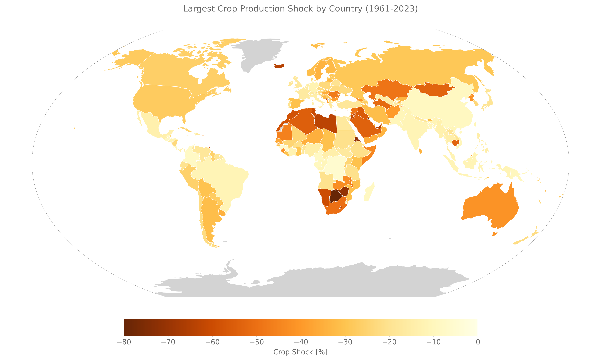
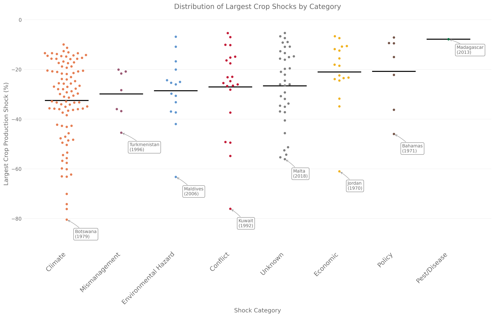
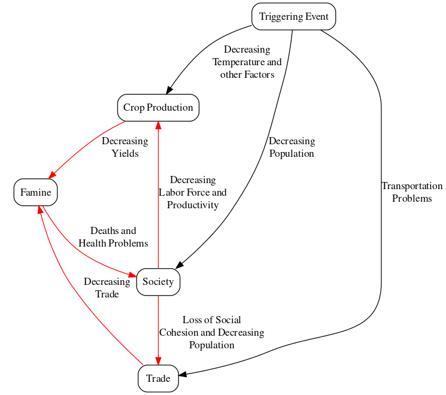
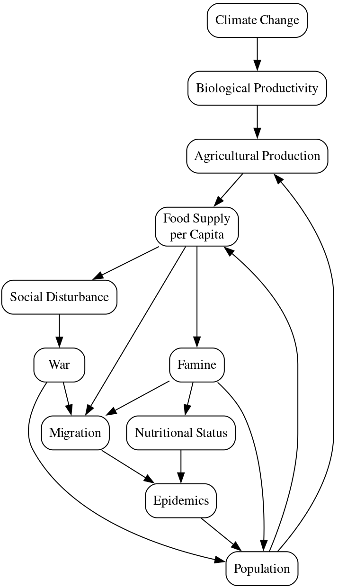

Wenn man über den Kollaps vergangener Gesellschaften liest, taucht fast immer eines auf: Hungersnot. Warum sind Hungersnöte so eng mit gesellschaftlichem Kollaps verbunden? Dieser Beitrag fasst die Gründe für diese enge Verbindung zusammen.

# Hungersnöte haben viele Auslöser

Zunächst einmal ist das Ernährungssystem mit vielen Teilen unserer Gesellschaft eng verbunden. Wir brauchen zum Beispiel ein stabiles Klima, eine stetige Versorgung mit Dünger und Pestiziden und Verkehrsinfrastruktur, um die Lebensmittel von dort, wo sie wachsen, dorthin zu bringen, wo sie gebraucht werden. Diese Vernetzung bedeutet, dass ganz verschiedene Ereignisse das Ernährungssystem treffen können. Ein Rahmen, der das gut zeigt, findet sich in einem Paper von Avin et al. (2018). Sie haben das bestehende Konzept der planetaren Grenzen genutzt (mehr zu planetaren Grenzen im Zusammenhang mit Kollaps gibt es [hier](https://existentialcrunch.substack.com/p/mapping-out-collapse-research#%C2%A7limits-to-growth)), um herauszufinden, welche Teile der menschlichen Gesellschaft für globale Katastrophen verwundbar sind (zum Beispiel Atomkrieg, Asteroideneinschläge und Geoengineering). Sie ordnen die globalen Katastrophen danach ein, mit welchen kritischen gesellschaftlichen Systemen sie interagieren (z. B. das Ernährungssystem oder die globale Sicherheit) und wie sich die Katastrophe ausbreitet (z. B. über natürliche Systeme wie die Verteilung in der Luft oder über abstraktere Netzwerke wie die digitale Infrastruktur). Sie finden, dass unser Ernährungssystem der Teil unserer Gesellschaft ist, der von den meisten globalen Katastrophen getroffen wird.

Das liegt vor allem daran, dass das Ernährungssystem von einem stabilen Status quo abhängt. Lebensmittel werden fortlaufend angebaut und brauchen dafür ständig ein passendes Klima, Dünger und Pestizide, und ein intaktes Handelssystem, um verteilt zu werden. Wenn irgendein Teil dieser Kette gestört wird, leidet die Lebensmittelproduktion.

Diese Beschreibung ist ziemlich abstrakt. Man kann sich auch empirischer anschauen, wie viele Faktoren das Ernährungssystem beeinflussen. Ein Paper von Cottrell et al. aus dem Jahr 2019 hat sich Produktionsdaten für Nutzpflanzen, Tierhaltung, Fischerei und Aquakultur angeschaut und bestimmt, ob es in diesen Bereichen in den Jahren 1961 bis 2013 einen Lebensmittelschock gab. Als Lebensmittelschock definieren sie jedes Ereignis in ihren Daten, bei dem es einen negativen Bruch in der Autokorrelation gibt, und versuchen, ein reales Ereignis zu finden, das diesen Bruch erklärt. Autokorrelation ist ein statistisches Konzept, das misst, wie eng ein Datenpunkt mit seinen vorherigen Werten zusammenhängt. Sie finden, dass Schocks in der Lebensmittelproduktion mehr oder weniger ständig passieren, aber nur auf lokaler Ebene, und sich meistens ausgleichen, wenn man global schaut. Die Hauptgründe für diese Schocks sind Klimaereignisse (am stärksten bei Nutzpflanzen), geopolitische Ereignisse (am stärksten bei Tierhaltung und Aquakultur) und Missmanagement (am stärksten bei der Fischerei) (1).

Abbildung 1: Ursachen von Schocks in der Lebensmittelproduktion (Cottrell et al., 2019)

Wenn wir uns speziell Schocks in der Pflanzenproduktion noch genauer anschauen wollen, können wir Jehn et al. (2026) nehmen (Hinweis: Ich bin Erstautor dieses Papers). Die Idee des Papers war, sich die gesamte Pflanzenproduktion anzuschauen, statt sie in einzelne Zeitreihen für jede Nutzpflanze aufzuteilen. Dafür wurden die einzelnen Nutzpflanzen über ihren Kaloriengehalt zusammengefasst, was eine Zeitreihe der Kalorienproduktion pro Land ergab. Die Schocks wurden erkannt, indem man die tatsächlichen Kalorienwerte jedes Jahres mit der Menge verglich, die man nach dem langfristigen Trend in diesem Jahr erwartet hätte. So konnten wir die Jahre mit den größten Schocks in der Pflanzenproduktion in jedem Land finden (Abbildung 2).

Abbildung 2: Die größten Schocks in der Pflanzenproduktion pro Land. Dunklere Farben zeigen größere Schocks.

Wie man sieht, können die Schocks ziemlich groß sein. Vor allem in Afrika haben mehrere Länder Schocks in der Pflanzenproduktion von 60 % oder mehr erlebt. Aber auch die größten Produzenten der Welt hatten erhebliche Schocks. Die USA hatten 1983 zum Beispiel einen Einbruch der Pflanzenproduktion von fast 30 %.

Durch die Durchsicht historischer Dokumente und Quellen wie FAO-Berichten konnte fast jeder Schock einem historischen Ereignis zugeordnet werden, das ihn plausibel verursacht hat. So konnten wir auch die verschiedenen Ursachen miteinander vergleichen (Abbildung 3).

Abbildung 3: Swarm-Plots der Größe von Schocks in der Pflanzenproduktion nach Ursachenkategorie. Die schwarze Linie zeigt den Mittelwert. Einzelne Punkte zeigen alle Schocks auf Länderebene. Für jede Kategorie ist der größte Schock mit Jahr und Land beschriftet.

Das zeigte, dass klimabedingte Schocks in den meisten Ländern die größten Schocks sind und auch insgesamt die schwersten. Die große Mehrheit dieser Klimaschocks waren Dürren. Aber auch die meisten anderen Kategorien enthalten große Schocks, was zeigt, dass eine ausreichend große Krise jeder Art verheerend für die Landwirtschaft sein kann.

# Hungersnöte verstärken sich selbst

Es gibt also viele Wege in eine Hungersnot. Ein zweiter Grund für die Verbindung zwischen Hungersnot und gesellschaftlichem Kollaps ist aber, dass es schwer ist, wieder herauszukommen, wenn man einmal in einer Hungersnot steckt, weil sie sich tendenziell selbst verstärkt. Charalampopoulos & Droulia (2021) haben sich historische Hungersnöte angeschaut und versucht, ein einfaches Modell zu entwickeln, das den Zusammenhang zwischen Extremwetterereignissen und Hungersnot erfasst. Ich habe es aus ihrem Paper (Abbildung 4) in eine allgemeinere Form gebracht, weil ihre Erklärung für mich so klingt, als wäre es egal, was die Hungersnot auslöst.

Abbildung 4: Der sich selbst verstärkende Mechanismus von Hungersnöten (angepasst nach Charalampopoulos & Droulia (2021)). Rote Pfeile zeigen den sich selbst verstärkenden Kreislauf der Hungersnot.

Der sich selbst verstärkende Kreislauf, den sie beschreiben, beginnt mit einem auslösenden Ereignis, das alle möglichen Faktoren umfassen kann, die eine Gesellschaft unter Stress setzen. Das kann ein globales katastrophales Risiko sein, aber das Konzept gilt allgemein für jedes Ereignis, das die Lebensmittelproduktion deutlich verringert oder den Handel stört, und kann lokal, regional oder global sein.
Dieses auslösende Ereignis wirkt über mehrere Wege. Erstens kann es die Pflanzenproduktion behindern, indem es ungünstige Bedingungen für das Pflanzenwachstum schafft, etwa niedrigere Temperaturen. Zweitens verringert es die Gesamtbevölkerung der Gesellschaft und damit die verfügbaren Arbeitskräfte. Drittens schafft es Transportprobleme, die eine effiziente Verteilung von Lebensmitteln behindern.
Wenn diese Effekte ein kritisches Ausmaß erreichen, setzen sie einen sich selbst verstärkenden Kreislauf in Gang:

* Eine Gesellschaft, die einen erheblichen Teil ihrer Bevölkerung verliert, wird unweigerlich weniger in der Lage sein, Lebensmittel zu produzieren und zu handeln.
* Weniger Produktion und Handel führen zu weniger verfügbaren Lebensmitteln in der Gesellschaft.
* Die Knappheit an Lebensmitteln führt zu mehr Hunger, mehr Todesfällen und mehr gesundheitlichen Problemen, und damit beginnt die nächste Runde des Kreislaufs.

Dieser sich selbst verstärkende Kreislauf geht so lange weiter, bis eines von zwei Dingen passiert: Man bekommt Essen von woanders, oder die lokale Bevölkerung und Lebensmittelproduktion finden ein neues Gleichgewicht. Die erste Option gab es früher oft nicht, weil der Transport von Waren vor den fossilen Brennstoffen vergleichsweise teuer war, und es gäbe sie heute auch nicht, wenn wir vor einer globalen Katastrophe stünden. Die zweite Option bedeutet meist, dass das neue Gleichgewicht deutlich niedriger liegt als vorher. Während die Hungersnot weitergeht, zerbröckeln die gesellschaftlichen Strukturen, die nötig sind, um viel Essen zu produzieren. Die niedrigsten Gleichgewichte sind entweder kleinbäuerliche Höfe oder Gruppen von Jägern und Sammlern. Charalampopoulos & Droulia (2021) argumentieren, dass Hungersnöte, was die Zerstörung sozialer Strukturen und Bevölkerungszahlen angeht, mit großen Kriegen vergleichbar sind. Sie betonen auch, dass Hungersnöte meist zusammen mit anderen erschütternden Ereignissen wie Krieg, Migration oder Revolution auftreten. Das macht es noch schwerer, den Kreislauf der Hungersnot zu stoppen.

# Gegen Hungersnöte kann man sich schwer schützen

Viele Dinge können also Hungersnöte auslösen, und wenn sie einmal begonnen haben, kommt man schwer wieder heraus. Aber man kann sich auch schwer gegen sie schützen. Menschen essen viel, und vieles von unserem Essen verdirbt schnell, vor allem wenn es nicht gekühlt wird. Es gibt also zu jedem Zeitpunkt nur eine begrenzte Menge an Lebensmitteln.

Die weltweite Menge an Lebensmitteln ist schwer abzuschätzen, und sie schwankt auch über das Jahr, je nach Jahreszeit. Es gibt aber einige grobe Schätzungen. Baum et al. (2015) haben einen Literaturüberblick dazu gemacht, welche Maßnahmen die Resilienz gegenüber Katastrophen in der globalen Lebensmittelversorgung erhöhen könnten, und kommen darauf, dass wir weltweit mit einem Puffer von 4 bis 7 Monaten an Lebensmitteln rechnen können. Sie argumentieren auch, dass Lebensmittellager zwar etwas Spielraum im System schaffen, aber nicht wirklich die Lösung für größere Katastrophen sind. Lebensmittel einzulagern ist sehr teuer. Große Reserven aufzubauen und zu halten, erhöht die Lebensmittelpreise weltweit, was heute schon mehr Menschen in Unsicherheit bringt. Und schließlich bräuchten viele der Katastrophen, die zu einem globalen gesellschaftlichen Kollaps führen könnten, Lebensmittelvorräte für 5 bis 15 Jahre (zum Beispiel ein nuklearer Winter, ein vulkanischer Winter oder ein Impaktwinter). Es könnte schlicht fast unmöglich sein, so eine gigantische Menge an Lebensmitteln so lange sicher zu lagern. Lebensmittelvorräte können also immer nur zur Ernährungssicherheit beitragen, aber nicht die alleinige Lösung sein, vor allem nicht bei größeren Katastrophen.

Lebensmittel vor einer Hungersnot einzulagern ist zwar schwierig (vor allem bei mehrjährigen globalen Hungersnöten), aber das ist nicht der einzige Weg, wie Länder ihr Risiko senken können. Bemerkenswert ist, dass noch keine stabile Demokratie eine Hungersnot erlebt hat (Hasell & Roser, 2013). Allgemeiner hat man festgestellt, wie [in diesem früheren Beitrag](https://florianjehn.github.io/Societal_Collapse/2023-08-16-democracy_and_resilience/) besprochen, dass Beteiligung und Demokratie die Resilienz von Gesellschaften stärken.

# Hungersnot im Zusammenspiel mit Klima und Gesellschaft
All diese komplexen Wechselwirkungen von Hungersnot mit anderen Teilen der Gesellschaft finden wir, wenn wir in die Geschichte schauen. Zhang et al. (2011) haben versucht, die zeitliche Abfolge von Hungersnöten, Klima und anderen großen menschlichen Krisen zu bestimmen. Dafür haben sie ein Modell gebaut, das sich anschaut, wann Klimaschocks auftreten und wie sich die Folgen durch die Gesellschaft fortpflanzen (Abbildung 5). Dann haben sie mit empirischen Daten und statistischer Analyse bestimmt, in welcher Reihenfolge Klimaschocks und gesellschaftliche Folgen auftreten und ob das ihrem Modell folgt.

Abbildung 5: Komplexes Zusammenspiel von Klimaschocks und Hungersnot, angepasst nach Zhang et al. (2011).

Sie finden einen Mechanismus, der dem bisher hier beschriebenen ziemlich ähnlich ist, und auch die zeitliche Abfolge stimmt. Normalerweise kommt also zuerst der Klimaschock, der die Menge an Lebensmitteln verringert, die man produzieren kann, was wiederum zu Hungersnot, Konflikten und Krankheiten führt. Das führt zu einem Bevölkerungsrückgang, der wiederum sowohl die benötigte als auch die produzierte Menge an Lebensmitteln verändert. Das Paper von Zhang und Co-Autoren verbindet also schön die Ursachen von Lebensmittelschocks mit ihren Folgen in einem empirisch bestätigten Modell. Konkretere Beispiele dafür, wie so eine Kaskade in unserer Geschichte abläuft, findest du im Beitrag über die [Krise nach der Kartoffelfäule](https://existentialcrunch.substack.com/p/potatoes-and-revolution) und in der [ausführlichen Analyse der Kleinen Eiszeit](https://florianjehn.github.io/Societal_Collapse/2023-11-20-case_study_volcanoes/).

Das Modell von Zhang et al. deckt nur die direkten Wechselwirkungen vom Klima bis zum Bevölkerungsrückgang ab. Wenn man aber wirklich verstehen will, wie sich die Dinge entwickeln könnten, ergibt es Sinn, auch indirekte Prozesse einzubeziehen. Dieses riesige Projekt haben Richards et al. (2021) angepackt. Sie haben ein [Wirkungsschleifendiagramm](https://link.springer.com/article/10.1007/s10584-021-02957-w/figures/5) (1) gebaut, das auch die indirekten Effekte von Klima, gesellschaftlichem Kollaps und Ernährung enthält. Soweit ich weiß, wurde es noch nicht für tatsächliche Modellierung verwendet, aber ich denke, das wäre ziemlich aufschlussreich, weil es eine große Bandbreite an quantifizierten Wechselwirkungen enthält. Sie zeigen zum Beispiel, wie selbst ziemlich getrennte gesellschaftliche Prozesse wie Innovation, Migration und Konsumnachfrage alle über das Ernährungssystem verbunden sind. Es zeigt auch, wie zentral unser Ernährungssystem als Bindeglied zwischen unserem Klima und gesellschaftlichem Kollaps ist. Gesellschaften können viele Probleme aushalten, aber sobald die Lebensmittelproduktion stoppt, bricht alles schnell zusammen.

# Handel und Hungersnöte heute

All diese Punkte zeigen, dass unser Ernährungssystem ziemlich anfällig für eine ganze Reihe von Belastungen ist und dass wir nicht einfach genug Lebensmittel einlagern können, um es zu stabilisieren. Die Vergangenheit zeigt aber auch, dass Schocks in der Lebensmittelversorgung nicht zu einer Hungersnot führen müssen, wenn es eine Quelle von außen gibt, die den Produktionsausfall ausgleichen kann.

Globale katastrophale Risiken belasten unser Ernährungssystem nicht überall gleich. Es wird immer Gegenden geben, die weniger stark getroffen werden und vielleicht selbst unter extremeren Umständen noch Lebensmittel produzieren können. Ein Paper, das das untersucht, ist Boyd & Wilson (2022). Für alle großen Inseln (zum Beispiel Island oder Australien, das man als Insel von der Größe eines Kontinents zählen könnte) sammeln sie empirische Daten zu Dingen wie Lebensmittelproduktion, Verfügbarkeit von Lebensmitteln und anderen Faktoren, die nach globalen Katastrophen wichtig sind. Unter den großen Inseln liegt Australien bei vielen dieser Faktoren vorn. Mit Blick auf den Schutz vor globalen Hungersnöten ist besonders relevant, dass Australiens Kapazität zur Lebensmittelproduktion ziemlich groß ist, weil es ein großer Exporteur ist. Australien könnte also eine wichtige stabilisierende Rolle für die globale Lebensmittelproduktion spielen, solange Handel möglich bleibt.

Tatsächlich taucht die Bedeutung des Handels in viel Forschung zur Ernährungssicherheit auf, sowohl heute als auch nach Katastrophen (wie in der Arbeit von Boyd & Wilson). Wang et al. (2023) zeigen zum Beispiel mit globalen Handelsdaten von 1986 bis 2018, dass die Zahl der Länder, die mit Lebensmitteln handeln, und die gehandelte Menge im Lauf der Zeit stark gestiegen sind. Der Lebensmittelhandel ist also für die Ernährungssicherheit vieler Länder heute viel wichtiger als früher. Wang und Co-Autoren warnen außerdem, dass sich dieses Netz schnell auflösen könnte, wenn wichtige Exportländer Exportverbote für Lebensmittel verhängen, weil das wahrscheinlich eine Kaskade von Exportverboten weltweit auslösen würde, was wiederum viele Länder in Ernährungsunsicherheit stürzen würde. Jetzt schon, und erst recht nach einer Katastrophe.

All das zeigt: Unser heutiges Ernährungssystem kann zwar für den Großteil der Menschheit Ernährungssicherheit schaffen, aber es gibt viele Wege, die diesen relativ stabilen Zustand beenden könnten. Wang et al. fassen das so zusammen, dass unser Ernährungssystem „robust, aber fragil“ ist. Kleine Schocks können wir leicht abfedern, ob das auch nach einem großen Schock gilt, ist viel weniger sicher.

# Anmerkungen

(1) Ich verlinke es hier direkt, weil es so groß ist.

# Zitieren
Bitte das englische Original zitieren:

Jehn, F. U. (2023, October 5). Famine's Role in Societal Collapse. Existential Crunch. [https://doi.org/10.59350/w5p0a-8b496](https://doi.org/10.59350/w5p0a-8b496)

# Quellen

* Avin, S., Wintle, B. C., Weitzdörfer, J., Ó hÉigeartaigh, S. S., Sutherland, W. J., & Rees, M. J. (2018). Classifying global catastrophic risks. Futures, 102, 20–26. https://doi.org/10.1016/j.futures.2018.02.001
* Baum, S. D., Denkenberger, D. C., Pearce, J. M., Robock, A., & Winkler, R. (2015). Resilience to global food supply catastrophes. Environment Systems and Decisions, 35(2), 301–313. https://doi.org/10.1007/s10669-015-9549-2
* Boyd, M., & Wilson, N. (2022). Island refuges for surviving nuclear winter and other abrupt sunlight‐reducing catastrophes. Risk Analysis, risa.14072. https://doi.org/10.1111/risa.14072
* Charalampopoulos, I., & Droulia, F. (2021). The Agro-Meteorological Caused Famines as an Evolutionary Factor in the Formation of Civilisation and History: Representative Cases in Europe. Climate, 9(1), Article 1. https://doi.org/10.3390/cli9010005
* Cottrell, R. S., Nash, K. L., Halpern, B. S., Remenyi, T. A., Corney, S. P., Fleming, A., Fulton, E. A., Hornborg, S., Johne, A., Watson, R. A., & Blanchard, J. L. (2019). Food production shocks across land and sea. Nature Sustainability, 2(2), Article 2. https://doi.org/10.1038/s41893-018-0210-1
* Hasell, J., & Roser, M. (2013). Famines. Our World in Data. https://ourworldindata.org/famines
* Jehn, F. U., Mulhall, J., Blouin, S., Gajewski, Ł. G., & Wunderling, N. (2026). The largest crop production shocks: Magnitude, causes and frequency. Earth System Dynamics, 17(1), 151–166. https://doi.org/10.5194/esd-17-151-2026
* Richards, C. E., Lupton, R. C., & Allwood, J. M. (2021). Re-framing the threat of global warming: An empirical causal loop diagram of climate change, food insecurity and societal collapse. Climatic Change, 164(3), 49. https://doi.org/10.1007/s10584-021-02957-w
* Wang, X., Ma, L., Yan, S., Chen, X., & Growe, A. (2023). Trade for Food Security: The Stability of Global Agricultural Trade Networks. Foods, 12, 271. https://doi.org/10.3390/foods12020271
* Zhang, D. D., Lee, H. F., Wang, C., Li, B., Pei, Q., Zhang, J., & An, Y. (2011). The causality analysis of climate change and large-scale human crisis. Proceedings of the National Academy of Sciences, 108(42), 17296–17301. https://doi.org/10.1073/pnas.1104268108
