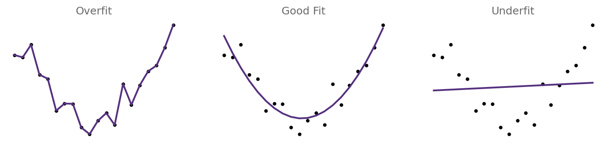
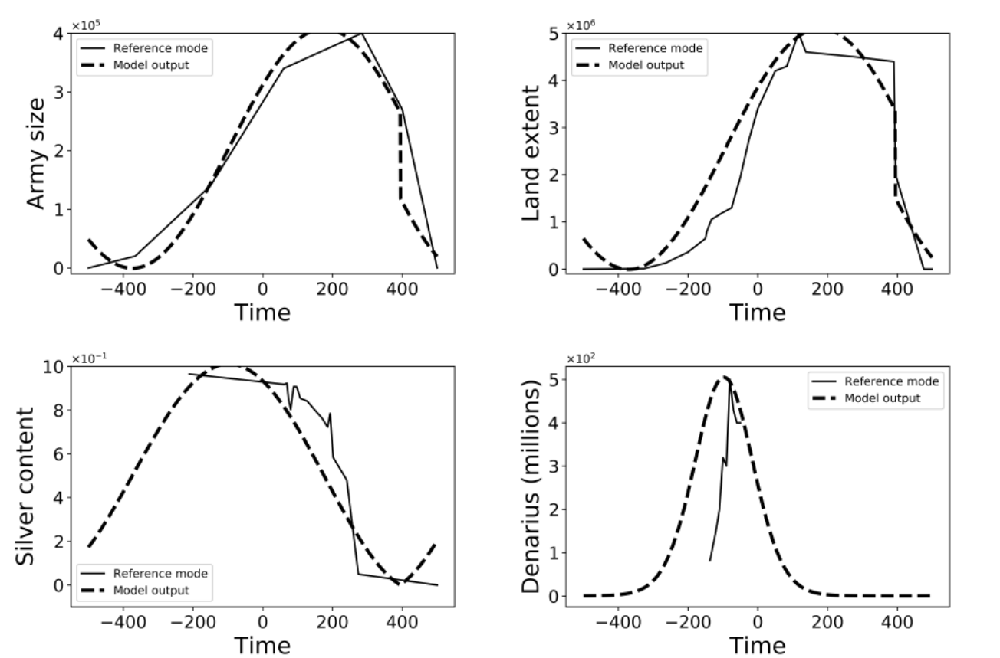
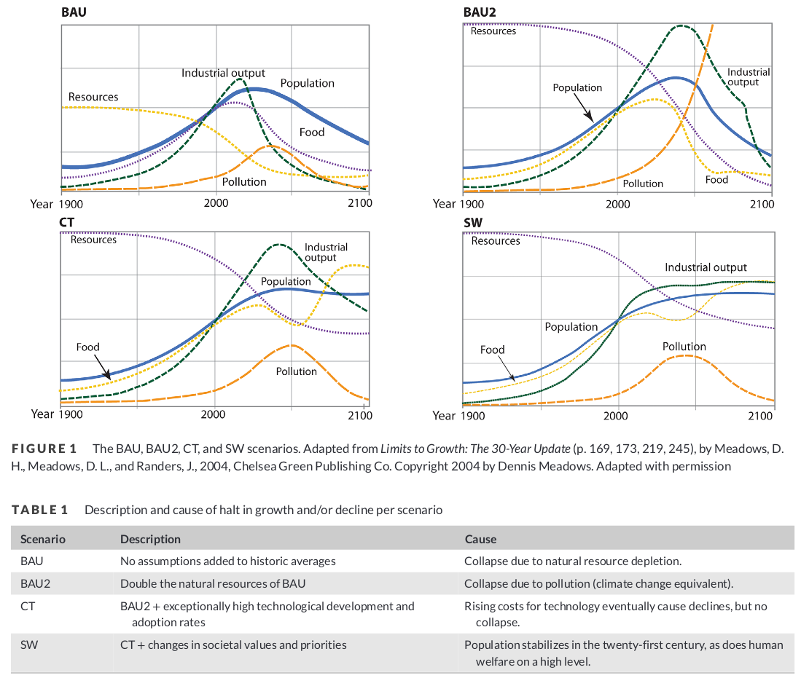

Der [erste Beitrag](https://florianjehn.github.io/Societal_Collapse/2023-06-06-collapse_overview/) dieses fortlaufenden Literaturüberblicks hat das Feld der Kollapsforschung zusammengefasst. Eines macht dieser Beitrag klar: Wir brauchen bessere Modelle gesellschaftlicher Dynamik. Dieser Beitrag schaut sich an, wie es um die Modellierung gesellschaftlicher Dynamik steht.

# Überblick über verschiedene Modellierungsansätze

Eine hilfreiche Arbeit zur Modellierung gesellschaftlicher Dynamik ist ein Literaturüberblick von Sabin Roman, den ich hier als Grundlage für einen ersten Überblick nehme (Roman, 2023) (1).

Die Kollapsforschung hat unter anderem gezeigt, dass man Kollaps nicht einer einzelnen Ursache zuschreiben kann. Vielleicht kann man ihn aber auf einen einzelnen Prozess zurückführen. Roman schlägt vor, dass man in Rückkopplungsmechanismen denken muss, um die Komplexität von Kollaps zu erfassen. Um Kollaps zu verstehen, müssen wir also in multikausalen Beziehungen zwischen einer Reihe gesellschaftlicher Variablen denken und sie modellieren. Als konkreteres Beispiel für so einen Rückkopplungsprozess nimm den sich selbst verstärkenden Mechanismus von Hungersnöten, der in einem [früheren Beitrag](https://florianjehn.github.io/Societal_Collapse/2023-10-05-famine_2/) erklärt wurde:

„

* _Eine Gesellschaft, die einen erheblichen Teil ihrer Bevölkerung verliert, wird unweigerlich weniger in der Lage sein, Lebensmittel zu produzieren und zu handeln._
* _Weniger Produktion und Handel führen zu weniger verfügbaren Lebensmitteln in der Gesellschaft._
* _Die Knappheit an Lebensmitteln führt zu mehr Hunger, mehr Todesfällen und mehr gesundheitlichen Problemen, und damit beginnt die nächste Runde des Kreislaufs._

“

Diese Rückkopplungsprozesse sind besonders wertvoll, wenn man quantitativ modellieren will, und Roman stellt die Arten von Modellen vor, mit denen gesellschaftlicher Kollaps über Rückkopplungsprozesse modelliert wurde. Roman unterscheidet vor allem danach, wie die Modelle aufgebaut sind (agentenbasierte Modelle vs. Weltmodelle), und aus welchen Feldern sie ihre Inspiration ziehen (ökonomisch begründete vs. ökologisch inspirierte Modelle).

# Agentenbasierte Modelle vs. integrierte Weltmodelle

Das ist der Unterschied zwischen Modellen, die sich auf Individuen und ihre Interaktionen konzentrieren, und Modellen, die eher abstraktere Prozesse modellieren.

Agentenbasierte Modelle kann man sich als Sammlung simulierter, stark vereinfachter Individuen vorstellen. Sie interagieren in jedem Zeitschritt der Simulation auf die Arten miteinander, die das Modell zulässt. Die Idee ist, dass aus diesen Interaktionen zwischen den Individuen ein emergentes Verhaltensmuster entsteht, das uns hilft, soziale Dynamik zu verstehen.

Integrierte Weltmodelle modellieren dagegen keine Individuen, sondern versuchen zu verstehen, wie sich gesellschaftliche Prozesse direkt in Gleichungen ausdrücken lassen. Sie bestehen meist aus einer Reihe von Variablen, die miteinander gekoppelt sind. Man könnte zum Beispiel den sich selbst verstärkenden Mechanismus von Hungersnöten als Gleichungen ausdrücken und das Modell dann mit verschiedenen Eingangsparametern laufen lassen, um zu sehen, wie sich die Rückkopplung dadurch verändert.

Wenn wir den Kreislauf der Hungersnot agentenbasiert modellieren würden, würden wir uns wahrscheinlich auf die Entscheidungen von Individuen konzentrieren, die mit Nahrungsknappheit konfrontiert sind. Jeder Agent, getrieben vom Bedürfnis, genug Nahrung zu sammeln, würde mit anderen Agenten und mit Faktoren wie Nahrungsquellen interagieren. Diese Simulation würde über viele Zeitschritte laufen, in denen die Agenten immer wieder interagieren. Am Ende der Simulation würden wir uns den Zustand aller Agenten anschauen, um die Ergebnisse ihrer Interaktionen zu bestimmen. In einem Hungersnot-Szenario könnte das zeigen, dass ein Teil der Agenten verhungert, weil er keine Nahrung findet, während es anderen besser geht, weil sie sich genug Nahrungsquellen sichern konnten.

Wenn wir den Kreislauf der Hungersnot mit einem Weltmodell modellieren würden, würden wir uns stattdessen auf übergeordnete Variablen wie Bevölkerung, gesamte Nahrungsvorräte und zusätzliche Belastungen wie Krankheiten konzentrieren. Rückkopplungsmechanismen, umgesetzt über Differentialgleichungen, würden diese Variablen miteinander verbinden. Wir könnten zum Beispiel festlegen, dass eine größere Bevölkerung die Nahrungsvorräte verringert und dass mehr Krankheiten zu einem Bevölkerungsrückgang führen. Wie beim agentenbasierten Modell würde dieses Modell Zeitschritt für Zeitschritt laufen, wobei die Differentialgleichungen die Werte der Variablen beeinflussen. Am Ende der Simulation können wir uns die Variablen anschauen, etwa ob die Bevölkerung gewachsen oder geschrumpft ist.

Beide Arten von Modellen haben das Problem, dass es sehr schwer ist, die richtige Zahl von Parametern und ihre richtigen Werte zu finden, sowohl für das Verhalten der Individuen in der agentenbasierten Modellierung als auch für die Rückkopplungsmechanismen in Weltmodellen. Man braucht genug Parameter, um seine Daten genau modellieren zu können, aber je mehr Parameter man hat, desto mehr Daten braucht man, um ihre Werte sinnvoll einzugrenzen. Man hat also einen Zielkonflikt zwischen Unter- und Überanpassung (Abbildung 1), den man schwer richtig hinbekommt.

Abbildung 1: Beispiel für Über- und Unteranpassung an Daten.

# Ökonomisch begründete vs. ökologisch inspirierte Modelle

Modelle unterscheiden sich auch darin, ob sie ihre Inspiration aus der Ökonomie oder der Ökologie ziehen. Diese Modelle unterscheiden sich nicht unbedingt in ihren Werkzeugen, sondern in den Annahmen dahinter. Ökonomisch begründete Modelle nehmen meist rationale, nutzenmaximierende Agenten an. Das wird oft als Nutzenfunktion ausgedrückt. Diese Modelle versuchen meist, die Daten mit Modellen anzupassen, die annehmen, dass Menschen völlig rationale Akteure sind. Laut Roman hat das nicht gut funktioniert. Ökonomisch begründete Modelle sind zwar mit der Zeit komplexer geworden, passen aber immer noch schlecht zu den archäologischen Daten, die wir haben.

Ökologisch inspirierte Modelle versuchen dagegen, kollapsartige Mechanismen aus der Natur zu nutzen, um zu zeigen, wie Gesellschaften auf- und absteigen. Diese werden dann an empirischen archäologischen Daten kalibriert. Ein Beispiel dafür ist das Modell des Römischen Reichs im nächsten Abschnitt. Laut Roman scheinen diese ökologischen Prozesse besser zum Aufstieg und Fall von Zivilisationen zu passen.

# Beispiele für Modelle

Im Folgenden will ich zwei Modelle hervorheben. Ein Systemdynamikmodell von Roman & Palmer (2019), das den gesamten Lebenszyklus des Römischen Reichs simuliert, und das klassische Modell der Grenzen des Wachstums (Herrington, 2021). Ich konzentriere mich auf diese beiden, weil man Roman and Palmer (2019) als sehr neuen Ansatz der Kollapsmodellierung sehen kann, während das Modell der Grenzen des Wachstums das am besten untersuchte Kollapsmodell ist, das wir haben.

## Den Zusammenbruch des Römischen Reichs quantifizieren

Wir fangen mit dem Modell von Roman und Palmer an. Mit diesem Modell wollen Roman und Palmer die Rückkopplungsmechanismen umsetzen, die sie für den Gesamtverlauf des Römischen Reichs für wichtig halten. Um herauszufinden, welche am wichtigsten sind, gehen sie die Literatur zum Römischen Reich durch und entscheiden sich für Armeegröße, Gesamtterritorium, Veränderungen des Territoriums und Münzprägung. Die Idee ist, dass die Armeegröße bestimmt, wie viel Territorium man gewinnen und halten kann, das Territorium die Münzprägung beeinflusst und die Münzprägung bestimmt, wie viele Soldaten man bezahlen kann. Roman und Palmer nutzen ein Weltmodell und bilden jeden dieser Rückkopplungsmechanismen über verbundene gewöhnliche Differentialgleichungen ab.

Das Modell selbst hat 10 Parameter, die diese Gleichungen steuern (z. B. die Nettowachstumsrate der Silberreserven). Vereinfacht gesagt, kann man sich jeden Parameter als Regler vorstellen, der einen anderen Teil des Modells einstellt. Die Zahl der Parameter richtet sich nach der Zahl der Bestände im Modell, es gibt also einen Parameter für jede einseitige Verbindung zwischen Variablen, Selbstschleifen eingeschlossen. Sie legen einen plausiblen Bereich für diese Parameter fest und stellen sie von Hand fein ein, um visuell eine gute Übereinstimmung zwischen Modellergebnissen und beobachteten historischen Daten zu bekommen.

Abbildung 2: Vergleich simulierter (gepunktete Linie) und historischer Daten (durchgezogene Linie) für das Modell des Römischen Reichs (Roman & Palmer, 2019)

Wie man an den Ergebnissen sieht (Abbildung 2), kann das Modell die Gesamttrends grob erfassen, tut sich aber mit den feineren Details schwer, vor allem mit der Geldmenge (Denar, Abbildung unten rechts). Das ist aber zu erwarten, denn die verwendeten Daten sind dünn und beruhen oft selbst auf Stellvertreterdaten und Schätzungen, was zusätzliche Unsicherheit bringt. Ein Nachteil des Modells ist, dass es maßgeschneidert für das Römische Reich ist. Selbst wenn es uns hilft zu verstehen, warum und wie das Römische Reich zusammengebrochen ist, wird es also sehr schwer sein, irgendwelche dieser Erkenntnisse auf die moderne Gesellschaft oder andere Zivilisationen allgemein zu übertragen.

## Die Grenzen des Wachstums

Das ursprüngliche Modell der Grenzen des Wachstums wurde 1972 veröffentlicht. Ziel war es zu verstehen, wohin uns die Entwicklungen bei Dingen wie Bevölkerung, Ressourcenverbrauch und Klimawandel in Zukunft führen würden. Dafür wurde das sogenannte World3-Modell gebaut. Nach den Definitionen oben ist dieses Modell ganz klar ein ökologisch inspiriertes integriertes Weltmodell. Es versucht, die Dynamik vieler Aspekte unserer globalen Zivilisation und ihre Wechselwirkungen zu erfassen. Es versucht, die Zukunft zu simulieren, indem es die Trends von 1972 in einer Reihe von Szenarien fortschreibt. Diese Szenarien unterscheiden sich in ihren Annahmen dazu, wie viele Ressourcen es auf der Welt gibt und wie die Menschheit auf die Herausforderungen vor uns reagiert.

Anders als fast alle anderen Kollapsmodelle, die ich gefunden habe, beschäftigt sich dieses nicht mit irgendeiner vergangenen Gesellschaft, sondern mit der, in der wir gerade leben. Das bringt natürlich das Problem mit sich, dass man das Modell nicht einfach überprüfen kann, weil wir nicht wissen, was in Zukunft passiert. Das Modell wurde aber vor mehr als vier Jahrzehnten veröffentlicht, ein großer Teil der vorhergesagten Zukunft ist also schon passiert, und wir können prüfen, wie gut es sich gehalten hat. Genau das hat Herrington (2021) gemacht.

In ihrer Analyse hat sie die Ergebnisse (Abbildung 3) des Modells der Grenzen des Wachstums mit den Daten verglichen, die wir heute haben. Sie findet, dass das Modell unseren bisherigen Weg relativ genau nachgezeichnet hat. Das hat aber einen großen Haken. Das Modell sagt bis 2020 bis 2030 kaum Unterschiede zwischen den verschiedenen Szenarien vorher. Wir wissen also nur, dass das Modell bisher nicht widerlegt wurde, aber es ist immer noch unklar, auf welchem Weg wir gerade sind.

Abbildung 3: Szenarien und Trends des Modells der Grenzen des Wachstums.

## Landschaften der Angst
Als Beispiel für agentenbasierte Modellierung will ich ein Modell von Kondor et al. (2024) besprechen. Sie haben es gebaut, um zu verstehen, wie Konflikte zwischen Gruppen die Bevölkerungsdynamik in der Vorgeschichte beeinflusst haben. Aus archäologischen Daten wissen wir, dass es in nicht staatlichen Gesellschaften im Europa des mittleren Holozäns Muster aus Aufschwung und Einbruch gab, aber es wird immer noch diskutiert, was genau sie ausgelöst hat. Eine Theorie ist, dass Konflikte dahinterstecken. Teilweise, weil einfach Menschen getötet wurden, möglicherweise aber noch stärker, weil Menschen Gegenden mieden, in denen aggressive Nachbarn unterwegs sein könnten.

Um das zu testen, haben Kondor und Co-Autoren ein agentenbasiertes Modell gebaut, das über direkte Opfer hinausgeht und erfasst, wie schon die bloße Drohung von Gewalt verändert, wo Menschen leben. Sie nennen das die „Landschaft der Angst“, ein Begriff aus der Ökologie, wo Beutetiere Gegenden mit Raubtieren meiden, auch ohne dass sie tatsächlich gejagt werden.

Ihre Modelle enthalten zwei zentrale Mechanismen. Wenn Konflikte ausbrechen, verlassen Menschen verwundbare Siedlungen und drängen sich an gut zu verteidigenden Orten wie Hügeln zusammen. Die Anwesenheit aggressiver Gruppen verhindert außerdem die normale Ausbreitung in neue Gebiete, sodass sich die Bevölkerung in „sicheren“ Zonen konzentriert.

Beim Abgleich mit Radiokarbondaten aus dem Europa des mittleren Holozäns fanden sie, dass ein Szenario ganz ohne direkte Konfliktopfer die beobachteten Muster aus Bevölkerungsaufschwung und -einbruch trotzdem nachbilden konnte. Die Modelle zeigen, dass diese indirekten Effekte allein große regionale Bevölkerungsrückgänge über Jahrhunderte auslösen können, ebenso zyklische Muster, die zu den archäologischen Belegen passen, und eine Konzentration der Bevölkerung, die zu Ressourcenknappheit und erhöhter Sterblichkeit führt.

Diese Forschung zeigt, dass die psychologischen und sozialen Folgen von Konflikten viel verheerender sein können als die direkte Gewalt. Die Angst selbst wird zu einer mächtigen demografischen Kraft, die ganze Landschaften umgestaltet und möglicherweise wichtige Bevölkerungsmuster der menschlichen Vorgeschichte erklärt.

# Wie hilfreich sind diese Modelle?

Mir scheint, dass bei der Modellierung gesellschaftlichen Kollapses noch viel zu tun ist. Eine große Herausforderung ist, Modelle zu entwickeln, die sich zwischen Gesellschaften übertragen lassen. Im Moment sind viele Modelle für eine einzelne Gesellschaft maßgeschneidert. Die sind zwar leichter zu bauen und können wichtige Erkenntnisse liefern, machen es aber schwer, ihre Ergebnisse zu verallgemeinern. Zwei weitere Dinge sind mir beim Durcharbeiten aufgefallen:

1. Wir brauchen mehr und bessere Daten. Die Geschichtswissenschaft war die meiste Zeit eine sehr qualitative Wissenschaft. Erst vor Kurzem wurden große Datenbanken wie SESHAT (Turchin et al., 2019) (2) aufgebaut, die standardisierte Daten für eine Reihe von Zivilisationen über lange Zeiträume enthalten. SESHAT endet aber mit der industriellen Revolution, es wird also ziemlich schwierig, Gesellschaften über diese Lücke hinweg zu vergleichen. Eine Datenbank wie SESHAT, die auch Gesellschaften nach der industriellen Revolution enthält, wäre sehr wertvoll, um unsere Modelle zu überprüfen.
2. Kollapsmodelle könnten von anderen Feldern lernen, wenn es darum geht, Modelle zu bauen, zu kalibrieren und zu überprüfen. Im Moment scheinen die Modelle in diesem Feld sehr maßgeschneidert zu sein, und alle entwickeln ihre eigenen Werkzeuge und Ideen für Dinge wie Kalibrierung. Andere Felder bauen aber schon seit Jahrzehnten Modelle mit ähnlicher Struktur und Komplexität. Ein Beispiel, das ich kenne, ist die Hydrologie. Dort versuchen sogenannte konzeptionelle Modelle ebenfalls, natürliche Prozesse auf aggregierter Ebene als Sammlung verbundener Differentialgleichungen auszudrücken. Dieses Feld hat einige Erkenntnisse gewonnen, die für Kollapsmodellierer interessant sein könnten:
  - Automatische Modellkalibrierung: Modelle von Hand zu kalibrieren gilt in der Hydrologie als überholt, weil Forschende dabei oft ihre Vorurteile die Modellergebnisse beeinflussen lassen und es auch keine echten Vorteile bringt. Ein Beispiel für ein Werkzeug zur automatischen Kalibrierung wäre [SPOTPY](https://spotpy.readthedocs.io/en/latest/) (Houska et al., 2015).
  - Baukästen für Modelle: Die genaue Struktur eines Modells beruht oft eher auf den Vorurteilen der Forschenden als auf der echten Welt. In der Hydrologie geht der Trend deshalb zu Baukästen für Modelle. Mit ihnen lassen sich leicht verschiedene Modellstrukturen bauen, sodass man auch untersuchen kann, wie Unterschiede in der Struktur des Modells die Ergebnisse prägen. Ein Beispiel ist das Catchment Modelling Framework ([CMF](https://philippkraft.github.io/cmf/)) (Kraft et al., 2011). Es funktioniert über modulare Bausteine für das Modell, etwa verschiedene Umsetzungen desselben Prozesses, zum Beispiel zur Simulation der Versickerung von Wasser in den Boden. Diese Bausteine lassen sich leicht zusammenstecken, sodass man schnell ein neues Modell bauen kann. Wenn man bestimmte Bausteine austauscht, kann man die Wirkung von Änderungen isolieren, was es leichter macht, die Funktionsweise des Modells zu verstehen und es mit anderen Modellen zu vergleichen, die mit demselben Baukasten gebaut wurden.
  - Sinnvolle Parameterwerte zu finden ist sehr schwer: Wenn Forschende Modelle bauen, denken sie oft, dass die Prozesse, die sie umsetzen, und die Parameterwerte, die sie wählen, zumindest grob einem realen Prozess entsprechen. Das ist aber wahrscheinlich oft nicht der Fall. Das wird erst sichtbar, wenn ein Modell mehrere Ergebnisse hat, die man mit echten Daten vergleichen kann. Änderungen an Parametern, die angeblich reale Prozesse abbilden, machen oft ein Ergebnis des Modells besser und dafür ein anderes schlechter. Wie das abläuft, wird zum Beispiel in Houska et al. (2021) beschrieben.
  - Komplexität von Modellen: Ein komplexes Modell ist nicht unbedingt ein besseres Modell, vor allem wenn man nicht die Daten hat, um seine Parameter sinnvoll einzugrenzen. Komplexe Modelle haben auch andere Nachteile, zum Beispiel lange Laufzeiten. Das macht es viel schwerer, zu lernen und Dinge schrittweise zu verbessern. Das fasst auch ein Zitat von Donella Meadows schön zusammen: „Models can easily become so complex that they are impenetrable, unexaminable, and virtually unalterable.“ („Modelle können leicht so komplex werden, dass sie undurchdringlich, unüberprüfbar und praktisch unveränderbar sind.“) Wir müssen uns also immer des Balanceakts bewusst sein, alle nötigen Teile ins Modell zu packen, ohne es mit mehr zu überladen, als unsere Daten eingrenzen können.

Das alles heißt nicht, dass die Modelle, die wir haben, nutzlos sind. Sie geben uns Einsichten, die wir anders nicht bekommen könnten. Und wenn wir sie mit Modellen aus den Naturwissenschaften vergleichen, müssen wir vorsichtig sein, denn die hatten Jahrzehnte oder sogar Jahrhunderte Zeit, verfeinert zu werden, während die Modellierung gesellschaftlicher Dynamik noch in den Kinderschuhen steckt. Wenn wir mehr Ressourcen in dieses Feld stecken, würde ich mit schnellen Verbesserungen rechnen, weil viele tief hängende Früchte mangels Ressourcen und Zeit noch nicht gepflückt sind. Zur Veranschaulichung: Ich kenne nur eine Handvoll Modelle gesellschaftlicher Dynamik, während in der Hydrologie ein aktuelles Paper 47 der beliebtesten hydrologischen Modelle in einem einzigen Rahmen umgesetzt hat, um Vergleiche zwischen Modellen zu erleichtern (Trotter et al., 2022). Beim Stand und den Ressourcen der Modellierung gesellschaftlicher Dynamik scheint mir so ein Projekt dort in absehbarer Zeit unwahrscheinlich. Sobald sich dieses Feld stärker etabliert hat, würde ich erwarten, dass viele der hier beschriebenen Probleme mit der Zeit weniger wichtig werden.

# Anmerkungen

(1) Das ist ein Kapitel aus dem Buch „The Era of Global Risk“ (Beard et al., 2023), das einen Überblick über den aktuellen Stand der Forschung zu existenziellen Risiken und verwandten Themen gibt.

(2) SESHAT wird [in diesem früheren Beitrag](https://florianjehn.github.io/Societal_Collapse/2023-08-10-lessons_from_the_past/) genauer besprochen.

# Zitieren
Bitte das englische Original zitieren:

Jehn, F. U. (2023, November 15). Simulating the end of the world. Existential Crunch. [https://doi.org/10.59350/6wbfn-3pp58](https://doi.org/10.59350/6wbfn-3pp58)

# Quellen

* Beard, S. J., Rees, M., Richards, C., & Rios Rojas, C. (2023). The Era of Global Risk: An Introduction to Existential Risk Studies. Open Book Publishers. https://doi.org/10.11647/obp.0336
* Herrington, G. (2021). Update to limits to growth: Comparing the World3 model with empirical data. Journal of Industrial Ecology, 25(3), 614–626. https://doi.org/10.1111/jiec.13084
* Houska, T., Kraft, P., Chamorro-Chavez, A., & Breuer, L. (2015). SPOTting Model Parameters Using a Ready-Made Python Package. PLOS ONE, 10(12), e0145180. https://doi.org/10.1371/journal.pone.0145180
* Houska, T., Kraft, P., Jehn, F., Bestian, K., Kraus, D., & Breuer, L. (2021). Detection of hidden model errors by combining single and multi-criteria calibration. Science of The Total Environment, 777, 146218. https://doi.org/10.1016/j.scitotenv.2021.146218
* Kondor, D., Bennett, J. S., Gronenborn, D., & Turchin, P. (2024). Landscape of fear: Indirect effects of conflict can account for large-scale population declines in non-state societies. Journal of The Royal Society Interface, 21(217), 20240210. https://doi.org/10.1098/rsif.2024.0210
* Kraft, P., Vaché, K. B., Frede, H.-G., & Breuer, L. (2011). CMF: A Hydrological Programming Language Extension For Integrated Catchment Models. Environmental Modelling & Software, 26(6), 828–830. https://doi.org/10.1016/j.envsoft.2010.12.009
* Roman, S. (2023). 2. Theories and Models: Understanding and Predicting Societal Collapse. 27–54. https://doi.org/10.11647/obp.0336.02
* Roman, S., & Palmer, E. (2019). The Growth and Decline of the Western Roman Empire: Quantifying the Dynamics of Army Size, Territory, and Coinage. Cliodynamics, 10(2). https://doi.org/10.21237/C7clio10243683
* Trotter, L., Knoben, W. J. M., Fowler, K. J. A., Saft, M., & Peel, M. C. (2022). Modular Assessment of Rainfall–Runoff Models Toolbox (MARRMoT) v2.1: An object-oriented implementation of 47 established hydrological models for improved speed and readability. Geoscientific Model Development, 15(16), 6359–6369. https://doi.org/10.5194/gmd-15-6359-2022
* Turchin, P., Whitehouse, H., Francois, P., Hoyer, D., Alves, A., Baines, J., Baker, D., Bartkowiak, M., Bates, J., Bennett, J., Bidmead, J., Bol, P., Ceccarelli, A., Christakis, K., Christian, D., Covey, A., De Angelis, F., Earle, T., Edwards, N., & Xie, L. (2019). An Introduction to Seshat: Global History Databank. Journal of Cognitive Historiography, 5. https://doi.org/10.1558/jch.39395
