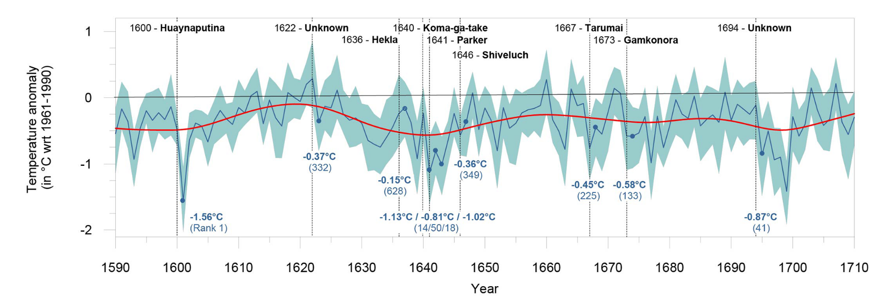

Dieser Beitrag dreht sich hauptsächlich um eine umfassende Fallstudie von Markus Stoffel und Kollegen aus dem Jahr 2022 (Stoffel et al., 2022). Das sehr dichte Paper fällt dadurch auf, dass es einen Literaturüberblick mit Daten aus ganz unterschiedlichen Quellen und historischen Aufzeichnungen verbindet. Es zeigt, wie weitreichend die gesellschaftlichen Folgen eines relativ moderaten globalen Temperaturrückgangs von maximal etwa 1 °C sein können.

# Hintergrund
Die „Kleine Eiszeit“ bezeichnet eine lange Phase kalter Klimabedingungen (1), die vor allem Europa betraf und vom 16. bis ins 19. Jahrhundert reichte. Wir konzentrieren uns auf die Zeit von Mitte der 1630er- bis Ende der 1640er-Jahre, die aus drei Gründen besonders interessant ist:

* Die Zeit von 1621 bis 1718 ist vom „Maunder-Minimum“ geprägt, einer Phase geringer Sonnenaktivität, die zu niedrigeren globalen Temperaturen führte.
* In diesem Zeitraum gab es mehrere bedeutende Vulkanausbrüche: 1637 brach die Hekla auf Island mit einem Vulkanexplosivitätsindex von 3 aus (die Skala ist logarithmisch und reicht bis maximal 8). 1640 und 1641 brachen der Mount Parker auf den Philippinen und der Komaga-take in Japan mit einem gemeinsamen Vulkanexplosivitätsindex von 6 aus. 1646 brach der Schiwelutsch auf Kamtschatka aus. Die genaue Größe ist unsicher, aber wahrscheinlich hatte er etwa die doppelte Wirkung der Hekla. Durch diese ungewöhnliche Häufung kleiner bis mittelgroßer Ausbrüche gelangte insgesamt eine beträchtliche Menge klimakühlender Gase in die Atmosphäre.
* Außerdem war diese Zeit von vielen ungewöhnlich heftigen Konflikten geprägt, vor allem vom Dreißigjährigen Krieg (1618 bis 1648), dazu kam eine große Zahl von Bürgerkriegen, darunter die Schottische Revolution, der Aufstand der Katalanen, der Restaurationskrieg in Portugal, der Englische Bürgerkrieg, der Irische Aufstand und der völlige Untergang der Ming-Dynastie in China. Im Verhältnis zur damaligen Bevölkerung waren das die zweittödlichsten Jahrzehnte seit 1400, übertroffen nur vom Zweiten Weltkrieg (Roser, 2014).

Das Paper versucht zu erklären, wie diese Konflikte mit den niedrigeren Temperaturen durch das Maunder-Minimum und die Häufung von Vulkanausbrüchen zusammenhingen.

# Temperaturanomalie im 17. Jahrhundert

Temperaturdaten aus dieser Zeit lassen sich über die maximale Spätholzdichte rekonstruieren. Die Dichte von Bäumen hängt von den Klimabedingungen ab, unter denen sie gewachsen sind. Wenn man also die Spätholzdichte misst, kann man sie als Stellvertreter für die Temperatur nutzen. Stoffel und Kollegen nutzen einen öffentlich zugänglichen Datensatz von Baumringen, um historische Temperaturen zu rekonstruieren und mit heutigen Bedingungen zu vergleichen (Abbildung 1). Das zeigt, dass die Temperaturen in den 1630er- und 1640er-Jahren absackten. Der Einbruch war aber ähnlich groß wie der frühere durch den Ausbruch des Huaynaputina in Peru (1600). Man sieht auch, dass die Temperaturen im ganzen Zeitraum niedriger waren als in der Vergleichsperiode 1961 bis 1990.

Abbildung 1: Rekonstruktion der Sommertemperatur der Nordhalbkugel anhand von Baumringen. Gezeigt ist die Abweichung von der heutigen Temperatur. Die Rangwerte in Klammern zeigen, wie stark die Abkühlung durch den jeweiligen Ausbruch im Vergleich zu allen Abkühlungsereignissen der letzten 1500 Jahre war. Die rote Linie zeigt den langfristigen Trend.

Stoffel und Kollegen verweisen außerdem auf zahlreiche zeitgenössische Berichte über niedrigere Temperaturen, „ungewöhnlichen Nebel“ und kupferrot gefärbte Himmel (2). Das zeigt, dass den Menschen damals durchaus bewusst war, dass in ihrer Umwelt ungewöhnliche Dinge passierten.

# Wetter und gesellschaftliche Not

Westeuropa, vor allem das Heilige Römische Reich, hatte schon vor 1630 mit großen Problemen zu kämpfen, vor allem wegen des langen Dreißigjährigen Kriegs. Dieser Konflikt, angetrieben von einer Mischung aus religiösen, politischen, territorialen, wirtschaftlichen und sozialen Faktoren und verschärft durch die Beteiligung anderer Länder, hatte die Region bereits stark belastet. Der andauernde Krieg hatte zu Lebensmittelknappheit geführt, aber die Lage verschlechterte sich noch weiter, als die Temperaturen zu sinken begannen. Ab Anfang der 1640er-Jahre gab es zahlreiche Berichte über kalte und nasse Sommer sowie lange und außergewöhnlich kalte Winter. Diese Klimaveränderungen verschärften lokale Konflikte, aber Ende der 1640er-Jahre waren alle Seiten so erschöpft, dass Weiterkämpfen schwierig wurde, was zu erfolgreichen Friedensverhandlungen führte. In manchen Teilen Deutschlands schrumpfte die Bevölkerung um bis zu zwei Drittel, und die Gesamtbevölkerung des Heiligen Römischen Reichs fiel von 16 auf 10 Millionen.

Ähnliche Berichte kamen aus Nordeuropa und Irland, aber auch aus weiter entfernten Gegenden wie China und Japan. Vor allem China litt schwer, denn es kämpfte bereits mit der größten Dürre der überlieferten Geschichte. Die Vulkanausbrüche von 1640/1641 verschärften die Dürre und führten zu extremen Zuständen, bis hin zu Kannibalismus, weitverbreiteten Epidemien und schließlich Krieg. Das Jahr 1645 hat die höchste dokumentierte Kriegshäufigkeit in China zwischen 850 und 1911.

# Kann man das alles den Vulkanen zuschreiben?

Die Daten von Stoffel et al. zeigen eindeutig, dass die 1630er- und 1640er-Jahre für große Teile der Welt eine harte Zeit waren. Sie werfen aber auch die Frage auf: Wie weit kann man diese Probleme den Vulkanausbrüchen und ihren klimatischen Folgen zuschreiben? China kämpfte bereits mit einer großen Dürre, und Europa steckte in Konflikten. Die Rolle der Vulkane ist hier also nicht eindeutig. Das Paper gibt eine klare Antwort: „Es kommt darauf an.“

Wie schwierig es grundsätzlich ist, gesellschaftliche Probleme dem Vulkanismus zuzuschreiben, zeigt auch eine andere Studie von Büntgen et al. (2020). Genau wie Stoffel und Co-Autoren nutzen sie große paläoklimatische Datensätze, um eine direkte Linie von Vulkanen zu gesellschaftlichen Folgen zu ziehen, und genau wie Stoffel kommen sie zu einem „Es kommt darauf an“. Ich erwähne das hier, um zu zeigen, wie schwierig es ist, aus paläoklimatischen Daten klare Schlüsse zu ziehen. Die Unsicherheiten sind groß, und es ist leicht, sich durch Rosinenpickerei eine Geschichte nach eigenem Geschmack zu bauen.

Grundsätzlich gilt: Die hier untersuchten Gesellschaften hatten schon Probleme, bevor die Vulkane ausbrachen. Einige davon hingen mit dem Klima zusammen, vor allem in China, aber die meisten waren menschengemacht und entstanden aus Konflikten und gesellschaftlichen Prozessen, die schlecht angepasst waren. Die Gesellschaften der damaligen Zeit hatten also Verwundbarkeiten, die sie anfälliger für die Gefahr von Vulkanausbrüchen machten, als sie es sonst gewesen wären.
So legen abrupte Klimastörungen durch Phasen intensiver vulkanischer Aktivität, wie die Serie von Ausbrüchen von 1636 bis 1646, tiefer liegende Probleme offen. Solche Krisen können schlecht angepasste Elemente des kulturellen, geopolitischen und sozioökonomischen Umfelds sichtbar machen, in dem sie passieren.

# Was wir heute daraus lernen können

Ich fand dieses Paper aus mehreren Gründen spannend. Es zeigt, wie viel Aufwand nötig ist, um historisches Klima zu rekonstruieren und mit gesellschaftlichen Reaktionen zu verknüpfen. Es zeigt auch, dass schon ein relativ moderater Temperaturrückgang von 1 °C große Folgen haben kann, wenn die betroffene Gesellschaft wegen ihrer Organisationsstruktur und bestehender Konflikte verwundbar ist. Das ist eine Warnung, wie verschiedene Risiken zusammenwirken können. In diesem Fall war Europa durch den Krieg schon geschwächt, bevor die Temperaturen sanken, und die beiden Faktoren haben die Probleme gegenseitig verschärft, was zu mehr Toten führte, als wenn die Ereignisse getrennt aufgetreten wären.

Außerdem zeigt das Paper, dass es nicht unbedingt einen Supervulkan braucht, um solche Folgen auszulösen. Auch eine Reihe normal großer Vulkanausbrüche, die kurz hintereinander passieren, kann erhebliche Konsequenzen haben. Und schließlich zeigt es den sich selbst verstärkenden Kreislauf von Hungersnöten und wie er mit Krisen und Krieg verflochten ist, den wir in einem früheren Beitrag besprochen haben.

Und dann wollte ich dieses Paper auch vorstellen, weil es die große Herausforderung zeigt, stimmige historische Erzählungen zu bauen. Die Forschenden haben die vorhandene Literatur gründlich durchgearbeitet und um eigene Datenanalysen auf Basis großer Datensätze paläoklimatischer Stellvertreterdaten ergänzt. Trotz all dieser Mühe konnten sie nicht eindeutig zeigen, wie weit die damals beobachteten Veränderungen auf Klima- und Umweltveränderungen zurückgehen. Geschichte zu entschlüsseln ist einfach wirklich schwer, und wir brauchen große Datenmengen, um zu sinnvollen Schlüssen zu kommen.

# Anmerkungen

(1) Nicht zu verwechseln mit der Spätantiken Kleinen Eiszeit, die wir uns angeschaut haben, als es darum ging, wie Demokratie die Resilienz beeinflusst.

(2) Der Nebel lässt sich durch einen Staubschleier vom Vulkanausbruch erklären, während der rote Himmel durch Schwefeldioxid entsteht, das das Sonnenlicht streut. Das ist auch der Grund für den roten Himmel auf dem Gemälde „Der Schrei“.

# Zitieren
Bitte das englische Original zitieren:

Jehn, F. U. (2023, November 22). Societal consequences of the Little Ice Age. Existential Crunch. [https://doi.org/10.59350/9bsn4-32g23](https://doi.org/10.59350/9bsn4-32g23)

# Quellen

* Büntgen, U., Arseneault, D., Boucher, É., Churakova (Sidorova), O. V., Gennaretti, F., Crivellaro, A., Hughes, M. K., Kirdyanov, A. V., Klippel, L., Krusic, P. J., Linderholm, H. W., Ljungqvist, F. C., Ludescher, J., McCormick, M., Myglan, V. S., Nicolussi, K., Piermattei, A., Oppenheimer, C., Reinig, F., … Esper, J. (2020). Prominent role of volcanism in Common Era climate variability and human history. Dendrochronologia, 64, 125757. https://doi.org/10.1016/j.dendro.2020.125757
* Roser, M. (2014). Global deaths in conflict since the year 1400. Our World in Data. https://slides.ourworldindata.org/war-and-violence/#/6
* Stoffel, M., Corona, C., Ludlow, F., Sigl, M., Huhtamaa, H., Garnier, E., Helama, S., Guillet, S., Crampsie, A., Kleemann, K., Camenisch, C., McConnell, J., & Gao, C. (2022). Climatic, weather, and socio-economic conditions corresponding to the mid-17th-century eruption cluster. Climate of the Past, 18(5), 1083–1108. https://doi.org/10.5194/cp-18-1083-2022
