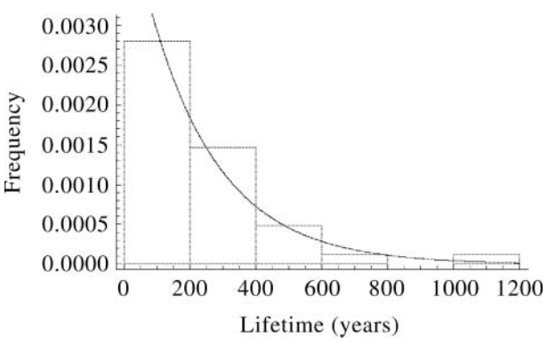
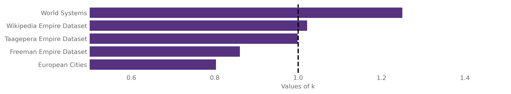

Eine Erklärung für Kollaps ist einfach Pech. Manchmal zeigen alle Faktoren, die eine Gesellschaft beeinflussen, in die falsche Richtung, und das eigene Reich zerbröselt, ohne dass man es aufhalten kann. In diesem Beitrag will ich untersuchen, ob Pech eine hilfreiche Sichtweise auf gesellschaftlichen Kollaps ist.

# Wie verbreitet ist die Pech-Sicht auf gesellschaftlichen Kollaps?

Eine der früheren Quellen, die das ausdrücklich diskutiert, ist ein kurzes Paper von Samuel Arbesman (Arbesman, 2011). Dieses Paper scheint die erste Analyse zu sein, wie lange Imperien allgemein bestehen (Abbildung 1).

Abbildung 1: Häufigkeitsverteilung der Lebensdauer von Imperien (Arbesman, 2011)

Arbesman hat einfach die Lebensdauer von Imperien aufgetragen und die Daten mit einem exponentiellen Zerfall angepasst. Er zeigt, dass die Lebensdauer offenbar einem exponentiellen Zerfall folgt, was heißen würde, dass Zivilisationen einfach zufällig ausgeknockt werden. Arbesman merkt das an, bietet aber auch einige Erklärungen, warum das vielleicht doch nicht zufällig ist. Seine wichtigste Erklärung ist der Red-Queen-Effekt. Das ist eine Anspielung auf „Alice im Wunderland“, wo Alice die Rote Königin trifft, die ihr sagt: „Hier musst du so schnell rennen, wie du kannst, um am selben Fleck zu bleiben.“ Übertragen auf unser Thema heißt das: Gesellschaften stehen einer sich wandelnden Umwelt gegenüber, die ständig neue Anpassungen von ihnen verlangt. Sie setzen diese Anpassungen um, aber das verschafft ihnen nur eine kurze Pause, weil immer wieder neue Herausforderungen auftauchen. Das führt zu einer konstanten Rate gesellschaftlicher Kollapse.

Eine ähnliche, aber umfangreichere Analyse hat vor Kurzem Anders Sandberg veröffentlicht (Sandberg, 2023). Wie Arbesman versucht Sandberg, die Lebensdauer von Zivilisationen an eine Verteilung anzupassen. Im Gegensatz zu Arbesman nutzt er aber fünf verschiedene Datensätze und eine Weibull- statt einer Exponentialverteilung. Die Mathematik ist für diesen Beitrag nicht wichtig, aber über den angepassten Parameter k kann man die Gefährdungsrate einschätzen, der eine Zivilisation ausgesetzt ist, also wie groß jedes Jahr die Chance ist, dass sie kollabiert. Ein Wert von 1 bedeutet eine konstante Rate, ein Wert über 1 eine steigende und ein Wert unter 1 eine sinkende. Sandberg findet ganz unterschiedliche Werte für k (Abbildung 2), die sich um k = 1 zu sammeln scheinen. Daraus schließt er, dass Zivilisationen über die Zeit wahrscheinlich einer gleichbleibenden Gefährdungsrate ausgesetzt sind.

Abbildung 2: Übersicht über die Werte für k, die Sandberg bei der Anpassung der Weibull-Verteilung gefunden hat. k = 1 → konstante Gefährdungsrate

Um seine Ergebnisse besser einzuordnen, vergleicht Sandberg sie mit einer Reihe anderer komplexer Systeme und deren Gefährdungsrate. Er nutzt zum Beispiel einen Datensatz zu Software-Lebenszyklen und findet k = 1,7353, was heißt, dass die Gefährdungsrate von Software mit der Zeit sehr steil ansteigt. Unternehmen haben dagegen einen k-Wert nahe 1 und ähneln damit eher Staaten.

Die Erklärung, die Sandberg dafür anbietet, ist der von Arbesman sehr ähnlich und verweist ebenfalls auf den Red-Queen-Effekt. Er argumentiert, dass sich Zivilisationen ständig an neue Herausforderungen anpassen müssen, was über die Zeit zu einer gleichbleibenden Gefährdungsrate führt. Er glaubt aber auch, dass Gesellschaften ihre Vorkehrungen gegen Kollaps wahrscheinlich nicht unbegrenzt steigern können, weil jedes zusätzliche bisschen Sicherheit etwas mehr kostet als das davor. Wenn man also eine konstante Gefährdungsrate hat, ist es nur eine Frage der Zeit, bis die eigene Zivilisation kollabiert.

Um das Problem der konstanten Gefährdungsrate anzugehen, schlägt er vor, Teile unserer Gesellschaft zu entkoppeln, damit ein lokaler Kollaps nicht das Ganze trifft. Sandberg hält das aber für schwer umsetzbar. Das stimmt wahrscheinlich, aber es gibt auch Bewegungen wie Degrowth, die genau das wollen.

# Kritik an der Pech-Idee

Interessanterweise habe ich bisher noch kein Paper gelesen, das Pech als hilfreiche Erklärung für Kollaps diskutiert und von einem echten Historiker geschrieben wurde. Die Wissenschaftler, die solche Ideen vertreten, scheinen meistens aus Physik, Ökonomie, Informatik und ähnlichen Fächern zu kommen. Das ergibt für mich intuitiv Sinn, denn in diesen Fächern ist der Glaube stärker, dass sich komplexe Phänomene in ordentlichen Gleichungen fassen lassen. Warum sollte gesellschaftlicher Kollaps also nicht dazugehören?

Eine kritischere Sicht kommt von Joseph Tainter, der Historiker ist und seit Jahrzehnten für seine Arbeit zu gesellschaftlichem Kollaps bekannt ist (Tainter, 2023) (1). Tainters Literaturüberblick dreht sich nicht speziell um Pech, sondern fragt allgemeiner, wie Wissenschaftler Kollaps im Laufe der Zeit erklärt haben. Ihm fällt unter anderem auf, dass Erklärungen für gesellschaftlichen Kollaps Trends zu folgen scheinen, etwa dem Aufschwung ökologischer Erklärungen nach der Veröffentlichung des Berichts „Die Grenzen des Wachstums“. Nach einem Überblick über die Kollapsforschung, ähnlich wie im [ersten Beitrag dieser Reihe](https://florianjehn.github.io/Societal_Collapse/2023-06-06-collapse_overview/), hebt Tainter zwei frühere Studien hervor, die seiner Meinung nach als einzige Kollaps in ausreichender Breite behandelt haben. Die eine ist von ihm selbst (Tainter, 1988), die andere ist ein Buch von Guy Middleton (Middleton, 2017). Er hebt diese beiden hervor, weil sie alle bekannten Erklärungen für den Kollaps von 19 Zivilisationen zusammenfassen. Das sind insgesamt 64 Erklärungen. Am beliebtesten scheinen äußere Konflikte (12), innere Konflikte (11) und Klimawandel (10) zu sein. Tainter merkt aber auch an, dass 28 der 64 Erklärungen den Kollaps als plötzliches, unerwartetes Ereignis darstellen, verursacht durch Klimawandel, Eindringlinge, Katastrophen oder eine zufällige Verkettung von Ereignissen. Er hält das für eine unzureichende Erklärung, weil sie den komplizierten Weg ignoriert, der dazu geführt hat, dass das Ereignis überhaupt einen Kollaps auslösen konnte.

Ein aktuelles Paper von Scheffer et al. (2023) hat außerdem die Analyse von Sandberg und Arbesman verbessert und gezeigt, dass Pech als Erklärung für Kollaps wahrscheinlich nicht ausreicht. Genau wie die Studien von Arbesman und Sandberg haben Scheffer und Co-Autoren einen großen Datensatz der Lebenszyklen vergangener Zivilisationen genutzt und dann geschaut, welche Wahrscheinlichkeitsverteilung am besten passt. Sie haben sich aber nicht auf bestehende Datensätze verlassen, sondern einen eigenen erstellt (2). Dadurch konnten sie eine größere Stichprobe sammeln und sicherstellen, dass sie nur Datenpunkte aufnehmen, die sie für gut genug hielten. Sie haben darauf geachtet, nur Datenpunkte aufzunehmen, bei denen sich Anfang und Ende eines Staates klar bestimmen lassen. Zusätzlich haben sie ihre Analyse mit Daten aus der SESHAT-Datenbank wiederholt. In beiden Fällen waren die Ergebnisse sehr ähnlich. Sie fanden, dass das Kollapsrisiko in den ersten ~200 Jahren eines Staates steigt und danach auf einem Niveau bleibt. Das heißt, dass entweder das Risiko mit der Zeit steigt, die Resilienz sinkt oder beides. Um herauszufinden, was davon zutrifft, schlagen sie vor, dass künftige Forschung sich vergangene Gesellschaften anschaut und prüft, ob man in ihrer Reaktion auf Störungen ein kritisches Verlangsamen findet (3). Kritisches Verlangsamen heißt, dass ein System länger braucht, um sich von einer Störung zu erholen, je näher es wegen sinkender Resilienz einem Kipppunkt kommt. Sie verweisen auch auf einige andere Studien, die schon etwas in diese Richtung versucht haben. Deren Ergebnisse scheinen darauf hinzudeuten, dass es vor einem Kollaps tatsächlich ein kritisches Verlangsamen gibt, aber wir brauchen mehr und bessere Daten, um sicher zu sein.

# Was können wir aus der Pech-Idee lernen?

Ich finde, man kann schon sagen, dass Zivilisationen durch Pech zerstört werden, aber nur in dem Sinne, in dem auch mein eigener Tod durch Pech erklärt werden kann. Ich kann nicht wissen, wann ich sterbe, aber wenn ich mir alle Menschen der letzten 100 Jahre anschaue, bekomme ich ein ziemlich klares Bild davon, wann ich damit rechnen kann, diese Welt zu verlassen. Bei Zivilisationen ist das wahrscheinlich genauso. Es wird immer schwer sein, genau zu wissen, was eine Zivilisation am Ende zu Fall bringt, aber das heißt nicht, dass alle Enden gleich wahrscheinlich sind. Wir können uns trotzdem vergangene Zivilisationen anschauen und versuchen zu verstehen, was passiert ist, damit wir uns auf die wahrscheinlicheren Ursachen vorbereiten und die Warnzeichen verstehen, die frühere Gesellschaften vielleicht nicht gesehen haben. Wir müssen aber auch darüber nachdenken, wie übertragbar unsere [Erkenntnisse aus der Vergangenheit sind](https://florianjehn.github.io/Societal_Collapse/2023-08-10-lessons_from_the_past/). Vielleicht war Pech früher eine bessere Erklärung, ist es aber nicht mehr, weil unsere heutige Gesellschaft vor allem Gefahren gegenübersteht, die sie selbst geschaffen hat?

Kollaps einfach als Pech darzustellen, hilft also nicht wirklich weiter, weil es uns kaum mehr sagt als das Endergebnis. Was wir aber eigentlich wollen, ist, die Mechanik dahinter zu verstehen. Das passiert zumindest teilweise im Pech-Paper von Anders Sandberg, in dem er anhand vieler Beispiele zeigt, dass Zivilisationen offenbar einem gleichbleibenden Kollapsrisiko ausgesetzt sind. Das hilft uns zwar nicht zu verstehen, was die Zivilisation am Ende zerstört hat, liefert aber Hinweise darauf, dass historische Theorien, die ein steigendes Kollapsrisiko vorhersagen, weniger wahrscheinlich sind (4). Ansätze wie der von Sandberg liefern sozusagen eine Basisrate für gesellschaftlichen Kollaps. Sie helfen, eine Bandbreite plausibler Ergebnisse anzugeben, können aber keine detaillierten Erklärungen für gesellschaftlichen Kollaps liefern.

Das hängt auch mit der Sichtweise zusammen, Risiko als Kombination aus Gefahr, Verwundbarkeit und Exposition zu sehen (wie [in diesem früheren Beitrag](https://florianjehn.github.io/Societal_Collapse/2023-08-10-lessons_from_the_past/) erklärt). Wenn ich das Risiko in diese Kategorien aufteile, funktioniert die Pech-Erklärung nicht mehr wirklich, weil dann klar wird, dass Risiko ein ständiges Zusammenspiel davon ist, wie wir das Risiko verstehen und wie wir uns darauf vorbereiten. Wenn eine Gefahr Schaden anrichten kann, ist das kein Pech, sondern ein Versagen unserer Vorbereitung, das uns verwundbar und exponiert gelassen hat.

So gesehen ist es wirklich eine unzureichende Erklärung, gesellschaftlichen Kollaps einfach dem Pech zuzuschreiben, oder um Joseph Tainter zu zitieren:

„After 3,000 years of literature on collapse and related phenomena, we cannot fail to be disappointed that 44% of collapse explanations answer the question “What causes collapse?” with the reply “Nothing in particular, just bad luck.” Surely we can do better.“

(„Nach 3.000 Jahren Literatur über Kollaps und verwandte Phänomene kann es nur enttäuschen, dass 44 % der Erklärungen die Frage ‚Was verursacht Kollaps?‘ mit ‚Nichts Bestimmtes, einfach Pech‘ beantworten. Das können wir doch sicher besser.“)

# Anmerkungen

(1) Interessanterweise ist das im selben Buch erschienen wie die Analyse von Anders Sandberg (Patterson, 2023).

(2) Sie haben auch den ganzen Datensatz als Anhang zu ihrem Paper veröffentlicht, was ich für eine großartige Praxis halte. Ich wünschte, mehr Paper würden es so einfach machen, ihre Ergebnisse nachzuvollziehen.

(3) Dieses kritische Verlangsamen ist derselbe Prozess, den wir im [Beitrag über Kipppunkte](https://florianjehn.github.io/Societal_Collapse/2023-06-19-tipping_points/) besprochen haben.

(4) Ein Beispiel für [so eine Theorie](https://existentialcrunch.substack.com/p/mapping-out-collapse-research#%C2%A7collapse-by-complexity) ist die Idee, dass Zivilisationen immer mehr Komplexität anhäufen, die ihre Ressourcen auffrisst und sie weniger fähig macht, auf Katastrophen zu reagieren.

# Zitieren
Bitte das englische Original zitieren:

Jehn, F. U. (2023, December 4). Is societal collapse just a random event?. Existential Crunch. [https://doi.org/10.59350/jjsgz-g1t08](https://doi.org/10.59350/jjsgz-g1t08)

# Quellen

* Arbesman, S. (2011). The Life-Spans of Empires. Historical Methods: A Journal of Quantitative and Interdisciplinary History, 44(3), 127–129. https://doi.org/10.1080/01615440.2011.577733
* Middleton, G. D. (2017). Understanding Collapse: Ancient History and Modern Myths. Cambridge University Press. https://doi.org/10.1017/9781316584941
* Patterson, M. C., Peter Callahan, Paul Larcey, Thayer (Ed.). (2023). How Worlds Collapse: What History, Systems, and Complexity Can Teach Us About Our Modern World and Fragile Future. Routledge. https://doi.org/10.4324/9781003331384
* Sandberg, A. (2023). The Lifespan of Civilizations: Do Societies “Age,” or Is Collapse Just Bad Luck? In How Worlds Collapse. Routledge.
* Scheffer, M., van Nes, E. H., Kemp, L., Kohler, T. A., Lenton, T. M., & Xu, C. (2023). The vulnerability of aging states: A survival analysis across premodern societies. Proceedings of the National Academy of Sciences, 120(48), e2218834120. https://doi.org/10.1073/pnas.2218834120
* Tainter, J. (1988). The Collapse of Complex Societies. Cambridge University Press.
* Tainter, J. A. (2023). How Scholars Explain Collapse. In How Worlds Collapse. Routledge.
