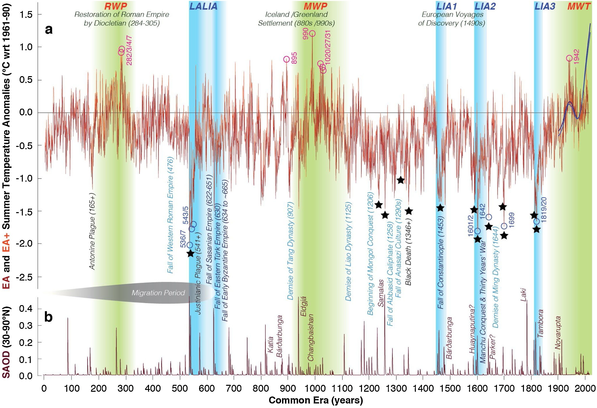
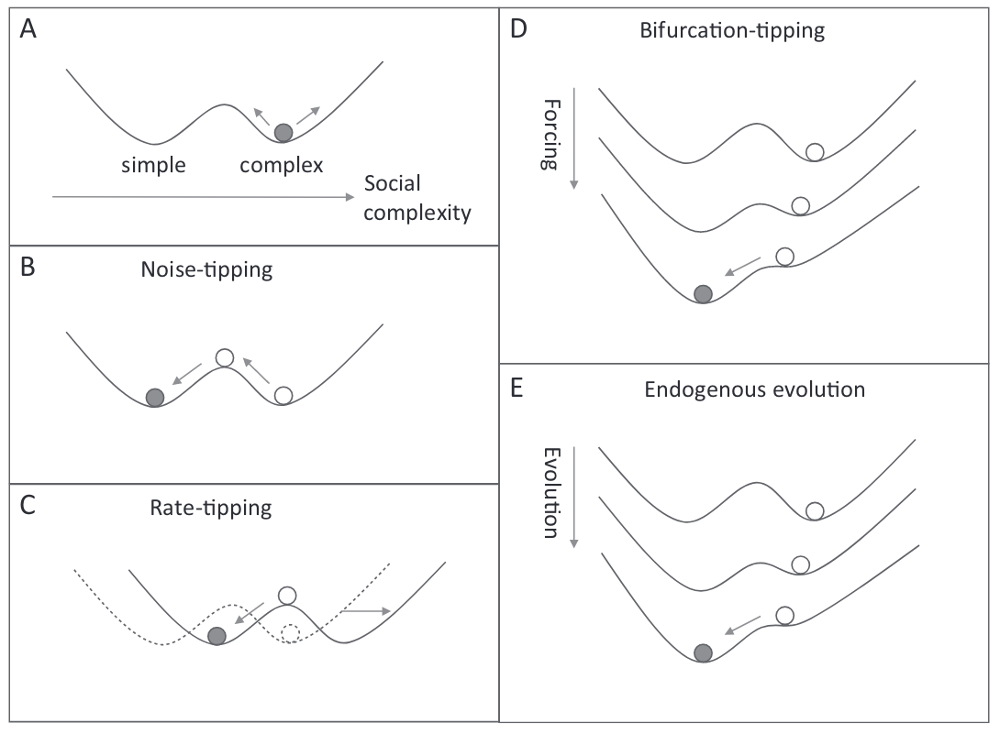
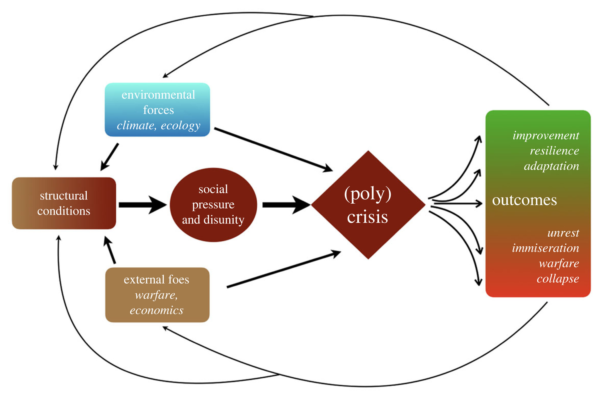

Das Knifflige an Kollaps ist, dass alle möglichen unmittelbaren Ursachen miteinander zusammenwirken und sich gegenseitig auslösen können. In einem [früheren Beitrag](https://florianjehn.github.io/Societal_Collapse/2023-12-04-bad_luck/) haben wir einen Literaturüberblick von Joseph Tainter besprochen (Tainter, 2023). Tainter nennt drei Hauptarten von Ereignissen, die als Ursache für Kollaps identifiziert wurden: 1) äußere Konflikte, 2) innere Konflikte und 3) Klimawandel. Wenn man darüber nachdenkt, wird klar, dass Klimawandel leicht äußere und innere Konflikte auslösen kann, aber nicht umgekehrt. Heißt das, dass der Klimawandel die eigentliche Ursache für gesellschaftlichen Kollaps ist?

# Klimaveränderungen mit schlimmen gesellschaftlichen Folgen werden vor allem von Vulkanen verursacht

Bevor wir uns die Mechanik anschauen, wie das Klima die Gesellschaft beeinflusst, sollten wir uns erst ansehen, um welche Art von Klimaveränderungen es eigentlich geht. Das Klima auf unserem Planeten ist nie statisch, aber diese Veränderungen sind meist ziemlich langsam, und man kann sich leichter an sie anpassen. Das Hauptproblem ist, wenn sich das Klima schnell und ohne Vorwarnung ändert. Das wird meistens von Vulkanen verursacht. Dank Verbesserungen bei der Analyse des Paläoklimas haben wir inzwischen ein ziemlich gutes Bild davon, wann diese Vulkanausbrüche passiert sind. Einen guten Überblick geben Sigl et al. (2015), die das Klima der letzten 2500 Jahre aus Eisbohrkernen rekonstruiert und ihre Hauptanalyse mit einer Reihe anderer Stellvertreterdaten überprüft haben. Vor allem zwischen 500 v. Chr. und 1000 n. Chr. sind Vulkane ein dominanter Treiber von Klimaanomalien. Von den 16 wichtigsten Klimaereignissen, die sie in dieser Zeit identifiziert haben, lassen sich 15 Vulkanen zuordnen.
Der Mechanismus: Vulkane stoßen Sulfataerosole aus. Diese streuen das einfallende Sonnenlicht, werfen einen größeren Teil davon zurück ins All und verringern so die Gesamtmenge an Energie, die die Erdoberfläche erreicht (1).

Sigl et al. schreiben auch, dass sie Vulkanausbrüche und ihre Folgen für das Klima mit dem Zusammenbruch von Zivilisationen verbunden sehen, tun sich aber mit einer direkten Zuordnung schwer:

*„...a direct causal connection of these two large volcanic episodes and subsequent cooling to crop failures and outbreaks of famines and plagues is difficult to prove . However, the exact delineation of two of the largest volcanic signals - with exceptionally strong and prolonged NH cooling; written evidence of famines and pandemics; as well as socio-economic decline observed in Mesoamerica ("Maya Hiatus"), Europe, and Asia - supports the idea that the latter may be causally associated with volcanically-induced climatic extremes.“*

(„...ein direkter ursächlicher Zusammenhang dieser beiden großen vulkanischen Episoden und der folgenden Abkühlung mit Missernten und dem Ausbruch von Hungersnöten und Seuchen ist schwer zu beweisen. Die genaue Abgrenzung zweier der größten vulkanischen Signale, mit außergewöhnlich starker und lang anhaltender Abkühlung der Nordhalbkugel, schriftlichen Belegen für Hungersnöte und Pandemien sowie dem in Mesoamerika („Maya-Hiatus“), Europa und Asien beobachteten sozioökonomischen Niedergang, stützt aber die Idee, dass Letzterer ursächlich mit vulkanisch ausgelösten Klimaextremen zusammenhängen könnte.“)

Eine neuere Studie von Büntgen et al. (2020) geht einen Schritt weiter und untersucht direkt, wie stark die Menschheitsgeschichte von vulkanisch verursachten Klimaveränderungen beeinflusst wurde, indem sie historische Aufzeichnungen mit Klimarekonstruktionen aus Baumringen kombiniert. Sie finden viele historische Beispiele für vulkanisch ausgelöste Klimaveränderungen, die zu gesellschaftlichem Kollaps oder zumindest zu erheblicher Not für die Menschen der jeweiligen Zeit geführt haben. Sie betonen außerdem folgende Punkte:

* Bevölkerungsrückgänge fallen meist mit kühlen Sommern zusammen und folgen fast immer auf Vulkanausbrüche.
* Der Bevölkerungsrückgang wird in solchen Zeiten vor allem durch Hungersnöte und Pandemien verursacht (2).

Sie fassen ihre Ergebnisse in einer beeindruckenden Abbildung zusammen (Abbildung 1). Diese Abbildung bringt mehrere Datensätze zu Temperatur, Ausbrüchen und historischen Ereignissen zusammen (siehe Bildunterschrift). Man sieht, dass bedeutende Ereignisse meist auf einen großen Ausbruch folgen. Aber nicht alle Ausbrüche führen zu großen Ereignissen, selbst wenn sie groß sind. Meist braucht es mehrere große Ausbrüche in kürzerer Zeit, um globale, negative Folgen zu erkennen. Denselben Effekt könnten plausibel Supervulkanausbrüche verursachen, aber so ein Ereignis haben wir in der überlieferten Geschichte (noch) nicht erlebt. Die größten Folgen sieht man bei der [Spätantiken Kleinen Eiszeit](https://florianjehn.github.io/Societal_Collapse/2023-08-16-democracy_and_resilience/) und der [Kleinen Eiszeit](https://florianjehn.github.io/Societal_Collapse/2023-11-20-case_study_volcanoes/), die wir beide in früheren Beiträgen besprochen haben.

Abbildung 1: Grafische Zusammenfassung von Vulkanausbrüchen (braune Linie unten), Temperatur (rote Linie), wichtigen historischen Ereignissen (als Beschriftungen) und Phasen wärmerer (grün schattiert) und kälterer (blau schattiert) Temperaturen (Büntgen et al., 2020).

Die Forschungsgruppe um Ulf Büntgen hat ein paar Jahre später auch einen Folge-Überblick zu dieser Studie gemacht (Büntgen et al., 2025). Das ist ein umfangreicher Überblick und keine Originalforschung. Sie finden in der Literatur, dass es etwa alle 50 Jahre einen Ausbruch gibt, der groß genug ist, das Klima auf einem für menschliche Gesellschaften bedeutsamen Niveau zu beeinflussen. Es kann aber auch viel intensivere Phasen von Ausbrüchen geben. Der Zeitraum von 1783 bis 1835 hatte zum Beispiel fünf bedeutende Ausbrüche. Bei den meisten dieser Ausbrüche ist das Klima etwa drei Jahre lang stark beeinflusst, aber es dauert etwa zwei Jahrzehnte, bis es vollständig wieder auf dem Niveau vor dem Ausbruch ist. Außerdem kann sich das Verhalten auf globaler und lokaler Ebene unterscheiden. Selbst kleinere Ausbrüche können möglicherweise starke lokale Klimafolgen haben, während es global kaum einen Unterschied gibt. Die Folgen können sich auch nach Jahreszeit unterscheiden. Grundsätzlich gibt es viel weniger Forschung zu Temperaturfolgen im Winter, weil die meisten Klimadaten nach Ausbrüchen aus Baumringen stammen, und Bäume wachsen im Winter sowieso nicht. Außerdem gibt es in den historischen Aufzeichnungen immer noch Klimafolgen, die wir keinem bestimmten Vulkan zuordnen können, was zeigt, wie wenig wir eigentlich wissen.

# Gesellschaftliche Reaktion auf vulkanische Klimafolgen
Neben diesen breiten Studien können wir uns auch konkrete vulkanische Folgen anschauen. Ein Beispiel kommt von Kaniewski et al. (2025). Sie haben sich speziell die Kleine Eiszeit (~1250 bis ~1860) angeschaut und alle Aufstände und Revolutionen kartiert, die in dieser Zeit passiert sind. Sie finden, dass das Klima ein wichtiger Stressfaktor ist. Ihre wichtigsten Ergebnisse:
* In Zeiten sinkender Sonnenaktivität (wenn es kälter wird) gibt es mehr Aufstände und Revolutionen.
* Je trockener und kälter eine Phase ist, desto mehr Aufstände und Revolutionen gibt es.
* Aufständen und Revolutionen gehen meist steigende Getreidepreise voraus.

Sie finden aber auch, dass Gesellschaften trockene und kalte Phasen oft weitgehend unbeschadet überstehen können, wenn sie richtig reagieren. Ihr Paradebeispiel ist England, das viele harte Phasen ohne Aufstände und Revolutionen überstand, weil es über sein Imperium zusätzliche Ressourcen ansaugen konnte.

Noch mehr ins Detail gehen Huhtamaa et al. (2022). Ihr Argument ist: Wenn man vulkanische Folgen verstehen will, ergibt es viel mehr Sinn, sich anzuschauen, wie dieselbe Gesellschaft auf verschiedene Vulkanausbrüche reagiert hat. Sie wählen dafür Finnland und finden, dass die Folgen grundsätzlich umso stärker sind, je destabilisierter die Gesellschaft ist, wenn der Vulkan ausbricht. Um das zu untersuchen, haben sie sich Temperaturdaten und Schwankungen der Getreideernte angeschaut, um die Folgen für Klima und Ernährungssystem abzuschätzen, und wie viele Höfe aufgegeben wurden, als Stellvertreter dafür, wie es der Gesellschaft allgemein geht. Damit schauen sie sich die Folgen von drei verschiedenen Vulkanausbrüchen an, die eine ähnliche Wirkung auf die Atmosphäre hatten. Sie finden bei allen drei Ausbrüchen, dass die Temperaturen sinken und die Erträge zurückgehen, aber dass sich die Rate aufgegebener Höfe unterscheidet. Bei einem der Ausbrüche war die Gesellschaft wegen Krieg schon ziemlich belastet, und wir sehen einen Anstieg der aufgegebenen Höfe. Bei einem späteren Ausbruch führte der Staat aber umfangreiche agrarwirtschaftliche Hilfsmaßnahmen ein, und die Rate blieb niedriger. Selbst mit diesen Maßnahmen waren die Folgen aber erheblich, vor allem für die ärmeren Teile der Gesellschaft.

Geschichte ist aber nicht deterministisch und einfach, und es scheint Fälle zu geben, in denen nicht vulkanischer Klimawandel zum Kollaps führt. Ein Paradebeispiel ist der Zusammenbruch der Bronzezeit (besprochen in einem [früheren Beitrag](https://florianjehn.github.io/Societal_Collapse/2020-10-28-bronze_age/) hier). Die Gesamtgeschichte dieses Zusammenbruchs ist zwar ziemlich komplex, aber neuere Forschung deutet darauf hin, dass er mit einer etwa 300 Jahre dauernden Megadürre zusammenfällt (Kaniewski & Van Campo, 2017). In diesem Fall scheint der Ursprung dieser Klimaverschiebung in den sich ständig ändernden Mustern des Erdklimas zu liegen und lässt sich nicht auf ein einzelnes Ereignis festlegen. Trotzdem scheinen Vulkane der Hauptfaktor für Klimaveränderungen zu sein, die menschlichen Bevölkerungen schaden.

# Wir können einen ziemlich klaren ursächlichen Zusammenhang zwischen Klima und gesellschaftlicher Stabilität finden

Wir wissen jetzt, dass Klimaanomalien vor allem von Vulkanen ausgelöst werden und dass Zeiten von Klimaanomalien mit Zeiten zusammenfallen, in denen viele Gesellschaften zu kämpfen haben. Bisher haben wir aber nur eine Korrelation festgestellt und keine Kausalität. Eine Studie von Zhang et al. (2011) versucht aber genau diese Kausalität durch eine umfangreiche Datenanalyse zu belegen. Dafür zoomen sie auf die Zeit von 1500 bis 1800 (die die Kleine Eiszeit enthält, aber auch Zeiten mit wärmerem und stabilerem Klima). Ihre Idee: Um zu belegen, dass Klimaveränderungen gesellschaftliche Konflikte verursachen, muss man zeigen, dass die zeitliche Abfolge stimmt.

Die Kette, die sie untersuchen wollen, ist Klimaanomalie → Rückgang der landwirtschaftlichen Produktivität → Hungersnot → Epidemien → Bevölkerungsrückgang (3). Sie verfolgen all diese Variablen über die Zeit und können tatsächlich zeigen, dass sie in der Reihenfolge auftreten, die sie angenommen haben. Besonders bemerkenswert scheint, dass all diese Veränderungen eng mit dem Getreidepreis zusammenhängen. Sie finden: Wenn der Getreidepreis über eine bestimmte Schwelle steigt, kann man kurz danach mit einer großen negativen Phase für die Bevölkerung rechnen. Auf Grundlage dieses Ergebnisses drehen sie ihr Modell um und versuchen, große historische Ereignisse nur mit dem Getreidepreis vorherzusagen. Das identifiziert 1264–1359 und 1559–1652 als Krisenzeiten und 1360–1558 und 1635–1800 als besonders günstige Zeiten. Alle Daten passen zu historischen Ereignissen:

Negative Vorhersage

* 1264–1359: Krisenzeit im Mittelalter
* 1559–1652: Allgemeine Krise des 17. Jahrhunderts

Positive Vorhersage

* 1360–1558: Renaissance
* 1635–1800: Aufklärung

Sie finden außerdem, dass der Getreidepreis umgekehrt mit der Temperatur zusammenhängt, und dass man Temperaturabweichungen von mehr als -0,1 Standardabweichungen als Krisenschwelle für menschliche Gesellschaften sehen kann, während wärmere Zeiten meist auch zu stabileren Gesellschaften führen. Mit dieser Temperaturschwelle sagen sie auch vergangene Ereignisse vorher und kommen zu denselben Schlüssen wie mit den Getreidepreisen. All das zusammen lässt es mir wahrscheinlich erscheinen, dass das Klima der wichtigste Treiber für das Wohlergehen von Gesellschaften insgesamt ist. Das wird aber immer durch die gesellschaftliche Reaktion auf die Klimaverschiebung vermittelt, wie wir in einem [früheren Beitrag](https://florianjehn.github.io/Societal_Collapse/2023-08-16-democracy_and_resilience/) besprochen haben.

Das von Zhang et al. besprochene Modell wird auch indirekt durch eine Studie von Ljungqvist et al. (2023) bestätigt. Das Paper von Ljungqvist ist eine riesige historische Untersuchung vergangener Hungersnöte in Europa. Sie untersuchen die Gründe für eine Reihe von Hungersnöten und wie sie abgelaufen sind, und wie im Modell von Zhang sehen wir immer wieder den Weg Klimaanomalie → Rückgang der landwirtschaftlichen Produktivität → Hungersnot → Epidemien → Bevölkerungsrückgang. Man sollte allerdings beachten, dass Ansätze wie der von Zhang und Co-Autoren in der Klimaforschung kritisiert wurden, weil sie zu vereinfacht seien, die Unsicherheiten vergangener Klimadaten nicht genug berücksichtigten und annähmen, dass Korrelation Kausalität bedeute (Degroot et al., 2021). Diese Kritik sollten wir im Kopf behalten und die Ergebnisse von Zhang et al. vorsichtig interpretieren.

Ein weiteres Beispiel für diesen sehr klaren Zusammenhang zwischen Klima und Krise ist ein Paper von Norman et al. (2025). Auch sie wollen untersuchen, wie das Klima Gesellschaften beeinflusst. Dafür schauen sie sich einen großen Baumringdatensatz an, der ihnen einen Überblick über das Klima im Römischen Reich über seine gesamte Existenz gibt. In diesem Klimadatensatz suchen sie alle Jahre, in denen es eine große Schlacht im Römischen Reich gab (insgesamt 106 Schlachten). Für die Jahre aller Schlachten sowie die zehn Jahre davor und danach schauen sie in der Zeitreihe der Region, in der die Schlacht stattfand, ob es ungewöhnliche Klimaereignisse gab. Sie finden, dass diese großen Schlachten deutlich wahrscheinlicher sind, wenn es vorher Klimaextreme gab. In den meisten Fällen fand das relevante Klimaextrem drei Jahre vor der Schlacht statt. Sie erklären das damit, dass der Klimaschock Zeit brauchte, um sich durch die Gesellschaft zu arbeiten: Ein Klimaschock passiert, Lebensmittel werden knapp, Spannungen steigen und entladen sich in einer großen Schlacht. Die Klimaereignisse, die das auslösen, sind meist Dürren oder extrem heißes Wetter (4).

# Theoretische Grundlagen für das Zusammenspiel von Klima und Gesellschaft

Wir haben Belege dafür angeschaut, dass das Klima sehr wahrscheinlich der wichtigste Treiber für gesellschaftlichen Kollaps ist. Jetzt brauchen wir eine theoretische Grundlage, um daraus eine echte wissenschaftliche Theorie zu machen. Zum Glück für uns hat Timothy Lenton vor Kurzem eine Studie veröffentlicht, die genau das versucht (Lenton, 2023).

Die Hauptidee in Lentons Kapitel ist, die Ideen der Kipppunkte (die wir in einem [früheren Beitrag](https://florianjehn.github.io/Societal_Collapse/2023-06-19-tipping_points/) besprochen haben) vom Klimasystem auf das Zusammenspiel des Klimasystems mit menschlichen Gesellschaften zu übertragen. Lenton argumentiert, dass man das Klima als evolutionären Druck auf Gesellschaften sehen kann. Er stützt sich dabei auf Argumente anderer, dass die Bildung von Staaten eine Reaktion auf ein sich wandelndes Klima war. Wie wir gesehen haben, wurde das Klima aber auch mit vielen Krisen und Zusammenbrüchen in Verbindung gebracht. Das wirft die Frage auf: „Wenn eine Verschlechterung des Klimas ein glaubwürdiger Auslöser für die Entstehung komplexer Gesellschaften ist, wie kann sie dann auch ein Auslöser für ihren Untergang sein?“

Lenton beantwortet die Frage mit Blick auf Komplexität. Er stellt sich den Komplexitätsraum, den eine Gesellschaft einnehmen kann, als Sammlung von Attraktoren vor. Diese Attraktoren stehen für gangbare Wege, wie man seine Gesellschaft organisieren könnte. Wenn man so einen Attraktor erreicht (zum Beispiel ein Nationalstaat wird), gibt es Rückkopplungsmechanismen, die einen meist ungefähr auf diesem Komplexitätsniveau halten. Zivilisationen führen außerdem meist zusätzliche Mechanismen ein, um ihre aktuelle Position im Komplexitätsraum stabiler zu machen. Das verfestigt ihre aktuellen Positionen und heißt, dass ein größerer Schock nötig ist, um sie zu verschieben. Das macht den Wechsel in einen anderen Komplexitätszustand abrupter und erhöht möglicherweise die Chance eines Kollapses, wenn es passiert. Allgemein kann man den Wechsel von einem komplexen Zustand in einen anderen als ziemlich erschütternd sehen, weil er eine große Umorganisation der Gesellschaft bedeutet. Stell dir die vielen Veränderungen vor, die nötig waren, um von einer mittelalterlichen Feudalgesellschaft zu den heutigen Nationalstaaten zu kommen.

Gesellschaften bleiben auf ihrer Komplexitätsposition, solange sie nicht gezwungen werden, sie zu verlassen. Gezwungen werden können sie vor allem durch eine Reihe von Klimamechanismen (Abbildung 2):

* Extremereignisse in einem sonst stabilen Klima: Die Gesellschaft wird von einer Flut getroffen, wie es sie nur alle 10.000 Jahre gibt, und ihre Lebensweise wird komplett zerstört (Abbildung 2B).
* Ein sich wandelndes Klima nach einem erschütternden Ereignis: Ein Vulkan bricht aus, und Rückkopplungen im Klima führen dazu, dass es in der Region dauerhaft weniger regnet (Abbildung 2C).
* Langsam sich ändernde natürliche Klimaschwankungen: Das Klima ist nie stabil und ändert sich mit der Zeit, wenn auch langsam. Das kann der Gesellschaft die Ressourcenbasis entziehen, auf die sie angewiesen ist, aber nur allmählich, was es schwer macht, es dem Klimawandel zuzuschreiben (Abbildung 2D). Zum Beispiel der Wandel der Sahara von einer Savanne zu einer Wüste.
* Evolutionäre Veränderungen der Gesellschaft: Die innere Dynamik einer Gesellschaft könnte sie weniger gut an den Klimazustand anpassen, in dem sie existiert. Das macht die Gesellschaft verwundbarer für alle Klimafolgen und erhöht die Wahrscheinlichkeit von Ereignissen, die ihre inneren Rückkopplungen überwinden (Abbildung 2D). Ein Beispiel könnte eine kulturelle Anpassung sein, die dazu führte, aus kulturellen Gründen ein bestimmtes Lebensmittel zu bevorzugen, obwohl es weniger effizient ist als andere Lebensmittel, die man in der Gegend anbauen könnte.

Abbildung 2: Verschiedene Arten von Kollapsszenarien über Kipppunkte.

Sobald einer dieser Prozesse die inneren Rückkopplungen der Gesellschaft überwältigt, sieht Lenton zwei Möglichkeiten:

* Kollaps: Der Klimaschock ist zu groß für die Gesellschaft und bringt sie in einen Zustand, in dem sie die Prozesse, die ihre Komplexität tragen, nicht mehr aufrechterhalten kann. Sie bricht zusammen und fällt auf den letzten tragfähigen Zustand zurück, wobei die Tiefe des Falls davon abhängt, wie tief die Gesellschaft auf ihrem Komplexitätsniveau verankert war.
* Anpassung: Da der aktuelle Komplexitätszustand nicht mehr tragfähig ist, hat die Gesellschaft auch die Möglichkeit, sich erheblich zu verändern, um den nächsten Attraktor im Komplexitätsraum zu erreichen, der besser an die veränderte Umwelt angepasst ist. Dort angekommen, beginnt der Prozess von vorn.

Lentons Beschreibung von Kollaps ist hilfreich, weil sie uns eine theoretischere Idee gibt, wie Gesellschaften und Klima beim Kollaps zusammenwirken. Da wir jetzt ein Modell haben, wie das funktionieren sollte, können wir auch in die Welt hinausgehen und versuchen, diese Hypothese tatsächlich zu widerlegen. Lenton beschreibt, wie man sein Modell wissenschaftlich testen könnte: Wenn wir ein kritisches Verlangsamen bei wichtigen gesellschaftlichen Variablen wie der Getreideernte oder dem Wert der Währung erkennen können (5), ist es wahrscheinlich, dass Kipppunktdynamiken der Prozess sind, der bestimmt, ob eine Gesellschaft durch ein bestimmtes Ereignis zusammenbricht oder nicht. So eine Analyse scheint mit dem Wissen, das wir heute schon haben, gut machbar, und ich hoffe, dass sie bald jemand macht.

# Eine vollständige Theorie des Kollapses?

In diesem Beitrag haben wir festgestellt, dass das Klima ein starker Kandidat für einen Hauptgrund gesellschaftlichen Kollapses ist, wenn auch vermittelt durch die gesellschaftliche Reaktion und innere Veränderungen der gesellschaftlichen Struktur. Das heißt aber auch, dass wir das Klima nicht allein betrachten können. Wir müssen immer auch die Gesellschaft berücksichtigen. Siehe zum Beispiel die sehr unterschiedlichen Reaktionen von Gesellschaften auf ähnliche Klimaschocks, wie in einem früheren Beitrag über die [Spätantike Kleine Eiszeit](https://florianjehn.github.io/Societal_Collapse/2023-08-16-democracy_and_resilience/) beschrieben.

Was noch fehlt, ist ein formaleres Modell, das all diese Punkte verbindet, vor allem zusammen mit dem Ernährungssystem, Epidemien und dem Gesamtkapital der Gesellschaft, das es ihr erlaubt, instabile Zustände zumindest eine Weile aufrechtzuerhalten. Das erwähnt auch Lenton am Ende seines Papers. Um hier voranzukommen, brauchen wir zuerst ein Rückkopplungsdiagramm, das versucht, alle verschiedenen Wechselwirkungen zwischen Klima, Ernährungssystem und Gesellschaft festzulegen. Wenn das steht, können wir es in ein Computermodell übertragen und schauen, ob es gesellschaftlichen Kollaps verlässlich vorhersagt. Eine gute Datenquelle ist hier möglicherweise die Seshat-Datenbank (Turchin et al., 2019), vor allem weil sie gerade einen Datensatz zu gesellschaftlichen Krisenzeiten zusammenstellen (6).

Ein weiteres aktuelles Paper der Seshat-Arbeitsgruppe streift die Frage, was der eigentliche Mechanismus ist und welche Rolle das Klima spielt (Hoyer et al., 2023). Sie tauchen tief in die Qing-Dynastie in China, das Osmanische Reich während der Kleinen Eiszeit und die Siedlung Monte Albán in Mexiko ein, um den Zusammenhang zwischen Klima und Gesellschaft zu untersuchen. Sie erstellen ein einfaches Flussdiagramm dazu, wie die Ereignisse dort ihrer Meinung nach allgemein ablaufen (Abbildung 3).

Abbildung 3: Flussdiagramm, wie Hoyer et al. (2023) den Zusammenhang zwischen Klima und Gesellschaft sehen.

Die Grundidee ist ähnlich wie bei den anderen Argumenten hier. Klima ist wichtig, passiert aber nicht im luftleeren Raum. Wenn eine Gesellschaft dafür sorgt, dass die Kosten extremen Klimas fair über die Gesellschaft verteilt werden, und ihre resilienzstärkenden Systeme (z. B. Bewässerung in vergangenen Gesellschaften oder das Stromnetz heute) in gutem Zustand sind, hat sie gute Chancen, selbst große Klimaschocks zu überstehen. Wenn eine Gesellschaft innerlich gespalten ist und die Instandhaltung ihrer Infrastruktur vernachlässigt hat, können Klimaschocks schnell verheerende Folgen haben. Die Verwundbarkeit einer Gesellschaft ist der Schlüssel, um die Folgen des Klimas zu verstehen.

# Anmerkungen

(1) Die Streuung des Lichts führt auch zu leuchtend roten Himmeln, vor allem wenn die Sonne nah am Horizont steht. Das scheint ziemlich inspirierend zu sein, denn jedes Mal, wenn ein großer Vulkan ausbricht und den Himmel färbt, bekommen wir [einen Haufen großartiger Kunst](https://worldhistory.substack.com/p/the-volcanoes-and-the-paintings).

(2) Leider besprechen sie nicht, ob die Pandemien durch die Hungersnot ermöglicht werden oder unabhängig davon passieren.

(3) Das Modell im Paper ist komplizierter, aber das scheint mir die Hauptidee zu sein.

(4) Das passt zu [anderen Papern, die wir besprochen haben](https://existentialcrunch.substack.com/p/famines-role-in-societal-collapse?open=false#%C2%A7famines-have-many-triggers), die zeigen, dass die größten Schocks in der Pflanzenproduktion von Dürren verursacht werden.

(5) Zur Erinnerung, was kritisches Verlangsamen bedeutet, hier die Erklärung aus meinem Beitrag über Kipppunkte: *„Der wichtigste Weg, Kipppunkte zu erkennen, sind sogenannte Frühwarnsignale. Sie funktionieren, indem sie Veränderungen im Verhalten eines Systems erkennen, während es sich einem Kipppunkt nähert. Diese Veränderung zeigt sich oft durch ein Phänomen namens kritisches Verlangsamen, bei dem das System weniger widerstandsfähig gegenüber Störungen wird. Das heißt, nach einer Störung braucht es immer länger, um in seinen ursprünglichen Zustand zurückzukehren, je näher es am Kipppunkt ist.“*

(6) Das erste große Paper, das sie aus diesem Krisendatensatz erstellt haben, wird [hier](https://florianjehn.github.io/Societal_Collapse/2024-04-09-big_data_history/) besprochen.

# Zitieren
Bitte das englische Original zitieren:

Jehn, F. U. (2024, February 8). Climate anomalies and societal collapse. Existential Crunch. [https://doi.org/10.59350/w2xfg-xv316](https://doi.org/10.59350/w2xfg-xv316)

# Quellen

* Büntgen, U., Arseneault, D., Boucher, É., Churakova (Sidorova), O. V., Gennaretti, F., Crivellaro, A., Hughes, M. K., Kirdyanov, A. V., Klippel, L., Krusic, P. J., Linderholm, H. W., Ljungqvist, F. C., Ludescher, J., McCormick, M., Myglan, V. S., Nicolussi, K., Piermattei, A., Oppenheimer, C., Reinig, F., … Esper, J. (2020). Prominent role of volcanism in Common Era climate variability and human history. Dendrochronologia, 64, 125757. https://doi.org/10.1016/j.dendro.2020.125757
* Büntgen, U., Cosmo, N. D., Esper, J., Frachetti, M., Khalidi, L., Mauelshagen, F., Rohland, E., & Oppenheimer, C. (2025). Volcanoes, Climate, and Society. https://doi.org/10.1146/annurev-earth-032524-013254
* Degroot, D., Anchukaitis, K., Bauch, M., Burnham, J., Carnegy, F., Cui, J., de Luna, K., Guzowski, P., Hambrecht, G., Huhtamaa, H., Izdebski, A., Kleemann, K., Moesswilde, E., Neupane, N., Newfield, T., Pei, Q., Xoplaki, E., & Zappia, N. (2021). Towards a rigorous understanding of societal responses to climate change. Nature, 591(7851), Article 7851. https://doi.org/10.1038/s41586-021-03190-2
* Hoyer, D., Bennett, J. S., Reddish, J., Holder, S., Howard, R., Benam, M., Levine, J., Ludlow, F., Feinman, G., & Turchin, P. (2023). Navigating polycrisis: Long-run socio-cultural factors shape response to changing climate. Philosophical Transactions of the Royal Society B: Biological Sciences, 378(1889), 20220402. https://doi.org/10.1098/rstb.2022.0402
* Huhtamaa, H., Stoffel, M., & Corona, C. (2022). Recession or resilience? Long-range socioeconomic consequences of the 17th century volcanic eruptions in northern Fennoscandia. Climate of the Past, 18(9), 2077–2092. https://doi.org/10.5194/cp-18-2077-2022
* Kaniewski, D., Marriner, N., Luce, F., Escarpe, M., Pourkerman, M., & Otto, T. (2025). A climate of conflict: How the little ice age sparked rebellions and revolutions across Europe. Global and Planetary Change, 254, 105038. https://doi.org/10.1016/j.gloplacha.2025.105038
* Kaniewski, D., & Van Campo, E. (2017). 3.2 ka BP Megadrought and the Late Bronze Age Collapse. In H. Weiss (Ed.), Megadrought and Collapse: From Early Agriculture to Angkor (p. 0). Oxford University Press. https://doi.org/10.1093/oso/9780199329199.003.0005
* Lenton, T. M. (2023). Climate Change and Tipping Points in Historical Collapse. In How Worlds Collapse. Routledge.
* Ljungqvist, F. C., Seim, A., & Collet, D. (2023). Famines in medieval and early modern Europe—Connecting climate and society. WIREs Climate Change, n/a(n/a), e859. https://doi.org/10.1002/wcc.859
* Norman, C., Schwinden, L., Krusic, P., Rzepecki, A., Bebchuk, T., & Büntgen, U. (2025). Droughts and conflicts during the late Roman period. Climatic Change, 178(5), 87. https://doi.org/10.1007/s10584-025-03925-4
* Sigl, M., Winstrup, M., McConnell, J. R., Welten, K. C., Plunkett, G., Ludlow, F., Büntgen, U., Caffee, M., Chellman, N., Dahl-Jensen, D., Fischer, H., Kipfstuhl, S., Kostick, C., Maselli, O. J., Mekhaldi, F., Mulvaney, R., Muscheler, R., Pasteris, D. R., Pilcher, J. R., … Woodruff, T. E. (2015). Timing and climate forcing of volcanic eruptions for the past 2,500 years. Nature, 523(7562), Article 7562. https://doi.org/10.1038/nature14565
* Tainter, J. A. (2023). How Scholars Explain Collapse. In How Worlds Collapse. Routledge.
* Turchin, P., Whitehouse, H., Francois, P., Hoyer, D., Alves, A., Baines, J., Baker, D., Bartkowiak, M., Bates, J., Bennett, J., Bidmead, J., Bol, P., Ceccarelli, A., Christakis, K., Christian, D., Covey, A., De Angelis, F., Earle, T., Edwards, N., & Xie, L. (2019). An Introduction to Seshat: Global History Databank. Journal of Cognitive Historiography, 5. https://doi.org/10.1558/jch.39395
* Zhang, D. D., Lee, H. F., Wang, C., Li, B., Pei, Q., Zhang, J., & An, Y. (2011). The causality analysis of climate change and large-scale human crisis. Proceedings of the National Academy of Sciences, 108(42), 17296–17301. https://doi.org/10.1073/pnas.1104268108
