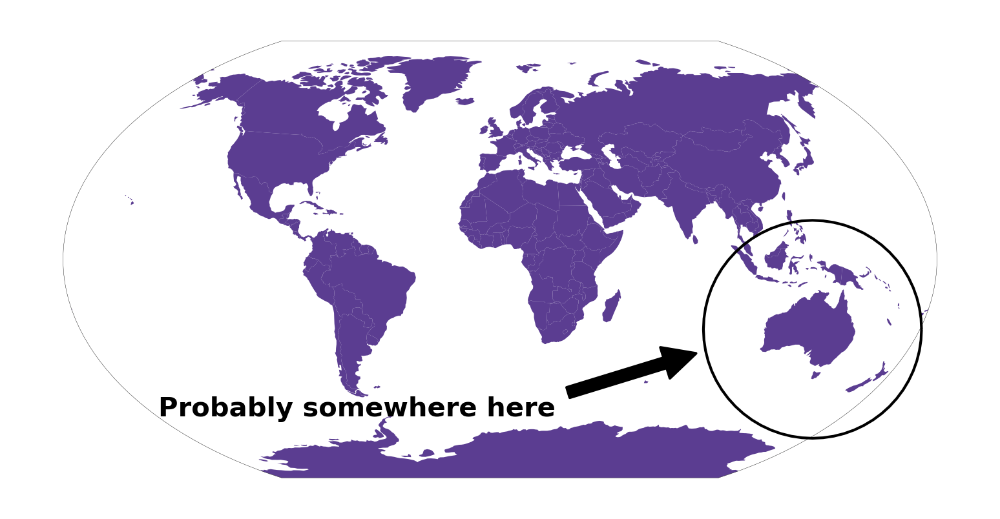

*Dieser Beitrag hat einen [Überblicksartikel](https://doi.org/10.1002/gch2.70146) zur selben Frage inspiriert. Der geht viel mehr in die Tiefe als dieser Beitrag hier, wenn du es also genau wissen willst, lies lieber den.*

Eine Frage, die bei Gesprächen über globale Katastrophen und gesellschaftlichen Kollaps oft aufkommt: Wo ist man in so einem Fall am besten aufgehoben? Diese einfache Frage ist überraschend schwer zu beantworten, weil sie von vielen Faktoren abhängt. Dieser Beitrag soll einen Überblick über die Faktoren geben, die eine Rolle spielen, und einige Empfehlungen für die wichtigsten globalen katastrophalen Risiken geben, die zu gesellschaftlichem Kollaps führen könnten. Er ist etwas spekulativer, aber beim aktuellen Stand der Literatur halte ich diese Spekulationen für vernünftig und lehrreich. Ich konzentriere mich vor allem auf das Ernährungssystem, weil ich glaube, dass es im Fall einer globalen Katastrophe für viele Menschen weltweit der verwundbarste Prozess sein wird.

# Um welche Art von Katastrophe geht es?

Es gibt eine große Bandbreite globaler katastrophaler Risiken, und wir können nicht über alle im Detail reden. Grundsätzlich kann man sie aber in zwei große Gruppen aufteilen:

* Globaler katastrophaler Infrastrukturverlust: Dazu gehören Szenarien wie elektromagnetische Pulse in großer Höhe (HEMP), geomagnetische Stürme, weltweit koordinierte Cyberangriffe und extreme Pandemien. Diese Ereignisse könnten das globale Stromnetz lahmlegen, wichtige Industrien stören (entweder indem Infrastruktur zerstört wird oder die Arbeitskräfte ausfallen) und die Produktion landwirtschaftlicher Notwendigkeiten wie Dünger und Pestizide unterbrechen. Das würde weltweit zu drastisch sinkenden Ernteerträgen führen und den Lebensmittelhandel schwer treffen. Ein Beispiel für ein Paper, das diese Folgen für die Landwirtschaft modelliert, ist Moersdorf et al. (2024) (Hinweis: Ich bin auch Autor dieses Papers).

* Abrupte Verringerung des Sonnenlichts: Solche Ereignisse könnten durch Atomkrieg, Einschläge von Asteroiden oder Kometen oder große Vulkanausbrüche ausgelöst werden. Der Mechanismus ist, dass Partikel in die Atmosphäre gelangen, die die globalen Temperaturen abstürzen lassen und so die Landwirtschaft lahmlegen. Studien deuten darauf hin, dass die Erträge im schlimmsten Fall eines großen Atomkriegs um mehr als 90 % sinken könnten. Das wird genauer in Xia et al. (2022) untersucht, wo die Folgen eines Atomkriegs für die Landwirtschaft modelliert wurden.

Ich konzentriere mich auf diese beiden Gruppen, weil es dazu die meiste Forschung auf globaler Ebene gibt. Es gibt viele andere Katastrophen, die plausibel zu gesellschaftlichem Kollaps führen könnten, aber ihre Kollapstheorien sind oft komplexer als die oben genannten, was es deutlich schwerer macht, sinnvolle Empfehlungen zu geben, wo man sie am besten übersteht.

# Südhalbkugel oder Nordhalbkugel?

Grundsätzlich scheint die Südhalbkugel bei Katastrophen, die das Sonnenlicht verringern, der bessere Ort zu sein. Das liegt vor allem daran, dass es auf der Südhalbkugel mehr Ozean als Land gibt. Eine der wichtigsten negativen Folgen einer abrupten Verringerung des Sonnenlichts ist der Temperaturabfall durch das geringere einfallende Licht. Die neueste große Modellstudie dazu ist von Coupe et al. (2019). Sie haben sich die klimatischen Folgen eines Atomkriegs angeschaut und sie mit einem angepassten Klimamodell simuliert. Die Welt kühlt zwar insgesamt ab, aber auf der Nordhalbkugel ist der Abkühlungseffekt größer (1). Die Temperatur auf der Südhalbkugel wird teilweise durch die größeren Ozeane abgepuffert, die einen Teil der Wärme von vor dem Atomkrieg speichern. Für große Vulkanausbrüche haben wir zwar keine vergleichbaren Simulationen (2), aber es gibt Forschung zu den Klimaschocks nach dem Ausbruch des Tambora 1815, die zeigt, dass der Schock an vergleichbaren Orten auf der Nordhalbkugel oft größer war (Wilson et al., 2023). Das hängt allerdings auch davon ab, wo die Partikel in die Atmosphäre gelangen. Bei einem großen Vulkanausbruch auf der Südhalbkugel gäbe es auch dort stärkere Klimafolgen, auch wenn sich die Partikel innerhalb weniger Monate weltweit verteilen. Angesichts paläoklimatischer Belege und dem Fehlen von Atomwaffenstaaten auf der Südhalbkugel scheint eine abrupte Verringerung des Sonnenlichts, die auf der Nordhalbkugel beginnt, aber viel wahrscheinlicher.

Bei globalem katastrophalem Infrastrukturverlust scheint es keine Rolle zu spielen, ob man auf der Nord- oder Südhalbkugel ist. Hier kommt die Hauptwirkung durch den Verlust von Dünger, Pestiziden und Handel. Das trifft die Volkswirtschaften mit der intensivsten Landwirtschaft, und die gibt es auf beiden Halbkugeln (Moersdorf et al., 2024).

# Länder mit hohem oder niedrigem Einkommen?

Wie oben gesagt, ist ein wichtiger Faktor bei globalem katastrophalem Infrastrukturverlust, ob ein Land ein hohes oder niedriges Einkommen hat. Das liegt vor allem daran, wie diese Länder Landwirtschaft betreiben (Moersdorf et al., 2024). Länder mit hohem Einkommen nutzen meist mehr Dünger und andere landwirtschaftliche Betriebsmittel, was sie anfälliger für Unterbrechungen bei diesen Gütern macht. Es gibt aber auch Länder wie Australien, die große Getreideexporteure sind, dafür aber weniger Betriebsmittel pro Hektar einsetzen als zum Beispiel Deutschland. Stattdessen nutzen sie mehr Fläche, aber weniger intensiv. Sie wären also wahrscheinlich weniger verwundbar als andere Länder mit hohem Einkommen. Kombiniert man das mit höherer staatlicher Leistungsfähigkeit (3) und hohem Einkommen, ist ein weniger importabhängiges Land wie Australien wahrscheinlich gut aufgestellt, um nach einem globalen katastrophalen Infrastrukturverlust stabil zu bleiben. Moersdorf et al. (2024) legen aber nahe, dass auch Länder mit niedrigem Einkommen gute Chancen haben könnten. Ihre Landwirtschaft nutzt derzeit nicht viele Betriebsmittel wie Dünger, also würde ihre Wirtschaft wahrscheinlich weniger gestört, wenn diese Güter nicht mehr fließen.

Auch bei einer abrupten Verringerung des Sonnenlichts sind Länder mit hohem Einkommen wahrscheinlich der bessere Ort, weil ihre höhere staatliche Leistungsfähigkeit ihnen wohl hilft, besser damit klarzukommen. Wenn das Sonnenlicht allerdings durch einen Atomkrieg verringert wird, wären NATO-Mitglieder und Staaten mit Atomwaffen wahrscheinlich eine Ausnahme, weil sie direkt von der Zerstörung durch die Atomwaffen getroffen würden. Ein weiterer Faktor ist der Breitengrad der Länder mit hohem Einkommen. Bei einer abrupten Verringerung des Sonnenlichts wären höhere Breiten wegen weniger Sonnenlicht und niedrigerer Temperaturen schlechter für den Anbau (Coupe et al., 2019).

# Inseln oder Kontinente?

Wie oben erwähnt, ist die Südhalbkugel wahrscheinlich resilienter gegenüber einer abrupten Verringerung des Sonnenlichts, weil sie mehr Ozeane hat, die den Temperaturschock abpuffern. Für Inseln auf der Südhalbkugel gilt dieses Argument sogar noch stärker. Ausgehend von dieser Überlegung haben Boyd & Wilson (2022) eine Reihe von Inseln weltweit danach bewertet, wie resilient sie gegenüber einer abrupten Verringerung des Sonnenlichts sind. Viele der bewerteten Parameter drehen sich außerdem um die Selbstversorgung der Inseln, was auch nach einem globalen katastrophalen Infrastrukturverlust wertvoll wäre. Neuseeland, Australien und Indonesien sind jeweils relativ resilient, aber jedes mit Einschränkungen:

* Neuseeland ist sehr vom Handel abhängig, vor allem bei Treibstoff.
* Australien ist insgesamt ziemlich gut, könnte aber in einem Atomkrieg ein mögliches Ziel sein, weil es mit den USA verbündet ist.
* Indonesien ist insgesamt auch ziemlich gut, leidet aber unter geringer politischer Stabilität.

Außerdem haben Inselstaaten meist kleine Armeen und sind daher potenziell verwundbar gegenüber Angreifern. Eines der größten handelsbezogenen Probleme ist die Abhängigkeit von Ölimporten. Diese Inseln könnten also immer resilienter werden, wenn sie mehr auf erneuerbare Energien umsteigen, auch wenn Wind- und Solarenergie und Biokraftstoffe von einer abrupten Verringerung des Sonnenlichts betroffen sind. Trotzdem würden sie wahrscheinlich viel besser abschneiden als Länder auf Kontinenten, die viele der gleichen Probleme hätten und dazu einen viel steileren Temperaturabfall als die Inseln.

Bei globalem katastrophalem Infrastrukturverlust ist das Bild allerdings weniger klar. Die Argumente zeigen zwar, dass einige dieser Inseln gegenüber so einer Katastrophe resilient wären, aber es ist unklar, ob sie besser oder schlechter dastehen würden als Länder auf Kontinenten. Soweit ich weiß, gibt es keine Forschung zu der Frage, ob Inseln oder Kontinente besser geeignet sind, um einen globalen katastrophalen Infrastrukturverlust zu überstehen.

*Wenn du wichtige Studien kennst, die ich übersehen habe, schreib mir bitte eine Mail, dann aktualisiere ich diesen Artikel!*

# Stadt oder Land?

Das Hauptproblem von Städten bei globalen Katastrophen ist, dass das Essen schnell ausgeht, weil die lokalen Vorräte nicht groß genug sind, um die Stadtbevölkerung lange zu versorgen. Baum et al. (2015) haben einen Literaturüberblick zur Resilienz des Ernährungssystems gegenüber Engpässen gemacht und sind zu dem Schluss gekommen, dass eines der Hauptprobleme ist, dass Vorräte schnell aufgebraucht sind. Dicht besiedelte Gebiete haben keine lokal verfügbaren natürlichen Ressourcen, die man bräuchte, um bei Lieferausfällen Lebensmittel anzubauen. Viele Städte hätten also viel mehr Menschen, als sie realistisch ernähren könnten, was ländliche Gebiete nach globalen Katastrophen allgemein zum besseren Ort macht.

# Lebensmittelexporteur oder -importeur?

Die meisten Länder sind Lebensmittelimporteure. Der Export wird von wenigen großen Akteuren dominiert, wie den USA bei Weizen und Mais (4). Viele Länder werden also Probleme mit der Lebensmittelversorgung bekommen, wenn Katastrophen den Handel behindern, weil ihnen die Kapazität (oder manchmal das Klima und die Böden) fehlt, um das Essen anzubauen, das sie brauchen. Deshalb ist es besser, in einem Land zu sein, das unter normalen Umständen Lebensmittel exportiert, weil es dann wahrscheinlicher ist, dass es nach einer Katastrophe genug Essen für seine Bevölkerung produzieren kann. Ein Beispiel für ein Exportland, das auch die anderen bisher besprochenen Kriterien erfüllt, ist Australien.

# Also, wo solltest du hin?

Zusammengefasst gibt es keine einfache Antwort, wo man am besten ist, weil es von der Katastrophe abhängt. Es gibt aber trotzdem ein paar allgemeine Empfehlungen, die meiner Meinung nach für viele Katastrophen gelten:

* Südhalbkugel > Nordhalbkugel
* Land mit hohem Einkommen > Land mit niedrigem Einkommen (mit der Einschränkung, dass das Land mit hohem Einkommen nicht viele Importe für seine Landwirtschaft und Wirtschaft braucht und vielleicht auch kein Atomwaffenstaat oder Teil der NATO ist)
* Lebensmittelexporteur > Lebensmittelimporteur
* Inseln > Kontinente (wenn die Insel nicht zu klein ist und sich selbst versorgen kann)
* Land > Stadt

Oder als grafische Zusammenfassung:

# Anmerkungen

(1) Das Paper beschreibt nicht in konkreten Zahlen, wie stark sich die Temperatur auf Nord- und Südhalbkugel unterscheidet, aber es modelliert, wie viele Tage mit einer Temperatur, die hoch genug für den Anbau ist, es auf den Halbkugeln gibt. Für den Großteil der Nordhalbkugel beträgt die Wachstumsperiode 0 Tage, während sie in weiten Teilen der Südhalbkugel bei 300 Tagen und mehr bleibt.

(2) Frühere Beiträge über die Folgen von Vulkanen findest du [hier](https://florianjehn.github.io/Societal_Collapse/2023-11-20-case_study_volcanoes/) und [hier](https://florianjehn.github.io/Societal_Collapse/2024-02-08-climate_collapse/).

(3) Die für Resilienz wichtig ist, wie in einem [früheren Beitrag](https://florianjehn.github.io/Societal_Collapse/2023-08-16-democracy_and_resilience/) besprochen.

(4) Es gibt viele Studien zu solchen Verteilungen, aber besonders interessant fand ich Clapp (2023), weil dort auch die Geschichte erklärt wird, wie wir bei dieser Konzentration auf so wenige große Exportländer gelandet sind.

# Zitieren
Bitte das englische Original zitieren:

Jehn, F. U. (2024, March 4). The best places to weather global catastrophes. Existential Crunch. [https://doi.org/10.59350/bgsnc-b5430](https://doi.org/10.59350/bgsnc-b5430)

# Quellen

* Baum, S. D., Denkenberger, D. C., Pearce, J. M., Robock, A., & Winkler, R. (2015). Resilience to global food supply catastrophes. Environment Systems and Decisions, 35(2), 301–313. https://doi.org/10.1007/s10669-015-9549-2
* Boyd, M., & Wilson, N. (2022). Island refuges for surviving nuclear winter and other abrupt sunlight‐reducing catastrophes. Risk Analysis, risa.14072. https://doi.org/10.1111/risa.14072
* Clapp, J. (2023). Concentration and crises: Exploring the deep roots of vulnerability in the global industrial food system. The Journal of Peasant Studies, 50(1), 1–25. https://doi.org/10.1080/03066150.2022.2129013
* Coupe, J., Bardeen, C. G., Robock, A., & Toon, O. B. (2019). Nuclear Winter Responses to Nuclear War Between the United States and Russia in the Whole Atmosphere Community Climate Model Version 4 and the Goddard Institute for Space Studies ModelE. Journal of Geophysical Research: Atmospheres, 124(15), 8522–8543. https://doi.org/10.1029/2019JD030509
* Moersdorf, J., Rivers, M., Denkenberger, D., Breuer, L., & Jehn, F. U. (2024). The Fragile State of Industrial Agriculture: Estimating Crop Yield Reductions in a Global Catastrophic Infrastructure Loss Scenario. Global Challenges, 8(1), 2300206. https://doi.org/10.1002/gch2.202300206
* Wilson, N., Valler, V., Cassidy, M., Boyd, M., Mani, L., & Brönnimann, S. (2023). Impact of the Tambora volcanic eruption of 1815 on islands and relevance to future sunlight-blocking catastrophes. Scientific Reports, 13(1), Article 1. https://doi.org/10.1038/s41598-023-30729-2
* Xia, L., Robock, A., Scherrer, K., Harrison, C. S., Bodirsky, B. L., Weindl, I., Jägermeyr, J., Bardeen, C. G., Toon, O. B., & Heneghan, R. (2022). Global food insecurity and famine from reduced crop, marine fishery and livestock production due to climate disruption from nuclear war soot injection. Nature Food, 1–11. https://doi.org/10.1038/s43016-022-00573-0
