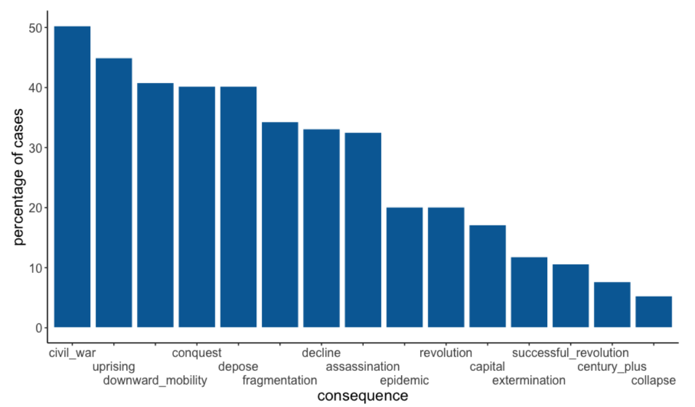
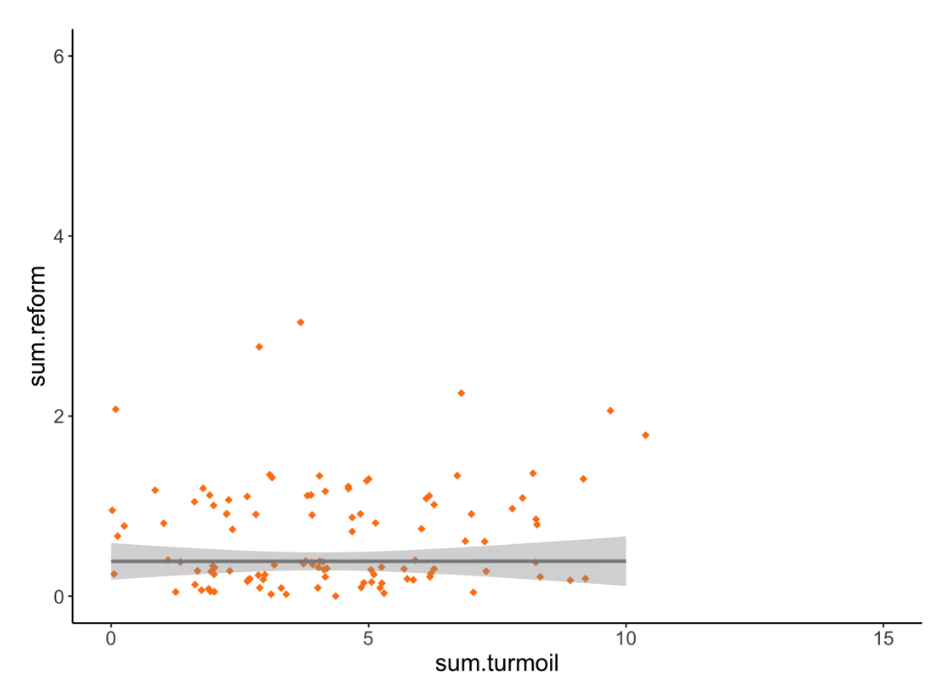
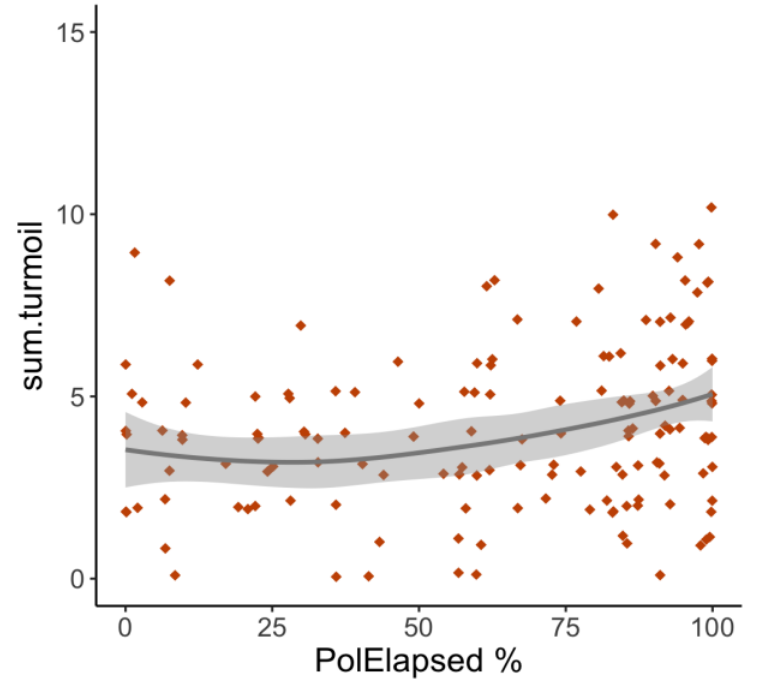

Ab und zu stößt man auf ein Paper, das einen umhaut, weil so viel Arbeit darin stecken muss und man so faszinierende Erkenntnisse daraus ziehen kann. Für mich ist das Paper „All Crises are Unhappy in Their Own Way: The Role of Societal Instability in Shaping the Past“ von Hoyer et al. (2025) so eine Arbeit. Sie haben einen neuen Datensatz auf der Seshat-Geschichtsdatenbank aufgebaut (Turchin et al., 2019) (1). Der neue Datensatz soll die meisten großen Krisen vom Beginn der überlieferten Geschichte bis etwa zum Anfang des 20. Jahrhunderts erfassen. Damit versuchen sie, eine ganze Reihe großer Erzählungen der Geschichte auf einen Schlag zu bestätigen oder zu widerlegen.

# Die großen Erzählungen der Geschichte

Wenn wir über die Geschichte unserer Spezies reden, werden oft große Erzählungen verwendet. Sie versuchen zu erklären, warum Geschichte passiert oder welche großen Trends sich von der fernen Vergangenheit bis heute entwickeln. Einige bekannte Beispiele:

* Steven Pinkers Argument, dass Gewalt seit Jahrtausenden abnimmt und wir in der friedlichsten Zeit leben, seit es die Menschheit gibt.
* Joseph Tainters Theorie der abnehmenden Erträge von Komplexität, die wir [in einem früheren Beitrag](https://florianjehn.github.io/Societal_Collapse/2023-06-06-collapse_overview/) genauer besprochen haben. Die Komplexitätssicht auf Kollaps besagt, dass Gesellschaften immer weniger tragfähig werden, weil Problemlösungen die Last schaffen, diese Komplexität zu erhalten.
* Peter Turchins säkulare Zyklen, [ebenfalls in einem früheren Beitrag beschrieben](https://existentialcrunch.substack.com/p/mapping-out-collapse-research#%C2%A7structural-demographic-theory). Säkulare Zyklen gehen davon aus, dass Gesellschaften in Phasen auf- und absteigen: Zusammenarbeit, angetrieben von Wachstum, schlägt wegen begrenzter Ressourcen in Konkurrenz um.

Andere Beispiele, die sich keiner bestimmten Person zuordnen lassen:

* Die großen Weltreligionen gibt es, um einen sozialen Kitt zu liefern, der Interaktion zwischen Menschen außerhalb ihrer direkten Verwandtschaft möglich macht. Das führt (angeblich) zu weniger Krisen in Regionen, in denen die Mehrheit der Menschen einer der großen Weltreligionen angehört.
* Mit der Zeit haben Gesellschaften Institutionen aufgebaut, mit denen sie Krisen besser bewältigen können.
* Größere Krisen führen zu größeren Umbrüchen und Reformen.

Hoyer und Co-Autoren glauben, dass all diese Erzählungen möglicherweise das Ergebnis von Rosinenpickerei sind. Wir brauchen deshalb einen großen Datensatz, der möglichst viele Krisen enthält, aber auch Ereignisse, die zu einer großen Krise hätten werden können, es aber nicht wurden.

# Wie man einen gigantischen Krisendatensatz baut

Um einen großen Datensatz über Krisen zu erstellen, muss man zuerst festlegen, was man mit Krise meint. Die Definition von Hoyer et al. lautet:

„Wir definieren Krise als eine Phase hoher gesellschaftlicher Belastung und eines Risikos systemischer Funktionsstörungen, also Zeiten, in denen Zeichen von Unruhe, institutionellem Versagen oder Niedergang und/oder gesellschaftspolitischer Instabilität im Vergleich zu früheren Generationen (bis etwa 50 Jahre zuvor) zunehmen.“

Sie räumen ein, dass Krise nicht das beste Wort dafür ist, weil es eher um die Zeit vor, nach und während dessen geht, was wir normalerweise als Krise sehen, finden aber, dass wir kein besseres haben, und bleiben deshalb dabei. Zur Klärung, was als Krise zählt, ein paar Beispiele:

* Die Zeit der Wirren in Russland
* Die Französische Revolution
* Der Zerfall des Mogulreichs
* Die Meiji-Restauration in Japan

Um alle tatsächlichen und möglichen Krisen zu finden, haben sie mit einer großen Gruppe historischer Fachleute gesprochen und alles gelesen, was sie in der Literatur finden konnten, das ihnen Hinweise geben konnte. Am Ende hatten sie 250 Fälle, von denen sie 168 in ihrer endgültigen Analyse verwendet haben, weil es für den Rest nicht genug Daten gab, um verlässlich zu sein. Von der Größe her können diese Einträge alles Mögliche betreffen, vom Stadtstaat bis zum Weltreich. Um sie zusammenzufassen, verwenden sie den Begriff Gemeinwesen (2). Der Datensatz enthält Fälle aus der ganzen Welt und reicht von der Bronzezeit bis ins frühe 20. Jahrhundert. Er ist etwas zu jüngeren Krisen hin verzerrt, weil wir dafür mehr Daten haben. Für jeden dieser Fälle haben sie eine große Bandbreite an Daten gesammelt:

* Ergebnisse der Krise: Führt die Krise zu einem Bürgerkrieg, einer Revolution usw.? Da die Krisendefinition einen breiten Zeitraum erfassen soll, müssen diese Ergebnisse nicht unbedingt das Ende einer Krise sein.
* Intensität der Krise: Dazu gehören Faktoren wie der Rückgang der Bevölkerung, ob die Elite ihre Positionen verloren hat, Attentate auf Herrscher, ob der Staat intakt blieb oder teilweise oder ganz aufgelöst wurde. All das wird dann zu einem Unruhewert für jede Krise aufsummiert.
* Reform: Wie stark sich der Staat nach der Krise reformiert hat. Dabei geht es um Reformen, die Dinge wie Wohlergehen und Freiheit verbessert haben. Zum Beispiel die Ausweitung des Wahlrechts oder große Programme für öffentliche Güter.
* Metadaten des Gemeinwesens: Dinge wie Dauer der Krise, Lebensdauer des Gemeinwesens, Geografie, Religion.
* Gesellschaftliche Komplexität: Die Gesamtkomplexität des Gemeinwesens. Dazu gehören Dinge wie Größe (Territorium, Bevölkerung, …), hierarchische Komplexität (wie viele Hierarchieebenen es in Verwaltung, Militär und Religion gibt), Regierungsführung (wie professionell und standardisiert die Bürokratie ist), Infrastruktur, Informationskomplexität (gibt es Schrift, wie wurden Aufzeichnungen geführt, …) und Geld (welche Art von Geld genutzt wurde). Die Gesamtkomplexität wird dann als erste Hauptkomponente all dieser Maße dargestellt.

# Ein Überblick über vergangene Krisen

Auf Grundlage dieses riesigen Datensatzes machen Hoyer et al. eine ganze Reihe von Analysen. Das sind meistens einfache Korrelationen und deskriptive Statistiken, also lassen sich mit stärkeren Werkzeugen wahrscheinlich noch viele weitere Erkenntnisse aus diesen Daten ziehen. Aber selbst mit so einfachen Ansätzen liefern sie viele faszinierende Ergebnisse.

## Die typische Krise gibt es nicht

Alle Krisen sind ein bisschen einzigartig und unterscheiden sich stark in ihren Eigenschaften. Die mittlere Dauer einer Krise liegt zwar bei 22 Jahren, die Spanne reicht aber von < 1 Jahr bis über 200 Jahre. Es gibt auch kein typisches Ergebnis einer Krise. Etwa 50 % der Krisen enden in irgendeiner Form von Bürgerkrieg, aber es gibt auch viele andere Ergebnisse (Abbildung 1). Diese Ergebnisse treten außerdem oft zusammen auf, und eine Krise kann mehrere verschiedene Ergebnisse auf einmal haben. Ziemlich relevant für diesen fortlaufenden Literaturüberblick: Nur etwa 5 % der Krisen enden in irgendeiner Form von Kollaps.

Abbildung 1: Folgen von Krisen und wie häufig sie auftreten

## Intensität der Krise und spätere Reformen hängen nicht zusammen

Die Verteilung der Krisenintensität und die des Umfangs von Reformen sind ziemlich unterschiedlich. Die Intensität der Krisen scheint ungefähr einer Normalverteilung zu folgen (3), die Verteilung des Reformumfangs liegt dagegen um 0, das heißt, nach der großen Mehrheit der Krisen gab es keine Reformen. Noch auffälliger werden diese Unterschiede, wenn man die beiden Verteilungen direkt vergleicht (Abbildung 2). Der Datensatz zeigt, dass eine größere Krise, wenn es zu einer Krise kommt, nicht zu größeren Reformen führt.

Abbildung 2: Zusammenhang zwischen dem Umfang der Reformen und der Intensität der Krisen (Die Zahlen sind eigentlich ganzzahlig, aber es wurde etwas Rauschen hinzugefügt, damit man die einzelnen Punkte besser auseinanderhalten kann).

## Dynamik von Krisen

Neben ihrer Schwere und ihren Ergebnissen lassen sich Krisen über verschiedene andere Faktoren beschreiben. Bemerkenswert ist, dass die Schwere von Krisen über die Zeit nicht abgenommen hat. Schwere Krisen waren 1850 genauso wahrscheinlich wie 1000 v. Chr. Dieses Ergebnis scheint ziemlich robust zu sein. Die Daten mögen zwar zu jüngeren Krisen hin verzerrt sein, aber man sollte erwarten, dass Krisen in der ferneren Vergangenheit schwerer sein mussten, um es überhaupt in die historischen Quellen zu schaffen. Wenn es überhaupt einen Trend in den Daten gibt, dann den, dass Krisen in den letzten tausend Jahren etwas schwerer waren als in früheren Zeiten. Es scheint aber einen Zusammenhang mit dem Lebenszyklus eines Gemeinwesens zu geben. Die Verteilung der Krisen über die Lebensdauer eines Gemeinwesens zeigt, dass Krisen in der zweiten Hälfte etwas schwerer sind (Abbildung 3). Trotzdem bleibt die Wahrscheinlichkeit von Reformen über die gesamte Lebensdauer eines Gemeinwesens relativ konstant. Dieselbe Abbildung enthält sowohl beunruhigende als auch hoffnungsvolle Erkenntnisse: Zivilisationen können große Krisen überstehen und danach noch lange bestehen, aber selbst kleine Krisen können ihr Ende bringen.

Abbildung 3: Schwere von Krisen über die Lebensdauer eines Gemeinwesens.

Das Ausmaß der Unruhe in einer Krise scheint nicht von der Weltregion abzuhängen, die geografische Lage hat also offenbar keinen großen Einfluss darauf, wie schwer die Krisen sind. Außerdem erleben Regionen, in denen Weltreligionen die Mehrheitsreligion sind, etwas weniger schwere Krisen. Größere Krisen führen zudem eher zu staatsbezogenen Ergebnissen (also Dingen wie der Eroberung durch einen Rivalen oder einem Bürgerkrieg), und auch der Bevölkerungsrückgang hängt leicht mit der Intensität der Krise zusammen.

## Eigenschaften von Staaten und Reformen

Wie oben gesagt, hängt der Umfang von Reformen überhaupt nicht mit der Schwere der Krise zusammen. Es gibt aber eine Reihe anderer Faktoren, die das Ausmaß von Reformen erhöhen oder verringern. Ein wichtiger Faktor ist Revolution (4). Wenn es eine Revolution gab, folgten in 65 % der Fälle Reformen, ohne Revolution nur in 23 % der Fälle. Interessanterweise gibt es selbst in der Teilmenge der Daten mit Revolution keinen Zusammenhang zwischen Schwere der Krise und Zahl der Reformen. Das scheint darauf hinzudeuten, dass Revolutionen Reformen wahrscheinlicher machen, selbst wenn die Revolution danach zu keiner großen Krise geführt hat. Reformen zu bewerten ist hier aber ziemlich kompliziert. Reformen können auch auf einen Regimewechsel folgen.

Die administrative Komplexität eines Staates ist ein weiterer wichtiger Faktor. Höhere administrative Komplexität behindert eher Reformbemühungen, mit der Idee, dass die Verwicklungen hochspezialisierter bürokratischer Systeme die Umsetzung neuer Politik und Strukturen erschweren können. Umgekehrt zeigen Gemeinwesen mit kleinerer Fläche und geringerer administrativer Komplexität mehr Reformen. Möglicherweise, weil dort Entscheidungsprozesse schlanker sind und sich Veränderungen so leichter umsetzen lassen.

Und schließlich spielt die gesamte hierarchische Struktur eines Staates eine Rolle dafür, wie offen er für Reformen ist. Mehr Hierarchieebenen in einem Staat gehen zwar meist mit mehr Reformen einher, aber nur, wenn die Hierarchie nicht überwiegend im Verwaltungsapparat des Staates liegt. Anders gesagt: Wenn es in einem Staat parallele Machtstrukturen gibt, scheint das Reformen zu erleichtern. Interessanterweise hängt die Komplexität der verschiedenen Hierarchien sehr stark miteinander zusammen. Das deutet darauf hin, dass es eine Art Sweet Spot bei Hierarchie und Machtverteilung in einem Gemeinwesen gibt, der Reformen erleichtert.

# Welche historischen Erzählungen halten?

## Gewalt hat im Lauf der Menschheitsgeschichte abgenommen (Steven Pinker)

Die Daten von Hoyer und Co-Autoren stützen Pinkers Behauptung nicht, dass Gewalt langfristig abgenommen hat: Die Schwere der Krisen hat über die Zeit nicht abgenommen. Wenn überhaupt, hat sie in den letzten 1000 Jahren zugenommen. Man muss allerdings beachten, dass sich Pinker vor allem auf den Rückgang der Zahl gewaltsamer Todesfälle über die Zeit konzentriert, während der hier vorgestellte Datensatz die Intensität von Krisenphasen untersucht und auch einige Krisen durch Naturkatastrophen enthält. Pinkers Hypothese könnte also trotzdem stimmen, müsste aber eingeschränkt werden: Sie deutet nicht unbedingt auf eine insgesamt friedlichere Zeit hin, sondern nur auf weniger gewaltsame Todesfälle inmitten anhaltender Krisen.

## Komplexität hat abnehmende Erträge (Joseph Tainter)

Die Ergebnisse von Hoyer und Kollegen widerlegen die Theorie der abnehmenden Erträge von Komplexität nicht. Tainters Theorie besagt, dass die Resilienz einer Gesellschaft mit der Zeit abnimmt, weil immer mehr Ressourcen nötig sind, um Lösungen für früher gelöste gesellschaftliche Probleme zu erhalten. Die hier vorgestellten Daten (Abbildung 3) passen zu dieser Theorie, weil sie zeigen, dass die Schwere von Krisen über die Lebensdauer eines Gemeinwesens zunimmt. Dieser Trend ist allerdings relativ schwach, was nicht ganz zu der Forschung über die Lebensdauer von Gesellschaften passt, die in einem [früheren Beitrag](https://florianjehn.github.io/Societal_Collapse/2023-12-04-bad_luck/) besprochen wurde und einen klaren Trend zu steigender Kollapswahrscheinlichkeit mit dem Alter eines Gemeinwesens zeigt. Trotzdem zeigt das, dass die Komplexitätstheorie zwei unabhängigen Versuchen standgehalten hat, sie mit quantitativen Daten zu widerlegen.

## Säkulare Zyklen (Peter Turchin)

Die Idee säkularer Zyklen oder irgendein zyklischer Blick auf Geschichte lässt sich mit diesen Daten nicht bestätigen. Wenn die Idee säkularer Zyklen stimmt, sollten wir erwarten, dass Gemeinwesen mit einer großen Krise enden. Das scheint hier nicht der Fall zu sein, was diese Hypothese weniger wahrscheinlich macht.

## Religionen als sozialer Kitt

Diese Hypothese scheint zu stimmen, aber nur in geringem Maß. Die großen Religionen scheinen Krisen weniger schwer zu machen, aber nur ein bisschen.

## Institutionen aufzubauen hilft, Krisen zu überstehen

Ob diese historische Erzählung stimmt, ist etwas schwerer zu beantworten. Wir haben schon in einem [früheren Beitrag](https://florianjehn.github.io/Societal_Collapse/2023-08-16-democracy_and_resilience/) besprochen, dass mehr staatliche Leistungsfähigkeit wichtig zu sein scheint, um durch eine Krise zu kommen. So ein Argument findet sich auch bei Hoyer et al. Ihre Studie zeigt aber auch, dass zu viel Bürokratie ebenfalls nicht hilft und dass parallele Hierarchien Reformen wahrscheinlicher machen. Für mich deutet das darauf hin, dass es irgendwo im Raum von Hierarchien und staatlicher Leistungsfähigkeit einen einigermaßen optimalen Bereich für Reformen und Resilienz gibt, aber aus dem Paper wird nicht klar, wo genau dieser Bereich liegen könnte.

## Größere Krisen führen zu größeren Umbrüchen

Diese historische Idee scheint nach den Daten von Hoyer und Kollegen am klarsten falsch zu sein. Es gibt keinen Hinweis darauf, dass größere Krisen zu größeren Umbrüchen führen. Selbst wenn man sich Revolutionen anschaut, die zu mehr Reformen führen, hängt die Größe der Krise nicht damit zusammen, wie viele Reformen danach umgesetzt werden.

# Warum sind manche Krisen schlimmer als andere, und warum führen manche zu Reformen?

Die Antwort geht etwas über das Paper hinaus, aber Hoyer und Co-Autoren diskutieren trotzdem einige mögliche Erklärungen:

* Die Größe des äußeren Schocks: Viele Krisen werden durch Ereignisse ausgelöst, auf die das Gemeinwesen keinen Einfluss hat. Eine großflächige Dürre (5) könnte eine Gesellschaft zum Beispiel über ihre Belastungsgrenze treiben, selbst wenn sie gut vorbereitet ist.
* Verhalten der Eliten: Eliten reagieren selbst auf ähnliche Krisen sehr unterschiedlich. Hoyer et al. zeigen das am Beispiel des Schwarzen Todes und wie die Eliten in Ägypten und England unterschiedlich reagierten. In England führte die Krise zu einer Umverteilung von Wohlstand und zur Stärkung der Rechte von Arbeitern, was teilweise zum Beginn der industriellen Revolution beitrug. In Ägypten wurde die Krise dagegen schlecht bewältigt, was vor allem zu mehr Unterdrückung und keiner Umverteilung von Wohlstand führte. Das wirft die Frage auf, ob Eliten in der Lage sind, die Kosten von Krisen gerecht über die Gesellschaft zu verteilen, statt die Last allein den weniger Wohlhabenden aufzubürden.
* Staatliche Leistungsfähigkeit: Wie oben erwähnt: Je mehr staatliche Leistungsfähigkeit man hat, desto besser kann man sich auf Krisen vorbereiten und desto schneller kann man Ressourcen bewegen, wenn die Krise da ist. Gleichzeitig muss man aber dafür sorgen, dass der Staat nicht durch eine zu komplexe Bürokratie unbeweglich wird.
* Revolutionen: Eines der faszinierendsten Ergebnisse dieser Studie ist, dass Revolutionen einer der wichtigsten Treiber von Reformen zu sein scheinen. Da es aber keinen Zusammenhang mit der Größe der Krise gibt, scheint das zu bedeuten, dass der beste Weg, Reformen durchzusetzen, eine Revolution ist, die man aber irgendwie unter Kontrolle hält, damit sie nicht in großem Chaos endet.

# Fazit

Wie jede gute wissenschaftliche Arbeit wirft dieses Paper mindestens so viele neue Fragen auf, wie es alte beantwortet. Es versucht aber, auf eine beeindruckende Zahl von Fragen Antworten zu geben. Nicht alle wurden beantwortet, aber trotzdem liefert das Paper viele überzeugende Belege. Das zeigt die Stärke quantitativer Geschichte und gleichzeitig, wie viel Arbeit nötig ist, um sie möglich zu machen. Dieses Paper baut auf der Arbeit von Hunderten oder sogar Tausenden anderer Forschender auf. Ich hoffe, dass solche Forschung weiter gefördert und gemacht wird. Vor allem, weil das Team um Hoyer auch plant, den Zeitraum des Datensatzes bis heute zu erweitern. Das würde nicht nur noch genauere Antworten auf die hier besprochenen Fragen liefern, sondern auch einen ziemlich starken Datenpunkt zu der Frage, ob die Geschichte der letzten ~100 bis 200 Jahre eine Fortsetzung früherer Trends ist oder etwas Neues, das sich nicht mit der früheren Geschichte vergleichen lässt (6).

# Anmerkungen

(1) Ein riesiger historischer Datensatz, den wir in diesem Blog schon öfter erwähnt haben: [1](https://florianjehn.github.io/Societal_Collapse/2023-08-10-lessons_from_the_past/), [2](https://florianjehn.github.io/Societal_Collapse/2023-08-16-democracy_and_resilience/), [3](https://florianjehn.github.io/Societal_Collapse/2024-02-08-climate_collapse/), [4](https://florianjehn.github.io/Societal_Collapse/2023-11-15-collapse_models/)

(2) Das sie so definieren: „Wir definieren ein Gemeinwesen als eine unabhängige politische Einheit, die von Dörfern (lokalen Gemeinschaften) über einfache und komplexe Häuptlingstümer bis zu Staaten und Imperien reichen kann.“

(3) Man kann auch gut argumentieren, dass das nicht wirklich eine Normalverteilung ist, weil sehr kleine Krisen vielleicht unterrepräsentiert sind. Wenn fast nichts passiert ist, ist die Chance größer, dass es nicht aufgezeichnet wurde und deshalb nicht im Datensatz auftaucht.

(4) Revolution ist hier so definiert: „Revolution ist der Versuch, eine Regierung durch Massenmobilisierung (militärisch, zivil oder beides) gewaltsam zu stürzen, um neue politische Institutionen zu schaffen. Das unterscheidet sich von Rebellionen und anderen Aufständen, die nicht unbedingt mit Massenmobilisierung verbunden sind oder einen systemischen bzw. Regierungswechsel anstreben (das aber können).“

(5) In früheren Beiträgen haben wir besprochen, wie solche Klimaschocks außer Kontrolle geraten können: [1](https://florianjehn.github.io/Societal_Collapse/2023-10-05-famine_2/), [2](https://florianjehn.github.io/Societal_Collapse/2024-02-08-climate_collapse/)

(6) Diese Frage wurde auch in einem [früheren Beitrag](https://existentialcrunch.substack.com/p/lessons-from-the-past-for-our-global) besprochen.

# Zitieren
Bitte das englische Original zitieren:

Jehn, F. U. (2024, April 9). What factors allow societies to survive a crisis?. Existential Crunch. [https://doi.org/10.59350/qk98g-z9j18](https://doi.org/10.59350/qk98g-z9j18)

# Quellen

* Hoyer, D., Holder, S., Bennett, J. S., Francois, P., Whitehouse, H., Covey, R. A., Feinman, G., Korotayev, A., Ustyuzhanin, V., Preiser-Kapeller, J., Bard, K., Levine, J., Reddish, J., Orlandi, G., Ainsworth, R., & Turchin, P. (2025). All Crises are Unhappy in Their Own Way: The Role of Societal Instability in Shaping the Past. Social Science History, 50(2), 314–346. https://doi.org/10.1017/ssh.2025.10113
* Turchin, P., Whitehouse, H., Francois, P., Hoyer, D., Alves, A., Baines, J., Baker, D., Bartkowiak, M., Bates, J., Bennett, J., Bidmead, J., Bol, P., Ceccarelli, A., Christakis, K., Christian, D., Covey, A., De Angelis, F., Earle, T., Edwards, N., & Xie, L. (2019). An Introduction to Seshat: Global History Databank. Journal of Cognitive Historiography, 5. https://doi.org/10.1558/jch.39395
