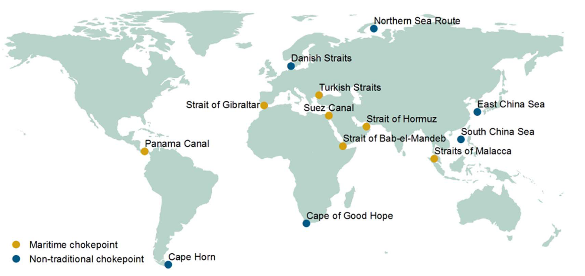
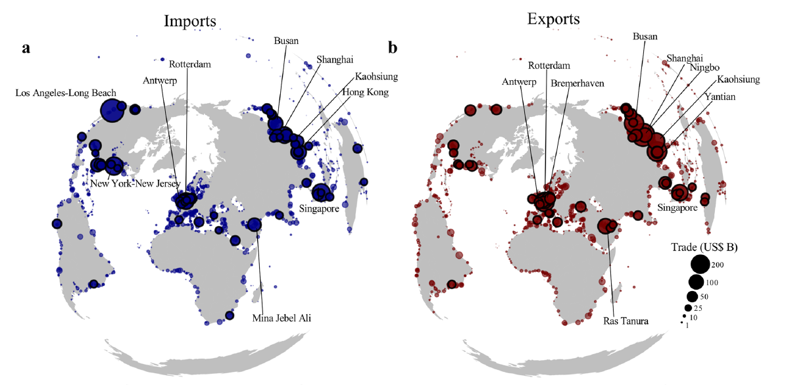
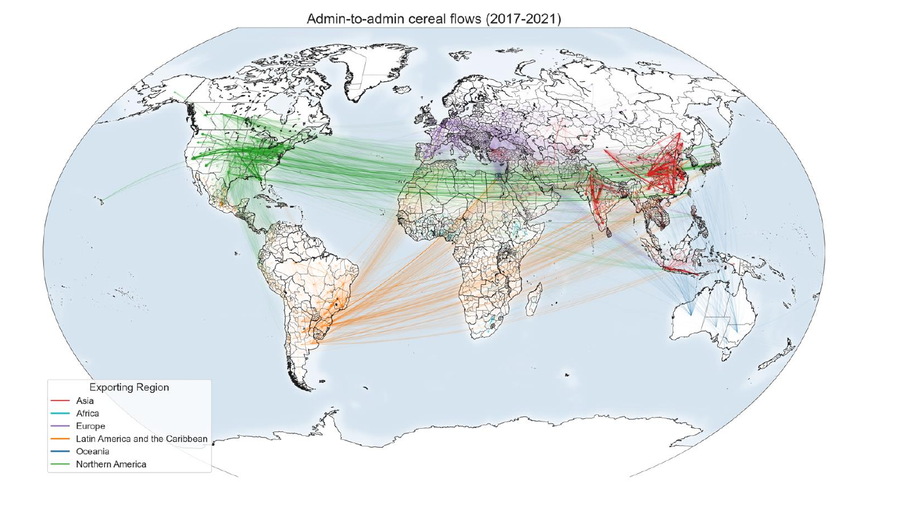
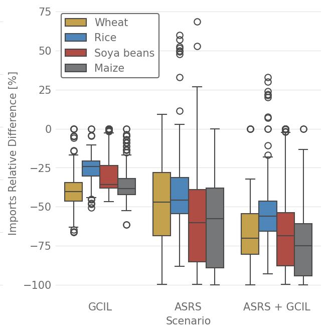
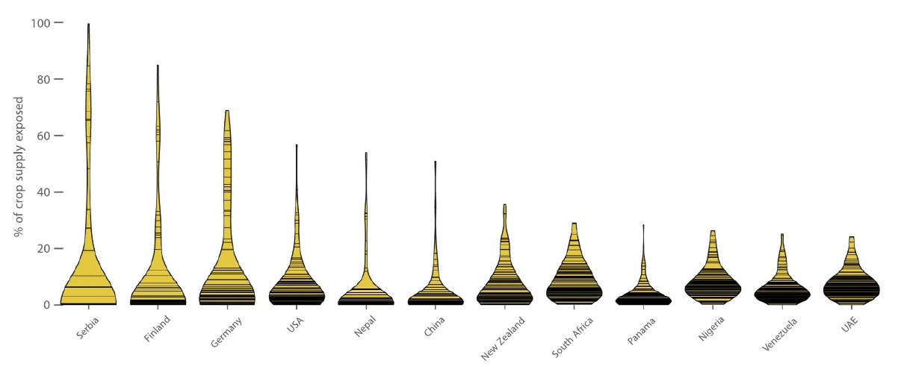

Die meisten Dinge, die du nutzt, und vor allem das Essen, das wir zu uns nehmen, hängen von einer intakten globalen Lieferkette ab. Ohne Handel wären lebenswichtige Ressourcen wie Dünger nicht mehr zugänglich, was die Lebensmittelproduktion viel schwieriger machen würde. Dieser Beitrag soll einen Überblick über das heutige Handelssystem geben, seine möglichen Schwachstellen hervorheben und die Faktoren untersuchen, die zu diesem Zustand beigetragen haben. Der Fokus liegt auf dem Lebensmittelhandel, weil er so wichtig und so verwundbar ist.

# Wie steht es um den Lebensmittelhandel?

Einen guten Überblick über den Zustand des Handelssystems geben D’Odorico et al. (2014), die globale Lebensmittelströme anhand von Handelsdaten der Ernährungs- und Landwirtschaftsorganisation der Vereinten Nationen (FAO) verfolgen. Sie finden, dass etwa ein Viertel der Lebensmittel, die wir produzieren, gehandelt wird und dass dieser Anteil in den letzten Jahrzehnten gestiegen ist. Außerdem wächst die gehandelte Menge an Lebensmitteln schneller als die produzierte. Mit diesem Anstieg des Lebensmittelhandels wird das System auch immer komplexer. Wir handeln nicht nur insgesamt mehr, sondern es gibt auch immer mehr Handelsbeziehungen zwischen Ländern, die vorher nicht verbunden waren. Gleichzeitig hat sich der Export von Lebensmitteln aber immer stärker konzentriert, und der Großteil der Lebensmittelexporte kommt inzwischen von wenigen großen Exporteuren wie den USA, Australien und Russland. Obwohl die Gesamtkomplexität des Netzwerks also wächst, wächst auch die Abhängigkeit von diesen großen Exporteuren weiter.

Ein Jahrzehnt später haben Ji et al. (2024) eine ähnliche Analyse mit neueren Daten gemacht und kamen zum selben Schluss. Das ist beunruhigend, denn diese Trends tragen zur Verwundbarkeit unseres Lebensmittelhandelssystems bei.

# Was macht den Lebensmittelhandel so verwundbar?

## Exportverbote

Puma et al. (2015) ist eine Schlüsselstudie, um die Fragilität unseres Lebensmittelhandelssystems zu verstehen. Sie war eine der ersten Studien, die sich genau angeschaut hat, wie sich Exportverbote auf die Stabilität des Handelsnetzes auswirken könnten. Wie die anderen hier genannten Studien haben sie aus Handelsdaten ein Netzwerkmodell gebaut. Um die Wirkung von Exportverboten zu untersuchen, haben sie gezielt Knoten aus dem Netzwerk entfernt, um zu sehen, wie stark das das Ernährungssystem treffen würde. Ihre Ergebnisse zeigen, dass unser Ernährungssystem nur stabil bleiben kann, solange die wichtigsten Handelsknoten weiter exportieren. Wenn ein Land wie die USA aufhört, Lebensmittel zu exportieren, würde das die Verfügbarkeit von Lebensmitteln in vielen Ländern drastisch verringern und auch die Handelsströme allgemein stören, weil viele Länder keine direkte Handelsverbindung haben und stattdessen Knoten wie die USA nutzen, um ihre Lebensmittel zu exportieren und zu importieren.

Neben dieser direkten Wirkung besprechen Puma und Co-Autoren auch die Möglichkeit von Kaskaden von Exportverboten. Historisch wissen wir, dass Länder Exportverbote meist aus drei Hauptgründen einführen: 1) ein Ausfall der eigenen Lebensmittelproduktion, 2) ein Produktionsausfall bei einem ihrer wichtigsten Importländer oder 3) Nachbarländer, die Exportverbote einführen. Bei globalen Katastrophen wie großen Vulkanausbrüchen würden wahrscheinlich alle drei zutreffen, was zu einer Kaskade von Exportverboten führen könnte, weil jedes Land versucht, genug Essen für seine eigenen Bürger zu sichern. Das könnte zu der tragischen Lage führen, dass es weltweit genug Essen gibt, es aber die Mehrheit der Weltbevölkerung nicht erreicht, weil fast alle Länder Exportverbote eingeführt haben.

## Engpässe

Wir haben weltweit zwar viele Handelsrouten, aber weil der meiste Lebensmittelhandel über das Wasser läuft, zwingt die Geografie diese Routen durch sogenannte Engpässe. Das sind Gebiete, durch die ein Großteil der Handelsströme durch eine sehr enge Passage muss. Den Einfluss dieser Engpässe auf den Lebensmittelhandel haben Wellesley et al. (2017) untersucht, indem sie den globalen Warenstrom verfolgt haben. Sie haben insgesamt 13 Engpässe identifiziert (Abbildung 1).

Abbildung 1: Engpässe im Lebensmittelhandel, wie sie Wellesley et al. (2017) identifiziert haben.

Besonders wichtig für den Lebensmittelhandel sind der Panamakanal und die Straße von Malakka. Etwa ein Viertel des globalen Maishandels geht zum Beispiel durch den Panamakanal, und etwa ein Viertel des globalen Reishandels wird durch die Straße von Malakka geschleust. Wenn so ein Engpass blockiert würde, würde das den Lebensmittelstrom also erheblich stören.

Ein Engpass kann aus verschiedenen Gründen blockiert werden. Ein berühmtes Beispiel ist, als das Containerschiff Ever Given 2021 den Suezkanal blockierte.

Wellesley und Co-Autoren sehen zwei Hauptgründe für künftige Blockaden der Engpässe:

* Klima: Manche Engpässe wie der Panamakanal hängen vom lokalen Klima ab, um zu funktionieren. Der Panamakanal nutzt Schleusen, um Schiffe über die Höhenunterschiede zu bringen. Diese Schleusen sind darauf angewiesen, dass der lokale Wasserstand hoch genug ist, um die Containerschiffe durchzulassen. Wenn es also eine Dürre gibt, ist der Kanal nicht mehr nutzbar. Ähnliches kann auch an anderen Engpässen passieren und dürfte wegen der Erderwärmung in Zukunft zunehmen.
* Geopolitik: Viele der Engpässe könnten bei hohen regionalen geopolitischen Spannungen blockiert werden. Die türkischen Meerengen wurden zum Beispiel während des Putsches in der Türkei 2016 gesperrt, und die Meerenge Bab al-Mandab wird gerade von Huthi-Rebellen bedrängt, was ihre Nutzung gefährlicher macht.

Neben diesen Engpässen allgemein sieht man auch, dass Häfen sich in ihrer Bedeutung für den Welthandel stark unterscheiden. Ein Paper von Verschuur et al. (2022) hat die 1300 wichtigsten Häfen der Welt für globale Lieferketten analysiert. Anhand einer großen Lieferkettendatenbank haben sie verfolgt, wie viele Waren durch all diese Häfen fließen. Sie finden, dass dem Wert nach etwa 50 % des Welthandels durch Häfen fließt. Außerdem unterscheiden sich die Häfen extrem in ihrer Bedeutung, wobei einige große Häfen wie Antwerpen, Los Angeles oder Singapur eine sehr wichtige Rolle für die globalen Handelsströme spielen (Abbildung 2). Wenn einer dieser Häfen gestört würde, hätte das also wahrscheinlich weitreichende Folgewirkungen.

Abbildung 2: Global wichtige Häfen für Importe und Exporte.

## Konzentration auf allen Ebenen

Wie am Anfang dieses Beitrags erwähnt, sind wir beim Lebensmittelhandel von sehr wenigen Ländern abhängig. Das ist aber nicht der einzige Bereich, in dem wichtige Güter und Tätigkeiten bei wenigen zentralen Akteuren konzentriert sind. Ein aktueller Literaturüberblick von Clapp (2023) hat untersucht, welche Teile des Ernährungssystems konzentriert sind und wie es historisch dazu kam. Konzentration heißt hier, dass eine kleine Zahl von Akteuren oder Gütern bestimmte Bereiche und Tätigkeiten dominiert. Clapp identifiziert drei Hauptbereiche, in denen uns diese Konzentration verwundbar macht:
* Das weltweite industrielle Ernährungssystem hängt stark von wenigen zentralen Getreidesorten ab, die mit fortschrittlichen Anbaumethoden angebaut werden, was es anfällig für Störungen macht, die genau diese Pflanzen treffen, und für den Verlust landwirtschaftlicher Betriebsmittel wie Dünger (1).
* Nur wenige Länder sind darauf spezialisiert, wichtige Getreidesorten für den Export zu produzieren, und zahlreiche andere Länder sind darauf angewiesen, darunter viele der ärmsten Länder der Welt mit der größten Ernährungsunsicherheit.
* Der globale Getreidehandel wird von einer Handvoll Firmen auf stark finanzialisierten Rohstoffmärkten kontrolliert, die ziemlich volatil sind.

Clapp führt diese Veränderungen auf Kapitalismus und Kolonialismus zurück. Unsere Konzentration auf wenige Grundnahrungsmittel kommt von der Effizienz, die man durch die Spezialisierung auf einzelne Pflanzen gewinnt. Historisch fehlten Kolonialmächten wie den USA die Arbeitskräfte, um die riesigen durch Kolonialismus erworbenen Gebiete zu bewirtschaften, was Anreize für eine frühe Mechanisierung schuf und ihre Rolle als große Lebensmittelexporteure festigte. Postkoloniale Länder erbten oft unterentwickelte Volkswirtschaften, was zu einer Abhängigkeit von billigeren importierten Lebensmitteln statt lokal angebauter Erzeugnisse führte. Diese Abhängigkeit hat sich wegen wirtschaftlicher Anreize, die Importe begünstigen, tief verfestigt.

Zur Konzentration des Handels bei wenigen Firmen argumentiert Clapp, dass die aktuellen Markttrends Monopole fördern. Lebensmittelhandel erfordert erhebliche Investitionen bei geringen Gewinnmargen, was es neuen Wettbewerbern sehr schwer macht, einzusteigen.

Ein weiteres Paper, das diese Probleme im Lebensmittelhandel mit der Struktur der globalen Märkte verbindet, ist von Yıldırım & Önen (2024). Sie haben untersucht, welche Länder am stärksten von Störungen des Ernährungssystems durch den russischen Überfall auf die Ukraine und COVID-19 betroffen waren. Sie argumentieren, dass das vor allem Länder mit niedrigem Einkommen traf, die auch keine eigene Lebensmittelproduktion haben. Sie schlagen vor, dass diese Länder Importbeschränkungen einführen könnten, um ihre lokale Lebensmittelversorgung zu stärken und sich weniger abhängig von Importen zu machen.

Um noch tiefer in die Konzentration einzusteigen, kann man sich anschauen, wie Handel unterhalb der Länderebene abläuft. Das hat Jain (2026) vor Kurzem ziemlich detailliert untersucht. Die Grundidee des Papers war, dass wir Handel wahrscheinlich besser verstehen könnten, wenn wir ihn genauer betrachten, also auf Verwaltungsebenen unterhalb der Länder. Das Problem ist, dass es diese Daten meistens nicht gibt. Wir müssen sie also erzeugen.

Dafür hat Jain Modelle des maschinellen Lernens auf Handelsbeziehungen im Lebensmittelhandel auf Länderebene und auf erklärende Variablen wie Anbaufläche, Viehbestand, Bevölkerung und Verkehrsnetze trainiert. Mit dem daraus entstandenen Modell konnte Jain die ein- und ausgehenden Handelsströme für niedrigere Verwaltungsebenen in allen Ländern vorhersagen. Diese Zahlen wurden dann angepasst, bis die Summen zu den tatsächlich gehandelten Mengen auf Länderebene passten. Wegen der großen Unsicherheiten sind die resultierenden Zahlen wahrscheinlich immer noch etwas ungenau, aber sie zeigen ziemlich interessante Handelsmuster (Abbildung 3). Es zeigt sich, dass die Produktion nicht nur auf wenige Länder konzentriert ist, sondern dass selbst in diesen Ländern der Großteil der Produktion aus einer kleinen Zahl von Regionen kommt. Selbst ein relativ lokaler Schock kann also schnell globale Folgen haben.

Abbildung 3: Subnationale globale Handelsströme von Getreide.

# Wie viel unseres Handels könnten wir verlieren?

Wir wissen also, dass der Lebensmittelhandel in vielerlei Hinsicht ziemlich verwundbar ist. Aber wie würden Veränderungen im Handel nach einer großen Katastrophe die Ernährungssicherheit beeinflussen? Dieser Frage gehen Jehn et al. (2025) nach (Hinweis: Ich bin Hauptautor dieses Papers). Dafür haben Jehn et al. ein einfaches Netzwerkmodell des Handels genutzt, um zu simulieren, wie Veränderungen der Lebensmittelproduktion die Muster des Lebensmittelhandels verändern. Die Annahme ist: Wenn man weniger Lebensmittel produziert, verringert man seine Exporte um dieselbe Menge. So lässt sich die Wirkung des direkten Ertragsrückgangs isolieren, ohne weitere Annahmen über menschliches Verhalten treffen zu müssen.

Jehn et al. haben mit diesem Modell die zwei Hauptarten globaler Katastrophen untersucht, die die Lebensmittelproduktion beeinflussen: 1) abrupte Verringerung des Sonnenlichts (wie ein nuklearer Winter), 2) globaler katastrophaler Infrastrukturverlust (GCIL, wie ein großer geomagnetischer Sturm, der das globale Stromnetz lahmlegt) und 3) eine Kombination aus beidem (stell dir einen nuklearen Winter nach einem Atomkrieg vor, der auch HEMP-Angriffe umfasste). Sie finden, dass viele Länder nach einem GCIL etwa 25 bis 50 % ihrer Lebensmittelimporte verlieren würden und bei einem ASRS 50 bis 100 %. Eine Kombination aus beidem wäre noch zerstörerischer (Abbildung 4).

Abbildung 4: Auswirkung eines globalen katastrophalen Infrastrukturverlusts (GCIL), einer abrupten Verringerung des Sonnenlichts (ASRS) und einer Kombination aus beidem auf die Lebensmittelimporte für alle vier wichtigen Nutzpflanzen und alle Länder.

Neben diesen direkten Folgen hat das Paper auch simuliert, wie sich das auf Handelsgemeinschaften auswirken würde. Eine Handelsgemeinschaft ist eine Gruppe von Ländern, die viel miteinander handeln. Sie können sich verändern, wenn zum Beispiel ein großer Exporteur wegen Ertragsverlusten seine Exporte verringert. Interessanterweise unterscheiden sich die Folgen hier stark je nach Katastrophe. Bei GCIL-Szenarien bleiben die Handelsgemeinschaften weitgehend gleich, weil die Lebensmittelproduktion relativ gleichmäßig getroffen wird. Wenn also die meisten Länder einen ähnlichen Rückgang der Lebensmittelproduktion haben, bleiben die Handelspartner weitgehend dieselben. Bei ASRS-Szenarien sieht das Bild aber ganz anders aus. Die dadurch verursachte Klimastörung ist regional sehr unterschiedlich, zerstört die Lebensmittelproduktion in manchen Ländern komplett, lässt andere gar nicht betroffen oder verbessert in manchen sogar die Bedingungen (z. B. in sehr heißen Ländern). Das verändert die Karte der Handelspartner komplett, weil viele Länder sich neue Partner suchen müssten, um überhaupt eine Chance auf Lebensmittelimporte zu haben.

All das deutet darauf hin, dass der Lebensmittelhandel nach globalen Katastrophen massiv gestört wäre, wobei ASRS möglicherweise am zerstörerischsten wäre.

# Der Zusammenhang zwischen dem Zusammenbruch des Handels und gesellschaftlichem Kollaps

Diese Paper zeigen, dass wir beim Lebensmittelhandel derzeit in einer schwierigen Lage sind. Wenn ein großer Schock passiert, könnte das Ernährungssystem kaskadenartig zusammenbrechen. Neben diesen Erkenntnissen aus der Gegenwart können wir auch in die Geschichte schauen, um zu sehen, wie zusammenbrechende Handelssysteme die beteiligten Länder gefährden. Ein Beispiel ist der Zusammenbruch der späten Bronzezeit (2), wie ihn Linkov et al. (2024) untersuchen.

Linkov et al. (2024) bauen ein Netzwerkmodell, um Handelsbeziehungen und politische Verbindungen abzubilden (Abbildung 5). Eine politische Verbindung meint hier Dinge wie unterzeichnete Verträge für einen Verteidigungspakt. Dann entfernen sie Knoten aus dem Netzwerk, um zu testen, welche die größte Wirkung hatten. Sie finden, dass in der Bronzezeit sowohl das politische als auch das Handelsnetz stark auf das Hethiterreich und Ugarit angewiesen waren, um zu funktionieren. Wenn man diese Knoten entfernt, wie es historisch durch ihren Zusammenbruch passiert ist, löst sich das ganze Netzwerk auf, weil der östliche und der westliche Teil viele der Verbindungen verlieren, die sie stabil gehalten haben. Dieser Verlust war besonders problematisch, weil die Wirtschaft der Bronzezeit stark auf Zinn angewiesen war, das vor allem auf Zypern abgebaut wurde. Ohne das Hethiterreich und Ugarit war die einzige verbleibende politische Verbindung Zyperns Ägypten, das selbst in der Krise steckte und deshalb nicht mehr in der Lage war, den Handel aufrechtzuerhalten. Wie von Linkov et al. (2024) vorhergesagt, führte der Zusammenbruch Ugarits und des Hethiterreichs zu einem breiteren Zusammenbruch, weil weiter entfernte Regionen über ihre Verbindungen zu diesen Reichen den Zugang zum Handel verloren. Es folgte der Zusammenbruch der späten Bronzezeit, der den ganzen weiteren Mittelmeerraum erfasste.

Abbildung 5: Das Netzwerk für Handel und Politik in der Bronzezeit.

Unser heutiges Lebensmittelhandelsnetz ist gar nicht so unähnlich. Wenn zum Beispiel die USA aus irgendeinem Grund aufhören würden, mit Lebensmitteln zu handeln, könnte allein das unser Lebensmittelhandelsnetz komplett auflösen.

# Wie wichtig ist die eigene Produktion im Vergleich zum Handel mit Lebensmitteln?

Man kann sich den Lebensmittelhandel auch so anschauen: Wann hilft es, viele Lebensmittel zu importieren, und wann ist es eher eine Belastung, und man hätte lieber die eigene Lebensmittelproduktion ausbauen sollen? Das untersucht ein Artikel von (Verschuur et al., 2026). Die Forschenden haben ein bilaterales Handelsmodell für 177 Länder und vier wichtige Nutzpflanzen (Mais, Weizen, Reis, Soja) entwickelt, um zu simulieren, wie verschiedene Arten von Schocks die Verfügbarkeit und die Preise von Lebensmitteln beeinflussen. Sie haben mehrere Szenarien modelliert: den Krieg in der Ukraine, Schocks bei den Energiepreisen, Handelsbeschränkungen und eine „Polykrise“, die alle drei kombiniert, vor dem Hintergrund von 54 Jahren wetterbedingter Schwankungen der Produktion.

Die wichtigsten Ergebnisse zum Handel als Puffer:

* Handel hilft grundsätzlich, lokale Schocks abzufedern, weil Länder sich Lebensmittel von anderen Lieferanten beschaffen können. Als zum Beispiel die Exporte der Ukraine gestört waren, wichen die Importländer auf andere Lieferanten aus.
* In normalen Jahren hatten Länder mit hoher Importabhängigkeit kleinere Verluste bei der Konsumentenrente, was darauf hindeutet, dass Handelsnetze Resilienz gegenüber moderaten Störungen bieten.
* Im Szenario des Ukrainekriegs nahmen die internationalen Handelsströme zu, weil Länder nach anderen Lieferanten suchten, was die Anpassungsfähigkeit des Handels zeigt.

Der Handel hat als Puffer aber Grenzen:

* Bei extremen Ereignissen am Rand der Verteilung (den schlimmsten 10 % der Szenarien) wurde eine höhere Importabhängigkeit eher zur Schwachstelle als zum Vorteil, vor allem bei Mais und Reis. Länder mit mehr eigener Produktion waren besser gegen schwere Schocks gepuffert.
* Handel kann Schocks durch das ganze globale System weitergeben und verstärken. Das kombinierte „Polykrisen“-Szenario führte bei allen Nutzpflanzen zu Preisanstiegen für Verbraucher von 23 bis 52 % und traf praktisch alle Länder gleichzeitig.
* Handelsbeschränkungen (wie Indiens Exportverbot für Reis) trafen bestimmte Regionen schwer, vor allem Afrika südlich der Sahara und Zentralasien.

Der Schock bei den Energiepreisen erwies sich insgesamt als am schädlichsten, weil er die Kosten für Betriebsmittel weltweit erhöhte, während verschiedene Regionen für bestimmte Arten von Schocks unterschiedlich verwundbar waren. Die Forschung legt nahe, dass sowohl Handelsverbindungen als auch eigene Produktionskapazität in einem Ansatz der „Risikoschichtung“ für die Resilienz des Ernährungssystems nötig sind.

Im Kern gibt der Handel dem Ernährungssystem wichtige Flexibilität, sich an Schocks anzupassen, wird aber bei kombinierten Störungen auf globaler Ebene als Puffer weniger wirksam. Das ist ein ähnlicher Schluss wie bei Yıldırım & Önen (2024), aber Verschuur et al. untermauern ihn zusätzlich mit Modellierung.

Ein weiteres Paper, das tiefer in die Gefahr einsteigt, dass Handel Schocks im System verstärkt, ist von Keys et al. (2025). Sie wollten verstehen, wie Klimagefahren über den globalen Lebensmittelhandel weitergegeben werden. Konkret ging es darum, wie sowohl heiß-trockene als auch heiß-feuchte Klimaschocks die landwirtschaftliche Produktion verringerten und wie dieser Rückgang sowohl das produzierende Land als auch seine Handelspartner traf. Um das zu modellieren, ließen sie ein Klimamodell (CESM 2) 100-mal jeweils 10 Jahre laufen. Jeder Lauf hat leicht andere Startbedingungen und entwickelt sich deshalb mit der Zeit anders. Zusammen stehen diese 100 Läufe für die plausible Schwankungsbreite des Klimas über 10 Jahre. Mit der gefundenen Schwankungsbreite konnten sie abschätzen, welche Teile der Erde Klimaschocks ausgesetzt sein könnten.

Mit diesem Wissen konnten sie abschätzen, wie viel unserer globalen landwirtschaftlichen Produktion von diesen Klimaschocks betroffen sein könnte. Um zu prüfen, wie diese Produktionsschocks dann Handelspartner treffen könnten, nutzten sie Handelsdaten, um zu verstehen, wie viel Lebensmittel Länder importieren und woher. So konnten sie berechnen, wie viel der Lebensmittelversorgung eines Landes von lokalen Klimaschocks und von Klimaschocks in anderen Ländern betroffen sein könnte (Abbildung 6). Das zeigte ihnen, dass es viele Länder gibt, die damit rechnen können, dass in den nächsten zehn Jahren 30 % oder mehr ihrer Versorgung mit Nutzpflanzen durch Klimaschocks gestört werden könnten (im Fall Serbiens bis zu 93 %).

Abbildung 6: Exposition der Versorgung mit Nutzpflanzen gegenüber Klimaschocks für verschiedene Länder. Schwarze Linien zeigen einzelne Modellläufe. Der Violinplot zeigt die Verteilung der Exposition über alle Läufe.

Grundsätzlich fanden sie, dass der beste Schutz gegen Klimaschocks ist, Lebensmittel aus möglichst vielen Ländern zu importieren, die außerdem über verschiedene Klimazonen verteilt sein sollten. Wenn man sich nur auf die eigenen Pflanzen und die der Nachbarn verlässt, ist es wahrscheinlich, dass man wegen des Klimawandels irgendwann eine schlimme Zeit hat.

# Lebensmittelhandel im Vergleich zum Handel mit anderen Gütern

All das zeigt, dass unser Lebensmittelhandelssystem anfällig für Risiken ist, was zeigt, wie wichtig es ist, die Resilienz zu erhöhen. Interessanterweise scheint das Ernährungssystem zwar immer verwundbarer zu werden, aber dieser Trend gilt nicht unbedingt für das breitere Handelssystem. Kang et al. (2024) haben die Handelsströme der letzten drei Jahrzehnte untersucht. In ihrer Analyse haben sie systematisch Knoten aus dem Netzwerk entfernt, um zu simulieren, wie sich die Last eines Knotens auf benachbarte Knoten verteilt. Sie beobachteten einen allmählichen Rückgang der Abhängigkeit von Ländern voneinander, vor allem seit der Finanzkrise 2008. Diesen Wandel führen sie auf die sinkende Bedeutung fossiler Brennstoffe durch alternative Energiequellen zurück, zusammen mit einem größeren Bewusstsein der Länder für die Verwundbarkeit von Lieferketten und Bemühungen, nach wiederkehrenden Schocks wie COVID-19 oder der Finanzkrise die Resilienz zu stärken. Die Studie zeigte aber auch, dass selbst der Wegfall eines kleineren Landes erhebliche Störungen verursachen kann, weil benachbarte Knoten oft nicht genug Kapazität haben, um den Verlust aufzufangen.

# Modellieren wir Handel zu einfach?

Die meisten Studien zum Handel modellieren ihn als gerichteten Graphen und nutzen verschiedene Methoden, um die Folgen zu bewerten, wenn ein Knoten aus dem Netzwerk entfernt wird. Der Handel kann dabei also nur schlechter werden, weil es keine Möglichkeit gibt, neue Verbindungen einzuführen. Im echten Leben führt aber jede Störung des Handels zu irgendeiner Art von Anpassung.

Nach dem russischen Überfall auf die Ukraine gab es zum Beispiel Befürchtungen, dass die Ukraine als Weizenexporteur komplett wegfallen würde, was eine große Störung gewesen wäre. Wie das verhindert wurde, untersucht ein Paper von Kuhla et al. (2024). Sie zeigen, dass es zwar eine Preisspitze gab, aber nicht so hoch wie befürchtet. Die internationale Gemeinschaft half, mit Russland eine Vereinbarung auszuhandeln, die etwas Export über das Schwarze Meer erlaubte, und gleichzeitig konnte die Ukraine mehr Getreide über europäische Flüsse statt über das Schwarze Meer handeln. Außerdem war die globale Weizenernte 2022 außergewöhnlich hoch, was zusätzlich Druck aus dem System nahm. Ohne diese internationale Vereinbarung und das glückliche Wetter hätten die Folgen also viel schlimmer sein können.

Die Herausforderung ist, die Ergebnisse solcher Anpassungen vorherzusagen, bevor sie passieren. Zum Glück haben wir den kompletten Wegfall großer Exporteure wie der USA oder Russlands noch nicht erlebt, aber dadurch haben wir nur wenige Daten, um neue Handelsverbindungen nach großen Schocks zu modellieren. Bisher habe ich keine Studie gefunden, die ein gutes Modell dafür hat, wie nach großen Störungen neue Handelsverbindungen entstehen.

*Wenn du wichtige Studien kennst, die ich hier übersehen habe, schreib mir bitte eine Mail, dann aktualisiere ich diesen Artikel!*

Das zeigt auch, wie wichtig Geopolitik für den Handel ist. Wir haben gesehen, dass politische Folgen ein wichtiger Faktor waren, als das Handelsnetz in der Bronzezeit zusammenbrach, und auch die Verschiebungen nach Russlands Überfall auf die Ukraine hängen offensichtlich mit Politik zusammen. Wir können uns hier aber noch breitere Trends anschauen. Diese jahrzehntelangen geopolitischen Veränderungen und ihren Einfluss auf den Handel untersuchen Piñeiro & Piñeiro (2024). Konkret haben sie sich angeschaut, wie viel der Handel im Vergleich zum BIP wert war, und fanden, dass er vor dem Ersten Weltkrieg seinen Höhepunkt hatte, von 1914 bis 1945 abstürzte und seitdem stetig gewachsen ist. Es scheint aber auch, dass sich das Wachstum nach ~2020 entweder verlangsamt oder sich sogar umgekehrt hat. Sie argumentieren, dass dieser jüngste Wandel passiert, weil sich Länder von internationalen Handelsverträgen abwenden. Parallel fangen viele Länder an, sich in Machtblöcke einzusortieren, vor allem um China und die USA. Sie verringern ihren Handel mit allen außerhalb ihres Machtblocks und erhöhen ihn innerhalb. Angesichts der Entwicklung, dass sich die USA, seit Trump wieder Präsident ist, immer mehr isolieren, scheint es wahrscheinlich, dass der Anteil des Handels am BIP in den kommenden Jahren sinken wird und der Machtblock um die USA in kleinere Ländergruppen zerfallen könnte, was den Handel weiter verringern würde.

Zusammengefasst ist das globale Handelssystem, vor allem im Lebensmittelbereich, von Natur aus verwundbar, und es ist sehr schwer vorherzusagen, wie Störungen ausgehen könnten. Das zeigt, dass es Priorität haben sollte, die Resilienz zu erhöhen, damit wir nicht denselben Weg gehen wie die Reiche der Bronzezeit. Die eigene Lebensmittelproduktion scheint hier ein wichtiger Faktor zu sein, wenn man gegen große Schocks resilient sein will. Lebensmittelhandel scheint nur bei kleineren Schocks gut zu helfen. Außerdem scheint die aktuelle geopolitische Weltlage darauf hinzudeuten, dass wir in den kommenden Jahren weniger Handel sehen werden. Das ist zwar wahrscheinlich insgesamt schlecht, könnte aber für manche Länder die Resilienz erhöhen, weil sie unabhängiger werden müssen. Global ist es aber ein schlechteres Ergebnis, sowohl jetzt, weil alles teurer wird, wenn der Handel zurückgeht, als auch nach großen Krisen, weil die meist besser bewältigt werden, wenn Länder einander vertrauen und zusammenarbeiten.

# Anmerkungen

(1) [Ein früherer Beitrag](https://florianjehn.github.io/Societal_Collapse/2024-03-04-where_to_stay/) erwähnt die Probleme, den Zugang zu Betriebsmitteln für die Landwirtschaft zu verlieren, ebenfalls genauer.

(2) Den Zusammenbruch der Bronzezeit haben wir in einem [früheren Beitrag](https://florianjehn.github.io/Societal_Collapse/2020-10-28-bronze_age/) genauer besprochen.

# Zitieren
Bitte das englische Original zitieren:

Jehn, F. U. (2024, April 25). Trade collapse. Existential Crunch. [https://doi.org/10.59350/rwygp-c5n09](https://doi.org/10.59350/rwygp-c5n09)

# Quellen

* Clapp, J. (2023). Concentration and crises: Exploring the deep roots of vulnerability in the global industrial food system. The Journal of Peasant Studies, 50(1), 1–25. https://doi.org/10.1080/03066150.2022.2129013
* D’Odorico, P., Carr, J. A., Laio, F., Ridolfi, L., & Vandoni, S. (2014). Feeding humanity through global food trade. Earth’s Future, 2(9), 458–469. https://doi.org/10.1002/2014EF000250
* Jain, S. (2026). Mapping global cereal flows at subnational scales uncovers heterogeneities in sourcing dependencies. Environmental Research: Food Systems, 3(2), 021002. https://doi.org/10.1088/2976-601X/ae69e9
* Jehn, F. U., Gajewski, Ł. G., Hedlund, J., Arnscheidt, C. W., Xia, L., Wunderling, N., & Denkenberger, D. (2025). Food trade disruption after global catastrophes. Earth System Dynamics, 16(5), 1585–1603. https://doi.org/10.5194/esd-16-1585-2025
* Ji, G., Zhong, H., Feukam Nzudie, H. L., Wang, P., & Tian, P. (2024). The structure, dynamics, and vulnerability of the global food trade network. Journal of Cleaner Production, 434, 140439. https://doi.org/10.1016/j.jclepro.2023.140439
* Kang, H., Lee, K.-M., & Yang, J.-S. (2024). The potential for cascading failures in the international trade network. PLOS ONE, 19(3), e0299833. https://doi.org/10.1371/journal.pone.0299833
* Keys, P. W., Barnes, E. A., Diffenbaugh, N. S., Hertel, T. W., Baldos, U. L. C., & Hedlund, J. (2025). Exposure to compound climate hazards transmitted via global agricultural trade networks. Environmental Research Letters, 20(4), 044039. https://doi.org/10.1088/1748-9326/adb86a
* Kuhla, K., Puma, M. J., & Otto, C. (2024). International cooperation was key to stabilize wheat prices after the Russian Invasion of Ukraine. Communications Earth & Environment, 5(1), 481. https://doi.org/10.1038/s43247-024-01638-7
* Linkov, I., Galaitsi, S. E., Trump, B. D., Pinigina, E., Rand, K., Cline, E. H., & Kitsak, M. (2024). Are civilizations destined to collapse? Lessons from the Mediterranean Bronze Age. Global Environmental Change, 84, 102792. https://doi.org/10.1016/j.gloenvcha.2023.102792
* Piñeiro, M., & Piñeiro, V. (2024). Geopolitical changes and their implications for agricultural trade negotiations. https://hdl.handle.net/10568/151905
* Puma, M. J., Bose, S., Chon, S. Y., & Cook, B. I. (2015). Assessing the evolving fragility of the global food system. Environmental Research Letters, 10(2), 024007. https://doi.org/10.1088/1748-9326/10/2/024007
* Verschuur, J., Koks, E. E., & Hall, J. W. (2022). Ports’ criticality in international trade and global supply-chains. Nature Communications, 13(1), 4351. https://doi.org/10.1038/s41467-022-32070-0
* Verschuur, J., Murgatroyd, A., Vittis, Y., Mosnier, A., Obersteiner, M., Godfray, C. J., & Hall, J. W. (2026). Assessing the resilience of global grain supplies to compound climatic and non-climatic shocks. PLOS Climate, 5(5), e0000825. https://doi.org/10.1371/journal.pclm.0000825
* Wellesley, L., Preston, F., Lehne, J., & Bailey, R. (2017). Chokepoints in global food trade: Assessing the risk. Research in Transportation Business & Management, 25, 15–28. https://doi.org/10.1016/j.rtbm.2017.07.007
* Yıldırım, C., & Önen, H. G. (2024). Vulnerabilities of the neoliberal global food system: The Russia–Ukraine War and COVID-19. Journal of Agrarian Change, n/a(n/a), e12601. https://doi.org/10.1111/joac.12601
