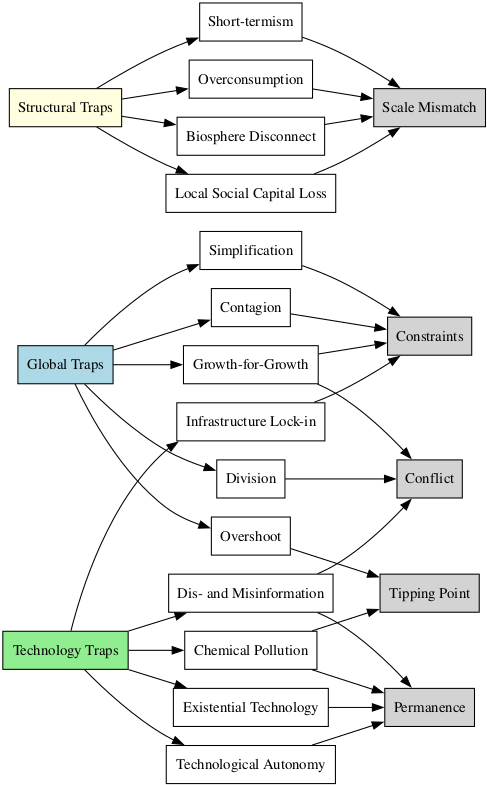

Historische Belege zeigen, dass menschliche Zivilisationen in der Vergangenheit immer wieder selbstzerstörerisch gehandelt haben, vor allem bei der Übernutzung von Ressourcen (1). Heute könnte man den Klimawandel als klares Beispiel für selbstzerstörerisches Verhalten nennen. In einem aktuellen Paper haben Søgaard Jørgensen et al. (2023) für diese Art von Verhalten den Begriff „Anthropozän-Fallen“ geprägt, aufbauend auf dem Konzept evolutionärer Fallen aus der Biologie. Sie zeigen, wie diese Fallen die Stabilität unserer Zivilisation gefährden, wie tief wir schon in ihnen stecken und was wir tun könnten, um sie zu vermeiden.

# Was ist eine evolutionäre bzw. Anthropozän-Falle?
In der Biologie meint man mit evolutionären Fallen Verhaltensweisen, bei denen die Instinkte eines Tieres es dazu bringen, Handlungen zu bevorzugen, die seinem Überleben und seiner Fortpflanzung schaden. Das passiert, wenn eine einst nützliche Eigenschaft in einer veränderten Umwelt schädlich wird, oft durch menschlichen Einfluss. Ein klassisches Beispiel ist der australische Prachtkäfer Julodimorpha bakewelli. Diese Käfer sind groß, braun und glänzend, und deshalb fühlen sich die Männchen von großen, braunen, glänzenden Dingen angezogen. Leider passen Bierflaschen genau auf diese Beschreibung, sodass die Käfer versuchen, sich mit ihnen zu paaren, was ihr Überleben und ihren Fortpflanzungserfolg verringert.

Beim Menschen ist ein Beispiel unsere Vorliebe für Zucker. Die war in unserer ursprünglichen Umwelt nützlich, wo Zucker knapp war, kann aber in der modernen Gesellschaft zu schädlichem Überkonsum führen. Anders als Tiere können Menschen solche Verhaltensweisen auch auf kultureller Ebene zeigen. Wir verhalten uns also kulturell auf eine Weise, die für Einzelne oder lokale Gruppen sinnvoll erscheint, aber dem Wohlergehen und Funktionieren der Gesellschaft insgesamt schadet (2). Das nennen Søgaard Jørgensen et al. „Anthropozän-Fallen“. Anders als biologische evolutionäre Fallen folgt die kulturelle Evolution des Menschen sich selbst beschleunigenden Verläufen. Biologische Fallen sind durch das Zusammenspiel von Umwelt und Genetik also einigermaßen festgelegt, während Anthropozän-Fallen sich durch Rückkopplungen ständig selbst verstärken. Beim Menschen liegt das Problem also nicht an fehlender Evolution, sondern daran, dass wir dem schädlichen Pfad unserer kulturellen Evolution nicht entkommen können.

# Wie haben sie die Fallen identifiziert?
Um verschiedene Arten von Fallen zu identifizieren, wurden am Stockholm Resilience Center mehrere Expertenworkshops abgehalten. In diesen Workshops haben die Fachleute zuerst 61 zentrale Prozesse identifiziert, von denen sie glauben, dass sie den Verlauf des Anthropozäns stark beeinflussen. Dann haben sie geprüft, welche dieser Prozesse eine Fallendynamik zeigen. Die Kriterien für eine Falle waren:

* Sie entwickelt sich aus einem anfangs nützlichen Prozess.
* Auf globaler Ebene zeigt sie Anzeichen unerwünschter Folgen für das menschliche Wohlergehen, oder man vermutet, dass sie solche Anzeichen in Zukunft zeigen wird.
* Sie hat einen Fallenmechanismus, der es schwerer macht, den negativen Folgen zu entkommen, sobald er einmal aktiviert ist.
Auf Grundlage dieser Kriterien haben sie 14 Fallen identifiziert.

# Welche Arten von Fallen gibt es?

Die 14 Fallen gehören zu drei großen Kategorien: strukturelle Fallen, globale Fallen und Technologiefallen (Abbildung 1). Diese Kategorien beschreiben die wichtigste evolutionäre Dynamik, die sie vorantreibt. Fallen können auch miteinander interagieren. Søgaard Jørgensen et al. finden, dass diese Wechselwirkungen vor allem verstärkend sind, z. B. führt ein höherer Organisationsgrad zu mehr technischer Entwicklung. Schauen wir uns diese drei Kategorien an.

Abbildung 1: Überblick über die Arten von Fallen (links), die Fallen (Mitte) und die Fallenmechanismen (rechts). Eigene Abbildung auf Grundlage von Tabelle 1 in Søgaard Jørgensen et al. (2023).

## Globale Fallen

Søgaard Jørgensen et al. (2023) erklären globale Fallen als Probleme, die aus wachsender sozialer Komplexität und Zusammenarbeit auf immer größeren Skalen entstehen. Menschliche Gesellschaften haben sich immer stärker organisiert, um Probleme zu lösen. Mit der Zeit verbindet uns das global, vergrößert aber auch unseren Einfluss auf die Umwelt. Das führt zu einem Kreislauf, in dem mehr Organisation Spezialisierung, Effizienz und Wachstum bringt, unterm Strich mit höherem Ressourcenbedarf. Wenn man diese Ressourcen nicht einfach zur Verfügung hat, kann man diesen Bedarf decken, indem man sich durch Konflikt oder mehr Zusammenarbeit mehr Ressourcen nimmt (3).

Dieser Kreislauf hat mehrere Risiken. Spezialisierung verringert Vielfalt und Resilienz, der Fokus auf Wachstum kann dem Wohlergehen schaden, und mehr Ressourcen zu verbrauchen riskiert, ökologische Grenzen zu überschreiten. Die Instabilität globaler Zusammenarbeit kann zu Konflikten führen, und mehr Vernetzung kann Krankheiten und andere Schocks verbreiten.

In den letzten 30 Jahren haben sich diese Fallen verschärft, mit häufigeren und schwereren Ökosystemschocks, disruptivem Wirtschaftswachstum, Wirtschaftskrisen, wachsender Ungleichheit, sich verschärfenden Umweltkrisen, stärkeren politischen Spannungen und häufigeren globalen Krankheitsausbrüchen. Dieses Streben nach mehr Organisation und Effizienz macht das globale System verwundbarer gegenüber allen möglichen Krisen.

## Technologiefallen

Technologiefallen sind Probleme, die aus unserer Nutzung von Technik entstehen. Menschen nutzen Technik, um ihr Leben zu verbessern, aber das kann unbeabsichtigte negative Folgen haben.

Søgaard Jørgensen et al. haben fünf Technologiefallen mit zwei sich verstärkenden Dynamiken identifiziert. Erstens schaffen technische Innovationen oft neue ökologische oder soziale Probleme, die dann mit noch mehr Technik angegangen werden. Zweitens werden Technologien, während sie sich weiterentwickeln, immer komplexer und stärker miteinander verknüpft.

Diese Technologiefallen entstehen oft beim Lösen anderer Probleme. Die beiden grundlegenden Fallen sind der Infrastruktur-Lock-in, bei dem bestehende Technologien wegen versunkener Kosten schwer zu ändern sind, und die chemische Verschmutzung durch neue Materialien. Die anderen Technologiefallen sind das Risiko der Selbstauslöschung durch mächtige Technologien wie Atomwaffen, die Gefahr, dass autonome Technologien nicht mit menschlichen Zielen übereinstimmen, und die Verbreitung von Desinformation durch das exponentielle Wachstum digitaler Information.

## Strukturelle Fallen

Strukturelle Fallen entstehen aus den schnellen globalen Veränderungen, die von der Dynamik der globalen und der Technologiefallen angetrieben werden. Sie entstehen entweder, wenn sich Dinge zu schnell ändern, als dass menschliches Verhalten nachhaltig sein könnte, oder durch verdeckte Folgen der Globalisierung. Diese Verdeckung kann zeitlich oder räumlich sein: Zeitliche Verdeckung liegt vor, wenn heutiges Handeln die Zukunft trifft (zeitliche Fallen), räumliche Verdeckung, wenn lokales Handeln global wirkt (Vernetzungsfallen).

Die wichtigste zeitliche Falle ist kurzfristiges Denken, bei dem kurzfristiges Wirtschaftswachstum und schnelle Lösungen die langfristige Nachhaltigkeit überschatten. Zu den Vernetzungsfallen gehören Prozesse wie die Trennung von Orten des Konsums und der Produktion oder ein wachsender Anteil der Bevölkerung, der in Städten lebt und nicht merkt, dass die Biosphäre um ihre Städte herum gestört ist, weil sie keinen direkten Zugang zu ihr haben.

# Wie geraten wir in Fallen?
Alle 14 Fallen folgen einem ähnlichen Verlauf, wie sie sich mit der Zeit entwickeln. Søgaard Jørgensen et al. glauben, dass diese Entwicklung in drei Schritten passiert:

1. **Entstehung und Ausbreitung**: Die Falle entsteht, wenn eine neue technische oder soziale Lösung auf ein Problem angewendet wird. Da die Lösung hilfreich ist, wird sie in immer größerem Maßstab übernommen. Diese Lösungen gehen oft lokale und kurzfristige Folgen an, ihre Wirkung kann aber global und langfristig sein.
2. **Verdeckung**: Die Falle wird größer, aber die Folgen sind noch nicht sichtbar, weil sie zeitlich, räumlich oder beides von der Lösung getrennt sind.
3. **Falle schnappt zu**: In dieser Phase schnappt die Falle zu, und es wird immer schwerer, ihr zu entkommen. Das passiert über fünf Hauptmechanismen.

## Fallenmechanismen
* **Dauerhaftigkeit**: Wenn man eine Technologie einmal in die Welt gebracht hat, ist sie schwer wieder zu entfernen. Zum Beispiel Atomwaffen oder viele Chemikalien.
* **Zwänge**: Das sind Faktoren, die es schwer machen, den Zustand zu ändern, in dem man sich befindet. Zum Beispiel der starke Fokus vieler internationaler Organisationen auf Wirtschaftswachstum statt auf andere Maßstäbe.
* **Kipppunkte**: Ein Kipppunkt ist ein Punkt im System, ab dem jeder zusätzliche Druck es schwer bis unmöglich macht, zum vorherigen Zustand zurückzukehren (4). Zum Beispiel das Absterben des Amazonas-Regenwalds durch den Klimawandel.
* **Konflikt**: Menschliche Zusammenarbeit braucht oft eine Fremdgruppe als Bezugspunkt. Auf globaler Ebene gibt es die nicht, was Zusammenarbeit auf dieser Ebene sehr schwierig macht.
* **Fehlende Passung der Skalen**: Ursache und Wirkung sind durch Zeit oder Entfernung verdeckt. Zum Beispiel, wenn man importierte Waren aus Ländern mit laxen Umweltauflagen kauft.

# Wie steht es aktuell um die Fallen?

Nachdem sie die Fallen und ihre Mechanismen identifiziert hatten, nutzten Søgaard Jørgensen et al. global verfügbare Daten und weitere Experteneinschätzungen, um die Fallen zu verstehen. Sie finden, dass 12 der 14 Fallen bereits zugeschnappt sind, und beschreiben den aktuellen Stand.

**Globale Fallen**: Institutionelle Festlegungen auf intensive Produktionsmethoden schränken unsere Möglichkeiten ein, Produktionsökosysteme resilienter zu machen. Durch die Verzögerung zwischen Emissionen und globaler Erwärmung sind wir schon auf Kurs für einen Anstieg um 1,5 °C und mehr. Nationale Ziele stehen oft im Widerspruch zu globalen Nachhaltigkeitsbemühungen, und viele Länder profitieren davon, nicht zusammenzuarbeiten. Die COVID-19-Pandemie hat gezeigt, wie schwierig es ist, vernetzte Systeme zu steuern.

**Technologiefallen**: Die Abhängigkeit von fossilen Brennstoffen, chemische Verschmutzung und Atomwaffen schaffen Fallen, denen man schwer entkommt. Die langfristigen und kombinierten Wirkungen von Schadstoffen sind nicht gut verstanden. Die Verbreitung von Atomwaffen hat uns in ernste Risiken eingeschlossen, was Abrüstung schwierig macht. Autonome Technik und Desinformation sind neue Probleme, über deren künftige Risiken sich immer mehr Sorgen gemacht werden. Viele mögliche Fehlschläge von KI und Robotik sind aber noch verdeckt, und Bemühungen, Desinformation zu regulieren, werden wohl so bald keinen Erfolg haben.

**Strukturelle Fallen**: Hier ist das Hauptproblem die Festlegung auf kurzfristige Wachstumsstrategien, die individuelle Gewinne über das Gemeinwohl stellen. Wirtschaftswachstum hängt immer noch an hohem Konsum, vor allem in reichen Ländern, was es schwer macht, lokales Handeln mit globalen Folgen in Einklang zu bringen.

Eine interessante Frage ist, ob diese Probleme speziell mit dem Anthropozän zusammenhängen oder allgemeinere Merkmale menschlicher Gesellschaften sind. Bei einigen dieser Fallen scheint Letzteres zuzutreffen. Überkonsum war zum Beispiel in vielen historischen Gesellschaften verbreitet. Ich glaube aber, dass die meisten Fallen typisch für unsere moderne Zivilisation sind, vor allem weil wir uns bei der Verteilung von Ressourcen auf kapitalistische Märkte verlassen. Märkte verteilen Ressourcen zwar meist effizient, stoßen aber oft auf das Problem negativer externer Effekte, also nicht eingepreister negativer Folgen für Dritte. Wenn ein Landwirt zum Beispiel zu viel Dünger einsetzt und der umliegenden Umwelt schadet, spiegeln sich diese Kosten nicht im Preis seiner Produkte wider, weil er für den Umweltschaden nicht zahlt. Viele dieser Fallen, etwa die chemische Verschmutzung, sind negative externe Effekte. Die Kosten für die Beseitigung trägt oft die Gesellschaft und nicht das verantwortliche Unternehmen. Ebenso setzen Märkte meist Anreize für kurzfristiges Denken, weil künftige Schäden normalerweise nicht in die heutigen Preise einfließen.

# Was hat das mit Fortschritt zu tun?
Beim Lesen könntest du denken, dass Søgaard Jørgensen et al. Fortschritt und Technik rein negativ sehen. Ihr Argument ist aber differenzierter. Sie meinen, dass die Menschheit wegen der Art, wie wir unsere Gesellschaften organisieren, oft in schädlichen, sich selbst verstärkenden Kreisläufen landet. Diese Kreisläufe richten den Schaden an, nicht die ursprünglichen Ziele von Fortschritt oder Technik. Die Lösung ist also nicht, zu einem vorindustriellen Leben zurückzukehren, sondern unsere Entscheidungsprozesse zu verbessern. Viele der Probleme, die sie nennen, ließen sich zum Beispiel durch stärkere demokratische Institutionen, mehr globale Zusammenarbeit und eine Abkehr von Märkten als Koordinationsmechanismus abmildern, wenn Märkte schwere externe Effekte nicht berücksichtigen können.

# Wie könnten wir entkommen?
Bis hierhin klingt es, als stecke die Menschheit bei den Anthropozän-Fallen in einer üblen Lage. Søgaard Jørgensen et al. versuchen aber, positiver zu enden, und beschreiben, wie wir die Fallen ihrer Meinung nach überwinden könnten. Das zentrale Konzept dabei ist Evolvierbarkeit. Gemeint ist, dass wir unsere eigene kulturelle Evolution in bestimmte Richtungen lenken, damit wir mit der Zeit besser an die Umwelt angepasst sind, die wir selbst geschaffen haben, mit globaler Nachhaltigkeit als letztem Ziel. Um dorthin zu kommen, schlagen sie fünf Aspekte der Evolvierbarkeit vor, an denen wir arbeiten sollten:
* **Fallen erkennen**: Im Moment merken wir die Fallen oft erst, wenn wir schon drinstecken. Wir müssen also das Bewusstsein schärfen, dass es so etwas überhaupt gibt, und Agenden wie die Ziele für nachhaltige Entwicklung schaffen, die ausdrücklich darauf abzielen, eine langfristig nachhaltige Umwelt zu schaffen.
* **Messen und vorausschauen**: Oft merken wir zu spät, dass wir in einer Falle stecken, weil wir die Wege, über die der Schaden entsteht, nicht beobachtet haben. Das BIP erfasst zum Beispiel die Schäden nicht, die wir anrichten. Wir müssen also Maßstäbe entwickeln, die unsere Wirkung auf die Umwelt genauer abbilden, und sie für unsere Entscheidungen nutzen.
* **Umorganisieren und erneuern**: Viele unserer Institutionen sind noch um neoliberale Ideale herum organisiert: kleiner Staat, laxe Regulierung und hohes Wirtschaftswachstum. Wir müssen diese schlecht angepassten Organisationen auslaufen lassen und durch neue ersetzen, die besser an die kommenden Herausforderungen angepasst sind.
* **Auf das Unbekannte vorbereitet sein**: Selbst wenn wir an allen anderen Punkten arbeiten, werden wir wahrscheinlich vor beispiellosen Herausforderungen stehen, die wir nicht haben kommen sehen. Wir brauchen also Reservekapazitäten im System, die schnell genutzt werden können, wenn etwas Unerwartetes passiert.
* **Mit Konflikten umgehen**: Weil uns auf globaler Ebene eine Fremdgruppe fehlt, fällt Zusammenarbeit schwer. Wir brauchen deshalb neue Erzählungen, die uns zusammenbringen könnten. Der gemeinsame Feind der Menschheit könnte zum Beispiel die Lebensfeindlichkeit des Weltraums und die Schwierigkeit sein, auf einem begrenzten Planeten zu leben (5).

Das sind alles übergeordnete Ziele, aber das Paper macht einen konkreten Vorschlag zu den Wechselwirkungen der Fallen und zu Prioritäten. Es identifiziert drei Fallen, globale Spaltung, kurzfristiges Denken und Überkonsum, die jeweils acht andere Fallen negativ beeinflussen. Diese drei Fallen zu lösen, könnte den Druck auf das System deutlich verringern.

# Ähnliche Ideen

Ein ähnliches Konzept wie die Anthropozän-Fallen ist die Todesspirale, wie sie Schippers et al. (2024) einführen. Sie definieren Todesspiralen als „einen Teufelskreis sich selbst verstärkenden dysfunktionalen Verhaltens, gekennzeichnet durch fortwährend fehlerhafte Entscheidungen, kurzsichtige Fixierung auf eine (Gruppe von) Lösung(en), Verleugnung, Misstrauen, Mikromanagement, dogmatisches Denken und erlernte Hilflosigkeit“. Sie glauben, dass es historisch zwei Hauptursachen für so eine gesellschaftliche Todesspirale gibt: 1) wachsende Vermögensungleichheit und 2) schwindende Ressourcen. Anders als bei Søgaard Jørgensen et al. (2023) führt diese konkretere Problembeschreibung auch zu einer konkreteren Lösung: Ungleichheit verringern, um die Resilienz der Gesellschaft allgemein zu erhöhen. Dieses Ergebnis passt auch [zu anderen Argumenten, die wir in diesem Blog besprochen haben](https://florianjehn.github.io/Societal_Collapse/2024-07-26-democratic_resilience/). Vor allem die Forschung zu Demokratien zeigt, dass weniger Vermögensungleichheit ein sehr wichtiger Faktor ist, um eine Gesellschaft resilient gegenüber Katastrophen zu machen.

Ein anderes aktuelles Paper von Rockström et al. (2023) macht weitere Vorschläge, die ganz im Sinne des hier vorgestellten Papers zu sein scheinen. Rockström et al. haben sich den Zustand des heutigen Erdsystems und seiner Bestandteile wie Klima oder Landnutzung angeschaut und eine Reihe sicherer und gerechter Erdsystemgrenzen vorgeschlagen, die die langfristige Stabilität und Resilienz des Erdsystems erhalten und gleichzeitig versuchen würden, jeden Menschen so wenig wie möglich den schädlichen Folgen von Veränderungen des Erdsystems auszusetzen. Wenn wir es schaffen würden, innerhalb dieser Grenzen zu bleiben, würden viele der beschriebenen Fallen deutlich weniger schlimm oder sogar ganz entschärft.

# Anmerkungen
(1) Das wird besonders in Erklärungen wie der von Jared Diamond betont, findet sich aber in so ziemlich allen Denkschulen zum gesellschaftlichen Kollaps (siehe den [Einführungsbeitrag](https://florianjehn.github.io/Societal_Collapse/2023-06-06-collapse_overview/) zu diesem fortlaufenden Literaturüberblick).

(2) Das ökonomische Gegenstück wäre wahrscheinlich so etwas wie ein Gefangenendilemma.

(3) Das klingt ziemlich ähnlich wie die Idee abnehmender Erträge von Komplexität von Joseph Tainter, die [hier](https://florianjehn.github.io/Societal_Collapse/2023-06-06-collapse_overview/) erklärt wird.

(4) Kipppunkte haben wir in einem [früheren Beitrag](https://florianjehn.github.io/Societal_Collapse/2023-06-19-tipping_points/) ausführlich besprochen.

(5) Vielleicht geht es nur mir so, aber das hat mich an den [Pale Blue Dot](https://www.planetary.org/worlds/pale-blue-dot) erinnert: „...auf einem Staubkorn, das in einem Sonnenstrahl schwebt.“

# Zitieren
Bitte das englische Original zitieren:

Jehn, F. U. (2024, June 20). Anthropocene traps. Existential Crunch. [https://doi.org/10.59350/7nnaa-1vr81](https://doi.org/10.59350/7nnaa-1vr819)

# Quellen

* Rockström, J., Gupta, J., Qin, D., Lade, S. J., Abrams, J. F., Andersen, L. S., Armstrong McKay, D. I., Bai, X., Bala, G., Bunn, S. E., Ciobanu, D., DeClerck, F., Ebi, K., Gifford, L., Gordon, C., Hasan, S., Kanie, N., Lenton, T. M., Loriani, S., … Zhang, X. (2023). Safe and just Earth system boundaries. Nature, 619(7968), 102–111. https://doi.org/10.1038/s41586-023-06083-8
* Schippers, M. C., Ioannidis, J. P. A., & Luijks, M. W. J. (2024). Is society caught up in a Death Spiral? Modeling societal demise and its reversal. Frontiers in Sociology, 9. https://doi.org/10.3389/fsoc.2024.1194597
* Søgaard Jørgensen, P., Jansen, R. E. V., Avila Ortega, D. I., Wang-Erlandsson, L., Donges, J. F., Österblom, H., Olsson, P., Nyström, M., Lade, S. J., Hahn, T., Folke, C., Peterson, G. D., & Crépin, A.-S. (2023). Evolution of the polycrisis: Anthropocene traps that challenge global sustainability. Philosophical Transactions of the Royal Society B: Biological Sciences, 379(1893), 20220261. https://doi.org/10.1098/rstb.2022.0261
