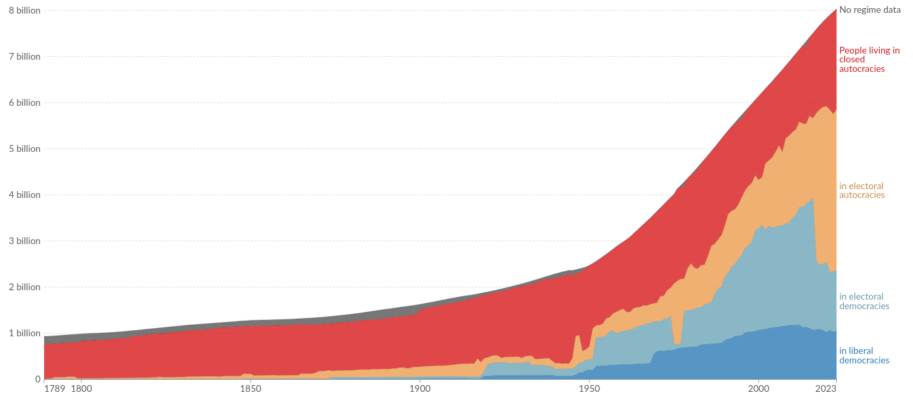
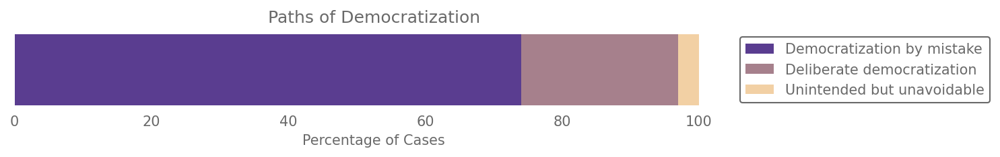

Demokratien haben einen stärkeren Anreiz als autoritäre Regime, ihre Bevölkerung zufrieden zu halten, weil das Überleben der politischen Elite über Wahlen direkter an die Bevölkerung gebunden ist. In einem [früheren Beitrag](https://florianjehn.github.io/Societal_Collapse/2023-08-16-democracy_and_resilience/) haben wir den Zusammenhang zwischen Beteiligung, Inklusion und Demokratie einerseits und gesellschaftlicher Resilienz andererseits untersucht. Wir haben festgestellt, dass sich historisch beteiligungsorientiertere Gesellschaften meist besser von großen Katastrophen wie großen Vulkanausbrüchen erholt haben. Außerdem haben Demokratien Krisen in den letzten Jahrzehnten allgemein besser bewältigt als Nicht-Demokratien. In diesem Beitrag bespreche ich weitere Gründe, warum Demokratien für gesellschaftliche Resilienz und vorausschauende Entscheidungen so wichtig sind. Ich werde aber auch argumentieren, dass die Zahl der Demokratien gerade abnimmt und wir etwas dagegen tun müssen, um bei globalen Katastrophen sicherer zu sein.

# Demokratische Prozesse begünstigen gesellschaftliche Resilienz

Zusätzlich zu den Vorteilen aus dem früheren Beitrag sind Demokratien bei globalen Risiken auch meist vorausschauender. Eine Reihe demokratischer Länder hat zum Beispiel nationale Risikoanalysen, die auch Einschätzungen globaler Gefahren enthalten (Tabelle 1).

Tabelle 1: Beispiele für Länder, die globale katastrophale Risiken in ihren nationalen Risikoanalysen behandeln. „Am Rande“ heißt, dass die Bedrohung erwähnt, aber nicht weiter besprochen wird.

| Land/Gefahr | Atomwaffen | Künstliche Intelligenz | Klimawandel | Erdnahe Objekte (z. B. Meteor) | Geomagnetischer Sturm | Pandemien | Supervulkanausbrüche | Link zur Risikoanalyse |
|----------------|-----------------|-------------------------|----------------|---------------------------------|-------------------|-----------|------------------------|-------------------------|
| Schweiz    | Am Rande    | Ja                     | Ja            | Ja                             | Ja               | Ja       | Ja                    | [Link](https://backend.babs.admin.ch/fileservice/sdweb-docs-prod-babsch-files/files/2024/03/01/688360c7-2703-4ace-88b4-4182446a4a15.pdf)               |
| Großbritannien | Ja             | Ja                     | Ja            | Nein                              | Ja               | Ja       | Ja                    | [Link](https://assets.publishing.service.gov.uk/media/64ca1dfe19f5622669f3c1b1/2023_NATIONAL_RISK_REGISTER_NRR.pdf)               |
| Niederlande    | Am Rande    | Nein                      | Ja            | Nein                              | Nein                | Ja       | Nein                     | [Link](https://www.rivm.nl/sites/default/files/2023-06/ANV_Dutch%20National%20Risk%20Assessment%202022_0.pdf)               |
| Neuseeland    | Am Rande    | Am Rande            | Ja            | Nein                              | Nein                | Ja       | Nein                     | [Link](https://www.dpmc.govt.nz/sites/default/files/2023-11/national-security-strategy-aug2023.pdf)               |
| Kanada         | Am Rande    | Nein                      | Ja            | Nein                              | Ja               | Ja       | Am Rande           | [Link](https://www.publicsafety.gc.ca/cnt/rsrcs/pblctns/2023-nrp-pnr/2023-npr-pnr-en.pdf)               |

Die Schweiz scheint im Vergleich zu vielen anderen Ländern eine ziemlich gute Risikoanalyse zu haben. Zusätzlich zur umfangreichen nationalen Risikoanalyse hat sie auch in ein Modell des Schweizer Ernährungssystems investiert (Zimmermann et al., 2017). Mit diesem Modell wird untersucht, wie die Schweizer Bevölkerung in verschiedenen Katastrophen ernährt werden könnte, und es zeigt, dass das in vielen Szenarien wahrscheinlich ginge, aber starke Veränderungen der Ernährungsgewohnheiten bedeuten würde.

Nicht alle hier aufgeführten Länder berücksichtigen alle Risiken, und nicht alle Demokratien haben solche nationalen Risikoanalysen. Mir sind aber keine ähnlichen Dokumente aus nicht demokratischen Staaten bekannt. Es könnte sie geben, ohne dass sie öffentlich sind, aber es ist wichtig, dass solche Analysen leicht zugänglich sind, damit blinde Flecken erkannt und angegangen werden können. Ein tolles Beispiel dafür, wie das ablaufen kann, beschreiben Boyd & Wilson (2021), die sich die aktuellen Pläne und Strategien Neuseelands zu globalen katastrophalen Risiken anschauen. Sie finden sie unzureichend und machen eine Reihe von Vorschlägen, wie sie verbessert werden könnten. So eine Bewertung und Kritik ist nur möglich, wenn Pläne öffentlich verfügbar sind und es eine Regierung gibt, die offen für Rückmeldungen ihrer Bürger ist. Die neuseeländische Analyse war zum Beispiel vorher geheim und wurde nach der Veröffentlichung scharf kritisiert.

In den letzten Jahrzehnten haben sich Bürgerräte als bemerkenswertes Beispiel dafür herausgebildet, wie demokratischere Prozesse vorausschauende Vorschläge hervorbringen können. Ein Bürgerrat versammelt eine demografisch repräsentative Gruppe von Menschen, gibt ihnen die wissenschaftlichen Informationen zu einem Thema und lässt viel Zeit für Diskussionen zu bestimmten gesellschaftlichen Fragen. Die Ergebnisse dieser Räte sind meist differenziert und führen oft zu tragfähigen Kompromissvorschlägen. In Irland sollte ein Bürgerrat zum Beispiel neue Regeln für Abtreibung vorschlagen, die in Irland bis dahin größtenteils verboten war. Nach sorgfältiger Beratung empfahl der Rat einen deutlich liberaleren Ansatz, was zu einem Referendum führte, in dem der Vorschlag mit klarer Mehrheit angenommen wurde. Dieser Fall zeigt, wie Bürgerräte heikle Fragen gut bewältigen und Mehrheiten gewinnen können.

Um empirischer für demokratischere Prozesse wie Bürgerräte zu argumentieren, können wir uns eine aktuelle Studie von Lage et al. (2023) anschauen. Sie haben die Ergebnisse aller Bürgerräte in der Europäischen Union zusammengetragen, die sich mit Klimaschutz beschäftigt haben. Ihre Ergebnisse zeigen, dass die Empfehlungen der Räte meist viel strenger sind als das, was ihre jeweiligen Regierungen derzeit umsetzen, vor allem bei Regulierung. Das deutet darauf hin, dass eine repräsentative Gruppe von Bürgern oft zu vorausschauenden Schlüssen kommt, die darauf abzielen, die Sicherheit und Vorbereitung der Gesellschaft zu gewährleisten. Bürgerräte zu globalen katastrophalen Risiken gab es zwar noch nicht, aber ich bin optimistisch, dass sie wertvolle Empfehlungen für eine bessere Vorbereitung liefern würden.

Ein weiterer Vorteil von Demokratien bei der Resilienz ist, Frieden zu wahren. Historisch führen etablierte Demokratien selten bis nie (je nachdem, wie man eine etablierte Demokratie definiert) Krieg gegeneinander. Ein Überblick über die aktuelle empirische Beweislage von Reiter (2017) kommt zu dem Schluss, dass das tatsächlich so ist. Selbst wenn man Faktoren wie nationale Interessen, wirtschaftliche Bedingungen und Geschlechternormen berücksichtigt, die die Entscheidung eines Landes für einen Krieg beeinflussen könnten, bleibt der wichtigste Faktor, ob das Land eine etablierte Demokratie ist. Tomz & Weeks (2013) haben versucht herauszufinden, warum es einen so starken Einfluss auf die Entscheidung für einen Krieg hat, eine Demokratie zu sein. Auf Grundlage früherer Literatur identifizieren sie die öffentliche Meinung gegen Angriffe auf andere Demokratien als Hauptgrund. Um diese Hypothese zu prüfen, haben sie Meinungsumfragen in Großbritannien und den USA durchgeführt. Darin wurden Menschen gefragt, ob sie einen Militärschlag gegen ein Land unterstützen würden, das Atomwaffen entwickelt. Es wurde kein bestimmtes Land genannt, aber es gab zusätzliche Informationen, ob das Land eine Demokratie ist, ob es in einem Militärbündnis mit Großbritannien/den USA ist und ob seine Streitkräfte gleich stark oder halb so stark sind wie die Großbritanniens/der USA. Wenn das Land eine Demokratie war, sank die Bereitschaft zum Angriff um etwa 20 bis 40 %. Das ist zwar nur ein Datenpunkt, stützt aber die Idee, dass öffentliche Rechenschaft hier ein starker Faktor sein könnte.

# Vergleich mit autoritären Regimen

Demokratien sind aber nicht nur besser darin, Frieden zu wahren, sie schneiden meist auch besser ab, wenn ein geopolitischer Konflikt ausbricht. Brands (2018) hat in einem Überblicksartikel untersucht, wie Demokratien und autoritäre Regime meist an Konflikte zwischen Großmächten herangehen und wie ihre Weltbilder allgemein aufeinanderprallen. Wirtschaftlich schneiden Demokratien beim Aufbau des Wohlstands, der für strategischen Erfolg nötig ist, durchweg besser ab als autokratische Regime. Das kommt vom freien Austausch von Informationen, stabilen rechtlichen Rahmenbedingungen und dem Schutz individueller Rechte und Eigentumsrechte, die Investitionen und Innovation fördern. Die dezentrale Machtstruktur der Demokratie hilft, vorschnelle wirtschaftliche Entscheidungen mit möglicherweise katastrophalen Folgen zu vermeiden, wie Chinas Großen Sprung nach vorn oder einen Krieg ohne Anlass. Außerdem sind demokratische Armeen meist leistungsfähiger als ihre autoritären Gegenstücke, weil sie meist Berufsarmeen sind, die mit delegierter Verantwortung und operativer Flexibilität umgehen können, während autoritäre Regime versuchen, Macht zu zentralisieren, um vor Putschen sicher zu sein.

Autoritäre Regime mögen Vorteile bei Geschwindigkeit und Entschlossenheit haben, Demokratien sind aber langfristig besser bei tragfähigen Entscheidungen. Genau die Eigenschaften, die demokratisches Regieren langsam und ineffizient erscheinen lassen können, Checks and Balances, Machtwechsel und lebhafte öffentliche Debatten, ermöglichen überlegte Abwägung und nötige Kurskorrekturen. Autoritäre Systeme dagegen, die Macht in einer kleinen Elite bündeln und Debatten unterdrücken, machen eher große Fehler, wenn Herrscher ohne ausreichende Rückkopplung emotionale oder unlogische Entscheidungen treffen. Diese langfristige Qualität von Entscheidungen könnte besonders wichtig sein, wenn es um komplexe globale katastrophale Risiken geht, die anhaltende Aufmerksamkeit und anpassungsfähiges Management brauchen und nicht nur schnelles Handeln.

Ein ähnlicher Punkt wird oft zur Fähigkeit von Autokraten gemacht, langfristig zu regieren. Das Argument lautet, dass Demokratien Probleme über lange Zeiträume nicht vorhersehen, weil sie nur in Wahlperioden denken können (also meist 4 bis 5 Jahre), während autokratische Regime daran nicht gebunden sind und deshalb Jahrzehnte im Voraus planen können. Ob dieses Argument stimmt, untersuchen Millemaci et al. (2024). Dafür haben sie sich Wirtschaftswachstum und langfristige positive gesellschaftliche Ergebnisse angeschaut (denk an Bildung, Gesundheit, öffentlichen Nahverkehr, Berücksichtigung der öffentlichen Meinung) und demokratische mit autokratischen Ländern verglichen. Beim Wirtschaftswachstum finden sie ähnliche Ergebnisse wie frühere Literatur: Demokratische Länder schneiden meist besser ab als autokratische Regime. Autokratische Regime haben aber Verteilungen mit dickeren Rändern. Das heißt, autokratische Regime schneiden wirtschaftlich zwar meist schlechter ab, stellen aber auch die größten Ausreißer, sowohl bei sehr langsamem (oder sogar negativem) als auch bei sehr schnellem Wachstum. Wirtschaftswachstum an sich ist aber nichts, was uns wirklich interessiert, denn ein höheres BIP heißt nicht automatisch, dass es den Menschen besser geht. Das macht die Studie von Millemaci und Co-Autoren besonders interessant, weil sie neben Wirtschaftswachstum auch positive gesellschaftliche Ergebnisse berücksichtigt, und hier sind die Ergebnisse sehr eindeutig. Demokratische Länder liefern ihren Bürgern durchweg bessere gesellschaftliche Ergebnisse bei Dingen wie Gesundheit oder Bildung. Das gilt sogar, wenn man berücksichtigt, wie reich das Land allgemein ist. Millemaci et al. schließen daraus, dass es keine wohlwollenden Diktatoren gibt, die langfristig regieren. Sie können vielleicht das Wirtschaftswachstum ankurbeln, aber das heißt nur, dass sie mehr Reichtum für sich und ihre Kumpane haben. Ihre Bevölkerung hätte eine viel bessere Lebensqualität, wenn ihr Land stattdessen demokratisch wäre.

# Demokratien scheinen zu stagnieren oder sogar zurückzugehen

Wir wissen also, dass vergangene Gesellschaften besser abschneiden, wenn sie beteiligungsorientierter sind, dass Demokratien Katastrophen besser bewältigen, sich meist nicht gegenseitig bekämpfen und dass gerade demokratische Prozesse wie Bürgerräte meist vorausschauende Vorschläge unter öffentlicher Kontrolle hervorbringen, die unsere Gesellschaften, wenn sie umgesetzt würden, resilienter gegenüber künftigen Gefahren machen würden. Aus Sicht der Resilienz gegenüber gesellschaftlichem Kollaps wäre es also sehr vorteilhaft, wenn mehr Staaten Demokratien würden und die bestehenden Demokratien demokratischer würden. Leider scheint das gerade nicht der Fall zu sein (Abbildung 1) (1).

Abbildung 1: Zahl der Menschen, die von 1789 bis heute in demokratischen bzw. autokratischen Staaten leben. Quelle: Our World in Data

Im letzten Jahrzehnt ist die Zahl der Wahldemokratien weitgehend stagniert, während die Zahl der liberalen Demokratien zurückgegangen ist. „Wahldemokratien“ meint hier eine verantwortliche Regierung durch freie und faire Wahlen, die sicherstellt, dass Politik und Zivilgesellschaft ohne Einmischung arbeiten können und die Medien unterschiedliche Sichtweisen darstellen können. Liberale Demokratien legen zusätzlich Wert darauf, die Rechte von Einzelnen und Minderheiten vor Übergriffen von Staat und Mehrheit zu schützen. Dazu gehören die Durchsetzung bürgerlicher Freiheiten, ein starker Rechtsstaat und Checks and Balances, die die Macht der Regierung begrenzen. Beide Typen schätzen Wahlen, aber liberale Demokratien fügen eine zusätzliche Schutzschicht für persönliche Freiheiten und die Integrität der Institutionen hinzu. Wenn es also darum geht, sicher vor künftigen Gefahren zu sein, sind liberale Demokratien möglicherweise die sicherere Wahl, weil sie sich stärker darauf konzentrieren, alle vor allen möglichen Schäden zu schützen.

Die Gründe für diesen Rückgang der Demokratie sind wahrscheinlich vielfältig. Ein Überblicksartikel von Loughlin (2019) argumentiert, dass das ein langsamer und etwas verdeckter Prozess war. Der Verlust der Demokratie passiert heute nicht durch einen Putsch, sondern durch eine schrittweise Aushöhlung demokratischer Prozesse. Ein Paradebeispiel ist Ungarn. Ein Land, das theoretisch eine Demokratie ist, in dem die Herrschaft von Viktor Orbán aber über die Jahre alle Kontrollen seiner Macht abgebaut und gleichzeitig das Wahlverfahren so verbogen hat, dass er fast nicht verlieren kann. Ähnliche Versuche sieht man auch in vielen anderen etablierten Demokratien. Zum Beispiel bei der Alternative für Deutschland oder der MAGA-Bewegung um Donald Trump in den USA. Den Prozess des demokratischen Verfalls sieht man zwar relativ klar, aber warum genau das gerade jetzt passiert, ist unsicherer. Loughlin nennt einige Hauptverdächtige:

* Globalisierung: Die zunehmende Globalisierung hat die Fähigkeit von Staaten untergraben, ihre eigene Wirtschaft zu regulieren, weil sie vielen Kräften außerhalb ihrer Kontrolle ausgesetzt sind. Damit fallen wichtige Möglichkeiten nationaler Selbstbestimmung weg.
* Ungleichheit: Die wirtschaftliche Ungleichheit ist in vielen Ländern in den letzten Jahrzehnten gestiegen, was das Leben vieler Bürger in Demokratien verschlechtert hat. Das hat das Vertrauen in traditionelle demokratische Prozesse verringert, die den Menschen ein besseres Leben versprochen hatten.
* Fokus auf das Individuum: Der neoliberale Kapitalismus, die Hauptform der Wirtschaft in fast allen Demokratien, setzt stark auf individuelle Freiheit. Zusammen mit mehr Migration und Ungleichheit führt das zu weniger Gruppenzusammenhalt und weniger Identifikation mit dem Kollektiv. Diese Identifikation mit dem Kollektiv ist aber wichtig, um demokratische Prozesse als wertvoll zu sehen, selbst wenn sie nicht immer genau zu dem führen, was man persönlich lieber hätte.
* Wirtschaftliche Macht von Unternehmen: Gigantische Unternehmen wie Amazon oder Apple haben über Lobbyarbeit wachsenden Einfluss auf die Regierungspolitik. Das frustriert Wähler, weil sie sehen, dass ihre Präferenzen nicht berücksichtigt werden, wenn sie gegen die Interessen großer Unternehmen gehen.

Das sind zwar gewichtige Behauptungen, aber sie finden sich oft auch in anderen Papern, die den Zusammenhang zwischen gesellschaftlichen Verhältnissen, Ungleichheit und Demokratie untersuchen. Centeno & Cohen (2012) besprechen zum Beispiel die Geschichte des Neoliberalismus und betonen ähnliche Punkte wie Loughlin. Ein konkreteres Beispiel dafür, wie wirtschaftliche Macht großen Unternehmen erlaubt, das politische System zu beeinflussen, liefern Supran et al. (2023). Sie haben die Unternehmensunterlagen von ExxonMobil untersucht und zeigen, dass das Unternehmen schon Anfang der 1980er-Jahre wusste, wie stark fossile Brennstoffe den Planeten erwärmen würden. Diese Modelle haben die Erwärmung der letzten Jahrzehnte genau vorhergesagt. Trotzdem nutzte ExxonMobil seinen Einfluss, um Falschinformationen zu verbreiten, die ihren eigenen Ergebnissen widersprachen, und um Politiker zu überzeugen, Gesetze zu vermeiden, die ihr Geschäft behindern würden.

Wenn man all diese Faktoren zusammen betrachtet, haben sie eines gemeinsam. Sie sind alle Folgen des neoliberalen Kapitalismus, der die Macht des Staates minimieren will und Märkte als wichtigsten Mechanismus gesellschaftlicher Koordination bevorzugt.

# In einer Demokratie zu landen ist nicht der Normalverlauf der Geschichte

Demokratien stärken unsere Resilienz, sind aber etwas auf dem Rückzug. Dieses Problem wäre weniger besorgniserregend, wenn wir Grund zu der Annahme hätten, dass die meisten Staaten irgendwann Demokratien werden. Denen von uns, die in Demokratien leben, scheinen sie eindeutig besser als die Alternativen. Ein Paper von Treisman (2020) stellt aber die übliche Erzählung infrage, dass Demokratisierung eine bewusste, rationale Entscheidung ist. Anhand historischer Übergänge zur Demokratie argumentiert er, dass die meisten unbeabsichtigte Folgen waren und keine geplanten Ergebnisse. Treisman teilt demokratische Übergänge in drei Haupttypen ein:
1. Demokratisierung aus Versehen: Der häufigste Fall, in dem autokratische Regime unabsichtlich die Bedingungen für Demokratie schaffen durch:
   - schlechten Umgang mit der Opposition im Inland (z. B. unkluge Zugeständnisse oder verpatzte Wahlen)
   - Versagen innerhalb des Regimes (z. B. Verlust der Unterstützung von Sicherheitskräften oder Eliten)
   - außenpolitische Fehltritte

2. Bewusste Demokratisierung: Ein selteneres Szenario, in dem Eliten sich absichtlich für Demokratie entscheiden, um:
   - eine Revolution durch versprochene Umverteilung von Wohlstand zu verhindern
   - Unterstützung der Bevölkerung für Kriege zu gewinnen
   - die Beliebtheit der Amtsinhaber zu steigern
   - politische Blockaden aufzulösen
   - andere Ziele zu erreichen, etwa Gewalt zu vermeiden oder internationale Hilfe zu sichern

3. Unbeabsichtigte, aber unvermeidliche Demokratisierung: Situationen, in denen die herrschenden Eliten sich aktiv gegen Demokratisierung wehren, sie aber nicht verhindern können.

Treismans Analyse (Abbildung 2) zeigt, dass die Mehrheit der historischen Demokratisierungen in die Kategorie „aus Versehen“ fällt, was darauf hindeutet, dass Demokratie oft als unbeabsichtigte Folge autokratischer Fehltritte entsteht und nicht durch bewusstes Handeln.

Abbildung 2: Anteil der Fälle für die verschiedenen Wege zur Demokratisierung.

Das heißt, dass Demokratisierung nicht selbstverständlich ist, weil sie von Fehlern der Herrscher abhängt, die möglich, aber nicht sicher sind. Außerdem waren Demokratien, wenn man an das Argument des vorherigen Abschnitts denkt, für viele autokratische Regime vielleicht einmal ein Zustand, auf den sie zusteuerten, aber dieser Trend hat sich in den letzten Jahrzehnten verschoben.

Es gibt aber auch Hinweise darauf, dass Demokratien ein starker Anziehungspunkt zu sein scheinen, zu dem man zurückkehrt, wenn man eine Weile eine stabile Demokratie war. Das untersuchen Nord et al. (2025). Sie wollten verstehen, wie es Demokratien in der aktuellen „Welle der Autokratisierung“ ergeht. Dafür haben sie in die Geschichte geschaut, denn es ist nicht das erste Mal, dass Demokratien Gegenwind haben. Sie nutzten einen Datensatz von Demokratien von 1900 bis 2023, der erfasst, wie demokratisch diese Länder in diesem Zeitraum waren.

Damit hatten sie für jedes Land eine Zeitreihe. In dieser Zeitreihe suchten sie nach Brüchen, an denen Länder plötzlich weniger demokratisch oder weniger autokratisch wurden. Mit diesem Ansatz fanden sie einen Prozess, den sie einfach „Kehrtwenden“ nennen. Ein Land bewegte sich eine Weile in Richtung Autokratie, änderte dann aber schnell den Kurs und wurde wieder demokratischer.

Sie identifizieren 102 solcher Kehrtwenden. Das ist bedeutsam, denn das sind 52 % aller Wendungen in Richtung Autokratie. Ungefähr die Hälfte aller demokratischen Rückschritte wird also schnell wieder behoben (also in weniger als fünf Jahren). Und es wird sogar noch besser, denn wenn wir nur die letzten 30 Jahre betrachten, wurden 73 % aller Wendungen in Richtung Autokratie schnell wieder umgekehrt. Selbst heute haben wir also offenbar gute Chancen, unsere Demokratien zu retten. Außerdem beginnen diese Kehrtwenden in den letzten Jahrzehnten meist, bevor ein Land zur Autokratie wird, was darauf hindeutet, dass Demokratien widerstandsfähiger gegen den Ruf der Autokratie geworden sind. Warum genau, bleibt aber etwas unklar.

# Demokratien retten, indem man sie demokratischer macht

Zusammengefasst: Demokratien sind wichtig, aber auf dem Rückzug, und wenn wir sie verlieren, gibt es keine Garantie, dass wir sie zurückbekommen. Das führt klar zu der Frage: Wie behalten wir unsere Demokratien? Der oben erwähnte Überblicksartikel von Loughlin liefert auch hier einige mögliche Antworten. Insgesamt lässt es sich so zusammenfassen: Unsere Demokratien leiden darunter, dass sie nicht demokratisch genug sind. Meistens bieten wir nur alle paar Jahre die Chance zu wählen, und das ist die einzige Berührung, die die meisten Bürger mit ihrer Demokratie haben. Demokratischer würde in diesem Zusammenhang heißen, Beteiligung, Repräsentation und Gleichheit in den Entscheidungsprozessen einer Gesellschaft zu stärken. Mögliche Maßnahmen sind Bürgerräte, Bürgerhaushalte und neue Technologien, die es leichter machen, die Meinungen der Bürger einzuholen (2). Da viele der Probleme auch in Ungleichheit wurzeln, könnte ein gleicherer Zugang zu Ressourcen, zum Beispiel über ein bedingungsloses Grundeinkommen, ebenfalls vielversprechend sein (3).

Egal, was wir tun, mir scheint es ziemlich wichtig, dass wir starke Demokratien erhalten, wenn wir gute Chancen haben wollen, die Gefahren zu überstehen, die auf uns zukommen.

# Anmerkungen
(1) Es gibt [einige aktuelle Forschung](https://www.cambridge.org/core/journals/ps-political-science-and-politics/article/measuring-democratic-backsliding/9EE2044CDA598BD815349912E61189D8), die argumentiert, dass Demokratien gar nicht zurückgehen, sondern stabil sind. Die meiste Forschung, die ich gesehen habe, argumentiert aber in die Richtung, dass die Demokratie gerade auf dem Rückzug ist. So oder so ist mein Argument hier im Wesentlichen dasselbe, wenn Demokratien nicht zurückgehen, sondern stabil sind.

(2) Hier fällt mir [Taiwan](https://80000hours.org/podcast/episodes/audrey-tang-what-we-can-learn-from-taiwan/) ein.

(3) Das sind alles ziemlich abstrakte Maßnahmen, aber es gibt auch etwas, das Einzelne tun können. Die deutsche Organisation Effektiv Spenden hat [einen Fonds eingerichtet](https://effektiv-spenden.org/demokratie-verteidigen/), der Spenden an Organisationen weiterleitet, die demokratische Prozesse stärken.

# Zitieren
Bitte das englische Original zitieren:

Jehn, F. U. (2024, July 26). Democratic Resilience. Existential Crunch. [https://doi.org/10.59350/2h1aw-4w266](https://doi.org/10.59350/2h1aw-4w266)

# Quellen

* Boyd, M., & Wilson, N. (2021). Anticipatory Governance for Preventing and Mitigating Catastrophic and Existential Risks. Policy Quarterly, 17(4), Article 4. https://doi.org/10.26686/pq.v17i4.7313
* Brands, H. (2018). Democracy vs Authoritarianism: How Ideology Shapes Great-Power Conflict. Survival, 60(5), 61–114. https://doi.org/10.1080/00396338.2018.1518371
* Centeno, M. A., & Cohen, J. N. (2012). The Arc of Neoliberalism. Annual Review of Sociology, 38(Volume 38, 2012), 317–340. https://doi.org/10.1146/annurev-soc-081309-150235
* Lage, J., Thema, J., Zell-Ziegler, C., Best, B., Cordroch, L., & Wiese, F. (2023). Citizens call for sufficiency and regulation—A comparison of European citizen assemblies and National Energy and Climate Plans. Energy Research & Social Science, 104, 103254. https://doi.org/10.1016/j.erss.2023.103254
* Loughlin, M. (2019). The Contemporary Crisis of Constitutional Democracy. Oxford Journal of Legal Studies, 39(2), 435–454. https://doi.org/10.1093/ojls/gqz005
* Millemaci, E., Monteforte, F., & Temple, J. R. W. (2024). Have Autocrats Governed for the Long Term? Kyklos. https://doi.org/10.1111/kykl.12425
* Nord, M., Angiolillo, F., Lundstedt, M., Wiebrecht, F., & Lindberg, S. I. (2025). When autocratization is reversed: Episodes of U-Turns since 1900. Democratization, 0(0), 1–24. https://doi.org/10.1080/13510347.2024.2448742
* Reiter, D. (2017). Is Democracy a Cause of Peace? In Oxford Research Encyclopedia of Politics. https://doi.org/10.1093/acrefore/9780190228637.013.287
* Supran, G., Rahmstorf, S., & Oreskes, N. (2023). Assessing ExxonMobil’s global warming projections. Science, 379(6628), eabk0063. https://doi.org/10.1126/science.abk0063
* Tomz, M. R., & Weeks, J. L. P. (2013). Public Opinion and the Democratic Peace. American Political Science Review, 107(4), 849–865. https://doi.org/10.1017/S0003055413000488
* Treisman, D. (2020). Democracy by Mistake: How the Errors of Autocrats Trigger Transitions to Freer Government. American Political Science Review, 114(3), 792–810. https://doi.org/10.1017/S0003055420000180
* Zimmermann, A., Ferjani, A., Mann, S., Haudenschild, U., Mittelholzer, M., & Müller, P. (2017). Ernährungspotenzial der landwirtschaftlichen Kulturflächen: Analyse einer optimierten Inlandproduktion von Nahrungsmitteln im Fall von schweren Mangellagen. Bundesamt für wirtschaftliche Landesversorgung (BWL).
