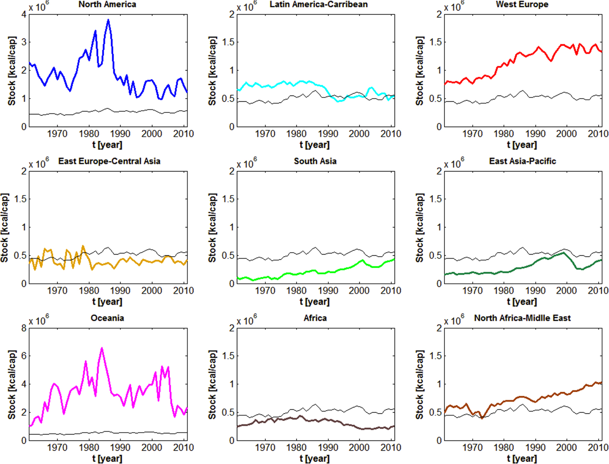
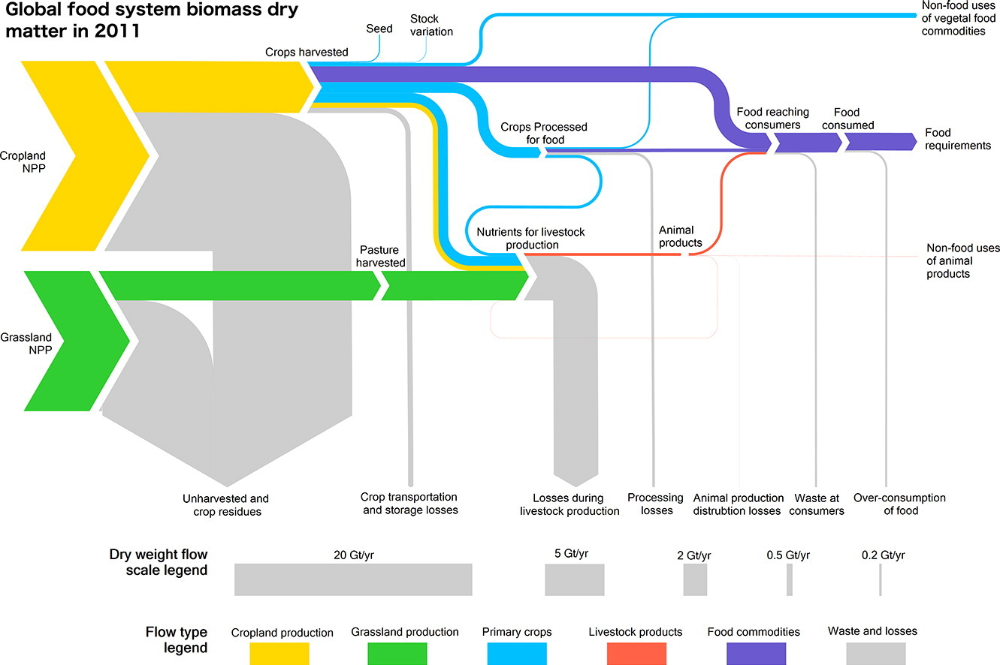

Viele Artikel nennen Hungersnöte als großes Problem beim gesellschaftlichen Kollaps und betonen, wie verwundbar Lebensmittelproduktion und -handel insgesamt sind. Wie schnell uns solche Ereignisse treffen, hängt von unseren Lebensmittelreserven ab. Aber wie viel Essen haben wir eigentlich auf Lager?

# Globale Lebensmittelvorräte nach Jahreszeit

Es ist überraschend schwer, verlässliche Daten zu den weltweiten Lebensmittelreserven zu finden. Populärwissenschaftliche Artikel machen zwar manchmal kühne Behauptungen, aber es gibt kaum gründliche Forschung dazu. Die wenigen Paper, die es gibt, konzentrieren sich oft auf Weizen und nutzen ihn als Stellvertreter für die Lebensmittelvorräte insgesamt, weil er unsere wichtigste Nutzpflanze ist. Do et al. (2010) haben sich zum Beispiel das globale Weizenangebot über fünf Jahre (2004 bis 2008) angeschaut und festgestellt, dass die Getreidevorräte normalerweise etwa 2 bis 6,6 Monate Weizenverbrauch abdecken, stark abhängig von der Jahreszeit (Abbildung 1) (1).

Abbildung 1: Zahl der Monate, bis die globalen Weizenvorräte bei monatlichem Verbrauch aufgebraucht sind. Basierend auf Do et al. (2010).

Die Weizenvorräte erreichen ihren Höchststand normalerweise im Oktober und ihren Tiefpunkt im Mai, was an der geografischen Verteilung der Weizenanbaugebiete liegt. Die wichtigsten Weizenregionen, wie die USA, China, Indien, Mitteleuropa und Russland, ernten auf der Nordhalbkugel vor allem im Spätsommer und Herbst, während der wichtigste Weizenproduzent der Südhalbkugel, Australien, ein paar Monate später erntet. Dieses saisonale Muster gilt wahrscheinlich für die Lebensmittelproduktion allgemein, weil die Nordhalbkugel deutlich mehr Ackerland hat.

Auf Grundlage der Daten von Do et al. und weiterer Berechnungen zur globalen Lebensmittelproduktion und -lagerung schätzen Denkenberger & Pearce (2015), dass es zusätzlich zu den Getreidevorräten noch Vorräte für weitere 4 Monate aus anderen Quellen gibt, etwa Lebensmittel in Haushalten und Läden, Wildtiere und Zugtiere. Selbst unter optimalen Bedingungen hätten wir weltweit also nur Essen für etwa 11 Monate. Diese Zahlen schwanken wahrscheinlich von Land zu Land, denn manche Länder halten größere Lebensmittelreserven oder sind große Lebensmittelexporteure, deren Exporte man für den Eigenbedarf umleiten könnte.

# Wie haben sich die Vorräte über die Zeit und nach Weltregion entwickelt?

Laio et al. (2016) schauen sich an, wie sich die Lebensmittelvorräte insgesamt in den letzten Jahrzehnten in allen großen Weltregionen entwickelt haben (Abbildung 2).

Abbildung 2: Zeitreihen der Vorräte (pro Kopf) in den verschiedenen Weltregionen. In jedem Feld zeigt die dünne Linie die globalen Vorräte (pro Kopf). (Laio et al., 2016).

Ihre Ergebnisse zeigen große regionale Unterschiede bei den Lebensmittelvorräten. Laut ihren Daten hat Afrika zum Beispiel Vorräte für etwa 4 Monate, Ozeanien dagegen für etwa 32 Monate (was [die Resilienz dieser Region noch einmal unterstreicht](https://florianjehn.github.io/Societal_Collapse/2024-03-04-where_to_stay/)). Das passt zu den Produktionsmustern: Regionen, die mehr Lebensmittel produzieren, haben meist auch größere Reserven (2).

Laio et al. haben sich auch die globalen Lebensmittelvorräte angeschaut (die dünne Linie in Abbildung 2) und kommen auf etwa 8 Monate, was der Schätzung von Denkenberger und Pearce ähnelt. Das Ergebnis von Denkenberger und Pearce ist etwas optimistischer, weil sie zusätzliche Quellen wie Lagerhäuser, Läden und Wildtiere berücksichtigen, während Laio et al. sich nur auf die Produktionsdaten der FAO stützen.

Trotz der regionalen Unterschiede sind die globalen Lebensmittelvorräte in den letzten 50 Jahren relativ stabil geblieben. Laio und Kollegen haben außerdem beobachtet, dass sich die Vorräte verschiedener Länder mit der Zeit angeglichen haben. Für die letzten ~15 Jahre fehlen allerdings Daten, und es ist unklar, ob diese Trends anhalten, vor allem nach Störungen wie COVID-19 und dem Überfall auf die Ukraine, die Handels- und Anbaumuster verändert haben. Angesichts der langfristigen Stabilität ist es aber wahrscheinlich, dass die Vorräte ähnlich hoch sind wie in den Jahrzehnten davor.

# Wie ergänzt der Lebensmittelhandel die Vorräte?

Wie wir in [einem anderen Beitrag](https://florianjehn.github.io/Societal_Collapse/2024-04-25-trade_collapse/) besprochen haben, ist Handel für unser Ernährungssystem enorm wichtig. Marchand et al. (2016) untersuchen, wie Handel und Vorräte zusammen bestimmen, wann einer Region das Essen ausgeht. Sie haben ein ökonomisches Modell gebaut, das zeigt, wie sich Produktionsschocks durch ein Netzwerk von Ländern ausbreiten, die Lebensmittel produzieren und handeln. Die Annahme ist, dass Länder, die von einem Produktionsschock getroffen werden, zuerst ihre Reserven nutzen, dann den Inlandsverbrauch senken und, wenn diese beiden Schritte nicht reichen, ihre Exporte verringern und ihre Importe erhöhen (3).

Sie finden, dass größere Lebensmittelvorräte eine wichtige Rolle dabei gespielt haben, die Folgen von Schocks abzufedern. Das Handelsnetzwerk für Lebensmittel war 2009 besser in der Lage, Schocks aufzufangen, als in früheren Jahren, vor allem wegen einer klügeren Verteilung der Reserven und weniger wegen mehr Handel. Große Exporteure sind Lebensmittelschocks stark ausgesetzt, haben aber große Vorräte, um die Folgen abzufedern. Die Studie zeigt, dass Verwundbarkeiten eher auf regionaler Ebene auftreten, wobei Cluster in Amerika, Südasien und Ostasien besonders gefährdet sind.

Ihr Fazit ist, dass für die Resilienz gegenüber Schocks die Verteilung der Reserven wichtiger ist als ihre Gesamtmenge. Das erklärt wahrscheinlich auch die etwas widersprüchlichen Ergebnisse von Laio et al. Die globalen Lebensmittelvorräte blieben zwar weitgehend stabil, aber ihre Verteilung hat sich verschoben, und sie sind vor allem in den verwundbarsten Regionen gewachsen, was das Gesamtsystem stabiler gemacht hat. Trotzdem finden Marchand und Co-Autoren, dass bestimmte Regionen anfälliger für Lebensmittelknappheit sind und dass Länder, die externen Schocks ausgesetzt sind, oft regionale Cluster bilden. Als mögliche Strategien gegen Lebensmittelknappheit schlagen sie vor, die Versorgung mit Grundnahrungsmitteln breiter aufzustellen und dafür zu sorgen, dass Handelspartner ausreichende Reserven haben.

# Andere Faktoren, die die Wirkung von Lebensmittelvorräten beeinflussen

Neben der Gesamtmenge an gelagerten und gehandelten Lebensmitteln in einer Region ist entscheidend, wie viel davon tatsächlich bei den Menschen ankommt. Vorräte sind nutzlos, wenn man nicht an sie herankommt. Das haben Jagtap et al. (2022) in einer Studie über die Folgen des russischen Überfalls auf die Ukraine für das Ernährungssystem des Landes deutlich gemacht. Ihre Expertenbefragung zeigte, dass die Ukraine zwar Weizenvorräte von 114 % ihres Jahresbedarfs hatte, der Zugang zu Lebensmitteln aber stark eingeschränkt war, weil der Transport von Waren riskant war und Russland ständig angriff. Besonders problematisch war das für Rinderhalter, die wegen Futtermangel Tiere schlachten mussten. Ähnliche Probleme könnte es bei einem gesellschaftlichen Kollaps geben, wenn zentrale Lebensmittellager und unzuverlässiger Transport es vielen schwer machen würden, an Essen zu kommen.

Ein weiterer wichtiger Faktor dafür, wie gut sich Lebensmittelvorräte nutzen lassen, ist Lebensmittelverschwendung. Alexander et al. (2017) haben sich das globale Ernährungssystem angeschaut und wie viel auf jedem Schritt vom Acker bis zum Teller verloren geht (Abbildung 3).

Abbildung 3: Verluste durch Lebensmittelverschwendung im globalen Ernährungssystem (Alexander et al. (2017))

Alexander et al. finden, dass nur etwa 6 % der landwirtschaftlichen Biomasse, die wir produzieren, am Ende als Lebensmittel gegessen werden. Der Rest geht vor allem durch Verschwendung verloren. Die meisten Verluste entstehen vor oder während der Ernte, und die Tierhaltung ist im Ernährungssystem besonders ineffizient. Verschwendung bei den Verbrauchern macht einen kleineren Teil aus, aber interessanterweise ist der Überkonsum von Lebensmitteln ungefähr so groß wie die Menge, die Verbraucher wegwerfen (Abbildung 3). Zusammengenommen heißt das, dass es viel Potenzial gibt, die Menge an Essen zu erhöhen, die bei den Menschen ankommt, vor allem wenn die Lebensmittelpreise plötzlich in die Höhe schießen würden.

# Fazit

Zusammengefasst hat die Menschheit nur begrenzte Lebensmittelreserven. Wenn die globale Lebensmittelproduktion plötzlich stoppen würde, wären unsere Vorräte in weniger als einem Jahr aufgebraucht, selbst wenn die Störung zum Höchststand unserer jährlichen Reserven käme. Selbst Ozeanien, das derzeit die größten Vorräte zu haben scheint, hätte sie innerhalb von drei Jahren aufgebraucht. Weniger Verschwendung und weniger Überkonsum geben uns zwar etwas Spielraum, aber das reicht wahrscheinlich nicht, um unsere Versorgung deutlich zu verlängern. Außerdem könnte es in einem Katastrophenszenario zu einer großen Herausforderung werden, das Essen dorthin zu bringen, wo es gebraucht wird. Das zeigt, wie dringend wir einen Plan B brauchen, um das Ernährungssystem am Laufen zu halten, falls die globale Produktion massiv einbricht.

# Anmerkungen

(1) Das US-Landwirtschaftsministerium veröffentlicht ebenfalls Daten zu Lebensmittelvorräten. Die deuten darauf hin, dass das Paper von Do et al. zu einem Tiefpunkt der Vorräte entstanden ist und die Weizenvorräte seitdem gestiegen sind. Außerdem nimmt diese Zahl an, dass der Verbrauch auf dem heutigen Niveau bleibt, was bei einer großen Katastrophe wahrscheinlich nicht so wäre.

(2) Ein großer Akteur bei den Vorräten ist [China](https://www.reuters.com/world/china/what-china-keeps-its-secretive-commodity-reserves-2021-08-05/), aber China hält ziemlich geheim, wie viel es tatsächlich hat.

(3) Ihr Modell sollte man mit Vorsicht genießen, weil es keine Preise berücksichtigt, die in so einem Szenario ziemlich wichtig sind.

# Zitieren
Bitte das englische Original zitieren:

Jehn, F. U. (2024, September 2). How much food is there?. Existential Crunch. [https://doi.org/10.59350/kjx6b-n3h33](https://doi.org/10.59350/kjx6b-n3h33)

# Quellen

* Alexander, P., Brown, C., Arneth, A., Finnigan, J., Moran, D., & Rounsevell, M. D. A. (2017). Losses, inefficiencies and waste in the global food system. Agricultural Systems, 153, 190–200. https://doi.org/10.1016/j.agsy.2017.01.014
* Denkenberger, D., & Pearce, J. (2015). Feeding everyone no matter what: Managing food security after global catastrophe. Academic Press.
* Do, T., Anderson, K., & Brorsen, B. W. (2010). The World’s wheat supply. Oklahoma Cooperative Extension Service.
* Jagtap, S., Trollman, H., Trollman, F., Garcia-Garcia, G., Parra-López, C., Duong, L., Martindale, W., Munekata, P. E. S., Lorenzo, J. M., Hdaifeh, A., Hassoun, A., Salonitis, K., & Afy-Shararah, M. (2022). The Russia-Ukraine Conflict: Its Implications for the Global Food Supply Chains. Foods, 11(14), 2098. https://doi.org/10.3390/foods11142098
* Laio, F., Ridolfi, L., & D’Odorico, P. (2016). The past and future of food stocks. Environmental Research Letters, 11(3), 035010. https://doi.org/10.1088/1748-9326/11/3/035010
* Marchand, P., Carr, J. A., Dell’Angelo, J., Fader, M., Gephart, J. A., Kummu, M., Magliocca, N. R., Porkka, M., Puma, M. J., Ratajczak, Z., Rulli, M. C., Seekell, D. A., Suweis, S., Tavoni, A., & D’Odorico, P. (2016). Reserves and trade jointly determine exposure to food supply shocks. Environmental Research Letters, 11(9), 095009. https://doi.org/10.1088/1748-9326/11/9/095009
