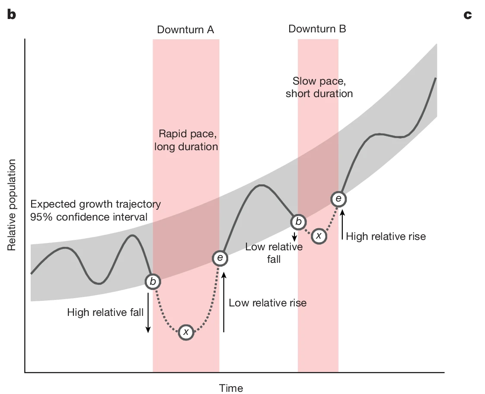
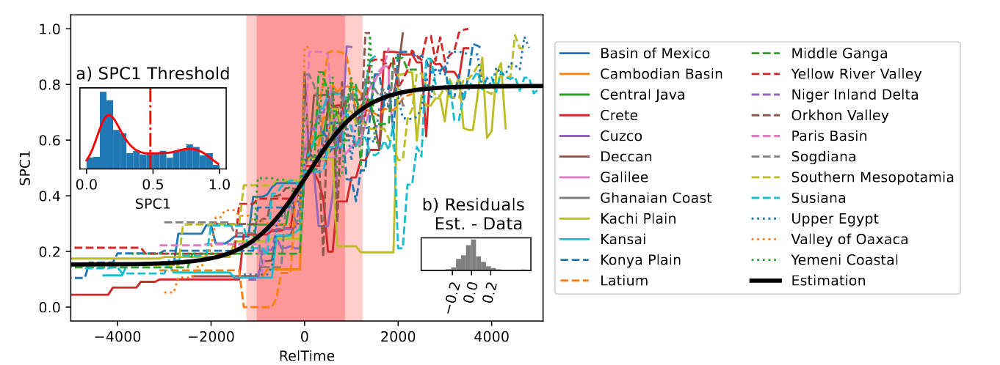
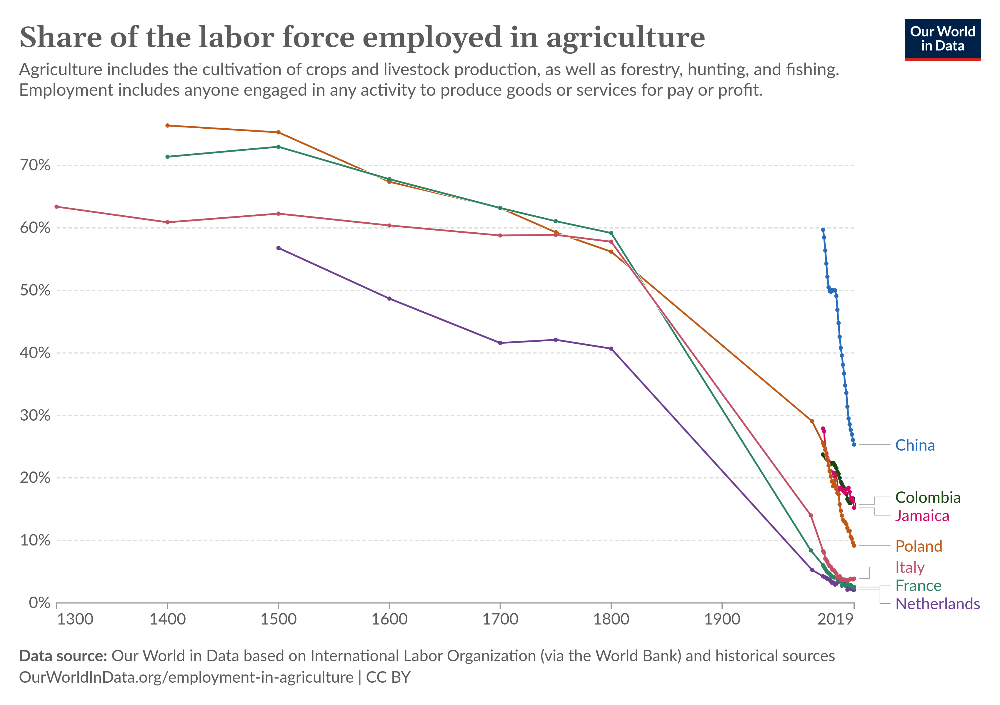
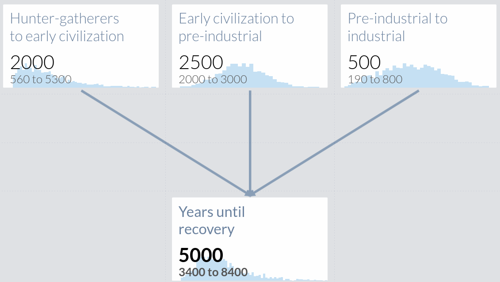

Eigentlich wollen wir einen Kollaps natürlich vermeiden, aber es ist wichtig zu verstehen, wie lange die Erholung dauern könnte, falls einer passiert. Das abzuschätzen ist schwierig, weil es davon abhängt, wie komplex die Gesellschaft am Anfang ist, wie viel verloren geht und welches Niveau man wieder erreichen will. Die Geschichte legt drei Hauptstufen in der Entwicklung der Zivilisation nahe, von frühen menschlichen Gesellschaften bis zu einer globalen Zivilisation:

* Von Jägern und Sammlern zu früher Landwirtschaft/Viehzucht. Der entscheidende Wechsel ist hier, dass Menschen den größten Teil des Jahres sesshaft werden. Stell dir ein kleines Dorf mit ein paar Hütten und einigen Feldern drumherum vor.
* Von früher Landwirtschaft/Viehzucht zur vorindustriellen Gesellschaft. Hier geht die Entwicklung in Richtung einer Gesellschaft wie im mittelalterlichen England. Es gibt eine klare Staatsstruktur mit einer festen Hierarchie, die riesige Landstriche kontrolliert. Die Technik entwickelt sich weiter, wenn auch langsam.
* Von der vorindustriellen zur industriellen Gesellschaft. Der Endpunkt ist hier im Grunde die Gesellschaft, in der wir heute leben.

In diesem Beitrag schaue ich mir an, welche Zeiträume für jeden dieser Übergänge nötig sein könnten. Bitte bedenke, dass das sehr grobe Schätzungen mit erheblichen Unsicherheiten sind.

# Von Jägern und Sammlern zu früher Landwirtschaft/Viehzucht

Diese Entwicklungen fanden in der Vorgeschichte statt, wir haben also keine schriftlichen Quellen und müssen auf Stellvertreterdaten zurückgreifen. Ein gängiger Stellvertreter ist die Radiokarbondatierung, bei der man die Verteilung von Kohlenstoffisotopen in archäologischen organischen Materialien analysiert. Da wir wissen, wie sich diese Verteilungen mit der Zeit ändern, kann man damit das Alter des organischen Materials schätzen. Wenn man die Daten aller archäologischen Funde zusammenfasst, kann man eine Dichtefunktion über die Zeit erstellen. Diese Funktion dient als Stellvertreter für die Bevölkerungsgröße, unter der Annahme, dass mehr Menschen auch mehr Material hinterlassen, das in die archäologischen Funde eingeht.

Eine aktuelle Studie von Riris et al. (2024) hat die Radiokarbondaten aus 16 anderen Studien zusammengefasst, um abzuschätzen, wie sich menschliche Populationen in den letzten 30.000 Jahren entwickelt haben und wie sie auf Störungen reagieren. Dafür haben sie Bevölkerungstrends über die Zeit an eine Kurve angepasst, die eine Schätzung der erwarteten Bevölkerung zu jedem Zeitpunkt liefert. Dann haben sie die tatsächlich geschätzte Bevölkerung mit diesem langfristigen Trend verglichen, um Stärke und Dauer von Bevölkerungsrückgängen in diesen Gesellschaften zu bestimmen (Abbildung 1).

Abbildung 1: Beispielhafter Verlauf einer Bevölkerung und wie die Einbrüche bestimmt wurden.

Diese Daten zeigen nicht direkt, wie lange der Übergang von Jägern und Sammlern zu früher Landwirtschaft/Viehzucht gedauert hat. Sie liefern aber einen Stellvertreter. Man kann die Einbrüche als die Zeit deuten, die nötig ist, um von einer niedrigeren Organisationsstufe (die keine größere Bevölkerung tragen kann) zu einer höheren Organisationsstufe (die eine größere Bevölkerung tragen kann) zu kommen.
Wenn wir annehmen, dass dieser Stellvertreter funktioniert, können wir uns die Daten zu den Bevölkerungsrückgängen anschauen. Sie zeigen, dass alle untersuchten Regionen regelmäßig Bevölkerungsrückgänge erlebten. Die meisten dieser Rückgänge brauchten 100 bis 500 Jahre, bis sie wieder aufgeholt waren, längere Einbrüche waren selten. Das deutet darauf hin, dass Erholungen in frühen Stadien der Zivilisation relativ schnell passieren konnten. Interessanterweise fanden Riris et al., dass die Häufigkeit früherer Störungen am besten vorhersagt, wie lange die Erholung dauert. Gesellschaften, die häufiger Bevölkerungsrückgänge erlebt hatten, erholten sich meist schneller. Da die moderne Zivilisation wenig Erfahrung damit hat, sich von solchen Zusammenbrüchen zu erholen, könnte unsere Erholung langsamer ausfallen. Der längste Einbruch in der Stichprobe dauerte 2000 Jahre. Ein komplexerer Einbruch braucht also etwa 500 bis 2000 Jahre zur Erholung.

Man kann sich auch eher qualitative Beschreibungen anschauen. Zeder (2011) hat zum Beispiel einen Literaturüberblick zur frühen Landwirtschaft gemacht und kam zu dem Schluss, dass es im Nahen Osten jeweils etwa 2000 Jahre von ersten Versuchen bis zu etablierter Landwirtschaft gedauert hat. Da die Datenlage so dünn ist, sind diese Zahlen aber sehr unsicher. Trotzdem scheint es vernünftig anzunehmen, dass ein typischer Übergang etwa 2000 Jahre dauert, vielleicht 500 Jahre, wenn man keinen kompletten Rückschlag hatte.

Das wirft natürlich die Frage auf: Wenn so ein Schritt so schnell geht, warum hat die Menschheit nicht schon früher irgendeine Art von Zivilisation entwickelt? Ich glaube, die Antwort geht in die Richtung, dass die Umwelt geeignet sein muss, um überhaupt eine Zivilisation zu entwickeln, und dass es auch die Anreize dafür geben muss (1). Das ist oft nicht gegeben. Die Schätzung hier ist also als der Wert zu verstehen, den ich bei guten Bedingungen erwarten würde, etwa bei einem stabilen und warmen Klima wie im Holozän.

Wahrscheinlich ist der entscheidende Faktor hier, dass man eine Umwelt braucht, die Landwirtschaft begünstigt. Dazu gehört nicht nur das Klima, sondern auch Dinge wie die lokalen Böden oder ob es Pflanzen und Tiere gibt, die man domestizieren kann. Gestützt wird dieses Argument durch eine Studie von Borcan et al. (2021). Sie haben einen Datensatz zusammengestellt, der die Mehrheit der Gesellschaften umfasst, die Staaten gebildet haben. Sie wollten herausfinden, ob es normalerweise zuerst Landwirtschaft und dann einen Staat gab oder umgekehrt. Ihre Ergebnisse zeigen: In so ziemlich allen Fällen gab es zuerst Landwirtschaft und erst danach eine Staatsbildung. Außerdem fanden sie, dass Geografie, Klima, Entfernung zu anderen Staaten und die Zeit seit der ersten Siedlung in der Gegend alle eine Rolle dabei spielen, wie lange es von Jägern und Sammlern bis zu frühen Staaten dauert.

# Von früher Landwirtschaft/Viehzucht zur vorindustriellen Gesellschaft

Der nächste Schritt für Gesellschaften ist, von den frühen Keimen der Zivilisation zu einer hochkomplexen Gesellschaft zu kommen, die das Potenzial für eine industrielle Revolution hat. Hier haben wir schon genauere und direktere Daten als für die Vorgeschichte. Die beste Datenquelle ist, wie so oft, die Seshat-Datenbank (2).

Wand & Hoyer (2024) nutzen Daten aus Seshat, um zu untersuchen, wie lange gesellschaftliche Entwicklung dauert. Ihnen fiel ein zeitliches Muster auf, wie lange Gesellschaften brauchen, um von geringer zu hoher Komplexität zu kommen (3). Um das zu prüfen, haben sie Zeitreihen zum Aufbau von Komplexität in verschiedenen Zivilisationen in Seshat analysiert und sie nach natürlichen geografischen Räumen gruppiert. Ein natürlicher geografischer Raum ist über zivilisatorische Kontinuität innerhalb von Regionen definiert, etwa den Übergang von der Römischen Republik zum Römischen Kaiserreich, während Ereignisse wie die römische Eroberung des ptolemäischen Ägyptens als Ende einer eigenständigen Entwicklung gelten.

Daraus ergaben sich 23 historische Zeitreihen der Komplexität für bestimmte geografische Räume. Wand und Hoyer haben dann geprüft, ob sich diese Verläufe mit einem einfachen mathematischen Modell beschreiben lassen. Sie fanden, dass eine Sigmoidkurve die Daten am besten abbildet, mit einer typischen Wachstumsphase von etwa 2500 Jahren (Abbildung 2). Diese Zeitspanne spiegelt wider, wie lange eine Region typischerweise braucht, um von früher Landwirtschaft/Viehzucht zu vorindustrieller Komplexität zu kommen, und liefert eine grobe Schätzung für das typische Tempo menschlicher gesellschaftlicher Entwicklung.

Abbildung 2: Komplexitätsverläufe natürlicher geografischer Räume. SPC1 steht für die erste Hauptkomponente aller Maße in Seshat, die Aspekte von Komplexität messen. Diese Abbildung stammt aus dem [Preprint](https://arxiv.org/pdf/2212.00563). Ich habe sie genommen, weil sie leichter zu lesen ist als die aus dem veröffentlichten Paper.

# Von der vorindustriellen zur industriellen Gesellschaft

Für diesen letzten Entwicklungsschritt konnte ich keine spezifischen Paper finden. [Our World in Data](https://ourworldindata.org/grapher/share-of-the-labor-force-employed-in-agriculture?tab=chart&time=1300..latest) hat aber eine Grafik, die zeigt, wie viel der Arbeitskräfte von 1300 bis heute in der Landwirtschaft beschäftigt waren (Abbildung 3).

*Wenn du wichtige Studien kennst, die ich hier übersehen habe, schreib mir bitte eine Mail, dann aktualisiere ich diesen Artikel!*

Abbildung 3: Anteil der in der Landwirtschaft Beschäftigten von 1300 bis heute.

Der Anteil der Beschäftigten in der Landwirtschaft ist ein Indikator für Industrialisierung. In Ländern, die sich industrialisiert haben, ist die Beschäftigung in der Landwirtschaft wegen höherer Produktivität stark gesunken. Moderne Anbaumethoden erlauben es einem einzelnen Landwirt, viel mehr Menschen zu ernähren als früher, sodass andere in Industrie, Wissenschaft und anderen Bereichen arbeiten können, was die Entwicklung insgesamt beschleunigt.

Historisch arbeiteten in vorindustriellen Gesellschaften etwa 50 bis 80 % der Bevölkerung in der Landwirtschaft, abhängig von Faktoren wie lokaler Produktivität, Klima und Bodenfruchtbarkeit. Diese Anteile begannen mit den ersten Industrialisierungsbemühungen zu sinken. Das 18. Jahrhundert markiert den Beginn der industriellen Revolution, mit einem spürbaren Rückgang der Beschäftigung in der Landwirtschaft ab etwa 1800, auch wenn die Grundlagen für diesen Wandel in den Jahrhunderten davor gelegt wurden. Zu diesen Grundlagen gehörte, dass kapitalistische Produktionsweisen zunehmend ins Feudalsystem Einzug hielten. Dies und andere Prozesse, wie mehr wissenschaftliche Erfindungen, die die Produktivität erhöhten, ermöglichten es den Menschen, in andere Berufe als die Landwirtschaft zu wechseln. Das sieht man am Anteil der in der Landwirtschaft Beschäftigten. Der Abwärtstrend beginnt etwa um 1500. Wir können also schätzen, dass der Übergang von einem vorindustriellen Zustand zum Niveau der reichsten, am weitesten entwickelten Länder heute typischerweise etwa 500 Jahre dauert. Von diesen 500 Jahren gibt es etwa 300 Jahre langsamen Aufbau, dann einen Umbruch und stark beschleunigten Fortschritt in den übrigen 200 Jahren.

Unter günstigen Bedingungen kann dieser Prozess aber viel schneller gehen. China hat zum Beispiel den Anteil der Beschäftigten in der Landwirtschaft in nur 50 Jahren von etwa 80 % auf 25 % gesenkt, indem es bestehende Technologien und Wissen aus bereits industrialisierten Ländern genutzt hat. Im Fall eines Kollapses würde die Erholung deshalb eher dem typischen Zeitraum von 500 Jahren folgen, weil uns dieser Schub fehlen würde.

# Wie lange würde die Erholung dauern?

Wenn ich alle Faktoren kombiniere, schätze ich die gesamte Erholungszeit für den Übergang von Jägern und Sammlern zu modernen entwickelten Ländern auf etwa 5000 Jahre, mit einer Spanne von 3400 bis 8500 Jahren (Abbildung 4). Diese Schätzung nimmt für jede Stufe einen typischen Verlauf unter günstigen Bedingungen an, außerdem eine Lognormalverteilung für den ersten Übergang, um die hohe Unsicherheit an den Rändern zu berücksichtigen, und eine Normalverteilung für die beiden späteren Übergänge, weil wir dort mehr Daten haben. Bedenke, dass es so eine durchgehende Linie von Jägern und Sammlern bis zur industriellen Zivilisation eigentlich nicht gibt. Wir haben stattdessen den typischen Fall aus drei getrennten Entwicklungskategorien genommen.

Abbildung 4: Grobe Schätzung der Erholungszeiten einer Zivilisation. Die Spannen weichen leicht von den hier besprochenen Werten ab, weil sie eine Zufallsstichprobe aus einer Wahrscheinlichkeitsverteilung sind.

Wie lange würde es also tatsächlich dauern, wenn wir nicht nur den Idealfall betrachten? Diese Frage ist viel schwerer zu beantworten, weil sie davon abhängt, wie wahrscheinlich diese Schritte sind. Ich glaube, der erste Schritt hat eine geringe Chance, noch einmal zu passieren. Moderne Menschen gibt es seit etwa 200.000 Jahren, und wenn wir wirklich so schnell zu frühen Zivilisationen kommen könnten, muss die Wahrscheinlichkeit dafür ziemlich gering sein (4). Wenn es aber eher eine Frage der klimabedingten Anreizstruktur war, könnte die Chance höher sein. Leider haben wir uns auf ein globales Klimaabenteuer mit ungewissem Ausgang eingelassen, es ist also fraglich, ob es diese Anreize in den kommenden Jahrhunderten noch geben wird.

Der Schritt von früher Zivilisation zur vorindustriellen Gesellschaft scheint dagegen ziemlich häufig zu sein, denn er ist oft passiert, teilweise völlig unabhängig voneinander, z. B. in China, Europa und Amerika. Wenn man also eine gute Basis hat, würde ich es für relativ wahrscheinlich halten, wieder auf vorindustrielles Niveau zu kommen.

Der letzte Schritt, von vorindustriell zu industriell, scheint wieder schwieriger zu sein. Man kann argumentieren, dass er nur einmal passiert ist, in Großbritannien, und sich von dort auf den Rest der Welt ausgebreitet hat. Warum ist es in Großbritannien passiert und nicht anderswo? Darüber wird immer noch heftig gestritten, und solange diese Debatte nicht entschieden ist, können wir es nicht wirklich sagen. Ein Argument dafür, dass es beim nächsten Mal leichter sein könnte: Erfindungen sind oft nicht durch das technische Niveau begrenzt, auf dem man sich befindet, sondern dadurch, dass jemand die Idee haben muss. Die Europäer haben zum Beispiel lange gebraucht, um die Idee der Schubkarre zu übernehmen, hätten sie aber viel früher erfinden können. Andererseits haben wir einen Großteil der leicht zugänglichen Ressourcen wie Kohle oder Metalle schon verbraucht. Jede nachfolgende Zivilisation hätte sie nicht mehr zur Verfügung, um ihre industrielle Revolution anzustoßen. Man könnte aber auch argumentieren, dass viele Metalle jetzt sogar leichter verfügbar sind, weil wir sie schon raffiniert haben und man sie nur noch einschmelzen muss. Ebenso könnten die Ruinen vergangener Zivilisationen Menschen inspirieren, die heutigen Errungenschaften nachzubauen, oder sie könnten als warnendes Beispiel gelten, das sich nie wiederholen soll (5).

*Wenn du wichtige Studien kennst, die ich hier übersehen habe, schreib mir bitte eine Mail, dann aktualisiere ich diesen Artikel!*

Insgesamt bin ich etwas zwiegespalten, was unsere Chancen angeht, uns von einem Zusammenbruch der Zivilisation zu erholen. Wenn wir die Erde beim Kollabieren nicht komplett kaputt gemacht haben, würde ich schätzen, dass wir es wahrscheinlich in ein paar Tausend Jahren wieder auf vorindustrielles Niveau schaffen. Ob wir weiter kommen, scheint ziemlich unsicher, weil die Umwelt dann einfach ziemlich anders sein wird als bei unserem ersten Versuch, eine globale Zivilisation aufzubauen.

# Anmerkungen

(1) [Dieses Paper](http://www.andreamatranga.net/uploads/1/5/0/6/15065248/theantandthegrasshopper2022.pdf) legt zum Beispiel nahe, dass eine veränderte Saisonalität den Anreiz gab, vom Jagen und Sammeln zu früher Landwirtschaft zu wechseln.

(2) Ein riesiger historischer Datensatz, den wir schon öfter erwähnt haben: [1](https://florianjehn.github.io/Societal_Collapse/2023-08-10-lessons_from_the_past/), [2](https://florianjehn.github.io/Societal_Collapse/2023-08-16-democracy_and_resilience/), [3](https://florianjehn.github.io/Societal_Collapse/2024-02-08-climate_collapse/), [4](https://florianjehn.github.io/Societal_Collapse/2023-11-15-collapse_models/), [5](https://florianjehn.github.io/Societal_Collapse/2024-04-09-big_data_history/)

(3) Diese Beobachtung habe ich auch kurz in einem [früheren Beitrag](https://florianjehn.github.io/Societal_Collapse/2023-08-10-lessons_from_the_past/) gemacht.

(4) Es gibt zahlreiche widersprüchliche Theorien zu diesem langen Zeitraum. Am häufigsten diskutiert werden Klima und Psychologie. Eine Idee ist, dass die Zivilisation nach den stabilen Umweltbedingungen des Holozäns entstand. Eine andere besagt, dass bedeutende soziale Innovationen, möglicherweise mit Religion verbunden, eine Zusammenarbeit jenseits der Dunbar-Zahl ermöglichten, bevor sich Zivilisation entwickelte.

(5) Viele dieser Punkte werden auch in dem hervorragenden Buch „The Knowledge“ von Lewis Dartnell diskutiert.

# Zitieren
Bitte das englische Original zitieren:

Jehn, F. U. (2024, September 24). How long until recovery after collapse?. Existential Crunch. [https://doi.org/10.59350/1hh7g-3kv98](https://doi.org/10.59350/1hh7g-3kv98)

# Quellen

* Borcan, O., Olsson, O., & Putterman, L. (2021). Transition to agriculture and first state presence: A global analysis. Explorations in Economic History, 82, 101404. https://doi.org/10.1016/j.eeh.2021.101404
* Riris, P., Silva, F., Crema, E., Palmisano, A., Robinson, E., Siegel, P. E., French, J. C., Jørgensen, E. K., Maezumi, S. Y., Solheim, S., Bates, J., Davies, B., Oh, Y., & Ren, X. (2024). Frequent disturbances enhanced the resilience of past human populations. Nature, 629(8013), 837–842. https://doi.org/10.1038/s41586-024-07354-8
* Wand, T., & Hoyer, D. (2024). The characteristic time scale of cultural evolution. PNAS Nexus, 3(2), pgae009. https://doi.org/10.1093/pnasnexus/pgae009
* Zeder, M. A. (2011). The Origins of Agriculture in the Near East. Current Anthropology, 52(S4), S221–S235. https://doi.org/10.1086/659307
