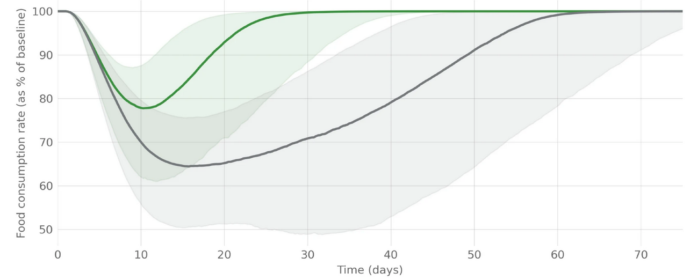

Strom ist für das Funktionieren unserer modernen Gesellschaft unverzichtbar, denn fast alles, was wir tun, hängt irgendwie vom Stromnetz ab. Diese Abhängigkeit bringt viel Komfort und Bequemlichkeit, macht uns aber auch verwundbar, wenn das Netz ausfällt. Was passiert also, wenn das Netz nicht mehr funktioniert? Diese Frage untersucht das Buch „Was bei einem Blackout geschieht: Folgen eines langandauernden und großräumigen Stromausfalls“ von Petermann et al. (2011) sehr gründlich. Ich stelle dieses Buch vor, weil es die umfassendste Analyse ist, die ich zu den gesellschaftlichen Folgen des Ausfalls aller stromabhängigen Systeme gefunden habe.

Wichtig ist, dass dieses Buch nicht einfach eine weitere akademische Veröffentlichung ist. Es wurde vom Institut für Technikfolgenabschätzung und Systemanalyse (ITAS) im Auftrag der Bundesregierung erstellt, um die Folgen von Stromausfällen in Deutschland zu untersuchen. Da das Buch auf Deutsch ist und viele meiner Leserinnen und Leser Englisch sprechen, halte ich es außerdem für besonders wertvoll, es hier zu besprechen, weil die meisten es wahrscheinlich nicht kennen.

Die Ergebnisse des Buchs beruhen auf Experteninterviews und einer systematischen Untersuchung der möglichen Folgen. Es wurde nichts modelliert, eine Einschränkung, die die Autoren mit Budgetgrenzen erklären, aber die Schlussfolgerungen sind logisch und nachvollziehbar. Das Buch ist nach den verschiedenen gesellschaftlichen Bereichen gegliedert, die von einem Stromausfall betroffen wären, darunter allgemeine Folgen, Kommunikation, Verkehr, Wasser- und Lebensmittelversorgung, Gesundheitswesen und Finanzwesen, sowie nach möglichen Lösungen, um die Folgen abzumildern.

# Allgemeine Lage

Damit es zu einem lang andauernden großen Stromausfall kommt, müssten wahrscheinlich wichtige Komponenten in mehreren Kraftwerken oder im Übertragungsnetz physisch zerstört werden, Komponenten, die schwer zu ersetzen sind. Das könnte verschiedene Ursachen haben. Petermann et al. nennen technisches und menschliches Versagen, kriminelle oder terroristische Handlungen, Epidemien und Pandemien sowie Extremwetter (1). Die Wahrscheinlichkeit solcher Stromausfälle könnte in Zukunft steigen, vor allem wegen der wachsenden Risiken durch Terrorismus und klimabedingtes Extremwetter.

Bei einem lang andauernden Stromausfall würde die Versorgung mit lebenswichtigen Gütern und Dienstleistungen schnell schwierig, was die öffentliche Sicherheit gefährdet. Der Staat könnte Mühe haben, seiner Pflicht zum Schutz seiner Bürger nachzukommen, selbst wenn er alle verfügbaren Mittel mobilisiert.

Deutschland hat wegen der Struktur seiner kritischen Infrastruktur einige zusätzliche Probleme, denn etwa 80 % davon sind in Privatbesitz (verteilt auf eine große Zahl kleiner Unternehmen), was die Koordination erschwert. Außerdem ist die Zuständigkeit für den Umgang mit dem Risiko von Stromausfällen auf verschiedene Institutionen verteilt. Zuerst kümmern sich die Kommunen um die Reaktion, aber wenn die Lage eskaliert, werden höhere Regierungsebenen einbezogen. Ein wirksames Krisenmanagement bräuchte Koordination über mehrere Ebenen hinweg, lokal, regional und national. Der deutsche Föderalismus erschwert das aber, weil Führung und Koordination auf den verschiedenen Regierungsebenen nicht einheitlich ablaufen. Außerdem wird die hier nötige Koordination weder geübt noch geplant.

Dazu kommt, dass die Bevölkerung kaum für so ein Ereignis sensibilisiert und darauf vorbereitet ist. Viele Menschen verbinden Katastrophen wie Stromausfälle mit unvermeidlichen Naturereignissen oder Terrorismus, was zu einem Gefühl des Fatalismus und mangelnder eigener Vorsorge führt. Um das anzugehen, ist es wichtig, das Bewusstsein in der Bevölkerung zu schärfen und zur Vorsorge zu ermutigen, damit im Krisenfall wirksame Kommunikation und Reaktion möglich sind.

# Kommunikation

Bei einem großen Stromausfall würden die Kommunikationssysteme mit als Erstes ausfallen. Die komplexe Struktur der Informations- und Telekommunikationsnetze hängt stark von externer Stromversorgung ab. Festnetztelefone würden sofort oder nach ein paar Stunden nicht mehr funktionieren (je nach lokaler Notstromversorgung). Mobilfunknetze würden anfangs dank batteriebetriebener Geräte noch funktionieren, aber schnell durch die stärkere Nutzung überlastet und bald ausfallen, wenn ihre Basisstationen keinen Strom mehr haben. Am längsten dürfte der Rundfunk funktionieren, und auch die internen Kommunikationsnetze der Behörden könnten dank ihrer Notstromversorgung ein paar Tage in Betrieb bleiben (2). Die internen Behördenkanäle wären aber nur für eine Minderheit der Menschen verfügbar.
Bei einem Stromausfall wäre die Kommunikation mit der Bevölkerung stark eingeschränkt. Es gibt zwar Ideen, wie man die Kommunikation aufrechterhalten könnte, etwa über Radiosender mit Notstrom oder lokale Informationsstellen, aber das sind Übergangslösungen mit begrenzter Kapazität.

Der Ausfall der Kommunikation hätte tiefgreifende Folgen für andere Bereiche. Anders als Gesundheitswesen, Wasserversorgung oder Verkehr, die teilweise ohne Strom funktionieren können, sind Kommunikationstechnologien vollständig auf eine stabile Stromversorgung angewiesen. Ohne Strom würden Telekommunikation und Informationsverarbeitung komplett stillstehen, was die Möglichkeiten, Reaktionen zu koordinieren oder mit der Öffentlichkeit zu kommunizieren, stark einschränken würde.

Die Verwundbarkeit der Kommunikationsinfrastruktur wird noch dadurch verschärft, dass Stromnetz und Kommunikationssysteme voneinander abhängen. Das Stromnetz ist sehr komplex und braucht Koordination und Kommunikation im ganzen Land, um zuverlässig zu funktionieren. Ein Ausfall des einen kann zum Ausfall des anderen führen und eine Kaskade von Ausfällen auslösen, von der man sich schwer erholt. Kommunikationsnetze nach einem Stromausfall wieder hochzufahren wäre ein langsamer, schrittweiser Prozess, und eine vollständige Wiederherstellung wäre kurzfristig wegen der Komplexität und Größe der Netze wahrscheinlich unmöglich (z. B. sind alle Batterien leer, und es gibt nicht genug Strom im System, um sie alle gleichzeitig zu laden, und die Leute fangen an, ihre Warmwasserspeicher zu heizen).
Es gibt derzeit keine umfassenden Pläne, diese Systeme resilienter zu machen, vor allem wegen der unerschwinglichen Kosten und technischer Grenzen. Mit der Einbindung erneuerbarer Energien könnten einige Verbesserungen möglich sein (3), aber insgesamt bleibt die Lage schwierig.

# Verkehr

Die Verkehrssysteme wären stark gestört. Elektrisch betriebene Verkehrsmittel, vor allem Züge und U-Bahnen, würden innerhalb von Minuten abrupt stehen bleiben. Das betrifft nicht nur die Fahrzeuge selbst, sondern auch die Infrastruktur, die Steuerungssysteme und die Organisation dieser Verkehrsnetze.

Der Schienenverkehr wäre stark betroffen, und viele Menschen könnten in Zügen und U-Bahnen festsitzen. Leitstellen, Stellwerke und Sicherheitssysteme wären in ihren Funktionen drastisch eingeschränkt, was die Mobilität der Bevölkerung erheblich behindern würde.
Der Hafenbetrieb würde weitgehend stillstehen, weil die Ladeeinrichtungen ausfallen. Flughäfen erweisen sich dagegen als relativ robust und könnten dank großer Notstromanlagen tage- oder sogar wochenlang weiterarbeiten (4).

Der Straßenverkehr würde chaotisch, vor allem in dicht besiedelten Gebieten. Dinge wie Ampeln oder die Tunnelbeleuchtung würden ausfallen, was zu Blockaden, Staus und mehr Unfällen führen würde, auch mit Verletzten und Toten. Rettungsdienste hätten Mühe, ihre Arbeit gut zu machen, weil die Straßen vielerorts blockiert wären.

Fahrzeuge mit Kraftstoff im Tank könnten anfangs zwar weiterfahren, aber da man an nicht funktionierenden Tankstellen nicht tanken kann, würde die Nutzung privater Kraftfahrzeuge nach den ersten 24 Stunden schnell stark zurückgehen (5). Der öffentliche Nahverkehr mit nicht elektrischen Bussen könnte eingeschränkt weiterlaufen.

Als Gegenmaßnahme können einige Zugverbindungen mit Diesellokomotiven aufrechterhalten werden. Die liegen gebliebenen elektrischen Züge würden aber die Gleise für die Dieselzüge blockieren. Die Behörden müssten in Zusammenarbeit mit Logistikunternehmen und Bahnbetreibern Transportkorridore einrichten und Transportkapazitäten zuteilen, um die Versorgung mit lebenswichtigen Gütern zu ermöglichen, vor allem über die Schiene. Dazu gehört die Entscheidung, welche Strecken offen gehalten werden sollen und welche Maßnahmen für den Notbetrieb nötig sind.

# Wasserversorgung

Die Wasserinfrastruktur steht vor großen Problemen, weil sie stark von Strom abhängt. Die meisten Wassersysteme hören fast sofort auf zu funktionieren, wenn der Strom ausfällt, und ein erheblicher Teil der Bevölkerung hätte keinen Zugang mehr zu frischem Wasser (es wäre aber noch etwas Wasser im System, das man nutzen könnte). Das betrifft alle Bereiche der Wasserwirtschaft, von der Förderung über die Aufbereitung bis zur Verteilung.

Der Ausfall der elektrischen Pumpen ist besonders kritisch, weil dann kein Grundwasser mehr gefördert werden kann. Wasseraufbereitung und Verteilung beschränken sich auf den Betrieb mit Schwerkraft, was die verfügbare Wassermenge stark verringert und höher gelegene Gebiete komplett ohne Versorgung lässt.

Abwassersysteme, die für bestimmte Wassermengen ausgelegt sind, könnten durch weniger Durchfluss und eine veränderte Zusammensetzung des Abwassers verstopfen (das würde aber wahrscheinlich ein paar Wochen oder länger dauern, bis es zu einem größeren Problem wird). In vielen Fällen müsste ungeklärtes Abwasser vielleicht direkt in Flüsse geleitet werden, was sofort Umweltschäden verursachen und lokale Wasserquellen verunreinigen würde. Der Wassermangel betrifft auch die Körperhygiene, was das Krankheitsrisiko erhöht und das Kochen erschwert. Außerdem behindert er die Brandbekämpfung, während gleichzeitig die Brandgefahr steigt, weil Menschen auf andere Methoden zum Kochen und Heizen ausweichen.

Um solche Probleme abzumildern, hat Deutschland ein Netz von 5200 Notbrunnen, das vom normalen Trinkwassersystem getrennt ist. Ursprünglich für Kriegsszenarien gebaut (mit einem Angriff der Sowjetunion im Hinterkopf), werden die Standorte dieser Brunnen erst bei großen Katastrophen öffentlich bekannt gegeben, damit niemand sie manipuliert. Diese Brunnen haben genug Kapazität, um durchschnittlich 15 l Wasser pro Person und Tag bereitzustellen (6). Das ist etwa eine Größenordnung weniger, als heute verbraucht wird, sollte aber für Trinkwasser, Essenszubereitung und grundlegende Hygiene reichen. Gebiete ohne Brunnen müssten mit Wasser per Lkw versorgt werden. Außerdem kann lokaler Notstrom genutzt werden, um Wasserpumpen vorübergehend zu betreiben und lokale Speicher wieder aufzufüllen. Zusammen sollten diese Maßnahmen zumindest etwas Trinkwasser für die Mehrheit der Bevölkerung liefern.

Die aktuellen Einschätzungen beruhen aber größtenteils auf theoretischen Überlegungen und nicht auf tatsächlichen Modellen. Solche Modelle zu entwickeln würde helfen, Annahmen zu prüfen und die Vorbereitung zu verbessern. Eine mögliche Verbesserung wäre, Kläranlagen so umzubauen, dass sie mit Biogas ihren eigenen Strom erzeugen, sodass sie unabhängig von externer Stromversorgung sind und durchgehend arbeiten können.

# Lebensmittelversorgung

Das heutige System der Lebensmittelversorgung hat in so einem Szenario mehrere Schwachstellen. Ein erheblicher Teil unserer Lebensmittel ist tiefgekühlt und wäre ohne Strom innerhalb weniger Tage verloren. Außerdem hätte die moderne Massentierhaltung mit ihren streng kontrollierten Umgebungen große Probleme. Viele Tiere in diesen Anlagen könnten innerhalb von Stunden bis Tagen sterben, weil lebenswichtige Systeme wie Beleuchtung, Heizung, Kühlung, Lüftung und Reinigung ausfallen.

Das Hauptproblem bei einem Stromausfall ist nicht unbedingt die Gesamtmenge an verfügbaren Lebensmitteln, sondern die Logistik, sie dorthin zu bringen, wo sie gebraucht werden. Es gibt zwar große Lebensmittelreserven, aber Ausfälle im Verkehr könnten verhindern, dass sie viele Menschen rechtzeitig erreichen. Außerdem können viele Menschen ohne Strom nicht kochen, sodass verzehrfertige Mahlzeiten bereitgestellt werden müssten.

Die heutige Struktur der Lebensmittelverteilung macht es wahrscheinlich, dass jede Reaktion nur teilweise wirksam ist und von Ort zu Ort sehr unterschiedlich ausfällt. Manche Gebiete hätten vielleicht genug Lebensmittel, während andere schwere Engpässe erleben könnten. Die meisten Lebensmittelgeschäfte haben nur begrenzte Lagerkapazitäten und sind meist auf häufige Lieferungen angewiesen. Ohne Strom könnten diese Läden ihre Bestände innerhalb weniger Tage aufbrauchen. Die Lieferkette würde zusätzlich durch den Ausfall der Kommunikation zwischen Zentralen, Lagern und Läden beeinträchtigt, was es schwer machen würde, Bestände und Nachfrage gut zu steuern.
Um diese Risiken zu verringern, könnte man dezentralere Lebensmittellager und ein Netz notfalltauglicher Läden aufbauen. Das wären normale Läden, die Anreize bekommen, größere Lagerkapazitäten und Notstromanlagen vorzuhalten.

Wenn der Stromausfall länger dauert, wird das auch die Lebensmittelproduktion treffen. Wie das ablaufen würde, wurde in einem [früheren Beitrag](https://existentialcrunch.substack.com/i/135889501/the-track-record-of-the-human-species-does-not-tell-much-about-the-extinction-risk-that-a-global-civilization-faces) besprochen.

# Gesundheitswesen

Das Gesundheitswesen ist wegen seiner Komplexität und Abhängigkeit von anderen vernetzten Systemen extrem verwundbar gegenüber einem lang andauernden Stromausfall. Es könnte höchstens etwa eine Woche ohne Strom funktionieren (7). Danach würden die meisten Patienten, die lebenswichtige Versorgung brauchen, wahrscheinlich sterben (8).

Da das Gesundheitswesen dezentral und hochspezialisiert ist, kann es den Folgen eines Stromausfalls nur kurz standhalten. Innerhalb von 24 Stunden ist die Funktionsfähigkeit des Gesundheitswesens schon erheblich eingeschränkt. In den folgenden Tagen müssten Dialysezentren und Pflegeheime zumindest teilweise evakuiert werden (wobei unklar wäre, wohin). Die meisten Arztpraxen und Apotheken würden schließen. Hausnotrufsysteme und medizinische Geräte für die häusliche Pflege würden nicht mehr funktionieren. Die Herstellung und Verteilung von Arzneimitteln im betroffenen Gebiet würde stoppen. Die wenigen zentralen Krankenhäuser, die ihre eigene Stromversorgung aufrechterhalten können oder unterbrechungsfreie Notstromaggregate haben, wären überfordert, weil sie den kompletten Ausfall der ambulanten Versorgung und der häuslichen Pflege auffangen müssten.

Innerhalb einer Woche würde sich die Lage im Gesundheitswesen so verschlechtern, dass trotz intensiver Nutzung regionaler Hilfskapazitäten mit einem vollständigen Zusammenbruch der medizinischen und pharmazeutischen Versorgung zu rechnen ist (je nach Behandlung und Medikament sehr unterschiedlich).

Um das Gesundheitswesen resilienter zu machen, bräuchte es größere Vorräte und Notstromversorgung. Das wäre aber wegen der dezentralen Struktur des Systems und der großen nötigen Vorräte extrem teuer.

# Finanzwesen

Das Finanzwesen erweist sich bei einem lang andauernden Stromausfall im Vergleich zu anderen kritischen Infrastrukturen als relativ robust. Das gilt besonders für die Abläufe im Hintergrund, etwa Daten- und Zahlungsverkehr zwischen Banken und Börsen. Diese Abläufe sind zusammen mit der Datenspeicherung und anderen kritischen Geschäftsprozessen meist über Notstromversorgung abgesichert oder können in nicht betroffene Gebiete verlagert werden. Vor allem Börsensysteme haben umfangreiche Notfallpläne, sodass sie ihre wesentlichen Funktionen während des gesamten Stromausfalls aufrechterhalten können.

Die kundennahe Seite des Bankwesens ist aber viel verwundbarer. Kurz nach dem Stromausfall sind Finanztransaktionen im betroffenen Gebiet unmöglich, weil Telefonnetze und Internet nicht mehr funktionieren. Viele Banken, die anfangs noch geöffnet haben, schließen innerhalb weniger Tage. Da auch die Geldautomaten nicht funktionieren, würde die Bargeldversorgung der Bevölkerung versiegen, was den lokalen Austausch von Gütern erschwert. Diese Lage zeigt eine entscheidende Schwäche des Sektors: den Verlust elektronischer Zahlungsmöglichkeiten und das schwindende Bargeld in der Bevölkerung. Die Angst in der Bevölkerung wächst, weil die Leute fürchten, keine Lebensmittel und andere Dinge des täglichen Bedarfs mehr kaufen zu können.

Die Folgen für Unternehmen zeigen sich gegen Ende der ersten Woche, wenn manche in Liquiditätsengpässe geraten. Das liegt daran, dass sie keine Einnahmen erzielen oder Zahlungen von Kunden bekommen können, aber weiter verschiedene finanzielle Verpflichtungen über automatische Abbuchungen erfüllen müssen, die trotz des Stromausfalls weiter ausgeführt werden.

Um diese Risiken zu verringern, wäre es entscheidend, Pläne für eine Notversorgung der Bevölkerung mit Bargeld in solchen Krisen zu entwickeln und umzusetzen.

# Was wir tun könnten, um die Resilienz zu erhöhen

Im ganzen Buch machen Petermann et al. eine Reihe von Vorschlägen, wie wir die Resilienz erhöhen könnten.

## Infrastruktur verstaatlichen und Entscheidungen bündeln

Ein Problem, das im Buch hervorgehoben wird, ist, dass ein Großteil der deutschen Infrastruktur in privater Hand ist, was die Koordination sehr schwierig macht. Das ließe sich vermeiden, wenn mehr Teile der Infrastruktur verstaatlicht würden. Das müsste aber mit einer klareren Hierarchie zwischen den Bundesländern und dem Bund verbunden werden. Im Moment sind die Zuständigkeiten auf sehr unterschiedliche Regierungsebenen verteilt, was die Koordination in einer nationalen Krise schwierig machen würde.

## Die Verteilung von Vorräten überdenken

Das Buch hat festgestellt, dass bei vielen unserer Vorräte (ob Kraftstoff oder Lebensmittel) nicht die Gesamtmenge das Problem ist, sondern die Verteilung. Ein Großteil der Vorräte liegt in wenigen großen Lagern. Das macht die Lagerung zwar billiger und einfacher, bedeutet aber auch, dass die Vorräte im Notfall nicht dort sind, wo sie gebraucht werden. Ein Ansatz wäre also, die Lagerung von Kraftstoff und Lebensmitteln zu dezentralisieren, damit der Transport bei einem Stromausfall einfacher ist.

## Inselnetze

Es wäre zwar schwierig, das ganze Stromnetz auf einmal wieder hochzufahren, aber wahrscheinlich ist es möglich, schnell Inselnetze aufzubauen. Die könnten von einem einzelnen Haus bis zu einer Stadt oder sogar einer kleinen Region reichen, je nach lokalem Aufbau des Netzes und den verfügbaren Ressourcen. Der Umstieg auf erneuerbare Energien ist hier ziemlich hilfreich, weil sie viel dezentraler sind als frühere Methoden der Energieerzeugung. Das erleichtert den Aufbau von Inselnetzen, die zumindest lokal einen Teil der kritischen Infrastruktur aufrechterhalten können und es den Regionen, denen das gelingt, erlauben, viele der schlimmsten Folgen des Stromausfalls zu vermeiden.

# Einen Stromausfall modellieren
Das Buch betont, dass es an Modellen zu den Folgen von Stromausfällen für kritische Infrastruktur fehlt. Eine aktuelle Studie von Blouin et al. (2024) schließt aber zumindest einen Teil dieser Lücke, indem sie die Folgen eines monatelangen Stromausfalls für das Ernährungssystem modelliert. Sie haben ein Systemdynamikmodell entwickelt, das fünf kritische Infrastrukturen verbindet, Stromnetz, flüssige fossile Brennstoffe, Internet, Verkehr und Arbeitskräfte, um die Resilienz der Lebensmittellieferkette abzuschätzen. Sie haben ihr Modell am einwöchigen Stromausfall in Venezuela überprüft und festgestellt, dass es die beobachteten Folgen gut abbildet. Deshalb sind sie einigermaßen zuversichtlich, dass das Modell hochrechnen und die möglichen Folgen für die Verfügbarkeit von Lebensmitteln in den USA nach einem elektromagnetischen Puls in großer Höhe (HEMP) durch eine Atomexplosion vorhersagen kann, wenn die Erholung relativ schnell geht (Abbildung 1).

Abbildung 1: Verfügbarkeit von Lebensmitteln über die Zeit nach einem HEMP über den USA (Blouin et al (2024)). Die grüne Linie steht für eine optimistische Erholung, die graue für eine pessimistischere.

Sie finden, dass die Verfügbarkeit von Lebensmitteln deutlich sinken würde, vor allem im pessimistischeren Szenario, in dem sie unter 50 % der Kalorien von vor dem HEMP fällt. Das von Blouin et al. untersuchte HEMP-Szenario ähnelt dem von Petermann et al. beschriebenen, allerdings mit 60 % statt 100 % Verlust der Verfügbarkeit des Stromnetzes. Petermann und Kollegen liefern aber keine quantitativen Schätzungen. Nach ihren Beschreibungen würde der Verlauf wahrscheinlich eher dem pessimistischen Szenario ähneln oder sogar zu einem völligen Zusammenbruch der Gesellschaft führen.

Außerdem ist die Analyse von Blouin et al. auf nationaler Ebene gemacht, während Petermann et al. betonen, dass die Folgen eines Stromausfalls lokal sehr unterschiedlich wären, manche Regionen kaum gestört, andere schwer getroffen. Ein räumlich aufgelöstes Modell wäre in Zukunft also ziemlich wertvoll. Sich anzuschauen, wie es Menschen mit mehr oder weniger Vermögen treffen würde, wäre auch eine gute Ergänzung.

# Fazit

Insgesamt zeichnet das Buch ein ziemlich verheerendes Bild davon, was nach einem Stromausfall passieren würde. Die Menschen würden den Zugang zu Lebensmitteln, Verkehr, Gesundheitsversorgung und Kommunikation verlieren. Die Wasserversorgung würde wahrscheinlich zumindest teilweise weiterfunktionieren, und es gäbe wahrscheinlich noch etwas Bargeld, um lokal zu bezahlen. Das Einzige, was wirklich resilient gegenüber einem Stromausfall zu sein scheint, sind die Börse und dein Bankkonto. Du hast also vielleicht nichts zu essen, aber anscheinend kannst du sicher sein, dass die Bank deine Schulden weiter im Blick behält, selbst wenn um dich herum alles zerbröckelt (9).

Es gibt aber zumindest auch etwas Positives. Die Autoren betonen das Potenzial von Inselnetzen, viele der Probleme eines Stromausfalls abzumildern. Zum Glück wird es jedes Jahr leichter, solche Inselnetze umzusetzen, weil immer mehr erneuerbare Energien ans Netz gehen und das Stromnetz dezentraler wird.

All das zeigt, dass die Folgen von Stromausfällen nicht gut verstanden sind, es nur wenige Modelle gibt und große Unsicherheit über die Ergebnisse herrscht. Petermann et al. argumentieren sogar, dass Vorhersagen über eine Woche hinaus wegen unseres fehlenden Wissens größtenteils unmöglich sind. Hier braucht es eindeutig mehr Forschung.

# Anmerkungen

(1) Es gibt aber auch Atomexplosionen in großer Höhe, die elektromagnetische Pulse (HEMPs) verursachen, und Weltraumwetterereignisse.

(2) Es gibt auch die Möglichkeit von Satellitentelefonen, aber die sind nicht weit verbreitet.

(3) Allerdings würden mehr erneuerbare Energien das Leben bei jeder Katastrophe schwerer machen, die das Sonnenlicht blockiert.

(4) Außer nach einem HEMP.

(5) Längerfristig gäbe es vielleicht Möglichkeiten, den Kraftstoff ohne Strom abzupumpen.

(6) Ich finde es ziemlich verrückt, dass ich seit 34 Jahren in Deutschland lebe, in Hydrologie promoviert habe, aber noch nie davon gehört hatte, dass Deutschland ein komplettes Notwassersystem hat.

(7) Und weniger, wenn es ein HEMP war.

(8) Einiges davon ist bei einem großen Stromausfall in Venezuela passiert.

(9) Hier steckt wahrscheinlich irgendwo eine Metapher für das Leben im Kapitalismus drin, aber die zu finden, überlasse ich dir als Übung.

# Zitieren
Bitte das englische Original zitieren:

Jehn, F. U. (2024, October 21). The consequences of large-scale blackouts. Existential Crunch. [https://doi.org/10.59350/wnta7-w0c60](https://doi.org/10.59350/wnta7-w0c60)

# Quellen

* Blouin, S., Herwix, A., Rivers, M., Tieman, R. J., & Denkenberger, D. C. (2024). Assessing the Impact of Catastrophic Electricity Loss on the Food Supply Chain. International Journal of Disaster Risk Science. https://doi.org/10.1007/s13753-024-00574-6
* Petermann, Th., Bradke, H., Lüllmann, A., Poetzsch, M., & Riehm, U. (2011). Was bei einem Blackout geschieht: Folgen eines langandauernden und großräumigen Stromausfalls. edition sigma. https://doi.org/10.5445/IR/140085927
