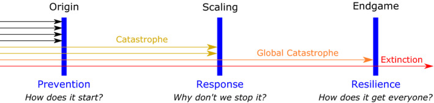

Wer über das Ende unserer modernen Zivilisation nachdenkt, muss kontrafaktisch denken, denn zum Glück ist es noch nicht passiert. Aber das ist nicht der einzige Weg, wie uns Kontrafaktisches hilft, Kollaps besser zu verstehen. Wir können uns auch kontrafaktische Szenarien ausdenken, um über vergangene Ereignisse nachzudenken. Nicht die Frage „Warum ist das passiert?“, sondern „Warum ist nicht etwas anderes passiert?“ Wir können Kontrafaktisches nutzen, um sowohl die Zukunft als auch die Vergangenheit zu erkunden. Dieser Beitrag soll ein paar Gründe liefern, warum wir das tun sollten, wie wir es tun könnten und warum es besonders hilfreich ist, über große Katastrophen nachzudenken.

# Warum und wie man kontrafaktisch denkt

Bevor Philip Tetlock für seine Arbeit zu Prognosen bekannt wurde, hat er auch zu kontrafaktischer Geschichte gearbeitet. In dem Buch „Unmaking the West“ versuchen Tetlock und andere, sich eine Reihe kontrafaktischer Geschichten auszudenken, die beschreiben, was ein paar mitteleuropäische Nationen davon hätte abhalten können, große Teile der Weltgeschichte des 19. und 20. Jahrhunderts zu dominieren. Am relevantesten für uns ist das erste Kapitel des Buchs, das gängige Kritik an kontrafaktischem Denken diskutiert und wie man Kontrafaktisches zu einem solideren wissenschaftlichen Beleg machen kann (Tetlock et al., 2006).

Der größte Vorteil kontrafaktischen Denkens ist, dass es uns hilft, den Rückschaufehler zu vermeiden. Normalerweise trübt das Wissen, dass ein Ereignis passiert ist, im Nachhinein unseren Blick. Bevor das Ereignis eintritt, erkennen wir die Unsicherheit der Zukunft an und können Alternativen in Betracht ziehen. Sobald ein Ereignis aber eintritt, fällt diese Mehrdeutigkeit in sich zusammen, und unser Gehirn richtet sich in der Gewissheit der Gegenwart ein. Jetzt fühlt es sich an, als „musste es so kommen“. Aber nur weil ein Ereignis passiert ist, heißt das nicht, dass es so kommen musste oder dass die Chance dafür auch nur hoch war. Es fühlt sich nur so an, weil wir in der Zeitlinie gelandet sind, in der das Ereignis eingetreten ist (1). Um diesen Fehler zu vermeiden, rät Tetlock, kontrafaktisch zu denken, weil uns das in die Geisteshaltung zurückbringt, die wir vor dem Ereignis hatten.

Ein zweites Argument von Tetlock ist, dass wir kontrafaktische Geschichte im Alltag sowieso benutzen, also können wir sie auch gleich formalisieren und für die Wissenschaft nutzen. Die Idee dahinter: Kontrafaktisches Denken ist unverzichtbar, wenn wir Ursache und Wirkung beschreiben wollen. Wenn ich zum Beispiel sage „Die Katze hat die Tasse vom Tisch geschubst“, behaupte ich, dass die Katze die Ursache für den Sturz der Tasse ist. Dafür musste ich implizit die kontrafaktische Behauptung aufstellen, dass die Tasse ohne die Katze noch auf dem Tisch stehen würde. Dasselbe passiert, wenn wir Aussagen über Geschichte machen. Wenn ich sage „Die osmanische Eroberung Konstantinopels hat das Byzantinische Reich zerstört“, stelle ich die kontrafaktische Behauptung auf, dass das Byzantinische Reich ohne die Eroberung Konstantinopels weiterbestanden hätte. Ohne die kontrafaktische Behauptung könnten wir nur beschreiben, was passiert ist, aber Ereignisse nicht als Ursache und Wirkung verknüpfen. Um beim Beispiel zu bleiben: Wir könnten sagen „Die Osmanen eroberten Konstantinopel“ und „Das Byzantinische Reich wurde zerstört“, aber wir könnten beides nicht zueinander in Beziehung setzen.

Tetlock argumentiert deshalb: Wenn wir sowieso implizit kontrafaktisch denken und es uns hilft, den Rückschaufehler zu vermeiden, sollten wir es einfach ausdrücklich tun, damit wir direkter daraus lernen können. Dafür nennt er die drei Hauptkritikpunkte an kontrafaktischer Geschichte und was man tun muss, um sie zu entkräften und so belastbare und verlässliche kontrafaktische Geschichte zu schreiben:
1. Kontrafaktische Geschichte ist willkürlich
   * Behauptung: Kontrafaktisches Denken öffnet einfach zu viele Möglichkeiten, und die Entscheidung, welcher man nachgeht, ist zu zufällig, um hilfreich zu sein.
   * Lösung: Die „Regel der minimalen Änderung“ anwenden. Man sollte die kleinstmögliche Abweichung vom tatsächlichen Geschehen anstreben, die einem noch die Erkenntnisse liefert, die einen interessieren.
2. Kontrafaktische Geschichte ist spekulativ
   * Behauptung: Kontrafaktisches ist im Grunde Fiktion, weil man sich alles Mögliche ausdenken kann.
   * Lösung: Das kontrafaktische Szenario so gut wie möglich historisch verankern. Tetlock rät, darauf zu achten, dass es mit gut belegten historischen Fakten und statistischen Verallgemeinerungen vereinbar bleibt. Man sollte auch darauf achten, dass die normalen Regeln von Ursache und Wirkung weiter gelten.
3. Kontrafaktische Geschichte ist eigennützig
   * Behauptung: Kontrafaktische Geschichten werden zu leicht von denen beeinflusst, die sie schreiben, und kommen immer zu den Schlüssen, die ihnen lieber sind.
   * Lösung: Offenlegen, wer an dem kontrafaktischen Szenario Anstoß nehmen könnte, und erklären, warum man die eigenen Entscheidungen trotzdem für angemessen hält.

Mit diesen Regeln, so das Buch, hätten ihnen ihre kontrafaktischen Geschichten geholfen, zwei wichtige Ideen über Geschichte zu verstehen:
1. Frühere Ereignisse haben einen größeren Einfluss auf den Gesamtverlauf als spätere, und historische Trends werden mit der Zeit immer unumkehrbarer
   * Man kann sich zum Beispiel leicht vorstellen, wie Europa nie zur Weltmacht geworden wäre, wenn man ein kleines Ereignis im Jahr 1500 ändert. Es ist fast unmöglich, ein vernünftiges Ereignis zu finden, das man ändern könnte, um Europa im Jahr 1800 aufzuhalten.
2. Eine bessere Welt ist möglich. Kontrafaktisches Denken zeigt, dass Geschichte viele Weggabelungen zu besseren oder schlechteren Ergebnissen hat.

# Storylines

Kontrafaktisches Denken hilft nicht nur, über die Vergangenheit nachzudenken, sondern kann uns auch Einsichten geben, was uns in der Zukunft erwarten könnte. Ein häufig genutzter Ansatz sind hier sogenannte Storylines. Bekannt gemacht hat sie, vor allem in der Klimaforschung, Shepherd et al. (2018). Shepherd und Co-Autoren gehen von dem Problem aus, dass der Klimawandel oft probabilistisch untersucht wird. Wir nutzen also viele Modelle und versuchen, einen Überblick über alle möglichen Zukünfte zu bekommen. Das ist ein hilfreicher Ansatz, hat aber einige Probleme. Wenn man viele Modellläufe oder sogar viele verschiedene Modelle nutzt und sich nur die zusammengefassten Ergebnisse anschaut, bleiben die extremsten Szenarien wahrscheinlich unentdeckt, weil sie über die zusammengefassten Läufe weggemittelt werden. Dabei könnten genau das die Ereignisse mit dem größten erwarteten Schaden sein, auf die man sich also vorbereiten müsste.

Um das anzugehen, schlagen sie Storylines vor. Die Idee ist, sich auf eine einzelne, plausible Kette von Ereignissen zu konzentrieren, die passieren könnte, und diese gründlich zu untersuchen. Um so eine Ereigniskette auszuwählen, hilft es oft, mit einem Ereignis anzufangen, das in der Vergangenheit passiert ist, und zu fragen: „Was hätte dieses Ereignis katastrophaler gemacht?“ Nimm zum Beispiel eine Überschwemmung. Eine Stadt in der Nähe blieb verschont, weil der Damm, der sie schützte, gehalten hat. Eine Storyline, die man hier entwickeln könnte, wäre: „Was wäre passiert, wenn der Damm gebrochen wäre?“ oder „Was wäre passiert, wenn es etwas mehr geregnet hätte und das Hochwasser höher als der Damm gewesen wäre?“.

Wichtig ist, dass Storylines keine Wahrscheinlichkeitsaussage machen sollen. Es geht eher um die Frage: „Ist diese Ereigniskette plausibel, und sollten wir uns deshalb darauf vorbereiten?“ Das ist eine nützliche Sichtweise, weil die Wissenschaft immer wieder gezeigt hat, dass Menschen sich mit Wahrscheinlichkeiten schwertun. Die Verhaltenspsychologie hat zum Beispiel gezeigt, dass viele Menschen Schwierigkeiten haben, rational auf Ereignisse zu reagieren, die sie selbst nicht erlebt haben. Im Grunde schätzen wir die Wahrscheinlichkeit eines Ereignisses geringer ein, wenn es außerhalb unserer persönlichen Erfahrung liegt, selbst wenn man uns die tatsächliche Wahrscheinlichkeit nennt. Deshalb wird sehr oft erst vorgesorgt, nachdem die Gefahr eingetreten ist. Oder um beim Beispiel zu bleiben: Die Leute fangen erst an, darüber nachzudenken, welche Ereignisse den Damm zerstören könnten, nachdem es passiert ist. Storylines sollen diesen Prozess in die Gegenwart holen und dafür sorgen, dass es sich eher wie etwas anfühlt, das wir erlebt haben. Wenn wir auf Basis vergangener Ereignisse einen plausiblen Weg zeigen können, wie eine große Katastrophe passieren könnte, haben wir vielleicht bessere Chancen, Leute davon zu überzeugen, jetzt zu handeln. Um diesen Punkt zu untermauern, nennen Shepherd et al. viele Beispiele, wo dieser Ansatz Ergebnisse gebracht hat, wo probabilistische Modellierung die Beteiligten nicht überzeugen konnte.

Eines dieser Beispiele ist, wie Storylines geholfen haben, die New Yorker U-Bahn vor großen Schäden zu bewahren. Storylines zeigten, dass die New Yorker U-Bahn in der Vergangenheit nur knapp einer großen Überschwemmung entgangen war. Die entwickelten Storylines spielten deshalb durch, was passieren könnte, wenn die Tunnel geflutet werden. Das zeigte, dass die elektrische Signaltechnik beschädigt würde und wahrscheinlich schwer zu ersetzen wäre. Auf Grundlage dieser Erkenntnis führte die Metropolitan Transit Authority die Regel ein, diese Technik auszubauen, wenn es wahrscheinlich schien, dass der Tunnel geflutet werden könnte. So konnte die New Yorker U-Bahn nach einer Überschwemmung schnell wieder fahren, was sonst ein großer Rückschlag gewesen wäre.

Ein ähnlicher Begriff für den Storyline-Ansatz sind sogenannte „abwärtsgerichtete Kontrafakten“ (downward counterfactuals), geprägt von Woo (2019). Die Idee ist, von schlimmen historischen Ergebnissen auszugehen und sie Schritt für Schritt schlimmer zu machen. Man fragt also im Grunde: „Wie hätte dieses Ereignis X % schlimmer werden können?“, erhöht den Prozentsatz schrittweise und schaut, ob man noch eine vernünftige Ereigniskette findet, die dieses schlimmere Ergebnis hervorbringen könnte. Dieser Ansatz könnte für Themen wie gesellschaftlichen Kollaps und globale katastrophale Risiken besonders interessant sein, weil er zeigen könnte, wie sich die Bedeutung verschiedener Prozesse verschiebt, je größer der Schaden wird.

Storylines können manchmal etwas verwirrend sein, weil Leute unter dem Begriff ziemlich verschiedene Dinge verstehen. Zum Glück versucht ein aktueller Überblicksartikel von Baulenas et al. (2023), diese Verwirrung aufzulösen, indem er die wichtigsten Arten beschreibt, wie der Begriff verwendet wird. Sie haben drei Hauptarten gefunden:
* Szenariobasierte Storylines: Das sind qualitative Beschreibungen, wie sich die Welt entwickeln könnte. Ein typisches Beispiel wären die Shared Socioeconomic Pathways des IPCC. Sie beschreiben die Grundidee einer möglichen Zukunft, die man dann in Klimamodelle einbauen und modellieren kann.
* Physikalische Klima-Storylines: Das ist die Art von Storyline, die Shepherd et al. meinen, wie oben erklärt.
* Diskursanalytische Storylines: Diese Art der Analyse will erfassen, worüber in der Klimapolitik geredet wird, um die wichtigsten Erzählungen und Metaphern zu verstehen.

Wie man sieht, sind diese Ansätze ziemlich unterschiedlich. Ich glaube, für die Kollapsforschung könnten alle hilfreich sein. Ich würde es gerne lesen, wenn sich jemand die Arbeit machen würde, die wichtigsten Erzählungen und Metaphern rund um gesellschaftlichen Kollaps zu erfassen.

Baulenas et al. empfehlen auch, die drei Ansätze zu kombinieren, um nützlichere Storylines zu bekommen. Zum Beispiel eine physikalische Klima-Storyline zu entwickeln und dann einen Workshop dazu zu machen, um herauszufinden, welche Erzählungen sie bei den Teilnehmenden auslöst.

# Globale katastrophale Risiken und Kontrafaktisches

Wir wissen jetzt, dass Kontrafaktisches nützlich ist, um sowohl die Vergangenheit als auch die Zukunft zu erkunden. Ein Teil der Zukunft, mit dem sich dieser fortlaufende Literaturüberblick oft beschäftigt, sind globale katastrophale Risiken. Hier wären Storylines meiner Meinung nach auch ziemlich hilfreich, um die Zukunft kontrafaktisch zu erkunden. Einen direkten Storyline-Ansatz zu globalen katastrophalen Risiken habe ich zwar noch nicht gesehen, aber kontrafaktisches Denken wird durchaus genutzt. Ein Paper, das ich hervorheben will, handelt von den verschiedenen Verteidigungsebenen gegen globale katastrophale Risiken, von Cotton-Barratt et al. (2020). Die Idee ist eher theoretisch, aber sie stellen sich die einzelnen Schritte vor, die passieren müssten, damit eine Katastrophe möglicherweise zum Aussterben der Menschheit führt (Abbildung 1).

Abbildung 1: Gestaffelte Verteidigung gegen globale katastrophale Risiken.

Sie stellen sich vor, dass das in drei Schritten passiert, an denen man die Katastrophe jeweils stoppen könnte:
1. Vorbeugung: Der erste Weg, eine Katastrophe zu stoppen, ist, sie ganz zu verhindern. Dieser Schritt ist nicht bei allen Risiken möglich oder nur mit unrealistischem Aufwand. Theoretisch kann man zum Beispiel einen Supervulkanausbruch verhindern (2), aber es ist unwahrscheinlich, dass wir das wegen des gigantischen Aufwands tun. Es gibt aber viele Katastrophen, bei denen wir die Wahrscheinlichkeit verringern könnten, dass sie überhaupt beginnen. Zum Beispiel könnten wir den Klimawandel plausibel stoppen, bevor er in den Bereich der meisten Kipppunkte kommt (3).
2. Reaktion: Viele Katastrophen fangen klein an und werden dann durch Prozesse wie Kaskaden immer größer. Wir haben also auch die Chance, auf dieser Ebene einzugreifen, indem wir die Katastrophe stoppen, bevor sie groß wird. Ein Beispiel wäre, eine Infektionskrankheit früh zu erkennen, bevor sie die Chance hat, zur globalen Pandemie zu werden.
3. Resilienz: Hier läuft die globale Katastrophe schon, und jetzt müssen wir damit klarkommen. Man kann sich zum Beispiel einen nuklearen Winter vorstellen und wie wir eine resiliente Lebensmittelproduktion hochfahren können (4).

Ein weiteres Beispiel für globale katastrophale Risiken und das Erkunden künftiger Kontrafakten ist der ParEvo-Prozess am Centre for the Study of Existential Risk von Beard et al. (2025). Die Idee ist, eine große Bandbreite von Zukünften zu erkunden, indem die Teilnehmenden auf den Ideen der anderen aufbauen, welche Wege die Zukunft nehmen könnte. Dafür gibt es einen Ausgangstext, der die Grundideen skizziert, und dann schreiben die Teilnehmenden kurze Fortsetzungen dazu und bauen Ideen aus den Texten der anderen weiter aus. Die Ergebnisse dieser Übung sind zwar alle zu weit ins Hypothetische abgedriftet, um direkt nützlich zu sein, aber die Idee ist vielversprechend. Vor allem, wenn man sie mit den Ideen von Tetlock et al. kombinieren würde, wie man belastbarere Kontrafakten erzeugt.

# Fazit

Kontrafaktisches Denken über Vergangenheit und Zukunft kann ein wertvolles Werkzeug sowohl für die Forschung zu globalen katastrophalen Risiken als auch für die Kollapsforschung sein. In beiden Fällen gibt es dazu bisher sehr wenig Forschung. Vor allem ein Storyline-Ansatz zu einem bestimmten globalen katastrophalen Risiko könnte viele Erkenntnisse bringen und außerdem eine plausible Geschichte liefern, die helfen könnte, die Politik stärker einzubinden.

# Anmerkungen

(1) Ein aktuelles Beispiel dafür ist die Wahl von Donald Trump. Vor der Wahl waren sich so ziemlich alle einig, dass sie zu knapp war, um eine Vorhersage zu treffen, und beide Kandidaten ungefähr gleiche Chancen hatten. Jetzt, wo Donald Trump gewählt ist, hat plötzlich jeder eine glasklare Erklärung, warum es zweifellos so kommen musste.

(2) Das wird ausführlich in [diesem Paper](https://www.sciencedirect.com/science/article/abs/pii/S0016328717301155) untersucht.

(3) Hier ist der Beitrag über [Kipppunkte](https://florianjehn.github.io/Societal_Collapse/2023-06-19-tipping_points/).

(4) Das haben wir in einem [früheren Beitrag](https://florianjehn.github.io/Societal_Collapse/2024-03-04-where_to_stay/) ausführlicher besprochen.

# Zitieren
Bitte das englische Original zitieren:

Jehn, F. U. (2024, November 20). Counterfactual catastrophes. Existential Crunch. [https://doi.org/10.59350/x3nr3-5v898](https://doi.org/10.59350/x3nr3-5v898)

# Quellen

* Baulenas, E., Versteeg, G., Terrado, M., Mindlin, J., & Bojovic, D. (2023). Assembling the climate story: Use of storyline approaches in climate-related science. Global Challenges, 7(7), 2200183. https://doi.org/10.1002/gch2.202200183
* Beard, S., Cooke, N., Dryhurst, S., Cassidy, M., Gibbins, G., Gilgallon, G., Holt, B., Josefiina, I., Kemp, L., Tang, A., Weitzdörfer, J., Ingram, P., Sundaram, L., & Davies, R. (2025). Exploring futures for the science of global risk. Futures, 168, 103569. https://doi.org/10.1016/j.futures.2025.103569
* Cotton-Barratt, O., Daniel, M., & Sandberg, A. (2020). Defence in Depth Against Human Extinction: Prevention, Response, Resilience, and Why They All Matter. Global Policy, 11(3), 271–282. https://doi.org/10.1111/1758-5899.12786
* Shepherd, T. G., Boyd, E., Calel, R. A., Chapman, S. C., Dessai, S., Dima-West, I. M., Fowler, H. J., James, R., Maraun, D., Martius, O., Senior, C. A., Sobel, A. H., Stainforth, D. A., Tett, S. F. B., Trenberth, K. E., van den Hurk, B. J. J. M., Watkins, N. W., Wilby, R. L., & Zenghelis, D. A. (2018). Storylines: An alternative approach to representing uncertainty in physical aspects of climate change. Climatic Change, 151(3), 555–571. https://doi.org/10.1007/s10584-018-2317-9
* Tetlock, P., Lebow, R. N., & Parker, N. G. (2006). Chapter 1. Counterfactual Thought Experiments: Why we can’t live without and how we must learn to live with them. In Unmaking the West: “What-If?” Scenarios That Rewrite World History. University of Michigan Press.
* Woo, G. (2019). Downward Counterfactual Search for Extreme Events. Frontiers in Earth Science, 7. https://doi.org/10.3389/feart.2019.00340
