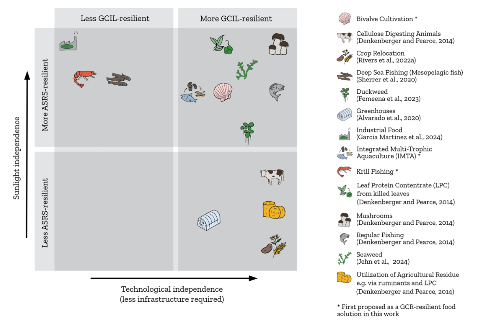

Was würden wir essen, wenn morgen die Sonne verschwände? Oder wenn unser Stromnetz weltweit zusammenbräche? Das ist ein Thema, das mich ziemlich interessiert, weil viele Facetten gesellschaftlichen Kollapses eng mit dem Ernährungssystem verknüpft sind. In früheren Beiträgen haben wir uns angeschaut, [was während einer Hungersnot passiert](https://florianjehn.github.io/Societal_Collapse/2023-01-13-famine/), [was eine Hungersnot auslöst und wie sie zum gesellschaftlichen Kollaps beiträgt](https://florianjehn.github.io/Societal_Collapse/2023-10-05-famine_2/), [wie klein unsere globalen Lebensmittelreserven sind](https://florianjehn.github.io/Societal_Collapse/2024-08-30-food_stocks/), [wie der Zusammenbruch des Handels die Verfügbarkeit von Lebensmitteln beeinflusst](https://florianjehn.github.io/Societal_Collapse/2024-04-25-trade_collapse/), [wo wir in verschiedenen Katastrophen noch Lebensmittel produzieren könnten](https://florianjehn.github.io/Societal_Collapse/2024-03-04-where_to_stay/) und [wie eine Hungersnot zu einer gesellschaftlichen Krise führen kann](https://florianjehn.github.io/Societal_Collapse/2022-08-29-potatoes/). Was wir bisher noch nicht angegangen sind: wie wir unser Ernährungssystem allgemein resilienter machen können und welche Lebensmittel wir während einer globalen Katastrophe essen könnten. Darum geht es in diesem Beitrag.

# Was macht ein Lebensmittel resilient?

Wenn man fragt, wie man Lebensmittel resilient macht, ist die logische Folgefrage: „Resilient wogegen?“. Zum Glück haben García Martínez et al. (2025) einen Literaturüberblick veröffentlicht, der beides beantwortet.

Wenn wir über resiliente Lebensmittel reden, müssen wir zwei Hauptszenarien betrachten (1):
* Abrupte Verringerung des Sonnenlichts (Abrupt sunlight reduction scenario, ASRS): Damit sind Ereignisse wie Vulkanausbrüche gemeint, die Partikel ausstoßen, die das Sonnenlicht blockieren und so die globalen Oberflächentemperaturen und Niederschläge senken, [wodurch die Ernteerträge um bis zu ~90 % sinken](https://www.nature.com/articles/s43016-022-00573-0).
* Globaler katastrophaler Infrastrukturverlust (Global catastrophic infrastructure loss, GCIL): Damit sind Szenarien gemeint, in denen das Stromnetz weltweit gestört oder zerstört ist, [was landwirtschaftliche Betriebsmittel und damit die Ernten um bis zu ~75 % trifft](https://onlinelibrary.wiley.com/doi/10.1002/gch2.202300206). Ursache könnten zum Beispiel große geomagnetische Stürme oder ein EMP-Angriff sein.

Beide Szenarien können zu einem steilen Rückgang der verfügbaren Lebensmittel führen. Außerdem dauern beide wahrscheinlich mehrere Jahre. Wie wir in einem früheren Beitrag gelernt haben, reichen unsere Lebensmittelreserven nur für weniger als ein Jahr. Wir müssen also Alternativen finden, um die Vorräte zu strecken. Die beiden Szenarien brauchen unterschiedliche Maßnahmen, weil sie verschiedene Teile des Ernährungssystems treffen. Bei ASRS ist das Problem, dass insgesamt weniger Energie ins System fließt, denn die Sonne liefert jeden Tag riesige Mengen kostenloser Energie. Maßnahmen müssen hier also mit dem geringeren Energieeintrag klarkommen. Bei GCIL bekommt man dagegen immer noch genauso viel Sonnenlicht und damit Energie, aber man verliert den Zugang zu anderen Betriebsmitteln im Ernährungssystem wie Dünger, Pestiziden und möglicherweise Mechanisierung, wenn der Treibstoff ausgeht. Ausgehend von diesen Einschränkungen kommen García Martínez und Co-Autoren auf eine Reihe möglicher Maßnahmen (Abbildung 1).

Ich werde hier nicht alle resilienten Lebensmittel erklären, weil das Paper das schon gut macht (2), aber ein paar Beispiele aus den verschiedenen Kategorien:
* Geeignet für ASRS, aber nicht für GCIL: Lebensmittel in dieser Kategorie brauchen kein Sonnenlicht, aber eine funktionierende Infrastruktur (denk an ein funktionierendes Stromnetz oder funktionierende Häfen). Das beste Beispiel sind hier wahrscheinlich sogenannte industrielle Lebensmittel. Die Idee ist im Grunde: Wie können wir Lebensmittel herstellen, ohne auf Landwirtschaft im klassischen Sinne angewiesen zu sein? Eine Lösung in dieser Kategorie ist Einzellerprotein. Man hat einen Bioreaktor, füllt ihn mit Nährstoffen für Mikroben (z. B. Ammoniak und Mineralien) und einer Energiequelle wie Methan (3) und heizt ihn auf eine gemütliche Temperatur. In diesem Bioreaktor fressen Mikroorganismen das Methan und die Nährstoffe, und zwar ziemlich effizient. Diese Mikroorganismen kann man dann als mehlartige Substanz essen (z. B. indem man sie als zusätzliche Proteinquelle ins Brot gibt).
* Geeignet für GCIL, aber nicht für ASRS: Hier sind die Anforderungen umgekehrt. Die Lebensmittel können weiter Sonnenlicht nutzen, aber nicht auf eine intakte Infrastruktur angewiesen sein. Sie müssen also eher Low-Tech sein. Ein klassisches Beispiel wäre, normale Nutzpflanzen in Gewächshäusern anzubauen. Einfache Gewächshäuser lassen sich billig bauen (man braucht kaum mehr als eine durchsichtige Folie und ein Gerüst).
* Geeignet für GCIL und ASRS: Die Lebensmittel hier müssen mit weniger Sonnenlicht funktionieren und gleichzeitig Low-Tech sein. Auf den ersten Blick klingt das ziemlich unmöglich. Es gibt aber tatsächlich ziemlich viele resiliente Lebensmittel in dieser Kategorie. Das deutlichste Beispiel sind Algen. Algen brauchen eigentlich gar nicht so viel Sonnenlicht, um gut zu wachsen, und lassen sich mit sehr einfacher Technik anbauen (und werden schon seit Tausenden von Jahren angebaut).

Abbildung 1: Eignung verschiedener resilienter Lebensmittel für unterschiedliche Arten von Katastrophen.

# Können wir das wirklich hochskalieren?

Wir wissen jetzt also, dass es viele Nahrungsquellen gibt, die uns selbst unter ziemlich düsteren Umständen ernähren könnten. Aber das Potenzial zu haben, ein resilientes Lebensmittel zu sein, und nach einer globalen Katastrophe tatsächlich genug davon produzieren zu können, sind zwei ziemlich verschiedene Dinge. Klare Zahlen dazu, wie schnell wir so eine Produktion resilienter Lebensmittel hochfahren könnten, sind schwer zu finden. Ich will deshalb auf ein etwas anderes Thema eingehen, das ein aktuelles, großes Skalierungsprojekt beleuchtet: Operation Warp Speed (OWS). Bei OWS haben die USA die Impfstoffproduktion schneller hochgefahren, als alle für möglich gehalten hatten. OWS wird ausführlich von D’Souza et al. (2025) diskutiert. Neben der Erklärung, wie OWS zustande kam, beantwortet ihre Forschung im Wesentlichen zwei Fragen:
1. Welche Eigenschaften muss ein Projekt haben, damit man es wie OWS beschleunigen kann?
   * Bedeutung: Ziemlich selbsterklärend. Wenn ein Projekt sehr wichtig ist, sind viele Leute daran interessiert, dass es gelingt.
   * Zeitdruck: So etwas wie OWS durchzuziehen ist ziemlich teuer, also sollte das Problem dringend und kostspielig sein, wie COVID es war, damit sich diese Ausgaben rechtfertigen lassen.
   * Ungewöhnliche Koordination: Große, wichtige Projekte lassen sich oft nicht klar als rein unternehmerisch oder rein staatlich einordnen. Sie brauchen beides, um zu gelingen. Um beides zu verbinden, braucht es eine Art gemeinsame Führungsstruktur, die es erlaubt, Risiken zu teilen und gute Ideen zu belohnen.
   * Klar definiertes technisches Ziel: Grundlagenforschung braucht Zeit. Wenn ein Projekt noch in der Grundlagenforschung steckt, ist es unwahrscheinlich, dass man es in kurzer Zeit auf den Markt bringt.
   * Unzulänglichkeit des Markts: Wie viel Geld man auf einem Markt für etwas bekommt und wie wertvoll es für die Gesellschaft ist, kann ziemlich auseinanderliegen. Je größer dieser Unterschied, desto eher ist es gerechtfertigt, mit so etwas wie OWS einzugreifen.
2. Wenn man ein Projekt wie OWS hat, was muss man tun, um es zu beschleunigen?
   * Viel Geld: Das ist irgendwie offensichtlich, aber wenn man viel Geld auf ein Problem werfen kann, ist die Chance höher, dass es gelöst wird. Man sollte aber beachten, dass gerade in Krisen das Risiko, zu wenig auszugeben, viel schwerer wiegt, als zu viel auszugeben. Wenn so etwas wie OWS ein paar Milliarden Dollar mehr kostet, als es wert war, ist das nicht toll. Aber wenn man an das Gegenszenario denkt, dass man einen Impfstoff hätte haben können, aber zu viel Angst hatte, Geld auszugeben, ist das eindeutig viel schlimmer.
   * Viele verschiedene Dinge parallel ausprobieren: Wenn man mehrere mögliche Lösungen hat und Zeit eine der knappen Ressourcen ist, ist es ziemlich vernünftig, viele Lösungen gleichzeitig zu probieren, auch wenn einige scheitern. Das kostet mehr Geld, aber wenn so viel auf dem Spiel steht, lohnt es sich.
   * Seltsame und ungewöhnliche Dinge probieren: Manche möglichen Lösungen haben nur eine sehr kleine Erfolgschance. Wenn sie aber funktionieren, ist der Nutzen so groß, dass man sie trotzdem fördern sollte. OWS hat zum Beispiel auch mRNA-Impfstoffe gefördert, die neu waren, sich aber am Ende als ziemlich wirksam herausgestellt haben.
   * Push- und Pull-Finanzierung kombinieren: Im Grunde heißt das, dass man Leuten Geld gibt, damit sie an dem arbeiten, was man sehen will (Push), und ihnen gleichzeitig verspricht, dass sie mehr Geld bekommen, wenn sie das Problem lösen (Pull).
   * Guten Führungskräften viel Entscheidungsgewalt geben: So etwas wie OWS durchzudrücken ist schwer und zeitkritisch. Es ergibt also Sinn, die besten Leute zu finden, die man kriegen kann, und ihnen die Befugnis zu geben, Hindernisse einfach aus dem Weg zu räumen, damit das Problem schnell gelöst wird und nicht in Bürokratie versandet.

Einige der Paper, die resiliente Lebensmittel als Forschungsthema eingeführt haben, enthalten zwar auch Schätzungen dazu, wie lange es dauern würde, sie auf einen nennenswerten Anteil der Lebensmittelproduktion hochzufahren, aber es ist immer noch ziemlich unklar, wie machbar das ist. Falls wir aber jemals in die Situation kommen, das tatsächlich testen zu müssen, weil ein ASRS oder ein GCIL unser Ernährungssystem verwüstet hat, scheint ein Ansatz wie bei OWS ziemlich sinnvoll. Resiliente Lebensmittel erfüllen so ziemlich alle Kriterien:
* Bedeutung: Es ist offensichtlich wichtig, genug Essen für die Bevölkerung zu haben.
* Zeitdruck: Das Essen geht schnell aus, also muss man schnell eine Lösung finden.
* Ungewöhnliche Koordination: Viele Maßnahmen für resiliente Lebensmittel sind neu (zumindest in diesem Maßstab) und brauchen deshalb sicher ungewöhnliche Koordination.
* Klar definiertes technisches Ziel: Die meisten resilienten Lebensmittel werden entweder schon kommerziell produziert oder sind nah dran. Die Frage ist, wie schnell wir ihre Produktion hochfahren können.
* Unzulänglichkeit des Markts: Theoretisch sollten Märkte ein Problem mit Lebensmitteln lösen können, aber es ist fraglich, ob sie schnell genug auf einen so riesigen, beispiellosen Schock reagieren würden.

Außerdem eignen sich resiliente Lebensmittel gut für parallele Ansätze, wie OWS sie bei Impfstoffen verfolgt hat. Im Fall einer globalen Katastrophe wäre es sinnvoll, viele davon gleichzeitig hochzufahren, damit es genug Essen für alle gibt, selbst wenn einige der Ansätze scheitern.

# Fazit

Operation Warp Speed zeigt, dass man kritische Technologien schnell hochskalieren kann, wenn die richtige Kombination aus Ressourcen, Führung und institutioneller Koordination stimmt. Resiliente Lebensmittel hochzufahren wäre zwar mit anderen (und wahrscheinlich größeren) Herausforderungen verbunden als die Impfstoffentwicklung, aber die Kernlehren zu paralleler Entwicklung, ausreichender Finanzierung und starker Führung bleiben relevant. Das ist besonders wichtig, weil [demokratische Gesellschaften mit höherer staatlicher Leistungsfähigkeit meist resilienter gegenüber Krisen sind](https://florianjehn.github.io/Societal_Collapse/2024-07-26-democratic_resilience/). Wir müssen diese institutionellen Stärken nutzen, um robuste Lebensmittelalternativen zu entwickeln, bevor wir sie dringend brauchen.

Bei resilienten Lebensmitteln wäre es aber auch wichtig, jetzt schon mehr Vorbereitung und Forschung zu betreiben. Viele resiliente Lebensmittel (wie Algen) sind zwar ziemlich etabliert, werden aber derzeit in vielen Regionen nicht angebaut, in denen wir sie im Fall einer globalen Katastrophe bräuchten, obwohl das dort heute schon machbar wäre (z. B. Nigeria) (4). Ähnlich müssen einige High-Tech-Lösungen erst noch in großem Maßstab produziert werden. Und allgemein gibt es kaum Forschung dazu, wie das Ernährungssystem und globale katastrophale Risiken zusammenwirken würden, es gibt hier also viel zu tun.

Wenn wir diese Schritte jetzt gehen, solange unser Ernährungssystem noch funktioniert, geben wir uns die beste Chance, die kaskadierenden Ausfälle zu vermeiden, die in der Geschichte [Störungen im Ernährungssystem zum gesellschaftlichen Kollaps](https://florianjehn.github.io/Societal_Collapse/2023-10-05-famine_2/) gemacht haben.

# Anmerkungen

(1) Es gibt noch andere Szenarien, in denen wir resiliente Lebensmittel bräuchten, aber die sind eher spekulativ, deshalb gehe ich hier nicht darauf ein.

(2) Wenn du ein bisschen tiefer einsteigen willst, gibt es hier einen [Blogbeitrag](https://uranium238.substack.com/p/introduction-to-resilient-foods), der genau das macht.

(3) Andere Energiequellen für die Produktion von Einzellerprotein sind: Wasserstoff, Methanol, Acetat, Ameisensäure, Paraffinwachs, Gasöl, Torf, Plastik, Pyrolysegas, lignozellulosehaltige Biomasse.

(4) Grüße an meine drei Abonnenten aus Nigeria: Sagt Bescheid, wenn ihr über Algen reden wollt.

# Zitieren
Bitte das englische Original zitieren:

Jehn, F. U. (2024, December 19). Resilient foods. Existential Crunch.  [https://doi.org/10.59350/w8s91-q5a13](https://doi.org/10.59350/w8s91-q5a13)

# Quellen

* D’Souza, A., Hoyt, K., Snyder, C. M., & Stapp, A. (2025). Can Operation Warp Speed serve as a model for accelerating innovations beyond COVID vaccines? Entrepreneurship and Innovation Policy and the Economy, 4, 103–138. https://doi.org/10.1086/732855
* García Martínez, J. B., Behr, J., Pearce, J. M., & Denkenberger, D. (2025). Resilient foods for preventing global famine: A review of food supply interventions for global catastrophic food shocks including nuclear winter and infrastructure collapse. Critical Reviews in Food Science and Nutrition, 65(28), 6068–6094. https://doi.org/10.1080/10408398.2024.2431207
