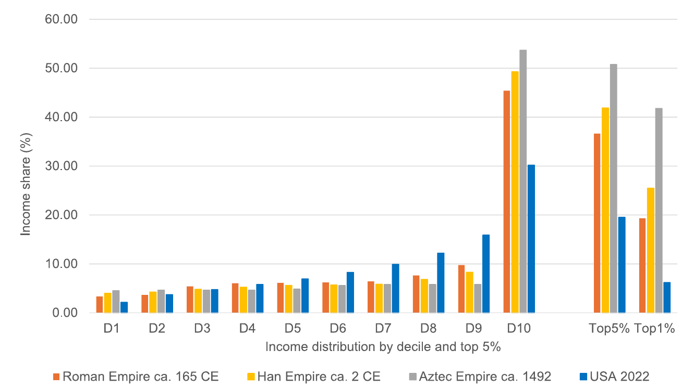

Beim Schreiben dieses fortlaufenden Literaturüberblicks zu gesellschaftlichem Kollaps taucht ein Thema immer und immer wieder auf: wirtschaftliche Ungleichheit. Es scheint, dass diese Ungleichheit Gesellschaften von Natur aus weniger stabil und weniger fähig zur inneren Koordination macht und damit anfälliger für Kollaps. Ein paar Beispiele, wo wir untersucht haben, wie Ungleichheit die Gesellschaft verwundbarer macht:
* Demokratien sind wahrscheinlich die beste Regierungsform, wenn man widerstandsfähiger gegen Kollaps sein will, und Demokratien funktionieren schlechter, wenn die Gesellschaft sehr ungleich ist ([Link](https://florianjehn.github.io/Societal_Collapse/2024-07-26-democratic_resilience/)).
* Viele gesellschaftlich schädliche Prozesse scheinen mit höherer Ungleichheit zuzunehmen ([Link](https://florianjehn.github.io/Societal_Collapse/2024-06-20-anthropocene_traps/)).

Dieser Beitrag soll das Thema wirtschaftliche Ungleichheit deshalb genauer untersuchen. Wir streifen auch, wie wirtschaftliche Ungleichheit zu ungleicher Macht beiträgt.

# Historische Beispiele für den Einfluss von Ungleichheit

Es gibt viele Beispiele dafür, wie Ungleichheit zu schlechteren Ergebnissen für die beteiligten Gesellschaften geführt hat, aber ich möchte hier zwei hervorheben:

## Wie Ägypten und England auf den Schwarzen Tod reagierten

Diese Fallstudie wird im CrisisDB-Paper beschrieben, das wir in einem [früheren Beitrag](https://florianjehn.github.io/Societal_Collapse/2024-04-09-big_data_history/) ausführlich besprochen haben. Hoyer et al. (2025) besprechen, wie Ägypten und England im 14. Jahrhundert auf den Schwarzen Tod reagierten. Sie wählen diesen Vergleich, weil beide Länder damals bei Infrastruktur, Bevölkerung, Agrarhandel und Komplexität insgesamt ziemlich ähnlich waren. Die Pest traf sie aber ziemlich unterschiedlich. Beide Länder hatten zwar viele Tote zu beklagen (bis zu einem Drittel der Bevölkerung), wählten aber unterschiedliche Strategien, um mit dieser Krise umzugehen. Die Herrscher Ägyptens entschieden, dass der beste Weg, ihre Probleme anzugehen, war, die notleidenden Bauern sich selbst zu überlassen und ihre Ressourcen stattdessen in große und teure Bauprojekte zu stecken. Das führte zu steigenden Getreidepreisen, höheren Pachten und insgesamt sinkender Produktion, sodass Ägypten viel schlechter dastand als vor der Pest. Die herrschende Klasse Englands schaffte es dagegen nicht, ihre Bauern so wirksam zu unterdrücken, was es den Bauern erlaubte, höhere Löhne durchzusetzen. Das bedeutete, dass die Eliten statt der armen Bevölkerung einen Großteil der Kosten der Pandemie tragen mussten. Das führte zu steigendem Lebensstandard in England und trug wahrscheinlich dazu bei, dass England zum Ausgangspunkt der industriellen Revolution wurde.

In einem anderen aktuellen Paper untersucht Cohn (2023) die Folgen des Schwarzen Todes für Europa genauer. Er betont ähnliche Punkte wie Hoyer und erklärt, dass sich die Ergebnisse aus England auch in weiten Teilen Mitteleuropas finden. In den meisten dieser Länder schaffte es die stark dezimierte Bauernschaft, in eine bessere Lage zu kommen, weil Arbeitskraft zum knappsten Faktor in der ganzen Lieferkette wurde. Es diversifizierte auch die Landwirtschaft weg vom reinen Anbau von arbeitsintensivem Weizen hin zu einer vielfältigeren Agrarlandschaft mit anderen Kulturen wie Weinbergen oder Olivenhainen. Das war eine Anpassung von unten. Die Bauern akzeptierten einfach nicht mehr die zermürbenden Bedingungen, die sie vorher ertragen mussten. In dieser Zeit sank die Vermögensungleichheit wegen der besseren Verhandlungsposition der Bauern erheblich, was insgesamt zu deutlich besserer Gesundheit und Produktivität führte. Es gab aber auch Orte wie Russland, die ihre Bauern brutal unterdrücken konnten. Das führte dann zu ähnlichen Problemen wie in Ägypten, zu geringerer Produktivität und einer insgesamt viel langsameren Entwicklung des Landes.

## Die Folgen von Ungleichheit im Römischen Reich, im Han-Reich und im Aztekenreich im Vergleich

Einen weiteren großen Vergleich, wie sich Ungleichheit in vergleichbaren Gemeinwesen auswirkt, machen Alfani et al. (2025). Sie haben einen Datensatz erstellt, um die Ungleichheit im Han-Reich und im Römischen Reich zu vergleichen. Außerdem haben sie beide mit einem früheren Datensatz zum Aztekenreich verglichen. Zum Glück für uns waren das Römische Reich und das Han-Reich ziemlich gut darin, Aufzeichnungen zu führen. Obwohl sie in vieler Hinsicht vergleichbar waren, war das Römische Reich meist weniger zentralisiert, und die Provinzen hatten mehr Selbstverwaltung.

Alfani und Kollegen berechneten den Reichtum der verschiedenen Regionen über ihren Urbanisierungsgrad und ihre Bevölkerungsdichte, unter der Annahme, dass mehr und größere Städte und eine größere Bevölkerung bedeuteten, dass eine Provinz reicher war. Das zeigte, dass im Han-Reich die zentrale Provinz ziemlich reich war, die anderen Provinzen dagegen viel weniger. Im Vergleich dazu hatte das Römische Reich zwar auch eine sehr reiche zentrale Region, aber auch mehrere andere Regionen (z. B. in Nordafrika) mit erheblichem Reichtum. Das liegt wahrscheinlich daran, wie beide Staaten ihr Militär und ihre Bürokratie einsetzten. Das Militär ist meist in Grenzregionen stationiert, sodass Reichtum vom Zentrum dorthin fließt, während sich die Bürokratie meist in der zentralen Region sammelt und Reichtum aus anderen Regionen abzieht. Das Han-Reich hatte ein kleines Militär und eine große Bürokratie, bei den Römern war es umgekehrt.

Neben dieser Ungleichheit zwischen Regionen berechnet das Paper auch die Ungleichheit in der Bevölkerung allgemein. Dazu verfolgen sie die Größe der verschiedenen Bevölkerungsgruppen in den Reichen (wie Bauern, Aristokraten, Händler usw.). So können sie einen Gini-Index für das Han-, Azteken- und Römische Reich berechnen und mit den heutigen USA vergleichen (Abbildung 1).

Abbildung 1: Vergleich der Einkommensanteile im Römischen Reich, im Han-Reich, im Aztekenreich und in den USA.

Das zeigt deutliche Unterschiede zwischen den verschiedenen Reichen, wobei das Aztekenreich mit Abstand das ungleichste war, gefolgt vom Han-Reich und dann dem Römischen Reich. Die USA haben das Ungleichheitsniveau dieser vergangenen Reiche noch nicht erreicht. Bemerkenswert ist aber, dass die ärmsten 10 % in den USA relativ gesehen ärmer sind als ihre Gegenstücke in allen drei anderen Reichen.

Diese Unterschiede in der Ungleichheit spiegeln sich auch in Unterschieden in der Stabilität wider. Von den betrachteten Reichen war das mit der höchsten Ungleichheit (die Azteken) das instabilste, während das mit der niedrigsten Ungleichheit (die Römer) das stabilste war. Natürlich sind das nur drei Datenpunkte und damit nicht besonders verlässlich, aber es passt zum allgemeinen Trend, dass Ungleichheit Instabilität erzeugt.

## Moralischer Kollaps und Ungleichheit

Eine weitere Perspektive darauf, wie Ungleichheit gesellschaftliche Stabilität untergräbt, kommt von Blanton et al. (2020) (1). Sie untersuchten 30 vormoderne Staaten, um zu verstehen, wie sich die Fairness der Regierung auf ihre Resilienz auswirkte. Ihr zentrales Ergebnis war, dass Staaten mit gerechteren Praktiken, wie fairer Besteuerung, Grenzen der Macht der Führung und unparteiischen Gerichten, meist ein höheres Wohlergehen der Bürger erreichten. Diese gerechteren Staaten standen aber vor einem interessanten Paradox: Sie brachen zwar nicht häufiger zusammen als weniger gerechte Staaten, aber wenn sie zusammenbrachen, waren die Folgen meist schwerer.

Die Autoren vermuten, dass das passiert, weil gerechtere Staaten es den Bürgern ermöglichen, komplexe, miteinander verbundene Systeme gegenseitigen Nutzens aufzubauen. Wenn Eliten anfangen, ihre gesellschaftlichen Pflichten durch Korruption oder Steuervermeidung aufzugeben, löst das eine Kaskade des Ausstiegs aus diesen kooperativen Arrangements aus. Bürger, die sehen, wie sich die Führung auf Kosten der Gesellschaft bereichert, sind weniger bereit, ihren fairen Anteil beizutragen, was einen sich selbst verstärkenden Kreislauf schwindenden sozialen Zusammenhalts erzeugt. Die Autoren zeigen dieses Muster an Fallstudien großer Zivilisationen wie dem Römischen Reich und der Ming-Dynastie, wo zunehmende Vereinnahmung von Ressourcen durch Eliten dem Kollaps oft vorausging.

Diese Forschung bestärkt, wie wirtschaftliche Ungleichheit, vor allem wenn sie durch Ausbeutung durch Eliten angetrieben wird, die sozialen Grundlagen aushöhlen kann, die komplexe Gesellschaften erst möglich machen. Wenn die an der Spitze aufhören, verhältnismäßig beizutragen, aber weiter Vorteile abschöpfen, untergräbt das den moralischen Konsens, der breitere soziale Zusammenarbeit fördert.

Das Knifflige ist zu verstehen, warum diese Veränderung überhaupt passiert. Wenn die Eliten der Gesellschaft bisher beigetragen haben, warum steigen sie plötzlich aus? Ich bin hier noch auf kein wirklich überzeugendes Argument gestoßen, aber eine Möglichkeit ist die Idee der Elitenüberproduktion. Dieses Konzept ist Teil der strukturell-demografischen Theorie des Kollapses, die wir im [ersten Beitrag](https://florianjehn.github.io/Societal_Collapse/2023-06-06-collapse_overview/) dieses fortlaufenden Literaturüberblicks besprochen haben. Um die Idee kurz zusammenzufassen:

*Säkulare Zyklen beschreiben ein wiederkehrendes Muster in der Geschichte. Es beginnt mit einer wachsenden Bevölkerung, die auch Raum zum Wachsen hat. Das Wachstum führt zu mehr Ressourcen für alle, was zu einer insgesamt kooperativen Stimmung führt. Irgendwann schrumpft der Raum zum Wachsen aber, sodass Menschen nur noch mehr Ressourcen bekommen können, wenn sie sie anderen wegnehmen. Bevölkerungswachstum drückt auch die Reallöhne und führt gleichzeitig zu einer Überproduktion von Eliten im Verhältnis zu den Elitepositionen. Das verringert Vertrauen und Frieden, bis es möglicherweise ein Umverteilungsereignis auslöst, etwa einen Bürgerkrieg, der wiederum die Bevölkerung verringert, und der Zyklus beginnt von vorn.*

Das ist ein guter Ausgangspunkt, aber ich glaube, hier braucht es noch viel mehr Forschung, um besser zu verstehen, warum das passiert. Es könnte zum Beispiel auch durch langfristige kulturelle Verschiebungen oder einen [Klimawandel](https://florianjehn.github.io/Societal_Collapse/2024-02-08-climate_collapse/) verursacht werden.

# Warum es auf allen Zeithorizonten wichtig ist, Ungleichheit zu verringern

Schauen wir uns auch an, wie sich wirtschaftliche Ungleichheit über verschiedene Zeithorizonte auswirkt. Hier liefern Schmidt & Juijn (2024) eine tolle Zusammenfassung. Ihr Paper will zeigen, dass wirtschaftliche Ungleichheit kurz-, mittel- und langfristig ein Problem ist und deshalb angegangen werden sollte, egal wie man die Zukunft abzinst.

Kurzfristig heißt hier etwa 50 Jahre. Für so eine Zeitspanne gibt es viel empirische Forschung, um zu untersuchen, wie sich Ungleichheit in verschiedenen Gesellschaften auswirkt. Schmidt und Juijn bringen sowohl ein individuelles als auch ein gesellschaftliches Argument. Das individuelle Argument ist, dass die Lebenszufriedenheit mit dem Wohlstand zu steigen scheint, aber unterproportional. Wenn man also einer reichen und einer armen Person denselben Geldbetrag gibt, bekommt die ärmere Person mehr Lebenszufriedenheit aus demselben Betrag. Wenn man insgesamt mehr Lebenszufriedenheit in der Gesellschaft will, sollte man Wohlstand also gleicher verteilen. Das gesellschaftliche Argument ist, dass es beim Blick auf Gesellschaften einen klaren statistischen Zusammenhang zwischen mehr Gleichheit und besseren gesellschaftlichen Ergebnissen zu geben scheint. Gleichere Gesellschaften haben bessere psychische und körperliche Gesundheit, mehr Vertrauen, bessere Bildungsergebnisse und weniger Kriminalität. Alles Dinge, die die Gesellschaft wahrscheinlich stabiler machen (etwa mehr Vertrauen und wirksame Institutionen). Kurzfristig spricht also ziemlich viel dafür, Ungleichheit zu verringern.

Mittelfristig (500–1000 Jahre) wird es etwas kniffliger zu verstehen, wie sich Ungleichheit auswirkt, weil wir viel weniger Daten haben. Schmidt und Juijn glauben, dass wir trotzdem von den kurzfristigen Ergebnissen extrapolieren können. Wenn eine Gesellschaft mehr Vertrauen, bessere Gesundheit und bessere Bildung hat, scheint es sehr unwahrscheinlich, dass das für die Gesellschaft schlechter ist als umgekehrt. Außerdem gibt es die Gefahr der Pfadabhängigkeit: Wenn man jetzt Ungleichheit hat, könnte sie sich selbst verstärken, und man hängt lange damit fest. Schmidt und Juijn argumentieren auch, dass es Forschung gibt, die versucht, dieses Argument empirisch zu untermauern. Konkret heben sie Forschung hervor, die zeigt, dass die Verteilung von Wohlstand in einer Gesellschaft auch beeinflusst, wie politische und rechtliche Macht verteilt sind. Wenn eine Gesellschaft also lange eine hohe wirtschaftliche Ungleichheit hat, zementiert das Machtstrukturen in den Händen derer mit dem meisten Wohlstand. Es könnte auch dazu führen, dass die breite Bevölkerung weniger mitzieht, weil sie sich ausgeschlossen fühlt (ähnlich wie bei der oben erklärten Idee des moralischen Kollapses; Schmidt und Juijn beziehen sich viel auf die Arbeit von Acemoglu und Robinson). Da wir wissen, dass demokratischere Regierungen weniger anfällig für Katastrophen sind, ist das eine besorgniserregende Aussicht, und es scheint wahrscheinlich, dass weniger wirtschaftliche Ungleichheit auch mittelfristig gut für die Gesellschaft ist.

Um dieses mittelfristige Argument weiter zu stärken, schauen sich Schmidt und Juijn auch mögliche Gegenargumente an. Das stärkste, das sie finden, ist die Idee von Tyler Cowen, dass über längere Zeiträume Wirtschaftswachstum der wichtigste Faktor für mehr Wohlergehen ist und wir deshalb sehr vorsichtig mit der Umverteilung von Wohlstand sein sollten. Wenn weniger Ungleichheit das Wirtschaftswachstum verringern würde, wäre das also ein starkes Argument dagegen, Ungleichheit zu verringern. Hier stehen sich zwei Weltbilder gegenüber. Das eine sagt, dass mehr Ungleichheit stärkere Anreize schafft, hart zu arbeiten und Risiken einzugehen, und damit das Wirtschaftswachstum erhöht, das andere, dass mehr Ungleichheit verringert, wie gut eine Gesellschaft funktioniert, weil Vertrauen sinkt und öffentliche Güter unterentwickelt bleiben, und damit das Wirtschaftswachstum senkt. Die endgültige Antwort auf diese Debatte wird anscheinend noch viel diskutiert, aber Schmidt und Juijn glauben, dass die besten empirischen Datensätze der OECD, die wir derzeit haben, in die Richtung deuten, dass weniger Ungleichheit zu mehr Wirtschaftswachstum führt. Wenn man Wirtschaftswachstum für den wichtigsten Faktor für Wohlergehen hält, sollte man also dafür sein, Ungleichheit zu verringern.

Wenn weniger Ungleichheit aber wirklich mehr Wirtschaftswachstum schafft, könnten wir auf ein anderes Problem stoßen: den Klimawandel. Im Allgemeinen ist Wirtschaftswachstum an Kohlendioxidemissionen gekoppelt. Dieser Zusammenhang von Wachstum und Emissionen unterscheidet sich aber zwischen Ländern, und Schmidt und Juijn betonen, dass neuere Forschung in vielen Ländern einen positiven Zusammenhang zwischen Einkommensungleichheit und Kohlenstoffemissionen gefunden hat, also dass die Pro-Kopf-Emissionen niedriger sind, wenn es weniger Ungleichheit gibt. Das liegt möglicherweise an besserer gesellschaftlicher Koordination und höherem Vertrauen in gleicheren Gesellschaften, was besseren Umweltschutz ermöglicht. Kurz- und mittelfristig können wir also ziemlich sicher sein, dass es eine gute Idee ist, Ungleichheit zu verringern. Aber was ist mit noch längeren Zeithorizonten?

Langfristig heißt hier ein paar tausend Jahre und mehr. Dieser Teil des Arguments wird hypothetischer und abstrakter, weil wir nichts Empirisches haben, worauf wir ihn stützen könnten. Die Grundidee ist aber ziemlich einfach. Über lange Zeithorizonte kommt die größte Gefahr für die Menschheit wahrscheinlich von Dingen wie globalen katastrophalen Risiken, denk an Atomkrieg oder außer Kontrolle geratenen Klimawandel. Wenn wir die Wahrscheinlichkeit solcher Ereignisse verringern können, ist das wahrscheinlich das Wichtigste, was wir für die langfristige Zukunft tun können. Wie wir aus den Argumenten zur kurz- und mittelfristigen Verringerung von Ungleichheit wissen, führt weniger Ungleichheit zu einer stabileren Gesellschaft und besseren Institutionen, die wiederum besser auf Krisen reagieren können. Wenn Menschen wegen geringerer Ungleichheit mehr Vertrauen haben, wird es leichter, an internationalen Problemen wie Klimawandel oder Rüstungskontrolle zu arbeiten.

Da wir nicht wissen, wie sich die Zukunft entwickelt, ist eine gute Möglichkeit, sie positiv zu beeinflussen, den Menschen, die in dieser Zukunft leben, eine stabile Gesellschaft und gute Institutionen mitzugeben, weil sie das flexibler macht. Ungleichheit zu verringern ist also wahrscheinlich auch für lange Zeithorizonte gut.

# Ungleichheit und globale katastrophale Risiken
Das Argument, dass Ungleichheit für globale katastrophale Risiken relevant ist, haben Jehn & Hoyer (2026) ausführlicher gemacht. Diese Studie ist ein Überblick, der argumentiert, dass Ungleichheit und globale katastrophale Risiken gleichzeitig zunehmen und dass diese beiden Trends nicht unabhängig voneinander sind. Das Argument stützt sich vor allem auf historische Befunde, dass Ungleichheit sowohl staatliche Handlungsfähigkeit als auch sozialen Zusammenhalt zersetzt, diese beiden Eigenschaften aber unverzichtbar sind, damit Gesellschaften auf große Katastrophen reagieren können. Diese Beispiele stammen sowohl aus der tieferen Geschichte als auch aus neuerer Forschung dazu, wie moderne Demokratien mit Naturgefahren umgehen. In beiden Fällen schneiden Gesellschaften mit geringerer Ungleichheit meist besser ab. Außerdem scheinen Demokratien die Regierungsform zu sein, die am meisten in die Vorbeugung globaler Katastrophen investiert, wie nationale Risikoregister zeigen. Das heißt auch, dass es aus einem zweiten Blickwinkel wichtig ist, Ungleichheit zu verringern: Demokratien sind bei globalen katastrophalen Risiken am besten, aber sie sind auch besonders anfällig für hohe Ungleichheit, weil diese die demokratische Legitimität untergräbt.

Wenn sich Menschen in ihrem eigenen Land zurückgelassen fühlen, steigt die Chance, dass Führungspersonen gewählt werden, die versprechen, die Ordnung wiederherzustellen, und Probleme Außenstehenden in die Schuhe schieben. Solche Führungspersonen wenden sich wahrscheinlich dem Protektionismus zu und von multilateralen Institutionen ab. Das ist wichtig, weil globale Katastrophen oft mit Koordinationsproblemen zusammenhängen, vor allem zwischen Ländern. Ein Beispiel wäre der globale Lebensmittelhandel, der leicht gestört werden könnte, wenn Länder Exportverbote einführen. Dieselbe Ungleichheit, die eine Gesellschaft intern weniger widerstandsfähig macht, macht sie also auch schlechter in der Art von Zusammenarbeit, die Katastrophen verlangen.

Solche Prozesse könnten eine gefährliche Schleife gegen globale Resilienz in Gang setzen. Ungleichheit schwächt das Funktionieren der Demokratie, schwache Demokratien bringen Führungspersonen hervor, die Ungleichheit nicht angehen, weil ihnen der Groll nützt, diese Führungspersonen untergraben internationale Zusammenarbeit, und die Krisen, die folgen, verringern die Ungleichheit auch nicht. Das ist spekulativer als die historischen Befunde oben, aber wenn es stimmt, ist weniger Ungleichheit möglicherweise eine Voraussetzung für die internationale Zusammenarbeit, die nötig ist, um vor globalen katastrophalen Risiken sicher zu sein.

# Der aktuelle Stand der Ungleichheit: Eine Geschichte zweier Trends

Der aktuelle Stand der globalen Ungleichheit zeigt ein komplexes und scheinbar widersprüchliches Bild. Die globale Ungleichheit insgesamt ist in den letzten Jahrzehnten zwar gesunken, aber dieser Rückgang verdeckt erhebliche Unterschiede sowohl zwischen als auch innerhalb von Ländern. Die Ungleichheit zwischen Staaten ist gesunken, weil Länder wie China und Indien schneller gewachsen sind als reiche Länder. Das ging aber mit steigender Ungleichheit innerhalb vieler Staaten einher. Diesen Trend zeigen zwei aktuelle Paper schön: Kanbur (2019) und Chrisendo et al. (2025).

Diese Auseinanderentwicklung zeigt sich in mehreren klaren Mustern:
* Reiche Länder: Länder wie die USA und viele europäische Staaten haben trotz ihres Wohlstands insgesamt wachsende innere Ungleichheit erlebt. Wie Chrisendo et al. (2025) zeigen, lebt inzwischen etwa die Hälfte der Weltbevölkerung (46–59 %, je nachdem, welche nationalen Einkommensdaten man nutzt) in Gebieten, in denen die Ungleichheit gestiegen ist.
* Asiatische Volkswirtschaften: Große asiatische Volkswirtschaften wie China haben dramatisches Wachstum zusammen mit starken Anstiegen der Ungleichheit erlebt. Chinas Gini-Koeffizient (2) stieg von 0,35 im Jahr 1995 auf 0,53 im Jahr 2010, hat seitdem aber Anzeichen gezeigt, sich einzupendeln.
* Lateinamerika: Länder wie Brasilien haben es geschafft, die Ungleichheit zu verringern, wenn auch von einem sehr hohen Ausgangsniveau. Brasiliens Gini-Koeffizient fiel zwischen 1990 und 2021 von 0,55 auf 0,47, erreicht durch gezielte Maßnahmen wie Geldtransfers an arme Familien und Erhöhungen des Mindestlohns.
* Afrika: Das Bild in Subsahara-Afrika zeigt vielleicht die meisten Unterschiede, mit sinkender Ungleichheit in Westafrika, aber steigender im östlichen und südlichen Afrika. Diese Region trägt auch die doppelte Last hoher Ungleichheit, oft verbunden mit sehr niedrigen Einkommen.

Was dieses Bild besonders wichtig macht, sind seine Folgen für gesellschaftliche Stabilität. Historische Belege wie die unterschiedlichen Reaktionen auf den Schwarzen Tod in Ägypten und England deuten darauf hin, dass der Umgang einer Gesellschaft mit Ungleichheit ihre Resilienz und ihre Fähigkeit, mit Krisen umzugehen, tiefgreifend beeinflussen kann. Dass die Ungleichheit für einen so großen Teil der Weltbevölkerung steigt, während wir gleichzeitig vor wachsenden globalen Herausforderungen stehen, wirft wichtige Fragen zu unserer gemeinsamen Fähigkeit auf, künftige Krisen zu bewältigen.

Die unterschiedlichen Entwicklungen in den Regionen zeigen aber, dass steigende Ungleichheit nicht unvermeidlich ist; politische Entscheidungen spielen eine Rolle. Länder, die Ungleichheit erfolgreich verringert haben, haben das meist durch bewusste Eingriffe geschafft, sei es durch Sozialprogramme, Mindestlohnpolitik oder andere Umverteilungsmaßnahmen. Wie Kanbur betont, erzeugen technischer Wandel und Globalisierung zwar Druck in Richtung steigender Ungleichheit, aber nationale Politik kann diese Kräfte abfedern, auch wenn das zunehmend internationale Koordination braucht, um voll wirksam zu sein.

Diese Muster deuten darauf hin, dass wir in einem Zeitalter steigender Ungleichheit leben, nicht weil Ungleichheit überall zunimmt, sondern weil die wirtschaftlichen Kräfte von technischem Wandel und Globalisierung so ausgerichtet sind, dass sie Druck nach oben auf die Ungleichheit ausüben. Wie Gesellschaften mit politischen Entscheidungen auf diesen Druck reagieren, scheint der entscheidende Faktor für die Ergebnisse zu sein.

# Wie sind wir beim aktuellen Stand der Ungleichheit gelandet?

Die aktuelle Lage steigender Ungleichheit innerhalb von Ländern und sinkender Ungleichheit zwischen Ländern lässt sich plausibel dem Neoliberalismus zuschreiben. Diesen Bogen des Neoliberalismus über die letzten Jahrzehnte beschreiben Centeno & Cohen (2012) sehr ausführlich. Im späten 20. Jahrhundert kam der Neoliberalismus als attraktive Ideologie auf, die über freie Märkte sowohl Demokratie als auch Wohlstand versprach. Wie Centeno & Cohen (2012) anmerken, war das besonders in den 1990er-Jahren überzeugend, als der Erfolg der „Tigerstaaten“ zu zeigen schien, wie globale Marktmechanismen Länder aus der Armut holen könnten. Der scheinbare Sieg des Kapitalismus über das sowjetische Modell festigte die Anziehungskraft neoliberaler Ideen weiter.

Die Grundsätze waren einfach: Staatseingriffe minimieren, öffentliche Dienste privatisieren und Märkte deregulieren. Die Theorie war, dass das die wirtschaftliche Freiheit maximieren würde, die wiederum politische Freiheit garantieren würde. Diese „Unteilbarkeitsthese“, also die Idee, dass wirtschaftliche und politische Freiheit untrennbar seien, wurde in politischen Kreisen sehr einflussreich.

Die Umsetzung neoliberaler Politik hatte aber mehrere Folgen, die die gesellschaftliche Verwundbarkeit erhöhten:
1. Geschwächte staatliche Handlungsfähigkeit: Durch umfangreiche Privatisierung und Deregulierung haben Staaten ihre Fähigkeit verringert, auf Krisen zu reagieren und öffentliche Güter bereitzustellen.
2. Mehr Ungleichheit: Der Fokus auf Deregulierung und Steuersenkungen, besonders für Reiche, hat zu wachsender Ungleichheit geführt.
3. Kaputte Rückkopplungsschleifen: Als Reichtum und Macht sich stärker konzentrierten, wurden Entscheidungsträger zunehmend von den Folgen ihrer Entscheidungen abgeschirmt, weil sie vor allem von Lobbyisten hören, was getan werden muss. Das hat es für Gesellschaften schwerer gemacht, aufkommende Bedrohungen zu erkennen und auf sie zu reagieren.

All diese Dinge machen eine Gesellschaft meist anfälliger für gesellschaftlichen Kollaps, wie dieser Beitrag und viele andere in dieser Reihe zeigen (3). Das macht deutlich, dass wir uns von vielen neoliberalen Ideen der letzten Jahrzehnte abwenden müssen, um eine bessere Chance zu haben, den Herausforderungen zu begegnen, die in den nächsten Jahrzehnten wahrscheinlich vor uns liegen.

Um die Wurzeln heutiger Ungleichheiten aufzuspüren, lohnt es sich aber, noch tiefer zu graben. Es gibt ein tolles Paper von Sullivan & Hickel (2023), das untersucht, wie sich Armut vom 16. Jahrhundert bis heute entwickelt hat. Die Motivation hinter dem Paper ist zu zeigen, dass tiefe Armut nicht etwas ist, das jede Gesellschaft erlebt hat und das erst durch die Wunder des Wirtschaftswachstums im Kapitalismus behoben wurde, sondern dass es den Menschen in vielen Ländern eigentlich gut ging und sie erst zu leiden begannen, als der Kapitalismus anfing. Sie glauben, dass sich die erste Sicht durchsetzen konnte, weil für diese Argumente das Pro-Kopf-BIP als Stellvertreter dafür genutzt wird, wie arm Menschen waren. Dieser Stellvertreter hat aber drei große Probleme:

* Es gibt in der Geschichte viele Beispiele, in denen das BIP pro Kopf stieg, während die Menschen eindeutig ein schlechteres Leben hatten. Sie heben vor allem die Philippinen zwischen 1820 und 1902 hervor. In diesem Zeitraum stieg das BIP pro Kopf um 15 %, aber so ziemlich jede Aufzeichnung aus dieser Zeit spricht nur davon, wie sich der Lebensstandard völlig verschlechtert.
* Das BIP pro Kopf der Vergangenheit beruht auf der Berechnung der Kaufkraftparität. Man berechnet also, wie viel die Menschen mit dem Geld, das sie damals hatten, kaufen konnten (4). Diese Berechnungen sind aber sehr fehleranfällig, besonders bei Lebensmitteln.
* Den Kapitalismus gab es schon lange, bevor das BIP pro Kopf anfing zu steigen. Die Grundlagen des Kapitalismus begannen sich im 16. Jahrhundert herauszubilden. Von 1600 bis 1800 sank das BIP pro Kopf in vielen Ländern aber sogar.

Um diese Probleme zu vermeiden, wollen sie Maße dafür betrachten, wie gut Menschen tatsächlich lebten, nicht irgendein abstraktes Maß wie das BIP. Dafür wählten sie Reallöhne (konkret, wie lange jemand arbeiten musste, um Essen für einen Tag für eine vierköpfige Familie zu bekommen), Körpergröße und Sterblichkeit. Sie verfolgen all diese Merkmale vom 16. Jahrhundert bis heute in Europa, Lateinamerika, Subsahara-Afrika, Südasien und China.

Ihr deutlichstes Ergebnis ist, dass es an all diesen Orten kaum oder gar keine extreme Armut gab. Die meisten Arbeiter konnten eine vierköpfige Familie versorgen. Die Zeiträume, in denen sie extreme Armut fanden, lagen meist in großen Kriegen oder in einigen Ausnahmeländern wie Peru, das unter besonders harter Kolonialherrschaft litt.

Das änderte sich, sobald die jeweilige Region begann, zum Kapitalismus überzugehen. In allen Fällen sanken Körpergröße und Reallöhne, während die Sterblichkeit stieg. Einige dieser Trends kehrten sich um, als in der ersten Hälfte des 20. Jahrhunderts starke sozialdemokratische oder sozialistische Bewegungen an die Macht kamen. Viele dieser Fortschritte beim menschlichen Wohlergehen wurden aber nach dem Aufstieg des Neoliberalismus im späteren 20. Jahrhundert wieder zurückgedreht.

Das heißt nicht, dass ein sozialistischer Staat immer der beste Weg ist, Armut zu vermeiden, denn es gab auch Beispiele wie China, wo das darin endete, dass die Bevölkerung ärmer wurde. Es zeigt aber klar, dass der Kapitalismus nicht als Hauptgrund für das gestiegene Wohlergehen herausgestellt werden kann. Stattdessen sieht es eher so aus, als würde er viele Gesellschaften sogar zurückhalten.

# Was können wir dagegen tun?

Unser aktueller Stand der Ungleichheit ist also weit vom optimalen Zustand entfernt, und es ist für die kurz-, mittel- und langfristige Zukunft wichtig, sie wieder zu senken. Aber wie könnten wir das angehen?

Wie wir oben gesehen haben, ist eine Pandemie, die ein Drittel der Bevölkerung tötet, eine Möglichkeit, aber das ist nicht der bevorzugte Weg, Ungleichheit zu verringern, und wie wir oben gesehen haben, verringert sie Ungleichheit nicht einmal garantiert. Ein Beispiel für verringerte Ungleichheit ohne einen brutalen Schock wie eine Pandemie beschreibt Marienbach (2024). Er hat die Stadt Teotihuacan in Mittelamerika untersucht. Diese Stadt ist ziemlich interessant, weil sie einen sehr niedrigen Gini-Koeffizienten von 0,12 hatte (5). Das ist ein unglaublich niedriger Wert und in modernen Staaten praktisch unbekannt. Das nächstliegende Land heute ist die Slowakei mit 0,24. Anders als die Slowakei war Teotihuacan aber die dominierende Macht in seiner Region und übertraf die weniger gleichen Städte um sich herum.

Marienbach schaut sich dann die gängigste Erklärung an, warum Staaten oder Städte ihre Ungleichheit auf ein niedrigeres Niveau senken können. Er betrachtet vor allem Pandemien, Massenkriege, Revolutionen und Staatsversagen. Nichts davon trifft auf Teotihuacan zu. Vor der Ankunft der Spanier gab es in Amerika keine großen Epidemien, die Stadt war viel stärker als die umliegenden Städte und musste deshalb nicht in große Kriege ziehen, und sie erlebte weder Revolution noch Staatsversagen. Was hielt die Stadt also mehrere hundert Jahre lang auf niedriger Ungleichheit? Marienbach vermutet, dass es ihr Regierungssystem war. Wegen eines Vulkanausbruchs in der Nähe mussten viele Nachbarstädte aufgegeben werden. Das führte zu einem großen Zustrom von Menschen nach Teotihuacan. Dadurch lebten etwa 20 ähnlich mächtige soziale Einheiten in der Stadt. Sie hielten sich gegenseitig in Schach und verhinderten, dass eine einzelne Fraktion die Macht übernehmen und Reichtum anhäufen konnte.

Das passt auch zu den Befunden oben, dass Ungleichheit nicht gegeben ist, sondern davon abhängt, wie wir regieren und wie wir den Wohlstand in der Gesellschaft verteilen. Vodovnik (2024) macht hier einige Vorschläge, wie eine neue Politik ausgerichtet sein könnte, die gesellschaftlichem Kollaps standhält. Er knüpft an die Kritik am Neoliberalismus an und daran, dass diese politische Ideologie eine sehr wichtige verbindende Idee in der Gesellschaft zurückgelassen hat: Fürsorge. In einer Gesellschaft, die sich nur auf Individuen konzentriert, die ständig miteinander konkurrieren, wird es schwer, gemeinsame Projekte und Ideen aufzubauen und dafür zu sorgen, dass für alle gesorgt ist. Dafür müssen wir Menschen ermöglichen, sowohl die Ressourcen als auch die Zeit zu haben, die Arbeit zu machen, die für eine Demokratie nötig ist. Das heißt zum Beispiel, es sich überhaupt leisten zu können, Zeit in politische Arbeit zu stecken. Wie ich in [einem anderen Beitrag](https://florianjehn.github.io/Societal_Collapse/2024-07-26-democratic_resilience/) besprochen habe, könnte hier ein bedingungsloses Grundeinkommen ein wichtiger Schritt sein (6). Das würde Menschen erlauben, die Sorgearbeit zu leisten, die letztlich für eine stabile Demokratie und damit für die Fähigkeit, großen Katastrophen standzuhalten, nötig ist.

Eine gleichere Gesellschaft aufzubauen, erfordert, was Vodovnik „fürsorgliche Demokratie“ nennt, also ein System, in dem die Sorge um andere nicht der Marktlogik untergeordnet ist, sondern als Grundlage des politischen und wirtschaftlichen Lebens verstanden wird. Das heißt ein demokratisches System, das soziales Wohlergehen und eine gerechte Verteilung der Ressourcen priorisiert, damit seine Bürger die Freiheit gewinnen, sich nicht ständig um ihre Zukunft und ihre gegenwärtigen Bedürfnisse sorgen zu müssen (7). Wir erreichen vielleicht nicht die bemerkenswert niedrige Ungleichheit des antiken Teotihuacan, aber die Geschichte zeigt, dass Alternativen zu unserem aktuellen System möglich sind, wenn wir die grundlegenden Beziehungen neu denken, die unsere Gesellschaft strukturieren. Die Frage vor uns ist nicht, ob Wandel möglich ist, sondern ob wir den Übergang durchdacht und bewusst gestalten können (z. B. durch schrittweise politische Reformen), statt darauf zu warten, dass eine Krise uns dazu zwingt.

Oder um es konkreter zu machen, können wir uns auch ein Paper von Easterlin (2012) anschauen, der den Unterschied in der Lebenszufriedenheit zwischen Reichen und Armen in kapitalistischen und sozialistischen Ländern untersucht hat. Er fand, dass der Unterschied in Gesellschaften, die entweder sozialistisch waren oder eine stark umverteilende kapitalistische Wirtschaft hatten (denk an Norwegen), meist deutlich kleiner war. Wenn wir also die Lebenszufriedenheit insgesamt und die wirtschaftliche Gleichheit in der Gesellschaft maximieren wollen, müssen wir Umverteilungsmaßnahmen einführen, die mindestens so stark sind wie in Norwegen. Das würde zwei Probleme des Neoliberalismus angehen, die wir oben identifiziert haben. Nämlich dass wir die Ungleichheit mit all ihren schlimmen Folgen für die gesellschaftliche Resilienz verringern und die kaputten Rückkopplungsschleifen reparieren, denn in Gesellschaften, in denen wirtschaftliche Macht gleicher verteilt ist, kann keine einzelne Person das System einfach dadurch kapern, dass sie reich ist.

# Anmerkungen

(1) Dieses Paper haben wir auch im [Beitrag zu Beteiligung](https://florianjehn.github.io/Societal_Collapse/2023-08-16-democracy_and_resilience/) besprochen.

(2) Der Gini-Koeffizient ist ein Maß für Ungleichheit. Ein Wert von 1 bedeutet, dass eine Person den gesamten Wohlstand hat, 0 bedeutet, dass alle Menschen gleich viel Wohlstand haben.

(3) Zum Beispiel, wie wichtig grundlegende Demokratie und staatliche Handlungsfähigkeit für gesellschaftliche Resilienz sind.

(4) Ähnliche Berechnungen macht man heute zum Beispiel beim Vergleich von Militärbudgets. Nominell hat Russland ein viel kleineres Militärbudget als die USA. Mit demselben Geldbetrag kann man in Russland aber viel mehr Panzer kaufen, weil Arbeit und Ressourcen dort viel billiger sind.

(5) Das wurde berechnet, indem man die Größenverteilung der Häuser in der Stadt als Stellvertreter für den Wohlstand insgesamt nahm.

(6) Ein bedingungsloses Grundeinkommen hat auch einige mögliche Probleme und ist nicht die endgültige Lösung all unserer Probleme, aber es könnte ein guter erster Schritt sein, und ich wollte diesen Beitrag nicht noch länger machen, indem ich seine Vor- und Nachteile bespreche.

(7) Heutige Beispiele dafür wären die „Wellbeing Economics“ in Ländern wie Neuseeland.

# Zitieren
Bitte das englische Original zitieren:

Jehn, F. U. (2025, January 15). Economic inequality and societal collapse. Existential Crunch. [https://doi.org/10.59350/yrvk7-w7589](https://doi.org/10.59350/yrvk7-w7589)

# Quellen

* Alfani, G., Bolla, M., & Scheidel, W. (2025). A comparison of income inequality in the Roman and Chinese Han empires. Nature Communications, 16(1), 3248. https://doi.org/10.1038/s41467-025-58581-0
* Blanton, R. E., Feinman, G. M., Kowalewski, S. A., & Fargher, L. F. (2020). Moral Collapse and State Failure: A View From the Past. Frontiers in Political Science, 2. https://doi.org/10.3389/fpos.2020.568704
* Centeno, M. A., & Cohen, J. N. (2012). The Arc of Neoliberalism. Annual Review of Sociology, 38(Volume 38, 2012), 317–340. https://doi.org/10.1146/annurev-soc-081309-150235
* Chrisendo, D., Niva, V., Hoffmann, R., Masoumzadeh Sayyar, S., Rocha, J., Sandström, V., Solt, F., & Kummu, M. (2025). Rising income inequality across half of global population and socioecological implications. Nature Sustainability, 8(12), 1601–1613. https://doi.org/10.1038/s41893-025-01689-4
* Cohn, S. (2023). The Black Death: Collapse, resilience, transformation (M. Centeno, P. Callahan, P. Larcey, & T. Patterson, Eds.; pp. 192–206). Routledge. https://eprints.gla.ac.uk/292026/
* Easterlin, R. (2012). Life satisfaction of rich and poor under socialism and capitalism. International Journal of Happiness and Development, 1(1), 112–126.
* Hoyer, D., Holder, S., Bennett, J. S., Francois, P., Whitehouse, H., Covey, R. A., Feinman, G., Korotayev, A., Ustyuzhanin, V., Preiser-Kapeller, J., Bard, K., Levine, J., Reddish, J., Orlandi, G., Ainsworth, R., & Turchin, P. (2025). All Crises are Unhappy in Their Own Way: The Role of Societal Instability in Shaping the Past. Social Science History, 50(2), 314–346. https://doi.org/10.1017/ssh.2025.10113
* Jehn, F. U., & Hoyer, D. (2026). Inequality’s contribution to global catastrophic risk. EarthArXiv. https://doi.org/10.31223/X5119G
* Kanbur, R. (2019). Inequality in a global perspective. Oxford Review of Economic Policy, 35(3), 431–444. https://doi.org/10.1093/oxrep/grz010
* Marienbach, M. (2024). Egalitarianism Without Catastrophe? Teotihuacan’s Challenge to Walter Scheidel’s Four Horsemen Theory. The Maastricht Journal of Liberal Arts, 15. https://doi.org/10.26481/mjla.2024.v15.1017
* Schmidt, A. T., & Juijn, D. (2024). Economic inequality and the long-term future. Politics, Philosophy & Economics, 23(1), 67–99. https://doi.org/10.1177/1470594X231178502
* Sullivan, D., & Hickel, J. (2023). Capitalism and extreme poverty: A global analysis of real wages, human height, and mortality since the long 16th century. World Development, 161, 106026. https://doi.org/10.1016/j.worlddev.2022.106026
* Vodovnik, Ž. (2024). Possibilities at the End of the World: (Re)Imagining Care as Politics. Teorija in praksa, 387–405. https://doi.org/10.51936/tip.61.2.387
