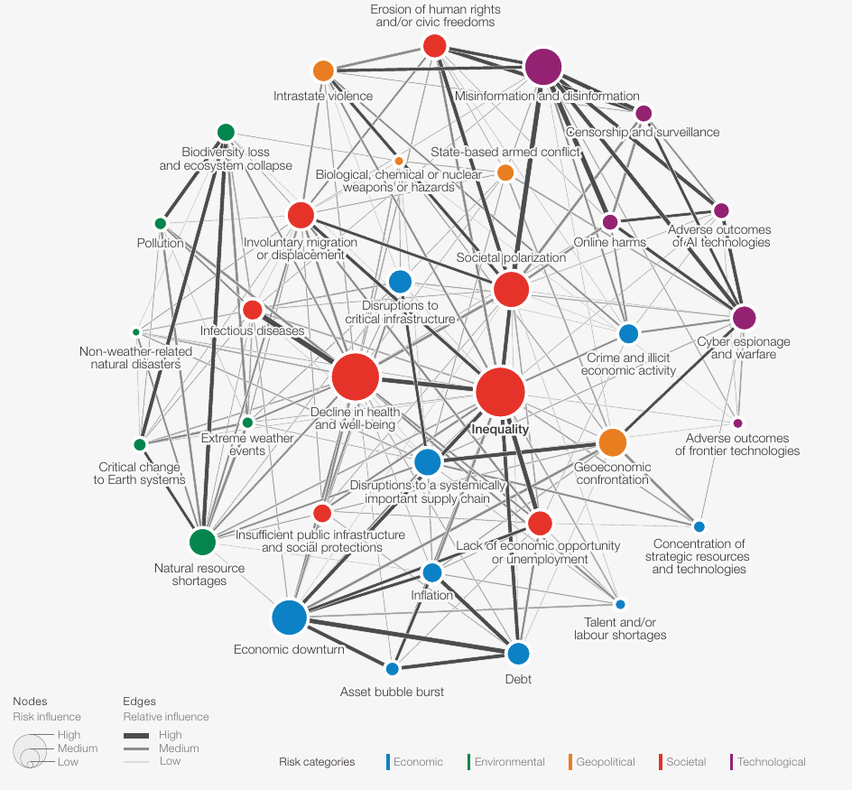

Mit diesem Beitrag will ich im Grunde eine kleine Sammlung von Listen katastrophaler Risiken anlegen, damit andere sie leichter finden und einen Überblick bekommen, wie Expertengruppen mit unterschiedlichem Hintergrund Risiken einordnen und bewerten. Die Motivation hinter diesem Beitrag und den Artikeln, die ich zitiere, ist die Idee, dass man vorbereitet sein muss, um sicher zu sein, und um vorbereitet zu sein, muss man wissen, was hinter dem Horizont lauert. Außerdem will ich zeigen, wie verschiedene Gruppen von Forschenden dabei vorgehen und wie sie sich manchmal auf ziemlich unterschiedliche Arten von Ereignissen konzentrieren. Und schließlich will ich die Katastrophen hervorheben, bei denen sich die meisten Leute einig zu sein scheinen, und wie gut diese Risikobewertungen von der Politik aufgegriffen werden.

# Schnapp sie dir alle

Die umfangreichste dieser Katastrophenlisten, die ich kenne, ist von Tähtinen et al. (2024). Sie haben versucht, im Grunde jede mögliche künftige Bedrohung aufzulisten, der Gesellschaften gegenüberstehen könnten. Um alles zusammenzubringen, haben sie sich 1714 Dokumente angeschaut und 54 Fachleute interviewt, was ihnen 153 mögliche künftige Krisen lieferte. Sie betonen, dass das die umfangreichste Liste von Dingen ist, die auf gesellschaftlicher Ebene schiefgehen können, und ich teile diese Einschätzung eher. Sie ordnen diese Krisen in 6 Kategorien ein:
* Politische Krisen (34 identifiziert): Sie entstehen durch gesellschaftliche Konflikte, Machtkämpfe und dysfunktionale Dynamiken bestehender Institutionen. Die Forschenden haben politische Krisen in drei Unterkategorien aufgeteilt:
    * Verschiebungen bei Regierung, Regimen und Machtverhältnissen (11 Krisen): Darunter Phänomene wie der Sturz einer Regierung und eine etablierte Überwachungsgesellschaft
    * Gesellschaftspolitische Polarisierung (8 Krisen): Darunter Krisen wie zunehmender Terrorismus und eine Desinformationskrise
    * Konflikte zwischen Staaten (15 Krisen): Darunter verschiedene Formen von Krieg und internationalen Spannungen
* Wirtschaftskrisen (23 identifiziert): Sie entstehen aus Marktversagen und Funktionsstörungen in Wirtschaftssystemen. Sie werden in drei Unterkategorien eingeteilt:
    * Zusammenbrechende Wirtschaftsinstitutionen (9 Krisen): Darunter systemische Bankenkrisen und Börsencrashs
    * Marktreibungen und Ungleichheiten (9 Krisen): Darunter Themen wie Hyperinflation und Massenarbeitslosigkeit
    * Probleme der öffentlichen Wirtschaft (4 Krisen): Darunter Haushaltskrisen und weitverbreitete Korruption
* Sozial-kulturelle Krisen und Gesundheitskrisen (25 identifiziert): Sie entstehen aus gesellschaftspolitischen Beziehungen, demografischen Dynamiken und Störungen von außen. Die Forschenden haben sie in drei Unterkategorien aufgeteilt:
    * Demografische Wende (5 Krisen): Darunter Migrationskrisen und Probleme einer alternden Bevölkerung
    * Soziale Erosion (9 Krisen): Darunter Phänomene wie extreme soziale Schichtung
    * Bedrohungen der öffentlichen Gesundheit (11 Krisen): Darunter Pandemien und Krisen der Gesundheitsversorgung
* Technologische Krisen (31 identifiziert): Sie eskalieren in soziotechnischen Systemen durch technische Entwicklung und Abhängigkeit. Sie fallen in drei Unterkategorien:
    * Soziotechnische Dissonanz (10 Krisen): Darunter unkontrollierte KI und die Militarisierung des Weltraums
    * Technische Gefahren (7 Krisen): Darunter Vorfälle wie schwere Atomkraftwerksunfälle
    * Unzugänglichkeit von Technologien (14 Krisen): Darunter Energiekrisen und fehlender Breitbandzugang
* Rechtliche Krisen (8 identifiziert): Dabei geht es um Versagen von Rechtssystemen, das Gleichheit, Effizienz oder Vertrauenswürdigkeit betrifft. Sie werden in zwei Unterkategorien aufgeteilt:
    * Ineffizientes Rechtssystem (5 Krisen): Darunter weitverbreitetes Misstrauen gegenüber dem Rechtssystem
    * Diskriminierendes und unterdrückendes Rechtssystem (3 Krisen): Darunter Themen wie der Verlust individueller Freiheit
* Umweltkrisen (32 identifiziert): Sie bestehen aus physikalischen Phänomenen, die durch natürliche Systeme oder menschliche Störungen entstehen. Sie werden in zwei Unterkategorien eingeteilt:
    * Naturgefahren und Extreme (23 Krisen): Darunter Extremwetter und Verlust der Artenvielfalt
    * Menschengemachte Umweltnotfälle (9 Krisen): Darunter Themen wie Verschmutzungskrisen und gescheitertes Geoengineering

# Eskalierende globale Krisen

Es gibt neben breiten Katalogisierungsversuchen auch gezieltere Wege, Listen möglicher Krisen zu sammeln. Der Bericht „Hazards with Escalation Potential: Governing the Drivers of Global and Existential Catastrophes“ des Büros der Vereinten Nationen für Katastrophenvorsorge (UNDRR) (Stauffer et al., 2023) konzentriert sich gezielt darauf, Gefahren zu identifizieren, die zu globalen Katastrophen oder existenziellen Bedrohungen für die Menschheit eskalieren könnten.

Der Bericht definiert Gefahren mit Eskalationspotenzial als solche, die zusammen mit den entsprechenden Verwundbarkeiten und Expositionen Kaskaden auslösen könnten, die zu globalen katastrophalen oder existenziellen Folgen führen. Mit einer umfassenden Methode aus Literaturüberblick, Expertenbefragungen zu 302 Gefahren aus den Hazard Information Profiles (HIPs) und Konsultationen mit Fachleuten haben sie eine Teilmenge von zehn Gefahren mit besonderem Potenzial zur katastrophalen Eskalation identifiziert. Diese zehn Hauptgefahren werden dann in vier Kategorien sortiert:

* Geogefahren: Vulkanische Aerosole, die eine globale Abkühlung und den Zusammenbruch des Ernährungssystems auslösen könnten
* Biologische Gefahren: Tödliche Pandemien, antimikrobielle Resistenzen und schädliche Algenblüten
* Technische Gefahren: Atomwaffen und nuklearer Winter, radioaktive Stoffe, Störungen der Infrastruktur und Gefahren im Zusammenhang mit dem Internet der Dinge
* Soziale Gefahren: Internationale bewaffnete Konflikte und Umweltzerstörung durch Konflikte

Neben diesen konkreten Gefahren hebt der Bericht zwei wichtige übergreifende Risikotreiber hervor: den Klimawandel (als Verstärker vieler Gefahren) und künstliche Intelligenz (als transformativen Prozess mit möglicherweise weitreichenden Folgen).

Die Forschenden konnten gemeinsame Eigenschaften identifizieren, die diese eskalierenden Gefahren besonders gefährlich machen. Dazu gehören exponentielles Wachstum und Selbstausbreitung, globale geografische Reichweite, schwere kaskadierende Folgen über mehrere Systeme hinweg, die Fähigkeit, unumkehrbare systemische Verschiebungen auszulösen, die Fähigkeit, etablierte Reaktionsmechanismen zu umgehen, der Verfall von Vertrauen und Zusammenarbeit, hohe Unsicherheit, geteilte Zuständigkeit getrennter nationaler Regierungen, technische Ursprünge und eine Entstehung durch Entwicklung.

Der Bericht betont, dass menschliche Entscheidungen diese Risiken antreiben. Wie Gesellschaften in kritische Infrastruktur, politische Systeme, militärische Kapazitäten und technische Entwicklung investieren, schafft Chancen, bringt aber auch Risiken mit sich. Viele der gefährlichsten Eskalationsszenarien hängen direkt mit menschlichen Entscheidungen und technischer Entwicklung zusammen, was zeigt, dass menschliches Handeln ein entscheidender Faktor sowohl beim Entstehen als auch beim möglichen Abmildern dieser katastrophalen Bedrohungen ist.

Ähnlich in Umfang und Ansatz ist der Global Risks Report des Weltwirtschaftsforums (WEF) (World Economic Forum, 2025). Wie der UNDRR-Bericht hat er Akteure aus Wissenschaft, Regierung, Privatwirtschaft und Zivilgesellschaft befragt, aber eine noch größere Stichprobe (900 Fachleute). Ziel des WEF-Berichts war herauszufinden, welchen Risiken wir kurzfristig (2 Jahre) und langfristig (10 Jahre) gegenüberstehen. Grundsätzlich ist die Stimmung pessimistisch, und die Mehrheit der Befragten glaubt, dass uns kurzfristig eine holprige Fahrt bevorsteht und langfristig eine noch holprigere. Das ist auch eine negativere Einschätzung als in den WEF-Risikoberichten der letzten Jahre. Die Befragten führen ihre negativere Einschätzung auf sich verschärfende geopolitische und geoökonomische Spannungen zurück. Vor allem kurzfristig sehen sie bewaffnete Konflikte zwischen Staaten als das Risiko Nummer eins, das 2025 Ärger machen wird. Das heißt aber nicht, dass sie bewaffnete Konflikte für das schwerste Risiko halten. Kurzfristig sehen die Befragten das in Falschinformationen und langfristig in Extremwetter. Neben dem Ranking der Risiken versucht der Bericht auch zu untersuchen, wie sie zusammenwirken und welche Arten von Risiken meist einen großen Einfluss auf andere haben (Abbildung 1). Das fand ich besonders interessant, weil es Ungleichheit als Schlüsselthema unserer Zeit darstellt, da sie viele andere mögliche Risiken sehr negativ beeinflusst. Das passt sehr gut dazu, dass Ungleichheit auch als einer der Hauptschuldigen für vergangene Krisen auftaucht, was wir [hier](https://florianjehn.github.io/Societal_Collapse/2024-12-20-inequality/) besprochen haben.

Abbildung 1: Eine vernetzte Karte der globalen Risikolandschaft

Solche Arten von Katastrophen sind auch für die Verteidigung sehr relevant. Deshalb versuchen auch Verteidigungsministerien, die verschiedenen Risiken zu kartieren, denen ihre Länder in Zukunft gegenüberstehen könnten. Ein Beispiel dafür ist ein Bericht des britischen Verteidigungsministeriums (UK Ministry of Defence, 2024). Sie haben versucht zu kartieren, welche strategischen Trends es bis 2055 geben wird. Ein strategischer Trend ist nicht dasselbe wie eine Katastrophe, aber die Haupttreiber der Trends, die sie identifizieren, sehen trotzdem unheimlich vertraut aus im Vergleich zu den Ereignissen, die wir bisher in diesem Beitrag behandelt haben. Konkret identifizieren sie sechs Haupttreiber globalen Wandels:

* Globaler Machtwettbewerb
* Demografischer Druck
* Klimawandel und Druck auf die Umwelt allgemein
* Technischer Fortschritt und Vernetzung
* Wirtschaftlicher Wandel und Energiewende
* Ungleichheit und Druck auf die Regierungsführung

Sie schätzen, dass uns eine wilde Fahrt bevorsteht, weil viele dieser Trends die Welt in verschiedene Richtungen schieben. Wirtschaftlicher Wandel und Technik werden die Welt zum Beispiel immer stärker vernetzen, während globaler Machtwettbewerb zu Zersplitterung führen wird. Oder ähnlich: Immer mehr Menschen weltweit fühlen sich ermächtigt, ihre Stimme zu erheben und sich zu mobilisieren, während gleichzeitig autokratische Regierungen auf dem Vormarsch zu sein scheinen.

Die Risiken und Trends werden auch nach Wirkung und Unsicherheit bewertet. Hier liegt KI vorn, was die größte Unsicherheit angeht, während dem globalen Machtwettbewerb die größte Wirkung auf den Zustand der Welt zugeschrieben wird. Da sie den globalen Machtwettbewerb für den wirkmächtigsten halten, versucht ein Großteil des restlichen Berichts, ihn genauer zu kartieren. Sie glauben, dass die USA die mächtigste Nation bleiben, aber wachsender Konkurrenz durch China gegenüberstehen werden, dass Russlands Zukunft vom Ausgang des Kriegs in der Ukraine abhängt, dass Indien eine wichtige Rolle spielen, aber mit inneren Unruhen kämpfen wird und dass sich viele Mittelmächte zusammentun werden, um in einer Welt schwächer werdender internationaler Abkommen eine Chance zu haben.

# Globale katastrophale und existenzielle Risiken

Eine weitere Community, die gern Listen von Katastrophen macht, ist die, die sich mit globalen katastrophalen Risiken beschäftigt (1). Bei globalen katastrophalen Risiken geht es um Bedrohungen, die weltweit viele Menschenleben kosten oder das Wohlergehen weltweit stark verringern könnten. Die Forschung dreht sich darum, wie solche Risiken eintreten könnten und wie man sie verhindern oder bewältigen könnte. Es ist aber immer noch umstritten, welche Katastrophen hier zählen sollten. Ich will kurz die umfangreichsten zusammenfassenden Studien hervorheben und welche Arten von Katastrophen sie einschließen.

## Ord (2020)

Dieses Buch ist einer der grundlegenden Texte des Felds der globalen katastrophalen Risiken. Darin ringt Toby Ord mit der Frage, welche Katastrophen ein globales Risiko für die Menschheit sind und wie groß die Chance ist, dass sie zum Aussterben der Menschheit führen. Die wichtigsten Katastrophen, auf die er kommt, sind: Asteroiden, Vulkane, Sternexplosionen, Atomwaffen, Klimawandel, Umweltzerstörung, Pandemien, KI und globaler Autoritarismus. Insgesamt glaubt er, dass es eine Chance von eins zu sechs gibt, dass eine davon in diesem Jahrhundert zu einer existenziellen Katastrophe führt, wobei er am ehesten auf KI tippt.

## ÓhÉigeartaigh (2025)

Sehr ähnlich in der Zielsetzung wie Ord, aber neuer (und deutlich kürzer) ist dieser Überblick von Seán Ó hÉigeartaigh. Es geht gezielt darum, was Fachleute in der Vergangenheit dazu gesagt haben, welche Katastrophen zum Aussterben der Menschheit führen könnten und wie wahrscheinlich sie sein könnten. Die Liste ähnelt der von Ord, ist aber etwas länger. Zusätzlich zu den von Ord genannten berücksichtigt Ó hÉigeartaigh auch einen Anstieg der Leuchtkraft der Sonne (die Sonne wird im Lauf ihres Lebens heller), schiefgehende Physikexperimente (z. B. versehentlich ein Schwarzes Loch im Inneren der Erde erzeugen) und unbekannte künftige Technologien (z. B. atomar präzise Fertigung) (2). Insgesamt schätzt Ó hÉigeartaigh, dass es einfach ziemlich schwierig ist, bis zum Aussterben der Menschheit zu kommen. Bei den meisten Katastrophen gibt es immer irgendeinen Rückzugsort. Wenn zum Beispiel ein Supervulkan die Erde abkühlt, gibt es immer noch Orte wie Australien, die ziemlich bewohnbar wären. Was uns alle erwischen könnte, sind seiner Meinung nach eher die kaskadierenden Ausfälle kritischer Systeme wie Strom- und Lebensmittellieferketten und das daraus folgende Chaos und die geringere Resilienz gegenüber weiteren Katastrophen. Und schließlich betont er, dass die größte Gefahr von uns selbst ausgeht. Wir haben immer noch Atomwaffen und könnten in Zukunft eine künstliche allgemeine Intelligenz bauen, mit sehr ungewissen Folgen für uns alle. Er endet mit einem Satz, der das knapp zusammenfasst: „Humans may be hard to wipe out, but that will not stop us giving it our best shot.“ („Menschen mögen schwer auszulöschen sein, aber das wird uns nicht davon abhalten, es nach Kräften zu versuchen.“)

## Avin et al. (2018)

Diese Studie geht etwas anders vor als Ord. Statt zu versuchen, die wichtigsten existenziellen Katastrophen zu finden, die es gibt, überlegen sie, wie man sie am besten einordnen kann. Dafür denken sie darüber nach, welche kritischen Systeme betroffen sind (physikalisch, biogeochemisch, zellulär, anatomisch, ganzer Organismus, ökologisch, soziotechnisch), wie sich die Katastrophe global ausbreitet (natürlich auf globaler Ebene, menschengemachte Netzwerke, Replikatoren) und auf welcher Ebene Vorbeugung und Abmilderung versagen (individuell, zwischenmenschlich, institutionell, jenseits von Institutionen). Dann versuchen sie, eine Liste von Beispielszenarien in diese Kategorien einzuordnen. Konkret schauen sie sich Asteroideneinschlag, Supervulkanausbruch, natürliche Pandemie, Zusammenbruch von Ökosystemen, Atomkrieg, biotechnisch veränderter Erreger, als Waffe eingesetzte künstliche Intelligenz und Terminationsschock beim Geoengineering an. Das soll keine erschöpfende Liste sein, sondern eher ihr Einordnungssystem veranschaulichen. Ihr Einordnungssystem ist zwar an sich schon interessant, zeigt aber auch, dass es ein System gibt, das gegenüber vielen dieser globalen Katastrophen besonders verwundbar ist: das Ernährungssystem (3).

## Sepasspour (2023)

Es gibt viele weitere Studien, die diskutieren, was als globales katastrophales Risiko zählen könnte, aber ich habe Ord, Ó hÉigeartaigh und Avin et al. hervorgehoben, weil ich sie für die besten halte. Die letzte, die ich hier hervorheben will, ist Sepasspour (2023). Dieser Artikel konzentriert sich zwar allgemein eher darauf, wie wichtig ein Ansatz für alle Gefahren bei globalen katastrophalen Risiken ist (4), beginnt aber mit einem Literaturüberblick, den ich hervorheben will. Darin hat Sepasspour sich 31 Bücher und 7 Berichte angeschaut, um herauszufinden, welche globalen katastrophalen Risiken am häufigsten genannt werden, und kommt auf folgende Liste: künstliche Intelligenz, Biotechnologie, Klimawandel, Zusammenbruch von Ökosystemen, erdnahe Objekte, Atomwaffen, Pandemien, Supervulkanausbruch. Nach meiner eigenen Erfahrung im Feld scheint mir das genau richtig, und das sollte man wahrscheinlich als Liste der „wichtigsten“ globalen katastrophalen Risiken sehen.

# Welche künftigen Katastrophen könnten uns erwarten?

Neben diesen Katastrophen, bei denen sich die meisten schon einig sind, dass sie groß und schlimm sind und wir etwas dagegen tun sollten, gibt es möglicherweise auch weniger bekannte Katastrophen, die in Zukunft ein großes Problem werden könnten. Dal Prá et al. (2024) haben versucht, solche Risiken in einem Horizon Scan zu kartieren. Dafür haben sie ein Team von 32 Wissenschaftlern zusammengestellt (Hinweis: Ich war einer davon) und sie zuerst gebeten, globale Themen einzureichen, die ihrer Meinung nach unter dem Radar fliegen. Das ergab 96 mögliche künftige Risiken, die auf die 15 eingegrenzt wurden, die die Mehrheit für am wichtigsten hielt. Hier eine kurze Beschreibung:

* Einbindung von KI in Atomwaffensysteme: Die zunehmende Einbindung von KI in Atomwaffensysteme bringt neue Risiken mit sich, weil sie das strategische Gleichgewicht destabilisieren, schnellere Entscheidungen mit weniger menschlicher Kontrolle ermöglichen und Schwachstellen für Cyberangriffe schaffen könnte, die zu versehentlichen Starts führen.
* Defizite bei staatlicher Leistungsfähigkeit: Wachsende Staatsschulden, sinkendes Vertrauen in Institutionen und weniger politische Stabilität behindern die Fähigkeit von Regierungen, wichtige Leistungen zu erbringen und wirksam auf katastrophale Risiken zu reagieren, und lassen die staatliche Leistungsfähigkeit gefährlich genau dann sinken, wenn wir sie am meisten brauchen.
* Kaskadierende Ausfälle in globalen Ernährungssystemen: Die Komplexität unseres globalen Ernährungssystems macht es anfällig für Störungen, die Dominoeffekte über Ernährungs-, Wirtschafts- und Gesundheitssysteme hinweg auslösen können und möglicherweise Hunderte Millionen Menschen mehr hungern lassen, wenn es zu Missernten, Konflikten oder Störungen der Lieferketten kommt.
* Durch den Klimawandel verursachte Vertreibung: Da der Klimawandel fast ein Drittel der Menschheit aus der historischen klimatischen Nische des Menschen drängt, wird Massenvertreibung mit anderen Krisen wie Konflikten und Ernährungsunsicherheit zusammenwirken und ein sich gegenseitig verstärkendes Netz von Herausforderungen schaffen, das die Reaktionsfähigkeit von Gesellschaften überfordert.
* Unklare Zukunft der Kohlenstoffsenke Ozean: Die entscheidende Rolle des Ozeans bei der Regulierung des Erdklimas, indem er CO₂ und überschüssige Wärme aufnimmt, könnte schwächer werden, was den Klimawandel beschleunigen und marine Nahrungsnetze stören könnte, von denen Milliarden Menschen abhängen.
* Abnehmende epistemische Robustheit: Unsere gemeinsame Fähigkeit, Entscheidungen auf Grundlage genauer Informationen zu treffen, wird durch digitale Medien, ideologische Voreingenommenheit und sinkende Kosten für die Produktion von Desinformation ausgehöhlt, was es immer schwerer macht, Reaktionen auf globale katastrophale Risiken abzustimmen.
* Hochgerüstete Überwachungsstaaten: Fortschrittliche Überwachungstechnologien, die Gesichtserkennung, Biometrie und die Überwachung sozialer Medien verbinden, ermöglichen beispiellose soziale Kontrolle und könnten Gesellschaften in Überwachungsregimen festsetzen, die die Handlungsfähigkeit der Bürger und ihre Fähigkeit verringern, auf außergewöhnliche Krisen zu reagieren.
* KI im Wettrüsten bei Biotechnologie: KI baut Hürden für die Entwicklung biologischer Waffen ab, weil sie mehr Menschen ermöglicht, biologische Daten zu manipulieren, um Proteine und virale Vektoren zu erzeugen, mit dem Risiko versehentlicher Freisetzungen oder eines gezielten Einsatzes in Konflikten.
* Zusammenbruch der Wahrheit im Zeitalter der KI: Generative KI beschleunigt unsere Unfähigkeit, Fakten von Fiktion zu unterscheiden, und schafft ein gesellschaftliches Umfeld, in dem Wahrheit immer weniger zählt und unsere Fähigkeit, auf echte Bedrohungen zu reagieren, durch Verwirrung und Misstrauen stark eingeschränkt ist.
* Instabilität und Kollision von Objekten im Erdorbit: Die Vermehrung von Satelliten erhöht das Risiko, das Kessler-Syndrom auszulösen, eine Kaskade von Kollisionen, die Weltraumschrott schneller erzeugt, als er verglüht, was die niedrige Erdumlaufbahn unbrauchbar machen und moderne Kommunikation, GPS-Systeme und wichtige Erdbeobachtung bedrohen könnte.
* Zusammenbruch von Handelsnetzen durch Zerstörung zentraler Knoten: Unsere globalen Just-in-time-Lieferketten sind anfällig für Störungen an kritischen Handelsknoten, die kaskadierende Folgen auslösen könnten, mit Exportverboten, Konflikten um den Zugang zu Ressourcen und schweren Folgen für lebenswichtige Sektoren.
* Politische Radikalisierung durch ökologische Destabilisierung: Klimawandel und Umweltbedrohungen können Menschen zu autoritäreren Ansichten treiben und sich selbst verstärkende Kreisläufe schaffen, in denen wachsender Autoritarismus Umweltprobleme schwerer lösbar macht, was die gesellschaftliche Polarisierung weiter beschleunigt.
* Großflächiger Hitzestress: Schon bei 2 bis 3 °C Erwärmung wird extremer Hitzestress in großen Teilen der Tropen, wo die Hälfte der Menschheit lebt, über große Teile des Jahres überschritten, was neurologische Schäden und wirtschaftlichen Zusammenbruch verursacht und möglicherweise eine globale sozioökonomische Kippkaskade auslöst.
* Beschleunigte Entwicklung autonomer Waffensysteme: Die schnelle Verbreitung autonomer Waffensysteme ohne ausreichende Kontrolle untergräbt internationale Normen darüber, wann Nationen im Krieg sind, verwischt die Grenzen von Konflikten und erhöht das Risiko einer unbeabsichtigten Eskalation.
* Terminationsschock durch Strahlungsmanagement: Wenn solares Geoengineering mit stratosphärischer Aerosolinjektion nach der Umsetzung durch eine Katastrophe oder einen internationalen Konflikt außer Gefecht gesetzt würde, könnte die folgende schnelle Erwärmung katastrophal sein und möglicherweise einen Temperaturanstieg um mehrere Grad in kurzer Zeit verursachen.

Das ist eine ziemlich wilde Mischung aus einer sehr breiten Palette von Feldern, aber ich finde, es gibt einen interessanten Überblick darüber, worüber Fachleute nachdenken, die sich mit globalen Risiken beschäftigen. Und genau wie im Überblick von Ó hÉigeartaigh wird eines sehr klar: Alle diese Risiken sind hausgemacht. Das größte künftige Risiko für die Menschheit ist die Menschheit.

# Welche Arten von Katastrophen berücksichtigt die Politik?

Jetzt wissen wir, welche Arten von Katastrophen Fachleute für globale Risiken derzeit und möglicherweise in naher Zukunft für am wichtigsten halten. Das ist aber nur der erste Schritt. Wichtig ist auch, wie diese Risiken in der Politik berücksichtigt werden. Denn wenn keine dieser Erkenntnisse in Gesetze oder Abkommen einfließt, sind sie so ziemlich zahnlos. Schauen wir uns also ein bisschen an, wie diese Katastrophen von der Politik aufgegriffen werden.

## Vereinte Nationen

Eine sehr interessante Studie im Zusammenhang mit globalen katastrophalen Risiken und deren Aufnahme durch die Politik ist Boyd & Wilson (2020). Sie haben die Digitale Bibliothek der UN untersucht, um zu bewerten, welche existenziellen Bedrohungen bei globalen Entscheidungsträgern Aufmerksamkeit bekommen. Sie haben systematisch nach Begriffen rund um existenzielle Risiken gesucht (wie „human survival“ und „global catastrophe“) sowie nach bestimmten Risikokategorien wie Atomkrieg, künstlicher Intelligenz und synthetischer Biologie. Ihre Analyse zeigte, dass Atomkrieg die Diskussion dominierte und 69 % der ausdrücklichen Erwähnungen existenzieller Risiken ausmachte, während andere möglicherweise katastrophale Bedrohungen wie künstliche Intelligenz, synthetische Biologie und Supervulkanausbrüche kaum Aufmerksamkeit bekamen oder in UN-Dokumenten völlig fehlten.

Sie schließen daraus, dass internationale Gremien verschiedene existenzielle Bedrohungen sehr unausgewogen behandeln und einige große Risiken trotz ihrer möglichen Schwere stark vernachlässigt werden. Sie argumentieren, dass man diese Lücke auf drei Hauptwegen schließen sollte: eigene UN-Gremien für jede große existenzielle Bedrohung schaffen (ähnlich wie die bestehenden für nukleare Abrüstung und erdnahe Objekte), ein übergeordnetes Gremium einrichten, das über alle existenziellen Risiken hinweg koordiniert, und möglicherweise die Rechte künftiger Generationen über den UN-Menschenrechtsrat berücksichtigen. Ihre Ergebnisse legen nahe, dass die globale Zusammenarbeit beim Abmildern existenzieller Risiken deutlich gestärkt werden muss, vor allem bei neuen technischen Bedrohungen, die sich in den kommenden Jahren schnell entwickeln könnten.

## Welche Arten von Katastrophen berücksichtigen nationale Risikoanalysen?

Nationale Risikoanalysen habe ich schon in [einem anderen Beitrag](https://existentialcrunch.substack.com/p/democratic-resilience) besprochen, deshalb gehe ich hier nicht ins Detail, aber zur kurzen Wiederholung: Demokratische Länder machen oft umfassende nationale Risikoanalysen, die auch globale katastrophale Bedrohungen enthalten. Ein Blick auf die Analysen der Schweiz, Großbritanniens, der Niederlande, Neuseelands und Kanadas zeigt, dass große Risiken unterschiedlich abgedeckt werden. Die Schweiz hat den gründlichsten Ansatz und behandelt künstliche Intelligenz, Klimawandel, erdnahe Objekte, geomagnetische Stürme, Pandemien und Supervulkanausbrüche. Großbritannien deckt ähnlich die meisten Risiken ab, außer erdnahen Objekten. Andere Demokratien wie die Niederlande, Neuseeland und Kanada decken weniger ab, aber Klimawandel und Pandemien tauchen in allen Analysen durchgehend auf.

Insgesamt scheint es hier stark vom Land abzuhängen, ob globale und/oder etwas ungewöhnlichere Risiken aufgenommen werden. Manche machen sehr gründliche Analysen, während andere sich vor allem auf kleine, lokale Risiken wie Hochwasser und unmittelbare globale Risiken wie Klimawandel oder Pandemien konzentrieren. Mir ist nicht wirklich klar, ob es hier ein Muster gibt.

*Wenn du Studien hast, die erklären könnten, warum sich manche Länder stärker auf globale Risiken konzentrieren als andere, sag mir bitte Bescheid.*

Ermutigend ist, dass gute nationale Risikoanalysen andere Akteure inspirieren können. In einem aktuellen Bericht von Graham et al. (2025) hat zum Beispiel eine Gruppe von Forschenden die Methodik der Schweizer nationalen Risikoanalyse auf Australien übertragen und gezeigt, dass selbst bei klassischer Risikobewertung (die sowohl Wahrscheinlichkeit als auch Ausmaß der Folgen berücksichtigt) die jährlichen erwarteten Folgen mancher globaler Katastrophen weit höher sind als die vieler häufigerer Bedrohungen (wie Hochwasser oder Brände) und Australien deshalb mehr investieren sollte, um Schäden durch globale Katastrophen zu verhindern.

# Was man mitnehmen kann

Wenn ich mir all diese verschiedenen Risikozusammenstellungen anschaue, scheint es mir, dass Fachleute für globale Risiken am meisten über nukleare Bedrohungen, künstliche Intelligenz, Pandemien und den Klimawandel besorgt sind. Außerdem wird ziemlich klar, dass grundsätzlich alle Risiken entweder direkt von der Menschheit verursacht oder von ihr verschlimmert werden. Es ist zwar offensichtlich schlecht, dass wir unser eigener Albtraum sind, heißt aber auch, dass all diese Risiken in unserer eigenen Hand liegen. Was die Menschheit verursacht hat, kann sie wahrscheinlich auch lösen. Ein guter Anfang scheint zu sein, dafür zu sorgen, dass die Risiken, denen wir gegenüberstehen, einheitlicher in Dinge wie nationale Risikoanalysen oder globale Politik einfließen, damit wir besser untersuchen können, was man gegen sie tun könnte. Außerdem taucht Ungleichheit in allen möglichen Bewertungen als ziemlich schlimm auf. Es scheint also eine gute Idee zu sein, sich auch darum zu kümmern.

# Anmerkungen

(1) Wenn du mehr über dieses Feld wissen willst, ich habe einen ganzen [systematischen Überblick](https://doi.org/10.5194/esd-16-1053-2025) dazu geschrieben.

(2) Der berühmte [Grey Goo](https://en.wikipedia.org/wiki/Gray_goo).

(3) Die Folgen davon werden in [einem anderen Beitrag](https://florianjehn.github.io/Societal_Collapse/2023-10-05-famine_2/) dieses fortlaufenden Literaturüberblicks besprochen.

(4) Was im Grunde heißt, dass wir uns vor allem auf Maßnahmen konzentrieren sollten, die eine positive Wirkung auf alle oder die meisten globalen katastrophalen Risiken haben, statt uns darin zu verzetteln, für jede globale Katastrophe die beste Lösung zu finden.

# Zitieren
Bitte das englische Original zitieren:

Jehn, F. U. (2025, June 18). What could go wrong?. Existential Crunch. [https://doi.org/10.59350/k1dc2-9x428](https://doi.org/10.59350/k1dc2-9x428)

# Quellen

* Avin, S., Wintle, B. C., Weitzdörfer, J., Ó hÉigeartaigh, S. S., Sutherland, W. J., & Rees, M. J. (2018). Classifying global catastrophic risks. Futures, 102, 20–26. https://doi.org/10.1016/j.futures.2018.02.001
* Boyd, M., & Wilson, N. (2020). Existential Risks to Humanity Should Concern International Policymakers and More Could Be Done in Considering Them at the International Governance Level. Risk Analysis, 40(11), 2303–2312. https://doi.org/10.1111/risa.13566
* Dal Prá, G., Chan, C., Burkhanov, T., Arnscheidt, C. W., Cremades, R., Cremer, C. Z., Galaz, V., Gambhir, A., Heikkinen, K., Hinge, M., Hoyer, D., Jehn, F. U., Larcey, P., Kemp, L., Keys, P. W., Kiyaei, E., Lade, S. J., Manheim, D., McKay, D. A., … Sutherland, W. (2024). A Horizon Scan of Global Catastrophic Risks (SSRN Scholarly Paper No. 5005075). Social Science Research Network. https://doi.org/10.2139/ssrn.5005075
* Graham, J., Boyd, M., Sadler, G., & Noetel, M. (2025). Mapping Australia’s Risk Landscape: A Comparative Analysis of Global Catastrophic Risks and Traditional Hazards (SSRN Scholarly Paper No. 5253625). Social Science Research Network. https://doi.org/10.2139/ssrn.5253625
* ÓhÉigeartaigh, S. (2025). Extinction of the human species: What could cause it and how likely is it to occur? Cambridge Prisms: Extinction, 3, e4. https://doi.org/10.1017/ext.2025.4
* Ord, T. (2020). The Precipice: Existential Risk and the Future of Humanity. Hachette Books, 480 pp.
* Sepasspour, R. (2023). All-Hazards Policy for Global Catastrophic Risk (Technical Report Nos. 23–1; p. 37). Global Catastrophic Risk Institute. https://gcrinstitute.org/papers/068_all-hazards.pdf
* Stauffer, M., Kirsch-Wood, J., Stevance, A.-S., Mani, L., Sundaram, L., Dryhurst, S., & Seifert, K. (2023). Hazards with Escalation Potential Governing the Drivers of Global and Existential Catastrophes. United Nations Office for Disaster Risk Reduction.
* Tähtinen, L., Toivonen, S., & Rashidfarokhi, A. (2024). Landscape and domains of possible future threats from a societal point of view. Journal of Contingencies and Crisis Management, 32(1), e12529. https://doi.org/10.1111/1468-5973.12529
* UK Ministry of Defence. (2024). Global Strategic Trends: Out to 2055.
* World Economic Forum. (2025). The Global Risks Report 2025.
