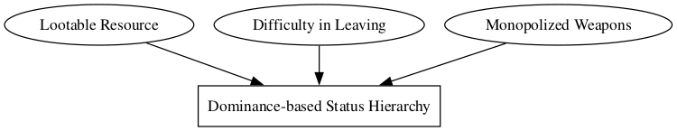
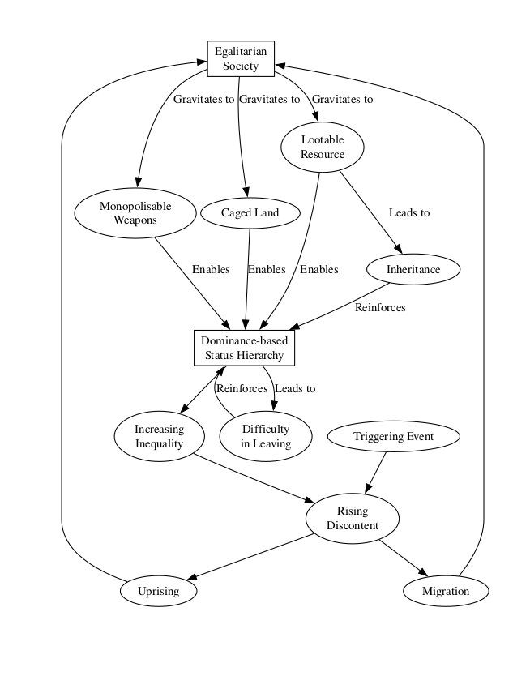
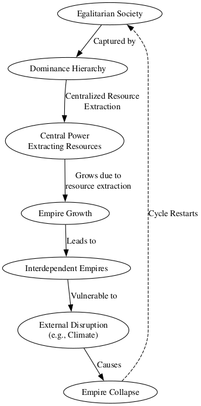
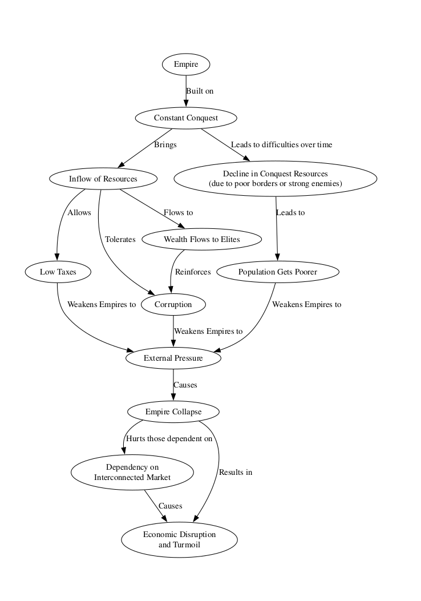
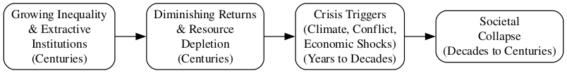

Wenn wir gesellschaftlichen Kollaps untersuchen, betrachten wir ihn meist durch die Brille der Eliten. Wir nutzen die Aufzeichnungen und Überreste von Kaisern, Adligen und den schriftkundigen Schichten, die am meisten zu verlieren hatten, wenn ihre Welt unterging. Aber was, wenn wir die ganze Zeit die falsche Frage gestellt haben? Nach Jahren, in denen ich Literatur zu Kollaps durchgesehen habe, von quantitativen Datenbanken wie Seshat bis zu Fallstudien über Jahrtausende, tauchen bestimmte Muster immer wieder auf. Als ich auf [Luke Kemps „Goliath’s Curse: The History and Future of Societal Collapse“](https://www.goodreads.com/book/show/219301731-goliath-s-curse) stieß, passte seine Analyse zu vielen der Schlussfolgerungen, die dieser Blog untersucht hat: dass Ungleichheit Fragilität antreibt, dass demokratische Beteiligung die Resilienz stärkt und dass unser heutiges globales System verwundbarer sein könnte, als es scheint. Kemp fügt aber eine wichtige Perspektive hinzu, die die meiste Forschung zu Kollaps übersieht. Er stellt elitenzentrierte Sichtweisen auf die Geschichte infrage. Statt einfach zu fragen, warum Gesellschaften zusammenbrechen, fragt er, ob Kollaps zwangsläufig die Katastrophe ist, für die wir ihn halten. Vielleicht ist die eigentliche Frage nicht, warum Kollaps so katastrophal ist, sondern für wen er katastrophal ist.

# Wie schlimm ist Kollaps, und für wen?

Gesellschaftlicher Kollaps gilt meist als etwas Schlechtes. Er steht für Chaos, Gewalt und Elend. Und das stimmt sicher für einen Teil der Bevölkerung, aber nicht für alle. Historisch waren die meisten Staaten ziemlich schreckliche Orte zum Leben. Sowohl die Römische Republik als auch das Römische Kaiserreich waren zum Beispiel den Großteil ihres Bestehens im Krieg und hielten gleichzeitig einen großen Teil ihrer Bevölkerung als Sklaven. Selbst für einen normalen Bauern war das Leben oft nicht toll. Man musste viele Steuern zahlen und bekam oft wenig zurück. Für den durchschnittlichen Menschen im Römischen Reich war die Chance also hoch, dass das Leben in Krieg, Armut oder Sklaverei endete. Aber das ist nicht das Rom, an das wir uns oft erinnern. Wenn wir an Rom denken, denken wir an all die Monumente, die sie gebaut haben, die Kunst, die sie geschaffen haben, und ihre Politik. Diese Aspekte stehen aber nur für einen kleinen Teil der Bewohner des Reichs. Wir sprechen über die kulturellen Errungenschaften statt über Krieg, Armut und Sklaverei, weil Geschichte nicht von einem armen Bauern in den Alpen oder einem Sklaven in den Minen Spaniens geschrieben wird, sondern von den Reichen, den Grundbesitzern, den Priestern, den Politikern. Das gilt für so ziemlich jedes Reich.

Wir sehen gesellschaftlichen Kollaps als etwas einzigartig Schlimmes, weil wir die Berichte der reichsten Menschen der Vergangenheit für repräsentativ für die ganze Bevölkerung halten. Aber wie sieht Kollaps aus, wenn wir uns stattdessen auf die Lebensbedingungen des durchschnittlichen Menschen konzentrieren? Was, wenn wir eine Geschichte des Kollapses von unten schreiben? Diese Frage versucht Kemps Buch zu beantworten.

Das heißt nicht, dass Kemp glaubt, Kollaps hätte keine Nachteile. Er kann sicher schreckliche Folgen haben. Wenn sich zum Beispiel eine Region auf eine bestimmte Nutzpflanze spezialisiert hat, um sie mit anderen Teilen ihres Reichs gegen alles zu tauschen, was sie braucht, wird diese Region massive Probleme bekommen, wenn der Fernhandel endet, weil ein Reich zusammengebrochen ist. Für viele der ärmeren Menschen könnte dieser Kollaps aber trotzdem das Ende der Sklaverei und eine allgemeine Verbesserung ihrer Lebensbedingungen bedeuten. Die Folgen eines Kollapses hängen stark davon ab, wo man ist und auch wann, denn auch die Folgen von Kollaps haben sich über die Zeit verändert.

# Der Naturzustand?

Wenn wir darüber nachdenken, wie das menschliche Leben aussah, bevor wir anfingen, unsere Geschichte aufzuzeichnen, gibt es eine ziemlich dominante Idee: den Naturzustand. Der Naturzustand ist eine Idee, die der Philosoph Thomas Hobbes berühmt gemacht hat. Sie nimmt an, dass das menschliche Leben, bevor es Staaten gab, garstig, roh und kurz war, weil die Menschheit in einem Krieg aller gegen alle gefangen war. Wir bräuchten deshalb einen Gesellschaftsvertrag zwischen dem Staat und seinen Bürgern. Der Staat sorgt für Ordnung, während sich die Bürger dem Staat unterwerfen, um voreinander geschützt zu sein. Diese Sicht auf den Menschen ist zwar ziemlich beliebt (besonders auf der rechten Seite des politischen Spektrums), beruht aber eigentlich auf keinerlei Daten. Hobbes hat einfach von seiner persönlichen Erfahrung, einen Bürgerkrieg zu durchleben, extrapoliert und daraus geschlossen, dass das für die ganze Menschheit gelten muss. Das Tolle ist: Wir haben inzwischen Daten, um diese Behauptungen zu überprüfen, und diese Daten zeichnen ein ganz anderes Bild als das, was Hobbes im Kopf hatte.

Bevor die Menschheit anfing, in dauerhaften Siedlungen zu leben, zogen egalitäre Gruppen von bis zu 200 Jägern und Sammlern durchs Land. Wir wissen, dass sie regelmäßig Kontakt zu anderen Gruppen hatten, weil die Überreste dieser Gruppen eine ziemlich hohe genetische Vielfalt aufweisen. Aber Gene waren nicht das Einzige, was sie austauschten. Wir finden auch Belege, dass sie vor 200.000 Jahren Fernhandel trieben und Güter wie Obsidian oder Muscheln etwa 200 km weit transportierten. Sie hatten auch Gemeinschaftsprojekte, die Tausende Menschen zusammenbrachten. Das berühmteste Beispiel hier ist Göbekli Tepe, eine gewaltige tempelartige Anlage, die von zusammenarbeitenden Stämmen von Jägern und Sammlern gebaut wurde.

Aber die Menschen arbeiteten nicht nur zusammen und trieben Fernhandel, ihr Leben war auch nicht garstig, roh und kurz. Stattdessen sind die Belege für Gewalt, die wir finden, im Allgemeinen ziemlich gering, wenn auch sehr unterschiedlich. Bei anthropologischen Belegen von Jägern und Sammlern finden wir Werte zwischen 0 und 55 %. Diese Studien sind aber unzuverlässig, weil die Gewalt von Siedlern, Bauern und den Folgen von Alkohol kommt. Im archäologischen Befund haben die größten systematischen Studien Anzeichen für eine Rate tödlicher Gewalt von nur etwa 1 % im gesamten Paläolithikum gefunden. Fast alle Todesfälle gehen auf einen einzigen Fundort zurück: Jebel Sahaba, wo es während des Umweltaufruhrs, als die Welt die Eiszeit verließ und in die stabile Warmzeit eintrat, die wir heute als Holozän kennen, einen Anstieg der Gewalt gab. Die Rate tödlicher Gewalt liegt heute bei 0,9 % oder 2,2 %, wenn man Suizid einbezieht. Auffällig an diesen Befunden ist auch, dass wir in den Belegen von Jägern und Sammlern im Grunde keinen Krieg sehen. Wenn es Gewalt gab, dann wahrscheinlich zwischen Einzelnen, nicht zwischen Gruppen.

# Unsere egalitären Ursprünge

Dieses relativ friedliche Dasein war wahrscheinlich möglich, weil Menschen von ihrem Ursprung her ziemlich egalitär sind. Erst vor etwa 11.000 Jahren sehen wir die ersten durchgängigen Anzeichen von Hierarchie, wie größere Gräber oder größere Häuser. Heutige nomadische Jäger und Sammler pflegen immer noch einen egalitären Lebensstil. Sie sorgen dafür, dass jeder, der versucht, die Hierarchie zu dominieren, wieder heruntergeholt wird. Zuerst mit sozialem Druck, aber sie gehen sogar so weit, Mitglieder ihres Stammes zu töten, wenn sich diese immer wieder über andere zu erheben versuchen. Diese Abneigung gegen Dominanz wird durch den Lebensstil von Jägern und Sammlern auch leichter. Wenn jemand versucht, einen zu dominieren, kann man einfach woanders hinziehen. Das sehen wir auch in unserer Biologie. Menschlichen Männern fehlen im Allgemeinen die Merkmale, die Arten mit steilen Dominanzhierarchien meist haben, etwa dass Männchen viel größer sind als Weibchen und natürliche Waffen wie große und scharfe Zähne haben. Außerdem haben unsere Augen viel mehr Weiß als die von Gorillas oder Schimpansen. Das ist wahrscheinlich eine evolutionäre Anpassung, weil es anderen erlaubt zu erkennen, worauf wir uns konzentrieren, was unsere Absichten für andere offensichtlicher macht und so Vertrauen schafft.

Neben diesem egalitären Zug sind wir aber auch besessen von Status. Auch das ergibt aus evolutionärer Sicht Sinn. Wenn der eigene Status in der Gruppe zu niedrig wird, könnte die Gruppe einen ausstoßen, was in vielen Umgebungen den sicheren Tod bedeuten würde. Aber auch: Je höher der eigene Status ist, desto wahrscheinlicher ist es, dass einem die Leute geben, was man will.

Wenn wir über Status nachdenken, gibt es im Allgemeinen zwei Wege, ihn zu bekommen: Dominanz oder Prestige. Diese haben ziemlich unterschiedliche Folgen. Status auf Grundlage von Prestige ist die prosozialere und hilfreichere Variante. Es hilft der ganzen Gruppe, wenn Menschen, die etwas besonders gut können, mehr Status bekommen. Außerdem kann Status auf Grundlage von Prestige nicht wirklich vererbt werden, also sammelt sich Status nicht über Generationen an. Dominanz dagegen heißt, sich Status mit schierer Gewalt zu nehmen. Sie beruht auf Gewalt, Einschüchterung und der Kontrolle von Ressourcen. Wenn möglich, versuchen Menschen meist, Einzelnen aus dem Weg zu gehen, die Status über Dominanz suchen, und suchen die Nähe derer, die Status über Prestige aufbauen. Nicht alle Menschen haben das gleiche Verlangen nach Status: Das Verlangen nach Status durch Dominanz ist bei Männern höher und bei denen, die bei der dunklen Triade höher abschneiden.

Unsere Ursprünge scheinen von Menschen geprägt zu sein, die in einem egalitären Umfeld nach Prestige und Zusammenarbeit streben. Leider begann sich das alles zu ändern, als Menschen Zugang zu neuen Ressourcen bekamen.

# Die Geburt Goliaths

Die Idee des gesellschaftlichen Kollapses lässt sich auf Menschen eigentlich erst anwenden, seit wir sesshaft wurden. Die Bevölkerungszahlen von Jägern und Sammlern schwankten zwar stark, aber diese Schwankungen wurden von anderen Prozessen angetrieben als denen, die wir meist als gesellschaftlichen Kollaps betrachten. Ihre Zahl nahm in direktem Zusammenhang mit der allgemeinen Produktivität und dem Klima der Region zu und ab, in der sie sich aufhielten. Wenn das Klima kühler wurde und die Produktivität sank, sanken auch die menschlichen Bevölkerungszahlen. Das sind zwar Faktoren, die auch sesshafte Menschen beeinflussen, aber diese können länger höhere Bevölkerungszahlen halten, selbst unter ungünstigeren Bedingungen, weil sie Vorräte für Notfälle anlegen können. Jäger und Sammler hatten im Durchschnitt eine viel bessere Ernährung als Ackerbauern. Sie hatten aber auch mehr Phasen von Hungersnot und Hunger. Wenn man sesshaft wird und sich auf eine einzelne Ressource konzentriert, geht es einem im Durchschnitt also schlechter, aber Schocks treffen einen nicht so hart.

Eine Siedlung zu gründen, ergibt nur Sinn, wenn es in der Nähe reichlich Ressourcen gibt. Das kann fruchtbares Ackerland sein, aber jede verlässliche Ressource funktioniert. Viele der ersten Siedlungen wurden in der Nähe natürlich reichhaltiger Orte gegründet, etwa an Flüssen mit viel Fisch. Das machte Menschen zwar widerstandsfähiger gegenüber den Schwankungen des Planeten, erlaubte aber auch, dass sich Hierarchien auf Grundlage von Dominanz einschlichen. Der Überschuss an sich ist aber nicht das Problem. Knifflig wird es, wenn die Ressourcen leicht gesehen, gestohlen und gelagert werden können. Wenn man das mit eingehegtem Land und monopolisierten Waffen verbindet, kann Goliath aufsteigen. Wenn man über Generationen am selben Ort lebt und seinen ganzen Lebensstil um ein paar zentrale Ressourcen herum ausrichtet, wird es möglich, Reichtum anzuhäufen. Und wenn man mehr Ressourcen hat als andere, kann man sie gegen Macht eintauschen.

Stell dir ein Fischerdorf vor. Eine Familie findet einen besonders ergiebigen Fischgrund und schafft es, den Fisch lagerfähig zu machen (z. B. durch Räuchern). So kann sie mehr Fisch anhäufen als die anderen. Das eröffnet ihr Möglichkeiten, etwa ein Fest auszurichten oder anderen in Notzeiten auszuhelfen. Diese Möglichkeiten erzeugen eine soziale Schuld gegenüber dieser Familie. Diese soziale Macht kann sie nutzen, um die Entscheidungen im Dorf zu prägen. Damit das funktioniert, muss sie diese zusätzlichen Ressourcen nicht nur sammeln, sondern auch dafür sorgen, dass niemand anderes sie nimmt. Um seine Ressourcen zu verteidigen, braucht man Waffen und Leute, die sie führen. Wenn jemand dagegen etwas einzuwenden hat, kann er nicht viel tun. Er kann nicht einfach gehen, weil sein Leben auch um die lokale Ressource herum aufgebaut ist, und er kann die führende Familie nicht herausfordern, weil sie die Waffen und die soziale Macht im Dorf kontrolliert.

Wir haben mit einer Familie angefangen, die etwas mehr Fisch gesammelt hat als die anderen, und sind bei einer Familie gelandet, die jetzt eine kleine Miliz hat, während ihr alle im Dorf einen Gefallen schulden. Das zeigt, wie sich eine Statushierarchie auf Grundlage von Dominanz leicht entwickelt, sobald es eine lagerfähige Ressource gibt, Menschen nicht einfach gehen können und monopolisierte Waffen Widerstand schwer machen. Und schließlich lassen sich diese Ressourcen und Dominanzstrukturen leicht vererben, was es leichter macht, sie über Generationen aufzubauen und zu verfeinern.

Abbildung 1: Das Rezept für Statushierarchien auf Grundlage von Dominanz

Das heißt nicht, dass wir immer in dieser Lage landen müssen, nur dass sie unter den möglichen Arten, eine Gesellschaft zu organisieren, ein starker natürlicher Attraktor ist. Das nennt Kemp **Goliath**: eine Ansammlung aufeinander abgestimmter Hierarchien auf Grundlage von Dominanz in verschiedenen Lebensbereichen, die Arbeit und Energie kontrollieren.

Sobald ein Goliath etabliert ist, will er immer mehr Ressourcen anhäufen. Das erhöht meist die Gewalt, sowohl innerhalb von Gesellschaften als auch zwischen ihnen. Innerhalb der Gesellschaften steigt sie, weil die Dominanz durchgesetzt werden muss, um die Leute bei der Stange zu halten, und zwischen Gesellschaften, weil andere Gesellschaften eine Bedrohung darstellen, die sich am besten vorbeugend lösen lässt. Das zeigt sich deutlich in unseren archäologischen Belegen. Die Gewalt nimmt auf breiter Front zu, und wir sehen auch Massentötungen und Menschenopfer, die es vorher im Grunde nicht gab. Goliath hat den Fokus also von Konflikten zwischen Einzelnen zu Konflikten zwischen Gruppen verschoben und ist damit der Ursprung des Krieges. Das sehen wir empirisch in Japan, Europa, Mesoamerika, China, Nordamerika und dem Nahen Osten.

# Kollaps in den ersten Siedlungen

Die Geschichte zeigt zwar, dass menschliche Gesellschaften dazu neigen, in diese Falle der Dominanzhierarchie zu rutschen, sie zeigt aber auch, dass diese Hierarchien besonders am Anfang ziemlich fragil waren. Es dauerte Tausende Jahre von den ersten Siedlungen, bis die Mehrheit der Menschen aufhörte, Jäger und Sammler zu sein. Ziemlich lange lebten Bauern und Jäger und Sammler also nebeneinander. Wenn sie die Wahl hatten, blieben Menschen meist Jäger und Sammler, weil ihnen das Selbstbestimmung über ihr Leben gab und, wenn die Zeiten gut waren, ein viel angenehmeres Leben. Außerdem eröffnete dieses Nebeneinander der Lebensweisen einen Weg, Hierarchien auf Grundlage von Dominanz zu vermeiden. Wenn man in einer Siedlung lebte, die einem zu hierarchisch wurde, ging man einfach.

Im Gegensatz zu dieser friedlichen Ablehnung von Hierarchie zeigen viele frühe Siedlungen auch eine gewaltsame Ablehnung von Hierarchie. Andere scheinen sich aber auch in einem langsamen, friedlichen Rinnsal von Menschen, die gingen, geleert zu haben. Kemp stützt sich hier auf viele Beispiele, aber das Muster ist immer dasselbe. Eine plünderbare Ressource führt zur Gründung einer Siedlung. Diese Siedlung ist zuerst egalitär, aber mit der Zeit sehen wir immer mehr Belege für Hierarchie (z. B. Tempel, größere Häuser für manche), aber nur bis zu einem gewissen Punkt. Sobald die Ungleichheit zu steil wird, erheben sich die Menschen in Rebellion und töten ihre Unterdrücker oder „stimmen mit den Füßen ab“ und verlassen die Siedlung. Ausgelöst wird das meist durch einen äußeren Schock wie eine Dürre. Manchmal führt das nicht zur Aufgabe der Siedlung, sondern zu einer Zeit wohlhabenden, aber egalitären Wachstums. In vielen Fällen schleicht sich nach einiger Zeit aber wieder Hierarchie ein, und der Zyklus beginnt von vorn. Auffällig ist die Allgemeingültigkeit des Musters. Wir finden es rund um den Globus, ob in Amerika, Europa oder Asien. Wir sehen auch, dass gleichere Gesellschaften meist länger überlebten, was auf eine grundsätzliche Instabilität von Dominanzhierarchien hindeutet.

Abbildung 2: Der Zyklus aus Aufstieg und Absturz von Dominanzhierarchien in frühen menschlichen Gesellschaften.

Sowohl in der egalitären als auch in der auf Dominanz beruhenden Gesellschaft sehen wir, dass sie Werkzeuge und Mythen entwickelten, die ihre jeweilige Lebensweise verfestigten. Eines der wichtigsten davon ist Religion, die besonders für Dominanzhierarchien hilfreich ist. Man kann Religion nutzen, um sich auf eine höhere Macht zu berufen und Geschichten zu entwickeln, etwa dass ein Monarch für eine gute Ernte unverzichtbar ist. Sobald diese Hierarchie gestürzt ist, betonen Menschen meist Dezentralisierung in allen Bereichen ihres Lebens. Je dezentraler man ist, desto schwerer ist es, beherrscht zu werden.

# Der Aufbau früher Staaten

Mit der Zeit setzten sich Ackerbaugesellschaften gegen Jäger und Sammler durch, weil sie Nahrungskrisen besser bewältigen, höhere Bevölkerungszahlen halten und sich in größerem Maßstab koordinieren konnten und aktiv auf Expansion und militärische Ausdehnung setzten. Das hieß, dass Goliath größer werden konnte, denn wohin er sich jetzt auch ausdehnte, gab es mehr plünderbare Ressourcen, weil die Menschen schon zum Ackerbau übergegangen waren. Es gab aber weitere Faktoren, die Goliath größer werden ließen. Bronze ermöglichte bessere Waffen, domestizierte Tiere und Pflanzen machten das Plündern von Ressourcen leichter, und höhere Bevölkerungsdichten machten es lohnender, ein Gebiet zu beherrschen. All das sieht man deutlich in den Daten der Seshat-Datenbank (1). Die besten Prädiktoren für mehr Hierarchie in einer Region sind ihre landwirtschaftliche Produktivität und die Übernahme militärischer Innovationen.

Diese Verschiebungen ermöglichten Dominanzhierarchien in größerem Maßstab. Bis dahin konnte man höchstens eine Siedlung oder zwei beherrschen, jetzt konnte man ganze Regionen beherrschen. Diese neuen, großen, ausbeuterischen und gewaltsamen Hierarchien auf Grundlage von Dominanz nennen wir heute die ersten Staaten. Besonders in Ägypten kamen all diese Faktoren genau richtig zusammen und erlaubten ihm, zum ersten großen Staat zu wachsen.

Um auf Hobbes zurückzukommen: Wir sehen, dass das Gegenteil seines Gesellschaftsvertrags passierte. Staaten brachten Barbaren keine Ordnung, sondern frühe Staaten schufen Systeme, die Bauern Ressourcen abpressten, die dafür wenig zurückbekamen und ohne diese Staaten gut hätten leben können. Wenn wir das mit heute vergleichen, sind die ähnlichsten Organisationen eigentlich die des organisierten Verbrechens wie die Mafia. Sobald man diese verbrechensähnliche Struktur eines Staates aufgebaut hat, ist Sklaverei der nächste logische Schritt, weil sie die ultimative Ausbeutung eines anderen Menschen erlaubt (auch wenn es natürlich auch ohne Staaten Sklaverei geben kann).

Ein weiterer Faktor, der diese frühen Staaten ermöglichte, hängt damit zusammen, wie Menschen auf wahrgenommene Bedrohungen reagieren. Wenn man in einem Staat auf Grundlage von Dominanz lebt, weiß man, dass es da draußen andere Staaten gibt, die einen angreifen könnten. Das macht Menschen offener für Autoritarismus, weil er mehr Sicherheit verspricht, und Menschen werden meist autoritärer, wenn sie bedroht sind. Die frühen Staaten wurden alle von ähnlichen Kräften geprägt. Jeder dieser Staaten hatte irgendeine Form autoritärer Hierarchie (politische Macht), durchgesetzt mit Gewalt (gewaltsame Macht), gestützt durch Rituale und Erzählungen, die ihre Autorität legitimierten (informationelle Macht), und presste einer bestimmten Bevölkerung (demografische Macht) Ressourcen ab (wirtschaftliche Macht).

Ein Argument, das an diesem Punkt oft kommt, ist, dass es Hierarchie braucht, um Großes zu schaffen. Das stimmt aber eigentlich nicht. In vielen Regionen finden wir große Projekte wie Tempel oder Bewässerungsanlagen, bevor wir Anzeichen von Hierarchie finden. Oft ist es umgekehrt. Egalitäre Gruppen bauen etwas Wertvolles, das andere auf sich aufmerksam macht, die dann eine Dominanzhierarchie aufbauen, um es zu kontrollieren.

Ein weiterer wichtiger Punkt: Wir finden in den archäologischen Belegen, dass die blutigste und tödlichste Phase dieser frühen Staaten nicht ihr Kollaps war, sondern ihre Gründung. Ihr Aufstieg fiel mit Eroberung und Krieg zusammen, während ihr Kollaps meist einfach bedeutete, dass die Menschen ihre Unterdrücker los waren, zumindest bis der nächste Goliath aufstieg. Der Gesamtprozess, wie die frühesten Staaten zusammenbrachen, war dem in Siedlungen ziemlich ähnlich, wenn auch in größerem Maßstab und mit mehr Varianz durch Klima und Eroberung.

# Kollaps in frühen Staaten und Imperien

Die nächste logische Entwicklung menschlicher Organisation waren Imperien. Im Grunde nutzen Imperien denselben ausbeuterischen Mechanismus, den wir für Siedlungen und frühe Staaten betrachtet haben, nur in viel größerem Maßstab. Meist gibt es ein Machtzentrum, das die Ressourcen aus allen Ecken des Reichs ansaugt, wie Rom im Römischen Reich. Sie sind Dominanzhierarchien in großem Maßstab. Für die Mehrheit der Bevölkerung, die in ihnen lebte, senkten sie meist den Lebensstandard und führten zu höherer Ungleichheit.

Ihre auf Dominanz beruhende Gesamtstruktur ist frühen Siedlungen und Staaten zwar ziemlich ähnlich, aber die Art des Kollapses begann sich hier zu verschieben. Frühe Siedlungen und einige der frühen Staaten erlebten Rebellionen, die sie zu einer egalitäreren Struktur zurückführten, aber je größer und mächtiger die Staaten und dann Imperien wurden, desto seltener sehen wir das. Sie zerfielen zwar immer noch regelmäßig, aber weniger wegen egalitärer Rebellionen und mehr wegen äußerer Faktoren.

Wenn wir uns die erste Welle von Imperien anschauen, die alle zu ähnlicher Zeit in der frühen Bronzezeit entstanden (denk an das Akkadische Reich oder das Alte Reich Ägyptens), wurden sie wahrscheinlich von einer Megadürre gestürzt (dem sogenannten 4,2-ka-Ereignis), die ein zu großer Schock für ihre sehr ungleichen Gesellschaften war. Die Dürre störte ihre Nahrungsproduktion, und die Hierarchie brach zusammen, weil der Mangel an Nahrung bedeutete, dass komplexere Staaten nicht mehr getragen werden konnten (auch wenn die regionalen Unterschiede, wie das ablief, groß waren). Bei den Imperien der späten Bronzezeit (denk an Babylonier, Hethiter usw.) war es anders. Sie erlebten einen komplexeren Zusammenbruch, den wir heute meist den Kollaps der späten Bronzezeit nennen (2). Dieser Kollaps umfasste plündernde Seevölker, eine Klimaverschiebung, Probleme bei der Nahrungsproduktion und andere Faktoren. Ein hier sehr wichtiger Faktor ist aber, dass diese Imperien bei Ressourcen wie Nahrung oder Zinn aufeinander angewiesen waren (3). Als diese Verbindungen gestört wurden, zerfielen die meisten Imperien und gingen unter; ohne diese zusätzliche Unterstützung konnten sie die Folgen nicht überstehen.

In beiden Fällen, beim Kollaps der frühen und der späten Bronzezeit, war eine Dominanzhierarchie etabliert, die so stark war, dass sie von innen schwerer zu stürzen war. Sie konnte aber durch äußeren Druck zu Fall gebracht werden, und wie bei unseren früheren Beispielen für Kollaps in kleinerem Maßstab deuten unsere archäologischen Belege darauf hin, dass dieser Kollaps für die meisten Menschen eigentlich gut war, weil ihre Körpergröße und Gesundheit nach dem Kollaps besser wurden. Sie waren plötzlich vom ausbeuterischen Goliath befreit, was ihnen mehr Ressourcen für sich selbst ließ und um mit den schwierigeren Klimabedingungen zurechtzukommen. Allerdings sehen wir auch hier Blutvergießen und Konflikte.

Abbildung 3: Aufstieg und Fall von Imperien durch äußeren Druck.

Neben diesem Ende von Imperien durch äußere Umstände gibt es auch den Weg über inneren Druck. Dieser innere Druck war aber nicht der Wunsch der Menschen, zu egalitären Gesellschaften zurückzukehren, sondern die zersetzende Kraft der Korruption und eines Systems, das von nie endendem Wachstum abhängt.

Das deutlichste Beispiel für diesen Weg, ein Imperium zu beenden, ist das Römische Reich. Rom war auf Eroberung gebaut. Es hatte ein starkes Militär, das fast ständig im Krieg war. Diese fortlaufende Eroberung brachte viele Ressourcen ein, was niedrige Steuern erlaubte und gleichzeitig hohe Korruption tragbar machte. Diese Ressourcen flossen aber überwiegend an die Eliten. Das war stabil, solange die Eroberungen weitergingen und es allen besser ging als vorher. Mit der Zeit wurden neue Eroberungen aber schwieriger. Viele der Regionen, an die Rom später grenzte, waren arm (z. B. die germanischen Stämme) oder so mächtig, dass sie nicht erobert werden konnten (z. B. das Sassanidenreich). Der ständige Zufluss von Ressourcen durch Eroberung hörte also auf. Die Eliten konnten zwar über Korruption und Dominanz immer noch mehr Ressourcen erlangen, aber die breite Bevölkerung wurde ärmer. Dazu kam noch die Übernutzung der Ressourcen des Landes. Die schwindenden Ressourcen führten zu zersplitterten Eliten. All das ließ das Reich so geschwächt zurück, dass es äußerem Druck nicht mehr standhalten konnte und zusammenbrach. Dieser Kollaps war für einen großen Teil der Bevölkerung aber ziemlich schlimm, besonders für die, die schon Hunderte von Jahren Teil des Reichs gewesen waren, weil sie von einem großen, vernetzten Markt spezialisierter Produktion abhängig geworden waren. Als dieser verschwand, mussten viele Regionen völlig neu ordnen, wie und was sie produzierten.

Abbildung 4: Kollaps von Imperien, die von Eroberung abhängen.

Dieses Muster war nicht einzigartig für das Römische Reich, sondern fand sich in vielen Imperien der Antike. Ein besonders interessanter Fall ist hier China. Es litt unter ähnlichen Problemen wie Rom, hielt aber länger. Dieser längere Zeitraum liefert auch interessantere Daten dazu, wie ausbeuterisch das chinesische Reich war. Wir finden einen klaren Zusammenhang zwischen der Frage, wie ausbeuterisch der Staat war, und wie lange sich die einzelnen Kaiser hielten. Je weniger ausbeuterisch ihre Politik war, desto länger blieben sie auf dem Thron. Das führt aber auch zu dem Problem, dass ein weniger ausbeuterisches Reich oft ein schwächeres Reich ist, weil es keine größeren Armeen unterhalten kann. Das macht es wiederum anfälliger für Eroberung. Das ist der Grund, warum sich so viele Staaten in der Menschheitsgeschichte auf Dominanzhierarchien gestützt haben. Dominanzhierarchien machen es leichter, sich zu verteidigen, weil man leichter Menschen und Gewalt mobilisieren kann. Eine egalitäre Gesellschaft macht das Leben für die, die darin leben, zwar besser, macht sie aber möglicherweise auch verwundbarer gegenüber den Dominanzhierarchien um sie herum.

Beim Blick auf zusammenbrechende Imperien sehen wir auch, dass verschiedene Teile von ihnen auf unterschiedlichen Zeitskalen zusammenbrachen und besonders ihre allgemeine Kultur nie wirklich zusammenbrach, sondern einfach in ein neues System überging. Der politische Kollaps ging oft schnell, innerhalb von Jahren oder Jahrzehnten. Wirtschaftliche Zusammenbrüche folgten meist innerhalb eines Jahrhunderts. Verschiebungen bei Informationssystemen und Bevölkerungsdynamik entfalteten sich aber über mehrere Jahrhunderte. Manche Aspekte blieben ganz unberührt.

Wir sehen auch ein klares zugrunde liegendes Muster. Imperien brachen zusammen, wenn ihre innere Ungleichheit so hoch wurde, dass sie ihre Resilienz verringerte. Sobald ihre Resilienz niedrig war, wurden sie von der nächsten Katastrophe gestürzt, die vorbeikam, und es spielte keine große Rolle, ob das Klima, Krieg oder etwas anderes war.

# Kollaps, Kolonialismus und Kapitalismus

Wie wir bisher gesehen haben, wächst die Reichweite Goliaths im Gleichschritt mit den Fähigkeiten der Menschen. Als wir frühe Bauern waren, konnte Goliath so groß wie eine Siedlung sein, dann wuchs er zu frühen Staaten, dann zu kontinentumspannenden Imperien. Der nächste Schritt waren die Kolonialreiche, die den ganzen Globus umspannten. Die koloniale Eroberung durch Imperien wie das spanische oder das britische stützte sich stark auf ihre bessere Technologie, aber auch darauf, andere Imperien durch Krankheiten zu schwächen und innere Konflikte anzuheizen. Diese globale Eroberung war wohl eines der brutalsten Dinge, die die Menschheit je getan hat. Man schätzt, dass in Amerika, Australien und Hawaii bis zu 90 % der Bevölkerung starben und diese Bevölkerung jahrhundertelang niedrig blieb, weil sie so gewaltsam unterdrückt wurde. Die Zerrüttung war so stark, dass sie sogar Regionen erfasste, die nie direkt kolonisiert wurden, aber trotzdem von eingeschleppten Krankheiten und politischer Instabilität verwüstet wurden. Interessanterweise wird diese Geburt des globalen Goliaths selten als Kollaps gezählt, weil sie aus europäischer Sicht zu Wachstum und Urbanisierung führte, auch wenn der Preis die Auslöschung ganzer Kulturen war. Vielleicht sollten wir beim Beginn von Imperien viel vorsichtiger sein und nicht bei ihrem Ende. Wenn wir auf die Geschichte schauen, ist der Aufstieg so gut wie immer viel brutaler als das Ende.

Gleichzeitig sehen wir die Anfänge des Kapitalismus. Kapitalismus und Kolonialismus passten gut zueinander. Der Kapitalismus beruhte auf Wachstum und der Ausbeutung von Ressourcen, während der Kolonialismus billigen Zugang zu einer großen Menge an Ressourcen ermöglichte. Er brachte auch eine neue Form der Ungleichheit hervor, die es vorher nicht gegeben hatte. Der frühe Kapitalismus nützte sehr wenigen Menschen. Selbst in den Kernländern der Imperien litt die Mehrheit unter schrecklichen Lebensbedingungen. Obwohl England zum Beispiel eindeutig das Land war, das am meisten von Kolonialismus und frühem Kapitalismus profitierte, sank die Lebenserwartung um fast 20 Jahre und die Körpergröße erwachsener Männer um fast 10 cm.

Zum Glück dauerten die meisten Schrecken des Kolonialismus nur etwa 100–200 Jahre. Seitdem hat sich die Welt weitgehend (zumindest formal) dekolonisiert, und die Lebensbedingungen haben sich weltweit wieder verbessert. Diese Zeit brachte aber eine dauerhafte Veränderung mit sich. Seitdem ist wohl kein Staat mehr dauerhaft zusammengebrochen. Sicher, Länder haben Gebiete gewonnen und verloren, und ab und zu werden einige Staaten zu gescheiterten Staaten, aber keiner brach so zusammen wie die Staaten und Imperien früherer Zeiten. Es gibt klare Machtübergänge, wenn auch manchmal gewaltsame. Selbst gescheiterte Staaten haben noch einen gewissen Zugang zu globalen Märkten, und sie bleiben meist nur ein paar Jahre „gescheitert“, bevor sich eine neue Regierung bildet.

Ist unser modernes System also das Ende des Kollapses? Haben wir Goliath erschlagen? Nicht wirklich. Wir haben immer noch Imperien (z. B. Russland, China oder die USA), wir nennen sie nur nicht mehr so. Viele unserer modernen Institutionen sind immer noch Hierarchien auf Grundlage von Dominanz, geschaffen und erhalten, um Ressourcen auszubeuten. Was tatsächlich passiert ist: Das Produkt des Kolonialismus und der Konflikte des 20. Jahrhunderts hat einen globalen Goliath geschaffen, der jede Nation auf diesem Planeten umfasst. Dieser Goliath stabilisiert sich selbst. Wenn Staaten straucheln, stabilisieren andere Staaten sie wieder, weil das oft eine Gelegenheit ist, Geld zu verdienen. Wir haben in vielen gescheiterten und strauchelnden Staaten gesehen, dass eine große Welle der Privatisierung kam, nach der sie wieder Teil der Weltwirtschaft waren. Es gibt aber auch andere Gründe, warum der Kollaps ausbeuterischer Systeme auf Grundlage von Dominanz heute viel unwahrscheinlicher ist. Moderne Waffen machen Widerstand viel schwerer, aber der wahrscheinlich stärkste Grund ist: Wir halten Dominanzhierarchien für selbstverständlich, weil die Menschheit inzwischen seit Tausenden von Jahren unter ihrer Kontrolle lebt. Das heißt nicht, dass Kollaps jetzt unmöglich ist. Es heißt nur, dass es ein Schock sein muss, der das ganze globale System auf einmal trifft.

# Eine allgemeine Theorie des Kollapses

Bevor wir uns anschauen, was diese globalen Schocks sein könnten, fassen wir kurz die wichtigsten Muster zusammen, die wir in all diesen historischen Ideen und Beispielen sehen können. Vieles davon hat mit Ungleichheit zu tun. Gleichere und inklusivere Gesellschaften überstehen Schocks meist viel besser. Außerdem leiden ungleichere Gesellschaften meist stärker unter einer Reihe von Problemen, die sie schlechter dafür rüsten, auf Krisen zu reagieren. Reichtum gibt Macht. Je mehr Reichtum man hat, desto mehr kann man die Gesellschaft nach seinen Vorlieben formen, und die persönlichen Vorlieben eines Einzelnen decken sich selten mit dem, was für die Gesellschaft als Ganzes am besten wäre. Vermögensungleichheit verstärkt sich selbst. In unseren modernen Gesellschaften ist der Reichtum, den man aus Kapital gewinnt, viel größer als der aus Arbeit. Die Reichen werden also meist reicher, was wiederum ihren unangemessenen Einfluss auf die Gesellschaft vergrößert. Über Schulden verfestigt sich das weiter. Wenn ich jemandem Geld schulde, wird es viel schwerer, mich gegen ihn zu wehren, weil er eine zusätzliche Macht über mich hat. Aber auch dadurch, dass reiche Menschen Dinge wie Medienunternehmen oder Lobbyteams kaufen, um Politik zu beeinflussen. Macht erzeugt Macht.

Neben diesen direkten negativen Folgen führt Ungleichheit auch zu einer Reihe von Folgeproblemen. Ungleichheit führt zu ungleicher Macht, die zu Korruption führt. Je größer das Machtgefälle, desto mehr Gelegenheiten gibt es, diese Macht auszunutzen. Korruption verringert das Vertrauen in den Staat und in andere Menschen und entfernt den Klebstoff, der die Gesellschaft zusammenhält. Ungleichheit macht auch Oligarchie leichter. Wenn man mehr Reichtum und Macht hat, wird es leichter, sich einen Teil der Gesellschaft herauszuschneiden, den man eng kontrolliert. Wenn die Vermögensungleichheit wächst, konkurrieren mehr Eliten um Positionen mit hohem Status. Aristokraten, Juristen, Adlige und Generäle, also die mit Ressourcen, organisieren entweder Rebellionen oder übernehmen bestehende. Dieser Anstieg der Konkurrenz unter Eliten ist zentral für die strukturell-demografische Theorie, ein Modell, das zuerst von Jack Goldstone entwickelt und von Peter Turchin verfeinert wurde (4). Es scheint einfach, dass Ungleichheit für jede Gesellschaft von Natur aus zersetzend ist.

Neben diesen Faktoren, die sehr direkt mit Ungleichheit zusammenhängen, kommen noch zwei weitere Faktoren ins Spiel:

**Imperiale Überdehnung**: Imperien wie Rom, die Qin und die Mongolen glaubten, ihre Herrschaft sei göttlich bestimmt und solle universal sein. Die Briten und andere Kolonisatoren sahen sich als Zivilisierer von Wilden, während islamische Herrscher die Umma ausdehnten. Eroberung bot Legitimität und praktische Vorteile: Bedrohungen neutralisieren, Ressourcen sichern und Eliten mit Land und Beute belohnen. Die Ausdehnung der Grenzen schuf aber oft neue Feinde und erhöhte die Kosten, was zur „imperialen Überdehnung“ führte.

**Sinkendes Energieverhältnis**: Gesellschaften hängen von Energie ab, und das Verhältnis von eingesetzter zu gewonnener Energie, der sogenannte Erntefaktor (Energy Return on Investment, EROI), ist entscheidend. Viele Zivilisationen, wie das Weströmische Reich, hatten wegen schwindender Ressourcen und Umweltzerstörung ein sinkendes Energieverhältnis. Ein schlechtes Energieverhältnis allein verursacht aber selten einen Kollaps; es trägt dazu bei, aber meist sind andere Faktoren beteiligt.

Diese Probleme hängen miteinander zusammen. Die Ausbeutung von Ressourcen, ob von Menschen oder der Natur, stößt auf abnehmende Erträge. Wie schwer das wiegt, hängt von der Resilienz einer Gesellschaft und ihrer Anpassungsfähigkeit ab. Größere Imperien mit fortschrittlicher Technologie und Kontrollsystemen können sich weiter ausdehnen und sind weniger anfällig für einen schnellen Kollaps. Ausbeuterische Institutionen und Ungleichheit bringen aber Oligarchie, Korruption und Konkurrenz unter Eliten hervor. Wenn diese Faktoren zusammenwirken, verschlimmern sie sich gegenseitig: Korruption nährt Ungleichheit, und Oligarchie führt zu schlechtem Umgang mit der Umwelt. Der Staat zersplittert, Eliten saugen Ressourcen ab und höhlen ihn nach und nach aus.

Wenn man all das zusammennimmt, formuliert Kemp einen allgemeinen Prozess des Kollapses in vier Schritten (Abbildung 5). Ausbeuterische Institutionen führen zu Ungleichheit. Das führt wiederum zu schwächenden Prozessen wie Korruption. Sobald die Gesellschaft genug geschwächt ist, wartet sie im Grunde nur noch auf einen Auslöser, der den Prozess des Kollapses in Gang setzt.

Abbildung 5: Die vier Schritte zum Kollaps.

# Was Gesellschaften widerstandsfähig gegen Kollaps macht

Es gibt einige allgemeine Prinzipien, wie das Speichern und Schaffen von Wissen, in denen große Staaten und Imperien hervorragend sind. Historische Imperien haben zum Beispiel oft technische Fortschritte gespeichert und weitergegeben und so zur langfristigen Resilienz beigetragen. Ebenso helfen eine starke religiöse oder ideologische Einheit und die Fähigkeit zu reformieren und zu dezentralisieren (wie im Byzantinischen Reich), die Konkurrenz unter Eliten zu verringern, was Gesellschaften widerstandsfähiger macht.

Es gibt aber ein starkes Argument dafür, dass inklusivere und demokratischere Systeme in Krisen ein noch wichtigerer Faktor sind. Studien von Peter Peregrine (5) zeigen, dass Gesellschaften mit größerer politischer Inklusivität und Zusammenarbeit meist anpassungsfähiger gegenüber Katastrophen wie Klimawandel oder Krankheitsausbrüchen sind. Moderne Demokratien sind teilweise deshalb oft widerstandsfähiger, weil sie unterschiedliche Sichtweisen in Entscheidungen einfließen lassen, was in Katastrophen zu umfassenderen Lösungen führt (6). Bürgerräte, die sich bei polarisierten Themen bewährt haben, sind ein Beispiel dafür. Außerdem gibt es viele andere Beispiele, wo die kollektive Weisheit der Vielen ziemlich gut funktioniert: Prognosen, Vorausschau, kollektive Intelligenz. Verteilte Informationsverarbeitung scheint zu besseren Entscheidungen zu führen. Außerdem verringert sie den Einfluss von Menschen mit hohen Werten bei der dunklen Triade und den korrumpierenden Einfluss von Macht.

Viele moderne Demokratien leiten die Beiträge der Bürger aber immer noch indirekt weiter, was ihr Potenzial begrenzt. Eine direktere Anwendung partizipativer Entscheidungsfindung könnte die Resilienz noch weiter verbessern.

Resilienz ist aber ein zweischneidiges Schwert: Ein System kann auch dann resilient sein, wenn es ein schlechtes ist. Das macht Demokratie entscheidend, weil sie nicht nur Resilienz fördert, sondern auch die besten Chancen hat, ein gutes System zu schaffen, das es wert ist, erhalten zu werden. Interessanterweise war gesellschaftlicher Kollaps oft ein Weg, inklusivere Regierungsformen zu ermöglichen. In vielen historischen Beispielen führte Kollaps zu weniger Dominanzhierarchie und danach zu egalitäreren Gesellschaften. In gewisser Weise könnte man gesellschaftlichen Kollaps also als kulturelle Anpassung an zu hohe Ungleichheit und zu wenig Inklusivität sehen. Außerdem sind Schulden, wie oben besprochen, ein wichtiger Mechanismus, um Dominanzhierarchien durchzusetzen, aber wenn eine Gesellschaft zusammenbricht, löscht das meist auch alle Schulden und gibt den nachfolgenden Gesellschaften eine leere Tafel, auf der sie neu anfangen können.

# Kollaps heute

Historisch sieht es so aus, als sei gesellschaftlicher Kollaps weniger ein Problem, als man denken könnte. Wenn wir auf die Geschichte schauen, passierten die brutalsten und schrecklichsten Ereignisse fast ausschließlich, wenn ein neuer Goliath aufstieg (z. B. der Aufstieg des Mongolenreichs oder die Eroberung Amerikas). Wenn Gruppen von Menschen versuchen, in ihrer eigenen Gesellschaft an die Spitze zu kommen, nutzen sie oft Gewalt. Wenn sie Erfolg haben und mit ihrer neuen Macht anfangen, ihre Nachbarn zu erobern, wird es meist noch brutaler. Auf der anderen Seite des Bogens der Geschichte, beim gesellschaftlichen Kollaps, sehen wir dagegen selten Brutalität in diesem Ausmaß. Stattdessen sehen wir Gesellschaften, die ihre Schulden tilgen, Hierarchien einebnen und dezentralisieren, damit sie wieder gleicher leben können.

Heißt das, dass ein gesellschaftlicher Kollaps auch heute möglicherweise ein Ereignis wäre, das die Dinge besser statt schlechter macht? Leider lautet die Antwort wahrscheinlich nein. Im Gegenteil, es scheint, als hätten wir uns eine Falle gebaut. Der globale Goliath führt zwar weiterhin zu ausbeuterischen Dominanzhierarchien, hat aber auch zum Aufstieg neuer Technologie geführt. Technologie, die jeden möglichen Konflikt, ob durch Kollaps verursacht oder anders, viel tödlicher machen würde. Dazu gehören Dinge wie Atomwaffen, aber auch Gain-of-Function-Forschung, KI oder der Verlust der Industrie durch einen elektromagnetischen Puls.

Neben diesen Werkzeugen und Prozessen, die den Zusammenbruch der internationalen Ordnung, den ein Kollaps wahrscheinlich mit sich bringen würde, gefährlicher machen, haben wir durch Klimawandel und überschrittene planetare Grenzen auch den Planeten selbst viel verwundbarer und lebensfeindlicher gemacht.

Das letzte Problem ist, dass wir ein globales System geschaffen haben, das stark voneinander abhängt. Es gibt kein einfaches Zurück zu niedrigeren Stufen der Komplexität. Selbst wenn man das Problem ignoriert, dass alles in unserem System auf immer mehr Wachstum ausgerichtet ist, ist wirtschaftliche Komplexität nicht etwas, das man einfach zurückfahren kann, wenn es zu schwierig wird, sie aufrechtzuerhalten. Stattdessen haben wir ein Netzwerk aus Netzwerken. Wenn ein Teil dieser Netzwerke ausfällt, scheint es wahrscheinlich, dass er das ganze System zum Absturz bringt. Dieses System ist gegenüber kleineren Schocks ziemlich resilient, aber da der globale Goliath auf mehr Ungleichheit hinarbeitet und mehr Ungleichheit uns weniger resilient macht, sieht es so aus, als steuerten wir auf eine Welt zu, die immer weniger resilient wird, bis wir Pech haben und eine Gefahr eintritt, die größer ist als unsere geschwundene Resilienz. Moderne Lieferketten sind auf Effizienz statt auf Resilienz optimiert. Just-in-time-Lieferung bedeutet, dass Fabriken oft weniger als einen Monatsvorrat an kritischen Bauteilen haben. Bei den Überschwemmungen in Thailand 2011 führten diese Faktoren zum Beispiel zu Fabrikschließungen auf mehreren Kontinenten, weil die Bestände an Dingen wie Festplatten schnell aufgebraucht waren.

Neben dem offensichtlichen Grund, dass dieser Kollaps schlimm wäre, sollten wir ihn auch vermeiden, weil die Chancen gut stehen, dass er mit der Zeit zum Aufstieg eines neuen globalen Goliaths führen könnte. Wie wir gesehen haben, war dieser Aufstieg wahrscheinlich das Gewalttätigste, was es in der Menschheitsgeschichte je gab. Wir sollten dafür sorgen, das nicht zu wiederholen.

# Was tun?

Wir leben in paradoxen Zeiten. Der letzte Abschnitt mag ziemlich düster klingen, aber er ist nur die halbe Geschichte unserer Zeit. Ja, wir haben uns eine Falle gebaut, und wenn sie zuschnappen würde, hätten wir alle eine ziemlich schlimme Zeit. Die moderne Menschheit ist aber auch besser gerüstet, mit Gefahr umzugehen, als je zuvor. Wir haben die Wissenschaft, um zu verstehen, was los ist, und es gibt Ideen, wie wir es lösen könnten. Wir müssen es „nur“ tun. Das könnte sogar leichter sein, als wir allgemein denken, denn wenn man es herunterbricht, gibt es sehr wenige Schlüsselakteure, die sich ändern müssen. Es sind genau die, die man vermuten würde. Zwei Staaten kontrollieren fast alle Atomwaffen, der Großteil der Klimaschäden geht auf sehr wenige Unternehmen zurück, nur sehr wenige Unternehmen haben überhaupt die Fähigkeit, eine Chance auf allgemeine KI zu haben, oder auf Massenüberwachung, die ebenfalls von einer Handvoll zentraler Unternehmen umgesetzt wird. Diese Akteure des Untergangs sind meist selbst Dominanzhierarchien, was sie dazu treibt, Entscheidungen zu treffen, die nur ihr Wachstum und ihren Fortbestand begünstigen und sonst nichts.

Wenn wir die Argumente in Kemps Buch zusammenfassen, wird eines ziemlich klar: Menschen leben gern in egalitären und freien Gesellschaften. Paradoxerweise war gesellschaftlicher Kollaps in der Vergangenheit ein Weg zurück zu egalitäreren und freieren Gesellschaften. Das hatte aber seinen Preis. Wir verloren technischen Fortschritt, viele Menschen verloren ihr Leben. Wenn das also so ist: Warum lassen wir nicht den Zwischenschritt weg? Wenn egalitärere und freiere Gesellschaften der Vorteil sind, den uns Kollaps gebracht hat, könnten wir auch ohne die Nachteile dorthin kommen.

Wenn Vermögensungleichheit und zentralisierte Macht die Wurzel allen Übels sind, können wir Vermögen umverteilen und Machtmonopole aufbrechen. Schon heute wird die Idee eines bedingungslosen Grundeinkommens und ähnlicher Ideen jeden Tag etwas beliebter. Wenn Demokratien zu resilienteren Gesellschaften führen, können wir sie heute stärken. Bürgerräte haben eine gute Bilanz darin, genau das zu tun, und sie werden immer häufiger eingesetzt. Aber wir brauchen diesen demokratischen Schub nicht nur in Regierungen. Wir brauchen ihn auf allen Ebenen der Gesellschaft. Denn wenn wir die wenigen Institutionen und Regierungen, die uns in diese Lage gebracht haben, nicht demokratisieren, wird es schwer, wieder herauszukommen.

Oder anders gesagt: Lass uns eine Zukunft bauen, in der wir eine egalitäre und gleiche Gesellschaft haben, die im Einvernehmen entscheidet, was allen die meiste Gesundheit, das meiste Glück und das meiste allgemeine Wohlergehen bringt.

Lass uns die Dominanzhierarchien beenden!

# Zitieren
Bitte das englische Original zitieren:

Jehn, F. U. (2025, August 6). The people's history of collapse. Existential Crunch. https://doi.org/10.59350/3qg73-sxp76

# Anmerkungen
(1) Ein riesiger historischer Datensatz, den wir in diesem Blog schon einige Male erwähnt haben: [1](https://florianjehn.github.io/Societal_Collapse/2023-08-10-lessons_from_the_past/), [2](https://florianjehn.github.io/Societal_Collapse/2023-08-16-democracy_and_resilience/), [3](https://florianjehn.github.io/Societal_Collapse/2024-02-08-climate_collapse/), [4](https://florianjehn.github.io/Societal_Collapse/2023-11-15-collapse_models/)

(2) Diesen Kollaps haben wir in einem [anderen Beitrag](https://florianjehn.github.io/Societal_Collapse/2020-10-28-bronze_age/) genauer besprochen.

(3) Die Folgen eines solchen Zusammenbruchs des Handels haben wir in einem [anderen Beitrag](https://florianjehn.github.io/Societal_Collapse/2024-04-25-trade_collapse/) besprochen.

(4) Ich erkläre diese Theorie [hier](https://existentialcrunch.substack.com/p/mapping-out-collapse-research?open=false#%C2%A7structural-demographic-theory).

(5) Diese Studien haben wir [hier](https://florianjehn.github.io/Societal_Collapse/2023-08-16-democracy_and_resilience/) besprochen.

(6) Mehr Erklärungen dazu, warum Demokratien die Resilienz erhöhen, [findest du hier](https://florianjehn.github.io/Societal_Collapse/2024-07-26-democratic_resilience/).
