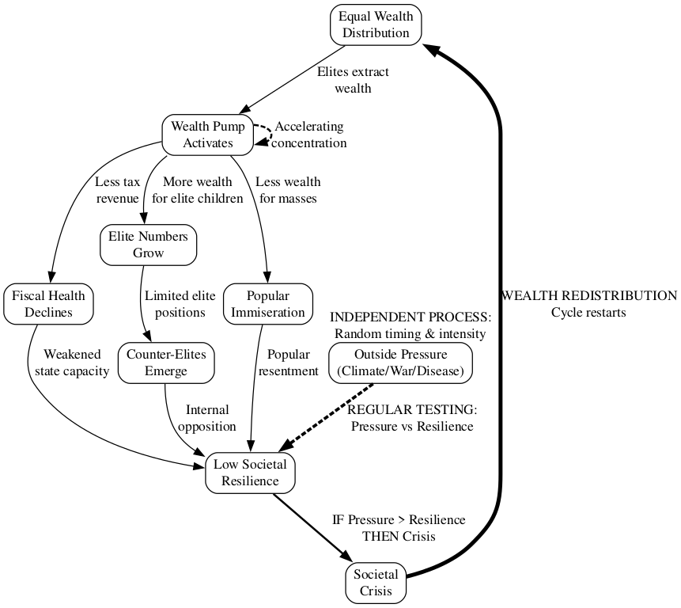

Das Leben fühlt sich härter an, weil es härter ist. Das ist zumindest eine der Hauptbotschaften, die ich aus Peter Turchins Buch „[End Times: Elites, Counter-Elites, and the Path of Political Disintegration](https://www.goodreads.com/book/show/62926960-end-times)“ mitgenommen habe. Darin nimmt uns Turchin mit auf eine große Rundreise durch seine strukturell-demografische Theorie und zeigt, wie sich ihre Erkenntnisse auf das heutige Amerika anwenden lassen.

# Die Mechanismen der strukturell-demografischen Theorie

Die Grundidee der strukturell-demografischen Theorie ist, dass Gesellschaften regelmäßig Phasen des Zerfalls erleben und dass sich die Prozesse hinter diesem Muster quantifizieren und mathematisch analysieren lassen. Wie oft man in Schwierigkeiten gerät, hängt vor allem davon ab, wie die Gesellschaft aufgebaut ist und besonders davon, wie viele Eliten es im Verhältnis zu den verfügbaren Elitepositionen gibt. Wenn jemand aus der Elite keine Position hat, die ihm seiner Meinung nach zusteht, wird er seine Macht nutzen, um die Gesellschaft so zu formen, dass er doch noch eine bekommt. Das kann sich schnell zu großen Störungen oder sogar zu Aufständen oder Bürgerkrieg hochschaukeln, weil diese verärgerten Eliten oft für ziemlich drastische Mittel offen sind, um wieder an die Macht zu kommen. Die Zahl der Eliten hängt vor allem davon ab, wie viele Kinder die Eliten hatten, und von der Vermögensungleichheit in einem Land. Wenn sie mehr Kinder und das Geld für deren Ausbildung haben, kann die Zahl der Eliten schnell steigen. Außerdem bedeutet Reichtum Macht, und wenn man viel mehr Reichtum hat als fast alle anderen, kann man andere von Machtpositionen fernhalten, was die Konkurrenz weiter verschärft.

Bevor wir uns all das anschauen und wie es sich gerade in den USA abspielt, müssen wir aber zuerst ein paar Begriffe und Konzepte verstehen.

## Was sind überhaupt Eliten?

Elite kann ein vager Begriff sein, und was Leute unter Elite verstehen, kann sich unterscheiden. Im Kontext der strukturell-demografischen Theorie ist eine Elite einfach eine Person, die in der Gesellschaft Macht hat. Besonders in kapitalistischen Gesellschaften hängt die Macht, die man hat, sehr stark davon ab, wie viel Geld man hat. Neben Eliten, die über Geld Macht ausüben, kann es aber auch Eliten geben, die Macht über Zwang (ein Armeegeneral), Verwaltung (der Chef der Zentralbank) oder Überzeugung (dein Lieblingspromi) ausüben. Mehrere Arten von Macht können auch in einer Person vereint sein. Wirtschaftliche Macht kann zum Beispiel genutzt werden, um auch politische Macht zu gewinnen.
## Die Hauptmechanismen

### Die Reichtumspumpe

Eliten neigen dazu, dem Rest der Gesellschaft Reichtum zu entziehen. Bis zu einem gewissen Grad ist das verkraftbar, aber wenn es mit der Zeit zunimmt, hat man ein Problem. Turchin nennt das die „Reichtumspumpe“: Ein immer größerer Anteil des Reichtums einer Gesellschaft konzentriert sich in einer kleinen Gruppe von Menschen. Diese zunehmende Konzentration von Reichtum hat mehrere Folgen.

### Elitenüberproduktion und Gegeneliten

Die erste ist, dass die Zahl der Eliten steigt. Denn der einfachste Weg, zur Elite zu gehören, ist, reiche Eltern zu haben. Wenn die Eliten einen immer größeren Anteil des Reichtums der Gesellschaft an sich reißen, können sie mehr Reichtum an mehr ihrer Kinder verteilen. Ein zweiter Weg in die Elite ist sozialer Aufstieg. Die Gesellschaft hat aber nur eine begrenzte Zahl von Positionen für diese Möchtegern-Eliten. Letztlich kann nur eine Person Präsident sein, egal wie viele Leute diesen Posten gern hätten. Je mehr Eliten es also gibt, desto mehr von ihnen haben das Gefühl, sie sollten an der Spitze der Gesellschaft stehen, aber es ist einfach kein Platz mehr für sie. Diese gescheiterten Eliten werden dann zu Gegeneliten, also zu Menschen, die das aktuelle System umstürzen wollen, damit sie doch noch in eine Eliteposition kommen.

Um wieder zu einer stabilen Gesellschaft zu kommen, muss man die Zahl der Eliten irgendwie wieder senken oder die Zahl der Elitepositionen ausweiten. Historisch geschah das meist dadurch, dass überzählige Eliten einfach in Kriegen, Säuberungen, Epidemien und Ähnlichem umkamen. Es gibt aber auch einige Fälle, wie den New Deal, in denen diese Verringerung der Eliten gewaltfrei und über die Umverteilung von Reichtum geschah.

### Verelendung der Bevölkerung

Parallel dazu, dass die Eliten reicher werden, wird die breite Bevölkerung ärmer, denn der zusätzliche Reichtum der Reichen muss ja irgendwoher kommen. Wenn man ärmer wird, verliert man meist auch den Zugang zu Dingen, die einem wichtig sind, denk an Gesundheitsversorgung, Bildung oder die Freiheit, zu tun, was man will. Das ist mies, also werden Menschen meist auch unglücklicher, wenn sie ärmer werden. Mit der Zeit staut sich so Groll in der Bevölkerung auf, der die Gesellschaft destabilisiert. Aufgelöst wird das, wenn wieder mehr vom gesellschaftlichen Reichtum an die ärmeren Teile der Gesellschaft verteilt wird.

### Sinkende Staatsfinanzen und geschwächte Legitimität

Wenn Reichtum zu den Reichen abgesaugt wird, heißt das auch, dass der Staat weniger davon bekommt. Um öffentliche Dienste aufrechtzuerhalten, braucht der Staat aber eine bestimmte Menge Geld. Wenn der Staat ärmer wird, verliert er also auch die Fähigkeit, für seine Bürger zu sorgen. Das sieht man tatsächlich in vielen heutigen Ländern, wo öffentliche Dienste in den letzten Jahrzehnten immer schlechter geworden sind, weil neoliberale Politik Steuern gesenkt und mehr Anhäufung von Reichtum in den Händen weniger erlaubt hat.

Diese verfallenden öffentlichen Dienste sind ein Problem für die Gesellschaft, weil sie das Leben für alle schlechter machen und auch die Legitimität des aktuellen Regimes verringern. Wenn um einen herum alles zerbröckelt, der Bus nur noch einmal am Tag kommt und das öffentliche Schwimmbad schließen musste, ist es schwer, das Gefühl zu haben, dass die Gesellschaft Fortschritte macht oder sich in die richtige Richtung bewegt. Dieses Versagen wird mit dem aktuellen Regime verbunden und teilweise auch damit, wie die Gesellschaft allgemein organisiert ist. Wenn man zum Beispiel in einer Demokratie lebt und alles zerbröckelt, kommen die Leute auf die Idee, dass Demokratie für sie nicht wirklich funktioniert.

### Druck von außen (Geopolitik, Klima, Pandemien)

Alle drei oben genannten Dinge (Elitenüberproduktion, Verelendung der Bevölkerung, sinkende Staatsfinanzen) tragen dazu bei, die Resilienz einer Gesellschaft zu verringern. Das Problem ist, dass eine Gesellschaft ziemlich regelmäßig mit Druck von außen konfrontiert wird. Das kann das Klima sein (eine Dürre), eine Pandemie (der Schwarze Tod) oder ein Nachbarstaat, der beschließt, gegen einen Krieg zu führen. Ob diese Dinge passieren und in welchem Ausmaß, kann eine Gesellschaft nicht wirklich kontrollieren. Wir können uns also vorstellen, dass eine Gesellschaft einen bestimmten Resilienzwert hat, der davon abhängt, wie gut sie mit Elitenüberproduktion, Verelendung der Bevölkerung und Staatsfinanzen umgeht. Dieser Resilienzwert wird dann zu zufälligen Zeiten und mit zufälliger Stärke durch Druck von außen auf die Probe gestellt. Wenn der Druck größer ist als die Resilienz, bricht man zusammen oder hat zumindest eine große gesellschaftliche Krise. Selbst sehr resiliente Staaten können also scheitern, wenn sie von großem Druck von außen herausgefordert werden, aber auch sehr fragile Staaten können lange bestehen, wenn sie Glück haben. Wenn man zusammenbricht oder eine große Krise hat, setzt das meist die Verteilung des Reichtums in der Gesellschaft zurück, und der Zyklus kann von vorn beginnen.

Abbildung 1: Flussdiagramm, wie der Grundmechanismus der strukturell-demografischen Theorie funktioniert.

## Weitere Mechanismen

Neben dieser Hauptschleife der strukturell-demografischen Theorie beschreibt Turchin auch eine Reihe anderer Prozesse, die passieren können und die Schleife verstärken oder Teile von ihr besser erklären.

### Goldstones Theorie des ideologischen Wandels

Neben dem oben erklärten strukturell-demografischen Hauptzyklus wirken auch andere Mechanismen. Einer davon ist, wie die ideologische Landschaft zersplittert, sobald es zu viele Eliten gibt. All diese gescheiterten Eliten versuchen, ihre Erzählung durchzusetzen, warum das Land strauchelt und warum es ihnen nicht die Eliteposition geben konnte, die ihnen zustand, meist mit sich selbst als Anführern dieser abgespaltenen ideologischen Lager. Die Phasen, in denen sich diese Zersplitterung entwickelte, hat Jack Goldstone beschrieben. Er glaubt, dass der Zyklus der Zersplitterung in drei Hauptschritten abläuft:
Der Staat hat zunehmend Mühe, die Kontrolle über die gesellschaftlichen Erzählungen zu behalten, weil immer mehr Gegeneliten versuchen, ihre Erzählungen durchzusetzen.
Sobald das alte Regime seine Legitimität völlig verloren hat (in der Vergangenheit oft begleitet von Kollaps), kämpfen die verschiedenen Fraktionen der Gegeneliten um die Autorität über die verbleibende Gesellschaft.
Eine dieser Fraktionen gewinnt die Autorität, was ihr erlaubt, die anderen Erzählungen zu unterdrücken, indem sie neue politische, religiöse und soziale Institutionen aufbaut.

### Die herrschende Klasse

Wer kontrolliert die Gesellschaft? Eine oft gestellte und oft sehr unterschiedlich beantwortete Frage. In vielen frühen Staaten war sie leicht zu beantworten. Wer das Militär kontrollierte, kontrollierte den Staat. Mit der Zeit wurde Überzeugung aber ein viel wichtigerer Faktor. Es ist viel besser, andere davon zu überzeugen, dass es in ihrem eigenen Interesse liegt, einem zu helfen, als sie mit vorgehaltener Waffe zu zwingen. Früher geschah das oft über Religion. Deshalb findet man in der Geschichte so viele Gottkönige. Sie vereinen die Macht des Zwangs und die der Überzeugung. Religion wird auch heute noch genutzt, etwa im Iran, wo das Regime seine Macht eindeutig auf Religion baut, aber auch in den USA, wo viele Dinge immer noch mit dem Christentum gerechtfertigt werden.

In vielen Ländern ist das Militär heute noch ein wichtiger Faktor, aber in den meisten gefestigten Demokratien ist das Militär kein wirklicher Machtfaktor mehr. Besonders in den USA hängt die Frage, ob man zur herrschenden Klasse gehört, von seinem Vermögen ab. Eine Kandidatur ist inzwischen so teuer, dass nur selbst vermögende oder stark gesponserte Politiker überhaupt eine Chance im Rennen um die Wahl haben.

Die Motive, an die Macht zu kommen, sind hier ziemlich offensichtlich. Die meisten Menschen wollen, dass ihr Vermögen wächst und nicht schrumpft. Das scheint bei den Reichen in der Gesellschaft besonders der Fall zu sein. Sie versuchen zwar vielleicht, eine Politik durchzusetzen, von der sie irgendwie profitieren, aber es gibt keinen großen übergreifenden Plan. Nur viele kleine Interaktionen zwischen Reichen und politischen Entscheidungsträgern. Mit der Zeit gleichen sich so die Interessen der Gesellschaft ihren Interessen an. Das heißt auch, dass es kein Machtzentrum gibt. Nur Tausende reiche Einzelne folgen ihren eigenen Anreizen, aber als ganze Klasse schieben sie die Gesellschaft in Richtung ihrer gemeinsamen Bedürfnisse. Und nichts davon ist ein Geheimnis. Es gibt keine geheime Kabale. Nur Menschen, die ihren Anreizen folgen, was leider zu schlechten gesellschaftlichen Ergebnissen führt.

# Wie sich die strukturell-demografische Theorie in den USA abspielt

## Die zwei Erzählungen der amerikanischen Gesellschaft

Nachdem wir jetzt die Grundlagen der strukturell-demografischen Theorie haben, können wir uns anschauen, wie sich all diese Prozesse in den USA abspielen. In den USA gibt es derzeit zwei Haupterzählungen, mit denen sich das Land selbst erklärt, denk an Slogans wie „Das System hat die weiße Arbeiterklasse im Stich gelassen“ gegen „Die Daten beweisen, dass das Leben besser ist, die Fanatiker sind nur sauer, weil sie Privilegien verlieren“. Beide Gruppen, die diese Erzählungen vertreten, glauben, dass die jeweils andere Gruppe diejenige ist, die das Land, das sie lieben, wirklich zerstört.

Die erste Erzählung ist die der armen, weißen Arbeiterklasse. Für sie ist das Leben in den letzten Jahrzehnten einfach immer schlechter geworden. Alles in ihrem Leben steht kurz vor dem Zusammenbruch, ihre Gesundheit, die Infrastruktur um sie herum, alles zerbröckelt. Das frustriert sie, besonders wenn andere sie als privilegiert bezeichnen, weil sie weiß sind. Sie fühlen sich nicht privilegiert. Sehen die anderen nicht, dass sie sich kaum noch halten können?

Die andere Erzählung ist, dass die letzten 100 Jahre der USA eine klare Erfolgsgeschichte waren. Das Leben aller wird besser (schau dir nur die Grafiken von „Our World in Data“ an!). Wenn man hart arbeitet, kann man reich werden und das Leben leben, von dem man immer geträumt hat. Wenn man arm ist oder das Leben einfach nicht zusammenpasst, liegt das nur daran, dass man nicht hart genug gearbeitet hat. Wenn man es wirklich versuchen würde, würde es einem blendend gehen. Wenn Leute behaupten, dass die Dinge schlechter werden, lehnen sie einfach wissenschaftliche Daten ab. Warum sehen sie nicht, dass sie so offensichtlich falschliegen?

## Welche Trends gibt es in den USA bei den gesellschaftlichen Ergebnissen?

Das Knifflige an beiden Erzählungen ist, dass sie teilweise stimmen und teilweise falsch sind. Beide sind in der Wirklichkeit verankert, aber nur in einem Teil davon, nur für eine bestimmte Gruppe. Das Leben in den USA ist in den letzten Jahrzehnten wirklich deutlich besser geworden, aber nur für die reichsten 10 % oder so. Der großen Mehrheit der Menschen geht es aber schlechter als ihren Eltern. Das BIP mag steigen, aber wenn die Reallöhne jedes Jahr sinken, heißt das einfach, dass die Mehrheit der Menschen ärmer wird, auch wenn das BIP steigt. Zwei Drittel der amerikanischen Bevölkerung verdienen real weniger als ihre Eltern, während gleichzeitig die Kosten für Grundbedürfnisse wie Gesundheit, Bildung und Wohnen durch die Decke gegangen sind. Das macht es noch schwerer, die Bildung zu bekommen, die man überhaupt bräuchte, um eine Chance zu haben, es zu schaffen. All diese Trends waren für Männer und Schwarze Amerikaner besonders stark.

Die Folgen davon finden wir sogar in der körperlichen und psychischen Gesundheit der Amerikaner. Seit den 1960er-Jahren werden Amerikaner nicht mehr größer, während andere reiche Länder weiter an Körpergröße zulegten. Noch deutlicher ist die Trendwende bei der Lebenserwartung. Sie sinkt in den USA seit etwa 2013, während sie in anderen reichen Ländern weiter steigt.

Diese schwierige Lage für viele Amerikaner spiegelt sich auch darin, wie sie psychisch damit umgehen. In den letzten Jahrzehnten sind die „Tode aus Verzweiflung“ gestiegen. Das sind Todesfälle durch Suizid und Drogenmissbrauch. Auch hier ist die Last bei Männern mittleren Alters mit wenig Bildung besonders hoch.

Wir sehen also: Das Leben in den USA kann großartig sein, aber nur, wenn man reich ist. Wenn man zur Mehrheit der Bevölkerung gehört, ist das Leben in den USA hart und wird seit Jahrzehnten härter. Aber wie sind die USA überhaupt hier gelandet?

## Historische Ursachen für das Schlamassel, in dem die USA gerade stecken

### Die plutokratischen Wurzeln der USA

Um 1500 waren Plutokratien in Europa ziemlich verbreitet. In den paar hundert Jahren danach wurden aber so gut wie alle von Militokratien erobert. Dieser ständige Kriegsdruck siebte die Staaten aus, die sich nicht selbst verteidigen konnten, und es stellte sich heraus, dass Staaten, die von den reichsten Mitgliedern der Gesellschaft geführt wurden, darin einfach nicht besonders gut waren. Es gab aber eine Ausnahme in Europa, wo sich plutokratische Herrschaft halten konnte: England. England konnte mit einer relativ kleinen Armee auskommen, weil es eine leicht zu verteidigende Insel war. Das reichte, um die meisten Versuche abzuschrecken, die Insel zu erobern. Und dieser seltene plutokratische Staat trug maßgeblich zur Kolonisierung des amerikanischen Kontinents bei. Das gab den USA starke plutokratische Wurzeln. Und da die USA ebenfalls in einem gut zu verteidigenden Gebiet landeten, mit Nachbarn, die militärisch schwächer waren als sie selbst, mussten sie die plutokratische Herrschaft nie wirklich aufgeben.

### Der Amerikanische Bürgerkrieg

Vor dem Amerikanischen Bürgerkrieg braute sich in den USA Unzufriedenheit zusammen. Das Machtzentrum bildeten die aristokratischen Sklavenhalter des Südens zusammen mit Kaufleuten, Bankiers und Juristen aus dem Nordosten. Der Süden produzierte die Agrargüter, und der Norden sorgte dafür, dass sie in alle Welt verkauft wurden. In diesem Arrangement war der Süden allgemein wichtiger, weil er durch die damalige Struktur der USA die Hälfte des Senats kontrollierte, obwohl er weniger Einwohner hatte. Außerdem lebten die meisten der reichsten Amerikaner im Süden.

In den Jahrzehnten vor dem Bürgerkrieg gab es mehrere Anzeichen, dass sich die Dinge verschlechterten. Die relativen Löhne sanken, es gab mehr Unruhen in den Städten, und die Zahl der Millionäre schoss in die Höhe. Als sich das Land industrialisierte, wurden die Eliten des Nordens reicher als die des Südens, und es störte sie zunehmend, dass sie mehr Geld, aber weniger Macht hatten. Sie wollten den Staat so reformieren, dass er ihren Geschäftsinteressen besser diente. Diese Reformen wären aber zum Nachteil des Südens gewesen, der sie deshalb blockierte. Als sich die Konfliktlinien vertieften, gab es parallel auch mehr Elitenüberproduktion. Sie entstand, weil die Industrialisierung anhaltendes Wirtschaftswachstum schuf, während ein Überangebot an Arbeitskräften (durch schnelles Bevölkerungswachstum und Einwanderung) die Löhne der Arbeiter stagnieren ließ, sodass alle Früchte dieses Wachstums stattdessen an die wohlhabende Klasse gingen. Je näher wir dem Ausbruch des Bürgerkriegs kommen, desto mehr Gewalt sehen wir auch (etwa mehr Unruhen und Faustkämpfe im Senat).

Die gängige Geschichte des Amerikanischen Bürgerkriegs ist, dass er geführt wurde, um die Sklaven zu befreien, aber Turchin hält das nur für ein Feigenblatt für den eigentlichen Grund: Sklaverei war die wirtschaftliche Grundlage der Wirtschaft des Südens. Wenn man die Sklaverei abschafft, verliert der Süden an Bedeutung, und die Eliten des Nordens können tun, was sie wollen.

### Rassismus tötet Solidarität

Eine große Hürde, die plutokratische Herrschaft in den USA zu beenden, war Rassismus. In vielen europäischen Ländern gab es große sozialistische Bewegungen, die die ganze Arbeiterklasse vereinten und ihr starke Hebel gaben, auf Veränderung zu drängen. Auch wenn viele der damaligen Errungenschaften in Europa wieder zurückgefahren wurden, drängten sie stärker als in den USA und schafften es, den Rückbau wirksamer zu bremsen. Die Arbeiterklasse in den USA scheiterte daran oft, weil sie durch Rassismus gespalten war. Die plutokratische Elite konnte Rassismus nutzen, um einen Keil zwischen Schwarze und weiße Arbeiter zu treiben. Das verringerte ihre Verhandlungsmacht und ließ sie in einer schlechteren Lage als ihre europäischen Gegenstücke. Deshalb gelang es den amerikanischen Arbeitern nie, so viel Umverteilung zu erzwingen wie in Europa, und die plutokratischen Eliten konnten ihre Position halten.

### Die Reformen der Progressive Era

Trotzdem sehen wir, dass die Arbeiterbewegung in Amerika in der Progressive Era (etwa 1890er- bis 1920er-Jahre) einige Erfolge erringen konnte. Was änderte sich in der Progressive Era? Mehrere Faktoren kamen zusammen, die selbst amerikanische Eliten zu Zugeständnissen zwangen. Die zwei Jahrzehnte um 1920 brachten beispiellosen Krisendruck: Allein 1919 streikten fast vier Millionen Arbeiter, die Schlacht am Blair Mountain wurde zum größten bewaffneten Aufstand seit dem Bürgerkrieg, und Rassenunruhen töteten im „Roten Sommer“ über 1.000 Menschen. Das waren keine gelegentlichen Unruhen, sondern eine anhaltende Bedrohung des ganzen Systems. Äußere Ereignisse wie die Russische Revolution erhöhten den Druck zusätzlich, weil sie zeigten, dass ganze Systeme zusammenbrechen können, wenn sie ihre Legitimität verlieren.

Entscheidend war, dass die Eliten erkannten, dass sie strategische Zugeständnisse machen konnten, ohne ihre grundlegende Position aufzugeben. Die Einwanderungsbeschränkungen von 1921–1924 verringerten das Überangebot an Arbeitskräften und hoben die Löhne, aber die Wirtschaftseliten akzeptierten diese Einschränkung, weil sie half, das System zu stabilisieren. Progressive Reformen umgingen rassistische Spaltungen oft, statt sie direkt anzugehen, etwa indem sie sich auf weiß dominierte Branchen konzentrierten und gleichzeitig bestimmte rassistische Grenzen verstärkten. Solche Kompromisse brachten der Gesellschaft etwas Frieden und legten die Grundlage für den New Deal.

### Der New Deal hätte das Land fast dauerhaft umgekrempelt

Der New Deal formte die amerikanische Gesellschaft hin zu mehr Umverteilung von Reichtum um. Er wurde möglich, weil die Unzufriedenheit in den Jahrzehnten davor wieder stark gestiegen war. Immer mehr Arbeitskonflikte, von denen ein immer größerer Anteil auch gewaltsam wurde. Manchmal wurden sogar Bundestruppen geschickt, um streikende Arbeiter zu töten. Der New Deal überwand den Rassismus nicht, er umging ihn vorübergehend, indem er Schwarze Amerikaner ausdrücklich vom Gesellschaftsvertrag ausschloss, genau wie bei den Reformen der Progressive Era. Dieses moralisch fragwürdige Arrangement ermöglichte Solidarität in der weißen Arbeiterklasse, indem es die rassistische wirtschaftliche Konkurrenz entfernte, die Plutokraten vorher ausgenutzt hatten. Außerdem machte die Schwere der Krise in der Großen Depression einige Eliten bereit, erhebliche Umverteilungsmaßnahmen zu akzeptieren, um einen völligen Zusammenbruch des Systems zu verhindern.

Gleichzeitig gab es auf der ganzen Welt starke Ideologien, die auf Veränderung drängten. Anarchismus, Kommunismus und Faschismus präsentierten sich alle als Alternative zum Kapitalismus. Diese Gefahr von innen und außen zwang die amerikanischen Eliten anzuerkennen, dass sich etwas ändern musste. Diese Veränderung war der New Deal. Er führte ein, dass die Reichen deutlich mehr Steuern zahlen mussten und dass dieses Einkommen an die Armen umverteilt und in die Infrastruktur der USA gesteckt wurde. Diese Politik verringerte die Vermögensungleichheit ohne Blutvergießen, verringerte damit Elitenüberproduktion und Verelendung der Bevölkerung und führte zu mehreren Jahrzehnten sozialen Friedens.

Eines der wichtigsten Ergebnisse des New Deal war ein ungeschriebener Vertrag zwischen Wirtschaft, Arbeitern und Staat. Er gab Arbeitern das Recht, sich zu organisieren und kollektiv zu verhandeln, und sah vor, dass die Gewinne aus dem Wirtschaftswachstum mit allen in der Gesellschaft geteilt würden. Eine soziale Zusammenarbeit zwischen einfachen Leuten, Eliten und dem Staat.

### Das Ende des Konsenses darüber, wie die Gesellschaft aussehen sollte, und der Aufstieg Reagans

Der New Deal brachte der amerikanischen Gesellschaft zwar für einige Jahrzehnte Frieden, aber in den 1970er- und 1980er-Jahren begann alles auseinanderzufallen, wobei sich die Wurzeln davon schon in den 1950er-Jahren finden. Wenn man verfolgt, wie weit Demokraten und Republikaner politisch voneinander entfernt sind, sieht man, dass sie um die 1950er-Jahre anfingen auseinanderzudriften, wobei sich die Linken bei den Demokraten und die Rechten bei den Republikanern einsortierten. Diese Sortierung und damit die politische Polarisierung sind seitdem nur gestiegen. Inzwischen fordern die extremeren Flügel beider Parteien einen kompletten Umbau der Gesellschaft. Wir befinden uns also mitten im oben beschriebenen Zyklus des ideologischen Wandels nach Jack Goldstone.

Ein klarer Bruch mit dem Konsens des New Deal zeigt sich besonders in den 1980er-Jahren. Die Leute, die damals an die Macht kamen, verkörpert durch Ronald Reagan (1), begannen, die Säulen der Nachkriegsgesellschaft abzubauen, geleitet von einer neuen Wirtschaftstheorie, dem Neoliberalismus, der argumentierte, dass Regeln und Umverteilung schlecht seien und der Kapitalismus entfesselt werden solle. Mit diesem Bruch sehen wir den Beginn des Rückgangs der Reallöhne. Die Ideen des Neoliberalismus wurden von benachbarten antikollektiven Ideen wie dem Objektivismus und der Meritokratie gestützt. Diese argumentierten, dass Egoismus eigentlich gut sei, kollektives Handeln schlecht und dass sich darin, wie reich man ist, nur widerspiegle, wie hart man gearbeitet hat, und sonst nichts (2). All diese Ideen sind hervorragend, wenn man die Reichtumspumpe richtig auf Touren bringen will (3), aber nicht so toll, wenn man langfristig eine stabile Gesellschaft haben will. Sie mögen das BIP hochpumpen, aber was ist ein hohes BIP wert, wenn die Menschen jedes Jahr früher sterben?

### Jetzt geht jeder an die Uni

Da all diese Prozesse die Reichtumspumpe hochgedreht haben, führten sie vorhersehbar zu einer Überproduktion von Eliten. In den 1950er-Jahren ging etwa 15 % der Bevölkerung aufs College. In den heutigen USA sind es etwa zwei Drittel. Selbst wenn man richtig gut ist, sind die Chancen also gering, es an die Spitze zu schaffen. Das lässt viele Menschen frustriert zurück. War nicht die Idee, dass Bildung dafür sorgt, dass man sein Stück vom Kuchen bekommt? Im amerikanischen System wird das durch die hohen Studienschulden verschlimmert, die Menschen während ihrer Ausbildung anhäufen. Nach der Uni nicht erfolgreich zu sein, tut noch mehr weh, wenn man danach von Schulden erdrückt wird.

Diese höhere Konkurrenz zwischen Eliten führt auch zu mehr Betrug und anderem unsozialen Verhalten. Das passiert, weil Menschen verzweifelter werden, wenn sie merken, dass die Konkurrenz so hoch ist, dass sie es wahrscheinlich nicht schaffen werden, egal wie sehr sie sich anstrengen. Verstärkt wurde das durch philosophische Ideen wie den Objektivismus, die einem sagen, dass es in Ordnung ist, nur auf sich selbst zu schauen.

### Kein politischer Einfluss für die Armen

All diese Kräfte haben zu einem immer geringeren Einfluss der Armen in der amerikanischen Gesellschaft geführt. Wenn man Geld hat, kann man die öffentliche Meinung leicht beeinflussen, indem man seine Erzählungen in den Medien unterbringt. Außerdem kann man in Lobbyarbeit investieren und sich direkt Zugang zu Politikern kaufen. Dazu gibt es eine umfangreiche Untersuchung des Politikwissenschaftlers Martin Gilens. Er sammelte Tausende politische Streitfragen zwischen 1981 und 2002. Für jede dieser Fragen prüfte er, was letztlich entschieden wurde und wie die öffentliche Meinung dazu stand. Er fand, dass die politischen Ergebnisse in den USA nur mit den Interessen und Wünschen der reichsten 10 % und ihrer Interessengruppen übereinstimmten. Die Vorlieben aller anderen spiegelten sich in nationalen politischen Entscheidungen einfach nicht wider. Das ist eine Folge jahrzehntelanger Verschiebungen von Reichtum und Macht in der amerikanischen Gesellschaft.

# Was können wir also für die Zukunft erwarten?

Was könnte die Zukunft angesichts der oben gezeigten Trends für die USA bringen? Turchin ist hier relativ pessimistisch. Er glaubt, dass die 2020er-Jahre eine harte Zeit werden, egal was wir jetzt tun. Die Probleme sind einfach zu tief verwurzelt, um sie schnell zu lösen. Die erste Chance, dass sich die Bedingungen verbessern, sieht er in den 2030er-Jahren, aber nur, wenn wir jetzt die Grundlage für diesen besseren Kurs legen (4). Um zu dieser besseren Zukunft zu kommen, müssen die USA einen Weg finden, sich wieder von ihrer plutokratischen Herrschaft zu befreien, so wie sie es im New Deal getan haben. Wenn ihnen das nicht gelingt, sagt Turchin voraus, dass alles nur schlimmer wird, mit immer mehr Gewalt und Störungen. Das könnte bis zu einem neuen Bürgerkrieg gehen.

Aber wer könnte diese Veränderung herbeiführen? Das Problem in der heutigen amerikanischen Gesellschaft ist, dass so gut wie alle Eliten immer noch tief in neoliberalen Wirtschaftsideen verwurzelt sind. Bis vor Kurzem drehten sich die großen politischen Kämpfe in den USA alle um Kulturkampfthemen (und das ist immer noch ein Hauptfokus). Bei den meisten wirtschaftspolitischen Fragen gab es zwischen Demokraten und Republikanern wenig Streit. Aber an den Rändern beider Parteien gibt es Abweichler, die darüber nachdenken, wie man die Dinge in Zukunft anders machen könnte.

Die abweichende Linke dreht sich um Leute wie Bernie Sanders oder Alexandria Ocasio-Cortez. Sie denken über sozialistischere Wege nach, die amerikanische Wirtschaft zu organisieren, und sind die Reaktion darauf, dass die Demokraten unter Bill Clinton die Arbeiterklasse im Stich gelassen haben. Die abweichende Linke hatte ihre Chance auf die Macht, als Bernie Sanders fast Präsidentschaftskandidat wurde, wurde aber von den etablierteren, neoliberalen Demokraten überwältigt. Seitdem hatte die abweichende Linke nicht viel zu feiern. Ihre kulturellen Ideen werden in Form des Kulturkampfs viel diskutiert, aber ihre Kritik an bestehenden wirtschaftlichen und militärischen Strukturen findet selten ihren Weg in die großen Medien.

Die abweichende Rechte war dagegen im letzten Jahrzehnt viel erfolgreicher. Sie fand ihren Vorkämpfer in Donald Trump. Trump sieht sich zwar als klassische Elite, aber viele seiner Anhänger und Verbündeten (wie Steve Bannon) sehen sich als revolutionäre Kraft (Gegeneliten). Ihr erster Versuch, das System nach der Wahl 2016 abzubauen, scheiterte. Statt sich aber in die herrschende Klasse einzufügen, wurden sie durch diese Erfahrung radikaler. Diese Radikalisierung hat sich auf die Republikaner allgemein ausgebreitet, und inzwischen hat ein großer Teil von ihnen die Ideen der abweichenden Rechten übernommen. Manche dieser Ideen richten sich sogar gegen die Interessen der plutokratischen Elite, etwa Zölle. Aber meistens scheint es ihnen einfach um Zerstörung und Herrschaft zu gehen. Die große Frage ist: Wie erfolgreich werden sie bei ihrem zweiten Versuch sein, das aktuelle System zu brechen?

Natürlich kann Turchin diese Frage nicht beantworten, und die Geschichte des künftigen Amerikas muss erst noch geschrieben werden. Er verweist aber wieder auf die Geschichte, um uns eine Vorstellung davon zu geben, wie es ablaufen könnte. Wenn wir uns historische Krisen anschauen, wird klar, dass die meisten Gesellschaften einem sehr ähnlichen Weg in die Krise folgen. Nämlich dem, den die strukturell-demografische Theorie beschreibt. Die Reichtumspumpe springt an, und von da an geht es bergab. Sobald die eigentliche Krise beginnt, wird es aber interessant. Denn hier zeigt die Geschichte, dass die Wege der Gesellschaften wieder auseinandergehen und jede Gesellschaft ihren eigenen Weg zu finden scheint, wie sie ihre Krise auflöst. Leider zeigt die Geschichte auch, dass die Krise in der großen Mehrheit der Beispiele nicht friedlich gelöst wird, sondern von den apokalyptischen Reitern. Trotzdem gibt es zumindest einige Beispiele in der Geschichte, in denen Gesellschaften ihre Probleme friedlich lösen konnten. Die besten Beispiele sind für Turchin England in der Zeit der Chartisten (1819–1876) und Russland in seiner Reformperiode (1855–1881). Beide Länder nutzten friedliche Reformen und eine Umverteilung von Reichtum von den Reichen zu den Armen, um die gesellschaftliche Stabilität zurückzubringen. Und selbst in den USA können wir auf den New Deal als fast erfolgreiches Beispiel verweisen, die Gesellschaft langfristig wieder gleicher zu machen.

Es gibt also Hoffnung, dass wir auch die Krise der Zukunft friedlich lösen können. Europa wird hier interessant zu beobachten sein, weil wir viele Staaten mit relativ ähnlicher Struktur und ähnlichem Umfeld, aber sehr unterschiedlich hoher Ungleichheit haben. Das wird ein guter Testfall für die Idee, dass geringe Ungleichheit Gesellschaften resilienter macht.

# Fazit

Auf den ersten Blick bietet dieses Buch nicht viel, worauf man hoffen kann. Es scheint vor allem zu sagen, dass die Zeiten hart sind und auf absehbare Zeit hart bleiben werden. Wenn wir die Dinge in die richtige Richtung bewegen, könnten sie in einem Jahrzehnt oder so wieder etwas besser werden. Wenn man etwas genauer hinschaut, bietet es zumindest ein paar Hoffnungsschimmer. Es sagt uns, dass Reformen nötig sind, aber oft scheitern, zeigt aber auch, dass es einige Beispiele gibt, wie den New Deal, bei denen erfolgreiche Umverteilung erreicht wurde (zumindest für eine Weile). Und anders als vergangene Gesellschaften verstehen wir heute zumindest einigermaßen, warum gesellschaftliche Krisen passieren und was man dagegen tun könnte. Was mich an diesem Buch aber verblüfft hat, ist, wie zaghaft es in seinen Empfehlungen ist, was getan werden könnte. Es hämmert einem immer und immer wieder ein, dass die Anhäufung von Reichtum bei den Reichen der Hauptprozess ist, der Instabilität in der Gesellschaft antreibt. Trotzdem fordert es keinen kompletten Umbau der Gesellschaft und auch nicht, Milliardäre wegzubesteuern. Es schlägt nur vor, wieder auf so etwas wie den New Deal hinzuarbeiten und auf das Beste zu hoffen. Aber wenn wir das Buch ernst nehmen, müsste es dann nicht für eine ganz neue Art plädieren, die Gesellschaft zu strukturieren? Wege finden, die der Reichtumspumpe nie wieder erlauben, ihren Lauf zu nehmen?

Ich würde sagen ja, genau nach dieser neuen Struktur der Gesellschaft sollten wir suchen. Aber warum hörst du überhaupt auf mich? Ich bin nur ein Wissenschaftler, der es nicht geschafft hat, eine feste Stelle an der Uni zu bekommen, und jetzt verdiene ich meinen Lebensunterhalt mit einem Blog. Laut diesem Buch macht mich das zu einer Gegenelite, die nur versucht, ihre Erzählung durchzusetzen, um wieder Macht in der Gesellschaft zu bekommen. Also nimm es vielleicht mit Vorsicht. Aber ich vermute, viele haben das Gefühl, dass sich etwas Grundlegendes ändern muss, auch wenn wir nicht ganz benennen können, was.

# Anhang

Diese Abschnitte habe ich geschrieben, musste sie aber herausnehmen, weil sie den Fluss des Beitrags gestört haben, aber sie waren einfach zu interessant, um sie hier nicht aufzunehmen.

## Eine kurze Geschichte der quantitativen Geschichte, von Seshat und der strukturell-demografischen Theorie

Die Idee, Geschichte zu quantifizieren, ist eigentlich ziemlich alt. Das Problem ist, dass es sehr schwer ist, weshalb die meisten früheren Versuche im Sand verliefen. Turchin führt die Wurzeln der Theorie auf Jack Goldstone zurück. Goldstone hatte zwar erste Erfolge darin, Geschichte mit großen Datensätzen zu verstehen, bekam aber nicht viel Anerkennung und kämpfte mit einem Mangel an strukturierten Daten, mit denen sich die großen historischen Vergleiche genauer machen ließen. Hier kommt Peter Turchin in die Geschichte. Er lernte Jack Goldstone kennen, und die beiden begannen zusammenzuarbeiten. Diese Zusammenarbeit war eine Inspiration für die Gründung der Seshat-Datenbank (die ich in diesem Blog schon mehrfach besprochen habe). Diese Datenbank enthält eine riesige Schatztruhe quantifizierter historischer Daten. Alle im selben Format, sodass sie tatsächlich verglichen und statistisch analysiert werden können. Das ließ die Ideen von Goldstone richtig glänzen, weil jetzt die Daten verfügbar waren, um solidere Analysen und Vorhersagen zu machen. Solche Datensätze zu erstellen, ist ziemlich aufwendig. Es dauerte 7 Jahre vom Beginn der Datensammlung bis zum ersten veröffentlichten Paper. Das Seshat-Team besteht aus Leuten mit einer großen Bandbreite an Fachwissen, von Anthropologen über Historiker und Archäologen bis zu Datenwissenschaftlern. Die gefundenen Daten werden von wissenschaftlichen Hilfskräften kodiert, diese Kodierung wird dann von anderen Hilfskräften und erfahreneren Forschenden überprüft sowie von Fachleuten der jeweiligen Gebiete, wenn die Kodierung schwierig oder mehrdeutig ist. Jeder Datenpunkt in Seshat wurde also von mehreren Leuten angeschaut und überprüft, und bei den komplizierteren war immer eine Fachperson beteiligt. Meiner Meinung nach ist das die beste historische Datenquelle, die es gibt, und wer Seshat ablehnt, muss eigentlich auch alle anderen empirischen historischen Aussagen ablehnen, denn Seshat ist die größte. Wenn man dieser nicht traut, wäre es seltsam, kleineren zu trauen.

## Plutokratie gegen Demokratie gegen Autokratie gegen Militokratie gegen Theokratie

Man kann eine Gesellschaft auf viele Arten strukturieren, aber einer der wichtigsten Faktoren ist die Frage, wie Macht strukturiert ist. Eine Plutokratie ist ein System, in dem die wohlhabende Elite die politische Macht hat und die Regierung faktisch von den reichsten Einzelpersonen oder Konzernen kontrolliert wird. Demokratie bedeutet Herrschaft durch das Volk, meist über gewählte Vertreter, die den Bürgern über regelmäßige Wahlen und bürgerliche Freiheiten Rechenschaft schulden. Eine Autokratie konzentriert die Macht bei einem einzelnen Herrscher oder einer kleinen Gruppe ohne nennenswerte Kontrolle ihrer Autorität und unterdrückt oft Opposition und Widerspruch. Eine Militokratie bringt Militärführer an die Spitze der Regierung, wo die Streitkräfte direkt regieren, statt der zivilen Führung zu dienen. Eine Theokratie wird von religiösen Autoritäten oder Führern regiert, die ein göttliches Mandat beanspruchen, mit Gesetzen und Politik, die auf religiöser Lehre statt auf weltlichen Grundsätzen beruhen. Jedes System steht für einen grundlegend anderen Ansatz, politische Macht zu organisieren und zu bestimmen, wer die Autorität hat, Entscheidungen für die Gesellschaft zu treffen. Oft gibt es auch keine klare Trennung zwischen ihnen, und es kann zum Beispiel eine Autokratie geben, die immer noch Wahlen abhält, die zumindest etwas umkämpft, aber stark zugunsten der Herrschenden verzerrt sind.

Historisch waren Militokratien und Theokratien ziemlich dominant und oft miteinander verflochten, aber heute landen wir meist bei Plutokratien, Demokratien und Autokratien. Um zu zeigen, wie selbst ähnliche Länder an verschiedenen Stellen dieses Spektrums landen können, vergleicht Turchin die Schicksale von Belarus, Russland und der Ukraine nach dem Fall der Sowjetunion.

### Russland

Nach dem Zerfall der Sowjetunion privatisierte Russland in halsbrecherischem Tempo. Das kam der plutokratischen Elite sehr gelegen, weil sie Unmengen Geld anhäufen konnte. Dieses Geld erlaubte den Reichen wiederum, die Politik in massivem Ausmaß zu beeinflussen, was das Land schnell in eine Plutokratie verwandelte. Das wurde aber so schnell so schlimm, dass die verbliebenen Eliten in Militär und Verwaltung erkannten, dass sie etwas tun mussten, oder sie würden all ihren Reichtum und ihre Macht verlieren. Sie nutzten ihre verbliebene Macht, um Putin ins Präsidentenamt zu bringen. Er und seine Verbündeten waren zwar korrupt, aber weniger korrupt als die plutokratischen Eliten, die sie verdrängten. Das stabilisierte das Land, und das Leben wurde für viele Russen wieder besser. Das wiederum bedeutete, dass große Proteste gegen ein immer autokratischeres Regime nicht genug Schwung bekamen, als sie ausbrachen. Zu viele Menschen hatten das Gefühl, dass sich die Dinge in die richtige Richtung bewegten, und wollten das Boot nicht ins Wanken bringen. Das erlaubte den Autokraten, ihre Macht noch weiter zu festigen und Russland in eine vollständige Autokratie zu verwandeln.

### Belarus

Als Belarus unabhängig wurde, gewann Alexander Lukaschenko die erste Wahl. Er sah, wie die völlige Privatisierung in Russland die Wirtschaft ruiniert hatte, also lehnte er dieselben Schritte in Belarus ab und behielt die Schlüsselindustrien unter staatlicher Kontrolle. Da er den Staat kontrollierte und der Staat alle Schlüsselindustrien, konnte er das nutzen, um Gefälligkeiten zu sammeln. Er konzentrierte sich auf das Militär. Das kam ihm sehr zugute, als 2020 große Proteste gegen ihn ausbrachen, weil er seine Kontakte im Militär nutzen konnte, um hart gegen Demonstrierende vorzugehen. Er wurde auch stark von Russland unterstützt. Das lässt Belarus jetzt irgendwo an der Grenze zwischen Autokratie und Militokratie.

### Ukraine

Anders als in Belarus und Russland konnten sich in der Ukraine die Reichen viel länger an der Macht halten. Die anderen Eliten in der Gesellschaft konnten ihnen nicht standhalten, was den Start einer massiven Reichtumspumpe erlaubte. Das lag teilweise daran, dass die Ukraine viel stärker zwischen Ost und West gespalten war. Etwa die Hälfte des Landes wollte der EU beitreten, während die andere Hälfte engere Beziehungen zu Russland wollte. Es gab also keine geeinte Machtbasis gegen die Kontrolle der Reichen, und mehrere Revolutionen führten nur dazu, dass eine andere plutokratische Fraktion an die Macht kam. Sie konnten einen Großteil des Reichtums des Landes absaugen, sodass die Ukraine nur die Hälfte des BIP pro Kopf von Belarus hatte, aber viele Milliardäre. Diese Serie plutokratischer Herrschaft endete, als Viktor Janukowytsch an die Macht kam. Er war massiv korrupt und versuchte, sowohl die Öffentlichkeit als auch die anderen Oligarchen zu bestehlen. Das war ein so dreister Griff nach der Macht, dass er genug Kräfte in der ukrainischen Gesellschaft vereinte, um ihn von der Macht zu entfernen und einen neuen Präsidenten zu wählen. Da Janukowytsch sehr prorussisch war, bedeutete seine Absetzung auch, dass Russland fürchtete, Einfluss in der Ukraine zu verlieren. Deshalb war die Revolution auch der Auslöser dafür, dass sich Russland stärker in die Politik der Ukraine einmischte, was zuerst zum Bürgerkrieg im Donbass und letztlich zur russischen Invasion der Ukraine führte. Wie das Land in die Zukunft geht, hängt sehr davon ab, wie der Krieg endet. Wenn er nicht in einer totalen Katastrophe für die Ukraine endet, stehen die Chancen gut, dass er zu einer demokratischeren Ukraine führt, weil der Krieg die Ungleichheit verringert hat, indem er viel Reichtum zerstört hat. Außerdem haben die Ukrainer die Nase richtig voll davon, dass sowohl Russen als auch Plutokraten großen politischen Einfluss haben.

# Zitieren
Bitte das englische Original zitieren:

Jehn, F. U. (2025, October 1). Inequality all the way down. Existential Crunch. [https://doi.org/10.59350/3zhee-h1x35](https://doi.org/10.59350/3zhee-h1x35)

# Anmerkungen

(1) Es ist doch immer Ronald Reagan, oder? Ich habe das Gefühl, jedes Mal, wenn ich über diesen Typen lese, heißt es: „Ronald Reagan wurde gewählt, und X begann schlechter zu werden.“

(2) Das ist deine regelmäßige Erinnerung daran, dass die späte Ayn Rand auf genau die Leistungen aus Social Security und Medicare angewiesen war, gegen die sie ihre ganze Karriere lang argumentiert hatte.

(3) Im Original: „make the wealth pump go brrrr“. Machen die Leute diesen Witz eigentlich noch?

(4) Oder eher gestern, denn das Buch erschien 2023.
