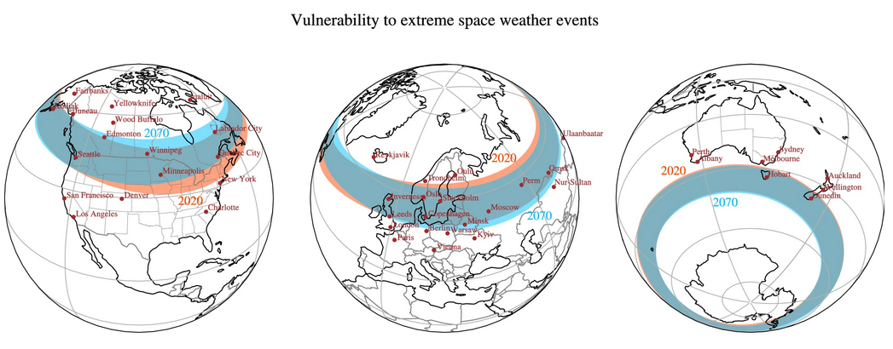

Weltraumwetter kommt oft zur Sprache, wenn es darum geht, welche Umweltgefahren zu gesellschaftlichem Kollaps oder zumindest zu massiven gesellschaftlichen Störungen führen könnten. Die Grundidee ist, dass geomagnetische Stürme von der Sonne so große Ausfälle im Stromnetz verursachen, dass sie sich nicht in vernünftiger Zeit reparieren lassen, was zu einem dauerhaften Stromausfall führt. Und wie wir aus [anderen Beiträgen](https://existentialcrunch.substack.com/p/the-consequences-of-blackouts) dieser Reihe wissen, wäre ein Stromausfall, der länger als ein paar Tage dauert, wirklich, wirklich schlimm.

Das Seltsame ist, dass die Schadensschätzungen, auf die ich gestoßen bin, extrem weit auseinandergehen, von „ein großer geomagnetischer Sturm würde die globale Gesellschaft völlig überwältigen“ bis „das ist ein Nicht-Problem, das im schlimmsten Fall zu kleineren Störungen und einem kurzen, lokalen Stromausfall führen könnte“. Schauen wir uns also etwas genauer an, welche dieser beiden Sichtweisen näher an der Wirklichkeit ist.

# Was ist ein geomagnetischer Sturm?

Bevor wir in die Details von Schäden und Gegenmaßnahmen einsteigen, definieren wir zuerst ein paar zentrale Begriffe rund um Weltraumwetter. Für diesen und den nächsten Abschnitt stütze ich mich auf schöne Überblicksartikel von Baker et al. (2014), Johnson et al. (2016) und Eastwood et al. (2017):

* Weltraumwetter: Die ganze Strahlung und die Teilchen, die die Sonne auf uns wirft, und wie sie mit dem Magnetfeld der Erde interagieren.
* Sonneneruptionen: Plötzliche Ausbrüche elektromagnetischer Strahlung von der Sonnenoberfläche, von Radiowellen bis zu Röntgen- und Gammastrahlen, verursacht durch die Freisetzung magnetischer Energie.
* Sonnenwind: Der ständige Strom geladener Teilchen (vor allem Elektronen und Protonen), der von der Sonne in alle Richtungen hinausfließt.
* Koronale Massenauswürfe (CME): Wenn die Sonne besonders große Mengen geladener Teilchen ins All schießt.
* Geomagnetischer Sturm: Die großen magnetischen Störungen im Magnetfeld der Erde, die entstehen, wenn starker Sonnenwind (oft verstärkt durch CMEs) auf die Erde trifft.

# Wie der Schaden entsteht

Bei einem geomagnetischen Sturm verdreht und verbiegt sich das Magnetfeld um die Erde unter dem Ansturm der Emissionen der Sonne. Diese Bewegung erzeugt geomagnetisch induzierte starke Ströme in allem auf der Erde, was groß ist und Strom leiten kann. Am stärksten betroffen sind deshalb das Stromnetz und Pipelines. Beides sind lange Metallleitungen, die die Ströme einfangen können. Für Pipelines ist das kein so großes Problem, es verstärkt nur die Korrosion. Das ist schlecht für die langfristige Instandhaltung, aber nicht katastrophal. Bahnstrecken haben manchmal kurzfristige Störungen, oder es kann zu Bränden in Relaisstationen kommen. Beim Stromnetz ist das anders. Fernübertragungsleitungen brauchen einen geringen elektrischen Widerstand, um gut zu funktionieren. Dieser geringe Widerstand heißt aber auch, dass sie die Ströme des geomagnetischen Sturms leichter aufnehmen. Im Grunde wirken diese Fernleitungen wie riesige Antennen, die die vom Sturm induzierten Ströme einfangen. Wenn der Strom im Netz wegen des geomagnetischen Sturms stark schwankt, kann das Schäden verursachen und Sicherheitsabschaltungen auslösen.

Manche Fachleute argumentieren, dass die bestehenden Schutzmaßnahmen gegen niederfrequente Ströme wie die aus geomagnetischen Stürmen nicht ausreichen, um großflächige Schäden am Stromnetz zu verhindern. Das zeigt sich vor allem bei den Transformatoren. Der zusätzliche Strom kann sie beschädigen, sie durch Erhitzung schneller altern lassen und möglicherweise zu einem kompletten Funktionsverlust führen. Grundsätzlich baut sich dieser Schaden über Stunden auf und ist weniger ein sofortiger Ausfall des Systems. Trotzdem ist dieser Schaden ein großes Problem, denn diese Transformatoren sind ziemlich groß, und wenn man heute einen bestellt, kann es Monate bis Jahre dauern, bis er geliefert wird. Die Lieferzeiten wären natürlich länger, wenn das an vielen Orten gleichzeitig passiert. Theoretisch könnte man also in einer Lage landen, in der Stromausfälle Wochen oder sogar länger dauern. Das wäre sehr zerstörerisch, und wie zerstörerisch, schauen wir uns weiter unten in diesem Beitrag an (1).

Der Zusammenbruch des Stromnetzes ist eindeutig das schlimmste Ergebnis, das ein geomagnetischer Sturm haben kann. Es ist aber nicht das einzige, über das wir uns Sorgen machen sollten:
* Störungen der Kommunikation: Geomagnetische Stürme bringen Energie in die Ionosphäre, das kann den Kurzwellenfunk stören.
* Störung der globalen Synchronisation und Navigation: Globale Satellitennavigationssysteme (Dinge wie GPS) könnten mehrere Tage gestört sein. Das wäre allgemein ärgerlich für die Navigation, aber noch wichtiger ist, dass wir sie auch für die globale Synchronisation aller möglichen Dinge nutzen, etwa unseres Finanzsystems. Das wäre während des Sturms nicht möglich.
* Probleme in der Luftfahrt: Flugzeuge könnten höheren Strahlendosen als normal ausgesetzt sein. Das hätte keine unmittelbaren Folgen, würde aber eine zufällige Auswahl von Menschen in den Flugzeugen später im Leben zu Krebs verurteilen. Außerdem könnte die Kommunikation mit Flugzeugen abbrechen, und ihre Navigationssysteme könnten betroffen sein.
* Kaskadierende Schäden: Die Stürme können Spannungsschwankungen auf den Stromleitungen verursachen, die andere Komponenten beschädigen und automatische, kaskadierende Abschaltroutinen im Netz auslösen können.

# Historische Beispiele

Aus der Geschichte kennen wir mehrere Beispiele für massive geomagnetische Stürme, die die Erde getroffen haben (auch beschrieben in Eastwood et al. (2017)):

* 1859: Das Carrington-Ereignis ist der größte geomagnetische Sturm, der die Erde getroffen hat, seit wir sie genau aufzeichnen können. Er störte an vielen Orten Telegrafenleitungen, richtete aber letztlich nicht viel Schaden an, weil es damals kaum sehr verwundbare Teile der Gesellschaft gab.
* 1921: Dieser Sturm war wahrscheinlich ähnlich stark wie das Carrington-Ereignis, aber sicher sind wir nicht, weil lange zurückliegende Ereignisse schwer einzuschätzen sind. Er verursachte Brände in mehreren Telegrafenstationen in Schweden.
* 1967: Dieser Sturm war groß genug, um die Kommunikation in den USA stark zu stören. Vor allem das Militär machte sich ziemliche Sorgen und fing deshalb an, sich ernsthafter mit den Folgen von Weltraumwetter zu beschäftigen.
* 1989: Etwa 1,5- bis 3-mal kleiner als Carrington, führte dieser Sturm zu einem großen Stromausfall in Kanada und beschädigte zwei größere Transformatoren in Großbritannien.
* 2003: Ein großer, aber nicht gewaltiger Sturm führte zu einem kurzen Stromausfall in Schweden.
* 2012: Ein Sturm der Carrington-Klasse wurde von der Sonne ausgestoßen, verfehlte aber die Erde.
* 2024: Das war der jüngste große geomagnetische Sturm, der die Erde traf. Er ließ zwar Polarlichter in ganz Europa sichtbar werden, aber seine geomagnetischen Folgen waren etwas kleiner als beim Sturm von 1989, sodass nicht viel Schaden entstand (einen Vergleich dieses Sturms mit früheren machen Lawrence et al. (2025)).

# Wo auf der Erde passiert das?

Die Folgen geomagnetischer Stürme wären nicht überall auf der Erde gleichzeitig zu spüren. Die Stürme können aber bis zu einer Woche dauern, und die Erde dreht sich alle 24 Stunden, sodass potenziell jeder Ort auf der Erde erreicht werden könnte. In den exponierten Gebieten ist die Verteilung aber nicht zufällig. Wegen der Form des Magnetfelds gibt es Gebiete, die bevorzugt getroffen werden könnten. Zum Glück haben Maffei et al. (2023) mit physikbasierten Modellen vorhergesagt, wo diese Gebiete heute liegen und wo sie in fünf Jahrzehnten liegen werden. Sie verschieben sich langsam, weil die Lage der Erde im All nicht völlig stabil ist, sondern etwas taumelt. Abbildung 1 zeigt die Gebiete mit der höchsten Wahrscheinlichkeit, von extremem Weltraumwetter getroffen zu werden. Sie zeigt, dass Nordeuropa, Südkanada und der Norden der USA die höchste Chance haben, getroffen zu werden. Das heißt aber nicht, dass alle anderen Orte sicher sind. Es heißt nur, dass die Wahrscheinlichkeit geringer ist. Während des Carrington-Ereignisses waren Polarlichter bis zum Äquator zu sehen.

Abbildung 1: Bänder mit der höchsten Wahrscheinlichkeit großer Schwankungen des Erdmagnetfelds durch geomagnetische Stürme.

Eine zweite globale Folge sind Störungen von Satelliten in der Erdumlaufbahn. Da die koronalen Massenauswürfe mehr Teilchen in Richtung Erde drücken, steigt die Dichte der Atmosphäre. Das heißt, dass Satelliten mehr Luftwiderstand haben, an Geschwindigkeit und damit an Höhe verlieren. Viele Satelliten haben Triebwerke an Bord, um dem entgegenzuwirken, aber bei einem sehr schweren Sturm reichen die vielleicht nicht, was zum Verlust einer unbekannten, aber möglicherweise großen Zahl von Satelliten führen könnte.

# Wie groß könnten diese Stürme werden?

Die Folgen der Stürme hängen stark davon ab, wie groß sie sind. Wir wissen klar, dass Stürme von der Größe des Carrington-Ereignisses passieren können, und wir sollten etwa alle 150 Jahre mit einem rechnen. Das ist aber nicht das absolute Maximum. Die Größe der Stürme folgt einer Verteilung mit sehr dicken Rändern, das heißt, viel größere, aber seltenere Ereignisse sind möglich. Leider haben wir keine wirklich lange Zeitreihe der Sonnenaktivität. Was wir haben, ist ein Himmel voller Sterne, von denen viele der Sonne ähneln. Vasilyev et al. (2024) haben eine große Stichprobe sonnenähnlicher Sterne genutzt, um zu prüfen, wie oft sie große Eruptionen erzeugen. Sie fanden, dass die Sterne in ihrer Stichprobe etwa alle 100 Jahre Eruptionen erzeugten, die 1 bis 1,5 Größenordnungen größer waren als Carrington. Die Sonne könnte also ein paar böse Überraschungen für uns bereithalten, aber wir wissen nicht sicher, ob die Sonne überhaupt Stürme dieser Größe erzeugen kann.

Es gibt auch Forschung, die in paläoklimatischen Aufzeichnungen nachschaut, wie groß die Eruptionen der Sonne werden können. Ein aktuelles Beispiel ist Bard et al. (2023). Wenn Sonneneruptionen auf die Erdatmosphäre treffen, erzeugen sie radioaktiven Kohlenstoff-14. Bäume nehmen ihn auf und lagern ihn in ihren Jahresringen ein. Wenn man sehr alte Baumreste hat, kann man die Kohlenstoff-14-Konzentration also als Stellvertreter für die Größe der Sonneneruptionen nutzen, die die Erde trafen, während der Baum noch wuchs. Bard und seine Co-Autoren fanden 14.300 Jahre alte Baumreste. In diesen Bäumen fanden sie Kohlenstoff-14-Konzentrationen, die darauf hindeuten, dass eine Sonneneruption, etwa eine Größenordnung größer als das Carrington-Ereignis, die Erde getroffen haben muss.

Diese beiden Argumentationslinien deuten darauf hin, dass die Sonne wahrscheinlich geomagnetische Stürme erzeugen kann, die eine Größenordnung größer sind als das Carrington-Ereignis. Die maximale Größe eines geomagnetischen Sturms ist aber auch durch die Stärke des Erdmagnetfelds begrenzt. Vasyliūnas (2011) hat ein theoretisches physikalisches Modell entwickelt und argumentiert damit, dass die größtmögliche Änderung des Magnetfelds bei einem Sturm etwa das 1,5-Fache des Carrington-Ereignisses beträgt, gemessen an der Absenkung des Magnetfelds in den Tropen. Das ist allerdings nicht genau dasselbe wie die maximale Änderungsrate des Magnetfelds, die für das Überhitzen von Hochspannungstransformatoren und andere Probleme im Stromnetz verantwortlich ist. Stürme über 1,5-facher Carrington-Größe könnten also trotzdem mehr Schaden anrichten, etwa indem sie schneller auf den Maximalwert ansteigen oder sich schneller ändern, auch wenn ihre maximale Absenkung der Magnetfeldstärke gedeckelt ist.

Die Gefahr könnte auch näher rücken. Jasinski & Velli (2025) haben sich Aktivitätsdaten der Sonne aus den letzten Jahrzehnten angeschaut und festgestellt, dass die Sonne derzeit allgemein auf einem Trend zu mehr Aktivität ist, sodass in den nächsten Jahrzehnten größere geomagnetische Stürme häufiger auftreten könnten. Auch das Magnetfeld der Erde ist auf einem Trend zur Abschwächung, was den natürlichen geomagnetischen Schutzschild gegen die Strahlung geladener Teilchen aus CMEs verringert.

# Schadensschätzungen

Da wir zum Glück noch kein Ereignis von Carrington-Größe mit unserer modernen, hoch digitalisierten Zivilisation erlebt haben, müssen wir uns auf Modelle stützen, um mögliche Schäden zu verstehen. Die Schätzungen gehen weit auseinander. Das pessimistischste, häufig zitierte Paper ist von Schulte in den Bäumen et al. (2014). Sie haben geomagnetische Stürme ähnlich dem Ereignis in Québec 1989 modelliert und bestimmt, welche geografischen Gebiete wahrscheinlich betroffen wären (Abbildung 1). Sie nahmen an, dass betroffene Regionen für ein Jahr 10 % ihrer Stromerzeugungskapazität verlieren würden, was die geschätzte Zeit ist, um beschädigte Transformatoren zu ersetzen und die Netzinfrastruktur wiederherzustellen. Mit einem globalen Lieferkettenmodell, das 187 Länder und ~16.000 Wirtschaftssektoren abdeckt, haben sie verfolgt, wie sich dieser Strommangel fortpflanzen würde: Produktionsverluste in stromabhängigen Sektoren, gestörte Lieferketten und weniger internationaler Handel, weil Länder keine Waren importieren können, die nicht produziert wurden. Das ergab geschätzte globale Verluste von 2,4 bis 3,4 Billionen Dollar (3,9 bis 5,6 % des globalen BIP), wobei etwa die Hälfte des Schadens in Ländern außerhalb der direkt betroffenen Zonen entstand. Der Unterschied ihrer Schätzung zu dem, was 1989 tatsächlich passierte, ist, dass sie annehmen, dass Regionen getroffen werden, die für die Weltwirtschaft wichtiger sind. Aber ihre Forschung scheint mir ein Worst Case unter pessimistischen Annahmen zu sein. Sie modellieren auch Ereignisse von Carrington-Größe, sagen aber nie, was die kosten würden. Wenn man das naiv nach der Größe des Sturms hochrechnet, kommt man auf etwa 5 bis 10 Billionen Dollar Schaden.

Am anderen Ende des wissenschaftlichen Spektrums stehen Oughton et al. (2019). Sie haben zuerst das Stromnetz Großbritanniens simuliert und wie geomagnetische Stürme verschiedener Größe darin Schäden verursachen würden. Darauf aufbauend prüfen sie, wie stark die Wirtschaft gestört wird und wie sich das in Lieferketten fortpflanzt. Ihre Schätzung ist, dass ein Ereignis von Carrington-Größe bis zu 60 Millionen Menschen in Großbritannien ohne Strom lassen würde, sie nehmen aber an, dass das Netz innerhalb von Tagen bis Wochen wiederhergestellt würde. Der Schaden von 20 Milliarden Dollar, auf den sie kommen, beruht dann auf entgangenen wirtschaftlichen Transaktionen in diesem Zeitraum. Das berücksichtigt allerdings keine globalen Effekte allgemein und modelliert auch nicht, dass andere Länder vor demselben Problem stehen könnten. Und schließlich berücksichtigt es auch nicht die Schäden, die bei einem wochenlangen Stromausfall entstehen würden, die wahrscheinlich viel schwerer wären als nur entgangene wirtschaftliche Transaktionen. Wenn wir das naiv auf globale Zahlen hochrechnen, basierend auf dem Anteil Großbritanniens am globalen BIP, kommen wir auf etwa 660 Milliarden $ Schaden weltweit.

Der Unterschied zwischen diesen Zahlen entspricht ungefähr dem Unterschied zwischen dem, was die USA für ihr Militär ausgeben, und einem Drittel des gesamten BIP der USA. Das ist ein gewaltiger Unterschied. Und selbst die größere Zahl setzt sich nicht wirklich damit auseinander, was passiert, wenn eine Region einen längeren Stromausfall erlebt. Außerdem werden Störungen von Satelliten, vor allem Megakonstellationen und globale Satellitennavigationssysteme, hier überhaupt nicht berücksichtigt.

Und schließlich gibt es noch die Netzbetreiber selbst, die das Netz instand halten und überwachen. Ihnen ist sehr bewusst, dass so etwas passieren kann, und in den letzten Jahrzehnten haben die Länder, die am wahrscheinlichsten von geomagnetischen Stürmen betroffen sind, ihr Netz gehärtet, damit es ihnen standhält. Es ist aber ziemlich schwer, ein Bild davon zu bekommen, wie weit das tatsächlich gekommen ist. Der neueste große Regierungsbericht, den ich finden konnte, war vom U.S. Department of Energy (2019). Er gab einen Überblick über den Stand der Vorbereitungen in den USA. Darin steht:

* Die Branche muss Pläne haben, was sie tut, wenn geomagnetische Stürme kommen.
* Sie muss alle 60 Monate eine Schadensbewertung machen.
* Die Branche ist mit der Regierung im Gespräch über eine physische Härtung des Netzes.
* Es gibt noch große Lücken im Verständnis, wie große geomagnetische Stürme mit dem Netz interagieren würden.

Insgesamt klingt es so, als würde das Risiko ernst genommen und an Vorbereitungen gearbeitet, aber sie sind noch lange nicht fertig. Dieser Bericht gilt nur für die USA, aber ich würde annehmen, dass noch exponiertere Länder wie Kanada oder Schweden besser vorbereitet sind, während Länder wie China, die bei kleineren geomagnetischen Stürmen nicht betroffen sind, wahrscheinlich viel schlechter vorbereitet wären und bei schweren Stürmen große Probleme hätten. Deshalb und wegen vieler anderer Unsicherheiten scheint mir die Bandbreite möglicher Schäden ziemlich groß.

# Wie können wir uns vorbereiten?

Zum Glück gibt es zumindest einige Dinge, die man tun kann, um Schäden zu verhindern oder zumindest zu verringern, wenn ein geomagnetischer Sturm kommt. Besonders wichtig sind hier genaue Vorhersagen geomagnetischer Stürme und ihrer Folgen. Oughton et al. (2019) schauen sich auch Szenarien mit besseren Vorhersagen als heute an, und das senkt ihre Schadensschätzung um zwei Drittel, weil die verwundbarsten Teile des Stromnetzes einfach abgekoppelt werden können. Sie werden dann nicht beschädigt und können direkt nach dem Ende des Sturms wieder ins Netz genommen werden. Grundsätzlich scheint mir, dass die Vorhersage der Bereich ist, in dem es im letzten Jahrzehnt oder so die meisten Fortschritte gab: Es wurden Satelliten zur Überwachung hinzugefügt, und die Vorhersagen sind inzwischen meist gut genug, um geomagnetische Stürme etwa zehn Stunden im Voraus vorherzusagen. Dank besserer Vorhersagen ließe sich also wahrscheinlich ein großer Teil der Schäden verhindern, selbst bei größeren Stürmen.

Neben Vorhersagen gibt es noch mehrere andere Möglichkeiten, die physische Infrastruktur resilienter zu machen (wie in Johnson et al. (2016) erklärt und in Kanada, den USA und Schweden umgesetzt):

* Kondensator-Blockierung: Dabei werden niederohmige Widerstände ins Netz eingebaut. Sie bremsen den Fluss der eintreffenden Ströme und schützen so, indem sie die maximalen Lasten verringern.
* Redundante Transformatoren: Einfach ein paar Ersatztransformatoren haben, mit denen man beschädigte schnell ersetzen kann.
* Änderungen der Netztopologie: Alle 50 bis 75 km Erdungspunkte einbauen, um zu begrenzen, wie viel schädlicher Strom sich in Übertragungsleitungen ansammeln kann. Außerdem alternative Wege im Netz haben, damit gestörte Leitungen nicht das Ganze lahmlegen.

# Fazit

Die vorhandenen Schadensschätzungen scheinen etwas ungenau zu sein und lassen wichtige Wege aus, etwa Schäden durch länger andauernde Stromausfälle. Außerdem kann die Sonne wahrscheinlich geomagnetische Stürme erzeugen, die deutlich größer sind als das Carrington-Ereignis, trotzdem behandeln fast alle Paper Carrington als Worst-Case-Szenario. Es scheint aber eine Obergrenze für die Schwere von Stürmen zu geben, je nachdem, wie das Magnetfeld der Erde funktioniert.

Bei den Gegenmaßnahmen haben sich die Vorhersagen deutlich verbessert, und im letzten Jahrzehnt wurden viele Maßnahmen zur Härtung des Netzes umgesetzt. Regierungsberichte zeigen aber, dass noch viel zu tun ist und große Unsicherheiten bleiben. Beim aktuellen Wissensstand bleibt unklar, wie schwer geomagnetische Stürme werden könnten.

Es gibt aber Gründe für vorsichtigen Optimismus. Das ist ein aktives Forschungsfeld mit im Vergleich zu anderen globalen Risiken relativ starkem staatlichem Interesse, was darauf hindeutet, dass die Gefahren mit der Zeit abnehmen könnten. Außerdem scheinen geomagnetische Stürme bei den schlimmsten Folgen eher regional als global zu sein. Die Effekte könnten zwar möglicherweise in weiten Teilen der Welt zu spüren sein, aber Schäden an Transformatoren würden wahrscheinlich nur bestimmte Regionen treffen. Das wäre sicher teuer zu reparieren und könnte viele Menschenleben kosten, wenn es schlecht gehandhabt wird, aber es scheint keinen realistischen Weg zu einem globalen Stromausfall zu geben.

# Zitieren
Bitte das englische Original zitieren:

Jehn, F. U. (2025, October 29). Auroras, space weather and the threat to critical infrastructure. Existential Crunch. [https://doi.org/10.59350/g95ww-xym22](https://doi.org/10.59350/g95ww-xym22)

# Anmerkungen

(1) Eine Einschränkung: Viele Hochspannungstransformatoren haben schon Ersatzgeräte in der Station, die man in Tagen oder Wochen statt Monaten in Position bringen und einschalten könnte.

# Quellen

* Baker, D. N., Jackson, J. M., & Thompson, L. K. (2014). Predicting and mitigating socio-economic impacts of extreme space weather: Benefits of improved forecasts. In A. Ismail-Zadeh, A. Kijko, I. Zaliapin, J. Urrutia Fucugauchi, & K. Takeuchi (Eds.), Extreme Natural Hazards, Disaster Risks and Societal Implications (pp. 113–125). Cambridge University Press. https://doi.org/10.1017/CBO9781139523905.012
* Bard, E., Miramont, C., Capano, M., Guibal, F., Marschal, C., Rostek, F., Tuna, T., Fagault, Y., & Heaton, T. J. (2023). A radiocarbon spike at 14 300 cal yr BP in subfossil trees provides the impulse response function of the global carbon cycle during the Late Glacial. Philosophical Transactions of the Royal Society A: Mathematical, Physical and Engineering Sciences, 381(2261), 20220206. https://doi.org/10.1098/rsta.2022.0206
* Eastwood, J. P., Biffis, E., Hapgood, M. A., Green, L., Bisi, M. M., Bentley, R. D., Wicks, R., McKinnell, L.-A., Gibbs, M., & Burnett, C. (2017). The Economic Impact of Space Weather: Where Do We Stand? Risk Analysis, 37(2), 206–218. https://doi.org/10.1111/risa.12765
* Jasinski, J. M., & Velli, M. (2025). The Sun Reversed Its Decades-long Weakening Trend in 2008. The Astrophysical Journal Letters, 990(2), L55. https://doi.org/10.3847/2041-8213/adf3a6
* Johnson, M., Gorospe, G., Landry, J., & Schuster, A. (2016). Review of mitigation technologies for terrestrial power grids against space weather effects. International Journal of Electrical Power & Energy Systems, 82, 382–391. https://doi.org/10.1016/j.ijepes.2016.02.049
* Lawrence, E., Beggan, C. D., Richardson, G. S., Reay, S., Thompson, V., Clarke, E., Orr, L., Hübert, J., & Smedley, A. R. D. (2025). The geomagnetic and geoelectric response to the May 2024 geomagnetic storm in the United Kingdom. Frontiers in Astronomy and Space Sciences, 12. https://doi.org/10.3389/fspas.2025.1550923
* Maffei, S., Eggington, J. W. B., Livermore, P. W., Mound, J. E., Sanchez, S., Eastwood, J. P., & Freeman, M. P. (2023). Climatological predictions of the auroral zone locations driven by moderate and severe space weather events. Scientific Reports, 13(1), 779. https://doi.org/10.1038/s41598-022-25704-2
* Oughton, E. J., Hapgood, M., Richardson, G. S., Beggan, C. D., Thomson, A. W. P., Gibbs, M., Burnett, C., Gaunt, C. T., Trichas, M., Dada, R., & Horne, R. B. (2019). A Risk Assessment Framework for the Socioeconomic Impacts of Electricity Transmission Infrastructure Failure Due to Space Weather: An Application to the United Kingdom. Risk Analysis, 39(5), 1022–1043. https://doi.org/10.1111/risa.13229
* Schulte in den Bäumen, H., Moran, D., Lenzen, M., Cairns, I., & Steenge, A. (2014). How severe space weather can disrupt global supply chains. Natural Hazards and Earth System Sciences, 14(10), 2749–2759. https://doi.org/10.5194/nhess-14-2749-2014
* U.S. Departement of Energy. (2019). Geomagnetic Disturbance Monitoring Approach and Implementation Strategies. U.S. Departement of Energy. https://www.energy.gov/sites/prod/files/2019/06/f64/DOE_GMD_Monitoring_January2019_508v2.pdf
* Vasilyev, V., Reinhold, T., Shapiro, A. I., Usoskin, I., Krivova, N. A., Maehara, H., Notsu, Y., Brun, A. S., Solanki, S. K., & Gizon, L. (2024). Sun-like stars produce superflares roughly once per century. Science, 386(6727), 1301–1305. https://doi.org/10.1126/science.adl5441
* Vasyliūnas, V. M. (2011). The largest imaginable magnetic storm. Journal of Atmospheric and Solar-Terrestrial Physics, 73(11), 1444–1446. https://doi.org/10.1016/j.jastp.2010.05.012
