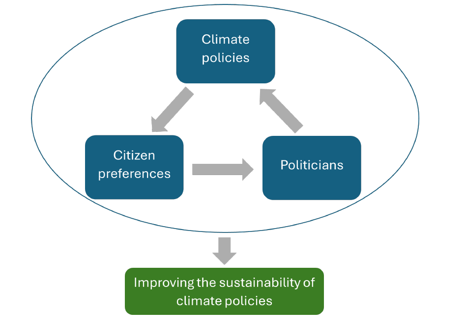
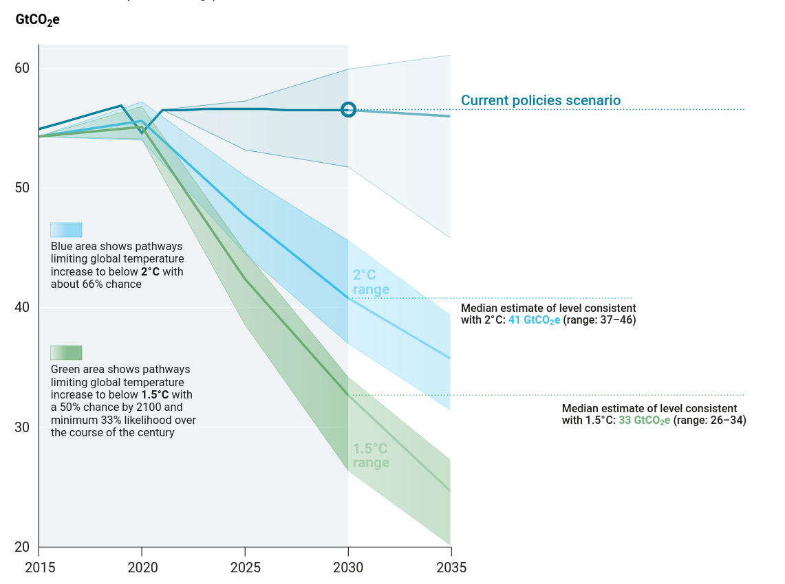
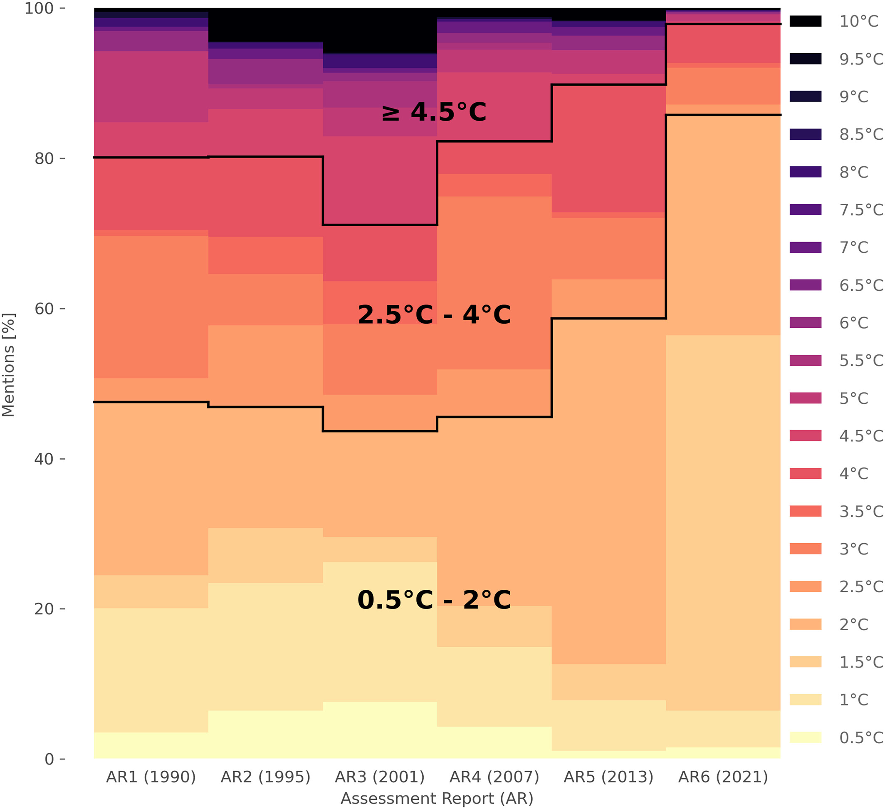

Solange wir nicht im Jahr 2100 sind, werden wir nicht genau wissen, welchen Weg die Menschheit in diesem Jahrhundert beim Klimawandel genommen hat. Aber wir können zumindest fundierte Vermutungen anstellen, auf welchem Kurs wir sind. Vor diesem Hintergrund scheint ein guter Teil der Klimaforschung auf hoffnungsvolle Temperaturbereiche unter 2 °C ausgerichtet zu sein, die wir wahrscheinlich verfehlen werden. Der Fokus auf unter 2 °C kommt von den ehrgeizigen Klimazielen, die sich die Menschheit gesetzt hat. Wir haben weniger Forschung zu den Temperaturen weit über 2 °C, die derzeit am wahrscheinlichsten aussehen, und noch weniger zu einer Erwärmung im Extrembereich, die unwahrscheinlich ist, aber gewaltige Folgen hätte. Mit Extrembereich meine ich sowohl die Möglichkeit unerwartet hoher Emissionen als auch die Möglichkeit unerwartet hoher Temperaturen bei einem bestimmten Emissionsniveau. Dieser Beitrag soll einen Überblick geben, warum ich glaube, dass die Klimaforschung zumindest teilweise in die falsche Richtung schaut, um solche Risiken zu verstehen.

# Gründe für Pfade über 2 °C

Schauen wir uns zuerst an, warum es wieder wahrscheinlicher geworden zu sein scheint, dass wir in einer Welt mit mehr als 2 °C landen. Vor 2020 gab es noch etwas Hoffnung, dass der Klimaschutz die nötige Kraft gewinnt, um die Erwärmung unter 2 °C zu begrenzen, aber die letzten Jahre fühlten sich eher nach Enttäuschung an. Sowohl, wie sich das Klimasystem verhält, als auch, wie sich die Gesellschaft verhält.

## Grüner Backlash

Bevor COVID kam, gab es in vielen Ländern große Klimaproteste. Nur ein paar Jahre später scheinen die wichtigsten Nachrichten aber zu sein, dass Klimaschutz einfach zu teuer ist und wir ihn aufgeben und das ganze Geld stattdessen in die Wirtschaft stecken sollten. Das ist nicht nur mein Eindruck, sondern auch das Thema eines aktuellen Überblicksartikels von Bosetti et al. (2025). Sie haben versucht, die politischen Folgen von Klimapolitik zu verstehen. Auf Grundlage ihrer Ergebnisse argumentieren sie, dass sich die Unzufriedenheit rund um Klimapolitik vor allem um zwei Themen dreht:

* Wirtschaft: Die Verteilungsfolgen. Klimapolitik bringt, wie jede Politik, Gewinner und Verlierer hervor. Wenn zu viele Menschen glauben, dass Klimapolitik ihnen schadet, versuchen sie, jemand anderen zu wählen.
* Kultur: Ein breiteres Muster des Misstrauens gegenüber der wissenschaftlichen und politischen Elite (1).

Sie fassen den gesamten Prozess in einem sehr einfachen konzeptionellen Modell zusammen (Abbildung 1). Die Grundidee: Politiker setzen Klimapolitik um, die trifft die Bürger, und die wählen Politiker danach, wie sie getroffen wurden. Einfach.

Abbildung 1: Konzeptionelles Modell, wie Klimapolitik, Politiker und Präferenzen der Bürger zusammenwirken

Dann erklären sie alle drei Schritte genauer:

### Folgen der Klimapolitik

Klimapolitik besteht typischerweise aus zwei Hauptteilen: erneuerbare Energien fördern und fossile Brennstoffe reduzieren. Projekte für erneuerbare Energien stoßen oft auf lokalen Widerstand, etwa wenn Leute gegen Windräder in der Nähe ihrer Häuser sind. Zu den Maßnahmen gegen fossile Brennstoffe gehören Verkehrsbeschränkungen, Verbote von Verbrennerautos, höhere Kraftstoffsteuern und die Schließung von Kohleminen.

Bosetti et al. (2025) finden in ihren Fallstudien ein durchgängiges Muster: Diese Maßnahmen erhöhen die Unterstützung für Politiker, die gegen Klimaschutz sind, aber nur, wenn die betroffenen Bürger keinen Ausgleich bekommen. Wenn es einen Ausgleich gibt, etwa besseren öffentlichen Nahverkehr zusammen mit Verkehrsbeschränkungen, bleibt die Unterstützung für Klimaschutz stabil. Menschen scheinen bereit zu sein, Klimapolitik zu akzeptieren, wenn sie für ihre Verluste entschädigt werden, und noch mehr, wenn sie in Entscheidungen einbezogen werden. Leider werden diese wichtigen Schritte oft ausgelassen, weil sie zusätzliches Geld kosten, das Regierungen offenbar nicht ausgeben wollen. Von dieser Lücke bei Ausgleich und Mitsprache profitieren meist rechte Parteien, die gegen Klimaschutz mobilisieren.

### Mobilisierung rechtspopulistischer Parteien gegen Klimaschutz

Rechtspopulistische Parteien betonen besonders, dass es einen Zielkonflikt zwischen Klimaschutz und wirtschaftlicher Entwicklung geben könnte, dessen Preis zu hoch sei. Dahinter steckt ihre Überzeugung, dass die Erderwärmung eigentlich gar nicht so schlimm ist, und eine allgemeine Ablehnung höherer Steuern, oft auf Basis eines neoliberalen Weltbilds. Mit diesen Botschaften können sie Klimaschutz als Kampf um Ressourcen zwischen dem reinen, arbeitenden Volk und korrupten Eliten darstellen, die Klimaschutz nur zu ihrem eigenen Vorteil vorantreiben. Diese Botschaften werden oft mit anderen Themen wie „Klimahysterie“ gemischt, die alle, die sich für Klimaschutz aussprechen, als übereifrige Aktivisten diskreditieren sollen.

Es gibt einige rechtspopulistische Parteien (z. B. in Finnland), die grundsätzlich akzeptieren, dass die Erderwärmung real ist, aber trotzdem dagegen sind, etwas zu tun, weil sie es als unfair darstellen, dass sie zahlen sollen, während andere tatenlos zusehen. Ähnlich wird oft argumentiert, das eigene Land sei zu klein, um etwas zu bewirken, also müssten nur die großen Verschmutzer etwas tun.

Und schließlich bedeutet Klimaschutz Veränderung, und konservativen Parteien geht es genau darum, den Status quo zu erhalten. Dieses Argument wird dann noch weitergetrieben, indem man behauptet, das Land sei in einem reinen und schönen Zustand (oder, wahrscheinlicher, war es) und Klimaschutz werde es noch weiter von diesem Ideal entfernen.

### Politische Folgen des grünen Backlashs

Wir wissen jetzt, dass Klimaschutz ohne Ausgleich einen erheblichen Backlash auslösen kann und dass rechtspopulistische Parteien am ehesten davon profitieren. Das hat großen Einfluss darauf, wie wahrscheinlich es ist, dass Klimaschutz zurückgefahren oder sogar rückgängig gemacht wird. Das bekannteste Beispiel ist Donald Trump. Neben vielem anderen hat er die USA (zweimal) aus dem Pariser Abkommen zurückgezogen, der Umweltschutzbehörde EPA das Geld gestrichen und die Förderung von Öl und Gas liberalisiert.

Aber dasselbe sehen wir auch in Europa. Grundsätzlich gilt: Je größer der Einfluss rechtspopulistischer Parteien, desto schwächer der Klimaschutz. Dieser Einfluss wächst, wenn sie es schaffen, einen relevanten Teil der Regierung zu kontrollieren.

### Zusammengefasst

Insgesamt zeigt das, dass wir gerade in einer Zeit nachlassenden Engagements für das Klima sind, weil genau die Parteien, die dagegen mobilisieren, Schwung gewinnen. Da aber viele der Beschwerden offenbar von fehlendem Ausgleich kommen, öffnet das auch die Tür für erfolgreichere Klimapolitik in der Zukunft. In dieser Welt leben wir leider noch nicht.

## Pfadabhängigkeit

Der Aufstieg von Parteien, die wild entschlossen sind, Klimaschutz zu verzögern oder zu stoppen, zeigt sich auch beim Fortschritt im Klimaschutz. Wenn du in der Klimabewegung aktiv warst oder dich für den Klimawandel interessierst, hast du wahrscheinlich schon die Art von Grafik gesehen, die vergangene Emissionen zeigt und wie stark sie in den nächsten Jahrzehnten sinken müssten, um die Erwärmung auf 1,5 °C oder 2 °C zu begrenzen. Vielleicht ist dir aufgefallen, dass die Kurve für die nötige Emissionsminderung jedes Jahr steiler wird, weil die Länder beim Klimaschutz nicht zulegen.

Dieses Muster ist so offensichtlich geworden, dass es sogar einen ganzen UN-Bericht nur zu diesem Thema gibt (UN Environment Programme, 2023). Der Bericht schaut sich den Stand der Emissionsminderung an und wie er sich in den letzten Jahren entwickelt hat. Jedes Jahr (mit Ausnahme von 2020 wegen COVID) stellen wir einen neuen Emissionsrekord auf, während der Pfad, auf dem wir sein sollten, nach unten zeigt, nicht nach oben. Immerhin scheinen die Emissionen jedes Jahr langsamer zu wachsen, was darauf hindeutet, dass sie in ein paar Jahren sinken sollten. Aber selbst wenn sich die Richtung des Trends in ein paar Jahren ändert, wird es zu spät sein, um uns einfach wieder auf einen 1,5-°C-Pfad zu bringen. Der UN-Bericht hat auch eine aktualisierte Version der Grafik erstellt (Abbildung 2), die die Lücke zwischen dem zeigt, wo wir sein sollten, und dem, wo wir tatsächlich sind. Sie zeigt ganz klar, dass wir auf einem Pfad deutlich über 2 °C sind.

Um fair zu den rechtspopulistischen Parteien zu sein, die gerade daran arbeiten, den Klimaschutz abzubauen: Der Fortschritt war auch vorher nicht berauschend. Sie haben das Schneckentempo nur noch weiter verlangsamt.

Abbildung 2: Klimapfade für die nächsten Jahrzehnte mit der aktuellen Politik und was wir tatsächlich bräuchten, um auf 1,5 °C oder 2 °C zu kommen. Die y-Achse zeigt, wie viele Gigatonnen Kohlendioxid wir ausstoßen können.

## Heiße 2020er

Während wir offenbar in einer Welt leben, in der der Klimaschutz nachlässt, reagiert gleichzeitig das Klimasystem selbst vielleicht stärker als erwartet. Selbst wenn sich die Emissionspfade stabilisieren, könnten eine höhere Klimasensitivität oder stärkere Rückkopplungen uns zu höheren Temperaturen treiben, als die aktuellen Modelle vorhersagen.

Hier will ich eine aktuelle Studie von Minobe et al. (2025) hervorheben. Sie argumentieren, dass wir gerade in einer Zeit leben, in der fast jedes neue Jahr ein neuer Temperaturrekord ist. Ein „normales“ Jahr gibt es nicht mehr. Aber selbst in dieser extremeren Welt waren die Jahre 2023 und 2024 außergewöhnlich. Vor allem die Ozeane sind von der schnellen Erwärmung stark betroffen. Um das zu untersuchen, haben sie einen neuen statistischen Test entwickelt, der ungewöhnliche Rekordjahre erfasst, und damit Daten zu Ozean und Atmosphäre aus 2023 und 2024 analysiert. Sie finden, dass diese beiden Jahre wärmer waren, als wir hätten erwarten sollen, selbst wenn man El-Niño-Ereignisse berücksichtigt. Das deutet darauf hin, dass wir vielleicht auf einem schnelleren Klimapfad sind, als Standardmodelle vorhersagen, möglicherweise weil die Klimasensitivität höher ist als die mittlere Schätzung oder weil Rückkopplungen stärker sind. In beiden Fällen werden Szenarien mit höheren Temperaturen wahrscheinlicher. Wir brauchen aber mehr Daten, um sicher zu sein.

Das ist zwar nur eine einzelne Studie, aber nicht die einzige, die vor Kurzem darauf hingewiesen hat, dass sich das Klima vielleicht schneller erwärmt, weil die letzten Jahre ziemlich außergewöhnlich waren.

Das heißt, dass wir zwei Risiken gegenüberstehen: zu geringer Emissionsminderung und einer möglicherweise stärkeren Reaktion des Klimas auf die Emissionen, die wir ausstoßen. Beide Wege machen höhere Temperaturen wahrscheinlicher.

# Wissen wir eigentlich, was bei stärkerer Erwärmung passieren könnte?

## Fokus auf Temperaturen

Die drei Argumente oben, ein Backlash gegen die grüne Wende, nachlassender Klimaschutz und beschleunigte Erwärmung, deuten alle darauf hin, dass wir gute Chancen haben, deutlich über 2 °C Erwärmung zu landen. Aber wie gut sind wir darauf eigentlich vorbereitet? Denn theoretisch haben wir uns alle darauf geeinigt, dass eine Erwärmung deutlich unter 2 °C (oder sogar unter 1,5 °C) unser gemeinsames Ziel als Spezies ist. Da das das vereinbarte Ziel war, gab es auch einen Anreiz, sich nur auf diese Temperaturbereiche und Szenarien zu konzentrieren, die sie untersuchen. Wie sehr hat dieser Anreiz die Forschung geprägt? Dieser Frage gehen Jehn et al. (2022) nach (Hinweis: Ich bin Erstautor dieses Papers).

Der Ansatz des Papers ist einfach: Alle Dokumente des IPCC einlesen und zählen, wie oft sie verschiedene Temperaturen erwähnen. Das Ergebnis ist Abbildung 3.

Abbildung 3: Erwähnungen von Temperaturen in den verschiedenen Sachstandsberichten des IPCC.

Sie zeigt, dass sich die untersuchten Temperaturen schon immer vor allem auf Werte unter 2 °C konzentrierten, aber im AR6, dem ersten Bericht nach dem Pariser Abkommen, wurden sie besonders betont. Das zeigt, dass bis vor Kurzem der größte Teil der Forschungsenergie in Temperaturen floss, unter denen wir ziemlich wahrscheinlich nicht bleiben werden.

## Fokus auf Szenarien

Ich kenne keine Studie, die diese Zahlen mit den nach 2022 veröffentlichten IPCC-Dokumenten aktualisiert hat, aber es gab auch nicht viele neue Dokumente. Was es aber gibt, ist ein interessanter Überblicks- und Perspektivartikel von Meinshausen et al. (2024). Darin diskutieren sie, wie Klimaszenarien in der Vergangenheit genutzt wurden und wie sie in Zukunft genutzt werden sollten. Ich fasse nicht das Ganze zusammen, weil es ziemlich lang ist, aber hervorheben will ich, dass ihnen ein passendes Szenario fehlt, das zur aktuell versprochenen Politik passt. Diese wird uns wahrscheinlich in eine Welt mit weit über 2 °C Erwärmung führen, wenn auch mit großer Unsicherheit.
Frühere Szenarien haben oft höhere und niedrigere Temperaturbereiche untersucht, aber nicht wirklich genau diesen Pfad. Meinshausen und Co-Autoren argumentieren deshalb, dass wir in Zukunft so ein spezifisches Szenario erstellen sollten, das von dem Punkt ausgeht, an dem wir gerade tatsächlich sind. Das würde uns das Wissen geben, das wir für den Pfad brauchen, auf dem wir wahrscheinlich landen.

Das heißt nicht, dass wir uns jetzt alle plötzlich wieder auf RCP8.5 konzentrieren sollten, denn dieses Worst-Case-Szenario ist inzwischen praktisch unmöglich (2), sondern einen vernünftigeren Umgang mit höheren Temperaturen und vor allem mit Extremrisiken. Also mit der Möglichkeit, dass wir wegen unvorhergesehener Rückkopplungen oder einer höher als erwarteten Klimasensitivität in einem Szenario mit hohen Temperaturen landen.

Außerdem können Szenarien nur ein Teil des Puzzles sein. Was ich besonders hilfreich fände, wäre Forschung zu sich verstärkenden und kaskadierenden Ereignissen. Der IPCC ist ziemlich gut darin, auf Dinge wie die steigende Wahrscheinlichkeit von Extremwetter hinzuweisen. Was der Forschung aber allgemein fehlt, ist ein Verständnis komplexer Kaskaden über 3 °C. In so einem Erwärmungsszenario können wir mit Ereignissen wie gleichzeitigen Missernten in mehreren Kornkammern, überschrittenen Kipppunkten oder großflächigem Zusammenbruch von Ökosystemen rechnen. Was sind die langfristigen Folgen davon? Wie könnten sie zusammenwirken? Dazu gibt es sehr wenig Forschung.

# Extremrisiken zu untersuchen ist eigentlich eine gute Idee

Die beiden letzten Paper zeigen, dass es eine klare Forschungslücke gibt, sowohl beim wahrscheinlichsten Pfad als auch bei stärkerer Erwärmung. Wir brauchen hier also dringend mehr Forschung, um zu wissen, womit wir es zu tun haben und was passieren könnte, wenn wir richtig Pech haben. Wenn man solche katastrophalen Folgen aber als lohnendes Forschungsthema hervorhebt, werden sie oft abgetan, weil sie angeblich nur zu Pessimismus und Untätigkeit beim Klimaschutz beitragen.

Zum Glück gibt es auch einen Perspektivartikel von Davidson & Kemp (2024), der darlegt, warum es stattdessen ziemlich wertvoll ist, stärkere Erwärmung zu untersuchen, und dass das ein wesentlicher Teil guter Klimaforschung und -politik ist. Sie argumentieren, dass es inzwischen viele Belege dafür gibt, dass die Untersuchung extremer Erwärmung die Wissenschaft nicht falsch darstellt. Außerdem gibt es keine Belege dafür, dass sie die Dekarbonisierung bremst oder zu Apathie führt. Es gibt sogar mehrere Studien, die zeigen, dass auf Angst setzende Botschaften wirksam Absichten und Verhalten verändern, wenn sie so formuliert sind, dass man etwas tun kann.

Sie grenzen sich vom Klima-Doomerismus ab. Sie sehen sich und diesen Ansatz eher als Klimarealismus. Die extremeren Zukünfte nicht als Gewissheit sehen, sondern als Möglichkeit, die man untersuchen muss, um vor unangenehmen Überraschungen sicher zu sein. Ihre Motivation ist, diese Zukünfte besser zu verstehen, damit wir sie vermeiden können, nicht, sich auf einen baldigen Kollaps vorzubereiten (3).

Sie glauben, dass drei Ansätze am hilfreichsten sind, um diese klimatischen Endspiele zu untersuchen:
* Der erste ist Vorausschau: Wissenschaftler, Ökonomen und Philosophen erstellen mit Werkzeugen wie Klimamodellen, Expertenbefragungen und Prognoseübungen systematische Einschätzungen katastrophaler Zukünfte. Dieser Ansatz will zwar evidenzbasierte Wahrscheinlichkeitsschätzungen liefern, greift aber oft zu kurz, weil er zu vereinfachte Methoden nutzt, die wichtige kaskadierende Risiken und gesellschaftliche Reaktionen übersehen.
* Der zweite Ansatz ist Agitation: Politische Akteure und Aktivisten nutzen Bilder katastrophaler Zukünfte, um für Klimaschutz zu mobilisieren. Dazu gehören Warnungen von Gruppen wie Extinction Rebellion, die zeigen, dass eine Katastrophe möglich, aber vermeidbar ist. Agitation kann zwar gut vermitteln, was auf dem Spiel steht, und falschem Optimismus etwas entgegensetzen, riskiert aber, die Krise zu entpolitisieren, indem sie sie als universelle Bedrohung darstellt, die unterschiedliche Interessen und Positionen verdeckt.
* Der dritte Ansatz ist Fiktion: Schriftsteller und Künstler erschaffen spekulative Erzählungen über vom Klimawandel veränderte Welten. Klimafiktion hat besondere Funktionen jenseits der Unterhaltung. Sie stellt durch Verfremdung selbstverständliche Annahmen infrage, bietet einen reflektierenden Kommentar dazu, wie unterschiedliche Gemeinschaften Katastrophen schon heute unterschiedlich erleben, und zeigt die Grenzen unserer Fähigkeit, uns beispiellose Zukünfte vorzustellen. Fiktion mag zu spekulativ erscheinen, hilft aber tatsächlich, wichtige, aber übersehene Zukünfte hervorzuheben, und fördert epistemische Bescheidenheit (4).

Die Autoren argumentieren, dass diese drei Ansätze sich ergänzen und besser verbunden werden sollten, wobei man sich immer bewusst sein muss, dass extreme Ergebnisse unsichere Möglichkeiten sind, die es zu vermeiden gilt, und keine unvermeidlichen Gewissheiten, die man hinnehmen muss.

# Fazit

Alles zusammengenommen sieht es so aus, als wären wir auf einem schwierigen Klimapfad weit über 2 °C Erwärmung, und wir wissen noch nicht genug darüber, was uns in so einer Zukunft erwarten könnte. Es ist aber toll zu sehen, dass Leute daran arbeiten, und beim Lesen des ersten Papers (Bosetti et al., 2025) war es auch eine angenehme Überraschung, dass mehr Klimapolitik offenbar nicht automatisch zu mehr Backlash führt. Sie muss nur ausgeglichen und demokratischer umgesetzt werden, damit die Ergebnisse viel besser werden.

Zum Schluss will ich besonders die Community zu Kipppunkten im Klima hervorheben. Nach vielen Gesprächen und dem Lesen ihrer Paper scheint mir, dass das der Teil der Klimaforschung ist, der Extremrisiken am ernstesten nimmt. Außerdem veröffentlichen sie ihr neuestes Wissen inzwischen jedes Jahr in einem [Global Tipping Points Report](https://global-tipping-points.org/). Schön zu sehen, dass ihre Forschung zu extremeren Zukünften an Fahrt gewinnt.

Jetzt müssen wir nur noch die Arbeit reinstecken, um diese Zukünfte zu vermeiden.

# Zitieren
Bitte das englische Original zitieren:

Jehn, F. U. (2025, November 26). Does climate science focus on the right temperature range?. Existential Crunch. https://doi.org/10.59350/g64bp-jjf43

# Anmerkungen

(1) Wenn du mehr darüber erfahren willst, woher dieses Misstrauen kommen könnte, schau [hier](https://existentialcrunch.substack.com/p/inequality-all-the-way-down).

(2) Climate Brink hat einen [schönen Erklärtext](https://www.theclimatebrink.com/p/moving-away-from-high-end-emissions) dazu geschrieben, warum RCP8.5 unwahrscheinlich ist.

(3) Leute meinen ganz verschiedene Dinge, wenn sie über Kollaps reden. Wenn du wirklich den Zusammenbruch der Industriegesellschaft meinst, sehe ich nicht wirklich, was dir Vorbereitung jetzt bringt. Die Chancen stehen ziemlich gut, dass du nur hart für das Privileg arbeitest, als Letzter zu verhungern.

(4) Das beste Beispiel dafür ist wohl „[Das Ministerium für die Zukunft](https://www.goodreads.com/book/show/50998056-the-ministry-for-the-future)“. Ich kann empfehlen, Klimaforschende zu fragen, was sie von dem Buch halten. Die Chancen stehen gut, dass sie es gelesen haben und eine Meinung dazu haben.

# Quellen
* Bosetti, V., Colantone, I., De Vries, C. E., & Musto, G. (2025). Green backlash and right-wing populism. Nature Climate Change, 15(8), 822–828. https://doi.org/10.1038/s41558-025-02384-0
* Davidson, J. P. L., & Kemp, L. (2024). Climate catastrophe: The value of envisioning the worst-case scenarios of climate change. WIREs Climate Change, 15(2), e871. https://doi.org/10.1002/wcc.871
* Jehn, F. U., Kemp, L., Ilin, E., Funk, C., Wang, J. R., & Breuer, L. (2022). Focus of the IPCC Assessment Reports Has Shifted to Lower Temperatures. Earth’s Future, 10(5), e2022EF002876. https://doi.org/10.1029/2022EF002876
* Meinshausen, M., Schleussner, C.-F., Beyer, K., Bodeker, G., Boucher, O., Canadell, J. G., Daniel, J. S., Diongue-Niang, A., Driouech, F., Fischer, E., Forster, P., Grose, M., Hansen, G., Hausfather, Z., Ilyina, T., Kikstra, J. S., Kimutai, J., King, A. D., Lee, J.-Y., … Nicholls, Z. (2024). A perspective on the next generation of Earth system model scenarios: Towards representative emission pathways (REPs). Geoscientific Model Development, 17(11), 4533–4559. https://doi.org/10.5194/gmd-17-4533-2024
* Minobe, S., Behrens, E., Findell, K. L., Loeb, N. G., Meyssignac, B., & Sutton, R. (2025). Global and regional drivers for exceptional climate extremes in 2023-2024: Beyond the new normal. Npj Climate and Atmospheric Science, 8(1), 138. https://doi.org/10.1038/s41612-025-00996-z
* UN Environment Programme. (2023). Emissions Gap Report 2023: Broken Record. https://www.unep.org/interactives/emissions-gap-report/2023/
