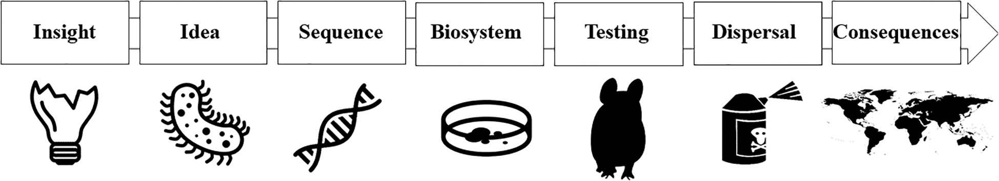

Existenzielles Risiko ist nichts Statisches, das außerhalb der Menschheit existiert. Es ist etwas, das Menschen prägen. Das kann direkt passieren, etwa bei Dingen, die Menschen herstellen oder einsetzen, wie Atomwaffen. Oder indirekt, etwa ob Menschen unsere Infrastruktur ausreichend auf große Vulkanausbrüche vorbereitet haben oder nicht. Menschliche Akteure können also die Gefahren, denen wir gegenüberstehen, vergrößern oder unsere Verwundbarkeit gegenüber bestehenden Gefahren verschlimmern, und sie tun es auch. Aber nicht alle haben dabei denselben Einfluss. Meine Nachbarn haben keinerlei Einfluss auf die Frage, ob es einen Atomkrieg zwischen Pakistan und Indien gibt. Die Macht und die Ressourcen, solche Ereignisse zu beeinflussen, sind meist bei sehr wenigen Gruppen konzentriert (1). Aber wer könnte die Welt zerstören wollen? Wer könnte die Fähigkeit haben, die Welt zu zerstören, aber keine Motivation dazu? Wie sind wir für diese Risiken verwundbar? Und was passiert, wenn katastrophale Fähigkeiten und Motivationen eines Akteurs zusammenkommen?

# Einzelne böswillige Akteure und der „Weltuntergangsknopf“
Zwei wichtige frühe Arbeiten zu existenziellen Risiken durch Akteure waren Torres (2018a) und Torres (2018b). Sie versuchen, alle Arten von Akteuren (Einzelne oder Gruppen) zu katalogisieren, die das Potenzial haben könnten, die Welt zu zerstören, absichtlich oder versehentlich. Sie betonen, dass es weltweit wachsende Sorge um Menschen geben sollte, die omnizide Überzeugungen äußern, vor allem angesichts der zunehmenden Zugänglichkeit neuer Dual-Use-Technologien, also Technologien mit möglicherweise hohem Zerstörungspotenzial wie KI oder Biotechnologie. Außerdem weiß man nie, was künftige wissenschaftliche Durchbrüche bringen, es besteht immer die Chance, dass eines Tages eine Technologie auftaucht, die super leicht zugänglich und super zerstörerisch ist (2). Die einzige Chance, die wir in so einem Fall vielleicht haben, ist zu versuchen, die Akteure zu verstehen, die solche Waffen einsetzen wollen könnten.

Wer würde, wenn er die Chance hätte, bereitwillig „Omnizid“ begehen, also wörtlich alle töten? Torres (2018a) entwickelt einen Rahmen, um solche Akteure einzuschätzen. Die Idee ist, dass die Methoden, mit denen böswillige Akteure versuchen, die Welt zu zerstören, weniger wichtig sind als ihre Motivation. Wenn man ihre Motivation versteht, ist die Chance größer, sie aufzuhalten. Die erste Erkenntnis ist, dass man damit die meisten herkömmlichen Terroristen ausschließen kann. Rebellen, die gegen ein autoritäres Regime in ihrem Heimatland kämpfen, haben zum Beispiel keinen Anreiz, Waffen der totalen Zerstörung einzusetzen. Wenn dein Ziel ist, die Menschen in deinem Land zu befreien, ergibt es nicht wirklich Sinn, sie zu töten. Das ist etwas abstrakt, aber Torres (2018a) schlägt ein einfaches Gedankenexperiment vor, um zu bestimmen, wen wir als apokalyptische Akteure betrachten sollten: Stell dir vor, es gäbe einen Knopf, den du drücken könntest und der sofort alle Menschen töten würde. Laut dem Paper ist jeder Mensch, der diesen Knopf drücken würde, ein apokalyptischer Akteur.

Damit bleiben Menschen übrig, die glauben, dass der aktuelle Zustand der Erde (oder sogar des Universums) so unrettbar schlecht ist, dass das einzig Vernünftige wäre, alle zu töten. Das ist sicher eine sehr extreme Position, aber aus der Geschichte wissen wir, dass es solche Menschen gegeben hat. Torres nennt sechs Beispiele für Ideologien, deren Anhänger den „Weltuntergangsknopf“ drücken könnten. Torres (2018a) liefert den Rahmen, Torres (2018b) die Beispiele dafür, also verbinden wir hier beides:

## Apokalyptische Terroristen
Das sind Menschen, die an irgendeine Art von kommender Apokalypse glauben, sie gerne früher sehen würden und dazu beitragen, wenn sie können.

Ein hier genanntes Beispiel ist James Ellison. Er war der Anführer von „The Covenant, the Sword, and the Arm of the Lord“, einer rechtsextremen, staatsfeindlichen Miliz in den USA. Sie begannen als „normale“ christlich-fundamentalistische Sekte, aber Ellison machte daraus eine aktive Terrorgruppe. Er hatte die Idee, dass die Wiederkunft Christi erst nach einem apokalyptischen Rassenkrieg zwischen weißen Europäern und allen anderen passieren würde. Wenn er also einen weltzerstörenden Rassenkrieg auslösen könnte, würde Christus früher zurückkehren. Letztlich war die Gruppe beim Erreichen ihrer Ziele nicht wirklich erfolgreich, aber man könnte sich leicht vorstellen, dass sie den Knopf für das „Ende der Welt“ drücken würde (3).

## Fehlgeleitete moralische Akteure
„Fehlgeleitet“ meint in den Papern von Torres Akteure, die sich nicht den langfristigen transhumanistischen Folgen des klassischen Utilitarismus anschließen. Damit sind vor allem Anhänger des negativen Utilitarismus gemeint, die der Idee anhängen, dass nur die Vermeidung negativer Erfahrungen zählt. Jede Welt, die Leid enthält, sollte also vermieden werden. Da alle Welten Leid enthalten, sollte keine existieren. Oder einfacher gesagt: Tote können keinen Schmerz fühlen.

Zum Glück wird diese ziemlich extreme Sicht nur von einigen Philosophen vertreten, die fest in der akademischen Welt weggeschlossen sind. Nihilistische Kulte wie der „Efilismus“, die antinatalistische Ideologie hinter dem Bombenanschlag auf eine Kinderwunschklinik in Palm Springs 2025, sind in den letzten Jahren aber öfter aufgetaucht, scheinen aber zumindest vorerst bei konventionellen Waffen zu bleiben.

## Radikale Ökoterroristen
Das sind Menschen, die glauben, dass die Erde (oder Gaia) ohne Menschen besser dran wäre. Wir hatten unsere Chance, mit diesem Planeten in Frieden zu leben, wir haben sie verspielt, also sollten wir einfach aussterben und den Planeten wieder zu seinem Gleichgewicht finden lassen.

Beispiele für solche Ideen in freier Wildbahn sind die Ränder der Tiefenökologie-Bewegung. Eine der bekannteren Gruppen, die mit diesen Ideen verbunden ist, ist die Gaia Liberation Front. Sie erklärt, ihre Mission sei, alle Menschen auszulöschen, weil man uns die Erde nicht anvertrauen könne. Um das zu erreichen, hält sie eine Pandemie, die nur Menschen treffen kann, für am besten geeignet, weil andere Methoden zu unpraktisch (wie Massenselbstmord) oder zu zerstörerisch (wie ein Atomkrieg) seien.

## Eigenwillige Akteure
Zu dieser Kategorie gehören „einsame Wölfe“ oder Randzellen. Sie können Teil loser Online-Gemeinschaften sein oder sich allein entwickeln und bedienen sich oft aus einer persönlichen oder bunt gemischten Palette von Ideologien. Viele solche Beispiele finden wir in der Epidemie von Schulmassakern in den USA, und ein besonders bekanntes ist Eric Harris, einer der Täter beim Massaker an der Columbine High School 1999. In seinen Tagebüchern erklärte er, dass er die Welt brennen sehen und die Menschheit töten wollte. Zum Glück hatte Eric Harris nicht die Mittel, die Welt brennen zu sehen, und das Konzept des „Einzeltäters“ hat in den letzten Jahrzehnten in der Terrorismusbekämpfung viel Aufmerksamkeit bekommen, wenn es um gefährliche Waffen geht.

## Nichtmenschliche Akteure
Neben diesen Akteuren, für die man historische Beispiele nennen kann, argumentiert Torres, dass es zwei weitere, eher hypothetische Gruppen gibt: eine maschinelle Superintelligenz mit fehlgeleiteten Werten und kriegerische Außerirdische. Aus offensichtlichen Gründen können wir über die Ideen und Anreize solcher Akteure aber nur spekulieren.

# Was könnte Menschen dazu bringen, den Weltuntergangsknopf zu drücken?
Neben Torres haben sich auch andere solche Gefühle in der breiten Bevölkerung angeschaut. Anders gesagt: Was könnte normale Menschen dazu motivieren, einen Weltuntergangsknopf zu drücken, wenn es einen gäbe? Es wird immer Wahnsinnige, bösartige Narzissten und schäumende Eiferer geben, mit denen man rechnen muss, aber breitere systemische Probleme können das Niveau extremer Überzeugungen in der Bevölkerung insgesamt anheben, bei Menschen, die sie sonst nicht hätten, was ohne angemessene soziale Unterstützung das Ausmaß an Terrorismus erhöhen könnte.

Auf Grundlage von Daten zu britischen Wahlen untersuchen Stevens & Banducci (2022), wie Menschen ihre Überzeugungen ändern, wenn sie sich bedroht fühlen. Sie zeigen, dass Wachstumsschübe beim Extremismus mit Gefühlen der Bedrohung zusammenhängen könnten, sowohl im normativen als auch im persönlichen Bereich. Zu persönlichen Bedrohungen gehören Dinge wie Gefühle existenzieller Unsicherheit. Normative Bedrohungen können der Klimawandel sein (den Torres in den oben beschriebenen Papern erwähnt), Gefühle kultureller Erosion oder zunehmender Autoritarismus. Apokalyptisches Denken und Weltuntergangsstimmung haben sich historisch in Krisenzeiten stärker verbreitet, etwa im Kalten Krieg. Gefühle existenzieller Unsicherheit könnten bedeuten, dass sich überdurchschnittlich viele Menschen zunehmend zu der Überzeugung hingezogen fühlen, dass die Welt besser dran wäre, wenn sie zerstört oder grundlegend verändert würde, als wenn sie auf ihrem jetzigen Kurs weitergeht. Probleme entstehen aber, wenn wir uns zu sehr auf die Idee des „Bürgerterrors“ stützen, was wir uns jetzt anschauen.

# Probleme mit der Sichtweise der „einzelnen Akteure“
Bisher haben wir sehr ausführlich untersucht, was einzelne Akteure oder kleine Gruppen dazu motiviert hat oder motivieren könnte, an Omnizid zu glauben oder sogar zu versuchen, ihn herbeizuführen. Das heißt aber nicht, dass das der wahrscheinlichste Weg ist, wie Menschen einen Omnizid oder eine globale Katastrophe verursachen könnten.

In der Literatur zu existenziellen Risiken (zum Beispiel in der oben beschriebenen Arbeit von Torres) gibt es ein wiederkehrendes Thema, das das Risiko stark betont, dass Terroristen oder Einzeltäter ein globales katastrophales Ereignis verursachen. Diesem Argument fehlt aber etwas, denn es mag Akteure geben, die theoretisch die Welt zerstören wollen, denen aber eindeutig die Ressourcen dafür fehlen, und es scheint plausibel, dass sie die auch nicht so bald bekommen werden. Außerdem gab es in den letzten Jahrzehnten weltweit massive Investitionen in die internationale Abwehr von CBRN-Terrorismus, was die Chance weiter verringert, dass eine Splittergruppe die Gelegenheit bekommt, die Welt zu beenden. Und schließlich ist die Frage: Wären die meisten Menschen mit den oben beschriebenen Überzeugungen überhaupt in der Lage, die gesamte Menschheit auszulöschen?

Grundsätzlich scheint es ziemlich schwer zu sein, Menschen zu finden, die die Welt wirklich zerstören wollen und auch die Fähigkeit dazu haben. Kallenborn & Ackerman (2023) haben die Literatur gründlich durchsucht, um solche Gruppen zu finden, konnten aber keine finden, die alle Kriterien erfüllt. Gruppen haben meist die Motivation, die Welt zu zerstören, aber nicht die Fähigkeiten für einen direkten Angriff. Sie halten es zwar für plausibel, dass es solche Gruppen in Zukunft geben könnte, aber der beste Weg, das Risiko zu senken, sei, Resilienz aufzubauen und gesellschaftliche Verwundbarkeiten anzugehen. Sie betonen auch, dass es derzeit zwar keine Terrorgruppe gibt, die die Welt zerstören könnte, dass es aber Gruppen gab, die den Willen und die Fähigkeit hatten, Maßnahmen zur Risikominderung zu sabotieren, aber das falsche Timing hatten. Es gibt derzeit also keine laufende Maßnahme zur Minderung globaler Risiken, aber wenn zum Beispiel ein Asteroid auf dem Weg zur Erde wäre, könnten Terroristen wahrscheinlich eine Mission sabotieren, die ihn davon abhalten soll, die Erde zu treffen.

Das Problem, apokalyptischen Terrorismus ins Zentrum der Aufmerksamkeit für Risiken durch Akteure zu stellen, untersucht Meggitt (2020). Die Kategorie „apokalyptischer Terrorismus“ ist trügerisch und sollte nicht leichtfertig vergeben werden, weil sie zu falschen Treffern führt. Terrorismusanalysten haben gezeigt, dass „Apokalyptik“ innerhalb von Terrorgruppen wie dem IS oft flexibel ist und umstritten, als Strategie genutzt wird, um Verhandlungsmacht zu gewinnen oder in schwierigen Zeiten Rekrutierung und Mitgliederbindung zu stärken, und dass ihre Betonung je nach Lage der Gruppe zu- und abnimmt.

Eine interessante Fallstudie liefert Juergensmeyer (2003). Er hat die Motivationen von Mitgliedern von Aum Shinrikyo untersucht, einer Gruppe, die in Diskussionen über existenzielle Risiken oft als Beispiel für echte omnizide Absichten und deren Umsetzung herangezogen wird. Nach Interviews mit mehreren Sektenmitgliedern nach dem Sarin-Anschlag, freien wie inhaftierten, kam Juergensmeyer zu dem Schluss, dass ihr Ziel trotz ihrer apokalyptischen Rhetorik nicht war, die Menschheit auszulöschen oder eine globale Katastrophe zu verursachen. Stattdessen glaubten sie, dass ihre Organisation ihnen helfen würde, eine Apokalypse zu überleben, die von äußeren nuklearen Mächten ausgelöst würde. Ihre eigentliche Motivation war, zu den Überlebenden zu gehören, die die Welt nach der Apokalypse wieder aufbauen, und in Japan die Macht zu haben. Ihre apokalyptische Erzählung diente ihnen dazu, Sinn zu stiften, war aber nicht ihr eigentliches Ziel. Es gibt keine überzeugenden Belege dafür, dass sie wirklich das Aussterben der Menschheit herbeiführen wollten.

Seit viele der Paper von Torres geschrieben wurden, hat das Feld der existenziellen Risiken davon profitiert, dass Forschende mit Expertise in Terrorismusbekämpfung, Biosicherheit, Politik und CBRN dazugekommen sind, und auch einfach davon, mehr Zeit gehabt zu haben, um die vielen Gefahren und stark verwundbaren Bereiche dieses Risikos zu durchdenken. Man erkennt zwar an, wie wichtig es ist, gefährliche Ideologien bei zahlreichen, aber unfähigen Akteuren im Blick zu behalten, aber die Forschung zu existenziellem Terrorismus hat sich von diesem engen Fokus wegbewegt und konzentriert sich zunehmend auf systemische Verwundbarkeiten als Risikofaktoren und deren Ausnutzung durch böswillige Akteure. Kallenborn und Ackerman (2023) plädieren für Lösungen, die die Resilienz stärken, ebenso wie für die Beobachtung der Akteure. Gleichzeitig haben sich die Untersuchungen auch auf andere Akteure, Fähigkeiten und systemische Verwundbarkeiten ausgeweitet.

# Institutionelle böswillige Akteure
Es scheint weit hergeholt, dass ein isolierter Einzelner heute die Welt zerstören könnte, selbst wenn er ideologische Motive dafür hätte. Institutionen, die die Welt gefährden, gibt es aber schon. Wir sollten nicht nur fragen: „Wer könnte den Weltuntergangsknopf drücken?“, sondern auch: „Wer könnte ihn bauen, und sollte er das?“

Institutionen bestehen aus Netzwerken und Gruppen von Menschen, haben Zugang zu größeren Ressourcen und rechtlichem Schutz, um Fähigkeiten aufzubauen, und nutzen oft systemische Verwundbarkeiten zu ihrem Vorteil. Diese Institutionen, ihre Fähigkeiten und die breiteren gesellschaftlichen Verwundbarkeiten im Spiel zu verstehen, ist unverzichtbar, um ein vollständigeres und genaueres Bild existenzieller Risiken durch Akteure zu bekommen.

Einen Vergleich der Bedrohungen durch böswillige Akteure verschiedener Größenordnung machen Sandberg & Nelson (2020). Sie haben dafür ein einfaches Modell für Biorisiken entwickelt (Abbildung 1). Die Idee ist: Wenn man ein erfolgreicher Bioterrorist sein will, muss man viele Schritte richtig machen. Das beginnt damit, die Einsicht zu haben, wie man alle töten will, die Idee umzusetzen und zu testen, nicht erwischt zu werden und das Unternehmen auf globale Ausmaße zu bringen. Jeder dieser Schritte hat seine eigenen Schwierigkeiten, die alle überwunden werden müssen, damit ein Akteur zum nächsten Schritt kommt. Diese Schwierigkeiten zu überwinden, erfordert oft Ressourcen, und der Fortschritt ist umso schwerer, je weniger Ressourcen man hat. Wegen dieser Einschränkungen kommt ihr Modell zu dem Schluss, dass zwar weniger mächtige böswillige Akteure zahlreicher sind, es aber wahrscheinlicher ist, dass weniger zahlreiche, aber mächtigere Akteure mehr Schwierigkeiten überwinden und so die gesamte Risikokette durchlaufen könnten. Sandberg und Nelson räumen zwar ein, dass sich das in Zukunft ändern könnte (wenn diese Schritte mit dem technischen Fortschritt deutlich einfacher werden), aber die Ergebnisse ihres Modells deuten darauf hin, dass der Großteil des aktuellen Risikos durch böswillige Akteure durch ihre Stellung in Institutionen ermöglicht wird, die Ressourcen bündeln.

Abbildung 1: Das Modell der Schritte, die man meistern muss, um ein globales Biorisiko zu verursachen.

Diese beängstigende Möglichkeit ist eine, auf deren Minimierung Fachleute für CBRN, Deradikalisierung und Biosicherheit riesige Mengen an Zeit und Ressourcen verwendet haben: ein mächtiger Akteur, der ausreichend motiviert wird, die katastrophalen Fähigkeiten einzusetzen, die er bereits besitzt, und niemand in seinem Umfeld, der darauf geschult ist, es zu bemerken oder zu melden, bevor es zu spät ist.

Aber was passiert, wenn die Anreize von Institutionen genau darin bestehen, diese Fähigkeiten aufzubauen und geheim zu halten? Eine hochzerstörerische, leicht zugängliche Waffe, die in Zukunft entdeckt werden könnte, wird höchstwahrscheinlich nicht aus einem selbst gebastelten Amateur-Biolabor oder von einem einzelnen genialen Forscher kommen. Viel wahrscheinlicher kommt sie von einer Gruppe von Menschen, die in einem KI-Labor, einer Biosicherheitseinrichtung oder einem Rüstungstechnikunternehmen arbeitet. Ihre Investoren, eine weitere Gruppe von Menschen mit stark gebündelten Ressourcen, könnten einen starken Anreiz haben, diese neue Erfindung zu vermarkten, zu nutzen oder zu verkaufen. Wegen dieses Maßes an Bündelung von Ressourcen und Macht ist es keine Übertreibung zu sagen, dass in der heutigen Welt die Bedrohung durch Terrorgruppen winzig ist im Vergleich zu der durch Peter Thiel oder Sam Altman, ermöglicht durch die Institutionen, in denen sie agieren, und die Verwundbarkeiten der Systeme, die diese Institutionen ausnutzen.

Gezielt auf institutionelle Akteure konzentriert sich ein kurzer Übersichtsartikel von Kemp (2021) (4). Darin argumentiert Kemp, dass existenzielles Risiko vor allem von großen, institutionellen Akteuren angetrieben wird, weil alle anderen zu wenige Ressourcen haben, um wirklich etwas zu bewegen. Die Wege, die bisher identifiziert wurden, wie die Welt enden könnte, sind Dinge wie künstliche allgemeine Intelligenz, katastrophale biologische Bedrohungen, Klimawandel, tödliche autonome Waffensysteme und Atomwaffen. Atomwaffen kann man nicht im Hinterhof bauen, und auch der Lebensstil eines Einzelnen kann nicht wirklich beeinflussen, wie viele ppm Kohlendioxid in der Atmosphäre sind.

Um diese Dinge zu tun, braucht man viel Macht und viele Ressourcen und viel Zeit, daran zu arbeiten, ohne aufgehalten zu werden. Das können nur sehr große Akteure wie die militärisch-industriellen Komplexe mehrerer Länder, die Industrie der fossilen Brennstoffe oder Big Tech ermöglichen oder erreichen. In vielen (oder vielleicht allen?) dieser Institutionen sehen wir, dass ihre Gewinne privatisiert werden, während die möglichen Nachteile öffentlich sind.

Schauen wir uns ein paar Beispiele an:

* Künstliche allgemeine Intelligenz: Es gibt sehr wenige KI-Unternehmen, die tatsächlich leistungsfähige neue Modelle bauen, und die Ressourcen, die man braucht, um solche Modelle zu bauen, sind bei wenigen Gruppen von Menschen stark konzentriert. Derzeit sind die größten OpenAI, xAI, Anthropic und Deepseek. Es ist unklar, ob ihre Modelle überhaupt zu allgemeiner KI führen könnten, aber klar ist, dass es extrem ressourcenintensiv und deshalb schwierig ist, daran zu arbeiten, weil man große Mengen Strom und Rechenleistung braucht, um sie zu bauen und zu betreiben.
* Klimawandel: Weltweit sind etwa 100 Produzenten für den Großteil der Kohlendioxidemissionen verantwortlich. Ebenso entfällt mehr als die Hälfte der globalen kumulierten Emissionen auf nur drei Hauptakteure: die USA, die EU-27 und China. Und schließlich halten nur sechs Länder 80 % der globalen Reserven fossiler Brennstoffe.
* Atomwaffen: Fast 90 % aller Atomwaffen werden von zwei Ländern gehalten: den USA und Russland. Und für die restlichen 10 % muss man nur 7 weitere Länder hinzunehmen. Instandhaltung und Herstellung der amerikanischen Waffen sind auf nur 28 Unternehmen gebündelt. Die Befehlskette für ihren Einsatz ist ziemlich kurz. In den USA hat der Präsident die alleinige Befugnis, einen Atomschlag anzuordnen. Es gibt vier wichtige Berater, aber ihre Zustimmung ist nicht nötig.

Das alles heißt, dass die meisten menschengemachten katastrophalen Gefahren in kleinen Netzwerken mächtiger Akteure stark konzentriert sind. Das US-Militär könnte man leicht als größten Verursacher globaler Risiken sehen. Es stößt gigantische Mengen Kohlendioxid aus, kontrolliert das fortschrittlichste Atomwaffenarsenal, ist bei der Entwicklung autonomer Waffen und Überwachungstechnologien vorne mit dabei und hat das mit Abstand größte Militär der Welt.

Was es so knifflig macht, solche Akteure im Zaum zu halten, ist, dass sie ihre Macht und Ressourcen oft nutzen, um Falschinformationen zu verbreiten, damit die öffentliche Meinung beeinflusst wird und sie ihre Mission fortsetzen können. Klare Beispiele wären, wie die NATO versucht hat, die Forschung zum nuklearen Winter zu diskreditieren (5), oder wie die Industrie der fossilen Brennstoffe jahrzehntelang große Desinformationskampagnen finanziert hat. Ebenso fehlt diesen mächtigen Organisationen oft eine wirksame Aufsicht, was es ihnen erlaubt, Risiken geheim zu halten. So wie die Industrie der fossilen Brennstoffe jahrzehntelang von der Tatsache der Erderwärmung wusste.

In Zukunft könnten einige dieser Wege zu globalen Katastrophen in die Reichweite einzelner Akteure kommen, aber im Moment scheint ziemlich offensichtlich, wer globale Risiken schafft, und wir sollten unsere Anstrengungen auf diese Akteure konzentrieren. Die Motivation dieser Akteure ist wahrscheinlich nicht, die Welt zu ruinieren, aber wir kommen nicht um die Tatsache herum, dass sie uns alle gefährden. Sie nehmen diese Risiken in Kauf, weil sie ein Profitmotiv haben und einer Konkurrenzdynamik ausgesetzt sind.

Es gibt auch Versuche, diese beiden Stränge zu einzelnen und institutionellen Akteuren zu verbinden. Ein Bericht von Althaus & Baumann (2020) argumentiert, dass wir uns auch böswillige Einzelne in Machtpositionen anschauen sollten. Sie argumentieren, dass einige der schlimmsten Dinge, die Menschen je angetan wurden, von Diktatoren verursacht wurden, die große institutionelle Macht hinter sich hatten. Klare Beispiele wären Hitler oder Stalin. Diese Einzelnen taten diese schrecklichen Dinge wahrscheinlich, weil sie Macht hatten, aber auch, weil sie hohe Werte bei Machiavellismus, Narzissmus, Psychopathie und Sadismus hatten. Das sind oft Eigenschaften von Menschen, die nach Macht und Status streben und auch extreme Überzeugungen haben. Die Minderung existenzieller Risiken sollte deshalb auch untersuchen, wie diese Eigenschaften erkannt werden können und wie man Menschen mit diesen Eigenschaften davon ausschließen kann, jemals Macht zu bekommen. So etwas wie ein ähnliches Überprüfungsverfahren gibt es in der Terrorismusbekämpfung schon, zum Beispiel in Hochsicherheits-Biolaboren. Wenn man Akteure, die schon in mächtigen Institutionen agieren, stärker unter die Lupe nimmt, ließe sich das existenzielle Risiko durch Akteure mit dieser Art von Maßnahme vielleicht erheblich senken.

# Politik rund um globale Risiken

Dass globale katastrophale Risiken in den Händen relativ weniger mächtiger Institutionen konzentriert sind, wirft eine entscheidende Frage auf: Wie sehen diejenigen, die für die Steuerung dieser Risiken verantwortlich sind, diese Herausforderung eigentlich? Zu verstehen, wie sich Politikerinnen und Politiker in dieser Landschaft konzentrierter Macht bewegen, ist wichtig, weil sie eine der wenigen möglichen Kontrollen dieser institutionellen Akteure sind. Die Politik selbst steht aber vor erheblichen Einschränkungen. Forschung von Nathan & Hyams (2022) gibt direkten Einblick, wie diejenigen, die der Steuerung globaler katastrophaler Risiken am nächsten sind, ihre eigene Fähigkeit sehen, diese Herausforderungen anzugehen, und zeigt sowohl die Chancen als auch die strukturellen Hürden, die die politischen Antworten auf unsere gefährlichsten institutionellen Akteure prägen. Sie haben 16 Beamte, Vertreter zivilgesellschaftlicher Gruppen und Menschen aus der Privatwirtschaft in Großbritannien, den USA oder Europa interviewt und versucht, diese Interviews zu verdichten. Dabei kamen vier Themen heraus, wie diese Menschen über globale Risiken denken:
* Skepsis: Ihnen ist klar, dass die aktuellen Lösungen oft unzureichend sind und die Regierung zu oft nur reagiert. Es braucht neue Systeme, um zu planen, bevor eine Katastrophe passiert. Diese Skepsis spiegelt direkt die Herausforderung wider, die oben identifizierten mächtigen institutionellen Akteure zu regulieren. Wie eine leitende UN-Mitarbeiterin zu Pandemien sagte: „Wenn morgen eine Krise kommt, ist es zu spät.“
* Realismus: Globale katastrophale Risiken sind einfach ein sehr komplexes Problem, bei dem es oft lange dauert, Lösungen umzusetzen. Das ist in einer Politikwelt, die auf das Kurzfristige ausgerichtet ist, einfach wirklich schwer. Wie ein Experte für Gesundheitssicherheit bemerkte, gibt es „Realpolitik, denn man kann so viele Abkommen haben, wie man will, aber wenn Großbritannien und die USA etwas produzieren, ist ihre erste Pflicht politisch klar gegenüber ihren eigenen Bürgern“. Das spiegelt die Herausforderung wider, institutionelle Akteure zu steuern, deren Einfluss über Landesgrenzen hinausreicht, während die Politik an innenpolitischen Druck gebunden bleibt.
* Einfluss: Einzelne Politikerinnen und Politiker haben das Gefühl, etwas Gutes bewirken zu können, wenn sie gute Arbeit zu globalen katastrophalen Risiken machen. Zum einen, um mögliche Lösungen umzusetzen, aber auch einfach, indem sie das Thema leichter besprechbar machen. Ein Interviewpartner betonte, wie wichtig prägende Gespräche mit „Leuten, die viel klüger sind als ich und vielleicht in einem Staatsfonds landen oder die Regierung von Saudi-Arabien oder Abu Dhabi beraten“ seien. „Wenn ihre Sicht auf die Welt nur ein ganz klein wenig anders ist und sie dann eine Entscheidung treffen, bei der es darum geht, Dutzende Milliarden Dollar in einen bestimmten Bereich statt in einen anderen zu stecken.“
* Steuerung außerhalb der Regierung: Die Idee ist, dass Steuerung auch viel außerhalb der Regierung stattfindet. Wir sollten uns also nicht nur auf die Politik verlassen, sondern auch daran arbeiten, an anderen Orten wie der Wissenschaft oder Unternehmen rechenschaftspflichtigere Strukturen zu schaffen. Wie eine Expertin für die Politik neuer Biotechnologien sagte: „Am meisten Optimismus habe ich dort, wo ich davon träume, ergänzende Räume zu schaffen, die Brücken zwischen Regulierung und Wissenschaftlern bauen, die direkt unter der regulatorischen Entscheidungsfindung liegen und den Prozess erweitern.“ Das spiegelt die Erkenntnis wider, dass klassische staatliche Steuerung vielleicht nicht ausreicht, um die institutionellen Akteure zu kontrollieren, die globale katastrophale Risiken antreiben.

Die Forschung zeigt eine grundlegende Spannung: Die Politik versteht die Risiken, die von konzentrierter institutioneller Macht ausgehen, fühlt sich aber durch genau die Machtungleichgewichte eingeschränkt, die diese Konzentration schafft. Sie sieht Möglichkeiten, über Sprache, das Setzen von Themen und nichtstaatliche Steuerungsmechanismen Einfluss zu nehmen, bleibt aber skeptisch, ob sie die Anreizstrukturen, die institutionelle böswillige Akteure antreiben, grundlegend verändern kann.

# Fazit
Was man aus all dem mitnehmen kann: Große Risiken durch einzelne Akteure sind etwas, worüber wir uns Sorgen machen und worauf wir uns vorbereiten sollten, aber das eigentliche Problem sind nicht sie, sondern einige der Institutionen, die aufgebaut wurden, um Teile der Gesellschaft zu gestalten und zu kontrollieren. Ihre Anreize stimmen oft nicht mit denen der Gesellschaft überein, und wir brauchen mehr Rechenschaftspflicht und Kontrolle über sie. Die Politik denkt darüber nach, aber es ist einfach schwer. Die hier gezeigte Forschung macht deutlich, dass die Akteure, die weltweit das größte Risiko darstellen, oft keiner Rechenschaft unterliegen und selbst die Politikerinnen und Politiker, die am meisten über sie nachdenken, unsicher sind, wie sie etwas bewirken können. Wir müssen unser System also umbauen, damit es wieder Rechenschaftspflicht gibt. Und ich klinge vielleicht wie eine kaputte Schallplatte, aber ich glaube, das ist wieder ein Bereich, in dem wir sehen, dass wir unsere Gesellschaft demokratischer machen müssen, dass wir mit neuen Wegen experimentieren müssen, Macht zu verteilen. Das löst vielleicht nicht all unsere Probleme, aber dezentralere Entscheidungen eignen sich per Definition weniger für Machtzentren ohne Rechenschaftspflicht (6).

*Dieser Beitrag wurde von [Mel Cowans](https://www.cser.ac.uk/team/mel-cowans/) begutachtet. Wenn er dir gefällt oder dich eines der besprochenen Konzepte interessiert, melde dich gerne bei Mel auf LinkedIn.*

# Zitieren
Bitte das englische Original zitieren:

Jehn, F. U. (2026, March 11). Who shapes global risk?. Existential Crunch. https://doi.org/10.59350/zfdhw-d9e42

# Anmerkungen

(1) Das gilt besonders für Atomwaffen, weil die kurze Zeitspanne, in der man entscheiden muss, ob man die Waffen startet oder nicht, es unpraktisch macht, viele Beteiligte einzubeziehen. Kurzgesagt hat ein schönes Video, das diese Dringlichkeit zeigt: [https://youtu.be/wmP3MBjsx20](https://youtu.be/wmP3MBjsx20)

(2) Eine formalere Erklärung, wie es dazu kommen könnte, findet sich in Nick Bostroms [Hypothese der verwundbaren Welt](https://onlinelibrary.wiley.com/doi/10.1111/1758-5899.12718).

(3) Solange die Person, die den Knopf drückt, weiß ist, natürlich.

(4) Ja, ich weiß, dass das ein Zeitungsartikel und kein Paper ist, aber ich finde, es ist eine ziemlich gute Quelle und enthält auch viele Verweise, die seine Argumente untermauern. Eine ausführlichere Darstellung findest du auch in Kapitel 20 von Luke Kemps Buch Goliath’s Curse, das ich in [einem anderen Beitrag](https://existentialcrunch.substack.com/p/the-peoples-history-of-collapse) zusammengefasst habe.

(5) Darüber habe ich [hier](https://existentialcrunch.substack.com/p/science-denial-and-nuclear-winter) geschrieben.

(6) Siehe [hier](https://existentialcrunch.substack.com/p/democratic-resilience) für eine ausführlichere Begründung, warum ich Demokratien für unverzichtbar halte.

# Quellen
* Althaus, D., & Baumann, T. (2020). Reducing long-term risks from malevolent actors. Center on Long-Term Risk. https://longtermrisk.org/files/Reducing_long_term_risks_from_malevolent_actors.pdf
* Juergensmeyer, M. (2003). CHAPTER 6 Armageddon in a Tokyo Subway. In Terror in the Mind of God: The Global Rise of Religious Violence (3rd ed.). University of California Press. https://www.jstor.org/stable/10.1525/j.ctt4cgfbx
* Kallenborn, Z., & Ackerman, G. (2023). Existential Terrorism: Can Terrorists Destroy Humanity? European Journal of Risk Regulation, 14(4), 760–778. https://doi.org/10.1017/err.2023.48
* Kemp, L. (2021). Agents of Doom: Who is creating the apocalypse and why. https://www.bbc.com/future/article/20211014-agents-of-doom-who-is-hastening-the-apocalypse-and-why
* Meggitt, J. J. (2020). The Problem of Apocalyptic Terrorism. Journal of Religion and Violence, 8(1), 58–104. https://doi.org/10.5840/jrv202061173
* Nathan, C., & Hyams, K. (2022). Global Catastrophic Risk and the Drivers of Scientist Attitudes Towards Policy. Science and Engineering Ethics, 28(6), 50. https://doi.org/10.1007/s11948-022-00411-3
* Sandberg, A., & Nelson, C. (2020). Who Should We Fear More: Biohackers, Disgruntled Postdocs, or Bad Governments? A Simple Risk Chain Model of Biorisk. Health Security, 18(3), 155–163. https://doi.org/10.1089/hs.2019.0115
* Stevens, D., & Banducci, S. (2022). What Are You Afraid of? Authoritarianism, Terrorism, and Threat. Political Psychology, 43(6), 1081–1100. https://doi.org/10.1111/pops.12804
* Torres, P. (2018a). Agential risks and information hazards: An unavoidable but dangerous topic? Futures, 95, 86–97. https://doi.org/10.1016/j.futures.2017.10.004
* Torres, P. (2018b). Who would destroy the world? Omnicidal agents and related phenomena. Aggression and Violent Behavior, 39, 129–138. https://doi.org/10.1016/j.avb.2018.02.002
