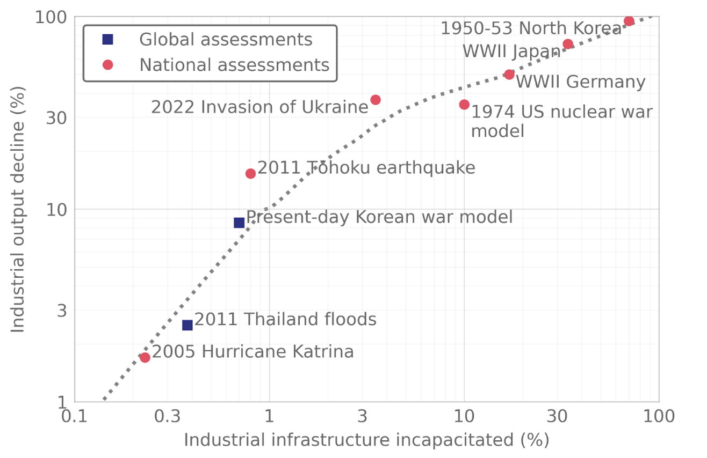

Um gesellschaftlichen Kollaps besser zu verstehen, müssen wir uns nicht nur die Faktoren anschauen, die zu einem Kollaps führen könnten, sondern auch, was während und nach einem Kollaps passieren könnte. Ein entscheidender Punkt ist dabei die Wirtschaft. Was sind die direkten Folgen eines Kollapses für eine Volkswirtschaft? Wie würden sich die Preise ändern? Würde der Handel weitergehen? Alles wichtige Fragen, aber wegen der Komplexität unserer Volkswirtschaften sehr schwer zu beantworten. Deshalb gibt es dazu nur sehr wenig Forschung, und die, die es gibt, betrachtet meist nur einen einzelnen Aspekt oder vereinfachte Szenarien.

# Nur eine einzige Bombe

Ein Beispiel ist ein Briefing Paper der britischen Nichtregierungsorganisation Article 36 (Article 36, 2015). Sie analysieren die wirtschaftlichen Folgen der Explosion einer einzigen Atomwaffe. Sie argumentieren, dass so eine Explosion, ob absichtlich oder nicht, globale Folgen hätte, merken aber auch an, dass sie wegen der Komplexität der Sache nur grobe Skizzen liefern können.

Ihre wichtigsten Punkte sind:
* Massiver Verlust von Menschenleben: Schon eine einzige Atomwaffe mit geringer Sprengkraft (100 kT) könnte plausibel rund 300.000 Menschen töten und verletzen. Mit den größeren Bomben, die wir heute haben, wären die Folgen viel schlimmer.
* Zerstörung von Industrien: Industrien sind oft in einer Region konzentriert, weil sich so Skaleneffekte besser nutzen lassen. Eine einzige Explosion könnte deshalb einen Schlüsselsektor einer Volkswirtschaft komplett lahmlegen.
* Zerstörung von Infrastruktur: Städte sind meist die zentralen Knotenpunkte der Infrastruktur, sei es Bildung, öffentlicher Verkehr oder Verwaltung. Fallen die aus, leidet die ganze Region.
* Schwere Belastung der öffentlichen Finanzen: Es wäre extrem teuer, die zerstörte Stadt wieder aufzubauen. Außerdem wären die Gesundheitskosten in der Region noch jahrzehntelang deutlich erhöht.
* Unklare Erholung: Wegen der hohen Kosten und unklarer systemischer Effekte könnte schon eine einzige Bombe es dem betroffenen Land ziemlich schwer machen, sich zu erholen, selbst mit Hilfe von außen.

Neben diesen Punkten betont das Paper immer wieder, dass das nur vage Vorhersagen sind, weil unsere aktuellen Wirtschaftsmodelle solche beispiellosen Ereignisse kaum vorhersagen können. Wir haben zwar einige Daten aus dem Zweiten Weltkrieg, nach dem Japan und Deutschland sich ziemlich stark erholt haben, obwohl sie viel größere Schäden erlitten hatten, als eine einzelne Bombe anrichten könnte. Hiroshima und Nagasaki haben zum Beispiel beide etwa 10 Jahre gebraucht, um wieder die Einwohnerzahl von vor dem Abwurf zu erreichen. Die größten Bomben, die wir heute im Einsatz haben, haben aber eine Sprengkraft von einer bis mehreren Megatonnen, also mehrere Größenordnungen mehr als die einzigen Atomwaffen, die je im Krieg abgeworfen wurden. Es bleibt also ziemlich unsicher, ob man den Wiederaufbau Japans und Deutschlands als Vergleich nehmen kann.

# Störung der Industrie

Ein Paper, das sich die Folgen industrieller Zerstörung systematischer anschaut, ist von Blouin et al. (2024) (Hinweis: Ich bin Co-Autor). Die Grundidee: Wir können zwar nicht einfach abschätzen, welchen Schaden ein Atomkrieg an der Industrieproduktion anrichten würde, aber wir können in die Geschichte schauen, Fallstudien finden, in denen die Zerstörung von Industrie zu einem Rückgang der Industrieproduktion geführt hat, und daraus hochrechnen. Diese Fallstudien reichen von großen Hurrikans bis zum Zweiten Weltkrieg (Abbildung 1).

Abbildung 1: Zusammenhang zwischen ausgefallener industrieller Infrastruktur und dem darauffolgenden Rückgang der Industrieproduktion. Basierend auf historischen Fallstudien und Modellstudien.

Neben diesem Zusammenhang zwischen industrieller Zerstörung und Produktionsrückgang schätzt die Studie auch ab, wie viel industrielle Kapazität in Konflikten zwischen USA und Russland bzw. Indien und Pakistan zerstört würde. Das lässt sich aus plausiblen Ziellisten und der Zerstörung durch die über diesen Zielen detonierenden Atomwaffen abschätzen. Im Fall eines Konflikts zwischen USA und Russland könnten so grob 3 % der globalen industriellen Kapazität zerstört werden, was allein durch die Detonationsschäden zu einem Verlust von 24 % der globalen Industrieproduktion führen würde. Dieser stark nichtlineare Zusammenhang zwischen zerstörter Kapazität und sinkender Produktion zeigt, wie verwundbar Volkswirtschaften gegenüber großen Störungen sind.

# Agrarpreise nach einem Atomkrieg modellieren

Die Studien oben stützen sich eher auf Fallstudien und historische Vergleiche. Aber können wir trotzdem etwas lernen, wenn wir Wirtschaftsmodelle auf globale Katastrophen anwenden? Weil es so schwierig ist, Wirtschaftsmodelle so weit außerhalb ihrer Trainingsdaten einzusetzen, gibt es dazu sehr wenig Forschung. Soweit ich weiß, gibt es zum Beispiel nur eine einzige Studie, die überhaupt versucht zu modellieren, wie ein Atomkrieg (oder ähnliche Ereignisse) die Weltwirtschaft beeinflussen könnte. Sie schaut sich die Lebensmittelpreise nach einem Atomkrieg an (Hochman et al., 2022).

*Wenn du wichtige Studien kennst, die ich übersehen habe, schreib mir bitte eine Mail, dann aktualisiere ich diesen Artikel!*

Die Studie von Hochman und Co-Autoren nutzt ein allgemeines Gleichgewichtsmodell, das ursprünglich entwickelt wurde, um die wirtschaftlichen Folgen des Klimawandels zu verstehen (später besprechen wir, warum das ein Problem sein könnte). Das Modell simuliert die meisten Länder und insgesamt 15 Sektoren, von denen 9 das Ernährungssystem abbilden (vor allem verschiedene Nutzpflanzen wie Reis, Weizen usw.), während der Rest für Bergbau, verarbeitendes Gewerbe, Bau und Verkehr steht. Angetrieben wird das Modell mit den Änderungen der landwirtschaftlichen Produktivität durch das verschlechterte Klima nach einem Atomkrieg. Ihr Szenario ist ein kleinerer Schlagabtausch zwischen Indien und Pakistan, der zu einem Rückgang der globalen Mitteltemperatur um etwa 2 bis 4 °C führt.

Das Modell macht eine ziemlich große Annahme: Es berücksichtigt die Zerstörung durch die Bomben nicht. Es modelliert im Grunde eine Welt, in der alles so ist wie heute, mit der einen Ausnahme, dass die Landwirtschaft plötzlich viel weniger produktiv ist. Das heißt auch, dass große Folgeeffekte fehlen. Indien ist ein großer Lebensmittelexporteur, und wenn es durch die Zerstörung eines Atomkriegs praktisch vom Markt verschwindet, würde das zusätzliche Schockwellen durch die Weltwirtschaft schicken. Außerdem ist Indien das bevölkerungsreichste Land der Welt, und viele Menschen dort würden in so einem Szenario wahrscheinlich auswandern wollen.

Aber selbst dieses unvollständige Bild zeigt schon, dass das unser Ernährungssystem massiv treffen würde. Sie finden, dass die globalen Kalorien wahrscheinlich um 10 bis 12 % sinken würden, und sehen auch kurzfristige Preisspitzen. Ihr Modell zeigt aber auch, dass die Preise für Grundnahrungsmittel schnell wieder sinken, weil Landwirte von Tierhaltung und Gemüse auf mehr Grundnahrungsmittel umsteigen. Dazu kommt noch eine Einschränkung: Die Ergebnisse gelten nur unter der Annahme, dass der Welthandel einfach weiterläuft, was nach so einem massiven Schock vielleicht nicht der Fall ist.

# Haben wir überhaupt die richtigen Werkzeuge, um globale Katastrophen zu modellieren?

Die besprochenen Paper deuten darauf hin, dass jede globale Katastrophe wahrscheinlich sehr schlecht für unsere wirtschaftlichen Aussichten wäre. Sie zeigen aber auch, dass wir große Schwierigkeiten haben, unsere aktuellen Werkzeuge überhaupt auf solche Aufgaben anzuwenden. Die Wirtschaft nach einem Atomkrieg zu modellieren, war nur möglich, indem man die direkten Folgen des Kriegs weggelassen hat, und Handel wird so abstrakt modelliert, dass es oft schwer ist, eine direkte Linie dazu zu ziehen, wie Handel tatsächlich abläuft. Das führt zu der Frage: Haben wir überhaupt die richtigen Werkzeuge, um unsere Wirtschaft nach einer globalen Katastrophe zu modellieren und zu analysieren?

Ein globales Risiko, bei dem diese Frage ausführlicher diskutiert wird, ist der Klimawandel. Ein bekanntes Paper dazu ist von Weitzman (2009). Sein Hauptargument: Die Art, wie Kosten-Nutzen-Analysen für den Klimawandel gemacht werden, ist grundlegend fehlerhaft, weil sie die Unsicherheit über katastrophale Folgen nicht richtig berücksichtigt. Das Kernproblem ist strukturelle Unsicherheit: Wir kennen nicht nur die Ergebnisse nicht, wir kennen nicht einmal die wahre Wahrscheinlichkeitsverteilung dieser Ergebnisse. Wir müssen sie aus begrenzten Daten schätzen. Wenn man diese Schätzunsicherheit mathematisch berücksichtigt, bekommt man eine Verteilung mit dickeren Rändern, als klimaökonomische Modelle normalerweise annehmen. Extreme Ereignisse werden wahrscheinlicher, als Verteilungen mit dünnen Rändern nahelegen würden.

Weitzman baut ein einfaches Modell, das zeigt, warum das wichtig ist. In seinem Modell sinkt die Wahrscheinlichkeit einer Katastrophe polynomiell, je schlimmer die Katastrophe wird, aber der Nutzenverlust (wie sehr die Katastrophe schmerzt) wächst exponentiell (je mehr man verliert, desto mehr schmerzt jeder weitere Verlust). Exponentielles Wachstum schlägt polynomiellen Rückgang. Das heißt, selbst katastrophale Ergebnisse mit sehr geringer Wahrscheinlichkeit können die gesamte Berechnung des erwarteten Schadens dominieren. Das Problem ist, dass klimaökonomische Modelle meist Verteilungen mit dünnen Rändern und willkürliche Obergrenzen für extreme Schäden verwenden. Damit nehmen sie praktisch an, dass man katastrophale Ergebnisse ignorieren kann, weil ihre Wahrscheinlichkeit vernachlässigbar ist. Wenn die Ränder aber tatsächlich dick sind, bricht diese Annahme zusammen. Ein Modell, das die dicken Ränder der Verteilung ignoriert, muss automatisch viel positivere Vorhersagen machen, weil es die schlimmsten Teile ignoriert.

Weitzmans Kritik gilt für jedes Modell, das Extremrisiken nicht richtig berücksichtigt, egal wie es aufgebaut ist. Bei komplexen, globalen Fragen wie Handelspolitik, Klimaökonomie und großen Politiksimulationen wird aber eine Art von Modell besonders oft verwendet: allgemeine Gleichgewichtsmodelle. Diese Modelle versuchen, eine ganze Volkswirtschaft zu simulieren und wie Preise auf Veränderungen reagieren (z. B. Produktionsschocks). Ihre Probleme hat Stiglitz (2018) in einem Überblicksartikel zusammengefasst. Grundsätzlich will man von einem Modell unter anderem, dass es katastrophale Veränderungen vorhersagt, denn die tun am meisten weh. Ob das BIP-Wachstum 2,8 % oder 2,9 % beträgt, ist nicht so wichtig, aber ein Börsencrash tut weh. Das Problem: Genau darin versagen allgemeine Gleichgewichtsmodelle. Sie tun sich ziemlich schwer damit, plötzliche Einbrüche vorherzusagen.

Oft wird versucht, das durch zusätzliche Parameter zu reparieren. Zusätzliche Parameter machen es aber immer leichter, einfach eine hübsch aussehende Überanpassung zu produzieren. Das Problem dieser Modelle ist, dass sie auf einer ziemlich hohen Abstraktionsebene arbeiten. Sie modellieren nicht wirklich, wie sich Haushalte, Unternehmen oder Länder verhalten oder reagieren. Sie berechnen nur einen Gleichgewichtspreis. Und deshalb können sie nichts über sich ändernde Erwartungen oder Werte sagen. Die Modelle lösen das, indem sie einfach annehmen, dass Menschen völlig rationale Akteure sind. Sind sie aber nicht, und ihr Verhalten ist das, was wir eigentlich vorhersagen wollen, nicht den künftigen Zustand irgendeines idealisierten Preises. Diese Modelle nehmen also genau das als statisch an, was uns am meisten interessiert. Weil sie daran scheitern, scheitern sie auch daran, katastrophale Ergebnisse vorherzusagen, denn die beruhen auf sich ändernden Erwartungen, Verhaltensweisen und Werten. Die einfache Struktur der Modelle berücksichtigt auch nicht, dass Schocks im System verstärkt werden. Sie nimmt an, dass Schocks immer nur von außen kommen können. Aus der Forschung zu systemischen Risiken wissen wir aber, dass Risiken im System regelmäßig verstärkt werden und auch aus dem System selbst entstehen.

Wenn wir an globale Katastrophen denken, kommt noch ein Problem dazu. Die Bevölkerung wird meist als äußerer Faktor angenommen, das Modell geht also von vornherein von einer stabilen Bevölkerung aus. Nach globalen Katastrophen ist der Verlust von Menschenleben aber wahrscheinlich einer der wichtigsten Faktoren für die wirtschaftlichen Folgen (2).

Und schließlich betrachten die Wirtschaftsmodelle immer nur eine Katastrophe auf einmal. Was würde passieren, wenn wir massive Schäden durch starke Erwärmung und gleichzeitig eine Pandemie hätten (3)? Wir wissen es einfach nicht.

# Werden wir die Wirtschaft nach einer globalen Katastrophe bald modellieren können?

Kann man einen Preis nach einer Katastrophe berechnen? Vielleicht, aber es wird immer geraten sein, weil die meisten verfügbaren Werkzeuge einfach nicht für diese Aufgabe gemacht sind. Wirtschaftsmodelle sind schlecht gerüstet, um die Folgen globaler Katastrophen zu modellieren, aber schon die ersten Versuche zeigen, wie massiv die Folgen sein könnten. Um die Vorhersagen zu verbessern, müssen sich Wirtschaftsmodelle auf Ergebnisse jenseits des BIP konzentrieren, etwa verlorene Menschenleben, und wir müssen an den fehlenden Rückkopplungen arbeiten. Empirische Arbeit könnte besser werden, aber das funktioniert wahrscheinlich nur für den Klimawandel, weil es für Katastrophen wie einen Atomkrieg schlicht keine verlässlichen Trainingsdaten gibt. Insgesamt sieht es so aus, als würde es noch ziemlich lange dauern, bis wir hier brauchbare Vorhersagen machen können, und bis dahin sollten wir bei jeder wirtschaftlichen Vorhersage, die globale Katastrophen betrifft, ziemlich vorsichtig sein. Das alles läuft darauf hinaus, dass es wirklich schwierig ist, eine ganze Volkswirtschaft zu modellieren. Wir können heute nicht einmal Rezessionen genau vorhersagen, haben dafür aber wenigstens Daten, um die Modelle zu kalibrieren. Bei der Simulation globaler Katastrophen können wir uns zum Glück nicht auf empirische Daten stützen, aber genau das macht es auch viel schwieriger.

# Anmerkungen

(1) Die Optimierung der Landwirtschaft ist auf das lokale Klima abgestimmt. Kurzfristige Klimaveränderungen sind deshalb teurer als langfristige. Wenn sich das Klima verschiebt, sinkt die Produktivität zunächst deutlich, aber mit der Zeit passt sich die Landwirtschaft an und ähnelt Orten, die vor der Verschiebung ein ähnliches Klima hatten. Ein Vergleich der Produktivität über heutige Klimazonen hinweg kann langfristige Ergebnisse vorhersagen, unterschätzt aber vielleicht die kurzfristigen Schäden, weil die Anpassung der Landwirtschaft Zeit braucht.

(2) In einem [früheren Beitrag](https://existentialcrunch.substack.com/p/famines-role-in-societal-collapse) haben wir besprochen, dass eine schrumpfende Bevölkerung einer der Parameter ist, die eine Gesellschaft wieder ins Gleichgewicht mit der Tragfähigkeit ihrer Umgebung bringen können. Dieses Gleichgewicht kann aber auf einem viel niedrigeren Bevölkerungs- und Technologieniveau liegen.

(3) Dieses Beispiel scheint mit der Zeit sogar wahrscheinlicher zu werden. Eine größere menschliche Bevölkerung und Tiere, die wegen der Erwärmung wandern, schaffen viel mehr Gelegenheiten, dass Krankheiten von Tieren auf Menschen überspringen.

# Zitieren
Bitte das englische Original zitieren:

Jehn, F. U. (2026, January 14). End time economics. Existential Crunch. https://doi.org/10.59350/10f7p-hc578

# Quellen
* Article 36. (2015). Economic impacts of a nuclear weapon detonation.
* Blouin, S., Jehn, F. U., & Denkenberger, D. (2024). Global industrial disruption following nuclear war. EarthArXiv. https://doi.org/10.31223/X58H9G
* Hochman, G., Zhang, H., Xia, L., Robock, A., Saketh, A., Mensbrugghe, D. Y. van der, & Jägermeyr, J. (2022). Economic incentives modify agricultural impacts of nuclear war. Environmental Research Letters, 17(5), 054003. https://doi.org/10.1088/1748-9326/ac61c7
* Stiglitz, J. E. (2018). Where modern macroeconomics went wrong. Oxford Review of Economic Policy, 34(1–2), 70–106. https://doi.org/10.1093/oxrep/grx057
* Weitzman, M. L. (2009). On Modeling and Interpreting the Economics of Catastrophic Climate Change. The Review of Economics and Statistics, 91(1), 1–19. https://doi.org/10.1162/rest.91.1.1
