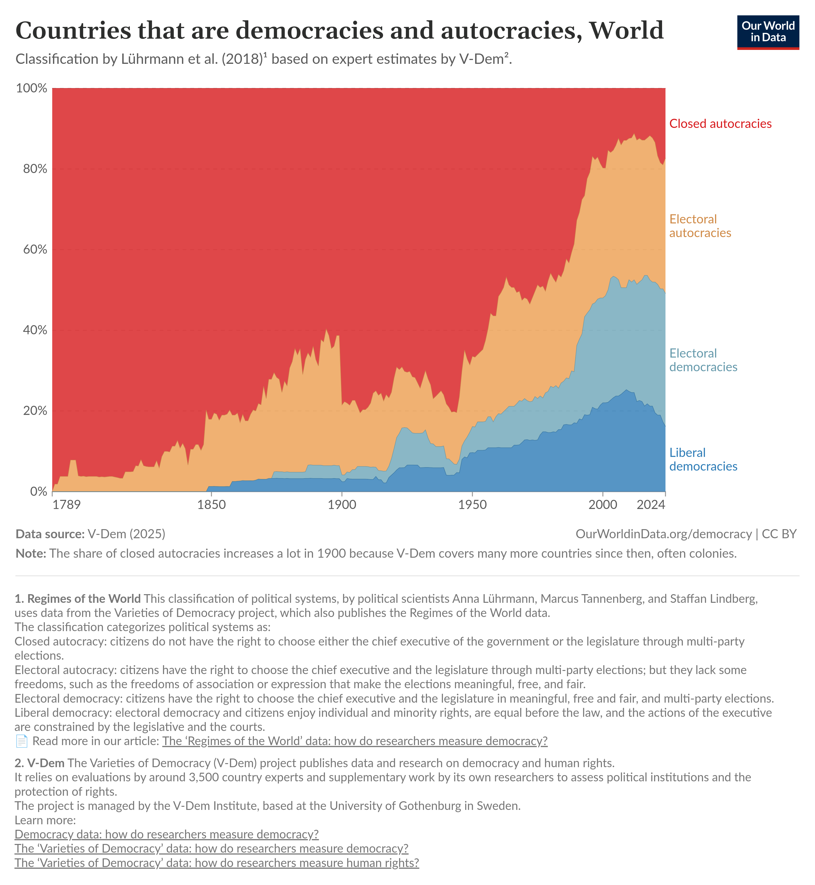
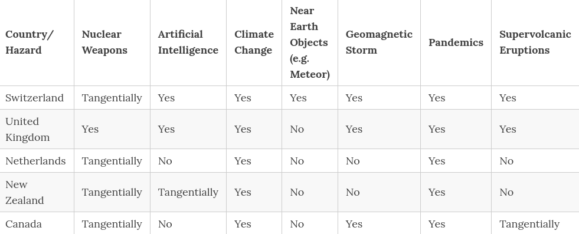
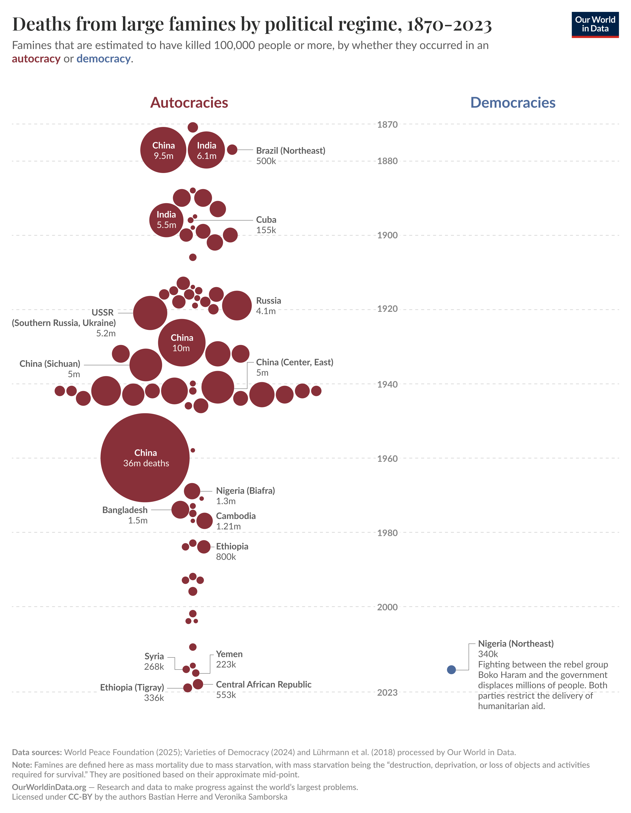
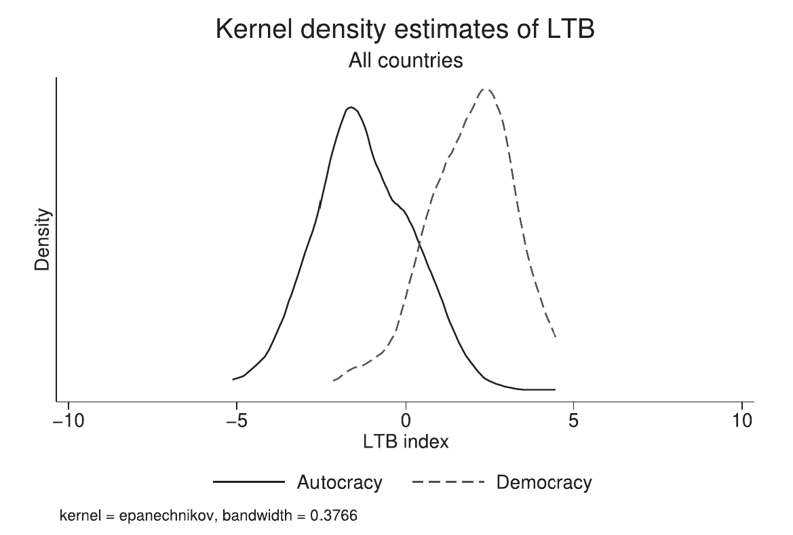

Der Anteil der Weltbevölkerung, der unter dem Spektrum politischer Systeme lebt, die als Demokratie gelten, liegt nahe an seinem historischen Höchststand und beträgt (sehr grob) etwa 4 Milliarden Menschen, also rund die Hälfte der Weltbevölkerung. Aus historischer Sicht hatten Demokratien in den letzten zwei Jahrhunderten einen ziemlichen Lauf: Vor den Revolutionen von 1848 lebten 0 % der Weltbevölkerung in etwas, das wir heute als Demokratie erkennen würden, denn keiner der damaligen Staaten erfüllte verschiedene wesentliche demokratische Eigenschaften wie eine wirklich rechenschaftspflichtige Führung sowie freie und faire Mehrparteienwahlen (Lührmann et al., 2018; Our World in Data, 2025), auch wenn es in den 100 Jahren vor den Revolutionen von 1848 in Europa und den neuen Vereinigten Staaten erhebliche Fortschritte in diese Richtung gab. Seit 1848 haben Demokratien einen kometenhaften Aufstieg erlebt und um 2010 ihren Höchststand erreicht. Der Fortschritt ist aber ins Stocken geraten, und seit 2010 ist der Anteil der Bevölkerung, der unter demokratischer Herrschaft lebt, gesunken (Abbildung 1). Ein Teil davon hängt vielleicht mit demografischen Trends zusammen: alternde Bevölkerungen und ein sinkender Anteil der Bevölkerung in „traditionellen“ demokratischen Kerngebieten wie Europa, Nordamerika und Japan im Vergleich zu erheblichem Bevölkerungswachstum im globalen Süden, oft in Ländern mit demokratischen Defiziten. Ein zugespitztes Beispiel: Das am schnellsten wachsende Land der Welt, Niger, gehört bei Demokratie und Freiheit auch zu den Schlusslichtern.

Abbildung 1: Anteil der Weltbevölkerung, der in Demokratien oder Autokratien lebt (1789 bis 2025). Diese Abbildung sollte mit dem Vorbehalt gelesen werden, dass Demokratie keine binäre Kategorie, sondern ein Spektrum ist und Einordnungen von Regimen komplexe institutionelle Wirklichkeiten zwangsläufig vereinfachen.

Der wichtigere und bedenklichere Treiber dieser Veränderung ist aber die Aushöhlung demokratischer Standards und der demokratische Rückschritt in vielen Demokratien. Der „demokratische“ Status von Ländern, die 2010 noch unvollständige oder sogar vollständige Demokratien waren, wie Ungarn, die Slowakei, Indien und Russland, ist jetzt bedroht, und viele werden inzwischen als „Wahlautokratien“ eingestuft. Einfach gesagt: Demokratie als System hat sich in den vergangenen zweihundert Jahren als sehr resilient erwiesen und ihren Bevölkerungsanteil enorm gesteigert, ist aber nicht grundsätzlich unverwundbar gegen Umkehr.

Das ist auf vielen Ebenen ziemlich besorgniserregend, vor allem weil Demokratien die einzige Regierungsform sind, in der Führende wirklich zur Rechenschaft gezogen werden können und die ganze Bevölkerung an der Regierung beteiligt ist, nicht nur eine Teilgruppe mächtiger Bürger. Es gibt auch reichlich Belege, dass Demokratie als „selbstkorrigierender Mechanismus“, also als System mit robuster Gewaltenteilung, ein wichtiger Faktor für die Beständigkeit demokratischer Systeme war (Aspen Institute, 2017). Es gibt aber noch einen zweiten Grund, warum Demokratien geschützt und gestärkt werden sollten, nicht nur um ihrer selbst willen, sondern auf einer systemisch wichtigen Ebene: Sie sind wirksamer als andere Regierungssysteme darin, Katastrophen zu verhindern und mit ihnen umzugehen. Demokratien zu schützen ist also nicht nur ein moralisches Gebot für unser gesellschaftliches Wohlergehen, sondern auch nötig, um Zerstörung, Kollaps und menschliches Leid nach großen Katastrophen zu vermeiden.

# Warum Demokratien besser darin sind, Krisen zu bewältigen und zu verhindern

## Historische Belege

Wie oben gesagt, gibt es Demokratien im modernen Sinn erst seit 1848, also stellen Fragen der Korrelation (mit anderen großen historischen Trends wie Industrialisierung, Kolonialismus und Dekolonisierung usw.) ein statistisches Problem dafür dar, wie wir Ursache und Wirkung bei der Abmilderung von Katastrophen verstehen und auseinanderhalten, und wir können nicht einfach in die tiefe Geschichte schauen, um zu verstehen, wie Demokratien Bedrohungen begegnen. Demokratien haben aber bestimmte Merkmale, die sie ausmachen und die sich auch in vordemokratischen Gesellschaften finden. Wenn wir in die Geschichte schauen, können wir also Gesellschaften auswählen, die bei diesen demokratischen Werten gut abschneiden, sie als Stellvertreter dafür nehmen, wie Demokratien unter diesen Umständen abgeschnitten hätten, und Schlüsse über diese protodemokratischen Mechanismen und ihren Einfluss auf die gesellschaftliche Resilienz ziehen.

So einen Ansatz hat Peter Peregrine in zwei Studien umgesetzt (Peregrine, 2018, 2021). In der ersten Studie sammelte Peregrine Daten zu 33 Gesellschaften, die insgesamt 22 katastrophale Klimakatastrophen erlebten (meist Dürren). Die Idee der Studie war zu testen, ob mehr lokale Beteiligung und mehr gemeinschaftliche Koordination und Selbstverwaltung oder eine starke Durchsetzung gesellschaftlicher Normen die Resilienz von Gesellschaften gegenüber Katastrophen wirksamer erhöhen. Dazu kodierte Peregrine Variablen, darunter wie steil Hierarchien waren und wie stark soziale Normen durchgesetzt wurden (z. B. indem er schaute, wie standardisiert Rituale und Wohnhäuser waren). Daraus ergab sich ein Gesamtwert dafür, wie stark soziale Normen durchgesetzt wurden und wie steil die Hierarchien waren. Diese Werte wurden dann mit gesellschaftlichen Ergebnissen verglichen (Veränderung der Bevölkerung, Gesundheit usw.). Das Ergebnis der Studie zeigte, dass Gesellschaften mit strengerer Durchsetzung von Normen (ein Stellvertreter für weniger Demokratie) schlechter abschnitten als weniger hierarchische Gesellschaften (ein Stellvertreter für Demokratien), die meist bessere Ergebnisse hatten. Ein ähnliches Argument macht das kürzlich erschienene Buch Goliath’s Curse (Kemp, 2025). Darin beschreibt Kemp, wie plünderbare Ressourcen die Anhäufung von Reichtum erlauben, was zu monopolisierter Gewalt und erzwungenen Hierarchien führt. An einer großen Bandbreite historischer Fallstudien zeigt er, dass diese erzwungenen Hierarchien von Natur aus instabil sind und Menschen lieber in gleicheren Gesellschaften leben.

Darauf aufbauend nutzte die zweite Studie von Peregrine einen ähnlichen Ansatz, konzentrierte sich aber auf die Spätantike Kleine Eiszeit (den kältesten vulkanischen Winter der letzten 3000 Jahre, den Gesellschaftsforschende als groben Stellvertreter für einen nuklearen Winter nutzen). Genau wie in der ersten Studie verglich Peregrine gesellschaftliche Ergebnisse mit Merkmalen von Hierarchie und Beteiligung. Und genau wie in der ersten Studie schnitten flexiblere, partizipativere Gesellschaften besser ab.
Eine nützliche moderne Entsprechung findet sich im Vergleich demokratischer und autoritärer Reaktionen auf die COVID-19-Pandemie, die einen großen, von außen kommenden Belastungstest für staatliche Handlungsfähigkeit, gesellschaftliche Regelbefolgung und anpassungsfähige Steuerung darstellte. Chinas Reaktion stützte sich auf extreme Zentralisierung und Durchsetzung mit Zwang, einschließlich langer Massen-Lockdowns, Bewegungskontrollen und Unterdrückung von Informationen. Diese Maßnahmen verringerten die Übertragung zunächst, erzeugten aber erhebliche Folgekosten: verspätete Erkennung von Ausbrüchen, brüchige Regelbefolgung, wirtschaftliche Verwerfungen und letztlich einen Verlust des weltweiten öffentlichen Vertrauens sowie die Zerstörung des Vertrauens in die eigene Politik des Staates im Land selbst (Zhang et al., 2024). Länder wie Dänemark verfolgten dagegen einen deutlich anderen Ansatz, der auf Transparenz, dezentrale Umsetzung und freiwillige Regelbefolgung auf Grundlage hohen Vertrauens in Institutionen setzte. Dänemark verhängte relativ begrenzte und befristete Einschränkungen, vermied lange Schulschließungen und setzte stark auf öffentliche Kommunikation und lokalen Ermessensspielraum, erreichte aber vergleichsweise niedrige Übersterblichkeit und eine schnellere gesellschaftliche Erholung (Mathieu et al., 2020). Wichtig ist, diesen Kontrast nicht einfach als Folge des Regimetyps allein zu lesen; auch Bevölkerungsgröße, Siedlungsdichte und die Struktur des Gesundheitssystems spielen eine Rolle. Trotzdem bestätigt der Vergleich das historische Muster, das Peregrine gefunden hat: Stark zentralisierte, normendurchsetzende Systeme wirken kurzfristig wirksam, neigen aber unter anhaltendem Stress zur Brüchigkeit, während partizipative Systeme mit verteilter Autorität und vertrauensbasierter Regelbefolgung eine größere Anpassungsfähigkeit zeigen.

Ein viel größerer Datensatz, der alle wichtigen politischen Gemeinwesen der letzten 5000 Jahre erfasst, zeigt ähnliche Ergebnisse (Hoyer et al., 2025b). Dieser Datensatz misst Ausgänge von Krisen (z. B. die Französische Revolution, den Zerfall des Mogulreichs oder die Meiji-Restauration in Japan) und wie sie mit den Eigenschaften der beteiligten Gemeinwesen zusammenhängen. Sie finden, dass ein wichtiger Faktor dafür, ob ein Staat es schafft, Reformen einzuführen, um eine Krise zu beenden, die hierarchische Komplexität ist. Genauer finden sie, dass es einen ausreichend komplexen Staat mit einer Machtbasis außerhalb des Verwaltungsapparats des Staates braucht. Genau dafür ist Demokratie da; stabile Demokratien entfernen sich von stark zentralisierten Machtstrukturen und setzen stattdessen auf einen Ausgleich der Macht zwischen Institutionen und Interessengruppen.

Es gibt auch ein Begleitpaper zu Hoyer et al. (2025b). Darin ging es darum zu verstehen, was Länder tun können, um eine Krise zu verhindern, bevor sie eintritt (Hoyer et al., 2025a). Dafür suchten sie nach Fällen von Gesellschaften, die direkt am Rand einer Krise standen, dann aber erfolgreich wieder zum Frieden fanden. Die vier deutlichsten Fälle für so ein Verhalten, die sie finden, sind die Ständekämpfe in der frühen Römischen Republik (494–287 v. Chr.), die Chartistenbewegung in England (1819–1867), die Reformperiode im Russischen Reich (1855–1881) und die Progressive Era in den USA (1914–1939). Das entscheidende gemeinsame Element, das Reformen erlaubte, bevor die Krise nicht mehr beherrschbar wurde, war, dass sie genug Unterstützung aus den Eliten und ein breites gesellschaftliches Bündnis zustande brachten. Das gab genug Macht, um Reformen gegen die Sonderinteressen mächtiger Eliten durchzusetzen. Auch das deutet wieder darauf hin, dass Demokratien besser darin sind, Krisen zu bewältigen. Auch in einer Demokratie ist es schwierig, breite Bündnisse zu bilden und sich gegen etablierte Interessen zu stellen, aber wegen der zentralen Idee verteilter Macht ist sie wahrscheinlich trotzdem wirksamer im Umgang mit solchen Problemen als andere Regierungsformen.

## Moderne Belege
Die Studien von Peregrine liefern überzeugende Belege, dass partizipativere, weniger hierarchische Gesellschaften in der Vergangenheit extreme Szenarien wirksamer bewältigt haben. Es gibt aber erhebliche systemische Unterschiede zwischen vormodernen Gesellschaften und modernen, globalen Demokratien; der nächste Abschnitt zeigt, dass auch moderne Demokratien stabiler sind und Krisen besser bewältigen.

### Katastrophen und künftige Entwicklungen planen und bewältigen
Bewältigung und Ausgang von Katastrophen werden besser, wenn man sie erstens versteht und sich zweitens auf sie vorbereitet. Ein Stellvertreter, um das einzuschätzen, ist das Vorhandensein und der Umfang nationaler Risikobewertungen; nationale Risikobewertungen sind der Versuch von Staaten, den Raum möglicher Zukünfte zu kartieren und welche Gefahren dort auf sie warten könnten. Länder mit starken nationalen Risikobewertungen haben in diesem Sinne den ersten Schritt gemacht, sich gut auf Katastrophen vorzubereiten. Aber nicht alle Länder erstellen nationale Risikobewertungen, und die, die es tun, setzen oft unterschiedliche Schwerpunkte. Im Allgemeinen erstellen demokratischere Regierungen bessere Risikobewertungen als autokratische. Um ihre Weitsicht zu vergleichen, können wir uns anschauen, wie verschiedene Länder globale katastrophale Risiken in ihren nationalen Risikobewertungen behandeln, denn das sind meist die schlimmsten Extremrisiken, die passieren können (Abbildung 2).

Abbildung 2: Überblick, welche Arten globaler Katastrophen verschiedene Länder in ihren nationalen Risikobewertungen berücksichtigen. „Tangentially“ bedeutet, dass die Gefahr erwähnt, aber nicht weiter besprochen wird.

Es gibt Belege, dass zumindest einige Staaten globale katastrophale Risiken als ernsthaften Gegenstand nationaler Planung behandeln, wobei die Schweiz durch die Breite und Tiefe ihrer Bewertung heraussticht. Die USA sind in diesem Vergleich nicht enthalten, weil sie keine einzelne, zusammengefasste nationale Risikobewertung erstellen; stattdessen sind die relevanten Analysen auf mehrere Behörden verteilt, was es schwer macht, sie als stimmiges Ganzes zu bewerten. Allerdings sind die USA insofern besonders, als sie eine Risikobewertung erstellt haben, die sich ausdrücklich auf globale katastrophale Risiken konzentriert, mit Plänen für regelmäßige Aktualisierungen etwa alle zehn Jahre.

Alle Länder in diesem Vergleich sind Demokratien, und es scheint keine öffentlich verfügbare nationale Risikobewertung vergleichbaren Umfangs von einer autokratischen Regierung zu geben. Das heißt nicht, dass es solche Bewertungen nicht in geheimer Form gibt, aber das ist an sich auch schon ein Problem. Risikobewertung auf nationaler Ebene ist von Natur aus komplex, und wichtige Wege zur Katastrophe werden leicht übersehen. Öffentliche Verfügbarkeit erlaubt Prüfung von außen und schrittweise Verbesserung. Neuseeland ist ein gutes Beispiel: Frühere Versionen seiner nationalen Risikobewertung waren geheim, aber die Entscheidung, eine spätere Fassung zu veröffentlichen, setzte das Dokument erheblicher Kritik aus, die wiederum in Überarbeitungen einfloss und die Resilienz insgesamt stärkte (Boyd & Wilson, 2021).

Über die Planung im Voraus hinaus ist es auch aufschlussreich, sich anzuschauen, wie Staaten abschneiden, wenn Katastrophen tatsächlich eintreten. Lin (2015) liefert eine systematische Analyse dieser Frage und untersucht 150 Länder zwischen 1995 und 2009, einschließlich ihrer staatlichen Handlungsfähigkeit, wie demokratisch sie waren und wie sie auf Katastrophen reagiert haben. Letzteres wurde mit öffentlich verfügbaren Daten dazu gemessen, wie viele Menschen von einer Katastrophe betroffen waren (Tod, Verletzung oder Obdachlosigkeit). Staatsausgaben geteilt durch das BIP dienten als Stellvertreter für staatliche Handlungsfähigkeit, und der demokratische Status wurde mit dem [Polity-IV-Datensatz](https://www.systemicpeace.org/polityproject.html) bewertet. Das zentrale Ergebnis ist, dass die Folgen von Katastrophen in Ländern, die demokratische Regierungsführung mit hoher staatlicher Handlungsfähigkeit verbinden, deutlich geringer sind. Weder Demokratie noch Handlungsfähigkeit allein reichen: Autokratische Systeme ebenso wie Demokratien mit schwacher staatlicher Handlungsfähigkeit haben deutlich schlechtere Ergebnisse, wenn Katastrophen eintreten. Lin (2015) führt diesen Effekt teilweise auf demokratische Rechenschaftspflicht zurück, die die politischen Kosten für Führende erhöht, die bei der Katastrophenreaktion versagen, betont aber, dass Rechenschaftspflicht mit administrativer und finanzieller Handlungsfähigkeit einhergehen muss, um zu wirksamem Handeln zu werden.

Bei der Vorbeugung gibt es auch Belege, dass demokratischere Prozesse meist zu vorausschauenderen Ergebnissen führen. Bürgerräte sollen eine große Zahl von Bürgerinnen und Bürgern zusammenbringen, die eine repräsentative Stichprobe ihrer Gesellschaft sind. Sie bekommen Informationen und Zeit, um eine breite Perspektive und passende Lösungen für gesellschaftliche Probleme zu entwickeln. Lage et al. (2023) untersuchen die Ergebnisse solcher Bürgerräte in der Europäischen Union im Bereich der Klimapolitik und finden, dass ihre Empfehlungen durchweg ambitionierter waren als die der nationalen Regierungen und besser zu dem passten, was laut Klimaforschung nötig ist. Weil diese Empfehlungen aus strukturierter Beratung normaler Bürgerinnen und Bürger statt politischer Eliten entstehen, genießen sie oft höhere öffentliche Legitimität. Die Bürgerversammlungen in Irland zur Abtreibung sind ein gut dokumentiertes Beispiel: Ihre Empfehlungen gingen weit über das hinaus, was vorher als wahlpolitisch machbar galt, fanden aber letztlich breite öffentliche Unterstützung, sobald der Beratungsprozess dahinter breit verstanden wurde.
Kurz gesagt: Demokratien sind meist gut auf Katastrophen vorbereitet, und sowohl ihre Regierungen als auch ihre Zivilgesellschaften unternehmen meist Schritte, um Katastrophen zu verstehen und sich gegen sie zu wappnen.

### Demokratien vermeiden meist sehr schlimme Ergebnisse
Diese Studien deuten darauf hin, dass Demokratien sowohl bei der Vorbereitung auf Katastrophen als auch bei ihrer Bewältigung besser abschneiden, sofern sie genug staatliche Handlungsfähigkeit haben. Außerdem gibt es Belege, dass demokratische Systeme auch wirksamer darin sind, schwere negative Ergebnisse von vornherein zu vermeiden.

*Demokratien führen selten Krieg gegeneinander*: Es gibt in der Geschichte sehr wenige Fälle, in denen demokratische Staaten gegeneinander gekämpft haben. Wenn man die Analyse auf vollständige liberale Demokratien nach heutigen Definitionen beschränkt, fällt diese Zahl praktisch auf null. Es gibt keine einzelne, endgültige Theorie, die dieses Muster erklärt, aber eine bekannte Erklärung (die Theorie des demokratischen Friedens) lautet, dass es politisch schwer ist, der eigenen Wählerschaft eine Aggression gegen einen anderen voll demokratischen Staat zu rechtfertigen (Reiter, 2017; Tomz & Weeks, 2013).

*Stabile Demokratien haben sehr selten Hungersnöte*: Historisch gehörten Hungersnöte zu den zerstörerischsten Ereignissen, denen Gesellschaften gegenüberstehen können, und führten oft zu Massensterben und politischer Instabilität, weil sie die grundlegendsten Bedingungen des Überlebens untergruben. Demokratien haben in dieser Hinsicht aber eine deutlich bessere Bilanz. Die Ergebnisse hängen teilweise davon ab, wie sowohl Hungersnot als auch Demokratie definiert werden, aber laut (Hasell & Roser, 2013) gab es seit 1870 nur eine einzige Hungersnot in einem demokratischen Staat, während autokratische Regime im selben Zeitraum Dutzende erlebten (Abbildung 3).

Abbildung 3: Todesfälle durch große Hungersnöte nach politischem Regime.

Demokratien verfolgen kein Wirtschaftswachstum um seiner selbst willen: Es gibt das hartnäckige Argument, dass autokratische Systeme besser langfristig planen können als Demokratien, weil sie nicht an Wahlzyklen von vier bis fünf Jahren gebunden sind. Diese Behauptung untersuchen Millemaci et al. (2024). Sie bewerten den Zusammenhang zwischen Regimetyp, Wirtschaftswachstum und längerfristigen gesellschaftlichen Ergebnissen wie Bildung, Gesundheit, öffentlichem Nahverkehr und dem Eingehen auf die Wünsche der Bevölkerung und vergleichen Demokratien und Autokratien in diesen Dimensionen. Ihre Ergebnisse zeigen, dass Demokratien beim Wirtschaftswachstum im Durchschnitt mindestens so gut abschneiden wie Autokratien, während die extremsten Ergebnisse an beiden Enden der Verteilung, also sehr hohes Wachstum und schwere Schrumpfung, in autokratischen Systemen auftreten. Wenn man gesellschaftliche Ergebnisse betrachtet, ist der Kontrast noch deutlicher. Demokratische Länder liefern bei diesen Maßen systematisch bessere Ergebnisse für ihre Bevölkerung (Abbildung 4).

Abbildung 4: Vergleich positiver gesellschaftlicher Ergebnisse (Long-term-Background-Index, LTB, bestehend aus Faktoren wie Gesundheit, öffentlichem Nahverkehr usw.) zwischen Demokratien und Autokratien. Ein höherer Index bedeutet bessere Ergebnisse für die Gesellschaft insgesamt. Die y-Achse ist eine Kerndichteschätzung, also eine geglättete Annäherung an die vorhandenen Datenpunkte. Einfacher gesagt heißt das nur, dass höhere Werte auf der y-Achse bedeuten, dass sich mehr Länder um diesen LTB-Indexwert sammeln.

*Demokratien kehren Autokratisierung oft um*: Es ist belegt, dass Demokratien negative Ergebnisse besser und verlässlicher vermeiden als Autokratien. Entsprechend ist ein demokratischer Rückfall in die Autokratie an sich schon ein negatives Ergebnis. Gleichzeitig zeigen demokratische Systeme aber auch eine gewisse Selbststabilisierung als Reaktion auf autokratische Aushöhlung. Diese Dynamik untersuchen Nord et al. (2025), die die Entwicklung demokratischer Regime zwischen 1900 und 2023 analysiert und Veränderungen der demokratischen Qualität über die Zeit verfolgt haben. In dieser Zeitreihe identifizieren die Autoren Episoden, in denen Länder abrupte Verschiebungen hin zu mehr Demokratisierung oder mehr Autoritarismus erlebten. Sie finden, dass etwa die Hälfte aller Autokratisierungsepisoden innerhalb relativ kurzer Zeit umgekehrt wird, in dieser Studie definiert als höchstens fünf Jahre. Dieses Muster hat sich über die Zeit verstärkt, und heutige Demokratien kehren Autokratisierungstrends in etwa 73 % der Fälle um.

# Was bedroht Demokratien heute?

Die Gründe für den heutigen Rückgang der Demokratie sind wahrscheinlich zahlreich und komplex (siehe Abbildung 1). Ein Überblick von Loughlin (2019) beschreibt diesen Rückgang als langsamen und oft undurchsichtigen Prozess. Statt durch offene Putsche verläuft die demokratische Aushöhlung heute meist über den schrittweisen Verfall demokratischer Institutionen und Praktiken. Ungarn ist ein häufig genanntes Beispiel; obwohl es formal als Demokratie eingestuft ist, hat die Regierung unter Viktor Orbán mit der Zeit institutionelle Kontrollen abgebaut und das Wahlsystem so umgebaut, dass eine Wahlniederlage deutlich unwahrscheinlicher wird. Vergleichbare Dynamiken lassen sich in anderen etablierten Demokratien beobachten: Oft genannte Beispiele sind die Alternative für Deutschland und die mit Donald Trump verbundene MAGA-Bewegung in den USA. Die Mechanismen demokratischer Aushöhlung sind zwar immer besser dokumentiert, aber die Gründe für ihre offensichtliche Beschleunigung in der Gegenwart bleiben weniger klar.

Loughlin nennt mehrere beitragende Faktoren:

* Globalisierung: Die zunehmende Globalisierung hat die Fähigkeit von Staaten verringert, ihre heimische Wirtschaft zu regulieren, weil sie zunehmend äußeren Kräften ausgesetzt sind, die sie nicht direkt kontrollieren. Das schränkt wichtige Wege nationaler Selbstbestimmung ein.
* Ungleichheit: Die wirtschaftliche Ungleichheit ist in vielen Ländern in den letzten Jahrzehnten gestiegen, was die materiellen Bedingungen für große Teile der Bevölkerung in demokratischen Gesellschaften verschlechtert hat. Das hat das Vertrauen in traditionelle demokratische Prozesse ausgehöhlt, die breite Verbesserungen des Lebensstandards versprochen hatten.
* Fokus auf das Individuum: Der neoliberale Kapitalismus, das vorherrschende Wirtschaftsmodell in den meisten Demokratien, legt großen Wert auf individuelle Autonomie. Zusammen mit zunehmender Migration und Ungleichheit kann diese Betonung den sozialen Zusammenhalt und die kollektive Identifikation schwächen. Diese kollektive Identifikation ist aber oft wichtig, um demokratische Legitimität aufrechtzuerhalten, vor allem wenn demokratische Ergebnisse nicht perfekt mit individuellen Wünschen übereinstimmen.
* Wirtschaftliche Macht von Unternehmen: Große multinationale Konzerne wie Amazon oder Apple üben über Lobbyarbeit und ähnliche Mechanismen wachsenden Einfluss auf die Politik aus. Das kann Frust bei Wählerinnen und Wählern erzeugen, wenn politische Entscheidungen eher Unternehmensinteressen als die Wünsche der Bevölkerung widerzuspiegeln scheinen.

Das sind gewichtige Behauptungen, aber sie finden sich häufig auch in anderen Papern, die den Zusammenhang zwischen gesellschaftlichen Bedingungen, Ungleichheit und Demokratie untersuchen. Centeno & Cohen (2012) besprechen zum Beispiel die Geschichte des Neoliberalismus und betonen ähnliche Probleme wie Loughlin. Im späten 20. Jahrhundert kam der Neoliberalismus als attraktive Ideologie auf, die über freie Märkte sowohl Demokratie als auch Wohlstand versprach. Wie Centeno & Cohen (2012) anmerken, war das besonders in den 1990er-Jahren überzeugend, als der Erfolg der „Tigerstaaten“ zu zeigen schien, wie globale Marktmechanismen Länder aus der Armut holen könnten. Der scheinbare Sieg des Kapitalismus über das sowjetische Modell festigte die Anziehungskraft neoliberaler Ideen weiter.

Die Grundsätze waren einfach: Staatseingriffe minimieren, öffentliche Dienste privatisieren und Märkte deregulieren. Die Theorie war, dass das die wirtschaftliche Freiheit maximieren würde, die wiederum politische Freiheit garantieren würde. Diese „Unteilbarkeitsthese“, also die Idee, dass wirtschaftliche und politische Freiheit untrennbar seien, wurde in politischen Kreisen sehr einflussreich.

Die Umsetzung neoliberaler Politik hatte aber mehrere Folgen, die die gesellschaftliche Verwundbarkeit erhöhten:

* Mehr Ungleichheit: Der Fokus auf Deregulierung und Steuersenkungen, besonders für Reiche, hat zu wachsender Ungleichheit geführt.
* Geschwächte staatliche Handlungsfähigkeit: Durch umfangreiche Privatisierung und Deregulierung haben Staaten ihre Fähigkeit verringert, auf Krisen zu reagieren und öffentliche Güter bereitzustellen.
* Kaputte Rückkopplungsschleifen: Als Reichtum und Macht sich stärker konzentrierten, wurden Entscheidungsträger zunehmend von den Folgen ihrer Entscheidungen abgeschirmt, weil sie vor allem von Lobbyisten hören, was getan werden muss. Das hat es für Gesellschaften schwerer gemacht, aufkommende Bedrohungen zu erkennen und auf sie zu reagieren.

Ein konkreteres Beispiel dafür, wie wirtschaftliche Macht großen Unternehmen erlaubt, das politische System zu beeinflussen, liefern Supran et al. (2023). Sie haben Unterlagen von ExxonMobil untersucht und gezeigt, dass das Unternehmen Anfang der 1980er-Jahre wusste, wie stark fossile Brennstoffe den Planeten erhitzen würden. Diese Modelle sagten die Erwärmung der letzten Jahrzehnte genau voraus. Trotzdem nutzte ExxonMobil seinen Einfluss, um Falschinformationen zu verbreiten, die seinen eigenen Ergebnissen widersprachen, und um die Politik davon zu überzeugen, Gesetze zu vermeiden, die sein Geschäft behindern würden.

Zusammengenommen haben diese Faktoren ein gemeinsames Grundmerkmal. Sie lassen sich alle als Folgen des neoliberalen Kapitalismus verstehen, der Marktmechanismen zur wichtigsten Form gesellschaftlicher Koordination macht und gleichzeitig die Rolle des Staates begrenzen will.

# Konkrete Ansätze, um Demokratien wieder stärker zu machen
Zusammengenommen zeigen die bisherigen Beispiele, dass starke demokratische Prozesse ein zentraler Bestandteil gesellschaftlicher Resilienz gegenüber katastrophalen Risiken sind. Neben besserer Krisenvorbereitung und -reaktion gehen solche Prozesse auch mit höherem Wohlergehen der Bürgerinnen und Bürger in der Gegenwart einher. Das wirft die Frage auf, wie demokratische Systeme gestärkt werden könnten. Dafür muss man sich einer Reihe struktureller Schwächen stellen, vor allem hoher Ungleichheit, verringerter staatlicher Handlungsfähigkeit und gestörter demokratischer Rückkopplungsschleifen.

## Ungleichheit beheben: Bürgerinnen und Bürgern die Ressourcen und die Zeit geben, sich an der Demokratie zu beteiligen

Demokratische Beteiligung kostet Zeit. Mehr Beteiligung an Entscheidungen kann die Qualität der Ergebnisse verbessern, braucht aber auch genug Raum für Beratung. Wenn sich Bürgerinnen und Bürger stärker an demokratischen Prozessen beteiligen sollen, muss das neben ihrem Arbeitsleben machbar sein. In heutigen Volkswirtschaften arbeiten aber viele Menschen lange. Manche tun das freiwillig, für andere ist es eine Notwendigkeit, getrieben von grundlegenden materiellen Bedürfnissen wie Wohnen und Lebensunterhalt. Für die zweite Gruppe sind mehr freie Zeit und Sicherheit eine Voraussetzung für sinnvolle demokratische Beteiligung. Ein möglicher Ansatz ist ein bedingungsloses Grundeinkommen (die Deutung von Versuchen ist zwar umstritten, sie deuten aber meist auf bessere Ergebnisse auf individueller Ebene bei Gesundheit und Zeit hin), das Menschen einen finanziellen Puffer geben könnte, der mehr bürgerschaftliches Engagement ermöglicht. Allgemeiner könnte eine große Bandbreite von Maßnahmen, die den wirtschaftlichen Druck verringern, ähnliche Funktionen erfüllen, etwa längere Elternzeit, bessere Kinderbetreuung oder höhere Steuern auf multinationale Konzerne und Erbschaften.

## Schwache staatliche Handlungsfähigkeit beheben: Menschen mehr für Demokratie begeistern

Neben der Zeit zur Beteiligung brauchen Bürgerinnen und Bürger auch genug Motivation, sich an demokratischen Prozessen zu beteiligen. Diese Dimension gehört zu den am schwersten politisch zu beeinflussenden. Trotzdem identifiziert die bestehende Forschung Faktoren, die das Engagement der Bürgerinnen und Bürger für das politische Gemeinwesen, in dem sie leben, und ihr Vertrauen darin erhöhen können. Ein solcher Faktor ist, ob der Staat als zugänglich, kompetent und verlässlich wahrgenommen wird. Wenn öffentliche Dienste verfallen, etwa wenn lokale Einrichtungen schließen, der Nahverkehr unzuverlässig ist oder Bibliotheken nicht genug Geld haben, fällt es Bürgerinnen und Bürgern schwer, das demokratische System als wirksam zu sehen. Die öffentliche Daseinsvorsorge zu stärken, spielt also eine wichtige Rolle dabei, das Vertrauen in demokratische Regierungsführung wiederherzustellen. Mehr staatliche Handlungsfähigkeit ist auch direkt für die Vorbereitung auf Katastrophen relevant, weil sie die Infrastruktur und die Verwaltungsprozesse trägt, die nötig sind, um große Risiken abzumildern und auf sie zu reagieren.

## Kaputte Rückkopplungsschleifen reparieren: Strukturen und Prozesse schaffen, die direktere Beteiligung an der Demokratie erlauben

Wenn Bürgerinnen und Bürger sowohl die Zeit als auch die Motivation zur Beteiligung haben, braucht es auch passende institutionelle Prozesse und Strukturen, um dieses Engagement wirksam zu bündeln. Eine große Bandbreite möglicher institutioneller Antworten könnte zu diesem Ziel beitragen. Am ambitioniertesten Ende des Spektrums würde das eine erhebliche Verlagerung politischer Autorität auf niedrigere Ebenen bedeuten. Solche Regelungen haben historische Vorbilder in den USA, vor allem in der Tradition der Town Halls. In der Gründungszeit der USA übten lokale Räte erhebliche Autorität aus und lieferten die demokratische Legitimation und Grundlage für die Verfassungsentwicklung, weil lokal gewählte Vertreter direkt an der Ausarbeitung der Regierungsgrundlagen beteiligt waren. Auch wenn ein Großteil dieser Autorität später auf der Ebene der Bundesstaaten gebündelt wurde, heißt diese Entwicklung nicht, dass Dezentralisierung von Natur aus unumkehrbar ist. Es gibt auch heutige Beispiele, aus denen solche Modelle schöpfen könnten. Die Schweiz zum Beispiel gibt Ebenen unterhalb des Bundes erhebliche Entscheidungsbefugnisse. Ebenso ist die autonome Region Rojava im Norden Syriens ein laufendes Experiment lokaler und partizipativer demokratischer Selbstverwaltung.

Eine leichter umsetzbare Lösung könnten Bürgerräte sein. Solche Räte haben gezeigt, dass sie vorausschauende politische Empfehlungen erarbeiten können, die auch relativ hohe öffentliche Zustimmung finden. Sie können in einer großen Bandbreite von Politikfeldern einberufen werden. Eine aktuelle Anwendung wäre die Steuerung und Regulierung künstlicher Intelligenz. Denkbar ist auch, Bürgerräte grenzüberschreitend zu organisieren, um zu Formen globaler Risikobewertung beizutragen und demokratische Beratung mit Anstrengungen zur Stärkung globaler Resilienz zu verbinden.
Ein weiterer möglicherweise wirksamer Ansatz ist der Bürgerhaushalt, der Bürgerinnen und Bürgern ein Stück Entscheidungsgewalt darüber gibt, wie Kommunen öffentliche Gelder verteilen. Dieser Ansatz beruht auf der Annahme, dass die lokale Bevölkerung oft am besten erkennen kann, vor welchen Herausforderungen sie steht, und entsprechende Antworten priorisieren kann. Diese Ansätze ließen sich durch digitale Technologien weiter stärken. Eine wachsende Zahl von Plattformen ermöglicht zugängliche Formen demokratischer Beratung auch aus der Ferne und senkt so die Hürden für Beteiligung und Koordination (zum Beispiel [Decidim](https://decidim.org/)).

# Fazit

Demokratien stehen unter erheblichem Druck, bleiben aber unverzichtbar, sowohl um eine hohe Lebensqualität zu erhalten als auch um Gesellschaften aufzubauen, die gegenüber künftigen Risiken resilient sind. Die hier beschriebenen politischen Optionen sind nicht als vollständige Lösungssammlung gedacht, sondern als Beispiele dafür, wie demokratische Systeme gestärkt werden könnten. Viele weitere Maßnahmen könnten ebenfalls wirksam sein, sofern sie den Bürgerinnen und Bürgern mehr Zeit und Ressourcen für Beteiligung geben, die Motivation zur demokratischen Selbstverwaltung fördern und institutionelle Prozesse schaffen, die echte Entscheidungsgewalt auf niedrigere Ebenen verlagern.

# Quellen
* Aspen Institute. (2017). Democracy as Self-Correction. Aspen Institute Centre for Enterprise. https://www.aspeninstitutece.org/article/2017/democracy-as-self-correction/
* Boyd, M., & Wilson, N. (2021). Anticipatory Governance for Preventing and Mitigating Catastrophic and Existential Risks. Policy Quarterly, 17(4), Article 4. https://doi.org/10.26686/pq.v17i4.7313
* Centeno, M. A., & Cohen, J. N. (2012). The Arc of Neoliberalism. Annual Review of Sociology, 38(Volume 38, 2012), 317–340. https://doi.org/10.1146/annurev-soc-081309-150235
* Hasell, J., & Roser, M. (2013). Famines. Our World in Data. https://ourworldindata.org/famines
* Hoyer, D., Bennett, J. S., Whitehouse, H., Francois, P., Reddish, J., Davis, D., Feeney, K. C., Levine, J., Holder, S. L., & Turchin, P. (2025a). CRISES AVERTED. How A Few Past Societies Found Adaptive Reforms in the Face of Structural-Demographic Crises. Cliodynamics: The Journal of Quantitative History and Cultural Evolution, 16(1). https://doi.org/10.21237/C7CLIO.38365
* Hoyer, D., Holder, S., Bennett, J. S., Francois, P., Whitehouse, H., Covey, R. A., Feinman, G., Korotayev, A., Ustyuzhanin, V., Preiser-Kapeller, J., Bard, K., Levine, J., Reddish, J., Orlandi, G., Ainsworth, R., & Turchin, P. (2025b). All Crises are Unhappy in Their Own Way: The Role of Societal Instability in Shaping the Past. Social Science History, 50(2), 314–346. https://doi.org/10.1017/ssh.2025.10113
* Kemp, L. (2025). Goliath’s Curse: The History and Future of Societal Collapse. Viking.
* Lage, J., Thema, J., Zell-Ziegler, C., Best, B., Cordroch, L., & Wiese, F. (2023). Citizens call for sufficiency and regulation—A comparison of European citizen assemblies and National Energy and Climate Plans. Energy Research & Social Science, 104, 103254. https://doi.org/10.1016/j.erss.2023.103254
* Lin, T.-H. (2015). Governing Natural Disasters: State Capacity, Democracy, and Human Vulnerability. Social Forces, 93(3), 1267–1300.
* Loughlin, M. (2019). The Contemporary Crisis of Constitutional Democracy†. Oxford Journal of Legal Studies, 39(2), 435–454. https://doi.org/10.1093/ojls/gqz005
* Lührmann, A., Tannenberg, M., & Lindberg, S. I. (2018). Regimes of the World (RoW): Opening New Avenues for the Comparative Study of Political Regimes. Politics and Governance, 6(1), 60–77.
* Mathieu, E., Ritchie, H., Rodés-Guirao, L., Appel, C., Gavrilov, D., Giattino, C., Hasell, J., Macdonald, B., Dattani, S., Beltekian, D., Ortiz-Ospina, E., & Roser, M. (2020). Excess mortality during the Coronavirus pandemic (COVID-19). Our World in Data. https://ourworldindata.org/excess-mortality-covid
* Millemaci, E., Monteforte, F., & Temple, J. R. W. (2024). Have Autocrats Governed for the Long Term? Kyklos. https://doi.org/10.1111/kykl.12425
* Nord, M., Angiolillo, F., Lundstedt, M., Wiebrecht, F., & Lindberg, S. I. (2025). When autocratization is reversed: Episodes of U-Turns since 1900. Democratization, 0(0), 1–24. https://doi.org/10.1080/13510347.2024.2448742
* Our World in Data. (2025). Countries that are democracies and autocracies. https://ourworldindata.org/grapher/countries-democracies-autocracies-row
* Peregrine, P. N. (2018). Social Resilience to Climate-Related Disasters in Ancient Societies: A Test of Two Hypotheses. Weather, Climate, and Society, 10(1), 145–161. https://doi.org/10.1175/WCAS-D-17-0052.1
* Peregrine, P. N. (2021). Social resilience to nuclear winter: Lessons from the Late Antique Little Ice Age. Global Security: Health, Science and Policy, 6(1), 57–67. https://doi.org/10.1080/23779497.2021.1963808
* Reiter, D. (2017). Is Democracy a Cause of Peace? In Oxford Research Encyclopedia of Politics. https://doi.org/10.1093/acrefore/9780190228637.013.287
* Supran, G., Rahmstorf, S., & Oreskes, N. (2023). Assessing ExxonMobil’s global warming projections. Science, 379(6628), eabk0063. https://doi.org/10.1126/science.abk0063
* Tomz, M. R., & Weeks, J. L. P. (2013). Public Opinion and the Democratic Peace. American Political Science Review, 107(4), 849–865. https://doi.org/10.1017/S0003055413000488
* Zhang, M., Liu, B., Xiang, G., Yan, X., Ling, Y., & Zuo, C. (2024). Navigating the shift: Understanding public trust in authorities amidst policy shifts in China’s COVID-19 response. Humanities and Social Sciences Communications, 11(1), 1716. https://doi.org/10.1057/s41599-024-04224-6
