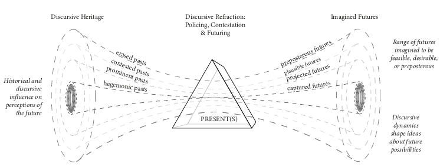

Untergangsvisionen kennst du wahrscheinlich. Man kommt heutzutage kaum an ihnen vorbei. Sie machen sicher Angst. Aber helfen sie? Wenn man sich die Welt anschaut, scheinen sie nicht sehr wirksam zu sein. Die USA sind aus so ziemlich jedem Umweltabkommen ausgestiegen, das einem einfällt, und die EU scheint immer kurz davor, wichtige Umweltregeln zurückzudrehen. Der Gegenwind gegen grüne Politik ist real. Noch problematischer ist aber, dass wir uns bessere Zukünfte nicht einmal mehr vorstellen können. Wenn wir zurückblicken, waren Utopien ein viel größerer Teil gesellschaftlicher Erzählungen. Einst drehten sich diese Erzählungen um große Themen wie einen starken Sozialstaat oder Bürgerrechte. Aber sie sind verschwunden. Nicht weil sie nicht mehr gebraucht werden, sondern weil wir eine institutionelle Maschinerie für Politik geschaffen haben, die systematisch jede Alternative zum Status quo im Keim erstickt. Diese positiven Visionen werden aber gebraucht, denn was wir jetzt haben, funktioniert eindeutig nicht.

Aber wie könnten wir diese positiven Visionen zurückbekommen?

Diese Frage beschäftigt mich in letzter Zeit sehr. Zum Glück bin ich auf das Buch „[Captured Futures: Rethinking the Drama of Environmental Politics](https://www.goodreads.com/en/book/show/223879872-captured-futures)“ von Maarten A. Hajer und Jeroen Oomen (2025) gestoßen, das ich hier zusammenfassen will. Es legt einen Bauplan dafür vor, wie wir in der heutigen Welt dystopischer Zukünfte gelandet sind, welche Kräfte unser Zukunftsdenken prägen und was wir vielleicht tun müssen, um uns wieder Zukünfte vorstellen zu können, für die es sich zu kämpfen lohnt, und sie wahr zu machen.

# Gefangene Zukünfte

Ziehen wir zuerst Bilanz, wo wir stehen. Die aktuelle Umweltpolitik scheint nicht zu funktionieren. Klimawandel, Artensterben und viele andere Umweltprobleme gehen weiter und scheinen nicht auf einem Kurs zu sein, bald gestoppt zu werden. Teilweise lässt sich das darauf zurückführen, dass die Politik von etablierten Interessen vereinnahmt ist, aber das kann nicht alles sein. Beunruhigender ist, dass dort, wo einst Ideen für eine bessere Zukunft waren, ein klaffendes Loch ist. Wenn wir über morgen reden, dann meist in Form einer Welt, die der heutigen sehr ähnlich sieht, aber entweder mit einer Klimakatastrophe im Hintergrund oder so, dass wir den Klimawandel und all unsere anderen Probleme irgendwie gelöst haben, ohne viel daran ändern zu müssen, wie Gesellschaften funktionieren. Die Zukunftsvisionen, die es derzeit gibt, sind meist gar keine Visionen, sondern der Status quo plus ein paar Änderungen am Rand. Angesichts der Größe der Herausforderung scheint es ziemlich unwahrscheinlich, dass diese kleinen Änderungen reichen könnten.

Diskussionen darüber, wie eine grundlegend andere Gesellschaft aussehen könnte, finden aber weit weg vom Mainstream statt, wenn sie überhaupt stattfinden. Das Einzige, was der Mainstream diskutiert, ist die Idee der ökologischen Modernisierung. Die Idee von grünem Wachstum, Kapitalismus, nur plötzlich nachhaltig. Keine Änderung des Lebensstils nötig, aber wie durch ein Wunder wird die Welt vor extremem Klimawandel und all den anderen Problemen gerettet.

Das sind gefangene Zukünfte. Die kollektive Unfähigkeit, sich eine Zukunft vorzustellen, die sich grundlegend von dem unterscheiden könnte, was wir heute haben. Solche Erzählungen sind stark, aber es scheint klar, dass sie nicht halten werden, was sie versprechen. Der Kapitalismus des grünen Wachstums ist um die Idee von Netto-Null herum gebaut. Die Fähigkeit, Kohlendioxid irgendwie zu entfernen. Jetzt können wir das nicht, weil es super teuer ist, aber es gibt den festen Glauben, dass der Markt das irgendwie lösen und zu einem unbekannten Zeitpunkt in der Zukunft Technik zur Kohlenstoffabscheidung liefern wird. Daran zu glauben ist sehr bequem, weil es einen im Jetzt von jeder Verantwortung entlastet. Warum Emissionen vermeiden, wenn sie in ein paar Jahren leicht wieder entfernt werden können?

Es wird aber immer deutlicher, dass dieser Ansatz nicht funktionieren wird. Länder des Globalen Südens drängen darauf, dass die reichen Länder echte Verantwortung für ihre vergangenen Emissionen übernehmen, Aktivisten radikalisieren sich, Wissenschaftler werden politisch aktiver, in der Hoffnung, dass ihre Botschaft so gehört wird. Die Erzählung vom grünen Wachstum und davon, eine Klimakatastrophe zu vermeiden, ohne dass sich jemand ändern muss, beginnt zu bröckeln. Aber was kommt als Nächstes, und wie entscheidet eine Gesellschaft über Erzählungen für ihre zentralen Herausforderungen?

# Die Gestalt der Steuerung

Hier hilft es, Umweltpolitik oder sogar alle Politik als ein Drama zu sehen, das ständig gespielt wird und sich verändert. In dieser Dramaturgie hat jeder eine Rolle zu spielen. Wissenschaftler sollen uns immer wieder warnen, dass die nächsten zehn Jahre die letzten sind, in denen wir etwas ändern können, jedes Jahr gibt es Konferenzen wie die COP, die viel Aufmerksamkeit bekommen, aber nicht wirklich viel liefern, Industriebosse warnen, dass die nötigen Veränderungen einfach zu teuer sind, und Politiker wägen die Belege ab, damit sie die Entscheidungen für die Gesellschaft treffen können.

In der politischen Wirklichkeit sind diese Rollen nicht so festgelegt, wie sie scheinen mögen. Interessengruppen in der Gesellschaft verschieben und verändern sich ständig. Das politische System, in dem wir leben, ist nicht stabil, sondern alle in der Gesellschaft gestalten es ständig, einfach indem sie darin leben und die Prämisse, wie Macht durch die Gesellschaft wirkt, entweder akzeptieren oder ablehnen. Ein Unterschied, den man hier verstehen muss, ist der zwischen Policy und Politics. Politics ist das System, wie eine Gesellschaft Entscheidungen trifft, die Debatte um den grundlegenden Aufbau. Policy sind dagegen die Regeln und Vorschriften, die man in dem politischen System aufstellt, auf das man sich mit Politics geeinigt hat. Policy setzt immer eine bestimmte Politics voraus, meist ohne das anzuerkennen.

Eine weitere Kategorie, die wir verstehen müssen, um zu begreifen, wie Gesellschaften funktionieren, ist Policing, also das Überwachen der Grenzen. Policing läuft gewissermaßen parallel zu Politics und Policy. Es ist der Akt, die bestehende Politics und Policy zu bekräftigen. Das passiert auf vielen Ebenen, oft tun Menschen es, ohne es zu merken, weil sie die Prämissen der Politik, in der sie leben, so tief verinnerlicht haben, dass sie sich nichts anderes vorstellen können. Ein Beispiel dafür, wie die aktuelle Umweltpolitik überwacht wird, wäre, wer zu Konferenzen wie der COP eingeladen wird, wessen Argumente während der Konferenz gehört und verstärkt werden und wessen Argumente ignoriert werden. Das zeigt die Grenzen dessen, was das aktuelle politische Regime aufnehmen oder tolerieren kann. Über Kohlenstoffentnahme zu reden ist in Ordnung, über das Ende des Kapitalismus zu reden nicht. Argumente, die den aktuellen Kreis akzeptabler Ideen verlassen, werden aktiv unterdrückt, z. B. indem man nicht über sie redet oder sie aktiv als absurd abstempelt.

Damit das funktioniert, muss klar sein, was gesteuert werden soll, wie es gesteuert werden soll, und die Betroffenen müssen sich genug dafür interessieren, um etwas dagegen zu tun. Diese Voraussetzungen werden durch schrittweise Interaktionen von Wissenschaftlern, Journalisten und Aktivisten langsam geschaffen. Das zieht politische Akteure an, die den Gegenstand dann von einem gesellschaftlichen Anliegen in einen steuerbaren Gegenstand verwandeln. Das Steuerungssystem entsteht nicht aus dem Nichts. Es muss aktiv geschaffen, erhalten und überwacht werden. Sonst würde es aufhören zu funktionieren, denn Steuerung findet nur in unserer kollektiven Vorstellung statt.

# Auftritt Dramaturgie

Da Steuerung in unserer kollektiven Vorstellung stattfindet und nicht als äußere, objektive Tatsache der Welt existiert, muss sie ständig neu aufgeführt werden. Sobald Menschen aufhören, an eine Form der Steuerung zu glauben, hört sie auf zu existieren. Diese ständige Neuschöpfung unseres Steuerungssystems bedeutet, dass es immer veränderbar ist. Hier werden Zukunftsvisionen wichtig. Wie ich mir die Zukunft vorstelle, prägt, welche Art von Steuerung ich zu akzeptieren bereit bin. Wenn sich meine Zukunftsvision ändert, ändern sich auch die politischen Systeme, in denen ich zu leben bereit wäre. Wir neigen dazu, diese Tatsache der Politik zu vergessen. Das passiert, weil wir uns an etwas Festem festhalten wollen. Wenn unser aktuelles politisches System nur in unseren Köpfen existiert und jederzeit geändert werden könnte, warum sollte ich mich an die Regeln der Gesellschaft halten? Das macht Politik dem Theater ähnlich. Damit Theater funktioniert und uns berührt, müssen wir ignorieren, dass alles nur ausgedacht ist. Wir müssen unseren Unglauben aussetzen.

Deshalb lassen sich Konzepte aus dem Theater nutzen, um Politik besser zu verstehen. Zwei wichtige davon sind Diskurs und Dramaturgie. Bei Dramaturgie geht es darum, wie Akteure durch Aufführung symbolische Macht ausüben. Genauer konzentriert sie sich darauf, wer was wie wo und zu wem sagt. Aus Sicht der Dramaturgie ist Politik eine Abfolge von Aufführungen. Diskurs ist die Idee, dass unsere sozialen Wirklichkeiten ständig neu hervorgebracht werden, indem man Erzählungen formt, die Vergangenheit, Gegenwart und Zukunft verbinden. Anders gesagt: Diskurs ist die Erzählung der Gesellschaft, und Dramaturgie ist, wie sie aufgeführt wird. Diskurs ist wie Klebstoff, er erlaubt, Gruppen zusammenzubringen und sich auf Konzepte und Erzählungen zu einigen, mit denen sie gut miteinander umgehen können. Die interessante Frage, die sich daraus ergibt, ist: Warum halten sich manche Erzählungen, während andere scheitern?

# Eine Geschichte der Zukunft

Um den aktuellen Zustand der Umweltpolitik zu verstehen, müssen wir auch verstehen, wie wir überhaupt hier gelandet sind. Vieles davon lässt sich auf die UN-Konferenz über die Umwelt des Menschen 1972 zurückführen. Dort starteten die Vereinten Nationen ihr Umweltprogramm. Das machte die Umwelt zum Gegenstand internationaler Steuerung. Seitdem wurden die vielen Teile der Umweltpolitik institutionalisiert, professionalisiert und in klare Abläufe eingebunden, wie die Dinge funktionieren sollen (z. B. die Gründung des IPCC und seine Regeln und Vorschriften). Diese Institutionalisierung hat drei Hauptkonventionen hervorgebracht, die in der heutigen Umweltpolitik hochgehalten werden:

* Policy-Orientierung: Das aktuelle politische System gilt als gegeben und kann (und soll) nicht geändert werden. Dazu gehören der Fokus auf den Nationalstaat als Handlungseinheit, die Trennung von Markt und Staat, die Dominanz des Marktes als Werkzeug gesellschaftlicher Koordination und die Hinnahme, dass Umweltpolitik eher eine Nebenbeschäftigung ist, die weit weg von den Machtzentren stattfindet.
* Trennung von Fakten und Werten: Die Idee ist, dass es Fachleute gibt, die in den Minen des Wissens arbeiten und dort Edelsteine reiner Fakten fördern. Diese reinen Fakten liefern sie an die Politik, die das Werturteil fällt, wie diese Fakten gedeutet und gewichtet werden sollen. Das hat auch zu einer „Vorherrschaft“ der Naturwissenschaften geführt, weil sie immer behaupten können, sie hätten nur die Wirklichkeit gemessen. Das ignoriert, dass auch die Fragen, wer als Fachperson gilt und was als Fakt zählt, Werturteile sind.
* Institutionalisierte Schnittstelle zwischen Wissenschaft und Politik: Die Schnittstelle zwischen Wissenschaft und Politik ist eine Reihe politischer, institutionalisierter Routinen, die festlegen, welche Themen zur politischen Entscheidung anstehen.

Diese drei Konventionen sind sehr wichtig, um den Status quo zu erhalten. Sie werden für den Glauben gebraucht, dass das Wunder eines Wirtschaftswachstums ohne Auswirkungen auf die Welt möglich ist.

Eine andere Sicht darauf, wie diese Dinge bewertet und beurteilt werden sollten, findet sich in Basisbewegungen, die sich darauf konzentrieren, lokale Umweltschäden zu verhindern. Ursprünglich begann vieles davon in der Gegenkultur in den USA, die sich um Themen wie den Protest gegen den Vietnamkrieg gebildet hatte. Das schwappte auch nach Europa. Diese Bewegungen kämpften gegen die Zerstörung durch neue Flughäfen und Straßen und gegen die grundsätzliche Gefahr der Atomkraft. Hier entstanden auch Bewegungen wie Greenpeace. Sie alle einte die Sorge über Massenkonsum, Verschmutzung, Kapitalismus und Imperialismus. Diese Bewegungen waren in den 1970er-Jahren ziemlich stark, ging aber in den 1980er-Jahren die Puste aus. Als ihre Bedeutung schwand, wurden die großen gesellschaftlichen Erzählungen zahmer und gaben die Kritik am Kapitalismus größtenteils auf. Gleichzeitig wurde Protest zur Umweltpolitik immer mehr in enge, akzeptierte Formen des Protests gelenkt, wie Nebenveranstaltungen bei globalen Konferenzen.

Die neue dominante Geschichte rund um die Umwelt wurde die Idee der ökologischen Modernisierung (also grünes Wachstum). Eine Geschichte, die auf diesen Überzeugungen beruht: Umweltschutz und Wirtschaftswachstum sind vereinbar, Fachleute sollen erklären, wie stark das System unter Stress steht, und technokratische Lösungen vorschlagen, marktbasierte Lösungen sind der Schlüssel, Verbraucher sollen einfach selbst die ethische Wahl treffen, der heutige Kapitalismus ist das einzig mögliche Gesellschaftssystem, und Unternehmen sollen durch regulatorische Rahmen gelenkt werden.

Als der Umweltprotest gezähmt wurde, verschob sich auch die Erzählung rund um Änderungen des Lebensstils. Wie man sein Leben lebt, sollte nie von außen verändert werden. Vom einzelnen Verbraucher sollte kein Opfer verlangt werden. Das entpolitisierte viele, weil es bedeutete, dass sie vernünftigerweise erwarten konnten, dass sich ihr eigenes Leben nicht ändern würde, egal was politisch passiert. Parallel dazu wurde der Fokus auf „die Fachleute“ verstärkt. Nur Fachleute konnten Wissen schaffen, das für politische Debatten taugt. Ideen aus der Öffentlichkeit waren nur dann einer Überlegung wert, wenn eine Fachperson sie befürwortet hatte.

Das führte zu einer abgestandenen Zukunftsvision. Einer Zukunft, die im Grunde wie jetzt ist, mit dem einzigen Unterschied, dass Fachleute die Umweltkrisen, vor denen wir stehen, irgendwie gelöst haben. Niemand müsste sein Leben ändern. Die Probleme wären in einer nicht allzu fernen Zukunft einfach weg. Der einzige Haken: Diese Zukunftsvision ist gescheitert. Die magische Lösung für die Umweltprobleme des Kapitalismus ist nicht eingetreten. Wir übernutzen immer noch unsere Ressourcen, wir überschreiten immer noch planetare Grenzen, wir beschleunigen immer noch den Klimawandel. Es braucht neue Geschichten über die Zukunft.

# Zukünfte konstruieren

Aber wie werden neue Zukunftsvisionen eigentlich konstruiert? Die Zukunft ist das ewige „noch nicht“. Sie existiert nur in unserer Vorstellung. Sie motiviert unser Handeln, weil sie noch gestaltet werden kann. Alles menschliche Handeln ist Projektion in die Zukunft. Zukunft ist also eher ein Verb. Etwas, das wir tun, auf das wir uns einlassen.

Im 20. Jahrhundert wurde die Zukunft oft mit Fortschritt und Chancen verbunden. Vieles an dieser Sicht drehte sich um Geopolitik und den Kampf politischer Systeme. Besonders der Kampf zwischen den USA und der Sowjetunion war ein Kampf um die Zukunft. Beide Seiten nutzten Szenarien, um ein anderes Morgen zu entwerfen. Diese waren nicht als genaue Darstellungen dessen gemeint, was passieren könnte, sondern sollten Entscheidungen unterstützen. Die Zukunft vorhersehbar und kontrollierbar machen, indem man ein Ziel hat. Das bot sich für quantifizierte Vorhersagen an.

Als die Vereinten Nationen anfingen, sich auf die Umwelt zu konzentrieren, taten sie das in einer Welt, die sich stark auf quantifizierte Vorhersagen stützte, also nutzten auch sie dieses Werkzeug. Sie nutzten diese Vorhersagen, um dystopische Zukünfte zu malen, in denen die Welt so aus dem Gleichgewicht war, dass sie kein guter Ort zum Leben mehr war. Die Idee war, dass das Menschen zum Handeln motivieren würde. Sie vermieden es auch, erstrebenswerte Zukünfte zu malen. Jeder Versuch, eine neue Utopie anzustreben, galt als Abkürzung zu den totalitären Regimen des Faschismus und Stalinismus und musste deshalb um jeden Preis vermieden werden. Geschichten über die Zukunft verschoben sich mehr dahin, wie sich die Gesellschaft organisieren sollte und wie sich eine offene Gesellschaft selbst erhalten kann. Eine technokratischere Vision der Bewahrung des Status quo.

Parallel dazu gab es immer noch Wissenschaftler, die Zukünfte und ihre Entstehung untersuchten. Sie identifizierten zentrale Wege, wie wir die Zukunft tatsächlich konstruieren. Ein wichtiges Merkmal hier sind Erwartungen, Affekt und Bestrebungen. Sie alle beziehen sich darauf, wie wir die Zukunft herbeiführen wollen könnten, wobei Erwartungen sich mehr auf den rationalen Teil und Affekt und Bestrebungen sich auf den emotionalen Teil konzentrieren. Erwartungen machen die Zukunft lesbar, während Affekt und Bestrebungen die Zukunft wünschenswert machen. Wenn viele Menschen das gleichzeitig tun, entsteht eine kollektive Vorstellung, die gemeinsame Vision, die die Menschen in einer Gesellschaft davon haben, wie ihre Zukunft aussehen sollte.

Wenn wir über die Zukunft reden, haben wir meist mehrere konkurrierende Alternativen gleichzeitig im Kopf. Wir sortieren sie unausgesprochen danach, wie wahrscheinlich sie sein könnten, von der einfachen Fortschreibung aktueller Trends in die Zukunft bis zu Dingen, die wir für so abwegig halten, dass wir sie für unmöglich halten. Das sind aber keine stabilen Kategorien. Was wir als Fortsetzung der Gegenwart und was wir als abwegig sehen, verändert sich mit der Zeit. Dinge, die einst unmöglich schienen, können zur Standarderwartung werden. Wie und warum, wird von unseren vergangenen Erfahrungen geprägt. Man kann die Art, wie Zukünfte konstruiert werden, also als Prisma sehen. Die Gegenwart ist der Mittelpunkt, an dem wir vergangene Erfahrungen in die Zukunft brechen (Abbildung 1).

Abbildung 1: Das Zukunftsprisma.

Da die Vorstellung von der Zukunft prägt, was wir in der Gegenwart tun, wird die Zukunft oft als Rechtfertigung dafür genutzt, wie die Gegenwart gesteuert werden soll. Der Kampf darum, über welche Zukünfte wir reden, ist der Kampf darum, welche Weltordnung, Gesellschaft und Geopolitik wir wollen. Damit die eigene Vision von morgen diesen Wettstreit gewinnt, muss sie einflussreich, glaubwürdig und wünschenswert sein. Statt die eigene Vision konkurrenzfähiger zu machen, kann man aber auch versuchen, die Verfügbarkeit alternativer Zukünfte zu verringern. Wenn man es schafft, Alternativen in den Bereich zu drängen, den die Leute für absurd halten, kann die eigene Zukunftsvision herrschen, auch wenn niemand sie wirklich mag.

Das ist der Zustand, in dem wir gerade sind. Der gesellschaftliche Diskurs hat alle Zukunftsvisionen, die sich grundlegend von der Gegenwart unterscheiden, so weit an den Rand gedrängt, dass die technokratische Vision, einfach so weiterzumachen, die Hauptzukunft bleiben kann, über die geredet wird, obwohl die Leute merken, dass das, was wir tun, nicht funktioniert. Erst jetzt, wo die Welt immer instabiler wird, beginnt diese Erzählung von der ewigen Gegenwart zu bröckeln. Wenn immer mehr Menschen die Zukunftsvorstellung, die wir in der kollektiven Vorstellung teilen, für unmöglich halten, ist die Zeit für neue Erzählungen gekommen.

# Die abgestandene Gegenwart

Bevor wir näher auf diese neuen Zukunftserzählungen eingehen, werfen wir erst noch etwas mehr Licht auf die Risse in der aktuell dominanten Vision der ökologischen Modernisierung. Wir alle freuen uns immer noch darauf, den amerikanischen Traum zu erfüllen. Die dominante Zukunftssicht ist immer noch, dass sich jeder ein Haus und ein Auto leisten kann, die er mit seiner Kernfamilie teilt. Die Mehrheit der Filme, Werbung und sozialen Medien zeigt immer noch solche erstrebenswerten Ziele. Ebenso ist jede Vision von Umweltpolitik nur dann annehmbar, wenn sie die Möglichkeit nicht ausschließt, den amerikanischen Traum zu erreichen.

Deshalb ist die dominante Idee in der Umweltpolitik gerade die Idee von Netto-Null. Netto-Null wurde nach dem Pariser Abkommen richtig stark. Im Pariser Abkommen wurde das Ziel festgeschrieben, die Erwärmung auf 1,5 °C zu begrenzen. Dieses Ziel überraschte alle, weil die Wissenschaft 1,5 °C für unerreichbar gehalten hatte und deshalb fast niemand viel dazu geforscht hatte. In den Diskussionen vor und in Paris wurde aber klar, dass eine Erwärmung um 2 °C mehrere UN-Mitglieder (z. B. die Malediven) zum Untergang verurteilen würde und die Vereinten Nationen keinem Ziel mit solchen Folgen zustimmen konnten. Deshalb wurde stattdessen 1,5 °C zum neuen Ziel erklärt, weil es einige Länder nicht so extrem gefährden würde. Wissenschaftler beeilten sich, Forschung zu diesem neuen Ziel zu liefern, das sie vorher ignoriert hatten (1).

Die neue Forschung erhärtete den früheren Verdacht der Wissenschaftler, dass das Ziel allein mit Emissionsminderungen realistisch nicht erreichbar war. Deshalb wurde die Idee negativer Emissionen in die Modellierung eingeführt. Negative Emissionen bedeuten einfach, überschüssiges Kohlendioxid zu entfernen, nachdem es schon ausgestoßen wurde, die Erfindung der Idee von Netto-Null. Netto-Null ist eine ziemlich bequeme Idee, wenn man den Status quo nicht ändern will, denn wenn man seiner Projektion einfach mehr negative Emissionen hinzufügt, bleibt 1,5 °C für immer in Reichweite, egal wie viel man ausstößt.

Um diesen Modellen ihre autoritative Kraft zu geben, wurden sie nominell in der Physik des Klimasystems verankert. Eine mathematische und physikalische Grundlage lässt jedes Szenario solider wirken. Wenn diese Modelle aber nicht nur Klimaschätzungen, sondern auch Annahmen darüber enthalten, wie Gesellschaften reagieren werden, wird es schnell trübe. Trotzdem werden sie im aktuellen technokratischen Regime bevorzugt, weil sie als Beleg sehr solide wirken. Wenn man nicht zu genau hinschaut.

Wegen ihrer mathematischen Grundlage lassen sich Modelle leicht als objektive Darstellung der Wirklichkeit darstellen. Jedes Mal, wenn man ein Modell baut, muss man aber viele Werturteile fällen. Wo liegen die Grenzen des Modells? Welche Prozesse nimmt man auf? Wie stellt man diese Prozesse mathematisch dar? Und hier kommen wir darauf zurück, wie Umweltpolitik heute gemacht wird. Die Annahmen der Modelle werden überwacht, genau wie alles andere im gesellschaftlichen Diskurs. Wissenschaftler nehmen nur die Annahmen in ihre Modelle auf, von denen sie wissen, dass ihre Kollegen sie akzeptieren werden. Wenn sie an Modellen arbeiten, die politische Entscheidungen leiten sollen, nehmen sie auch nur die Annahmen auf, die die Politik ihrer Meinung nach als plausibel akzeptieren wird.

Modelle sind also stark von dem Umfeld geprägt, in dem sie entstehen, und damit auch dadurch begrenzt, welche Zukünfte vorstellbar sind. Wie sich das auswirkt, sehen wir, wenn wir uns anschauen, wie Modelle Änderungen des Lebensstils abbilden. In vielen Fällen tun sie es einfach nicht. Sie schreiben einfach den aktuellen Konsum und die aktuellen Ungleichheiten in die Zukunft fort. Das ist zwar die am leichtesten zu verteidigende Annahme, aber auch die, die zu den am wenigsten ambitionierten politischen Vorschlägen führt, weil gerade die Hebel, die genug Veränderung bewirken würden, um das Ruder herumzureißen, als unveränderlich angenommen werden. Das lässt nur Netto-Null als Hoffnung, weil es der einzige Vorschlag ist, der verspricht, den Klimawandel zu stoppen, ohne dass sich der Lebensstil ändert.

Die Art, wie Modelle entstehen, zeigt auch das Problem, Umweltpolitik einfach als Durchsetzen dessen darzustellen, was die Wissenschaft empfiehlt. Politische Sichtweisen prägen die Wissenschaft, indem sie Annahmen prägen, Forschungsgeld verteilen und entscheiden, wer als Fachperson gilt. Und so wie das System derzeit aufgebaut ist, heißt das, dass extremere Sichtweisen nie ihren Weg in den öffentlichen Diskurs finden, weil die Wissenschaft sie nicht empfiehlt, was wiederum nicht passiert, weil der öffentliche Diskurs es nicht verlangt. Eine perfekte diskursive Falle.

# Die letzte Chance der ökologischen Modernisierung

Diese diskursive Falle bringt uns auf einen gefährlichen Kurs. Inzwischen wird immer deutlicher, dass Netto-Null nicht liefern wird, während die Grenzen rund um Änderungen des Lebensstils immer noch so stark überwacht werden, dass Vorschläge in diese Richtung vom Tisch bleiben. Deshalb braucht es eine neue, bessere technische Lösung, um den Glauben aufrechtzuerhalten, dass wir die Gegenwart in die Zukunft verlängern können, ohne etwas daran zu ändern, wie die Gesellschaft funktioniert.

Diese neue technische Lösung ist Geoengineering und besonders das Management der Sonneneinstrahlung (Solar Radiation Management, SRM). SRM erfüllt alle Kriterien. Es ist eine technische Lösung für ein soziales Problem, es lässt sich schön quantifizieren und modellieren, und es lässt sich mit apokalyptischen Zukunftsvisionen verknüpfen (Geoengineering oder Klimakollaps!). Sind wir nicht in einem Klimanotstand? Rechtfertigt ein Notstand nicht jede mögliche Maßnahme? Heiligt der Zweck nicht die Mittel?

Der Fokus auf Geoengineering baut sich schon eine ganze Weile auf. Die Idee bekam in den 1970er-Jahren erstmals etwas Aufmerksamkeit. Damals hielten sie die meisten aber für zu gefährlich und leichtsinnig. Trotzdem hatte sie einige mächtige Unterstützer in Gestalt von Leuten wie dem berühmten (oder eher berüchtigten) Edward Teller. In den 1980er-Jahren begann sie langsam mehr Zugkraft zu bekommen, vor allem auf Grundlage von Kosten-Nutzen-Rechnungen. Viele versuchten, sie weit weg von den Mainstream-Diskussionen zu halten, aber in den 2000er-Jahren begannen Politiker vorzuschlagen, Geoengineering zumindest in Betracht zu ziehen, als eine Art letztes Mittel, wenn alles andere scheitert.

In den 2000er-Jahren begann die Forschung zu dem Thema viel schneller zu wachsen, und inzwischen wird es offen diskutiert, und es gründen sich sogar Start-ups, um von seiner möglichen Umsetzung zu profitieren. Immer mehr Thinktanks und Forschungsinstitute begannen, sich das Thema anzuschauen oder es in ihre Modellläufe aufzunehmen, um sein Potenzial einzuschätzen. Die Art, wie es in die Mainstream-Debatten eingeführt wurde, lief über drei Hauptwege:

* Den Diskurs verschieben: Geoengineering als letztes Mittel darstellen, das wir als Absicherung für die Gesellschaft brauchen.
* Faktische Steuerung: Geoengineering existiert in einem vorstaatlichen Raum. Es ist noch nicht weit genug entwickelt, um sich leicht in bestehende Rahmen einzufügen. Große wissenschaftliche Berichte wirken als eine Art Sammelpunkt für neue Themen und taten das auch hier. Sie führen Definitionen ein und erlauben es, leichter über das Thema zu reden.
* Extrastatecraft (Staatskunst außerhalb des Staates): Thinktanks und ähnliche Organisationen können die Diskussion weiter prägen, indem sie neue Regeln rund um das Thema vorschlagen, was es anderen leichter macht, sie als Politik umzusetzen. Beim Geoengineering war hier eine wichtige Debatte die um Kühlungszertifikate, die es Unternehmen erlaubt hätten, Ansprüche auf von ihnen verursachte Kühlung zu verkaufen, damit andere Unternehmen mehr ausstoßen können.

Es ist zwar ziemlich besorgniserregend, dass Geoengineering immer mehr an Boden gewinnt, es zeigt aber auch, welche Eigenschaften Ideen haben müssen, um im aktuellen Zustand der Umweltpolitik zu gedeihen. Sie müssen auf wissenschaftlichen Bewertungen beruhen, fertige politische Vorschläge enthalten, packend genug sein, um in den Medien vorzukommen, und jemandem erlauben, damit Geld zu verdienen.

Das heißt nicht, dass alle künftigen Vorschläge diese Eigenschaften haben sollten, sondern dass sie Ideen im aktuellen Regime erfolgreich machen. Wenn wir wollen, dass über bessere Zukünfte geredet wird, müssen wir auch ändern, wie die Diskussionen ablaufen. Wir müssen den diskursiven Raum aufbrechen, damit Argumente möglich werden, die nicht automatisch annehmen, dass der Lebensstil etwas ist, das sich nie ändern lässt. Er lässt sich ändern, er hat sich in der Vergangenheit geändert, und er muss sich wieder ändern, damit dieser Planet ein guter Ort zum Leben bleibt. Und diese befreiten Zukünfte müssen keine der Askese sein. Sie können auch hell und positiv sein.

# Lebendige Visionen eines besseren Morgen

Die Umweltpolitik muss neu erfunden werden, wenn sie uns in den kommenden Jahrzehnten helfen soll. Derzeit konzentriert sich die Debatte vor allem auf das Argument, dass wir handeln müssen, weil wir sonst verloren sind. Aber hat das funktioniert? Wenn wir uns umschauen, gibt es an vielen Orten Gegenwind gegen Umweltpolitik. Teilweise hat sich das sogar in Misstrauen gegenüber der Wissenschaft übersetzt. Dieser Weg ist eine Sackgasse.

Wir müssen die tiefen Hebelpunkte in der Gesellschaft finden. Was könnte man tun, um echten Wandel zu bewirken? Dieser tiefe Hebelpunkt ist die Kultur. Die moderne Kultur ist stark auf fossile Brennstoffe ausgerichtet. Billige und leicht verfügbare Energie gilt als selbstverständlich. So ein Leben setzt Energie im Überfluss voraus und kümmert sich nicht ums Bewahren. Es heißt auch, dass Menschen, die tief in diesem Lebensstil verankert sind, jede Diskussion über fossile Brennstoffe als Bedrohung ihres guten Lebens sehen. Auf fossile Brennstoffe zu verzichten, fühlt sich an wie der Verzicht auf eine bessere Zukunft. Hier setzen auch viele rechtspopulistische Parteien mit ihren Argumenten an. Sie verbinden das Festhalten an fossilen Brennstoffen mit dem Verbleib in der Komfortzone. Wenn man sein Argument nur auf die drohende Katastrophe stützt, hat man hier nichts anzubieten. Um weiterzukommen, müssen wir verstehen, woher diese Wünsche kommen und was sie ersetzen könnte.

Wir müssen die Kultur rund um unsere Vorstellung davon ändern, wie eine Gesellschaft aussehen sollte. Nur wenn man diese Erwartungen ändert, gibt es eine Alternative, die man anbieten kann. Nimm zum Beispiel Autos. Autos sind so dominant, weil alle glauben, dass sie unverzichtbar sind. Aber es gibt andere Verkehrsmittel, die genauso gut oder sogar besser funktionieren könnten. Die Niederlande waren in den 1960er-Jahren völlig autozentriert, haben ihre Kultur aber über Jahrzehnte so verschoben, dass Fahrräder als viel erstrebenswerter gelten. Jetzt haben sie ein besseres Leben und weniger Autos. Das muss kein Widerspruch sein.

Die aktuelle Kultur kann wie ein fester Monolith wirken. Unerschütterlich. Aber jeder von uns hat Spielraum bei den Entscheidungen, die er trifft. Selbst ein einfacher Sachbearbeiter hat Spielraum darin, wie er Gesetze und Regeln umsetzt oder durchsetzt. Was in der Gesellschaft möglich ist, wird ständig neu ausgehandelt. Flüsse bekommen inzwischen in vielen Ländern eigene Rechte, um sie besser zu schützen. Das wäre noch vor ein paar Jahrzehnten völlig undenkbar gewesen. Und inzwischen passiert es so oft, dass Zeitungen nicht einmal mehr darüber berichten. Das ist die Art von kulturellem Wandel, die wir brauchen.

# Über Werte reden

Politik folgt aus unserer Kultur, und Kultur folgt aus unseren Werten. Wenn wir eine neue Umweltpolitik wollen, müssen wir also darüber reden, was uns als Gesellschaft wichtig ist. Das ist möglich. Die aktuelle Umweltpolitik kam nicht aus dem Nichts. Sie hat sich über Jahrzehnte aufgebaut und begann damit, dass Menschen darüber diskutierten, was ihnen wichtig war. Viel von solchem Wandel passiert über Sprache. Ein aktueller Diskurs, der Werte prägt, dreht sich um die Idee des Anthropozäns, aber auch andere Ideen wie der Fokus auf die Wirtschaft oder der Glaube an das BIP sind diskursive Konstruktionen, die prägen, wie wir über Politik denken.

Da es in der Vergangenheit Veränderungen von Diskurs und Werten gegeben hat, können wir uns auch diese vergangenen Beispiele anschauen, um zu verstehen, warum sie funktioniert haben. Eines dieser Projekte, das gerade die Welt verändert, ist der Aufstieg des heutigen Konservatismus. Die Diskussion um den Konservatismus, den wir heute haben, begann in den 1960er-Jahren, nachdem Barry Goldwater daran gescheitert war, den Libertarismus in den amerikanischen Mainstream zu bringen. Die Wähler lehnten ihn und seine Ideen so deutlich ab, dass es aussah, als sei der amerikanische Konservatismus tot. Tatsächlich war es aber der Ausgangspunkt dafür, wie ein modernerer amerikanischer Konservatismus aussehen sollte. Erst nachdem er gescheitert war, konnte er neu gedacht werden. Über Jahrzehnte bauten sie einen neuen Konservatismus auf. Einen Konservatismus, der ultrakapitalistisch ist. Sie investierten in Thinktanks und in Forschung, um Ideen wie Märkte und Freiheit und ihr Verhältnis zueinander neu zu besetzen. Vieles davon wurde von Milliardären wie den Koch-Brüdern finanziert. Dass sie Wahlen gewinnen und in Donald Trump ihren Vorkämpfer gefunden haben, ist nur der letzte Schritt in einem jahrzehntelangen Kampf, die Erzählungen darüber umzuschreiben, wie Steuerung ablaufen sollte. Dieses diskursive Projekt lässt sich mit positiveren und prosozialeren Ideen wiederholen.

# Bewegungen im Hier und Jetzt

Das Gute ist, dass wir nicht bei null anfangen müssen. Es gibt schon Ideen dafür, wie eine andere Welt aussehen könnte. Eine Welt mit anderen Werten, die eine Umweltpolitik hervorbringt, die diesen Planeten tatsächlich bewahrt.

## Degrowth/Postwachstum

Die Grundidee dieser Bewegung ist, dass man auf einem endlichen Planeten kein unendliches Wachstum haben kann, das aber in Ordnung ist, weil Wirtschaftswachstum für ein gutes Leben nicht nötig ist. Vieles dreht sich um Diskussionen, wie eine Welt ohne Wachstum aussehen könnte und wie wir sie erreichen könnten. Die Bewegung umfasst eine ziemlich breite Gruppe von Menschen, gilt aber allgemein als links. Kate Raworth hat sie mit ihrem Konzept der Donut-Ökonomie populär gemacht, und die ganze Idee scheint gerade Fahrt aufzunehmen. Besonders bei Wissenschaftlern, die nicht mehr glauben, dass grünes Wachstum möglich ist. Sie hat sogar in politischen Kreisen etwas Akzeptanz gefunden, ist aber noch weit vom Mainstream entfernt. Um erfolgreich zu sein, müsste es ihr gelingen, Wirtschaftswachstum in der Mainstream-Debatte als etwas Schädliches umzudeuten.

## Indigenes Wissen und Umweltgerechtigkeit

Während Degrowth besonders in reichen Ländern aktiv ist, hat auch der Globale Süden seine eigenen Ideen. In vielen dieser Länder gibt es Widerstand gegen den übermächtigen Fokus auf Wirtschaftswachstum, weil sie von ihren früheren Erfahrungen mit vom Westen erzwungenen Wachstumsregimen gezeichnet sind. Außerdem werden Natur und Menschheit oft nicht als getrennte Dinge gesehen, sondern als Facetten desselben Ganzen. Das führt zu neuen, anderen politischen Visionen, von denen sich viele darauf konzentrieren, die Erde als lebendig zu sehen, aber diese Ideen sind sehr vielfältig und unterscheiden sich in ihrer lokalen Umsetzung oft erheblich. Beispiele sind Buen Vivir in den Anden oder Ubuntu-Traditionen im südlichen Afrika. Oft dreht sich die Idee darum, dass jeder seinen Anteil bekommen sollte, aber nur, solange es anderen oder der Umwelt nicht schadet.

## Ökokonservatismus

Umweltanliegen sind heute stark mit der Linken verbunden. Bis in die 1960er-Jahre war Umweltschutz aber auch ein Thema, hinter das sich viele Konservative stellen konnten. Die Verbindung zerbrach, als Umweltschutz und Kapitalismuskritik näher zusammenrückten, wurde aber nie ganz gekappt. Ein bekanntes Beispiel ist Roger Scruton. Viele seiner Ideen ähneln Degrowth, aber er sieht die Menschheit mehr in der Rolle eines Verwalters, der die Natur schützt und unterstützt. Ähnlich wie viele linke Ideen argumentiert auch er, dass sich viele Umweltprobleme lösen ließen, wenn lokalen Gemeinschaften mehr Macht zurückgegeben und zentralisierte Entscheidungen vermieden würden. Der Bewegung des Ökokonservatismus fehlen derzeit aber starke Stimmen, und sie wird von anderen Strömungen des Konservatismus übertönt.

# Neue Dramaturgien

Neben einer soliden theoretischen Grundlage für die neuen Ideen der Umweltpolitik braucht es auch neue Dramaturgien. Neue Bilder und Aufführungen der alternativen Ideen, die den Menschen etwas geben, woran sie sich festhalten können. Beispiele für solche neuen Dramaturgien wären, wie Greta Thunberg ihren Schulstreik begann oder wie Ende Gelände es schaffte, gespenstische Bilder zu erzeugen, die die Zerstörungskraft und das Surreale der Nutzung fossiler Brennstoffe wirklich zeigten. In den heutigen überfluteten Informationsökosystemen sind solche Leuchtfeuer noch wichtiger. Menschen können sich nur um eine neue Idee scharen, wenn sie von ihr erfahren. Es gibt viele verschiedene Wege, diese Leuchtfeuer zu schaffen, sowohl auf negative als auch auf positive Weise. Allen gemeinsam ist, dass andere einen für schräg halten werden, wenn man daran arbeitet. Das muss man aber aushalten. Man kann nicht von allen Zustimmung bekommen, wenn man die Gesellschaft umbauen will. Je größer der Wandel ist, den man vorschlägt, desto stärker wird sich das System wehren. Klar scheint, dass der Anstoß zum Wandel von außerhalb der gefangenen Politik kommen muss. Wenn sie uns hätte retten können, hätte sie es schon getan. Und es gibt viele Dramaturgien, aus denen man wählen kann, wenn man anfangen will.

## Dramaturgie des Gegenwinds

Die Umweltpolitik steckt oft in einer Zwickmühle: Sie will die Landwirtschaft erhalten, aber auch die negativen Umweltfolgen der Landwirtschaft vermeiden. Das hat in vielen Ländern zu Bauernprotesten geführt. Jedes Mal, wenn Subventionen für fossile Brennstoffe ohne Ausgleich gestrichen werden, leiden Menschen und fühlen sich nicht gehört. Oft mischt sich das mit allgemeinem Unmut. Wenn man ohnehin schon am Boden ist, kann sich Umweltschutz leicht wie das Hobby verwöhnter Eliten anfühlen. Solcher Protest wird oft von populistischen Parteien vereinnahmt. Er kann zwar zerstörerisch sein, zeigt aber auch, dass sich diese Gruppen für Politik mobilisieren lassen. Gerade richtet sich das oft gegen Umweltpolitik, aber mit den richtigen Angeboten ließe sich das ändern.

## Dramaturgie des moralischen Protests

Die Politik geht zurück auf die Straße. Es gibt einen stärkeren Fokus darauf, sichtbar zu sein, um Aufmerksamkeit und damit Einfluss zu bekommen. Es ist der Versuch, die Probleme sichtbar zu machen, die die Gesellschaft mit viel Mühe ignoriert. Ein wirksamer Weg dafür ist, die Heuchelei der Reichen zu zeigen. Extinction Rebellion blockierte zum Beispiel 2023 an mehreren Flughäfen Privatjets, um die nackte Unmoral privater Flüge sichtbar zu machen. Es gibt auch Beispiele aus der Vergangenheit, wo solche Proteste sehr erfolgreich waren. Tierschützer schafften es, Pelz von Luxus zu moralischem Versagen umzudeuten. Ebenso ließen sich fossile Brennstoffe über Ideen wie Stranded Assets (verlorene Vermögenswerte) neu rahmen.

## Dramaturgie des Rechtsstreits

Ein wichtiger Hebel sind die Gerichte. In vielen Fällen sind bestehende Gesetze schon stark genug, um die Umwelt zu schützen. Sie werden nur nicht genug durchgesetzt. Ein sehr starkes Argument, das sich in vielen Ländern und Bereichen anwenden lässt, ist die Sorgfaltspflicht. Der Staat muss dafür sorgen, dass seine Bürger nicht unnötig geschädigt werden. Die Folgen des Klimawandels können so ein Schaden sein, und wenn der Staat nicht hart daran arbeitet, diese Schäden zu verhindern, handelt er gegen seine eigenen Gesetze. Der zusätzliche Vorteil, solche Fälle vor Gericht zu gewinnen, ist, dass sich Gerichte von den Argumenten der anderen inspirieren lassen. Wenn ein Gericht einen Fall oder ein Argument findet, mit dem ein Klimafall erfolgreich gewonnen wird, wird das oft von anderen Gerichten wiederverwendet.

## Dramaturgie von finanziellem Risiko und finanzieller Chance

Nur um Politik zu kämpfen, wird wahrscheinlich nicht reichen. Aber es gibt andere Machthebel. Der ganze Finanzsektor beginnt zu erkennen, welchen Gefahren er durch den Klimawandel ausgesetzt sein wird. Ideen wie Stranded Assets verbreiten sich. Unternehmen müssen umschichten, wenn ihre Anteilseigner den Eindruck bekommen, dass sie sich zu verwundbar gegenüber dem Klimawandel machen. Ein weiterer mächtiger Akteur sind hier die Rückversicherer. Wenn die Rückversicherer überzeugt sind, dass der Klimawandel in bestimmten Regionen oder Anlageklassen ein zu großes Risiko wird, um noch versicherbar zu sein, können sie massive Verschiebungen weg von fossilen Brennstoffen auslösen.

## Dramaturgie demokratischer Praxis
Alternative demokratische Praktiken gewinnen an Schwung (2). Dazu gehören Dinge wie Bürgerräte. Sie waren in Ländern wie Frankreich, Irland oder Großbritannien erfolgreich. Sie haben klar gezeigt, dass sich selbst ganz normale Bürger von radikalem Klimaschutz überzeugen lassen, wenn sie die Zeit und die Informationen haben, darüber nachzudenken. Derzeit werden diese alternativen Formen demokratischer Praxis oft von echter gesellschaftlicher Macht ferngehalten, aber das heißt nicht, dass es so bleiben muss. Es gibt Länder, die sie mehr nutzen als andere (z. B. die Schweiz), und selbst dieses Niveau muss nicht der Endpunkt sein.

## Dramaturgie des Zukunftsentwerfens

Die aktuelle Dramaturgie bietet keine positiven Visionen. Es geht nur darum, Probleme zu lösen und Katastrophen zu vermeiden. Besseres Zukunftsentwerfen muss politische Strategie, Bürgerbeteiligung und Kunst verbinden, um Zukunftsvisionen im Jetzt zu schaffen. Die Zukunft, die wir wollen, gibt es oft schon, sie ist nur ungleich verteilt. Zeig Politikern, dass die Ziele, die sie für unmöglich halten, schon existieren. Man kann eine alternative Zukunft nicht wegdiskutieren, wenn man einfach durch sie hindurchlaufen kann. Damit das funktioniert, brauchen wir ständig Menschen, die an neuen Wegen arbeiten, sich zu organisieren. Gemeinschaftlichere Städte, Gemeinschaftsgärten, gemeinschaftliche Wohnprojekte, fahrradfreundliche Stadtviertel. Das alles gibt es heute schon, wir brauchen nur mehr davon.

## Dramaturgie des radikalen Inkrementalismus

Bürger können oft ziemlich radikale Lösungen finden, wenn man ihnen nur die Gelegenheit dazu gibt. Südafrika hatte zum Beispiel wegen schlecht verwalteter Stromnetze viele Stromausfälle. Über Jahre begannen ganz normale Menschen langsam, aber sicher, solarbetriebene Mikronetze zu bauen. Diese wuchsen mit der Zeit auf eine so große Größe, dass sie halfen, das ganze Netz zu stabilisieren. Oft braucht es nur ein klar definiertes Ziel und den Spielraum, auf kreative Weise darauf hinzuarbeiten. Radikaler Inkrementalismus ist eine Politik des Werdens, eine Revolution von unten, die kleine Enklaven des Experimentierens schafft, die neue Ideen und Bewegungen anstoßen können.

## Dramaturgie der Gewalt

Gewalt kann wirksam sein. Wir geben das oft nicht gern zu, aber schon die bloße Androhung von Gewalt kann helfen, Wandel herbeizuführen. Teilweise liegt das vielleicht daran, dass extremere Strömungen den Rest der Bewegung im Vergleich zahmer wirken lassen. In den USA wirkte die Bürgerrechtsbewegung zum Beispiel weniger radikal, wenn man sie mit den Black Panthers verglich. Extremere Aktivisten deuten die Drohung an, dass es später eskaliert, wenn Forderungen nicht erfüllt werden. Gewalt rundweg abzulehnen, kann man auch als eine Art Gefangenschaft der Vorstellungskraft sehen. Ohne zumindest etwas Gewalt hätten viele erfolgreiche Kämpfe für mehr Freiheit in der Vergangenheit nicht funktioniert. Die schwierige Frage ist nur, wie viel und welche Art von Gewalt sich rechtfertigen lässt.

# Wie geht es weiter?

Die aktuellen Ansätze reichen nicht. Wir müssen deutlich machen, dass die auf fossilen Brennstoffen beruhende industrielle Modernisierung nur ein Sprungbrett für die nächste Phase der Zivilisation war. Menschen brauchen eine Zukunftsvision. Wenn man nicht weiß, wohin man will, ist es einfach zu beängstigend, sich überhaupt in Bewegung zu setzen. Derzeit gibt es keine solche gemeinsame Vision einer positiven Zukunft. Wir haben nur ein Spektrum von Möglichkeiten. Vielleicht müssen wir unser Wirtschaftssystem in etwas völlig Neues verwandeln, vielleicht müssen wir neu denken, wie wir uns zur Natur verhalten.

Eine Geschichte, die wir erzählen könnten, ist eine Geschichte der Regeneration. Die Schäden der letzten Jahrhunderte reparieren. Daran arbeiten, die Welt wieder heil zu machen. Es ist eine positive Geschichte, weil sie zeigt, dass es etwas gibt, das es wert ist, wiederhergestellt zu werden, etwas, das einen Versuch wert ist. Wir können auch anfangen, uns wieder mit Utopien vertraut zu machen. Darüber nachdenken, wie eine bessere Welt aussehen könnte. Wir erreichen sie vielleicht nie, aber es ist gut, einen Leitstern zu haben.

Wie du dir aus dieser Zusammenfassung vielleicht schon gedacht hast, stimme ich diesem Buch in vielem zu, und es hat viele Ideen für mich geschärft, die vorher nur als vage Umrisse in meinem Kopf existierten. Ich glaube, sein Argument geht über Umweltpolitik hinaus. Gesellschaftlicher Kollaps ist auch eine Untergangserzählung, und wir haben in diesem Blog viel darüber gesprochen. Was ich in einigen meiner Texte versucht habe, ist zu zeigen, dass wir gesellschaftlichen Kollaps auch unwahrscheinlicher machen können, indem wir bessere Zukünfte anstreben. Besonders weniger Ungleichheit und mehr demokratische Beteiligung scheinen großartige Wege zu sein, eine bessere Zukunft als Ziel zu haben, die gleichzeitig unsere Chance verringert, einem Kollaps zum Opfer zu fallen. Gesellschaften mit geringer Ungleichheit und viel Demokratie sind sowohl die, in denen es sich am besten lebt, als auch die, die die höchste Chance haben, schlimme Ergebnisse zu vermeiden.

Ich hoffe nur, dass wir es schnell genug tun. Ich stimme zwar zu, dass Wandel möglich ist und sich die Arbeit daran lohnt, aber er könnte für all die Probleme, die vor uns aufzuziehen scheinen, einfach zu langsam sein. Letztlich können wir es aber nicht wissen, also sollten wir es trotzdem versuchen.

Aber egal, wo wir am Ende landen, eines ist klar: Dies ist das Zeitalter der Politik.

# Zitieren
Bitte das englische Original zitieren:

Jehn, F. U. (2026, June 3). How environmental politics lost the future. Existential Crunch. https://doi.org/10.59350/fxwp0-w8r72

# Anmerkungen
(1) Diese Schieflage im Forschungsfokus haben wir in [einem anderen Beitrag](https://existentialcrunch.substack.com/p/does-climate-science-focus-on-the) besprochen.

(2) Darüber haben wir in [diesem Beitrag](https://existentialcrunch.substack.com/p/democratic-resilience9) viel gesprochen.

# Quellen
* Hajer, M. A., & Oomen, J. (2025). Captured Futures: Rethinking the Drama of Environmental Politics. Oxford University Press.
