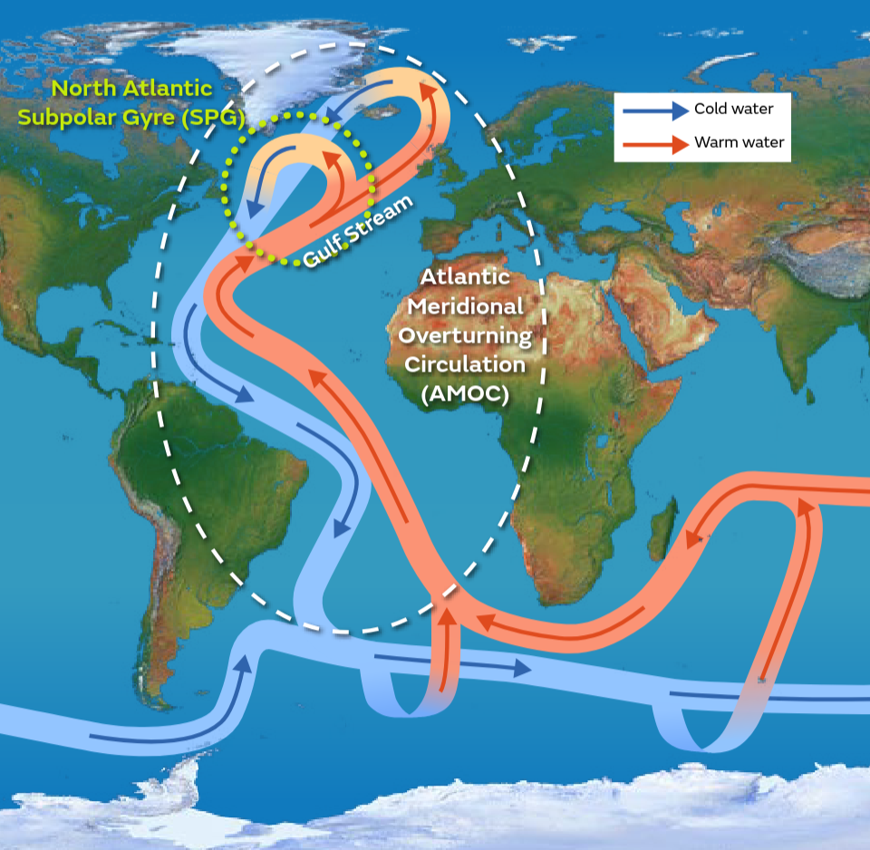
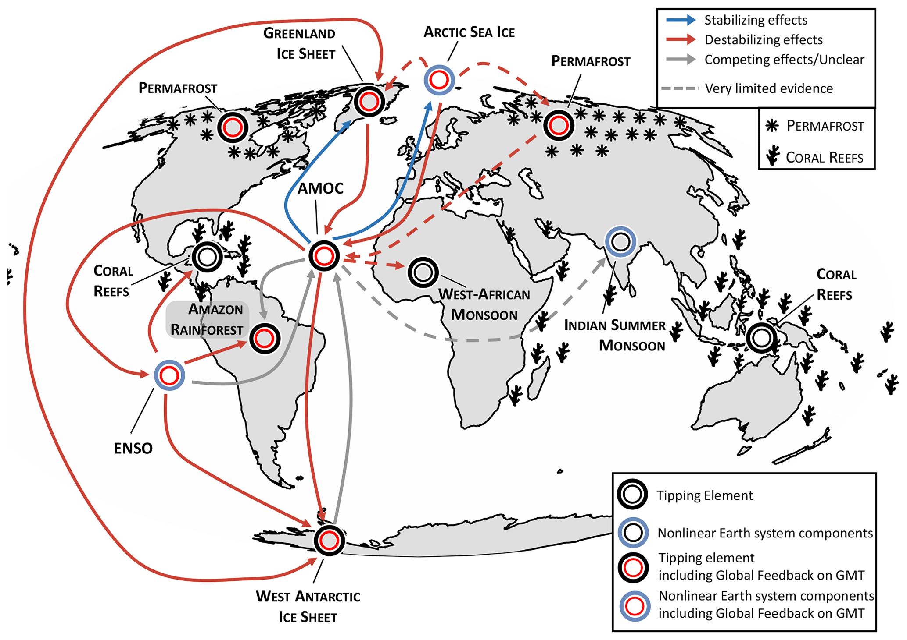
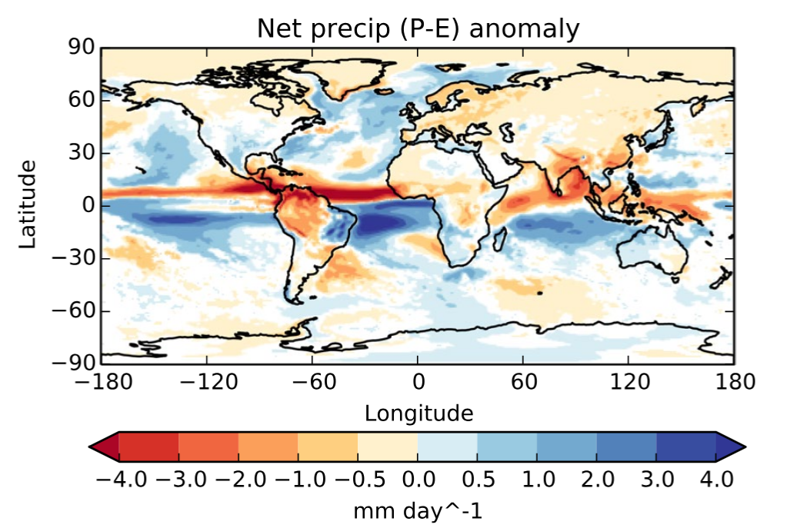
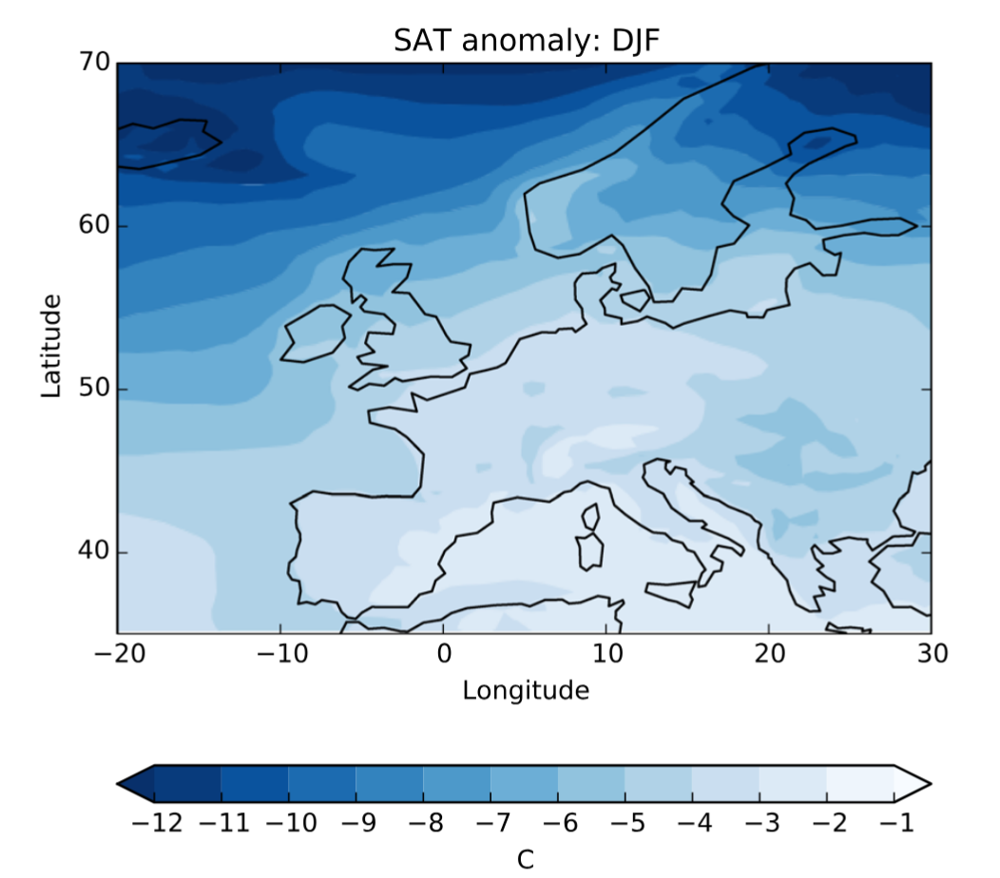
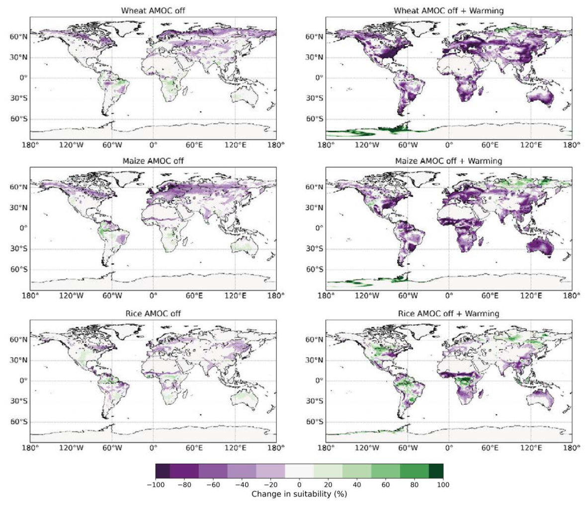

Was würde passieren, wenn die Atlantische Meridionale Umwälzzirkulation (AMOC) kollabiert? Ein gefrorenes Europa oder nur etwas kühlere Jahreszeiten? Die Einschätzungen in der Wissenschaft scheinen stark auseinanderzugehen, und die Sorge in der Öffentlichkeit wächst deutlich. Island hat einen Kollaps der AMOC sogar als mögliche Bedrohung der nationalen Sicherheit eingestuft, was zeigt, dass die Gefahr ernst genommen wird. Schauen wir uns also die verschiedenen Sichtweisen an.

# Was ist ein Kollaps der AMOC überhaupt?

Zuerst ein paar Grundlagen, worüber wir überhaupt reden. Einen guten Überblick gibt ein Faktenblatt des britischen Met Office (2025). Die AMOC ist Teil der Meeresströmungen, die Wärme über die Erde verteilen. Parallel dazu hilft der vom Wind angetriebene Golfstrom, warmes Wasser aus dem Golf von Mexiko an die Küsten Europas zu bringen. Dort kühlt das Wasser ab, sinkt nach unten und fließt nach Süden. Angetrieben wird das alles von der Dichte des Wassers, die von Salzgehalt und Wärme abhängt.

Wenn sich das Klima erwärmt, wird der Salzgehalt durch Schmelzwasser vom grönländischen Eisschild verdünnt. Außerdem bleibt das Wasser im Norden wegen der höheren Umgebungstemperaturen insgesamt wärmer. Beides zusammen heißt, dass weniger Wasser absinkt, und damit fällt der Motor der Strömung weg. Ein Teil davon wird aber auch vom Wind angetrieben, also würde ein Teil der Strömung wahrscheinlich weiterlaufen, selbst wenn die dichtegetriebene Durchmischung nachlässt.

Die Umverteilung von Wärme durch die AMOC ist für Europa ziemlich wichtig. Ohne sie wäre das europäische Klima viel kühler. Das könnte die Erwärmung durch den Klimawandel in der Region komplett ausgleichen. Das klingt zwar nach einem okayen Ergebnis, aber das Problem ist, dass das nur für die Durchschnittstemperatur gilt. Auch die Verteilung der Temperaturen über das Jahr würde sich ändern. Vor allem die Winter könnten dramatisch kälter werden, und in Teilen Skandinaviens könnte es im Winter bis zu -30 °C kalt werden. Da der Wärmeunterschied im Atlantik dadurch größer würde, könnte das auch zu viel extremerem Wetter und stärkeren Stürmen in Europa führen.

Die Folgen beschränken sich nicht auf Europa. Da die AMOC Wärme auf globaler Ebene verteilt, könnte es auch in anderen Teilen der Erde Veränderungen geben. Dazu gehören eine Austrocknung der Amazonasregion und damit möglicherweise ein Absterben des Regenwalds, Veränderungen beim Monsun und Störungen von El Niño. Selbst wenn einige Orte in Europa bei einem Kollaps der AMOC einen Teil der Klimawandelfolgen ausgeglichen bekämen, wären die globalen Auswirkungen eindeutig negativ.

Das Knifflige ist, dass die besten Datensätze, um die AMOC zu verstehen (denk an Strömungen, Dichte usw.), alle nur ein paar Jahre bis Jahrzehnte alt sind. Die älteren Daten sind viel gröber. Außerdem werden die Ozeane in Modellen ziemlich unterschiedlich abgebildet, und deshalb lassen die Klimamodelle eine große Bandbreite möglicher Zukünfte für die AMOC zu. Klar scheint aber, dass wir mit einer Abschwächung rechnen können. Abschwächung ist allerdings kein Kollaps, und wie wir unten sehen werden, ist die Beweislage für einen Kollaps der AMOC viel gemischter.

Abbildung 1: Schema der AMOC. Rot zeigt warmen, oberflächennahen Transport, Blau kalten, tieferen Transport (Met Office, 2025).

# Wie wahrscheinlich ist ein Kollaps? Warum reden alle gerade darüber?

Diese Bandbreite möglicher Zukünfte ist auch der Grund, warum das Thema in den letzten Jahren so viel mehr Aufmerksamkeit bekommen hat. Tatsache ist, dass die Wissenschaft schon lange weiß, dass die AMOC kollabieren könnte. Ein Kollaps der AMOC wurde schon im dritten Sachstandsbericht des IPCC Anfang der 2000er-Jahre diskutiert. Die allgemeine Einschätzung war damals aber, dass dieser Kollaps, wenn überhaupt, nicht in diesem Jahrhundert passieren würde und uns deshalb jetzt nicht beschäftigen müsse. Das änderte sich im sechsten Sachstandsbericht, als die Wissenschaftler zu dem Schluss kamen, dass sie nicht mehr mit hoher Sicherheit sagen konnten, dass die AMOC in diesem Jahrhundert nicht kollabiert.

Ein großer Beleg, der die Diskussion verändert hat, ist eine Studie von Caesar et al. (2018). Sie haben ein Klimamodell laufen lassen, in dem sich die AMOC durch die globale Erwärmung abschwächt. Das lieferte ihnen ein simuliertes Muster der Oberflächenwassertemperatur für die letzten ~150 Jahre. Dann haben sie diese simulierten Muster mit tatsächlichen Messungen verglichen und festgestellt, dass die Temperaturmuster zu einer Abschwächung der AMOC passen und dass sich die Abschwächung vor allem in den letzten Jahren zu verstärken scheint.

Richtig losgetreten hat das Ganze aber ein Paper von Ditlevsen & Ditlevsen (2023). Anders als die meisten Studien vor ihnen sagten sie einen Kollaps der AMOC bis zur Mitte des Jahrhunderts vorher. Ihre Einschätzung stützen sie auf mathematische Signaturen eines Systems, das sich einem Kipppunkt nähert. Dahinter steckt die Idee, dass ein System, je näher es einem Kipppunkt kommt, sich nach einer Störung immer schlechter wieder erholt. Das zeigt sich in einem Signal mit höherer Varianz, weil die Selbstkorrektur des Systems nicht mehr so stark ist, und darin, dass das System nach Störungen länger braucht, um sich zu stabilisieren. Sie finden diese beiden Signaturen in einer langen Zeitreihe der Meeresoberflächentemperatur südlich von Grönland und schließen daraus, dass sich die AMOC abschwächt. Mit zwei verschiedenen Methoden rechnen sie das hoch und kommen zu dem Ergebnis, dass die AMOC um etwa 2060 kippen könnte.

Das war ein schockierendes Ergebnis und hat seitdem viele Debatten und weitere Forschung ausgelöst. Wir sollten es aber mit Vorsicht genießen, weil es auf vielen Annahmen und Entscheidungen beruht, die man auch anders hätte treffen können. Selbst in ihren eigenen Zusatzinformationen zeigen sie zum Beispiel, dass schon leicht andere Annahmen darüber, wie sie ihre Stellvertreterdaten konstruieren, den Kollaps der AMOC ins nächste Jahrhundert verschieben würden. Ähnlich große Unsicherheiten kommen durch ihre mathematischen Werkzeuge dazu (1).

Es gibt auch Folgearbeiten, die direkter auf Physik beruhen. Van Westen et al. (2024) haben zum Beispiel das Community Earth System Model (CESM) genutzt, um das Kippen der AMOC in einem vollwertigen Klimamodell zu simulieren. Eine der wichtigsten Änderungen gegenüber früheren Versuchen ist, dass sie darauf achten, dass der Zufluss von salzarmem Wasser in den Nordatlantik realistischer ist. Dadurch schwächt sich die AMOC nicht durch einen plötzlichen, großen Zufluss ab wie in vielen anderen Modellen, sondern durch sich langsamer verschiebende interne Rückkopplungen des simulierten Klimasystems.

Mit ihren besseren Simulationen entwickeln sie bessere Wege, Veränderungen der AMOC in der echten Welt zu messen, und nutzen diese, um Veränderungen der AMOC zu erkennen. Ihr Ergebnis: Die AMOC scheint eindeutig auf Kippkurs zu sein, aber die Daten sind noch zu dünn, um gut abzuschätzen, wann es passiert.

Die Diskussion darüber, wann die AMOC kollabiert, ist also noch voll im Gange, und man findet auf beiden Seiten Leute, die sehr stark für ihren Zeitplan argumentieren. Mir scheint, dass sich die Debatte langsam dahin verschiebt, das Risiko eines Kollapses der AMOC in diesem Jahrhundert ernst zu nehmen. Selbst wenn die Chance gering ist, könnten die Folgen riesig sein, und deshalb sollten wir uns das genauer anschauen. Das heißt nicht, dass es passieren muss, aber mehr Geld dafür auszugeben, die Wahrscheinlichkeit und die Folgen zu verstehen, scheint sehr gerechtfertigt.

# Was sind die Folgen?

## Wechselwirkungen mit anderen Kipppunkten
Die AMOC ist nicht der einzige Teil des Erdsystems, der kippen kann (2). Es gibt mehrere andere Kippelemente, die in einen anderen Zustand wechseln könnten, zum Beispiel der grönländische Eisschild. Sie können zwar jeweils für sich kippen, aber diese verschiedenen Kippelemente können sich auch gegenseitig beeinflussen. Ein Überblicksartikel von Wunderling et al. (2024) zeigt, dass die AMOC das Herzstück all dieser Wechselwirkungen ist (Abbildung 2). Ein Kollaps der AMOC könnte den grönländischen Eisschild und das arktische Meereis stabilisieren, weil er zu kühleren Temperaturen im Nordatlantik führen würde. Bei allen anderen Kippelementen könnte ein Kollaps der AMOC sie aber weiter destabilisieren, oder die genaue Art der Wechselwirkung ist unklar oder zeigt gegenläufige Effekte (etwa, dass der südliche Teil des Amazonas feuchter wird, während der Norden trockener wird). Wenn die AMOC kollabiert, könnte das zum Beispiel den westantarktischen Eisschild weiter destabilisieren, weil weniger Wärme von der Süd- auf die Nordhalbkugel transportiert wird. Das alles heißt, dass eine stabile AMOC besonders wichtig ist, denn wenn sie kippt, können wir weltweit mit vielen anderen Folgen rechnen, nicht nur mit einem kühleren Europa.

Abbildung 2: Wechselwirkungen der Kippelemente, die im Überblicksartikel von Wunderling et al. identifiziert wurden.

## Klima
Aber selbst wenn wir nur die Klimafolgen eines Kollapses der AMOC betrachten, ohne weitere Kippeffekte, könnten die Folgen ziemlich schwer sein. Eine Studie, die das sehr detailliert untersucht hat, ist Jackson et al. (2015) (3). Sie haben Kontrollsimulationen ohne Kollaps der AMOC laufen lassen und Simulationen, in denen die AMOC durch einen simulierten großen Zufluss von salzarmem Wasser abgeschaltet wird. Darauf aufbauend vergleichen sie diese Szenarien bei Parametern wie Niederschlag und Temperatur. Ihre Ergebnisse zeigen, dass das zu einer großen globalen Umverteilung von Wärme und Niederschlag führt. Die Veränderungen bei der Wärme sind so ziemlich das, was man erwarten würde. Die Nordhalbkugel kühlt ab, vor allem in der Nordatlantikregion, während sich die Südhalbkugel insgesamt erwärmt, räumlich gleichmäßiger. Das Muster beim Niederschlag ist vielfältiger (Abbildung 3). Hier gibt es Regionen, die eindeutig stärker betroffen sind. So ziemlich rund um den Äquator geht der Niederschlag zurück, vor allem aber in Mittelamerika und im nördlichen Amazonasbecken.

Abbildung 3: Veränderungen des Nettoniederschlags, also die Veränderung des Niederschlags abzüglich der Veränderung, wie viel Wasser durch Evapotranspiration verloren geht.

Aber diese Werte sind nur Jahresdurchschnitte. In Europa verstärken sich diese Veränderungen im Winter (Abbildung 4). In vielen Teilen Skandinaviens könnte die Temperatur im tiefsten Winter um zusätzliche 10 °C fallen, Großbritannien könnte um 5 °C abkühlen, und selbst kontinentalere Gegenden wie Mitteldeutschland könnten noch um 2 bis 3 °C abkühlen. Das könnte sehr disruptiv werden, weil viele dieser Gegenden beispiellose Temperaturen erleben würden und ihre Infrastruktur, ihre Gebäude usw. dafür nicht ausgelegt wären.

Abbildung 4: Temperaturveränderungen in Europa für Dezember, Januar und Februar.

Diese Veränderungen werden nicht über Nacht passieren, aber gemessen an Veränderungen im Erdsystem sind sie trotzdem ziemlich schnell. Die Simulation von Jackson et al. zeigte, dass das Abschalten etwa 10 bis 15 Jahre dauert. Anpassung wird also schwer, aber es gibt zumindest eine Chance, wenn man ein Jahrzehnt Zeit hat, Lösungen zu finden. Andere Paper wie das oben besprochene von van Westen et al., das einen realistischeren Aufbau hat, kommen zu dem Schluss, dass ein Kollaps eher ein Jahrhundert dauern würde. Wenn das so wäre, schiene Anpassung gut machbar.

## Landwirtschaft

Jedes Mal, wenn sich das Klima stark ändert, folgen große Auswirkungen auf die Landwirtschaft. Seltsamerweise gibt es nicht viele gute Studien, die die Folgen der AMOC für Nutzpflanzen modellieren. Eine gute ist wohl derzeit Ritchie et al. (2020). Sie haben die Folgen eines Kollapses der AMOC für die Landwirtschaft in Großbritannien modelliert. Die Ergebnisse sind ziemlich drastisch. Durch die Veränderungen bei der Temperatur und vor allem beim Niederschlag würde der Großteil der heutigen Agrarflächen in Großbritannien wieder zu Grasland. Dem könnte man mit großflächiger Bewässerung entgegenwirken, aber das wäre an vielen Orten wahrscheinlich unbezahlbar teuer. Sie schätzen, dass die Schäden für die Landwirtschaft eine Größenordnung größer wären als die durch den Klimawandel allein.

Es gibt auch eine Einschätzung der OECD (2021). Ihr Bericht beschäftigt sich allgemein mit allen möglichen Extremrisiken des Klimas und hat auch ein Kapitel zum Kollaps der AMOC. Sie haben keine eigenen Modelle laufen lassen, sondern die Arbeit anderer neu ausgewertet (z. B. das oben erwähnte Paper von Jackson et al.). So konnten sie auch untersuchen, wie sich die Eignung für Nutzpflanzen verändert (Abbildung 5), wenn ein Kollaps der AMOC mit 2,5 °C Erwärmung zusammenkommt. Sie haben kein Pflanzenmodell laufen lassen, sondern nur geprüft, welche Gitterzellen allgemein in einem Klimabereich liegen, der für verschiedene Nutzpflanzen geeignet ist, und die Ergebnisse des Kontrolllaufs mit dem Szenario aus 2,5 °C Erwärmung und Kollaps der AMOC verglichen. Sie finden, dass in so einem Szenario etwa 50 % der für Weizen und Mais geeigneten Fläche verloren gehen, während die für Reis geeignete Fläche leicht wächst. Diese Ergebnisse klingen extrem, aber bedenke, dass sie diese Analyse für die gesamte Landfläche der Erde gemacht haben, nicht nur für die Flächen, auf denen diese Pflanzen tatsächlich angebaut werden. Auf dem Großteil der Flächen, die für Weizen und Mais ungeeignet werden, wurden diese Pflanzen gar nicht angebaut. Trotzdem gibt diese Analyse ein gutes Gefühl dafür, wie wichtig die AMOC für das globale Klima und die Ernährungssysteme ist.

Abbildung 5: Veränderungen der Eignung für den Pflanzenanbau nach 2,5 °C Erwärmung und einem Kollaps der AMOC.

Außer diesen Einschätzungen gibt es nicht viel Forschung, auf die man sich stützen kann. Aber ausgehend von den veränderten Mustern bei Niederschlag und Temperatur könnte man erwarten, dass die Landwirtschaft in Europa allgemein betroffen wäre, ebenso wie Regionen mit starken Veränderungen beim Niederschlag wie Indien, Mittelamerika oder Teile Südostasiens. Das sind alles Gegenden, in denen viel Essen angebaut wird. Diese Veränderungen sind allerdings schwer abzuschätzen.

# Fazit

Nach der Beweislage scheint es sehr wahrscheinlich, dass sich die AMOC in diesem Jahrhundert abschwächt. Die knifflige Frage ist, wie stark und wie bald? Beim aktuellen Stand der Forschung glaube ich nicht, dass irgendjemand diese Frage mit großer Sicherheit beantworten kann.

Wenn es passiert, sind die Folgen klarer. Vor allem Teile Europas hätten es wahrscheinlich sehr schwer, sich anzupassen, besonders Großbritannien. Und es scheint wahrscheinlich, dass das einen großen Schock für die globalen Ernährungssysteme auslösen könnte, wenn viele produktive Regionen in Europa plötzlich viel weniger produktiv sind und andere große Anbaugebiete wie Indien ebenfalls betroffen sind.

Wie so viele der Risiken, die in diesem Blog besprochen werden, ist das wieder eines dieser Ereignisse mit geringer Wahrscheinlichkeit, starken Folgen, wenn es passiert, und relativ wenig Wissen darüber. Mehr Forschung und allgemein mehr Investitionen in Resilienz sind eindeutig nötig.

# Zitieren
Bitte das englische Original zitieren:

Jehn, F. U. (2026, July 1). How much do we actually know about AMOC collapse?. Existential Crunch. https://doi.org/10.59350/sse7m-1nn58

# Anmerkungen
(1) Siehe [Ben-Yami et al. (2024)](https://www.science.org/doi/epdf/10.1126/sciadv.adl4841) für eine ausführliche Kritik an Ditlevsen and Ditlevsen (2023).

(2) Kipppunkte werden in [diesem Beitrag](https://existentialcrunch.substack.com/p/the-trouble-with-tipping-points) genauer beschrieben.

(3) Siehe das neuere Paper von [van Westen & Baatsen (2025)](https://agupubs.onlinelibrary.wiley.com/doi/10.1029/2025GL114611) für eine Bestätigung der Ergebnisse von Jackson et al. (2015).

# Quellen
* Caesar, L., Rahmstorf, S., Robinson, A., Feulner, G., & Saba, V. (2018). Observed fingerprint of a weakening Atlantic Ocean overturning circulation. Nature, 556(7700), 191–196. https://doi.org/10.1038/s41586-018-0006-5
* Ditlevsen, P., & Ditlevsen, S. (2023). Warning of a forthcoming collapse of the Atlantic meridional overturning circulation. Nature Communications, 14(1), 4254. https://doi.org/10.1038/s41467-023-39810-w
* Jackson, L. C., Kahana, R., Graham, T., Ringer, M. A., Woollings, T., Mecking, J. V., & Wood, R. A. (2015). Global and European climate impacts of a slowdown of the AMOC in a high resolution GCM. Climate Dynamics, 45(11), 3299–3316. https://doi.org/10.1007/s00382-015-2540-2
* Met Office. (2025). Factsheet: The Atlantic Meridional Overturning Circulation (AMOC) (Met Office 02770). https://weather.metoffice.gov.uk/binaries/content/assets/metofficegovuk/pdf/research/climate-science/met-office-hadley-centre/amoc-factsheet-update-2025-v3.pdf
* OECD. (2021). Managing Climate Risks, Facing up to Losses and Damages: Understanding, Reducing and Managing Risks. OECD Publishing. https://doi.org/10.1787/55ea1cc9-en
* Ritchie, P. D. L., Smith, G. S., Davis, K. J., Fezzi, C., Halleck-Vega, S., Harper, A. B., Boulton, C. A., Binner, A. R., Day, B. H., Gallego-Sala, A. V., Mecking, J. V., Sitch, S. A., Lenton, T. M., & Bateman, I. J. (2020). Shifts in national land use and food production in Great Britain after a climate tipping point. Nature Food, 1(1), Article 1. https://doi.org/10.1038/s43016-019-0011-3
* van Westen, R. M., Kliphuis, M., & Dijkstra, H. A. (2024). Physics-based early warning signal shows that AMOC is on tipping course. Science Advances, 10(6), eadk1189. https://doi.org/10.1126/sciadv.adk1189
* Wunderling, N., von der Heydt, A. S., Aksenov, Y., Barker, S., Bastiaansen, R., Brovkin, V., Brunetti, M., Couplet, V., Kleinen, T., Lear, C. H., Lohmann, J., Roman-Cuesta, R. M., Sinet, S., Swingedouw, D., Winkelmann, R., Anand, P., Barichivich, J., Bathiany, S., Baudena, M., … Willeit, M. (2024). Climate tipping point interactions and cascades: A review. Earth System Dynamics, 15(1), 41–74. https://doi.org/10.5194/esd-15-41-2024
