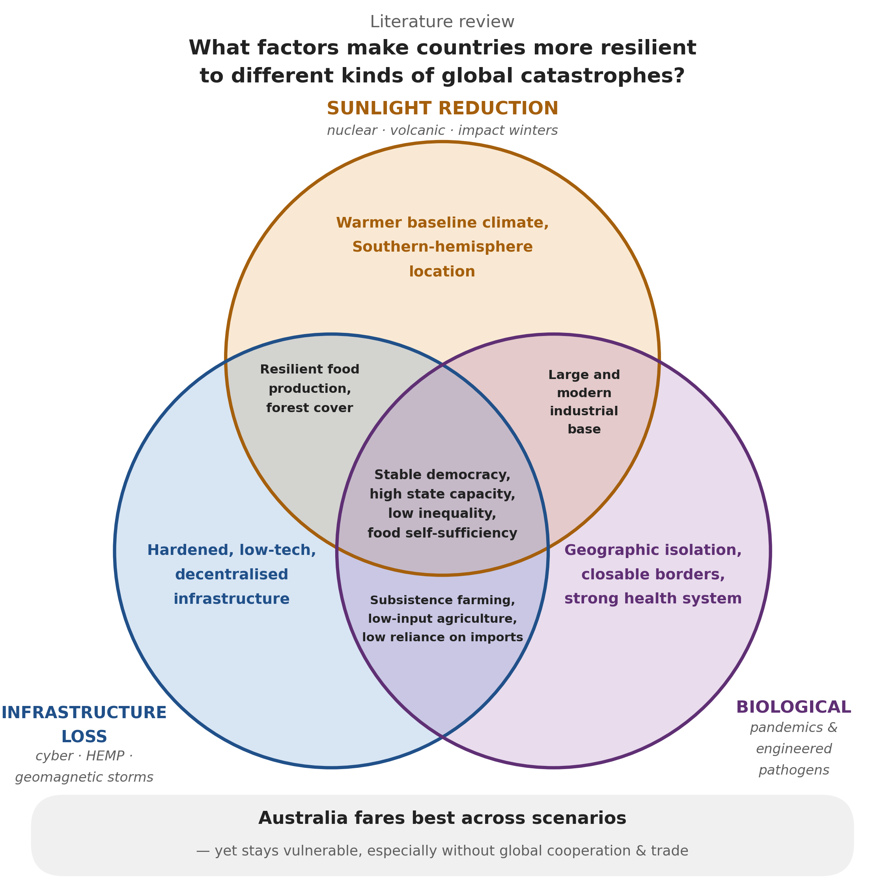
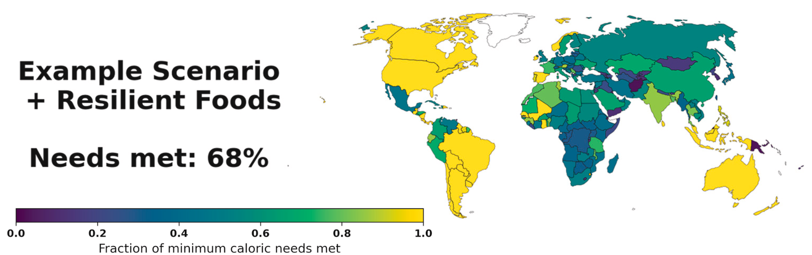
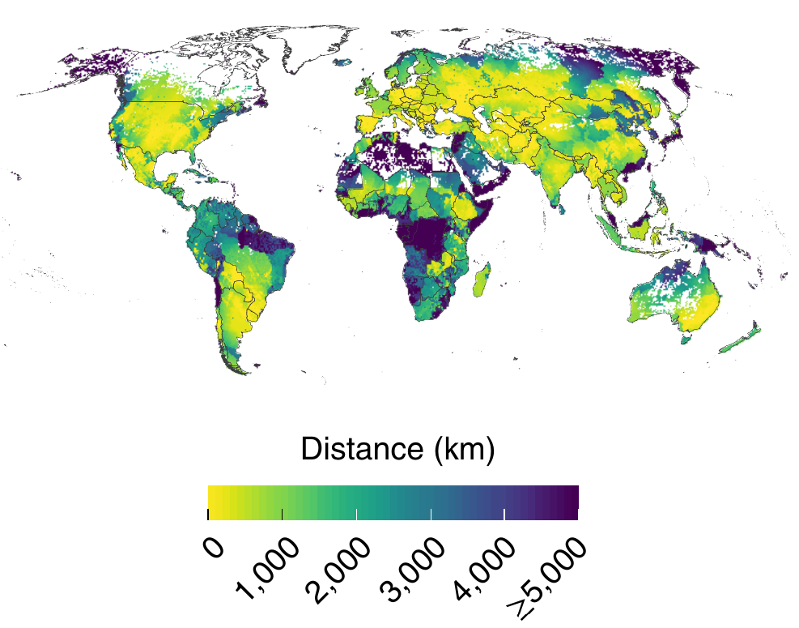
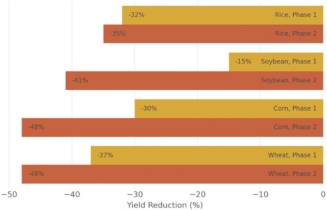

Wenn ich mit Leuten über gesellschaftlichen Kollaps rede, kommt oft etwas, das mir gegen den Strich geht: die Idee, dass es eine realistische Strategie sei, sich vom Kollaps abzuschotten. Die extremste Version davon ist die Vorstellung, dass man in diesen gefährlichen Zeiten am besten fährt, wenn man sich in seinem eigenen kleinen Rückzugsort verschanzt. Diesen Weg gehen regelmäßig Milliardäre, aber er scheint auch für normale Menschen einen gewissen Reiz zu haben. Bei Nicht-Milliardären zeigt sich das als idealisierte kleine Kommune, in der alles lokal angebaut und hergestellt wird und man den Zusammenbruch der Zivilisation überlebt, indem man eins mit der Natur wird. Ich glaube, beide „Überlebensstrategien“ funktionieren nicht, und sie scheitern aus ziemlich ähnlichen Gründen.

# Kein Ort ist sicher vor allen Arten von Katastrophen
Das erste Problem ist, dass man nicht weiß, welche Art von Katastrophe einen erwischt. Es gibt eine Menge Dinge, die die Zivilisation beenden könnten: nuklearer Winter, eine Pandemie, geomagnetische Stürme, was auch immer. Bei manchen davon hätte man vielleicht etwas Vorwarnzeit, um sich vorzubereiten, aber es ist unwahrscheinlich, dass man genug Vorwarnung hat, um mit dem Rückzugsort erst anzufangen, wenn man weiß, was passiert. Man muss sich also jetzt für einen Ort entscheiden. Aber für welchen?

Es gibt ein Paper, das genau diese Frage untersucht, von Jehn et al. (2026). Es ist ein Literaturüberblick über alle Dokumente, die diskutieren, was Orte besser geeignet macht, um alle möglichen globalen Katastrophen zu überstehen. Aus diesen über 150 Papern haben wir alle Faktoren herausgezogen, die einen Ort mehr (oder weniger) resilient gegenüber globalen katastrophalen Risiken machen. Das Paper geht ziemlich ins Detail, aber für dieses Argument reicht ein Blick auf die grafische Zusammenfassung (Abbildung 1). Sie zeigt, dass es einige Faktoren gibt, die für alle Arten von Katastrophen gut sind. Grob zusammengefasst: ein demokratischer und gut funktionierender Staat. Es gibt aber auch viele Faktoren, die sich direkt widersprechen. Bei Szenarien mit Infrastrukturverlust ist es gut, eine einfache, dezentrale Infrastruktur zu haben, weil man dann nach der Katastrophe noch einiges davon weiterverwenden und ihren Zusammenbruch leichter verhindern kann. Bei einer abrupten Verringerung des Sonnenlichts und bei Pandemien hat man dagegen bessere Überlebenschancen, wenn man eine große, moderne Industrie hat, weil man all diese Industriekraft nutzen kann, um die Güter und Technologien herzustellen, die man zum Überleben braucht.

Wie die Abbildung zeigt, haben manche Länder trotz dieser Zielkonflikte bessere Chancen, aber selbst die brauchen Zusammenarbeit und Handel, denn kein Land könnte allein einer globalen Katastrophe gegenüberstehen und auf gute Überlebenschancen hoffen.

Abbildung 1: Überblick darüber, welche Faktoren Orte resilienter gegenüber verschiedenen globalen katastrophalen Risiken machen.

# Warum Zusammenarbeit so wichtig ist

Ein Paper, das schön zeigt, wie wichtig Handel und Zusammenarbeit nach einer Katastrophe sind, ist Rivers et al. (2024). Es nutzt ein komplexes Modell des Ernährungssystems nach einer Katastrophe, um zu verstehen, welcher Teil der Bevölkerung jedes Landes mit resilienten Lebensmitteln und durch Handel mit Überschüssen zwischen Ländern ernährt werden kann (1). Dafür simuliert es einen schweren nuklearen Winter und wie die verbleibenden Möglichkeiten der Lebensmittelproduktion in einzelnen Ländern hochgefahren werden könnten. Das zeigt, dass das für die Mehrheit der Länder nicht wirklich funktioniert (Abbildung 2). Sie haben derzeit einfach nicht die Kapazität, genug zu produzieren, um alle zu ernähren (2). Wenn man aber Handel zulässt, könnte es genug Essen für alle geben.

Abbildung 2: Schätzung, welcher Anteil jedes Landes mit resilienten Lebensmitteln, aber ohne Handel ernährt werden könnte.

Zugegeben, das ist ein ziemlich extremes Szenario, aber es geht hier nur um Essen. Zum Überleben braucht man viel mehr. Derselbe Mechanismus gilt für alle möglichen lebenswichtigen Güter, denk an Treibstoff, Dünger, Medikamente, Computer und so weiter. Man ist auf diese Dinge angewiesen, und sie wären so ziemlich nirgends verfügbar, wenn der Handel aufhören würde.

Ein konkretes Beispiel: Neuseeland. Es schneidet bei vielen Resilienzfaktoren am besten ab. Aber reicht das? Um das besser zu verstehen, können wir uns Wilson et al. (2025) anschauen. Sie haben untersucht, wie sehr Neuseeland bei Medikamenten vom Handel abhängt, anhand der zehn meistgenutzten Arzneimittel im Land. Konkret haben sie alle Ausgangsstoffe analysiert, die man dafür braucht. Für zehn von zehn Arzneimitteln hat Neuseeland keine eigene Produktion der Ausgangsstoffe und könnte sich daher nicht selbst versorgen. Das liegt vor allem daran, dass es im Land keine petrochemischen Raffinerien gibt, aber auch an fehlenden Minen oder anderer Chemieproduktion. Neuseeland würde also all diese Medikamente verlieren und wahrscheinlich auch viele andere. Bei vielen anderen Gütern ist es nicht anders. So ziemlich alles, was man benutzt, hängt an der globalen Lieferkette und lässt sich nicht einfach ersetzen. Schon gar nicht kurzfristig. Man hätte also nicht nur keine Medikamente, sondern würde auch Dinge wie Dünger, Treibstoff und Computer verlieren. Jede dieser Kategorien einzeln zu verlieren wäre hart, alle auf einmal zu verlieren wäre verheerend. Handel ist also für so ziemlich jedes Land lebenswichtig.

Du denkst jetzt vielleicht: „Aber kann ich das nicht einfach alles einlagern?“ Sicher kann man sich einen Puffer anlegen, aber das ist extrem teuer, weil man genug für den Rest seines Lebens lagern muss. Außerdem geht es hier nur um dich. Wenn du Familie oder ein paar Freunde hast, wird die nötige Vorratsmenge schnell unrealistisch, wenn man davon ausgehen muss, dass nie wieder eine Lieferung kommt, die die Lager auffüllt.

# Lokale Lebensmittelproduktion ist nur für einen Bruchteil der Weltbevölkerung eine Option

Aber nehmen wir um des Arguments willen an, du hättest es irgendwie geschafft, völlig unabhängig von Importen zu sein, und deine einzige Aufgabe wäre, dein eigenes Essen lokal anzubauen. Würde das funktionieren? Für die meisten Menschen ist die Antwort ein ziemlich klares Nein. Die meisten Menschen leben einfach nicht an einem Ort, an dem sie das Essen produzieren könnten, das sie brauchen. Das fängt schon damit an, dass die Mehrheit der Menschen in Städten lebt. Wenn du einer davon bist, schau dich um. Wo genau würdest du dein eigenes Essen anbauen? Da ist kein Platz. Ein Paper, das das untersucht, ist von Boyd & Wilson (2025). Sie wollten verstehen, welcher Teil der Bevölkerung Neuseelands durch urbane Landwirtschaft ernährt werden könnte. Dafür haben sie mit Satellitenbildern erfasst, wie viel freie Fläche es in einer typischen neuseeländischen Stadt zum Anbauen gibt, und dann berechnet, wie viele Kalorien man auf diesen Flächen mit den effizientesten Pflanzen produzieren könnte. Ergebnis: Diese Flächen könnten nur etwa 20 % der Bevölkerung ernähren. Alles andere müsste von außerhalb der Stadt kommen. In den relativ kleinen Städten Neuseelands könnte das vielleicht noch klappen, aber für viele größere Städte weltweit wäre diese Zahl viel, viel niedriger und die Ernährung der Bevölkerung dort noch unrealistischer.

Aber das ist noch nicht alles. An vielen Orten, an denen Menschen heute leben, kann man wegen Dingen wie ungünstigem Klima oder ungeeigneten Böden nicht genug Essen produzieren. Wir müssen die Zahlen nicht einmal schätzen. In einem ziemlich interessanten Paper haben Kinnunen et al. (2020) untersucht, wie weit heutige Menschen von der Region entfernt leben, die ihr Essen produziert. Dafür haben sie das heutige System der Lebensmittelproduktion genommen und berechnet, wie man Lebensmittel weltweit verteilen müsste, um die Gesamtstrecke zu minimieren, die das Essen zurücklegen muss. So konnten sie eine Karte erstellen, die zeigt, wie weit Menschen von ihrer Lebensmittelproduktion entfernt wären (Abbildung 3). Wie man sieht, wäre das für einen großen Teil der Weltbevölkerung eine ganz schöne Strecke. Für viele Menschen lägen diese Anbauregionen Tausende Kilometer entfernt. Scheint unwahrscheinlich, dass nach einem gesellschaftlichen Kollaps alle einfach zu ihrer zugewiesenen Anbauregion laufen würden.

Abbildung 3: Simulierte Entfernung von der Lebensmittelproduktion zum Verbrauch.

Und denk daran: Das geht von der heutigen Produktion aus, nicht von der nach einem Kollaps. Diese Entfernungen wären viel länger, wenn man mit Anbaumethoden aus der Zeit vor der Industrialisierung arbeiten müsste. Wie viel länger, kann ich dir nicht genau sagen, aber wir können uns anschauen, wie sehr unsere moderne Lebensmittelproduktion von Betriebsmitteln wie Dünger oder Treibstoff abhängt, die wir für selbstverständlich halten. Dafür können wir Moersdorf et al. (2024) nehmen. Dieses Paper hat geschätzt, wie viel der globalen Lebensmittelproduktion auf der Wirkung landwirtschaftlicher Betriebsmittel beruht. Im zweiten Schritt wird dann simuliert, wie stark die globalen Erträge sinken würden, wenn wir den Zugang zu diesen Betriebsmitteln verlieren (Abbildung 4). Wie man sieht, würde das die Erträge ziemlich stark senken. Und das setzt immer noch voraus, dass die Leute wissen, wie man Landwirtschaft betreibt. Aber weißt du das? Glaubst du, du könntest einen Hof auf dem Niveau eines mittelalterlichen Bauern führen, dessen Familie seit 10 Generationen dasselbe Stück Land bewirtschaftet?

Abbildung 4: Prognostizierter Ertragsrückgang für Phase 1 (einige industrielle Betriebsmittel) und Phase 2 (keine industriellen Betriebsmittel) nach Nutzpflanze.

# Fazit

Ich will hier nicht argumentieren, dass man einen gesellschaftlichen Kollaps nicht überleben könnte. Ich glaube, das kann man, wenn Gesellschaften genug in Resilienz investiert haben. Ich glaube nur, dass es nach allem, was wir wissen, keine realistische Option ist, ihn allein oder in einer lokalen Kommune aussitzen zu wollen. Darauf zu setzen zeigt sowohl einen tiefen Mangel an Solidarität als auch eine schlechte Strategie. Wenn dir also das nächste Mal jemand erzählt, dass er plant, sich von allen anderen abzuschotten, um den gesellschaftlichen Kollaps zu überleben, kannst du ihm gratulieren, dass er seine verbleibende Zeit damit verbringt, hart für das Privileg zu arbeiten, etwas später zu verhungern. Der bessere Weg ist das Gegenteil. Wir brauchen Zusammenarbeit, wir brauchen Handel. Vielleicht nicht global, aber sicher auf regionaler oder sogar kontinentaler Ebene. Je mehr, desto besser. Deine beste Überlebensstrategie ist also nicht, an dich in deinem kleinen Rückzugsort zu denken, sondern dabei zu helfen, regionale Partnerschaften, bessere Demokratien und starke Netzwerke aufzubauen. Wir stehen und fallen alle gemeinsam.

# Zitieren
Bitte das englische Original zitieren:

Jehn, F. U. (2026, November 4). No one survives alone. Existential Crunch. https://doi.org/10.59350/0060d-mzf07

# Anmerkungen
(1) Falls du nicht mehr weißt, was resiliente Lebensmittel sind, schau [hier](https://existentialcrunch.substack.com/p/resilient-foods).

(2) Aktuelle Analysen zeigen eine Momentaufnahme von Produktion und Selbstversorgung und machen deutlich, dass viele Länder ihren eigenen Lebensmittelbedarf nicht decken. Das heißt nicht unbedingt, dass sie nicht genug produzieren könnten. Billigere Importe und strukturelle Einschränkungen (zum Beispiel Anbauzyklen, Grenzen der Infrastruktur) können die Produktion drücken. Die aktuellen Produktionsmengen sind aber ein verlässlicher Indikator dafür, wie schnell ein Land auf Störungen im Handel reagieren kann. Mehr dazu [hier](https://www.nature.com/articles/s43016-025-01173-4).

# Quellen
* Boyd, M., & Wilson, N. (2025). Resilience to abrupt global catastrophic risks disrupting trade: Combining urban and near-urban agriculture in a quantified case study of a globally median-sized city. PLOS One, 20(5), e0321203. https://doi.org/10.1371/journal.pone.0321203
* Jehn, F. U., Rössler, M., Kemp, L., Cassidy, M., Kallenborn, Z., García Martínez, J. B., Mani, L., & Boyd, M. (2026). No Place to Hide? Regional Resilience and Vulnerability to Global Catastrophic Risk. Global Challenges, 10(8), e70146. https://doi.org/10.1002/gch2.70146
* Kinnunen, P., Guillaume, J. H. A., Taka, M., D’Odorico, P., Siebert, S., Puma, M. J., Jalava, M., & Kummu, M. (2020). Local food crop production can fulfil demand for less than one-third of the population. Nature Food, 1(4), 229–237. https://doi.org/10.1038/s43016-020-0060-7
* Moersdorf, J., Rivers, M., Denkenberger, D., Breuer, L., & Jehn, F. U. (2024). The Fragile State of Industrial Agriculture: Estimating Crop Yield Reductions in a Global Catastrophic Infrastructure Loss Scenario. Global Challenges, 8(1), 2300206. https://doi.org/10.1002/gch2.202300206
* Rivers, M., Hinge, M., Rassool, K., Blouin, S., Jehn, F. U., Martínez, J. B. G., Grilo, V. A., Jaeck, V., Tieman, R. J., Mulhall, J., Butt, T. E., & Denkenberger, D. C. (2024). Food system adaptation and maintaining trade could mitigate global famine in abrupt sunlight reduction scenarios. Global Food Security, 43, 100807. https://doi.org/10.1016/j.gfs.2024.100807
* Wilson, N., Wood, P., & Boyd, M. (2025). Capacity to manufacture key pharmaceuticals in New Zealand after a global catastrophe. New Zealand Medical Journal, 138(1625), 44–58. https://doi.org/10.26635/6965.7053
