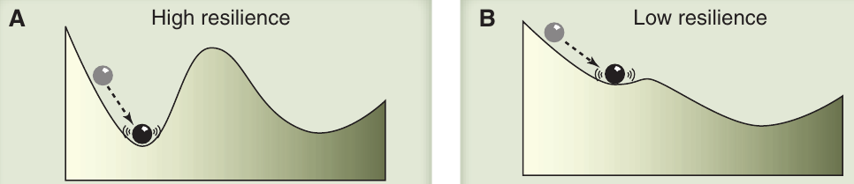
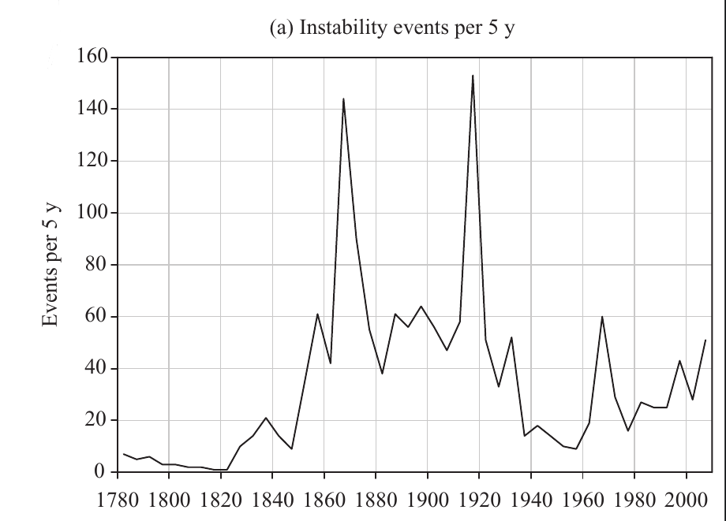
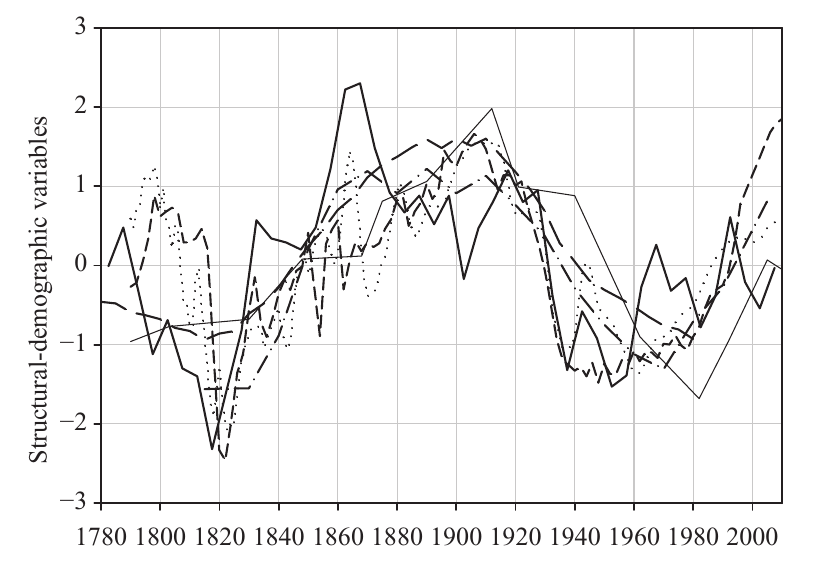
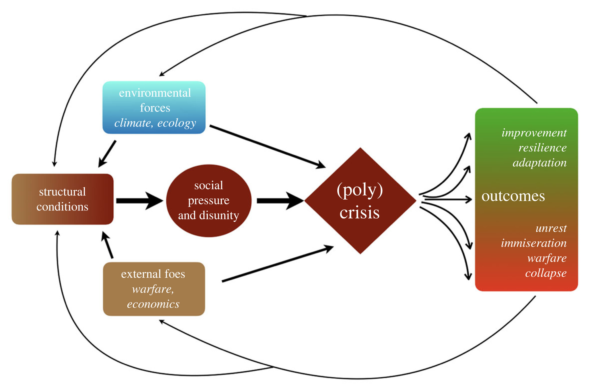

Etwas zu verhindern ist meist einfacher, als das Chaos aufzuräumen, wenn es passiert ist. Das gilt auch für Gesellschaften, und wenn sich eine gesellschaftliche Krise oder sogar ein Kollaps verhindern lässt, würde das viel Leid ersparen. Das Knifflige ist aber, dass man dafür vorher wissen müsste, dass so ein negatives Ereignis bevorsteht, und das ist keine triviale Aufgabe. Die Forschung der letzten Jahrzehnte hat sich aber Werkzeuge angeschaut, die helfen könnten herauszufinden, ob eine Gesellschaft am Abgrund steht.

Grundsätzlich gibt es zwei große wissenschaftliche Lager, die sich mit solchen Fragen beschäftigen: den eher statistischen Ansatz, vor allem vertreten von Klimaforschenden und besonders der Kipppunktforschung, und den eher strukturellen Ansatz aus der Geschichtswissenschaft. Im Folgenden beschreibe ich beide Lager und was wir aus ihrer Forschung lernen können, um zu verstehen, wie nah unsere eigenen Gesellschaften an einem Kipppunkt sein könnten.

# Statistische Frühwarnzeichen
Das wichtigste Paper, mit dem diese Forschungsrichtung begann, ist von Scheffer et al. (2012). Die Grundidee: Ein resilientes System hat Prozesse, die helfen, ein stabiles Gleichgewicht zu halten. Je mehr Verbindungen und Redundanzen das System hat, desto länger kann es seinen Zustand gegen Störungen halten. Bei weniger komplexen und vernetzten Systemen ist das Verhalten anders, aber grundsätzlich sind sowohl natürliche als auch menschliche Systeme meist von der komplexen und vernetzten Sorte, deshalb schauen wir uns hier vor allem diese an. Ein klassisches Beispiel wäre der Welthandel (1). Alle sind mit allen verbunden, und wenn ein einzelnes Unternehmen oder sogar ein einzelnes Land eine Weile nicht mehr handelt, hat das Gesamtsystem genug Spielraum und Alternativen, um die Folgen größtenteils abzufedern.

Sobald die Fähigkeit des Systems, Störungen abzufedern, an ihre Grenze kommt, gibt es aber einen plötzlichen Wechsel in einen neuen Zustand. Das nennt man einen kritischen Übergang. Ein Beispiel wäre der Amazonas-Regenwald. Derzeit ist der stabile Zustand dort Regenwald. Wenn das Klima aber immer heißer und trockener wird, könnte die Region einen kritischen Übergang in einen neuen stabilen Zustand als Savanne erleben. Wenn Bäume aus Wassermangel sterben, recyceln sie keine Feuchtigkeit mehr, was die Region noch trockener macht, was zu noch mehr toten Bäumen führt, bis nur noch Sträucher und Gräser überleben könnten (2).

Eine hilfreiche Darstellung aus dem Paper zeigt das als Kugel, die das System darstellt und in einer Landschaft möglicher Zustände herumrollt. Wenn es in dieser Landschaft steile Täler gibt, ist das ein stabiler Zustand, den man schwer verlässt. Mit der Zeit kann sich das aber zu einer neuen Landschaft abbauen, in der die Gipfel um das frühere Tal abgetragen sind, und plötzlich braucht die Kugel nur noch einen kleinen Schubs, um in einen neuen Zustand zu wechseln (Abbildung 1).

Abbildung 1: Beispiel für Zustandslandschaften von Systemen mit hoher und niedriger Resilienz.

Was das Paper für diese Diskussion relevant macht, ist, dass es in vielen, sehr unterschiedlichen menschlichen und natürlichen Systemen ähnliche verräterische Zeichen eines kritischen Übergangs findet, bevor er tatsächlich passiert. Das häufigste davon ist das sogenannte kritische Verlangsamen. Gemeint ist die Geschwindigkeit, mit der sich das System von kleinen Störungen erholt. Je langsamer es sich wieder in seinen vorherigen Zustand zurückdrückt, desto näher ist das System an seinem kritischen Übergang und damit an einem neuen Zustand. Wenn man also den richtigen Stellvertreter für sein Gesamtsystem findet, kann man nach kritischem Verlangsamen suchen, und wenn man es findet, weiß man, dass sich das System einem Kipppunkt nähert. Leider sagt es einem nicht, wie nah man dran ist, nur dass man näher kommt.

# Fallstudien zu kritischem Verlangsamen

Die erste Studie, die wir uns anschauen können, ist von Downey et al. (2016). Sie haben sich die Bevölkerung neolithischer Menschen in Europa angeschaut, um zu verstehen, wie sie über die Jahrtausende wuchs und schrumpfte. Grundlage ist ein riesiger Datensatz, der neun neolithische Regionen abdeckt und ihre Entwicklung über viertausend Jahre verfolgt. In diesen Populationen suchen sie nach kritischem Verlangsamen. Sie finden ein kritisches Verlangsamen der Wachstumsrate der Bevölkerung, bevor sie in eine Phase langsameren Wachstums übergeht. In diesem Fall scheint es also möglich zu erkennen, wann eine menschliche Bevölkerung in gefährliches Terrain gerät. Es sagt aber nichts darüber, warum dieses kritische Verlangsamen passierte. Die Autoren vermuten, dass Übernutzung natürlicher Ressourcen, Krankheiten oder Gewalt dahinterstecken könnten, aber letztlich bleibt dieser Teil des Papers größtenteils Spekulation.

Eine andere Fallstudie zu einer etwas jüngeren Bevölkerung ist von Scheffer et al. (2021). Sie haben sich vorspanische Pueblo-Gesellschaften angeschaut. Genau wie die Studie von Downey wollten sie verstehen, ob man frühe Zeichen eines Umbruchs in einer Gesellschaft sehen kann. Die untersuchte Gesellschaft hat 5 unterscheidbare Phasen, die alle mit langsamem Wachstum beginnen und damit enden, dass die Siedlungen aufgegeben werden. Da sie keine Bevölkerungszahlen haben, entwickeln sie einen anderen Stellvertreter dafür, wie gut es der Gesellschaft geht. Die Häuser in der Gegend sind aus Holz, und für jeden verwendeten Baum lässt sich bestimmen, wann er gewachsen ist. So lässt sich analysieren, wie viele Bäume zu welchem Zeitpunkt gefällt wurden. Die Autoren argumentieren, dass das ein Stellvertreter dafür ist, wie gut es der Gesellschaft geht, weil man meist nur dann ein neues Haus baut, wenn man die Mittel dafür hat und erwartet, eine Weile dort zu wohnen. Mit diesem Ansatz bekommen sie eine Zeitreihe der gesamten Bautätigkeit und suchen darin ebenfalls nach kritischem Verlangsamen. Sie finden ein kritisches Verlangsamen vor dem Ende der meisten Siedlungsphasen. Da die Bäume es auch erlauben, das Klima zu rekonstruieren, prüfen sie, ob das Klima die eigentliche Ursache für das Ende dieser Siedlungen gewesen sein könnte, finden aber viele Beispiele für schlechtes Klima, das nicht zu aufgegebenen Siedlungen geführt hat. Hier muss also ein anderer Prozess im Spiel sein. Sie finden zu diesen Zeiten auch mehr Zeichen von Gewalt, was auf einen Zerfall des sozialen Gefüges hindeutet. Es gibt allerdings auch Fälle, in denen Siedlungen ohne jedes Warnzeichen aufgegeben wurden, was darauf hindeutet, dass auch große, unerwartete Schocks gut etablierte Gesellschaften aus der Bahn werfen können.

# Politische Instabilität als zentraler Indikator

Die Erklärungen oben zeigen, dass der Fokus auf statistische Frühwarnzeichen gut ist, wenn man eine grobe Idee haben will, ob die eigene Gesellschaft in die richtige oder falsche Richtung geht, aber er hat den klaren Nachteil, dass es sehr schwer ist, gesellschaftliche Probleme einer klaren Ursache zuzuordnen. Die Methode weiß überhaupt nicht, was in einer Gesellschaft passiert, sie erkennt nur Unregelmäßigkeiten und kann einem auch nicht wirklich sagen, wie nah man am Abgrund ist. Wenn wir aber wirklich verstehen wollen, was passiert und was man dagegen tun könnte, braucht es auch Prozessverständnis und nicht nur die Analyse statistischer Muster.

Der ausgereifteste Ansatz, das zu versuchen, ist die strukturell-demografische Theorie (SDT). Ein gutes einführendes Paper ist Turchin (2012). Es erklärt die Grundzüge der SDT und analysiert, wie gut sie auf die gesamte Geschichte der USA passt. Die SDT geht auf die Entdeckung sogenannter säkularer Zyklen zurück. Das sind Zyklen politischer Instabilität, die sich in einem einigermaßen vorhersagbaren Muster wiederholen. Politische Instabilität wird hier über gewaltsame, gruppenbasierte Ereignisse gemessen, denk an Unruhen, Terrorismus oder Lynchmorde (Abbildung 2).

Das sollte man festhalten, weil es die Grenze dessen markiert, woran die Theorie tatsächlich getestet wurde. Die SDT hat einen Zusammenhang zwischen strukturellem Druck und Unruhen gezeigt. Sie hat nicht gezeigt, dass dieser Druck einen Kollaps vorhersagt, und das ist nicht dasselbe. Die USA sind 1870 oder 1920 nicht zerfallen, sie hatten eine sehr schlimme Zeit.

Abbildung 2: Instabilitätsereignisse in den USA

Wenn man diese Kurve in die zugrunde liegenden Muster zerlegt, wird klar, dass sie aus einem längeren 150-jährigen Zyklus und einem kürzeren 50-jährigen Zyklus besteht, der über den längeren gelegt ist. Die höchsten Spitzen werden erreicht, wenn sowohl der 150-jährige als auch der 50-jährige Zyklus auf ihrem Höhepunkt sind, was um 1870 und 1920 passierte. Beides waren Zeiten massiver Unruhe in den USA. Ähnliche Muster findet man in vielen anderen Gesellschaften, und die SDT ist der Versuch zu erklären, wie diese Muster entstehen.

Die Grundidee der SDT: Wenn das Bevölkerungswachstum höher ist als der Anstieg der Produktivität, setzt das eine Kaskade in Gang, die zu politischen Unruhen führt. Zuerst sinken die Reallöhne, und die Inflation steigt. Das führt zur Verelendung der Bevölkerung. Außerdem entsteht bei starkem Bevölkerungswachstum ein Jugendüberhang, also viel mehr junge Menschen im Vergleich zu den älteren Jahrgängen. Beide Faktoren führen zu Problemen, weil viele Menschen Mühe haben, das Lebensnotwendige zusammenzubekommen. Der zweite Teil der SDT ist, dass es zu einer Überproduktion von Eliten führt. Eliten können mehr vom gesellschaftlichen Wohlstand anhäufen, wenn die Reallöhne sinken, weil sie in einer besseren Verhandlungsposition sind. Das heißt mehr Eliten, die auch mehr Ressourcen in den Kampf um Status stecken können. Auch das destabilisiert die Gesellschaft. Und schließlich leeren sich die Staatskassen, weil die Eliten immer mehr Ressourcen an sich ziehen und der Staat immer mehr Geld ausgeben muss, um die Infrastruktur für die wachsende Bevölkerung zu erhalten, denn sowohl die etablierten Eliten als auch die arbeitenden Armen sind gegen höhere Steuern. Alles zusammen heißt das: Der Staat kann weniger tun, während die Bevölkerung kämpft und die Eliten ihre ganze Zeit damit verbringen, miteinander zu konkurrieren. Das destabilisiert Staaten und kann zum Kollaps führen, muss es aber nicht.

Um die Theorie weiter zu überprüfen, prüft Turchin auch, ob all diese Marker in dieselbe Richtung gehen wie die politische Instabilität, und es zeigt sich, dass sie ein sehr, sehr ähnliches Muster ergeben (Abbildung 3). Turchin hat diesen Rahmen 2010 auch genutzt, um für die Zeit um 2020 wachsende Instabilität in den USA vorherzusagen, und regierungsfeindliche Demonstrationen und Unruhen nahmen in diesem Jahrzehnt tatsächlich stark zu, die Richtung stimmte also.

Abbildung 3: Instabilität (dicke durchgezogene Linie), Einwanderung (Strichpunktlinie), das umgekehrte Verhältnis von Lohn zu BIP (gepunktete Linie), umgekehrte Gesundheit (lang gestrichelte Linie), Ungleichheit (dünne durchgezogene Linie) und Polarisierung (kurz gestrichelte Linie). Alle Variablen wurden linear vom Trend bereinigt und auf denselben Mittelwert und dieselbe Varianz skaliert.

# Fallstudien zur strukturell-demografischen Theorie

Um die Ideen der strukturell-demografischen Theorie zu überprüfen, hat Turchin ein größeres Team zusammengestellt, das in den letzten Jahrzehnten riesige historische Datensätze gesammelt hat. Der neueste dieser Datensätze ist CrisisDB, der in Hoyer et al. (2023, 2025) genutzt wurde, um nach Gesellschaften zu suchen, die große Krisen erlebt haben. Hoyer et al. (2023) verbindet die Ideen der strukturell-demografischen Theorie mit der Idee der aktuellen Polykrise, die wir gerade durchleben (Abbildung 4). Die Idee ist zu zeigen, dass menschliche Gesellschaften Druck von außen erleben, der aus der Umwelt oder von anderen Gesellschaften kommen kann. Je nach ihren strukturellen Bedingungen erleben sie mehr oder weniger sozialen Druck und Uneinigkeit, was am Ende zur Krise führt. Das bedeutet aber nicht automatisch ein schlechtes Ende. Je nachdem, welche Entscheidungen die Gesellschaft trifft, kann es auch zu Erneuerung und Anpassung führen. In beiden Fällen beeinflussen die Entscheidungen der Gesellschaft aber ihre Umwelt und andere Gesellschaften, was den Kreislauf schließt.

Abbildung 4: Flussdiagramm idealisierter ursächlicher Verbindungen zwischen Gesellschaft und Umwelt.

Um diesen Prozess zu veranschaulichen, stellt Hoyer et al. Fallstudien aus ihrer Datenbank vor. Die erste ist die Qing-Dynastie, die China von 1644 bis 1911 regierte. Früh in ihrer Herrschaft traf sie die Kleine Eiszeit, aber sie konnte mit dieser klimatischen Bedrohung umgehen. Sie richtete sogar staatliche Kornspeicher ein, die in schwierigen Zeiten Lebensmittel verteilten. In der zweiten Hälfte ihrer Herrschaft erlebte sie aber ein massives Bevölkerungswachstum und sinkende Produktivität, was die Mechanismen der strukturell-demografischen Theorie in Gang setzte: Verelendung der Bevölkerung, Überproduktion von Eliten und sich verschlechternde Staatsfinanzen. Das führte zum Taiping-Aufstand, dem blutigsten Bürgerkrieg der Geschichte. Gleichzeitig verfiel die staatliche Infrastruktur. Als später ein raueres Klima kam, musste die Bevölkerung hungern. Und schließlich fingen europäische Mächte an, sich in chinesische Angelegenheiten einzumischen. All diese Faktoren zusammen führten zum Untergang der Qing-Dynastie.

Die zweite ist das Osmanische Reich. Hier waren die äußeren Faktoren noch stärker: Das Reich erlebte in den 1590er-Jahren eine beispiellose Dürre. Parallel dazu erreichten die inneren Unruhen von 1520 bis 1610 ihren Höhepunkt. Das führte zu Hunger und Krankheiten, die einen erheblichen Teil der Bevölkerung töteten. Das verringerte aber auch den Druck, und die Produktivität konnte wieder steigen. Außerdem hielten die Osmanen, anders als die Qing, ihre öffentliche Infrastruktur wie die Bewässerung weiter instand. Das erlaubte dem Reich, sich zu stabilisieren und diese schwierigen Zeiten ohne Kollaps zu überstehen.

Hoyer et al. (2025) machen etwas noch Ehrgeizigeres, indem sie sich Länder anschauen, die große Krisen vermeiden konnten, um zu verstehen, welche Faktoren dafür wichtig sind. Dafür haben sie in ihren Zeitreihen politischer Instabilität nach Zeiten gesucht, in denen es viele Instabilitätsereignisse gab, aber keine große Krise. Dann haben sie sich diese Fallstudien angeschaut, um zu verstehen, wie es gelang, Krisen zu vermeiden. Die vier besten Fallstudien, die sie gefunden haben, waren die Ständekämpfe in der frühen Römischen Republik, die Zeit der Chartisten in England, die Reformzeit im Russland des 19. Jahrhunderts und die Progressive Era in den USA. Gemeinsam ist diesen Fällen, dass sich selbst große gesellschaftliche Instabilität beheben lässt, wenn die Reform groß genug ist. Das ist für Gesellschaften mit vielen Ressourcen einfacher, und alle Fallstudien stammen aus Reichen, die Ressourcen aus eroberten Gebieten aufnehmen konnten. Das ist zwar keine Voraussetzung für Reformen, macht sie aber einfacher. Die Reformen in all diesen Fällen hatten zwei Hauptziele: mehr Menschen die Möglichkeit zur Beteiligung zu geben und Ungleichheit zu verringern. Die Gesellschaft muss also die Eliten entweder dafür gewinnen oder sie dazu zwingen, einen Teil ihrer Beute und ihres Einflusses abzugeben. Wenn das gelingt, kann die Gesellschaft auf viel wohlhabendere Zeiten hoffen.

Der Aufbau der Studie begrenzt allerdings, was sie uns sagen kann. Die Fälle wurden ausgewählt, weil die Instabilität hoch war und keine Krise folgte, und die hilfreichen Reformen wurden dann bestimmt, indem man sich anschaute, was diese Gesellschaften getan haben. Das ist ein guter Weg, Hypothesen darüber zu entwickeln, was hilft. Es kann einem aber nicht sagen, ob die Reformen den Unterschied gemacht haben, weil es keinen Vergleich mit Gesellschaften gibt, die sich reformiert haben und trotzdem gescheitert sind.

# Wie viel können uns diese Warnzeichen sagen?

Beide Ansätze sind viel besser darin, die Vergangenheit zu erklären, als einem zu sagen, wo man gerade steht. Das erste Problem sind Basisraten. Unruhen sind häufig, Kollaps ist selten. Fast jede Gesellschaft in den historischen Quellen hat Phasen von Unruhen, Putschen und politischer Gewalt, und nur ein kleiner Teil dieser Phasen endet in etwas, das den Namen Kollaps verdient. Ein Indikator, der zuverlässig vor einem Kollaps anschlägt, wird also auch oft anschlagen, wenn nicht viel folgt, und das gilt selbst dann, wenn der Indikator echten Druck erfasst. Das zweite Problem ist, dass die Forschenden die Antwort fast immer schon kennen. Die Studien oben wählen den Stellvertreter, die Trendbereinigung und die Fensterlänge mit dem Vorteil des Rückblicks. Für die Zukunft vorherzusagen ist eine andere Aufgabe. Das dritte Problem ist, dass die Annahmen hinter dem kritischen Verlangsamen ein System mit fester Struktur voraussetzen. Gesellschaften halten aber nicht so still. Sie verändern ihre eigenen Institutionen, und Technik verändert, was als Schock gilt. Das könnte auch steigende Varianz und steigende Autokorrelation erzeugen, ohne dass irgendwo in der Nähe ein Kipppunkt ist. Und schließlich sind Gesellschaften auf eine Weise reflexiv, wie es Regenwälder nicht sind. Wenn ein Warnsystem gut genug funktionieren würde, um ihm zu glauben, würden die Leute danach handeln und genau das verändern, was gemessen wird. Das ist zwar der ganze Sinn, so etwas zu bauen, bedeutet aber auch, dass es sich nie so überprüfen lässt wie ein Indikator für einen Kipppunkt im Klima, weil es nur einen Durchlauf der Geschichte gibt und keine Kontrollgruppe.

# Alles zusammengebracht

All das heißt, dass es zwei Hauptansätze gibt, die vorherzusagen versuchen, wie nah eine Gesellschaft an einer großen Krise oder sogar an einem Kollaps ist. Zusammen könnten sie ziemlich wirkungsvoll vorhersagen, welche Gesellschaften sich bald reformieren müssen, um eine Katastrophe zu vermeiden, aber man kann nie wirklich sicher sein, ob sie einen tatsächlich vor einem Kollaps warnen.

Die strukturell-demografische Theorie sagt einem, auf welche gesellschaftlichen Marker man achten sollte: schnelles Bevölkerungswachstum, wachsende wirtschaftliche Ungleichheit, Verelendung der Bevölkerung, ausufernd wachsende Spitzeneinkommen und Überproduktion von Eliten. Wenn all das schlimmer wird, stehen die Chancen gut, dass schwierigere Zeiten bevorstehen. Sie sagt einem aber nicht wirklich, ob man schon in gefährlichem Terrain ist. Hier könnten die statistischen Frühwarnzeichen ziemlich hilfreich sein. Man könnte sie nutzen, um die Gesellschaften genauer zu analysieren, bei denen sich die strukturell-demografischen Marker verschlechtern. In diesen Gesellschaften müsste man zusätzliche Marker für gesellschaftliches Wohlergehen und Wachstum finden und schauen, ob sie Zeichen kritischen Verlangsamens zeigen. Ein einfaches Beispiel wäre das BIP, aber es gibt wahrscheinlich viel bessere Marker. Wenn diese Zeichen kritischen Verlangsamens zeigen, während sich in der Gesellschaft auch die strukturell-demografischen Marker verschlechtern, sollte man sich wirklich genauer anschauen, was los ist, um sicherzugehen, dass keine große Krise kommt.

Es sieht nicht so aus, als hätte schon jemand die Studie gemacht, um das auf globaler Ebene systematisch so zu prüfen, dass beide Theorien abgedeckt sind. Das zu machen könnte eine ziemlich wirkungsvolle künftige Forschungsrichtung sein.

Was all das aber auch zeigt: Man kann auch einfach Pech haben und zu den Gesellschaften gehören, die von einem großen, katastrophalen Ereignis gefällt werden, obwohl sie auf normale Katastrophen gut vorbereitet waren.

# Anmerkungen
(1) Mehr Informationen zum Welthandelssystem findest du [hier](https://existentialcrunch.substack.com/p/trade-collapse).

(2) Es gibt eine [großartige Studie](https://www.pnas.org/doi/10.1073/pnas.2120777119) von Nico Wunderling, die diesen Wechsel genauer beschreibt.

# Quellen
* Downey, S., Haas, R., & Shennan, S. (2016). European Neolithic societies showed early warning signals of population collapse. Proceedings of the National Academy of Sciences, 113, 9751–9756. https://doi.org/10.1073/pnas.1602504113
* Hoyer, D., Bennett, J. S., Reddish, J., Holder, S., Howard, R., Benam, M., Levine, J., Ludlow, F., Feinman, G., & Turchin, P. (2023). Navigating polycrisis: Long-run socio-cultural factors shape response to changing climate. Philosophical Transactions of the Royal Society B: Biological Sciences, 378(1889), 20220402. https://doi.org/10.1098/rstb.2022.0402
* Hoyer, D., Bennett, J. S., Whitehouse, H., Francois, P., Reddish, J., Davis, D., Feeney, K. C., Levine, J., Holder, S. L., & Turchin, P. (2025). CRISES AVERTED. How A Few Past Societies Found Adaptive Reforms in the Face of Structural-Demographic Crises. Cliodynamics: The Journal of Quantitative History and Cultural Evolution, 16(1). https://doi.org/10.21237/C7CLIO.38365
* Scheffer, M., Carpenter, S. R., Lenton, T. M., Bascompte, J., Brock, W., Dakos, V., van de Koppel, J., van de Leemput, I. A., Levin, S. A., van Nes, E. H., Pascual, M., & Vandermeer, J. (2012). Anticipating Critical Transitions. Science, 338(6105), 344–348. https://doi.org/10.1126/science.1225244
* Scheffer, M., van Nes, E. H., Bird, D., Bocinsky, R. K., & Kohler, T. A. (2021). Loss of resilience preceded transformations of pre-Hispanic Pueblo societies. Proceedings of the National Academy of Sciences, 118(18), e2024397118. https://doi.org/10.1073/pnas.2024397118
* Turchin, P. (2012). Dynamics of political instability in the United States, 1780–2010. Journal of Peace Research, 49(4), 577–591. https://doi.org/10.1177/0022343312442078
