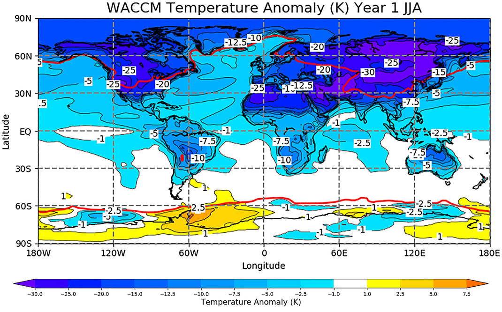
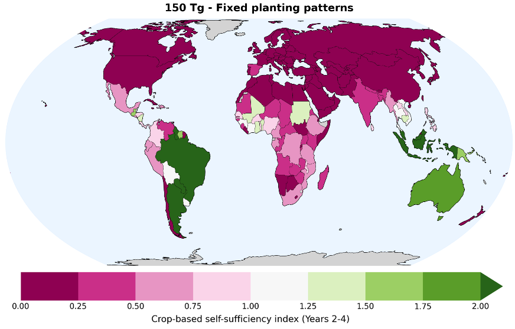
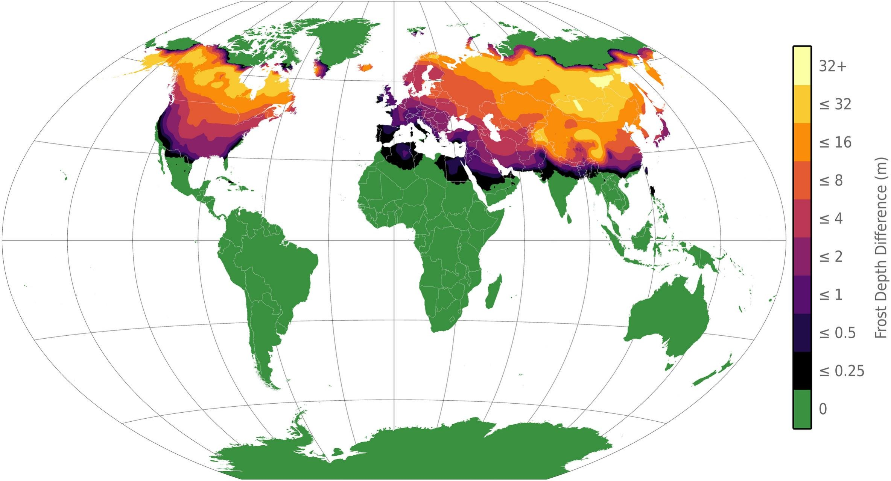
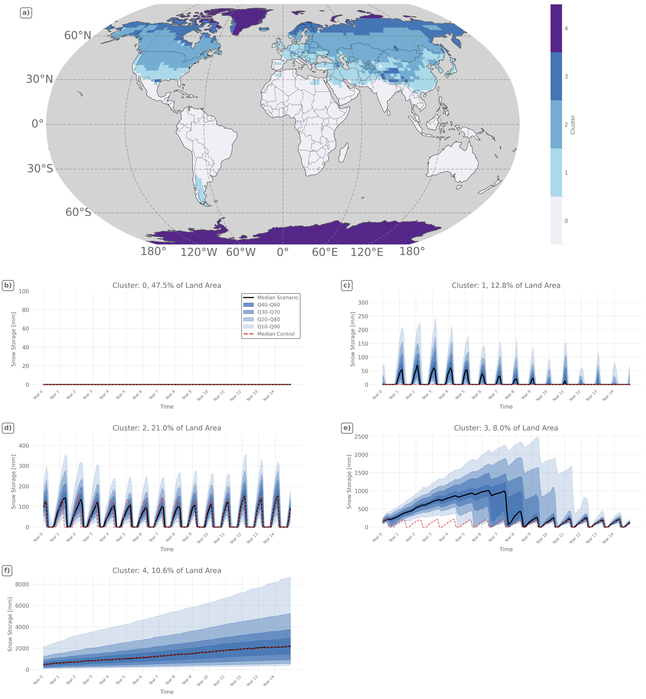

Wenn es zu einem nuklearen Winter käme, würde der Norden der Welt für ein Jahrzehnt sehr frostig werden. Ein nuklearer Winter wirkt sich aber nicht überall gleich aus. Grundsätzlich gilt: Je weiter man vom Äquator entfernt ist, desto schlimmer wird es, und die Nordhalbkugel kommt schlechter weg, weil sie mehr Landfläche hat, die schneller abkühlt. Das heißt, jeder nukleare Winter trifft die nördlichsten Länder der Nordhalbkugel am härtesten. Konkret würden Russland, Kanada, Island, Finnland, Norwegen und Schweden wahrscheinlich eine besonders schlimme Zeit haben. Bis auf Russland haben diese Länder nicht einmal Atomwaffen. In diesem Beitrag will ich einen Überblick geben, wie sich das auf Temperatur, Ernährung, Wasser, Frost und Schnee auswirken würde.

# Temperatur

Die offensichtlichste Folge eines nuklearen Winters ist, dass weniger Sonnenlicht die Erdoberfläche erreicht. Da das die Energie im System begrenzt, fallen die Temperaturen entsprechend. Die Standardstudie, um das besser zu verstehen, ist Coupe et al. (2019). Sie haben mit einem vollwertigen Klimamodell simuliert, wie sich ein großer Atomkrieg auf die globalen Temperaturen auswirken würde (Abbildung 1).

Abbildung 1: Temperaturanomalie im zweiten Sommer nach einem Atomkrieg mit 150 Tg (Juni bis August, Jahr 1), simuliert mit WACCM4 (Coupe et al., 2019). Rote Linie: Überall polwärts davon liegt die mittlere Sommertemperatur unter 0 °C.

Dieses Modell zeigt, dass die Sommertemperaturen im zweiten Jahr des nuklearen Winters massiv fallen würden. Russland wäre 25 bis 30 °C kälter als normal, Kanada etwa 25 °C, Skandinavien etwa 20 °C und Island etwa 12,5 °C. In all diesen Ländern lägen die Temperaturen unter dem Gefrierpunkt, selbst mitten im Sommer. Dieser Lauf geht zwar von einem totalen Atomkrieg aus, aber auch nach kleineren nuklearen Schlagabtauschen sind die Folgen schlimm.

Der Frost im Sommer ist ein besonders großes Problem. Ein einziger Frost in der Wachstumsperiode kann die ganze Ernte vernichten. Selbst in den Gegenden, die im Schnitt über 0 °C liegen, gäbe es also wahrscheinlich Sommerfröste, die jede konventionelle Landwirtschaft unmöglich machen würden.

# Ernährung

Diese Temperaturänderung hat ziemlich schwere Folgen für die Pflanzenproduktion. Blouin et al. (2025) haben das für eine Reihe von Nutzpflanzen im Pflanzenmodell MINK modelliert. Sie haben dabei zwei Fälle angenommen: Entweder passen sich die Landwirte nicht an und versuchen weiter anzubauen, was sie schon immer angebaut haben, oder sie wechseln zu den Pflanzen, die unter den kälteren Bedingungen am besten wachsen (Abbildung 2).

Abbildung 2: Selbstversorgung mit Nutzpflanzen nach Land, gemittelt über die Jahre 2 bis 4, mit und ohne Verlagerung der Pflanzen (Blouin et al., 2025). 1,0 heißt genug Kalorien aus Nutzpflanzen, um 2.300 kcal pro Person und Tag bereitzustellen.

Das funktioniert, vor allem bei den weniger schweren nuklearen Wintern. Bei einem Atomkrieg mit 16 Tg könnte diese Maßnahme allein die Produktionsverluste ausgleichen. In den extremsten Szenarien kommt sie aber an ihre Grenzen. In einem großen Teil der Nordhalbkugel wird es einfach zu kalt, egal welche Pflanze man nehmen will. Es gibt schlicht keine Nutzpflanze, die in einer Umgebung wachsen und Ertrag bringen könnte, in der die Temperatur im Sommer unter 0 °C bleibt. Je weiter nach Norden man kommt, desto schlimmer wird es, denn dort werden bereits die kältetolerantesten Pflanzen angebaut. Diese Gegenden betreiben Landwirtschaft schon ganz am Rand des Möglichen. Es gibt keine noch kältetoleranteren Pflanzen, zu denen sie wechseln könnten.

Das alles bedeutet, dass diese nördlichen Länder den Großteil ihrer lokalen Lebensmittelproduktion verlieren würden.

# Wasserleitungen

Aber damit hören die Probleme nicht auf. Selbst noch dringendere Bedürfnisse würden nicht mehr gedeckt. Durch einen nuklearen Winter ändert sich die Frosttiefe. Der Boden friert dort tiefer, wo es schon Frost gibt, und er friert auch weiter im Süden, wo es heute keinen Frost gibt. Ein Paper, das sich das angeschaut hat, ist von Lamilla Cuellar et al. (2026). Sie haben die Klimadaten von Coupe et al. (2019) für das 150-Tg-Szenario genommen, um zu untersuchen, wie sich das auf die Trinkwasserinfrastruktur auswirken würde. Zuerst haben sie sich die Änderungen der Frosttiefe angeschaut (Abbildung 3).

Abbildung 3: Änderungen der Frosttiefe während eines nuklearen Winters (150 Tg) im Vergleich zum Normalzustand.

Das zeigt, dass die meisten städtischen Gebiete nördlich des 25. Breitengrads von einer größeren Frosttiefe betroffen wären. Das ist ungefähr die Linie, die mitten durch Indien, Mexiko und Saudi-Arabien verläuft. Unterirdische Wasserinfrastruktur liegt normalerweise tiefer als die übliche Frosttiefe einer Region. So muss man die Rohre nicht groß isolieren. Wenn die Frosttiefe aber steigt, fängt die ungeschützte Wasserinfrastruktur plötzlich an zu frieren, was schnell zur Zerstörung führen kann. Man kann zwar gegensteuern, indem man sie besser isoliert, z. B. indem man mehr Erde darüber schüttet, aber das ist ziemlich arbeitsintensiv und müsste in riesigem Umfang passieren. Betroffen wären etwa 5 bis 9 Millionen km Rohrleitungen in 92 Ländern, die rund 2,1 Milliarden Menschen versorgen. Finnland und Island haben von allen Ländern die meisten gefährdeten Rohre pro Person, Norwegen folgt dicht dahinter.

# Schnee

Die Frosttiefe ist aber nicht das Einzige, was zunimmt. Auch die Schneedecke wächst, weil mehr Niederschlag als Schnee fällt und es wegen der niedrigeren Temperaturen länger dauert, bis er schmilzt. Wöstenberg und Jehn (2026) haben diese Schneedynamik modelliert, um zu verstehen, wo sie die Dinge verändern würde (Abbildung 4).

Abbildung 4: Regime der Schneeakkumulation während eines nuklearen Winters (47 Tg).

Das zeigt eine ziemlich deutliche Veränderung darin, wie sich Schnee weltweit ansammelt. Es ergeben sich drei regionale Muster: neue saisonale Schneedecken, längere Schneesaisons und eine Akkumulation über mehrere Jahre in hohen Breiten. Im Norden Russlands, in Skandinavien und in Kanada hört der Schnee ganz auf zu schmelzen. Etwa sechs Jahre lang sammelt er sich einfach an und erreicht im Median rund 1.000 mm Wasseräquivalent. Das sind ungefähr 2,5 bis 3,3 m gesetzter Schnee und an den schneereichsten Orten 6 bis 8 m.

All das hätte Folgen für die Infrastruktur und für menschliche Gesellschaften allgemein, weil es Dinge wie die Schneelast auf Gebäuden, verschüttete Straßen und Bahnstrecken, das Abflussverhalten von Flüssen oder das Auffüllen von Trinkwasserspeichern verändert. Wenn die Schneedecken plötzlich schmelzen, sobald das Klima wieder normal wird, könnte das zu beispiellosen Überschwemmungen führen. Die könnten auch Gegenden treffen, die keine großen Hochwasser durch Schneeschmelze gewohnt sind.

# Fazit

All diese Dinge würden gleichzeitig passieren, und das in einer Zeit, in der ohnehin alles durcheinander ist. Gleichzeitig würde der Heizbedarf in die Höhe schießen. Norwegen bekommt fast seinen ganzen Strom aus Wasserkraft und Schweden und Kanada einen großen Teil, also könnten Schneedecken, die das Wasser festhalten, und zugefrorene Einläufe ihre Stromversorgung treffen.

Die meisten Menschen in diesen Gegenden wären wahrscheinlich jahrelang ohne Essen, Wasser, Heizung und Strom. Der Großteil der hier gezeigten Forschung hat sich ziemlich schwere Szenarien angeschaut. Die direkte Zerstörung durch den Atomkrieg selbst ist darin aber noch nicht einmal berücksichtigt. Wenn man die mit einrechnet, wird es noch viel schlimmer. Trotzdem könnte ein nuklearer Winter auch dadurch entstehen, dass andere Länder einen Atomkrieg austragen, zum Beispiel Pakistan und Indien.

Ich finde es ziemlich wichtig, sich klarzumachen, dass Atomkriege auch Menschen weit weg von den Einschlägen treffen können. Die Menschen in den nördlichsten Ländern sollten das am meisten bedenken, denn sie wären selbst von kleineren nuklearen Schlagabtauschen weit weg hart getroffen. Wahrscheinlich haben sie sogar den nötigen Hebel dafür. Die meisten dieser Länder sind in der NATO, was ihnen einen Hebel gibt, die nukleare Haltung der USA zu beeinflussen.

# Quellen

* Blouin, S., Rivers, M., Hinge, M., Antonietta, M., Jimenez, I., Jehn, F. U., & Denkenberger, D. (2025). Strategic crop relocation could substantially mitigate nuclear winter yield losses. EarthArXiv. https://eartharxiv.org/repository/view/10178/
* Coupe, J., Bardeen, C. G., Robock, A., & Toon, O. B. (2019). Nuclear Winter Responses to Nuclear War Between the United States and Russia in the Whole Atmosphere Community Climate Model Version 4 and the Goddard Institute for Space Studies ModelE. Journal of Geophysical Research: Atmospheres, 124(15), 8522–8543. https://doi.org/10.1029/2019JD030509
* Lamilla Cuellar, J. E., Palm, R., Denkenberger, D. C., & Jehn, F. U. (2026). Frost depth increase under a nuclear winter scenario projected to sever piped-water access in the Northern Hemisphere. Water Security, 27, 100193. https://doi.org/10.1016/j.wasec.2025.100193
* Wöstenberg, E., & Jehn, F. U. (2026). Snow Accumulation Regimes During Nuclear Winter. ESS Open Archive. https://doi.org/10.22541/essoar.15011611/v1
