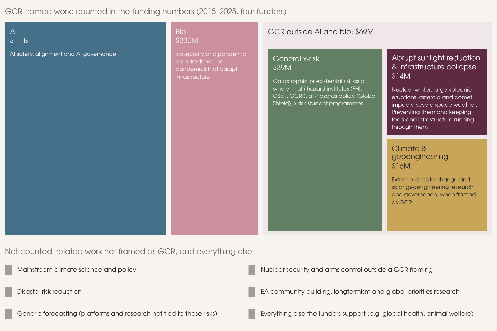
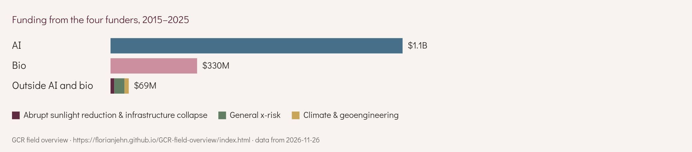
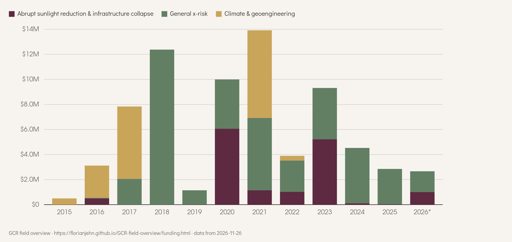
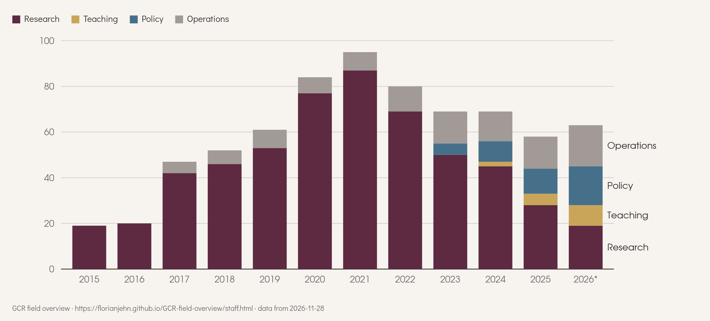
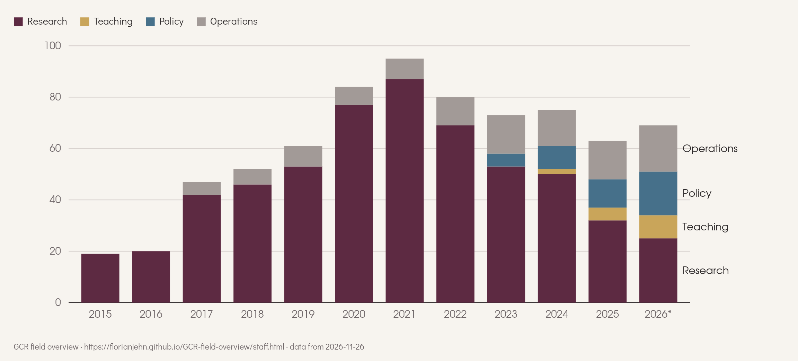

Ich mache mir Sorgen um das Forschungsfeld der globalen Katastrophenrisiken (Global Catastrophic Risk, GCR). Seit ungefähr fünf Jahren verbringe ich einen Großteil meiner Zeit mit Forschung, Lehre und Advocacy rund um GCR. Ich mache das, weil ich es wichtig finde, dass wir uns auf Dinge wie geomagnetische Stürme, große Vulkanausbrüche und Atomkrieg vorbereiten. Ich fürchte nämlich, dass mindestens eine globale Katastrophe noch zu meinen Lebzeiten passieren wird, und es wäre mir sehr lieb, wenn die Menschheit dann darauf vorbereitet wäre. Aber es sieht so aus, als würde diese Art von GCR-Forschung von der GCR-Arbeit zu KI und Bio an den Rand gedrängt. In den Jahren, in denen ich dabei bin, scheint alles außerhalb von KI und Bio im Niedergang zu sein. Seit 2021 habe ich immer wieder gesehen:
* Kolleg*innen wenden sich anderen Dingen zu, weil sie niemanden finden, der sie für diese Arbeit bezahlt.
* Etablierte Institutionen schließen, und kaum neue springen in die Lücke.
* Alle haben Mühe, genug Geld aufzutreiben, um den Laden am Laufen zu halten.
* Die Organisationen, die übrig bleiben, scheinen jedes Jahr kleiner zu werden.

Aber stimmt das wirklich, oder rede ich einfach mit den falschen Leuten? Ich wollte mir das schon länger anschauen, aber es kam mir immer wie zu viel Arbeit vor, die ganzen unordentlichen Daten zusammenzutragen. Claude macht das aber gerne alles für mich, und so habe ich jetzt einen zusammengefassten Überblick über den Zustand des Feldes, basierend auf Förderung (von Coefficient Giving, dem Long Term Future Fund, dem Survival and Flourishing Fund und dem Future of Life Institute als den Hauptgeldgebern) und Personalzahlen (basierend auf Schnappschüssen von Team-Seiten aus der Wayback Machine). Eine interaktive Version findest du [hier](https://florianjehn.github.io/GCR-field-overview/index.html).
 
Insgesamt scheint mein Eindruck tragischerweise zu stimmen. 69 Millionen Dollar für ein ganzes Forschungsfeld über 10 Jahre sind nicht viel. Die Personalzahlen erreichten 2021 ihren Höhepunkt und gehen seitdem zurück. Die Schließung des Future of Humanity Institute hat zu einem deutlichen Rückgang der Zahl der Menschen geführt, die an diesen Themen arbeiten. Nur etwa 25 Personen betreiben in expliziten GCR-Organisationen GCR-Forschung außerhalb von KI und Bio. Gleichzeitig werden Atomwaffenarsenale ausgebaut, die ständige Bedrohung durch geomagnetische Stürme und Vulkane lauert im Hintergrund, und der Klimawandel liegt inzwischen über 1,5 °C. Diese Risiken werden also entweder schlimmer oder bleiben gleich. Wir brauchen diese Forschung.

# Was zähle ich zur GCR-Forschung?
Wenn ich von GCR spreche, meine ich die Arbeit zu solchen Ereignissen, die das Potenzial haben, 10 % oder mehr der Weltbevölkerung zu töten. Die Gefahren, die hier oft beschrieben werden, sind KI, Bio (meist Pandemien), Atomwaffen, Vulkane, geomagnetische Stürme und extremer Klimawandel, aber es gibt eine lange Liste weiterer möglicher GCR-Ursachen, von Asteroiden über Nanotechnologie bis zu einer nahen Supernova (Abbildung 1). Nicht dazu zählen Dinge wie die etablierte Klimaforschung, nukleare Sicherheit, Forecasting usw., da diese meist nicht aus einer GCR-Perspektive betrieben werden. Klimaforschung, die nicht aus der GCR-Ecke kommt, beschäftigt sich zum Beispiel selten mit Szenarien stärkerer Erwärmung.

Die sauberste Trennung dieser Gefahren verläuft zwischen KI + Bio und dem Rest. KI und Bio haben deutlich mehr Aufmerksamkeit und Geld bekommen als der Rest. Sie standen am Anfang des GCR-Feldes im Mittelpunkt, aber ich würde sagen, dass sie inzwischen größtenteils aus dem GCR-Feld herausgewachsen und eigenständige Forschungsfelder geworden sind. Außerdem überschneiden sich KI und Bio oft, weil befürchtet wird, dass KI Biotechnologie nutzen könnte, um die Menschheit anzugreifen.

In der GCR-Forschung außerhalb von KI + Bio bin ich am stärksten mit dem Forschungsstrang verbunden, der sich mit abrupten Sonnenverdunkelungsszenarien und dem Zusammenbruch von Infrastruktur beschäftigt. Vieles davon dreht sich um die Frage, wie man Gesellschaften widerstandsfähiger gegen solche Szenarien machen kann. Ich halte diesen Forschungsstrang für wichtig und ziemlich vernachlässigt, deshalb behandle ich ihn in der folgenden Analyse gesondert. Ich glaube sogar, dass er ziemlich wichtig ist, wenn deine Hauptsorge KI ist, denn KI allein kann dich nicht töten. Sie braucht einen Vektor, und viele der wahrscheinlichen Vektoren laufen über das Ernährungssystem und die Infrastruktur, weil das ziemlich verwundbare Stellen der Menschheit sind. Die Organisation, die am direktesten daran arbeitet, ist die Alliance to Feed the Earth in Disasters (ALLFED), aber auch andere wie das Centre for the Study of Existential Risk (CSER) oder das Global Catastrophic Risk Institute (GCRI) haben hier wichtige Arbeit geleistet. Es bleibt viel zu tun, vor allem bei der Frage, wie man das stärker in die breite Diskussion bringt und wie man Maßnahmen tatsächlich umsetzt. Aber die Frage, die mich in letzter Zeit sehr beschäftigt, ist: Wird überhaupt noch jemand da sein, der daran arbeitet?

Abbildung 1: Überblick, was die verschiedenen Begriffe umfassen und was sie ausschließen.

# Disclaimer

Ich habe zwar versucht, das genau zu machen, aber ich habe nicht alles bis ins letzte Detail geprüft, da ich nur einen groben Eindruck davon bekommen wollte, wohin sich das Feld bewegt. Viele der Kategorien und Entscheidungen hätte jemand anderes anders treffen können, was die Zahlen verändern würde. Ich wäre aber sehr überrascht, wenn das Gesamtbild nicht in die richtige Richtung zeigt, denn es deckt sich klar mit meinem eigenen Eindruck und dem anderer, wie es um das Feld steht. Während der Arbeit daran habe ich Abgrenzungen, Institutionen und die Zuordnung von Fördergeldern regelmäßig geändert, aufgrund von Feedback anderer und eigener Ideen. Keine dieser Änderungen hat das Gesamtbild nennenswert verschoben. Allerdings war ich vermutlich eher vorsichtig dabei, Dinge als direkt GCR-relevant einzustufen. Außerdem unterschätzt das die Gesamtfördersumme, die das Feld erhalten hat, da nichts außerhalb dieser vier großen Geldgeber gezählt wird.

# Was sagen die Zahlen?

GCR außerhalb von KI und Bio hatte seinen Höhepunkt um 2021 und ist seitdem im Niedergang (1). Außerdem wird ziemlich deutlich, dass GCR außerhalb von KI und Bio im Vergleich zu KI und Bio immer nur einen winzigen Geldbetrag bekommen hat (Abbildung 2).

Abbildung 2: Vergleich der Gesamtförderung 2015–2025 für KI, Bio und GCR außerhalb von KI und Bio.

Wir können uns auch ansehen, wie sich das über die Zeit entwickelt hat (Abbildung 3). Der Trend scheint nach unten zu zeigen, mit sehr wenig Geld in diesem und den beiden vorherigen Jahren. Das scheint vor allem daran zu liegen, dass Coefficient Giving seine Ausgaben in diesem Bereich Jahr für Jahr verringert, während der Survival and Flourishing Fund einen Teil der Lücke füllt (hauptsächlich durch die Förderung von ALLFED). Wenn wir uns nur die Arbeit zu abrupten Sonnenverdunkelungsszenarien und dem Zusammenbruch von Infrastruktur anschauen, gibt es zwei große Förderereignisse. 2020 hat Coefficient Giving Arbeit zum nuklearen Winter gefördert, und 2023 hat das FLI dasselbe getan. Abgesehen von diesen beiden ist da nicht viel. Dasselbe gilt für Klima/Geoengineering, das von zwei großen Förderrunden dominiert wird.

Abbildung 3: Förderung für GCR außerhalb von KI und Bio über die Zeit.

Bei der Förderung steckt GCR außerhalb von KI und Bio also offenbar in einer ernsten Notlage (2). Von vornherein wenig Geld, und es versiegt jedes Jahr mehr. Aber wie sieht es damit aus, wie viele Menschen daran arbeiten? Vielleicht haben alle GCR-Organisationen außerhalb von KI und Bio andere Wege gefunden, an mehr Geld zu kommen? Leider lautet die Antwort: nein. Die Personalzahlen erreichten 2021 ihren Höhepunkt und gehen seitdem zurück (oder stagnieren zumindest in den letzten Jahren) (Abbildung 4).

Abbildung 4: Personalstand der wichtigsten GCR- oder Multi-Hazard-Organisationen außerhalb von KI und Bio. Diese Liste ist meine subjektive Auswahl derer, die ich für relevant halte, also nimm sie mit Vorsicht.

Heute sind nur noch zwei große Forschungsorganisationen übrig: CSER und ALLFED. Da CSER inzwischen einen starken Schwerpunkt auf Lehre hat und viele seiner bekanntesten GCR-Forschenden verloren hat, könnte man sogar sagen, dass ALLFED die letzte verbliebene große GCR-Forschungsorganisation außerhalb von KI und Bio ist. Insgesamt ist die Zahl der Forschenden besonders stark zurückgegangen und liegt jetzt wieder auf einem Niveau, das mit 2016 vergleichbar ist (Abbildung 5).

Abbildung 5: Personalstand nach Hauptschwerpunkt in den wichtigsten GCR- oder Multi-Hazard-Organisationen außerhalb von KI und Bio. Diese Liste ist meine subjektive Auswahl derer, die ich für relevant halte, also nimm sie mit Vorsicht. Außerdem stammen die Rollenbeschreibungen teils aus dem, was ich darüber weiß, was die Leute tatsächlich machen, und teils aus den Beschreibungen auf den Websites. Es könnte in der Vergangenheit mehr Leute in Policy und Lehre gegeben haben, die ich nicht erfasst habe oder von denen ich nichts weiß.

Das einzig Positive, das ich hier sagen kann, ist, dass offenbar mehr Menschen in Lehre und Policy arbeiten. Bei der Lehre ist allerdings unklar, wohin die Studierenden mit ihrer neu gewonnenen Expertise gehen sollen, wenn es keine Institutionen gibt, die diese Arbeit machen (3). Bei Policy gab es dagegen einige größere Erfolge. Der US Global Catastrophic Risk Management Act führte zur Bewertung durch RAND, und der Zukunftspakt der UN erwähnt existenzielle Risiken ausdrücklich. Vielleicht legen wir also gerade das Fundament für einen künftigen Ausbau des Feldes? Wir werden sehen.

# Fazit

Zusammengefasst:
* Nur etwa 25 Personen betreiben in expliziten GCR-Organisationen GCR-Forschung außerhalb von KI und Bio aus einer GCR-Perspektive (4).
* Der Höhepunkt der GCR-Arbeit außerhalb von KI und Bio lag im Jahr 2021.
* Die GCR-Arbeit außerhalb von KI und Bio bekommt sehr wenig Geld, während die Förderung für KI und Bio gleichzeitig stark steigt.
* Bei Lehre und Policy rund um GCR scheint es aufwärts zu gehen.

Das ist ein Feld im Niedergang, aber ich hoffe, dass sich das ändert. Ich kann eine Welt, in der diese Art von Forschung nicht gemacht wird, einfach nicht akzeptieren. Sie ist schlicht zu wichtig. Einen Großteil meiner eigenen Forschung der letzten Jahre habe ich in meiner Freizeit gemacht, während mein Geld aus anderen Jobs kommt. Ich habe gesehen, dass andere das genauso machen, aber langfristig ist das nicht tragbar. Vielleicht ändert die große Menge an Fördergeld von Anthropic das Bild wieder, denn schon 3 Millionen Dollar pro Jahr zusätzlich würden die philanthropische Förderung des Feldes mehr als verdoppeln, aber das glaube ich erst, wenn ich es sehe.

Insgesamt finde ich das alles von diesen großen Geldgebern ziemlich enttäuschend. Sie alle beschreiben sich so, als würden sie den Ideen von Lösbarkeit, Vernachlässigung und Ausmaß oder ähnlichen Denkweisen folgen. Wie kann das nicht wenigstens etwas Geld für GCR-Forschung außerhalb von KI und Bio einschließen? Zumal nur ein paar Brotkrumen des KI-Geldes nötig wären, um das Feld auf Jahre zu erhalten. Große Förderungen gehen an Dinge wie KI-Journalismus oder Sommerprogramme für Studierende. Ist das wirklich wichtiger als das gesamte GCR-Forschungsfeld außerhalb von KI und Bio?

Ich verstehe, dass KI diesen Geldgebern als die einzige Gefahr erscheinen mag, die zum Aussterben führen könnte, und dass sich das Feld gerade sehr schnell bewegt. Aber wie oben erwähnt, braucht KI immer noch einen Vektor. Selbst wenn dir nur KI wichtig ist, sollte also auch etwas Geld in Dinge fließen wie das Verständnis der Folgen eines Atomkriegs oder großflächiger Infrastrukturausfälle. Außerdem besteht immer die Möglichkeit eines großen Vulkanausbruchs, eines geomagnetischen Sturms oder eines Atomkriegs, noch bevor KI womöglich die Kontrolle übernimmt. Es gibt viele Szenarien und Möglichkeiten, in denen GCR-Forschung sehr wertvoll bleibt.

Ich finde auch, dass der Zeitpunkt einfach miserabel ist. Wir leben eindeutig in einer Welt, die geopolitisch instabiler wird, Atomwaffenarsenale werden größer, gleichzeitig macht sich der Klimawandel richtig bemerkbar, und es besteht immer die Möglichkeit eines großen geomagnetischen Sturms oder eines großen Vulkanausbruchs. Diese Arbeit wird gebraucht und ist wichtig. Sie nicht zu machen, wäre ein schwerer moralischer Fehler.

# Anmerkungen

(1) Es sieht also so aus, als wäre ich genau zum Höchststand dazugekommen, und dann haben alle angefangen zu gehen. Ich hoffe, ihr seid nicht meinetwegen gegangen?

(2) Ich bin nicht die erste Person, die so argumentiert. Siehe zum Beispiel auch [hier](https://forum.effectivealtruism.org/posts/vhw6R5P52qJr6opou/sff-2025-funding-by-cause-area-usd34-million-to-ai-86-bio-7), [hier](https://forum.effectivealtruism.org/posts/NWHb4nsnXRxDDFGLy/historical-ea-funding-data-2025-update#ovShzjgj3d3kHQJ4L) und [hier](https://forum.effectivealtruism.org/posts/YDjH6ACPZq889tqeJ/updates-on-the-ea-catastrophic-risk-landscape).

(3) Wobei es natürlich auch ziemlich gut ist, wenn Menschen mit GCR-Expertise am Ende in etablierteren Organisationen arbeiten.

(4) Das ist natürlich höchst unsicher, und es ist auch nicht die Zahl der Menschen, die für GCR relevante Forschung betreiben. Es gibt zum Beispiel sehr, sehr viel mehr Menschen, die zu nuklearen Themen arbeiten.
