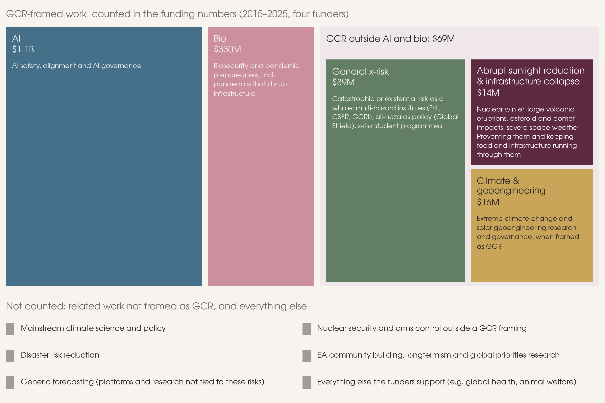
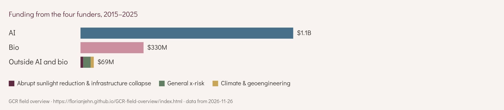
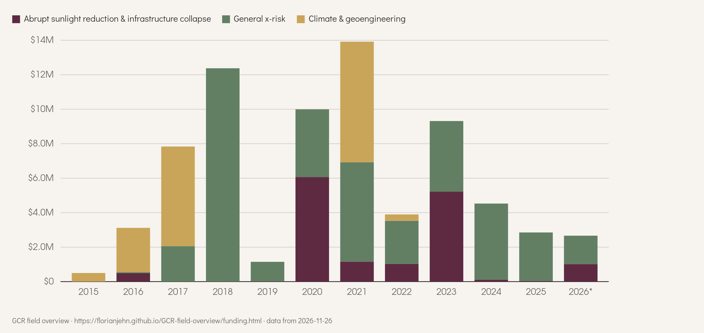
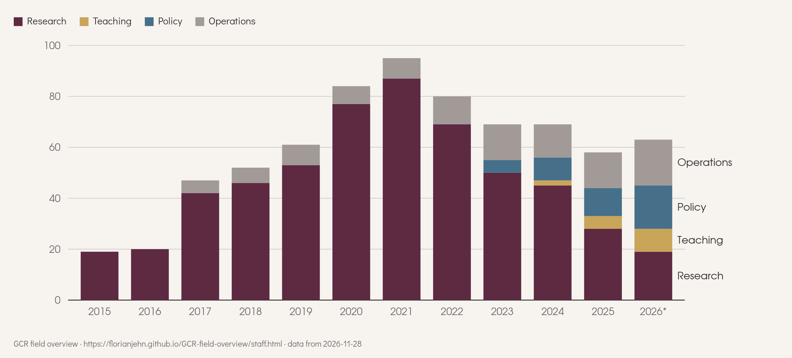
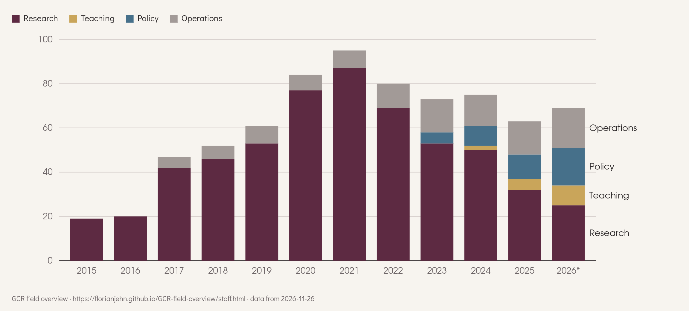

I am concerned about the field of global catastrophic risk (GCR) research. For roughly five years now I have spent much of my time doing research, teaching and advocacy around GCR. I do this because I think it is important that we prepare for things like geomagnetic storms, large volcanic eruptions and nuclear war, because I fear that at least one global catastrophe will happen in my lifetime and I would very much prefer if humanity would be prepared for it. But it seems that these kinds of GCR research are getting pushed to the side by GCR work on AI and bio. Over the years I have been involved in this, everything outside of AI and bio seems to be in decline. Since 2021 I’ve repeatedly seen:
* Colleagues move on to other things, because they cannot find anyone to pay them to work on this.
* Established institutions close down and few new ones step up to fill the gap.
* Everybody is hard pressed for funding to keep the lights on.
* The organisations that remain seem to get smaller every year.

But is this actually true or am I just talking to the wrong people? I wanted to look into this for a while, but it always seemed like too much work to aggregate all the messy data. However, Claude is happy to do that all for me, and so I now have an aggregated state of the field based on funding (from Coefficient Giving, the Long Term Future Fund, Survival and Flourishing Fund and Future of Life Institute as the main funders) and staff numbers (based on snap shots of team pages from the Wayback Machine). You can find an interactive version [here](https://florianjehn.github.io/GCR-field-overview/index.html). 
 
Generally, my impression seems to be tragically accurate. 69 million dollars for a whole research field over 10 years ain't much. Staffing levels hit their peak in 2021 and have been declining since then. The closure of the Future of Humanity Institute led to a significant decline in the number of people working on these topics. Only around 20 people do GCR research outside AI and bio in explicit GCR orgs. All the while nuclear arsenals are extended, the constant threat of geomagnetic storms and volcanoes lurks in the background and climate change is now beyond 1.5°C. So, these risks are either getting worse or staying constant. We need this research. 

# What do I see as GCR research?
When I say GCR for me this includes the work on those kinds of events that have the potential to kill 10 % or more of the global population. The hazards that are described often here are AI, bio (mostly pandemics), nuclear, volcanoes, geomagnetic storms and extreme climate change, but there is a long list of other potential GCR causes reaching from asteroids to nanotech to a nearby supernova (Figure 1). This excludes things like mainstream climate science, nuclear security, forecasting etc, as it all is usually not conducted from a GCR perspective. For example, non GCR climate research rarely concerns itself with higher-warming scenarios. 

The cleanest split for these hazards is between AI + bio and the rest. AI and bio have gotten considerably more attention and money than the rest. They were central at the start of the GCR field, but I would argue that by now they have mostly graduated from being part of the GCR field and are their own independent research fields. Also, AI and bio often overlap, due to concerns that AI will use biotechnology to attack humanity.

In the non AI + bio GCR research I am most connected to the line of research that is concerned with abrupt sunlight reduction scenarios and infrastructure collapse. A lot of this revolves around questions on how to make societies more resilient to those scenarios. I think this line of research is both important and quite neglected, so I treat it separately in the following analysis. I think it is even quite important if your main concern is AI, as AI on its own cannot kill you. It needs a vector and many likely ones act via the food system and infrastructure, as those are quite vulnerable spots of humanity. The organisation that works on this most directly is the Alliance to Feed the Earth in Disasters (ALLFED), but others like the Centre for the Study of Existential Risk (CSER) or the Global Catastrophic Risk Institute (GCRI) have done important work here as well. Much work remains to be done, especially in figuring out how to bring this more into mainstream discussions and how to actually implement interventions. But the question that has been a lot on my mind lately is: Will anybody actually be around to work on this?

Figure 1: Overview of what the different terms encompass and what they exclude. 

# Disclaimer

While I tried to make this accurate, I did not check everything super deep, as I just wanted to get a rough impression of where the field is going. Many of the categories and decisions could have been made differently by somebody else, with changes on what the numbers are, but I would be very surprised if the overall picture is not directionally correct, as it also clearly tracks with my own impression and that of others when it comes to how the field is doing. While working on this I changed scopes, institutions and fund allocation regularly on feedback from others and ideas I had myself. None of those changes meaningfully shifted the overall picture. Though, I was probably more on the conservative side when it comes to classifying things as directly GCR relevant. Also, this underestimates the amount of funding the field has received in total, as it does not count anything outside of those four big funders. 

# What do the numbers say? 

GCR outside AI and bio had its peak around 2021 and has been in decline ever since (1). Also, it becomes pretty obvious that GCR outside AI and bio only ever got an absolutely tiny amount of money in comparison with AI and bio (Figure 2). 

Figure 2: Comparison of overall funding 2015-2025 for AI, bio and GCR funding outside AI and bio.

We can also check how this developed over time (Figure 3). The trend seems to be pointing downward, with very little money flowing this year and the previous two years. This mostly seems to come from Coefficient Giving decreasing its spending in this area year by year, with the Survival and Flourishing Fund filling some of the gap (mainly by funding ALLFED). If we only look into the work around abrupt sunlight reduction scenarios and infrastructure collapse, there are two major funding events. In 2020 Coefficient Giving funded nuclear winter work and in 2023 FLI did the same. Outside of these two, there ain’t much. Same goes for climate/geoengineering, which is dominated by two big funding rounds. 

Figure 3: Funding to GCR outside of AI and bio over time. 

So, it seems when it comes to funding GCR outside of AI and bio is in dire straits (2). Little money to begin with and drying up more each year. But, how is the picture when it comes to how many people work on this? Maybe all the GCR orgs outside AI and bio have found other ways to get more money? Unfortunately, the answer is: no. Staffing levels hit their peak in 2021 and have been declining since then (or at least stagnating the last few years) (Figure 4). 

Figure 4: Staffing levels at the main GCR or multi hazard organisations outside of AI and bio. This list is my subjective choice of who I see as relevant, so treat it with a grain of salt. 

Today only two major research organisations are left: CSER and ALLFED. As CSER now has a heavy teaching focus and has lost many of its most well known GCR scholars, you could even say that ALLFED is the last remaining major GCR research org outside AI and bio. Generally, the amount of researchers has declined especially steeply and is now on a level again comparable to 2016 (Figure 5). 

Figure 5: Staffing levels by their main focus in the main GCR or multi hazard organisations outside AI and bio. This list is my subjective choice of who I see as relevant, so treat it with a grain of salt. Also, the role descriptions are partly from what I know people are actually doing and partly from the website descriptions. There might be more policy and teaching people in the past that I did not pick up or do not know about. 

The only positive thing I can say here is that there seems to be an increase in people working on teaching and policy. For teaching it is unclear though where students would go to with their newly won expertise if there are no institutions to do this work (3). Though, there have been some bigger successes when it comes to policy. The US Global Catastrophic Risk Management Act resulted in RAND's assessment, while the UN's Pact for the Future explicitly mentions existential risks. So, maybe we are currently building the foundation for a future expansion of the field? We will see. 

# Conclusion

To sum this up:
* Only around 20 people do GCR outside AI and bio research from a GCR angle in explicit GCR orgs (4).
* The peak of GCR work outside AI and bio was in 2021. 
* The GCR work outside AI and bio receives very little money, while at the same time the funding for AI and bio is surging. 
* There seems to be an uptick in teaching and policy work around GCR.

This is a field in decline, but I hope this will change. I just cannot accept a world in which this kind of research does not get done. It is just too important. Much of my own research of the last few years has been on my own time, while my money comes from other gigs. I have seen others do the same, but this is not sustainable long term. Maybe the large amount of funding coming from Anthropic will change the picture again, as simply adding 3 million dollars a year to the field would more than double its philanthropic funding, but I’ll believe it when I see it. 

Generally, I find this all quite disappointing from these major funders. They all describe themselves as following ideas of tractability, neglectedness and scale or similar ways of thinking. How can this not include at least some money to GCR research outside of AI and bio? Especially, as just a few bread crumbs of AI money would be needed to maintain the field for ages. Major grants get made to things like AI journalism or summer programs for students. Is this really more important than the whole GCR research field outside of AI and bio? 

I get that for these funders AI might seem as the only hazard that could cause extinction and that the field is moving very fast right now, but as mentioned above, AI still needs a vector. So, even if all you care about is AI, some money should also go to things like understanding the impacts of nuclear war or large scale infrastructure disruption. Also, there is always the chance of a major volcanic eruption, geomagnetic storm or nuclear war even before AI might take over. There are many scenarios and possibilities where GCR research remains highly valuable.

I also think that the timing is just abysmal. We are clearly in a world that is getting more unstable when it comes to geopolitics, nuclear arsenals are getting bigger, at the same time climate change is really starting to bite and there is always a chance of a large geomagnetic storm or a major volcano erupting. This work is needed and important. Not doing it would be a grave moral error. 

# Endnotes

(1) So, it seems I joined at the high water mark and then everybody started to leave, hope y’all did not go because of me?

(2) I am not the first person to make arguments like this. For example, see also [here](https://forum.effectivealtruism.org/posts/vhw6R5P52qJr6opou/sff-2025-funding-by-cause-area-usd34-million-to-ai-86-bio-7), [here](https://forum.effectivealtruism.org/posts/NWHb4nsnXRxDDFGLy/historical-ea-funding-data-2025-update#ovShzjgj3d3kHQJ4L) and [here](https://forum.effectivealtruism.org/posts/YDjH6ACPZq889tqeJ/updates-on-the-ea-catastrophic-risk-landscape). 

(3) Though of course it is also quite good if people with GCR expertise end up working in more mainstream organisations.

(4) Obviously, this is highly uncertain, depends a lot on what orgs you count and it is also not the number of people that do research relevant to GCR, there are many many more people working on nuclear issues for example. 

